> [!important] 本篇目标
> 承接第一章给出的整体地图，本篇深入**虚拟化 CPU** 这条主线：先建立**进程**这一抽象与它的 API（OSTEP 第 4、5 章），再回答"如何既高效又不失控地运行用户程序"这一**机制**问题（第 6 章），最后转入**策略**问题——在各种调度算法之间做权衡（第 7~10 章）。
>
> CSAPP 第八章已从"使用者"视角讲清进程、系统调用、上下文切换与信号（8.4~8.10、8.12），这些内容本篇只作概括，把篇幅留给 CSAPP 未涉及的部分：受限直接执行的机制，以及调度策略。

---

# 第一部分 进程：抽象与 API

## 2.1 关键问题：如何制造"许多个 CPU"

第一章演示过一个现象：虽然机器上只有一个物理 CPU，同时运行四个只做忙等的程序，它们却**似乎都在同时运行**。操作系统借助硬件制造了这个假象——把一个物理 CPU 转换成看似无限多个**虚拟 CPU**。

> [!question] 关键问题：如何虚拟化 CPU
> 物理 CPU 数量有限，操作系统如何在它们之上制造出"有许多个 CPU 可用"的错觉，而且要让这种错觉既高效、又安全？

答案是**时分共享**（time sharing）：让一个进程只运行一小段时间，随即切换到另一个进程，如此反复轮换。由于切换得非常快，用户感知到的就是多个程序在并行推进。借助时分共享实现 CPU 虚拟化，是操作系统最基本的技术之一。代价是性能：CPU 被共享，每个进程都会跑得更慢。

> [!note] 时分共享与空分共享
> **空分共享**（space sharing）把资源在空间上切开、同时分给多个使用者（如磁盘空间）；**时分共享**则让一个使用者在某一时刻独占资源，用完再交给下一个。CPU 属于后者：同一时刻只有一个进程真正在跑。

## 2.2 进程与它的机器状态

轮换需要一个被轮换的对象，这个对象就是**进程**（process）。对它的非正式定义是：

> 进程就是一个正在运行的程序。

程序本身只是磁盘上的静态字节——一组指令和静态数据，没有生命周期，也不会自己动。操作系统把这些字节加载到内存、让处理器开始执行，静态的程序才"活"过来，成为可以运行、暂停、切换、退出的进程。

要让一个进程能被暂停、之后再恢复，操作系统必须能记录并重建它"此刻的状态"。这些状态合称**机器状态**，主要包括三类：

| 类别                | 具体内容                                                                    | 直觉                             |
| ------------------- | --------------------------------------------------------------------------- | -------------------------------- |
| **内存 / 地址空间** | 代码段、静态数据段、堆、栈                                                  | 进程"看到"的整个世界             |
| **寄存器**          | 程序计数器（PC / IP）、栈指针（SP）、帧指针（FP）、通用寄存器、标志寄存器等 | 进程"想到"哪里、"手头"算到哪一步 |
| **I/O 状态**        | 打开的文件列表（文件描述符）                                                | 进程与外部世界建立的联系         |

PCB 中还会记录当前工作目录、等待的事件等信息，见 2.4。

其中**程序计数器**尤为关键：它记录进程下一条要执行的指令地址。暂停进程时，操作系统首先保存这些寄存器；进程重新获得 CPU 时再把它们恢复，进程就能从被打断处无缝继续。

> [!tip] CSAPP 回顾
> CSAPP 8.6 给出的定义更形式化：进程是一个执行中程序的实例，运行在自己的**上下文**中，它向程序提供两样抽象——一个独立的逻辑控制流（好像独占 CPU），一个私有的地址空间（好像独占内存）。8.7、8.8 分别展开这两点。

## 2.3 机制与策略

机制（how）与策略（which / when）的对照表见 1.1，这里只用进程的例子落实：

1. **机制**：上下文切换——保存并恢复寄存器与 PC，回答"如何切换进程"（第 6 章，2.7~2.12）。
2. **策略**：调度——回答"下一个运行哪个进程"（第 7~10 章，2.13~2.40）。

区分这两者的好处是解耦：机制一旦实现好，就能在其上挂接不同策略，而不必改动底层。

## 2.4 进程的创建、状态与 PCB

把一个磁盘上的程序变成可运行的进程，操作系统大致要做以下工作：

1. 把程序的代码和静态数据从磁盘读入内存，并分配地址空间（早期系统一次性全部加载；现代系统按需**惰性加载**，借助分页与交换，见虚拟化内存部分）；
2. 创建运行时**栈**（stack），用于函数调用、局部变量和返回地址；
3. 视需要初始化 `main(argc, argv)` 的参数；
4. 初始化**堆**（heap），供 `malloc` 一类动态分配使用；
5. 设置 I/O 状态，例如默认赋予标准输入、输出、错误三个文件描述符；
6. 跳转到程序入口，进程开始执行。

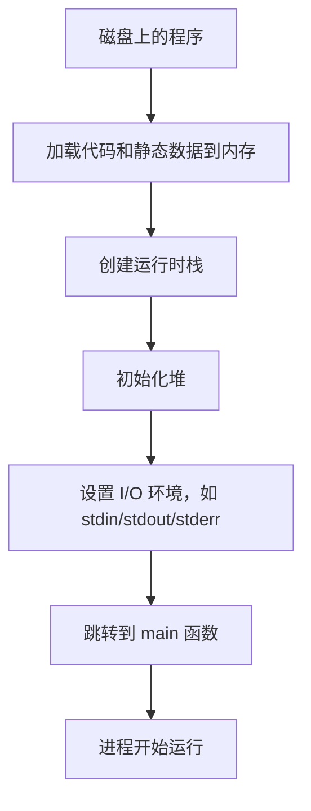

进程在运行中不断在三种基本状态之间迁移：

| 状态        | 含义                          |
| ----------- | ----------------------------- |
| **Running** | 正在 CPU 上执行               |
| **Ready**   | 已准备好运行，但暂时没被调度  |
| **Blocked** | 在等待某个事件，例如 I/O 完成 |

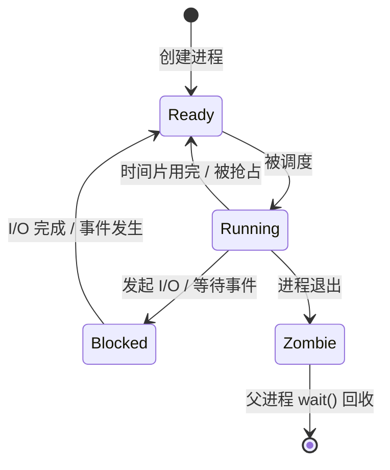

只有 **Running** 态占用 CPU；**Ready** 与 **Blocked** 的区别在于前者"只差 CPU"，后者"在等别的东西"——即使立刻给它 CPU 也跑不下去。当有进程阻塞时，CPU 可以被交给别的进程，系统利用率因此提高。

两个术语：Ready → Running 称为**被调度**（scheduled），Running → Ready 称为**解除调度**（descheduled）。另外，进程退出后先进入**终止**（final / zombie）状态，保留返回码等待父进程 `wait()` 取回，之后操作系统才清理它。

操作系统用一张**进程列表**（process list）维护所有进程，每个进程对应一个数据结构，通常称为**进程控制块**（Process Control Block，PCB）。下面是简化示意：

```c
// 取自旧版 x86 xv6（现行 xv6-riscv 的定义不同，需验证）
enum proc_state { UNUSED, EMBRYO, SLEEPING, RUNNABLE, RUNNING, ZOMBIE };

struct proc {
    char *mem;                   // 进程内存起始地址
    uint sz;                     // 内存大小
    char *kstack;                // 内核栈底
    enum proc_state state;       // 进程状态
    int pid;                     // 进程 ID
    struct proc *parent;         // 父进程
    void *chan;                  // 非零则在该事件上睡眠
    int killed;                  // 非零则已被杀死
    struct file *ofile[NOFILE];  // 打开的文件表
    struct inode *cwd;           // 当前工作目录
    struct context context;      // 内核寄存器，切换进程时保存 / 恢复
    struct trapframe *tf;        // 陷入帧，陷入时保存的用户寄存器
};
```

后续讲的上下文切换涉及两套保存：`tf` 记录陷入时存于内核栈的**用户寄存器**，`context` 记录切换时由操作系统保存的**内核寄存器**，见 2.11。

## 2.5 进程 API：fork、wait 与 exec

CSAPP 8.12 已系统讲过 UNIX 的进程控制接口，这里我们复习一下三大核心调用：

| 调用                   | 作用                     | 关键行为                                                                             |
| ---------------------- | ------------------------ | ------------------------------------------------------------------------------------ |
| `fork()`               | 创建新进程               | **调用一次、返回两次**：父进程得到子进程 PID，子进程得到 0                           |
| `wait()` / `waitpid()` | 等待并回收子进程         | 阻塞到某个子进程结束，返回被回收子进程的 PID                                         |
| `exec*()`              | 用新程序替换当前进程映像 | 覆盖代码与静态数据，堆、栈重新初始化；成功则**从不返回**；PID 与打开的文件描述符不变 |

三者中最反直觉的是 `fork()` 的两个返回值。它们恰好是父子进程区分彼此、走不同分支的依据：

```c
int rc = fork();

if (rc < 0) {                 /* fork 失败 */
    fprintf(stderr, "fork failed\n");
    exit(1);
} else if (rc == 0) {         /* 子进程：rc == 0 */
    printf("hello, I am child (pid: %d)\n", (int) getpid());
} else {                      /* 父进程：rc == 子进程 PID */
    wait(NULL);               /* 先等子进程结束，输出顺序才确定 */
    printf("hello, I am parent of %d\n", rc);
}
```

若父进程不先 `wait`，两行输出的先后由调度器决定，是不确定的。`exec*()` 则用于让当前进程"改头换面"，去运行另一个程序；它**不创建新进程**，成功时也不会返回到调用点，因为原来的执行流已被新程序替换。

> [!tip] CSAPP 回顾
> 父子进程共享打开文件、`fork` 的两处返回、僵死进程与回收、`waitpid` 的选项与状态宏，见 CSAPP 8.12。本节的 `fork` 与 CSAPP 8.12.2 中"打印 `x=0` 和 `x=2`、但两行顺序不定"是同一现象：输出顺序由调度器决定，是不确定的。

原书还介绍了几组周边接口：

| 接口           | 作用                                                                         |
| -------------- | ---------------------------------------------------------------------------- |
| `kill()`、信号 | 向进程发送信号：不只是终止，也可暂停、继续；进程可用 `signal()` 注册处理函数 |
| `ps`、`top`    | 查看进程列表与资源占用                                                       |
| 用户与权限     | 普通用户只能控制自己的进程，超级用户（root）可控制所有进程                   |

## 2.6 为什么把 fork 和 exec 分开

既然总是先 `fork` 再 `exec`，为什么不合成一个"创建并运行"的调用？答案是——**在两者之间**，shell 还有机会做准备工作，例如重定向标准输入 / 输出、建立管道、设置环境变量。合并成一个调用，这些操作就无处安放。

以最简单的重定向为例：

```bash
wc p3.c > newfile.txt
```

shell 可以这样安排：先 `fork()` 出子进程；在子进程中**关闭标准输出**、打开 `newfile.txt` 占据空出的位置；再 `exec()` 运行 `wc`。落到代码上：

```c
if (rc == 0) {
    close(STDOUT_FILENO);                                       /* 关闭 fd 1 */
    open("./p4.output", O_CREAT | O_WRONLY | O_TRUNC, S_IRWXU); /* 打开新文件 */
    /* 随后 execvp 运行 wc，它的输出即写入 p4.output */
}
```

它之所以有效，依赖两条规则：

1. **文件描述符总是从最小的可用编号开始分配**：标准输出是文件描述符 1，关闭它之后编号 1 空闲，接着 `open` 新文件时内核把 1 分给它。
2. **`exec` 之后打开的文件描述符保持不变**：于是 `wc` 继承了这个"被改造过的" fd 1，它对标准输出的写入实际都进了文件。

管道同理：shell 用 `pipe()` 把前一个进程的输出接到后一个进程的输入，如 `grep -o foo file | wc -l`。

> [!tip] CSAPP 回顾
> 文件描述符、打开文件表与 `dup2`、重定向与管道的完整机制见 CSAPP 10.1~10.4、10.7、10.8；`close` + `open` 顶替标准输出的写法，正式的等价物是 `dup2`。

---

# 第二部分 机制：受限直接执行

## 2.7 关键问题：性能与控制

策略（该运行哪个进程）的前提，是操作系统能随时**切换**进程，这就落到机制问题上。此时操作系统面对一对互相拉扯的目标：

1. **性能**：程序要尽可能直接在硬件上快速运行；
2. **控制**：操作系统必须能随时夺回 CPU，不能让用户程序为所欲为。

若操作系统每条指令都介入，控制有余而性能尽失；若完全放手，性能好却失去控制——一个死循环程序就能霸占整台机器。解决办法叫**受限直接执行**（Limited Direct Execution，LDE）：让用户程序直接在 CPU 上跑，同时借助硬件提供的少量限制保住操作系统的控制权。

## 2.8 用户模式、系统调用与陷阱

LDE 的硬件基础是 CPU 的两种模式：普通程序运行在**用户模式**（受限，不能直接做 I/O、修改页表等特权操作），内核运行在**内核模式**（全权）。处理器用**模式位**标记当前模式，用户程序只能通过中断、故障或系统调用进入内核模式，处理完毕再切回用户模式。用户程序若尝试执行特权操作，硬件会触发异常，操作系统通常会终止该进程。

用户程序需要特权操作（读写文件、创建进程、分配内存、网络通信）时，通过**系统调用**（system call）请求内核代劳。在硬件上，这表现为一条特殊指令（x86-64 上是 `syscall`），触发一个**陷阱**（trap）：进入内核时现场保存在**内核栈**上，处理完成后执行**陷阱返回**（return-from-trap）指令回到用户模式。系统调用号与参数经约定的寄存器传递，返回值也经寄存器带回。出错的表示因层次而异：Linux 内核返回负的 `errno`，libc 包装函数则返回 $-1$ 并设置全局变量 `errno`。

> [!tip] CSAPP 回顾
> 模式位与特权指令、陷阱作为"有意的同步异常"、`syscall` 指令与参数 / 返回值寄存器约定，见 CSAPP 8.4.2、8.5.2、8.9。区别普通过程调用与系统调用的关键，是系统调用的跳转目标由操作系统**预先指定**，用户程序不能自选入口——下一节正与此相关。

## 2.9 陷阱表：把入口交给内核

内核怎么知道系统调用发生时该跳到哪里？靠一张**陷阱表**（trap table）。系统启动时，操作系统把各类处理程序的地址填入表中并告知硬件：系统调用、时钟中断、缺页异常、非法指令各跳到何处。

这里最关键的性质是：**设置陷阱表是特权操作**，用户程序无法改写它。因此用户程序即使想"跳到内核里乱来"也无从下手——它只能跳到内核事先允许的入口。这正是"预先指定入口"在硬件上的落实。用户程序也不直接给出入口地址，而只传入**系统调用号**，陷阱处理程序据此在**系统调用表**中分派。

> [!warning] 内核必须校验用户传入的参数
> 参数中的指针（如 `write` 的缓冲区地址）可能指向内核内存或非法地址。内核在使用前必须检查，否则用户程序可借系统调用读写内核数据。

## 2.10 协作式与抢占式调度

有了 LDE，用户程序能高效运行；但操作系统还需要能主动夺回 CPU。早期有些系统采用**协作式**（cooperative）调度，等进程主动发起系统调用、显式让出 CPU（`yield`）或做出非法操作时才收回控制权。它的致命缺陷是：只要有一个进程进入无限循环、又从不发起系统调用，操作系统就再也拿不回 CPU，只能重启整台机器。

现代系统改用**抢占式**（preemptive）调度，依靠**时钟中断**（timer interrupt）：时钟设备每隔若干毫秒触发一次中断，硬件强制把控制权交还操作系统。操作系统由此获得一个不受用户程序摆布、可以定期收回 CPU 的支点。

> [!tip] CSAPP 回顾
> 定时器中断使内核能够抢占当前进程，是上下文切换得以发生的前提，见 CSAPP 8.4.1、8.10；早期 Mac OS 的协作式调度与后来的抢占式回归，在第一章"简单历史"中已提过。

## 2.11 上下文切换

当操作系统决定从进程 A 切换到进程 B 时，执行**上下文切换**（context switch）。它涉及**两次**保存 / 恢复，发生在不同层次：

| 次序 | 执行者                         | 保存什么       | 存放位置                   |
| ---- | ------------------------------ | -------------- | -------------------------- |
| ①    | 硬件（陷入时隐式）             | A 的用户寄存器 | A 的内核栈（对应 `tf`）    |
| ②    | 操作系统的 switch 例程（显式） | A 的内核寄存器 | A 的 PCB（对应 `context`） |

随后操作系统恢复 B 的内核寄存器，把栈切换到 B 的内核栈，再执行陷阱返回；硬件从 B 的内核栈恢复 B 的用户寄存器，B 从上次中断处继续。**栈的切换由操作系统完成，不是硬件。**

需要区分的是："陷入内核"与"切换进程"是两件事。系统调用或时钟中断会先让当前进程陷入内核，但此时未必发生切换；只有调度器决定换人时，才真正执行上下文切换。

上下文切换的**代价**远不止保存 / 恢复寄存器：切换会污染 CPU cache、TLB、分支预测器等片上状态，使新进程一开始就大量缺失，性能损失比"存几条寄存器"大得多。

处理中断期间若又来了中断，怎么办？常见做法是处理期间暂时关闭中断，并配合加锁等手段保护内核数据结构——这是后续并发部分的伏笔。

> [!tip] CSAPP 回顾
> CSAPP 8.10 把上下文切换描述为"保存当前进程的上下文、恢复另一个进程的上下文、把控制传递给新进程"，并指出系统调用与中断都可能触发它。

## 2.12 受限直接执行协议全景

把启动、运行、陷入、切换、退出串起来，LDE 协议可以概括为下表：

| 阶段       | 操作系统动作                                           | 硬件动作                                     | 用户进程动作      |
| ---------- | ------------------------------------------------------ | -------------------------------------------- | ----------------- |
| 启动       | 初始化陷阱表，启动时钟                                 | 记住陷阱处理程序地址                         | —                 |
| 创建进程   | 分配内存，加载程序，设置用户栈，在内核栈填入初始寄存器 | —                                            | —                 |
| 开始运行   | 从陷阱返回                                             | 从内核栈恢复寄存器，切到用户模式，跳到入口   | 运行 `main`       |
| 系统调用   | 处理特权请求，完成后陷阱返回                           | 保存寄存器到内核栈，陷入内核                 | 经库函数触发 trap |
| 时钟中断   | 进入处理程序，决定是否切换                             | 保存用户寄存器到内核栈，进入内核模式         | 被暂停            |
| 上下文切换 | 保存旧进程内核寄存器到 PCB，恢复新进程的，切换内核栈   | 陷阱返回时恢复新进程用户寄存器，切到用户模式 | 新进程继续运行    |
| 进程退出   | 清理资源                                               | —                                            | 调用 `exit`       |

---

# 第三部分 调度：从基本算法到多处理器

## 2.13 从机制到策略

第 6 章解决了"如何切换进程"的机制，但机制本身不回答一个更根本的问题：

> [!question] 切换的那一刻，操作系统应该选哪个进程运行？

这就是**调度策略**（scheduling policy）要回答的。本部分从最简单的算法开始，逐步加入现实约束，观察每个算法在什么指标上表现好、在什么指标上会吃亏；随后进入无需预知任务长度的 MLFQ、按比例分配的彩票、步长与 CFS 调度，最后扩展到多处理器。

整条路线可以概括为"放宽假设 → 暴露问题 → 引出新算法"：

| 放宽的假设 / 新增的指标  | 暴露的问题                        | 引出的算法                  |
| ------------------------ | --------------------------------- | --------------------------- |
| 运行时间不再相同         | FIFO 的护航效应                   | SJF                         |
| 不再同时到达，并允许抢占 | 非抢占的 SJF 仍被先到的长任务堵住 | STCF                        |
| 新增指标：响应时间       | STCF 对交互不友好                 | RR                          |
| 允许任务发起 I/O         | CPU 与磁盘无法重叠                | 把每段 CPU 突发视为独立任务 |
| 运行时间事先未知         | SJF / STCF 无法实施               | MLFQ                        |

## 2.14 工作负载假设

为了让分析有共同基础，先做一组刻意简化的**工作负载假设**：

1. 每个工作运行相同的时间；
2. 所有工作同时到达；
3. 一旦开始，工作一直运行到完成；
4. 所有工作只使用 CPU，不发起 I/O；
5. 每个工作的运行时间事先已知。

这些假设当然不现实，但它们构成了讨论的起点。后文每放宽一条假设，就会暴露某个算法的局限，也自然引出下一个算法。

## 2.15 两个指标：周转时间与公平性

最常用的指标是**周转时间**（turnaround time），衡量一个工作从到达到完成的全部耗时：

$$
T_{\text{周转时间}} = T_{\text{完成时间}} - T_{\text{到达时间}}
$$

如果所有任务同时到达，则 $T_{\text{到达时间}} = 0$，于是 $T_{\text{周转时间}} = T_{\text{完成时间}}$。周转时间是**性能指标**，越小越好。

另一个常被提及的指标是**公平性**（fairness）。麻烦在于，性能与公平经常互相冲突：一味压低平均周转时间，可能让某些长任务长期得不到运行；一味追求公平，又可能拖慢整体完成速度。这种"两者不可兼得"的张力，会贯穿后续所有算法。

## 2.16 先进先出：FIFO

**FIFO**（First In First Out，也叫 FCFS）最朴素：谁先到谁先运行，非抢占。三个任务 A、B、C 同时到达、各需 10 秒时：

```mermaid
gantt
    title FIFO：三个等长任务，每个 10s
    dateFormat X
    axisFormat %s
    section CPU
    A :a1, 0, 10
    B :b1, after a1, 10
    C :c1, after b1, 10
```

完成时间为 10、20、30，平均周转时间 $20$。放宽"运行时间相同"这条假设：设 A 需 100 秒、B 和 C 各需 10 秒且同时到达：

```mermaid
gantt
    title FIFO：A=100s，B=10s，C=10s
    dateFormat X
    axisFormat %s
    section CPU
    A :a1, 0, 100
    B :b1, after a1, 10
    C :c1, after b1, 10
```

完成时间为 100、110、120，平均周转时间骤升至 $110$。两个只需 10 秒的短任务被前面 100 秒的长任务死死堵住，这个现象称为**护航效应**（convoy effect）。

## 2.17 最短任务优先：SJF

要缓解护航效应，自然想到**先运行最短的任务**，即 **SJF**（Shortest Job First）。同样用 A=100s、B=10s、C=10s 同时到达的例子：

```mermaid
gantt
    title SJF：先运行短任务
    dateFormat X
    axisFormat %s
    section CPU
    B :b1, 0, 10
    C :c1, after b1, 10
    A :a1, after c1, 100
```

完成时间变为 10、20、120，平均周转时间 $\frac{10 + 20 + 120}{3} = 50$，相比 FIFO 的 110 大幅下降。

> [!important] SJF 的最优性
> 在"所有任务同时到达、任务长度已知"的假设下，SJF 是**最优**的，能最小化平均周转时间。
>
> **证明**：设 $n$ 个任务按长度 $l_{(1)}, \dots, l_{(n)}$ 的顺序依次执行，第 $i$ 个任务的完成时间是前 $i$ 个长度之和，于是
>
> $$\sum_{i=1}^{n} T_i = \sum_{i=1}^{n} (n-i+1)\, l_{(i)}$$
>
> 系数 $n-i+1$ 随 $i$ 递减，由排序不等式，当 $l_{(1)} \le \dots \le l_{(n)}$ 时右端最小。

但最优性建立在两个不现实的假设上：现实中任务长度通常未知，任务也不一定同时到达。

## 2.18 抢占式最短完成时间优先：STCF

先放宽"同时到达"。设 A 在 $t=0$ 到达、需 100 秒，B 和 C 在 $t=10$ 到达、各需 10 秒。若采用非抢占的 SJF，A 一旦开始就不能被打断，B、C 只能等它跑完，平均周转时间约 $103.33$，依然很差。

问题出在"非抢占"：要让短任务优先，必须允许调度器在新任务到达时**打断**当前任务。**STCF**（Shortest Time-to-Completion First），即抢占式 SJF，每当有新任务到达就比较所有任务的**剩余时间**，让剩余时间最短者运行：

```mermaid
gantt
    title STCF：抢占式最短完成时间优先
    dateFormat X
    axisFormat %s
    section CPU
    A_first :a1, 0, 10
    B :b1, 10, 10
    C :c1, 20, 10
    A_rest :a2, 30, 90
```

A 在 $t=10$ 被抢占，B、C 先跑完，A 再继续剩余的 90 秒。平均周转时间为 $\frac{(20-10) + (30-10) + (120-0)}{3} = 50$，回到 SJF 的水平。

> [!important] STCF 的最优性
> 在任务长度可知、且只考虑周转时间的假设下，STCF 是最优的抢占式调度算法。代价是**对响应时间不友好**：为了让平均完成时间最小，它会尽可能让别人等，交互式体验因此很差。

## 2.19 新指标：响应时间

分时系统出现后，用户坐在终端前等待反馈，"多久第一次看到反应"变得与"多久完成"同样重要，于是引入**响应时间**（response time）：

$$
T_{\text{响应时间}} = T_{\text{首次运行}} - T_{\text{到达时间}}
$$

周转时间关注"多久做完"，响应时间关注"多久**第一次**被轮到"。用 STCF 处理三个同时到达的任务时，第三个任务可能要等前两个都跑完才第一次运行，平均周转时间漂亮，交互体验却很糟。

## 2.20 轮转调度：RR

**RR**（Round Robin）专门优化响应时间：每个任务运行一个**时间片**（time slice，也叫 scheduling quantum），然后切换到下一个任务。时间片长度必须是定时器中断周期的整数倍，因为调度决策只能发生在中断时刻。

设 A、B、C 同时到达、各需 5 秒、时间片 1 秒，运行序列为（每格 1 秒）：

```text
A B C A B C A B C A B C A B C
```

响应时间分别是 A=0、B=1、C=2，平均 $1$；同样任务若用 SJF，平均响应时间为 $\frac{0 + 5 + 10}{3} = 5$。RR 明显对交互更友好。但代价落在周转时间上：RR 的完成时间 A=13、B=14、C=15，平均周转时间 $14$；SJF 为 $5, 10, 15$，平均 $10$。

对一般情形，设 $N$ 个任务同时到达、长度同为 $L = kq$（$q$ 为时间片），则：

| 指标         | RR                       | SJF                 |
| ------------ | ------------------------ | ------------------- |
| 平均响应时间 | $\dfrac{(N-1)q}{2}$      | $\dfrac{L(N-1)}{2}$ |
| 平均周转时间 | $LN - \dfrac{(N-1)q}{2}$ | $\dfrac{L(N+1)}{2}$ |

> [!note] RR 的"平均"陷阱
> 用平均值评价 RR 会令人意外：一种"公平"的算法，平均周转时间竟如此之差。原因不难理解——RR 把 CPU 在任务之间来回分，导致**每一个**任务都尽量晚完成。目标是周转时间时，这类"公平"算法都很糟糕；目标是响应时间时，它们又几乎是必需的。

## 2.21 时间片与上下文切换开销

时间片长度决定 RR 站在响应时间与开销之间的哪一端：

- 时间片**太短**：响应时间好，但切换过于频繁，上下文切换开销大；
- 时间片**太长**：切换少，但响应变差，退化得越来越像 FIFO。

时间片长度因此是"响应性"与"摊销切换成本"之间的折中。设一次切换的代价为 $c$、时间片为 $q$，则切换开销占比为 $\frac{c}{q+c}$。取 $c = 1\,\text{ms}$：$q = 10\,\text{ms}$ 时约为 $\frac{1}{11} \approx 9.1\%$（原书取整为约 10%）；拉长到 $q = 100\,\text{ms}$，降到 $\frac{1}{101} < 1\%$，响应却明显变慢。上下文切换的真实代价还远不止保存 / 恢复寄存器（见 2.11），cache、TLB 等状态的失效往往才是大头。

## 2.22 兼顾 I/O

现实进程会发起 I/O。进程发起 I/O 时进入阻塞，CPU 空闲，调度器本应把 CPU 交给别人；I/O 完成时中断把进程从阻塞态拉回就绪态，调度器再决定何时运行它。

设想 A 是 I/O 密集型（每运行 10ms 就发起 10ms I/O，共需 50ms CPU），B 是 CPU 密集型（连续占用 50ms）。若调度器把 A 的每个 CPU 片段都当成独立的短任务，用 STCF 就会优先运行这些短片段，从而**把 CPU 和磁盘重叠起来**：

```mermaid
gantt
    title 结合 I/O：CPU 与磁盘重叠
    dateFormat X
    axisFormat %s
    section CPU
    A1 :a1, 0, 10
    B1 :b1, 10, 10
    A2 :a2, 20, 10
    B2 :b2, 30, 10
    A3 :a3, 40, 10
    B3 :b3, 50, 10
    A4 :a4, 60, 10
    B4 :b4, 70, 10
    A5 :a5, 80, 10
    B5 :b5, 90, 10
    section Disk
    A_IO1 :d1, 10, 10
    A_IO2 :d2, 30, 10
    A_IO3 :d3, 50, 10
    A_IO4 :d4, 70, 10
    A_IO5 :d5, 90, 10
```

好处是三重的：交互式 / I/O 密集型任务获得良好响应，CPU 密集型任务用上 I/O 等待时间，系统整体利用率更高。这也说明，区分 CPU 密集与 I/O 密集对调度很有价值。

## 2.23 无法预知的任务长度

SJF / STCF 的理论最优性有一个致命前提：操作系统**事先知道**每个任务要运行多久。现实中这根本做不到。

出路是：

> 用**历史行为**预测**未来行为**。

一个进程过去的运行模式往往能预示它将来会面对什么。这个朴素的想法，正是 MLFQ 的核心。

---

## 2.24 多级反馈队列：基本思想与初版规则

抛弃"已知任务长度"的前提后，问题变成：

> 如何设计一个调度器，既照顾短任务（低响应时间），又不饿死长任务，还能自动区分交互式与 CPU 密集型进程？

**多级反馈队列**（Multi-Level Feedback Queue，MLFQ）为此而生。它使用**多个优先级队列**：高优先级队列先运行，同一队列内部用 **RR** 轮转，并按进程的**实际行为**动态调整优先级。关键设计是：不要求进程预先声明自己是"短任务还是长任务"，而是通过观察行为来**推断**，再据此安置优先级。

**最朴素**的 MLFQ 由四条规则定义：

> **规则 1**：如果 A 的优先级高于 B，运行 A。
>
> **规则 2**：如果 A 和 B 优先级相同，用 RR 轮流运行。
>
> **规则 3**：新任务进入系统时，放入最高优先级队列。
>
> **规则 4**：
>
> - 任务用完自己这一层的整个时间片就降一级
> - 若主动让出 CPU（例如发起 I/O），则保持当前优先级不变。

> [!note] 时间片与配额
> **时间片**（time slice）是同层 RR 的运行单位；**配额**（time allotment）是任务在某一层被降级前允许累计消耗的 CPU 时间。初版规则 4 中二者等同，2.27 修正后才分开。

## 2.25 MLFQ 如何近似 SJF

新任务进系统时会被放进最高优先级，好像它是个"短任务"。如果它确实很快完成，就获得类似 SJF 的低周转时间；如果它持续占用 CPU、用完了最高层的整个时间片，就会被降级，逐渐暴露出"长任务"的真面目，最终沉到最底层。这一动态过程可以概括为：

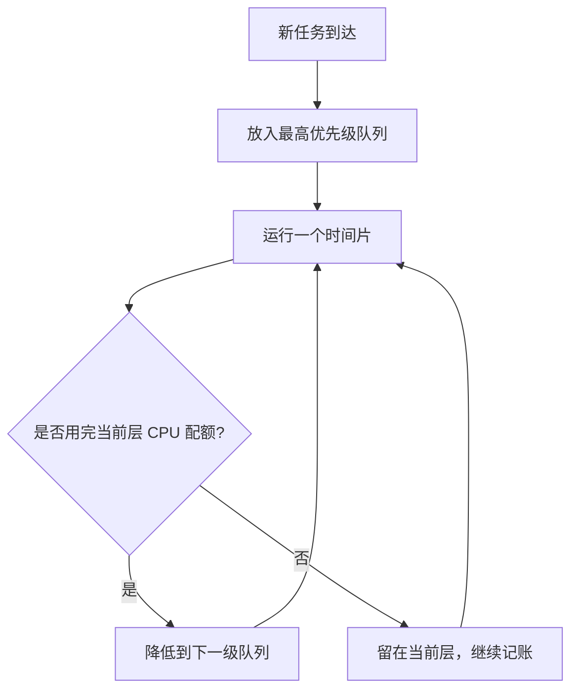

直观上，A 若是早已降到低优先级的长任务，而短交互任务 B 在 $t=100$ 到达，B 会先进入最高层、很快跑完，A 之后再继续——这正是 STCF 想要的"短任务优先"效果。同理，交互式任务经常运行一小会儿就去等待 I/O，从而主动释放 CPU；规则 4 初版会让它们一直留在高优先级，响应时间因此很好。

## 2.26 饥饿与周期性优先级提升

朴素 MLFQ 有两类问题。**饥饿**：高优先级队列一直有新任务进来时，低优先级的长任务可能**永远**得不到 CPU。**行为变化**：一个进程可能先表现为 CPU 密集型、后来又变成交互式，但此刻优先级已很低，无法及时回到高优先级。

为此加入规则 5——**周期性优先级提升**（priority boost）：

> **规则 5**：经过一段时间 S，把所有任务重新提升到最高优先级队列。

饥饿消失，行为变化也能被及时反映。但 S 又成了难题：S **太大**，长任务仍可能长时间得不到运行；S **太小**，交互式任务得不到足够连续的 CPU。没有万能取值。这类难以确定、需要凭经验取舍的常量，被称为**巫毒常量**（voo-doo constant）。

## 2.27 愚弄调度器与 CPU 记账

规则 4 初版还有一个漏洞：它把"主动让出 CPU"直接当作"这是交互式任务"的证据。于是一个纯 CPU 密集型进程只要**故意在时间片用完前发起一次 I/O**，就能一直骗过调度器、赖在最高优先级——CPU 密集型进程可以伪装成交互型，长期独占高优先级。

修正办法是**记账**：记录一个进程在其当前优先级层级上累计消耗的 CPU 时间，只要累计用量达到该层配额就降级，**不管它中途让出过多少次**。这样，频繁发起 I/O 也无法再"洗白"一个 CPU 密集型任务。

## 2.28 最终的 MLFQ 规则

综合以上修正，MLFQ 的最终形态为：

| 规则 | 内容                                                  |
| ---- | ----------------------------------------------------- |
| 1    | 高优先级任务先运行                                    |
| 2    | 同优先级任务按 RR 轮转                                |
| 3    | 新任务进入最高优先级队列                              |
| 4    | 用完当前层的累计 CPU 配额就降级（不因主动让出而豁免） |
| 5    | 每隔 S 时间把所有任务提升到最高优先级                 |

规则 3 让新任务享受"疑似短任务"的优待，规则 4 让真正吃 CPU 的任务下沉，规则 5 周期性打散已固化的优先级以防饥饿。三者配合，使 MLFQ 无需预知任务长度，就能近似兼顾响应时间与周转时间。

## 2.29 MLFQ 的调优与真实系统

MLFQ 留出大量参数需要调：用多少个优先级队列？每层时间片多长？每隔多久做一次优先级提升？是否允许用户通过 `nice` 之类接口给出优先级建议？常见做法各有取法：高优先级队列配**短时间片**以利交互，低优先级队列配**长时间片**以减少切换，再加周期性 boost 防止饥饿。

尽管参数细微差别会导致行为差异很大，MLFQ 及其变体在真实系统中被广泛采用，例如 BSD UNIX、Solaris 以及 Windows NT 及其后继版本。以 Solaris 的 TS（time-sharing）调度类为例，队列数量、每层时间片、优先级提升周期都可配置；FreeBSD 某些版本还用公式根据 CPU 使用量动态计算优先级。

> [!note] 调度的"没有免费午餐"
> MLFQ 是"经验驱动"的调度器：它不追求某个指标上的理论最优，而是用一套启发式规则在各种工作负载下取得不错的**综合**表现。这也解释了为什么真实系统的调度器往往复杂得"不优美"——它们是无数权衡与补丁叠加的结果。

## 2.30 比例份额与彩票调度

前面几类算法围绕周转时间、响应时间打转，还有一类换了个出发点：

> 如何确保每个任务（或每个用户）获得**约定比例**的 CPU 时间？

这类调度器称为**比例份额**（proportional share）调度器，也叫**公平份额**（fair-share）调度器。它们不回答"谁该先跑"，而回答"长期来看 CPU 该怎么分"。

**彩票调度**（lottery scheduling）用一个很巧妙的类比实现比例份额：每个进程持有一定数量的**彩票**，每次调度时随机抽取一张中奖彩票，持有者获得 CPU。彩票数占比越高，获得 CPU 的概率越大。例如 A 有 75 张、B 有 25 张，长期看 A 约获得 75% 的 CPU。选择过程如下：

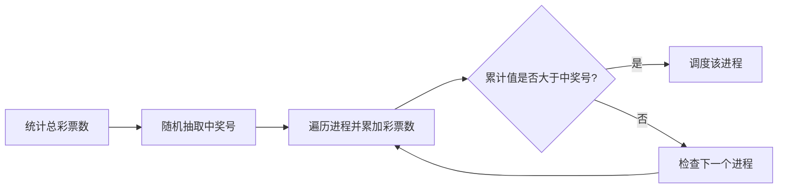

用随机性做调度有三点好处：避免传统算法难以处理的极端情形；轻量，几乎不需要记录每个进程的状态；快速，每次只需一个随机数。

## 2.31 彩票调度的实现与扩展

实现极其简洁：先取一个 $[0, \text{总彩票数})$ 范围内的随机数作为中奖号，再线性扫描进程列表累加彩票数，第一个使累计值超过中奖号的进程即为中奖者。

```c
int counter = 0;
int winner = get_random(0, total_tickets - 1);   /* 抽取中奖号 */

node *current = head;
while (current) {
    counter += current->tickets;                  /* 累加彩票数 */
    if (counter > winner)
        break;                                    /* 命中 */
    current = current->next;
}
schedule(current);                                /* 调度中奖进程 */
```

例如 A 有 100 张、B 有 50 张、C 有 250 张（总数 400），若中奖号为 300：A 累计 100、B 累计 150 都不大于 300，C 累计 400 首次超过，因此 C 中奖。

彩票调度还提供了三个灵活的扩展：

- **彩票货币**（ticket currency）：不同用户使用各自的局部彩票，再按比例兑换成全局彩票，用户不必关心全系统总票数；
- **彩票转让**（ticket transfer）：进程可临时把彩票转给另一个进程，例如客户端把票转给服务端以加速自己的请求；
- **彩票通胀**（ticket inflation）：在可信环境中，进程可临时增减自己的彩票数，表达"我现在更需要 CPU"。

## 2.32 彩票调度的缺陷：短期不公平

彩票调度是**概率性**的。随机抽签保证了长期比例，但短时间内实际分配可能明显偏离期望。考虑两个运行时间同为 $R$、彩票数相同的任务，用**不公平指标**比较它们完成时间的先后：

$$
U = \frac{T_{\text{先完成者}}}{T_{\text{后完成者}}}
$$

完全公平意味着两者同时完成，此时 $U = 1$。任务越长，实际比例越接近期望，$U$ 越接近 1；任务越短，随机波动越大，$U$ 往往越差。换言之，彩票调度在**长时间尺度**上公平，在**短时间尺度**上可能相当不公平。

## 2.33 步长调度：确定性的比例份额

要消除随机波动，可用**步长调度**（stride scheduling）：

- 每个进程有一个**步长**（stride），与彩票数成反比：彩票越多，步长越小；
- 每个进程还有一个**行程值**（pass），初始为 0；
- 每次调度**行程值最小**的进程，它运行一个时间片后 $pass \mathrel{+}= stride$。

取大常数 $10000$，则 A（100 票）stride=100、B（50 票）stride=200、C（250 票）stride=40。初始行程值都为 0，调度过程如下（每行选出当前最小者运行并更新其行程值）：

| A pass | B pass | C pass | 本次运行 |
| -----: | -----: | -----: | -------- |
|      0 |      0 |      0 | A        |
|    100 |      0 |      0 | B        |
|    100 |    200 |      0 | C        |
|    100 |    200 |     40 | C        |
|    100 |    200 |     80 | C        |
|    100 |    200 |    120 | A        |
|    200 |    200 |    120 | C        |
|    200 |    200 |    160 | C        |
|    200 |    200 |    200 | （持平） |

结果 C 运行 5 次、A 运行 2 次、B 运行 1 次，比例恰为 $250 : 100 : 50$，与彩票数完全一致。

> [!important] 比例性
> 设任务 $i$ 有 $t_i$ 张彩票，运行 $n_i$ 次后 $pass_i = n_i \cdot \frac{10000}{t_i}$。每次总是选 $pass$ 最小者，故任意时刻最大与最小的 $pass$ 之差不超过最大步长，因此各 $\frac{n_i}{t_i}$ 近似相等，即 $n_i \propto t_i$。

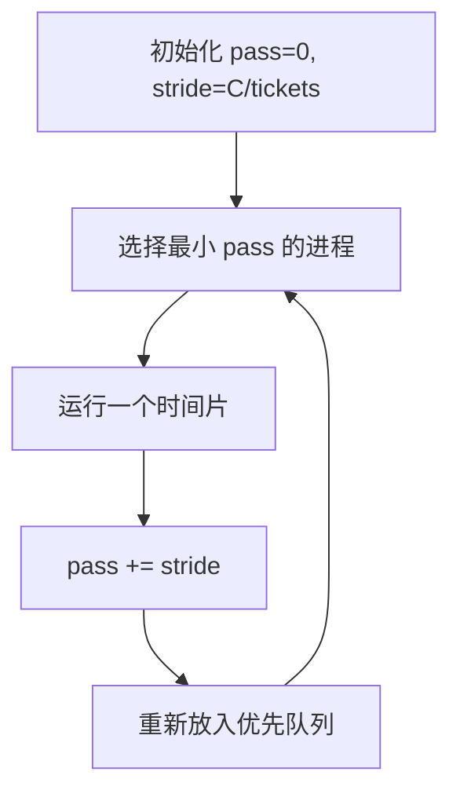

彩票与步长的取舍如下：

| 特性       | 彩票调度 | 步长调度                 |
| ---------- | -------- | ------------------------ |
| 基本性质   | 概率性   | 确定性                   |
| 实现复杂度 | 很低     | 较低，但需维护行程值     |
| 新进程加入 | 容易     | 需要设置合适的初始行程值 |
| 短期公平性 | 可能偏离 | 更精确                   |
| 全局状态   | 少       | 多                       |

新进程若取 $pass = 0$，会在追上其他进程之前长期独占 CPU，所以初值必须设置得当（常见做法是取当前最小 $pass$，需验证）。

## 2.34 Linux 的 CFS：完全公平调度

**CFS**（Completely Fair Scheduler）是 Linux 采用的确定性比例份额调度器，思路接近步长调度：目标是把 CPU 公平分给所有竞争进程。

**1. 虚拟运行时间**：每个进程有 `vruntime`，运行时按物理时间累加。每次调度选 `vruntime` 最小者。`vruntime` 相当于步长调度的 pass。

**2. 时间片**：由两个参数决定——`sched_latency`（典型值 48 ms）：一个调度周期内每个进程都应运行一次；`min_granularity`（典型值 6 ms）：时间片下限，避免切换过频。

$$
\text{time\_slice} = \max\left(\frac{\text{sched\_latency}}{n},\ \text{min\_granularity}\right)
$$

$n=4$ 时为 $12\,\text{ms}$；$n=10$ 时 $4.8\,\text{ms} < 6\,\text{ms}$，取 $6\,\text{ms}$。CFS 只在定时器中断时检查是否切换，所以时间片是中断周期（如 1 ms）的整数倍；`vruntime` 则精确记账，长期仍然公平。

**3. 权重（nice 值）**：`nice` 取值 $[-20, 19]$，默认 0，每个值映射到一个权重 $w$（`nice`=0 对应 $w_0 = 1024$，`nice` 每小 1，权重约大 25%）。时间片与 `vruntime` 的累加按权重调整：

$$
\text{time\_slice}_k = \frac{w_k}{\sum_i w_i} \cdot \text{sched\_latency}
\qquad
\text{vruntime}_i \mathrel{+}= \frac{w_0}{w_i} \cdot \text{runtime}_i
$$

权重大，则时间片长、`vruntime` 增长慢，更常被选中。例：A 的 `nice`=−5（$w=3121$），B 的 `nice`=0（$w=1024$），`sched_latency`=48 ms，则 A 的时间片约 $36\,\text{ms}$，B 约 $12\,\text{ms}$。

**4. 数据结构**：就绪进程放在按 `vruntime` 排序的**红黑树**中，取最左节点，插入与删除均为 $O(\log n)$。阻塞的进程不在树中。

**5. 睡眠进程**：进程长时间睡眠后 `vruntime` 远落后于他人，唤醒后会长期独占 CPU。CFS 把唤醒进程的 `vruntime` 设为树中当前最小值以避免此问题，代价是频繁短暂睡眠的进程得不到应有的份额。

> [!note] 参数来源
> 上述典型值与权重取自原书示例，现行内核参数与实现细节需验证。

## 2.35 比例份额的适用场景

比例份额调度有一个绕不开的难题：**彩票数（或权重）该由谁、按什么来定**？浏览器该分多少、编译器该分多少、I/O 密集型任务如何折算，都没有自然答案。因此在通用 CPU 调度中，MLFQ 一类调度器更为常见。

比例份额真正的用武之地，是那些**份额需求本来就明确**的场景：虚拟机之间的资源分配、容器的 CPU 份额、数据中心的资源管理——在这些地方，租户花钱购买了确定的资源比例，调度器只需保证它。

---

## 2.36 多处理器调度：新问题与缓存一致性

直到这里，讨论都默认只有一个 CPU。当机器拥有多个核 / 多个处理器时，单处理器策略需要重新审视，还会冒出一批新问题：缓存一致性、同步开销、**缓存亲和性**、负载均衡、可扩展性。

多 CPU 共享内存时，每个 CPU 带自己的缓存再接总线：

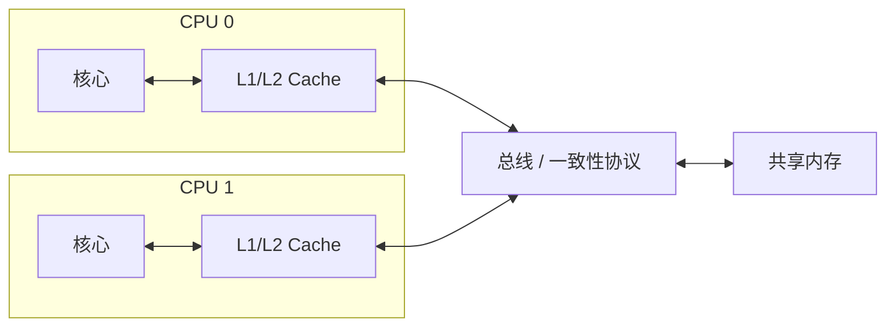

这带来**缓存一致性**问题：CPU0 修改地址 A 后只更新了自己的缓存，若操作系统把相关进程迁移到 CPU1，而修改尚未同步回内存，CPU1 就可能读到**过时的值**。这类问题通常由硬件的**缓存一致性协议**（cache coherence protocol，如总线窥探）解决。即使硬件保证了一致性，多个 CPU 并发访问**共享数据结构**时仍需要互斥——一致性协议保证"读到最新值"，但不保证"读—改—写"这一复合操作的原子性。

## 2.37 缓存亲和性

一个进程在某个 CPU 上运行过后，会在该 CPU 的缓存与 TLB 里留下状态。如果下次仍在**同一个** CPU 上运行，这些状态大多还能命中，性能更好；如果被迁移到**另一个** CPU，就要重新建立，性能下降。

因此多处理器调度多了一层约束：

> 尽量让进程留在它上次运行的 CPU 上（保持**亲和性**），同时又要维持各 CPU 之间负载均衡。

亲和性与均衡是一对张力：太强调亲和，CPU 之间可能忙闲不均；太强调均衡，又频繁迁移、损失缓存。下面两种结构正各有取舍。

## 2.38 单队列多处理器调度：SQMS

最直接的扩展是**单队列多处理器调度**（Single Queue Multiprocessor Scheduling，SQMS）：所有进程共用一个**全局就绪队列**，各 CPU 都从中取任务。

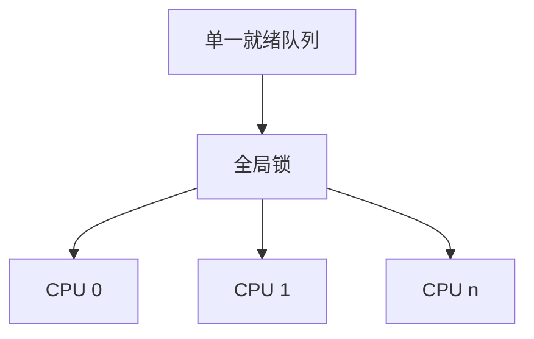

优点是结构简单、容易复用单处理器策略、天然负载均衡（谁有空谁取，忙闲自动拉平）。缺点也明显：全局队列需要**加锁**保护，锁争用会损害**可扩展性**（CPU 越多抢锁越激烈）；且缓存亲和性通常较差，进程两次被调度未必落到同一个 CPU 上。

SQMS 调度器通常会附带亲和性机制：例如 5 个任务、4 个 CPU 时，让其中 4 个任务各自尽量留在原 CPU，只让第 5 个在各 CPU 间迁移，以此兼顾亲和性与均衡。

## 2.39 多队列调度、负载均衡与工作窃取

**多队列多处理器调度**（Multi-Queue Multiprocessor Scheduling，MQMS）给每个 CPU 配一个**独立就绪队列**：

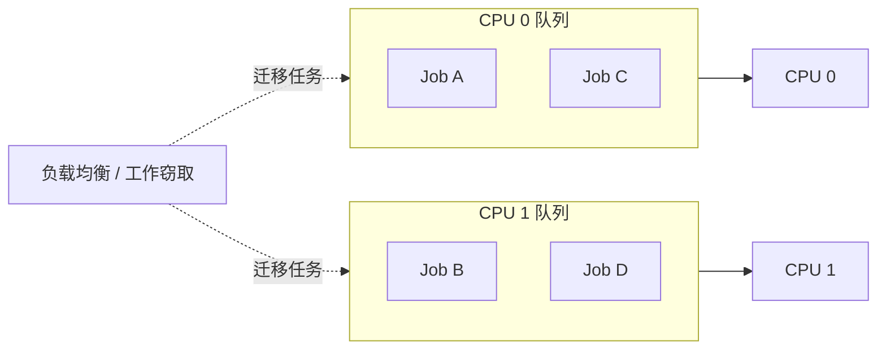

它可扩展性好、锁争用少、缓存亲和性好，代价是**负载可能不均**，必须额外引入任务迁移。最简单的负载不均：一个队列只有 A，另一个队列有 B 和 D，各自用 RR 轮转时，A 独占 CPU0 的全部时间，实际获得了**两倍**于其它进程的 CPU。

**一次迁移不够。** 把 D 挪到 CPU0 后变成 $\{A, D\}$ 对 $\{B\}$，B 又比别人多拿一倍 CPU。正确的做法是**持续迁移**（continuous migration）：让任务在 CPU 之间轮换"独占"的位置。以 3 个任务共享 2 个 CPU 为例，每个时间片换一个任务独占一个 CPU，另外两个共享另一个 CPU。三个时间片后，每个任务得到 $1 + \frac{1}{2} + \frac{1}{2} = 2$ 个"CPU·时间片"，即各得 $\frac{2}{3}$ 个 CPU。

迁移可以采用**工作窃取**（work stealing）：空闲或负载较轻的队列定期偷看其它队列，若发现自己明显空闲、而某队列明显更长，就"窃取"其中一个任务：

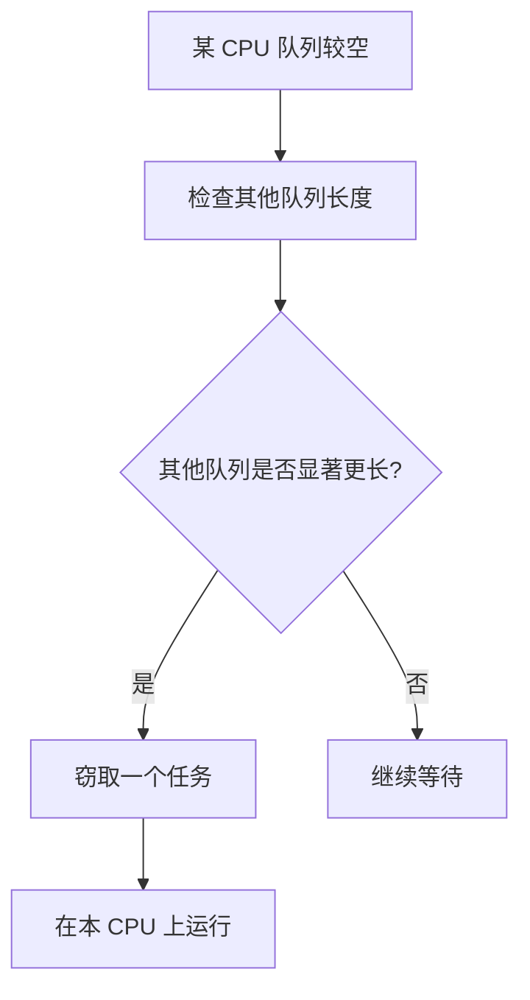

窃取频率又成了一个折中：检查**太频繁**，迁移开销大且伤缓存亲和性；检查**太少**，负载不均迟迟得不到纠正。

## 2.40 现实中的多处理器调度

Linux 社区历史上尝试过多种方案，恰好体现了单队列与多队列两条路线：

| 调度器 | 队列结构 | 特点                                      |
| ------ | -------- | ----------------------------------------- |
| O(1)   | 多队列   | 基于优先级，类似 MLFQ（随时间调整优先级） |
| CFS    | 多队列   | 确定性比例份额，类似步长调度（见 2.34）   |
| BFS    | 单队列   | 比例份额，基于 EEVDF 思路                 |

单队列与多队列**都能成功**，关键在于如何在可扩展性、缓存亲和性、负载均衡与交互性之间权衡。

> [!note] 版本说明
> 上表反映原书写作时的状态。Linux 6.6 起默认调度器已由 CFS 改为 EEVDF（需验证）。

---

# 第四部分 小结

## 2.41 小结

本篇沿着"抽象 → 机制 → 策略"的路线走完了 CPU 虚拟化的全貌：**进程**是基本抽象，其状态由内存、寄存器与 I/O 三部分构成；**受限直接执行**是让用户程序高效运行、又让操作系统保持控制的机制，靠模式位、陷阱表、时钟中断与上下文切换共同实现；**调度策略**则在周转时间、响应时间、公平性之间反复权衡，从 FIFO、SJF、STCF、RR，到无需预知任务长度的 MLFQ，再到按比例分配的彩票、步长调度与 Linux 的 CFS；到了多核时代，缓存亲和性与负载均衡又成了新的核心矛盾。

### 调度算法一览

| 算法    | 是否抢占 | 是否需预知长度 | 主要优化                 | 主要缺点                         |
| ------- | -------- | -------------- | ------------------------ | -------------------------------- |
| FIFO    | 否       | 否             | 简单                     | 护航效应，平均周转时间差         |
| SJF     | 否       | 是             | 最小化平均周转时间       | 需预知长度，响应差               |
| STCF    | 是       | 是             | 最优平均周转时间         | 需预知长度，响应差               |
| RR      | 是       | 否             | 响应时间好               | 周转时间差，上下文切换开销       |
| MLFQ    | 是       | 否             | 兼顾响应与周转           | 参数难调，可能饥饿 / 被愚弄      |
| Lottery | 是       | 否             | 比例共享，实现简单       | 短期不公平                       |
| Stride  | 是       | 否             | 确定性比例共享           | 需维护全局行程值状态             |
| CFS     | 是       | 否             | 加权比例共享（vruntime） | 参数依赖经验，睡眠进程需特殊处理 |

### 两个关键指标

$$
T_{\text{周转时间}} = T_{\text{完成时间}} - T_{\text{到达时间}}
\qquad
T_{\text{响应时间}} = T_{\text{首次运行}} - T_{\text{到达时间}}
$$

### MLFQ 五条规则速记

| 规则 | 内容                                                |
| ---- | --------------------------------------------------- |
| 1    | 高优先级先运行                                      |
| 2    | 同优先级按 RR 轮转                                  |
| 3    | 新任务进入最高优先级队列                            |
| 4    | 用完当前层累计 CPU 配额就降级（不因主动让出而豁免） |
| 5    | 每隔 S 时间把所有任务提升到最高优先级               |

### 多处理器调度对比

| 方案 | 结构            | 优点                 | 缺点                         |
| ---- | --------------- | -------------------- | ---------------------------- |
| SQMS | 单全局队列      | 简单，天然负载均衡   | 锁争用，扩展性差，缓存亲和差 |
| MQMS | 每 CPU 一个队列 | 扩展性好，缓存亲和好 | 负载不均，需要持续迁移       |
