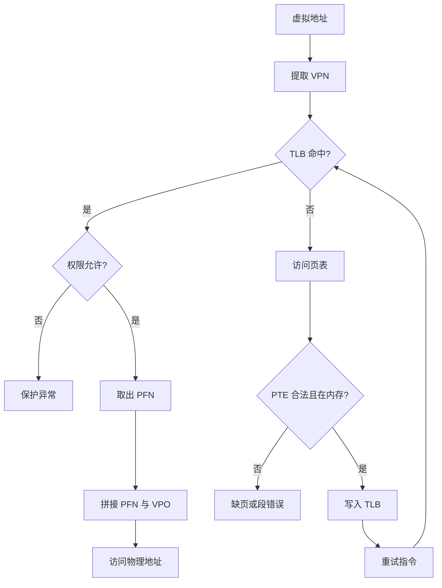
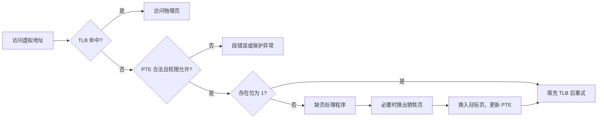

> [!important] 本篇目标
> 承接上一章的 CPU 虚拟化，本篇转向**内存虚拟化**：先建立地址空间这一抽象与空闲空间管理，再逐步引入地址转换、分段、分页、TLB 和多级页表，最后讨论如何让虚拟内存超过物理内存，以及如何选择要换出的页面。
>
> CSAPP 第九章已经系统介绍了现代虚拟内存、页表、缺页、`mmap`、`fork`、`execve` 和动态内存分配。本篇保留这些概念在 OSTEP 机制链条中的位置，但不重复完整推导，把重点放在“为什么需要下一种机制”以及“不同策略如何权衡”。

内存虚拟化要制造的假象是：每个进程都拥有一块**私有、连续、足够大的内存**。实际上，多个进程共享同一组物理页，某些页面甚至暂时不在内存中，而在磁盘或文件中。

> [!question] 关键问题：如何虚拟化内存
> 操作系统如何在有限的物理内存上，为每个进程提供一个私有而灵活的地址空间，同时保证访问足够快，并且不允许进程破坏其他进程或内核？

这个问题包含三个目标：

| 目标       | 含义                                     |
| ---------- | ---------------------------------------- |
| **透明性** | 程序不需要知道自己的页面位于哪个物理位置 |
| **效率**   | 地址转换的常见路径应尽量接近普通内存访问 |
| **保护**   | 进程只能访问被授予权限的页面             |

本篇的路线可以概括为：

1. 用地址空间隐藏物理内存的共享，并了解变长块的空闲空间管理
2. 用地址转换把虚拟地址映射到物理地址（基址加界限、分段）
3. 用分页消除外部碎片和连续放置要求
4. 用 TLB 加速地址转换
5. 用多级页表压缩稀疏地址空间下的页表开销
6. 用交换和缺页突破物理内存容量
7. 用页面替换策略决定保留谁、驱逐谁

---

# 第一部分 抽象与 API

## 3.1 地址空间：进程看到的内存

**地址空间**（address space）是进程看到的内存布局，而不是物理内存的真实布局。

早期系统几乎没有内存抽象：操作系统占据物理内存的一部分，当前程序直接使用剩余空间。多个程序同时驻留后，问题立刻出现：一个程序写错地址，就可能覆盖另一个程序或操作系统的数据。

虚拟内存为每个进程提供独立的虚拟地址空间。典型布局包含：

| 区域       | 作用                         | 常见增长方向     |
| ---------- | ---------------------------- | ---------------- |
| 代码段     | 指令和只读常量               | 固定             |
| 数据段     | 已初始化和未初始化的全局数据 | 固定             |
| 堆         | `malloc` 等动态分配          | 通常向高地址增长 |
| 共享库区域 | 映射动态链接库和文件         | 由内核安排       |
| 栈         | 函数调用、局部变量、返回地址 | 通常向低地址增长 |

堆和栈放在地址空间的两端，是为了给它们留下增长空间。中间的大段空洞没有被使用，也不需要为每个字节都分配物理内存。这种布局体现了虚拟地址空间的两个特性：**稀疏**和**按需建立**。

> [!tip] CSAPP 回顾
> 程序中打印出来的指针通常是虚拟地址。只有地址转换完成后，硬件和内核才知道对应的物理位置。进程看到的是自己的地址空间，不能直接看到物理内存的全貌。

## 3.2 `malloc`、`free` 与内存生命周期

`malloc` 和 `free` 是 C 库提供的动态内存分配接口，不是直接的系统调用。

```c
#include <stdlib.h>

void *malloc(size_t size);
void free(void *ptr);       // 不需要传入大小：分配器自己记录（见 3.3）
```

`malloc` 返回一块至少能容纳 `size` 个字节、并满足基本对齐要求的区域。它不会初始化内容。`free` 要求传入此前分配得到的块的起始地址，否则行为未定义。

| 接口      | 作用                                     |
| --------- | ---------------------------------------- |
| `malloc`  | 分配未初始化的内存                       |
| `calloc`  | 分配并清零                               |
| `realloc` | 调整已分配块的大小，可能移动并复制原内容 |

分配器通常从两个方向获得虚拟内存：

- 通过 `brk`/`sbrk` 扩大传统堆
- 通过 `mmap` 创建新的虚拟内存区域（匿名映射）

应用程序一般不应直接使用 `brk` 或 `sbrk` 管理堆。它们是分配器实现的一部分，直接混用容易破坏分配器的内部状态。

> [!warning] 常见内存错误
> 未初始化读取、缓冲区溢出、释放后使用、重复释放、无效释放、返回局部变量地址和内存泄漏，都可能在错误发生很久之后才表现为崩溃。编译器只能发现其中很小一部分，需要借助 `gdb`、`valgrind` 一类工具。

两个典型的大小错误：

| 错误                             | 原因                                                   |
| -------------------------------- | ------------------------------------------------------ |
| `malloc(strlen(s))` 存放字符串   | 漏掉结尾的 `'\0'`，应为 `strlen(s) + 1`                |
| 对指针取 `sizeof` 以为是数组大小 | `sizeof(p)` 是指针本身的大小，只有静态数组才得到总字节 |

与虚拟内存相关的两个事实值得记住：

1. 进程退出时，操作系统会回收进程拥有的全部页面，所以短命程序不调用 `free` 通常不会造成系统级泄漏。内存管理实际发生在两个层次：应用层由分配器管理堆内的块，操作系统层管理页面。
2. 长期运行的程序仍必须释放不再使用的块，否则进程的堆会持续增长，最终耗尽可用内存。

## 3.3 空闲空间管理

变长内存块的管理难点是：总空闲空间足够，并不代表存在一块连续空间能够满足请求，这称为**外部碎片**（external fragmentation）。本节假设分配出去的块不能移动，因此无法通过紧缩消除碎片。

### 3.3.1 基本机制

分配器通常需要处理四个动作：

1. **分割**：从较大的空闲块中切出请求大小的部分
2. **合并**：释放块后合并相邻的空闲块
3. **放置**：在多个候选空闲块中选择一个
4. **扩展**：找不到合适块时向内核申请新的堆空间

OSTEP 的实现思路是**块头加嵌入式空闲链表**：

```c
typedef struct { int size; int magic; } header_t;       // 已分配块的块头
typedef struct node_t { int size; struct node_t *next; } node_t;  // 空闲块头，存放在空闲块内部
```

- 分配 $N$ 字节时，实际需要找到 $N+\text{sizeof}(\text{header\_t})$ 字节的空闲块；返回的指针指向块头之后
- `free(ptr)` 通过 `ptr` 往前回退一个块头，读出大小，因此无需传入大小；`magic` 用于完整性检查
- 空闲链表的节点就存放在空闲块自身内部，不占额外空间
- 合并依赖地址顺序：释放块与相邻空闲块地址连续时，合并为一个更大的块

> [!note] 术语来源
> CSAPP 把空闲块组织方式分为隐式链表、显式链表和分离空闲链表；OSTEP 的主线则是上面的块头加嵌入式链表。两者是同一问题的不同表述。

### 3.3.2 放置策略

| 策略       | 做法                       | 特点                                                   |
| ---------- | -------------------------- | ------------------------------------------------------ |
| 首次适配   | 从头找到第一块足够大的区域 | 简单、较快，前部可能积累小碎片                         |
| 下一次适配 | 从上次搜索结束的位置继续   | 性能接近首次适配，避免前部堆积小碎片（原书表述需验证） |
| 最佳适配   | 找最小的可用块             | 需要完整搜索；容易留下大量难以利用的小碎片             |
| 最差适配   | 找最大的可用块             | 希望留下大块，通常反而造成严重碎片，且同样需要完整搜索 |

### 3.3.3 其他方案

| 方案                 | 思想                                                            | 代价                                   |
| -------------------- | --------------------------------------------------------------- | -------------------------------------- |
| 分离空闲链表（slab） | 为常用大小的对象单独维护缓存，分配与释放都是 $O(1)$             | 需要预估常用大小，其余请求仍走通用分配 |
| 伙伴系统             | 空间按 $2^n$ 大小对半切分，释放时检查伙伴（地址仅差一位）并合并 | 向上取整到 $2^n$，带来内部碎片         |

> [!note] 与分页的联系
> 分配器管理的是变长块，因此需要处理外部碎片。分页把物理内存切成固定大小的页帧，避免了外部碎片，但页表和页内未使用空间会带来新的成本。

---

# 第二部分 机制：地址转换

## 3.4 基址加界限：最简单的动态重定位

早期的**静态重定位**由加载器在程序载入时改写其中的地址，没有保护，装入后也无法再搬动。**动态重定位**由硬件在每次访问时完成转换，这就是**基址加界限**（base and bounds）。每个 CPU 为当前进程保存两个寄存器：

- `base`：进程地址空间在物理内存中的起始位置
- `bound`：进程地址空间的大小

硬件对每次内存访问执行：

$$
\text{physical address}=\text{virtual address}+\text{base}
$$

但只有当 $0 \le \text{virtual address}<\text{bound}$ 时，访问才合法。否则 CPU 触发保护异常。

例如，进程的虚拟地址空间大小为 $16\,\mathrm{KB}$，被放在物理地址 $32\,\mathrm{KB}$ 处。虚拟地址 $15\,\mathrm{KB}$ 会被转换为物理地址 $47\,\mathrm{KB}$；虚拟地址 $16\,\mathrm{KB}$ 则越界。


各环节由谁负责：

| 时机       | 硬件                               | 操作系统                               |
| ---------- | ---------------------------------- | -------------------------------------- |
| 每次访存   | 转换并检查界限，越界则触发异常     | —                                      |
| 创建进程   | —                                  | 在空闲列表中找一块足够大的物理空间     |
| 进程退出   | —                                  | 回收其物理空间                         |
| 上下文切换 | 提供特权指令修改 `base` / `bound`  | 把它们保存到 PCB，并恢复下一个进程的值 |
| 异常       | 触发异常，跳到陷阱表登记的处理程序 | 通常终止出错的进程                     |

修改这两个寄存器、注册异常处理程序等操作都必须是特权操作，否则用户程序可以绕过保护。

这种方案很快，但有两个明显限制：

- 整个地址空间必须连续放入物理内存
- 堆和栈之间的未使用空间也会占据预留区域。这类浪费发生在已分配单元**内部**，称为**内部碎片**（internal fragmentation）

## 3.5 分段：只为使用中的区域分配空间

**分段**（segmentation）把地址空间拆成多个逻辑段，每个段拥有独立的基址、界限和权限。

典型段包括代码、堆和栈。虚拟地址先确定段，再计算段内偏移：

```c
segment = (virtual_address & SEG_MASK) >> SEG_SHIFT;
offset = virtual_address & OFFSET_MASK;

if (offset >= bounds[segment])
    raise_protection_fault();
else
    physical_address = bases[segment] + offset;
```

栈通常向低地址增长，因此它的段还需要一个**增长方向位**。对反向增长的段，先取负偏移再相加：

$$
\text{负偏移}=\text{offset}-\text{max\_seg\_size},\qquad \text{PA}=\text{base}+\text{负偏移}
$$

分段的优点是：堆和栈之间的空洞不需要占用物理空间。它还能通过权限位支持代码共享，例如把多个进程的代码段映射到同一组只读物理页。

分段对操作系统提出了新要求：

| 事项         | 说明                                                                                                                                              |
| ------------ | ------------------------------------------------------------------------------------------------------------------------------------------------- |
| 上下文切换   | 需要保存和恢复所有段寄存器                                                                                                                        |
| 段增长       | 堆增长时（`sbrk`）由 OS 决定扩大该段或拒绝                                                                                                        |
| 物理空闲空间 | 段大小不一，物理内存会碎片化。可以**紧缩**（compaction），即停下进程、搬动数据、改写基址，但代价很高；也可以用 3.3 的放置策略，只能缓解，不能根除 |

分段仍然有两个根本问题：

1. 不同大小的段会产生**外部碎片**
2. 一个大而稀疏使用的段仍需整段放入连续的物理内存，不足以支持通用的稀疏地址空间

因此，现代通用系统通常以分页为主，分段只保留有限的兼容或保护作用。

## 3.6 分页：固定大小的地址转换

**分页**（paging）把虚拟地址空间切成固定大小的虚拟页，把物理内存切成同样大小的页帧。虚拟页可以放在任意物理页帧中。

设页大小为 $P=2^p$ 字节。虚拟地址可以拆成：

| 虚拟页号 VPN | 页内偏移 VPO |
| ------------ | ------------ |
| 高位         | 低 $p$ 位    |

页表用 VPN 查找页表条目（PTE），PTE 给出物理页帧号 PFN 和访问权限。物理地址由 PFN 与原来的页内偏移拼接而成：

$$
\text{PA}=(\text{PFN}\ll p)\mathbin{|}\text{VPO}
$$

分页的核心优点是灵活：

- 虚拟页不需要连续放置
- 未使用的虚拟页不需要分配物理页帧
- 物理内存按固定大小的页帧管理，空闲空间管理只需一条页帧空闲链表
- 权限可以精确到页面

代价是页内未使用的部分，即**内部碎片**，以及页表本身的空间。

一个简化的线性页表条目如下：

| PTE 字段 | 作用                                  |
| -------- | ------------------------------------- |
| 有效位   | 该虚拟页是否属于进程的合法地址空间    |
| 存在位   | 页面当前是否驻留在物理内存            |
| PFN      | 页面在物理内存中的页帧号              |
| 保护位   | 是否可读、写、执行，以及用户/内核权限 |
| 脏位     | 页面装入后是否被修改                  |
| 访问位   | 页面近期是否被访问                    |

> [!tip] CSAPP 回顾
> CSAPP 第九章已经完整展开了 VPN、VPO、PPN、PTE、缺页和多级页表的地址翻译过程。本节只保留它们在 OSTEP 机制演进中的作用：分页消除分段的外部碎片，但页表本身可能很大，而且每次访问都可能需要额外查表。

## 3.7 页表为什么会拖慢访问

如果页表位于内存，每次虚拟访问都要多一次内存访问：

1. 读取 PTE，得到 PFN
2. 读取真正的数据或指令

一条带一个内存操作数的指令包含取指和访存两次虚拟访问，因此至少需要 4 次物理内存访问。可以把线性页表的查找抽象为：

```c
vpn = virtual_address >> PAGE_OFFSET_BITS;
vpo = virtual_address & PAGE_OFFSET_MASK;
pte_address = ptbr + vpn * sizeof(PTE);
pte = access_memory(pte_address);

if (!pte.valid)
    raise_segmentation_fault();
if (!can_access(pte.protection))
    raise_protection_fault();
if (!pte.present)
    raise_page_fault();

physical_address = (pte.pfn << PAGE_OFFSET_BITS) | vpo;
access_memory(physical_address);
```

页表还可能占用大量内存。32 位地址空间使用 4 KB 页时有 $2^{20}$ 个虚拟页；若每个 PTE 为 4 字节，单个线性页表就需要 4 MB，每个进程各有一份。64 位地址空间若直接使用线性页表，则根本不可行。

## 3.8 TLB：把地址转换缓存起来

**TLB**（Translation Lookaside Buffer）是 MMU 中的小型地址转换缓存，通常是**全相联**的：硬件并行比较所有条目。TLB 命中时，硬件可以直接得到 PFN，不必访问内存中的页表。

```c
vpn = virtual_address >> PAGE_OFFSET_BITS;
(success, e) = tlb_lookup(vpn);
if (success) {
    if (!can_access(e.protection))
        raise_protection_fault();
    pa = (e.pfn << PAGE_OFFSET_BITS) | vpo;
    access_memory(pa);
} else {
    // 硬件管理：遍历页表并填充 TLB；软件管理：陷入内核
    retry_instruction();          // 填充后重试，此时命中
}
```



TLB 的性能依赖局部性。例如，对数组 `int a[10]` 顺序访问，设元素起始虚拟地址为 100、页大小 16 字节：`a[0]~a[2]` 在同一页，`a[3]~a[6]` 在下一页，`a[7]~a[9]` 在第三页。只有访问每页的第一个元素时未命中，共 3 次未命中、7 次命中，命中率 70%。页越大、访问越连续（空间局部性），命中率越高；循环再次访问近期页面（时间局部性）时，转换通常仍在 TLB 中。

### 3.8.1 TLB 未命中由谁处理

| 方式     | 做法                                                      | 特点                                         |
| -------- | --------------------------------------------------------- | -------------------------------------------- |
| 硬件管理 | 硬件按固定格式遍历页表（页表基址寄存器），并填充 TLB      | 软件介入少，但页表格式被硬件固定             |
| 软件管理 | 硬件触发 TLB 未命中异常，由内核查表，并用特权指令填充 TLB | 更灵活，页表可以使用任意数据结构；硬件更简单 |

软件管理有两点必须注意：

1. 未命中陷阱返回时，应回到**导致异常的同一条指令**重新执行，这不同于系统调用返回到下一条指令
2. 处理程序自身的代码和数据不能再触发 TLB 未命中，否则会无限递归。常见做法是把处理程序放在不经转换的物理内存，或为它保留固定的 TLB 条目

无论哪种方式，缺页通常都由操作系统处理，因为它可能涉及磁盘 I/O。

### 3.8.2 上下文切换与 ASID

TLB 中的转换只对创建它的地址空间有效。TLB 条目通常带有自己的**有效位**，表示该条目是否含有有效转换，这与 PTE 的有效位含义不同。切换进程时，操作系统有两种选择：

1. 清空 TLB，即把所有条目的有效位置 0，让新进程重新填充
2. 给 TLB 条目增加地址空间标识符（ASID），用 `(ASID, VPN)` 区分不同进程的同号虚拟页

清空 TLB 简单但会带来大量冷启动未命中。ASID 可以保留多个进程的转换，但要求硬件保存当前 ASID，并在进程退出或标识符复用时正确失效旧条目。

### 3.8.3 TLB 替换与真实的 TLB

TLB 满时需要选择牺牲条目，常见策略是 LRU 或随机。LRU 有一个典型的最坏情形：循环访问 $n+1$ 个页面而 TLB 只有 $n$ 项时，每次访问恰好需要刚被驱逐的那一项，**每次都未命中**；随机策略则没有这种病态。

真实的 TLB 条目除 VPN 和 PFN 外还带有若干标志，例如全局位（G，被所有进程共享）、ASID、一致性位、脏位和有效位（具体字段宽度需验证）。有些系统还保留若干“固定”条目供操作系统使用。

## 3.9 页表太大怎么办

线性页表的空间代价由页表项数量决定，与实际使用了多少页无关。下面依次是三类应对方式。

### 3.9.1 更大的页面与混合方案

**更大的页面**直接减少页表项。32 位地址空间使用 4 MB 页时，VPN 只有 10 位，页表仅 $2^{10}\times4\,\mathrm{B}=4\,\mathrm{KB}$。代价是页内部的碎片大幅增加，所以多数系统仍以小页为主，只在特定场景提供大页。

**混合方案**把分页与分段结合：每个段（代码、堆、栈）各有一张页表，段基址寄存器指向对应页表，界限寄存器记录该页表的有效长度。这样堆栈之间的空洞不占页表项。它的缺点是：

- 仍然依赖分段，对稀疏的大堆不够灵活
- 页表变成了变长对象，外部碎片又回来了

### 3.9.2 多级页表

**多级页表**的核心想法是：把线性页表切成**恰好一页大小**的块，只为含有有效项的块分配物理页；用**页目录**记录每一块是否有效以及它在哪个物理页。

以 32 位地址、4 KB 页、4 字节 PTE 为例：一页可容纳 $4096/4=1024$ 个 PTE，所以每级索引 10 位，$\text{VPN}=20=10+10$，页目录本身恰好也是一页：

$$
\text{VPN} = \underbrace{\text{PD index}}_{10}\;\Vert\;\underbrace{\text{PT index}}_{10}
$$

每张页表页覆盖 $1024\times4\,\mathrm{KB}=4\,\mathrm{MB}$ 的虚拟地址。若进程只使用代码、堆、栈三个 4 MB 区域，总页表只需 $1$ 页目录 $+\,3$ 页表页 $=16\,\mathrm{KB}$，而线性页表为 $4\,\mathrm{MB}$。

两级页表的查找可抽象为：

```c
directory_index = vpn >> PT_INDEX_BITS;
table_index = vpn & PT_INDEX_MASK;

pde = access_memory(pdb + directory_index * sizeof(PDE));
if (!pde.valid)
    raise_segmentation_fault();

pte = access_memory((pde.pfn << PAGE_OFFSET_BITS)
                    + table_index * sizeof(PTE));
```

如果某个区域的所有页面都未使用，页目录项可以标记为无效，对应的下级页表页根本不存在。三级、四级乃至更多级页表，只是把这种间接关系继续向上扩展。

多级页表是典型的时间—空间折中：

| 情况         | 代价                                          |
| ------------ | --------------------------------------------- |
| TLB 命中     | 与页表层级无关，直接形成物理地址              |
| TLB 未命中   | 两级页表需两次加载，$k$ 级需 $k$ 次，时间更长 |
| 地址空间稀疏 | 只分配少量下级页表，节省空间                  |
| 实现         | 查找逻辑更复杂                                |

### 3.9.3 反向页表

**反向页表**为每个物理页帧维护一个条目，记录它属于哪个地址空间以及哪个虚拟页。它可以减少页表总量，但查找需要搜索或哈希 `(ASID, VPN)`，因此实现方式和访问代价不同。

此外，有些系统把页表本身放在内核虚拟内存里，使页表也可以被换出，减轻物理内存压力（VMS 即如此，见 3.13）。

---

# 第三部分 超越物理内存

## 3.10 交换空间与缺页

当进程的虚拟页面总量超过物理内存时，操作系统需要把暂时不用的页面放到更大的后备存储中。传统实现使用磁盘上专门划出的**交换空间**（swap space），现代系统也可能直接从可执行文件或内存映射文件重新读取干净页面。

PTE 中的存在位表示页面当前是否在物理内存：

- `present = 1`：PTE 中保存物理页帧号
- `present = 0`：页面可能在交换空间、文件中，或尚未被实际分配。对换出的页面，PTE 的 PFN 字段可用来存放它的磁盘地址

访问一个合法但不在内存中的页面，会触发**缺页**。这不是程序访问非法地址，而是硬件把控制权交给内核，请内核完成一次延迟的数据装入。

> [!note] 为什么缺页由软件处理
> 磁盘 I/O 比软件处理开销慢几个数量级，多出的软件开销可以忽略；若由硬件处理，硬件还要理解交换空间的布局并自己发起 I/O，复杂度不值得。

缺页处理的大致步骤是：

1. 保存导致异常的指令和进程状态
2. 验证虚拟地址属于某个合法区域，并检查访问权限
3. 找到空闲页帧；如果没有，则运行页面替换策略驱逐页面
4. 从交换空间或映射文件读取目标页面
5. 更新 PTE，设置 PFN 和存在位
6. 重新执行原来的指令

```c
// OS 缺页处理程序（简化）
pfn = find_free_frame();
if (pfn == -1)
    pfn = evict_page();            // 运行替换策略，脏页先写回
disk_addr = pte.disk_addr;         // 不在内存时，PTE 中存放磁盘地址
disk_read(disk_addr, pfn);         // 进程阻塞，调度器运行其他进程
pte.present = 1;                   // I/O 完成后更新 PTE
pte.pfn = pfn;
retry_instruction();               // 重试：可能先 TLB 未命中，再命中
```



磁盘 I/O 期间，当前进程会阻塞，调度器可以运行其他就绪进程。这样，慢速存储访问和 CPU 工作能够重叠。

> [!warning] 合法缺页不等于非法访问
> “页面不在物理内存中”和“虚拟地址不属于进程”是两件事。前者通常可以通过换入页面恢复；后者或权限不匹配通常会导致段错误或保护异常。

## 3.11 页面替换：应该驱逐谁

当没有空闲页帧时，操作系统必须选择一个**牺牲页**。页面替换的目标是减少昂贵的磁盘访问。

### 3.11.1 衡量指标

可以把物理内存看成虚拟页面的缓存。每次访问总要经过一次内存访问，未命中时再加上一次磁盘访问，因此平均访问时间为：

$$
\mathrm{AMAT}=T_M+P_{\mathrm{Miss}}\,T_D
$$

其中 $T_M$ 是内存访问时间，$T_D$ 是磁盘或后备存储访问时间。（原书写作 $P_{\mathrm{Hit}}T_M+P_{\mathrm{Miss}}T_D$，因 $T_D\gg T_M$，两者数值近似。）

例：$T_M=100\,\mathrm{ns}$，$T_D=10\,\mathrm{ms}$。要使平均访问时间的增幅不超过 $10\%$，需 $P_{\mathrm{Miss}}\,T_D\le 0.1\,T_M$，即 $P_{\mathrm{Miss}}\le 10\,\mathrm{ns}/10\,\mathrm{ms}=10^{-6}$。即使很低的缺页率也可能显著拖慢程序。

### 3.11.2 最优策略

最优替换策略驱逐**未来最晚才会再次访问**的页面。它能达到理论上的最低缺页率，但需要知道未来访问序列，因此只能用于研究和比较。

### 3.11.3 FIFO 与随机策略

FIFO 按页面进入内存的顺序维护队列，每次驱逐最早进入的页面。它实现简单，但不关心页面是否刚刚被频繁访问。

FIFO 还可能出现 **Belady 异常**：增加页帧数量后，缺页次数反而增加。经典序列为 `1 2 3 4 1 2 5 1 2 3 4 5`，FIFO 用 3 个页帧缺页 9 次，用 4 个页帧缺页 10 次。原因是 FIFO 不具备栈特性，较大的缓存不一定包含较小缓存的全部内容。LRU 则具有栈特性，不会出现该异常。

随机策略随机选择牺牲页，状态简单，也能避免某些固定访问模式下的极端行为，但短期表现取决于运气。

### 3.11.4 LRU 与局部性

LRU（Least Recently Used）驱逐最近最久未访问的页面。它利用了时间局部性：近期访问过的页面更可能很快再次访问。

LRU 的问题是实现成本高。若每次内存访问都更新页面的精确时间顺序，记录本身可能成为性能负担；找出最久未访问的页面也要扫描全部页面：4 GB 内存、4 KB 页时约有 $2^{20}$ 个页面。因此真实系统通常使用 LRU 的近似算法。

用访问序列 `0 1 2 0 1 3 0 3 1 2 1`、3 个页帧比较（M 为未命中，H 为命中，括号内为被逐出的页）：

| 访问 | FIFO           | LRU            | OPT              |
| :--: | -------------- | -------------- | ---------------- |
|  0   | M              | M              | M                |
|  1   | M              | M              | M                |
|  2   | M              | M              | M                |
|  0   | H              | H              | H                |
|  1   | H              | H              | H                |
|  3   | M（逐出 0）    | M（逐出 2）    | M（逐出 2）      |
|  0   | M（逐出 1）    | H              | H                |
|  3   | H              | H              | H                |
|  1   | M（逐出 2）    | H              | H                |
|  2   | M（逐出 3）    | M（逐出 0）    | M（逐出 0 或 3） |
|  1   | H              | H              | H                |
| 合计 | 4 命中 / 36.4% | 6 命中 / 54.5% | 6 命中 / 54.5%   |

不同工作负载下各策略的表现不同：

| 工作负载                          | 结论                                             |
| --------------------------------- | ------------------------------------------------ |
| 无局部性（均匀随机访问）          | 所有策略命中率相同，由缓存容量与页面总数之比决定 |
| 80-20（80% 访问集中于 20% 页面）  | LRU 略优于 FIFO 与随机，OPT 更好                 |
| 循环访问 $n$ 个页面、缓存小于 $n$ | LRU 与 FIFO 命中率为 0，随机策略明显更好         |

最后一行可以证明：设缓存容量为 $n-1$，循环访问页面 $0,1,\dots,n-1$。访问页面 $i$ 时，缓存中保存的是最近访问的 $n-1$ 个不同页面，恰好是除 $i$ 之外的全部页面，所以每次都未命中。FIFO 同理。

### 3.11.5 时钟算法与脏页

时钟算法给每个页面一个引用位，所有页面排成环，由一个指针指向当前位置。硬件访问页面时将引用位置 1，**清零由操作系统在指针扫过时完成**。需要替换时，指针循环检查：

1. 引用位为 1：清零并跳过，表示近期使用过
2. 引用位为 0：选择为牺牲页

还应考虑脏位：

- 干净页可以直接丢弃，稍后重新读取
- 脏页必须先写回交换空间或文件，驱逐成本更高

因此，改进的时钟算法先寻找“引用位为 0 且干净”的页面，其次是“引用位为 0 但脏”的页面。

几种策略的对比：

| 策略 | 思想                 | 实现代价   | 典型弱点                     |
| ---- | -------------------- | ---------- | ---------------------------- |
| OPT  | 驱逐未来最晚使用的页 | 不可实现   | 仅作比较基准                 |
| FIFO | 驱逐最早进入的页     | 极低       | 不看使用情况，有 Belady 异常 |
| 随机 | 随机驱逐             | 极低       | 表现不稳定                   |
| LRU  | 驱逐最久未访问的页   | 精确实现高 | 循环访问超过容量时最坏       |
| 时钟 | 用引用位近似 LRU     | 低         | 近似，只区分“用过 / 没用过”  |

## 3.12 预取、聚集与抖动

缺页处理不是唯一的虚拟内存策略。操作系统还需要决定何时换入、何时写回，以及如何应对内存压力。

- **按需分页**：页面第一次被访问时才换入，避免为永远不用的页面付出成本
- **预取**：根据访问模式提前换入可能很快使用的页面
- **聚集写入**：把多个待写页面合并成较大的 I/O，减少存储设备开销
- **后台回收**：当空闲页低于**低水位线**（LW）时，后台线程（页面守护进程）开始回收，直到空闲页达到**高水位线**（HW）后休眠，避免缺页路径临时等待

如果所有进程的工作集总和超过物理内存，系统会频繁换入换出，CPU 大部分时间都在等待存储，这种状态称为**抖动**（thrashing）。

解决抖动的办法包括：

1. 暂停部分进程，让剩余进程的工作集放入内存
2. 通过准入控制限制同时运行的内存密集型任务（宁可把少数任务做好，也不让全部任务都做得很差）
3. 在无法维持有效进度时，由内核终止某些进程（如 Linux 的 out-of-memory killer）

> [!note] 工作集
> 工作集是进程在一段时间内频繁访问的页面集合。页面替换策略真正想保护的不是“所有已分配页面”，而是当前工作集。

---

# 第四部分 综合案例与总结

## 3.13 真实系统：VAX/VMS 与 Linux

### 3.13.1 VAX/VMS

VAX/VMS 是观察早期虚拟内存系统的一个经典案例。它使用 32 位虚拟地址和 512 字节页面，并把地址空间划分为进程空间和系统空间。

进程空间又分为两个区域：

- `P0`：用户代码和向高地址增长的堆
- `P1`：向低地址增长的栈

> [!note] 与原书图示的方向差异
> 原书图示把地址 0 画在上方，所以会把 P0 的堆写作“向下增长”、P1 的栈写作“向上增长”。上面按硬件的真实地址方向描述（原书措辞需验证）。

系统空间 `S` 包含内核代码、内核数据以及与进程相关的页表。内核被映射进每个地址空间，用户指针传入系统调用后内核可以直接解引用。切换进程时，内核只需切换 `P0`、`P1` 的页表信息；系统空间在所有进程中保持一致，但通过权限位禁止用户代码访问。此外，VMS 把第 0 页标记为不可访问，用来捕获空指针解引用。

VAX 的页面很小，线性页表会带来较大开销，因此 VMS 采用了几种组合策略：

| 机制                 | 作用                                             |
| -------------------- | ------------------------------------------------ |
| 分段页表             | 为不同区域分别维护页表，跳过堆栈之间的空洞       |
| 内核虚拟内存中的页表 | 页表本身也可以被换出，减轻物理内存压力           |
| 分段 FIFO            | 为每个进程设置驻留集大小，限制单个进程占用的页数 |
| 二次机会列表         | 将干净页和脏页分别缓存，尽量避免重新读盘         |
| 页聚集               | 将多个页面合并后执行较大的磁盘 I/O               |
| 按需置零             | 页面真正被访问时才分配并清零物理页               |
| 写时复制             | 多个地址空间先共享只读页面，写入时再创建副本     |

### 3.13.2 Linux

| 方面     | 要点                                                                                                                                                    |
| -------- | ------------------------------------------------------------------------------------------------------------------------------------------------------- |
| 地址空间 | 分为用户部分和内核部分；内核部分又有**内核逻辑地址**（物理内存的直接映射，物理上连续，可用于 DMA）和**内核虚拟地址**（物理上可不连续，便于分配大块）    |
| 页表     | x86-64 只使用 48 位虚拟地址，采用四级页表                                                                                                               |
| 大页     | 支持 2 MB、1 GB 页。收益：减少 TLB 未命中与页表遍历层数；代价：内部碎片，换入换出粒度变粗。可显式使用，也可由透明大页自动合并                           |
| 页缓存   | 统一缓存三类内容：内存映射文件、文件数据与元数据、进程的堆栈（匿名）页面，用哈希表快速查找                                                              |
| 替换     | 近似 **2Q**：维护非活跃与活跃两条链表。页面首次访问进入非活跃表，再次访问才升入活跃表；牺牲页取自非活跃表尾部，并周期性把活跃表中较旧的页面降到非活跃表 |

### 3.13.3 地址空间与安全

| 威胁                               | 机制                                                         | 代价或局限                         |
| ---------------------------------- | ------------------------------------------------------------ | ---------------------------------- |
| 缓冲区溢出注入代码                 | **NX 位**：禁止执行栈等数据页                                | 无法阻止复用已有代码的攻击         |
| 返回导向编程（ROP）                | **ASLR**：随机化代码、栈、堆的位置；内核侧为 KASLR           | 信息泄漏可使随机化失效             |
| Meltdown / Spectre（推测执行泄漏） | **KPTI**：用户态页表只保留极少量内核映射，陷入内核时切换页表 | 每次进出内核都要切换页表，性能下降 |

## 3.14 小结

本篇沿着“抽象 → 机制 → 策略”的路线介绍了内存虚拟化：

- **地址空间**为每个进程提供私有、连续、足够大的内存假象
- **空闲空间管理**处理变长块的分配，外部碎片是它的核心难题
- **基址加界限**用很少的硬件实现了最初的重定位和保护
- **分段**只为使用中的逻辑区域分配物理空间，但会产生外部碎片
- **分页**把地址空间和物理内存切成固定大小的页，消除外部碎片和连续放置要求
- **页表**保存虚拟页到物理页帧的映射，PTE 还携带权限、存在、脏和访问信息
- **TLB**缓存地址转换，降低每次访问查页表的成本
- **多级页表**用时间换空间，减少稀疏地址空间的页表开销
- **交换和缺页处理**让虚拟地址空间可以超过物理内存
- **页面替换**利用局部性，在有限页帧中尽量保留工作集
- **抖动**说明过度超额分配会让系统退化为存储设备速度

#### 机制演进一览

| 机制       | 解决的问题             | 引入的新问题                   |
| ---------- | ---------------------- | ------------------------------ |
| 基址加界限 | 重定位与保护           | 内部碎片，地址空间须连续       |
| 分段       | 堆栈间空洞浪费         | 外部碎片，稀疏大段仍须整段常驻 |
| 分页       | 外部碎片，连续放置     | 页表大，每次访问多一次查表     |
| TLB        | 查表慢                 | 未命中处理，上下文切换时的失效 |
| 多级页表   | 稀疏地址空间下页表太大 | 未命中时多次加载，实现复杂     |
| 交换与替换 | 物理内存容量有限       | 磁盘延迟，抖动                 |

> [!important] 最后一个视角
> CPU 虚拟化把一个处理器变成许多个虚拟 CPU；内存虚拟化把一组共享的物理页变成每个进程都独占的地址空间。两者的共同结构是：硬件负责高频路径上的快速执行，操作系统在异常和切换等关键时刻介入，策略决定有限资源应该分给谁。
