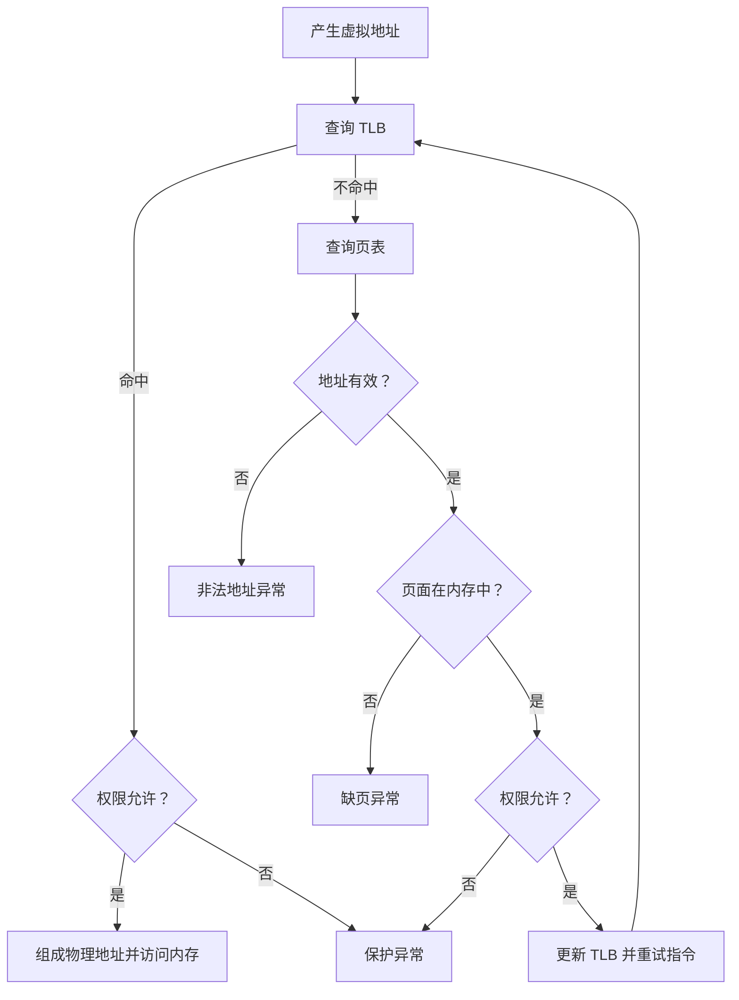
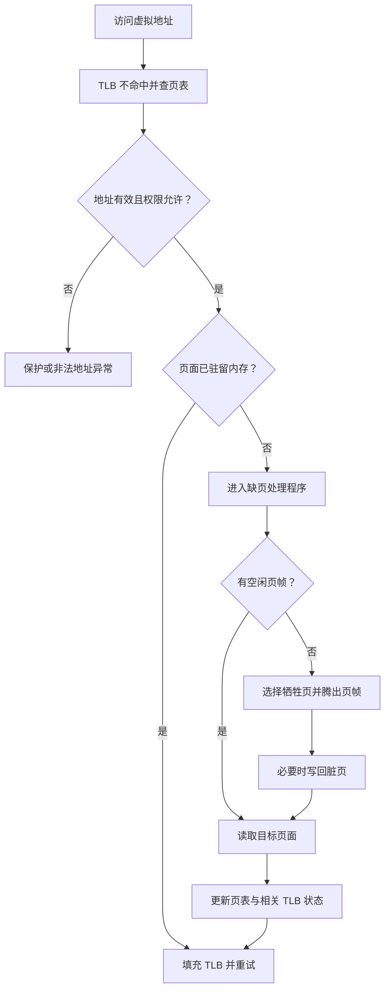

> [!important] 本篇目标
> 承接上一章的 **虚拟化 CPU**，本篇转向另一个核心问题：操作系统如何让多个进程共享有限的物理内存，同时又让每个进程感觉自己拥有一片独立的内存？
>
> 本篇沿着 OSTEP 第 13～23 章的主线展开：先建立**地址空间**这一抽象，再依次学习地址翻译的几种机制——基址与界限、分段、分页和 TLB；随后讨论如何缩小页表，以及物理内存不足时如何换入、换出页面；最后通过 VAX/VMS 与 Linux 两个案例观察这些机制与策略如何组合。
>
> CSAPP 第九章已经从程序员视角介绍了虚拟内存、地址翻译、页表、TLB、缺页异常和动态内存分配。本篇把重点放在这些机制背后的设计动机、实现代价与策略权衡上。

---

# 第一部分 地址空间：抽象与目标

上一章讨论了 CPU 虚拟化：操作系统通过时分共享，让多个进程看起来都能持续使用处理器。内存虚拟化则解决另一个问题：**如何让多个进程共享同一套物理内存，却各自拥有独立的地址空间？**

> [!question] 关键问题：如何虚拟化内存
> 物理内存容量有限，而且需要被多个进程共享。操作系统如何为每个进程提供一个私有、连续、足够大的地址空间，并确保一个进程不能随意访问其他进程或内核的内存？

核心思路是：**程序使用虚拟地址，硬件在访问内存时将它转换为物理地址，操作系统负责维护转换关系并提供保护。** 地址翻译通常由内存管理单元（Memory Management Unit，MMU）执行。只要转换机制足够高效，这一过程就可以对普通程序保持透明。

> [!tip] CSAPP 回顾
>
> - 物理寻址与虚拟寻址、地址空间：9.1、9.2
> - 虚拟内存作为缓存、内存管理与保护的工具：9.3～9.5
> - 地址翻译、TLB、多级页表：9.6.2、9.6.3、9.7.1

## 3.1 从物理内存到地址空间

早期系统的内存布局比较直接：操作系统占据物理内存的一部分，运行中的程序使用另一部分。程序看到的地址基本就是实际使用的物理地址，内存抽象和保护能力都很有限。

多道程序与分时系统出现后，多个进程需要同时驻留在内存中。若一个进程能够随意读写整个物理内存，它就可能破坏其他进程的数据，甚至覆盖操作系统本身。因此，操作系统不仅要共享内存，还必须隔离不同的使用者。

为此，操作系统向每个进程提供**地址空间**（address space）：程序可以使用的一组虚拟地址，以及这些地址所代表的代码和数据。一个典型进程的地址空间包括：

| 区域                       | 作用                               | 典型布局                                 |
| -------------------------- | ---------------------------------- | ---------------------------------------- |
| **代码段**（code / text）  | 保存程序指令                       | 通常位于较低的虚拟地址                   |
| **静态数据**（data / BSS） | 保存全局变量、静态变量等           | 通常紧邻代码段                           |
| **堆**（heap）             | 支持 `malloc()` 等动态内存分配     | 典型布局中向较高地址增长                 |
| **栈**（stack）            | 保存函数调用、局部变量等运行时状态 | 典型布局中位于较高地址，并向较低地址增长 |

这只是常见布局，不是必须遵守的硬件规则。实际系统中的地址空间还可能包含共享库、内存映射区域等；多线程进程中的多个线程通常共享同一地址空间，但各自拥有独立的线程栈。

关键在于：**进程看到的是虚拟地址空间，而不是物理内存的真实布局。** 例如，进程 A 访问虚拟地址 `0x1000`，它实际访问的物理地址可能是 `0x81000`；进程 B 也可以使用虚拟地址 `0x1000`，但被映射到另一处物理内存。两个进程的虚拟地址可以相同，并不意味着它们访问同一份数据。

> [!note] 虚拟地址不等于物理地址
> 用户程序中打印出的指针，通常是虚拟地址。程序一般不需要知道相关数据究竟位于哪一个物理页；具体的物理位置由操作系统维护的映射关系和硬件地址翻译机制决定。

例如，下面的程序可以打印出代码、堆和栈上对象的地址：

```c
#include <stdio.h>
#include <stdlib.h>

int main(void) {
    int *p = malloc(sizeof *p);          // 堆上对象
    int x = 3;                           // 栈上对象
    if (p == NULL) return 1;

    printf("code:  %p\n", (void *)main); // 代码段（函数指针转 void *，非严格 ISO C，原书如此）
    printf("heap:  %p\n", (void *)p);
    printf("stack: %p\n", (void *)&x);
    free(p);
    return 0;
}
```

这些指针值是程序所见的虚拟地址。地址的具体数值和布局会受操作系统、编译器、运行时以及地址空间布局随机化（ASLR）等因素影响，因此示例输出只能用于观察，不能当作固定规律。

## 3.2 虚拟内存的三个目标

虚拟内存系统的设计要同时满足三个目标。

| 目标                       | 含义                               | 设计上的要求                                     |
| -------------------------- | ---------------------------------- | ------------------------------------------------ |
| **透明性**（transparency） | 程序不必感知内存虚拟化的实现细节   | 程序按虚拟地址读写内存，地址翻译由系统在后台完成 |
| **效率**（efficiency）     | 虚拟化不能带来过高的时间和空间开销 | 地址翻译要快，页表等管理结构不能占用过多内存     |
| **保护**（protection）     | 进程之间、进程与内核之间相互隔离   | 非法地址访问或违反权限的操作必须被阻止           |

> [!note] CSAPP 的三重角色
> CSAPP 9.3～9.5 用“三重角色”组织同一组能力：虚拟内存作为磁盘的缓存、作为内存管理的工具、作为内存保护的工具。OSTEP 的透明性、效率、保护三个目标，则是在描述这些机制必须满足的设计约束。

这里的"透明"指**程序不需要知道底层机制如何实现**。程序依然使用熟悉的加载、存储和指令获取操作；硬件和操作系统负责将它们映射到实际的物理内存。

保护则是可靠性的基础，其核心原则是**隔离**（isolation）：一个进程不应因为另一个进程出错或恶意操作而受到影响，普通用户进程也不应随意读写内核内存。地址翻译机制因此不只是重定位工具，也必须提供访问权限检查。

## 3.3 用户程序如何申请内存

用户程序使用内存有两种常见方式，它们属于用户态接口，不等同于操作系统底层的物理页管理。

- **栈内存**由编译器按函数调用的生命周期隐式管理：局部变量在函数调用期间存在，返回后生命周期结束。
- **堆内存**由程序通过 `malloc()` 显式申请、`free()` 显式释放，可以跨越单次函数调用存在，生命周期由程序负责。

```c
int *create_value(void) {
    int *p = malloc(sizeof *p);   // 失败时返回 NULL
    if (p == NULL) return NULL;
    *p = 42;
    return p;                     // 调用者负责在不再使用时 free(p)
}
```

> [!important] `malloc` / `free` 是库函数，不是系统调用
> 它们由用户态分配器（如 glibc）实现，管理进程堆中的空闲区域。分配器需要更多空间时，才通过系统调用 `brk` / `sbrk` 调整堆的上界，或用 `mmap` 映射一块匿名内存向 OS 索取。`free(ptr)` 释放先前返回且尚未释放的内存块；`sizeof(ptr)` 得到的是指针本身的大小，不是所指区域的大小。

常见的内存管理错误（未分配就使用、分配不足导致越界、读未初始化内存、忘记释放、释放后使用、重复释放）及其后果，见 CSAPP 9.15；`malloc`/`free` 的接口与常见误用见 9.10。进程退出时操作系统会回收其整个地址空间，但这不能成为长期运行程序忽略内存泄漏的理由。

---

# 第二部分 机制：把虚拟地址变成物理地址

建立地址空间抽象后，接下来的问题是：**程序发出的虚拟地址究竟如何对应到物理内存？** 这由地址翻译（address translation）机制完成。操作系统负责建立和维护映射，MMU 在内存访问路径上执行必要的地址翻译与保护检查。

## 3.4 基址与界限：最简单的地址翻译

最简单的机制称为**基址与界限**（base and bounds），也称动态重定位（dynamic relocation）。它为每个运行进程维护两个寄存器：

- **基址寄存器**（base register）：进程地址空间在物理内存中的起始地址。
- **界限寄存器**（bounds / limit register）：进程允许访问的虚拟地址范围，常用地址空间大小表示。

进程生成虚拟地址后，硬件先检查地址是否越界，再将其加上基址得到物理地址：

$$
\text{PA} = \text{VA} + \text{base}
$$

前提是虚拟地址满足界限检查，例如采用"地址空间大小"这一约定时，需要有 $0 \leq \text{VA} < \text{bound}$。

假设某进程的地址空间大小为 4 KB，并被放置在物理地址 16 KB 处，则 `VA = 0` 映射到 `PA = 16 KB`，`VA = 1 KB` 映射到 `PA = 17 KB`，`VA = 3000` 映射到 `PA = 19384`。但 `VA = 4400` 超出 4 KB 界限，硬件会触发异常，而不会允许进程访问相邻区域。

> [!note] 地址翻译由谁执行？
> 进程直接使用虚拟地址。正常的地址翻译由硬件完成，不需要操作系统介入每一次内存访问。操作系统负责在进程运行前设置寄存器，并在进程切换时保存和恢复相应状态。

### 3.4.1 硬件和操作系统各自负责什么

要让基址与界限机制安全工作，硬件至少需要：

| 硬件支持               | 用途                                       |
| ---------------------- | ------------------------------------------ |
| 用户模式与内核模式     | 限制普通进程执行特权操作                   |
| 基址与界限寄存器       | 提供重定位和范围检查所需的信息             |
| 地址翻译与越界检查电路 | 对每次内存访问执行检查并计算物理地址       |
| 修改寄存器的特权指令   | 只允许内核设置基址与界限，进程不能自行修改 |
| 异常与陷阱机制         | 非法访问发生时把控制权交给操作系统         |

操作系统则需要在几个关键时刻介入：

1. **创建进程时**：在物理内存中找到可容纳其地址空间的区域，并设置基址与界限。
2. **进程切换时**：保存旧进程的寄存器值，并为新进程恢复正确的值。
3. **进程退出时**：回收其占用的内存，将空间归还给空闲空间管理结构。
4. **非法访问时**：处理越界异常，通常终止出错进程。

早期也曾采用纯软件的**静态重定位**：加载程序时改写可执行文件中的地址，使其适合最终装入位置。它不需要每次访问都由硬件转换，但难以在运行时移动程序，也难以可靠地保护进程之间的内存，因此不能替代有硬件支持的动态检查。

### 3.4.2 局限：内部碎片与连续空间

基址与界限的实现简单、高效，但通常要求一个进程的整个地址空间放在一块连续的物理内存区域中。假设给进程分配了固定大小的区域，而它实际只使用其中一小部分，未用的空间仍被占据。这种分配单元内部的浪费称为**内部碎片**（internal fragmentation）。

更麻烦的是，典型地址空间中的代码、堆和栈之间可能留有很大的未使用区域。如果要求这些空洞也跟着整个地址空间一起驻留在物理内存中，就会浪费大量内存。为此，我们需要更灵活的机制。

## 3.5 分段：按逻辑区域重定位

基址与界限机制只有一组寄存器，负责整个地址空间。**分段**（segmentation）将这个思路推广为多组基址与界限：代码、堆、栈等逻辑区域各自有独立的映射信息。操作系统因此可以把不同段放到物理内存的不同位置，而不必为段与段之间的未使用空间分配物理内存。

每个段至少需要记录：

- **基址**：该段在物理内存中的起始位置。
- **界限**：该段允许访问的范围。
- **增长方向**：支持栈这类向低地址增长的段。
- **保护信息**：例如是否允许读、写或执行。

对于向高地址增长的普通段，地址翻译为：

$$
\text{PA} = \text{base}_{s} + \text{offset}
$$

同时必须检查段内偏移是否小于该段的界限。虚拟地址中的段编号 $s$ 决定使用哪一组基址与界限。

### 3.5.1 如何判断地址属于哪个段

常见思路有两种：

- **显式方式**：虚拟地址中的某些位直接表示段编号，其余位表示段内偏移。例如用高两位区分代码、堆、栈等段。
- **隐式方式**：根据产生地址的方式推断段。例如，程序计数器产生的取指地址属于代码段；基于栈指针的访问属于栈段。

显式方式直观，但会占用部分虚拟地址位，并且段的划分方式受到地址格式限制；隐式方式则需要硬件根据指令和寄存器使用情况判断。

### 3.5.2 栈的反向增长、保护与共享

栈向较低地址增长，其地址翻译不能简单地把正偏移加到基址上。设段内最大长度为 $\text{maxSeg}$，硬件需要先求**负偏移**，再加到基址上：

$$
\text{off}' = \text{off} - \text{maxSeg} \;(<0), \qquad \text{PA} = \text{base} + \text{off}'
$$

例：16 KB 地址空间，高 2 位为段号，段内偏移 12 位，每段最大 4 KB。栈段 base = 28 KB，访问虚拟地址 15 KB：段号 `11`，段内偏移 3 KB，则 $\text{off}' = 3\,\text{KB} - 4\,\text{KB} = -1\,\text{KB}$，$\text{PA} = 28\,\text{KB} - 1\,\text{KB} = 27\,\text{KB}$。

分段也可以支持更细致的保护。如果代码段标记为可读和可执行、不可写，操作系统就能让多个进程共享同一份只读代码，而不必为每个进程复制一份。堆和栈通常需要读写权限；试图写入只读段或从不可执行段取指，都应触发保护异常。

### 3.5.3 分段的代价：外部碎片

分段减少了地址空间内部空洞造成的浪费，却带来了新的问题。不同进程、不同段的大小各不相同，物理内存使用一段时间后可能留下许多互不相邻的小空闲块。即使空闲空间总量足够，也可能没有一块连续区域能够满足新的分配请求。这称为**外部碎片**（external fragmentation）。

一种解决方法是**内存紧凑**（compaction）：移动现有段，把零散空闲块合并成较大的连续区域。但移动数据成本很高，还需要更新相关映射。因此，分段并不能彻底解决内存管理问题；如果单个逻辑段内部本身也很稀疏，它仍然可能浪费空间。

## 3.6 空闲空间管理：分配器如何管理变长区域

分段讨论的是 OS 如何管理物理内存中大小不一的区域；同样的问题也出现在用户态 `malloc()` / `free()` 分配器中。只要分配和释放的块大小不固定，就需要决定如何找到合适的空闲区域，以及如何避免碎片。

> [!tip] CSAPP 回顾
> 隐式 / 显式空闲链表、放置策略（首次 / 下一次 / 最佳适配）、分割与合并、边界标记：见 CSAPP 9.9～9.13，重点 9.13.1、9.13.2、9.13.5、9.13.6、9.13.8、9.13.9。本节只保留 OSTEP 的视角，并补充 slab 与伙伴系统。

### 3.6.1 分割、合并与头部

- **分割**（splitting）：找到比请求更大的空闲块，将所需部分分配给调用者，余下部分留在空闲列表中。
- **合并**（coalescing）：释放时检查相邻区域是否也空闲，若相邻则合并为更大的块。

例：30 字节区域依次为 10 空闲、10 已分配、10 空闲，空闲总量 20 字节，仍无法满足 15 字节的连续请求。

`free(ptr)` 不接收块大小，分配器因此在用户指针附近保存**头部**（header），记录块大小等信息，释放时通过指针找到头部。只靠头部只能方便地向后合并；要在常数时间内向前合并，还需要**脚部**（footer），即头部的副本，见 CSAPP 9.13.6。

### 3.6.2 常见空闲空间分配策略

| 策略                       | 选择方式                       | 优点                           | 局限                                             |
| -------------------------- | ------------------------------ | ------------------------------ | ------------------------------------------------ |
| **最佳适配**（best fit）   | 找到能够满足请求的最小空闲块   | 希望减少分配后剩余的空间       | 通常需要扫描大量空闲块，可能留下难以利用的小碎片 |
| **最差适配**（worst fit）  | 选择最大的空闲块               | 希望分割后仍留下较大的空闲区域 | 搜索开销大，实际效果往往不理想                   |
| **首次适配**（first fit）  | 从列表开头找到第一个足够大的块 | 查找较快                       | 列表开头可能积累很多小碎片                       |
| **下一次适配**（next fit） | 从上次查找结束处继续搜索       | 避免总从列表开头开始           | 效果仍取决于分配请求序列与列表组织方式           |

> [!note] 术语
> CSAPP 9.13.2 讨论首次适配、下一次适配和最佳适配；最差适配是 OSTEP 补充的策略，CSAPP 未展开。

此外有两类常见的专用结构：

- **分离存储 / 分离适配（segregated storage / segregated fit）与 slab 分配器**：按常见对象大小（或内核对象类型）维护独立列表或缓存，减少通用分配与初始化的开销。
- **伙伴系统**（buddy allocator）：空闲块按 2 的幂次大小管理，分配时递归拆分，释放时若伙伴也空闲就逐级合并。便于合并，但块大小受限，可能产生内部碎片。

这些策略处理变长块的分配效率和碎片问题。接下来的分页反过来：把内存划分成固定大小的单元，从根本上避免外部碎片。

## 3.7 分页：把地址空间切成固定大小的页

> [!note] 三种机制对比
>
> | 机制       | 映射粒度     | 主要碎片                         | 硬件支持                  | 共享能力         |
> | ---------- | ------------ | -------------------------------- | ------------------------- | ---------------- |
> | 基址与界限 | 整个地址空间 | 内部碎片（含空洞）               | 一对基址 / 界限寄存器     | 无               |
> | 分段       | 逻辑段       | 外部碎片                         | 每段一对寄存器 + 段号识别 | 可共享只读段     |
> | 分页       | 固定大小的页 | 内部碎片（页内），**无外部碎片** | 页表 + MMU（常配 TLB）    | 页级共享，粒度细 |

**分页**（paging）不再要求整个地址空间或每个逻辑段连续地放在物理内存中，而是把虚拟地址空间切成固定大小的**虚拟页**（virtual page），把物理内存切成同样大小的**物理页**（physical page，又称页帧 page frame）。虚拟页可以映射到任意空闲物理页，因此一个进程的虚拟地址空间在物理内存中可以是离散的。

操作系统为每个进程维护**页表**（page table），记录虚拟页到物理页的映射。若虚拟页 0 映射到物理页 3，虚拟页 1 映射到物理页 7，那么两个相邻的虚拟页不必占据相邻的物理页。

### 3.7.1 将虚拟地址拆成 VPN 与 VPO

虚拟地址可以分为两部分：

- **虚拟页号**（Virtual Page Number，VPN）：指出要访问哪一个虚拟页。
- **虚拟页面偏移**（Virtual Page Offset，VPO）：指出该页中的具体字节位置，也就是常说的页内偏移。

如果页大小为 $2^p$ 字节，那么 VPO 需要 $p$ 位；虚拟地址剩下的高位就是 VPN。地址翻译只需要把 VPN 替换成对应的物理页号（PPN），VPO 保持不变：

$$
\text{VA} = (\text{VPN},\ \text{VPO})
\quad\Longrightarrow\quad
\text{PA} = (\text{PPN},\ \text{PPO})
$$

其中 PPO 是**物理页面偏移**（Physical Page Offset）。因为虚拟页和物理页大小相同，VPO 与 PPO 的位数和数值都相同。

例如，一个 64 字节的虚拟地址空间需要 6 位地址；若页大小为 16 字节，则 VPO 占 4 位，VPN 占 2 位。假设虚拟页 1 映射到物理页 7，访问虚拟地址 21：

1. $21 = 010101_2$。
2. 高两位 `01` 是 VPN 1，低四位 `0101` 是 VPO 5。
3. VPN 1 映射到 PPN 7，因此物理地址为 $7\times16+5=117$。

### 3.7.2 页表记录什么

最简单的页表是一个数组，称为**线性页表**（linear page table）。操作系统用 VPN 作为索引，找到相应的页表条目（Page Table Entry，PTE）。下表按 OSTEP 的字段划分说明；CSAPP 的 PTE 划分略有不同，见后面的跨书对照。

| 字段                               | 作用                                               |
| ---------------------------------- | -------------------------------------------------- |
| **物理页号（PPN）**                | 记录虚拟页映射到哪个物理页                         |
| **有效位（valid）**                | 表示该虚拟页是否属于进程允许使用的地址空间         |
| **保护位（protection）**           | 限定页面能否读、写或执行                           |
| **存在位（present）**              | 表示该页当前是否驻留在物理内存中                   |
| **脏位（dirty）**                  | 表示页面载入后是否被修改过，影响换出时是否需要写回 |
| **引用位（reference / accessed）** | 记录页面近期是否被访问，可辅助页面替换             |

> [!warning] 有效位与存在位不是一回事
> **有效位**回答"这个地址是否属于进程可以使用的地址空间"；**存在位**回答"这个合法页面当前是否在物理内存里"。一个有效但不存在的页面可能已被换出到磁盘，需要通过缺页处理调入；一个无效页面则可能根本不属于该进程的地址空间。

> [!warning] 跨书对照：CSAPP 的有效位不能简单等同于 OSTEP 的存在位
> CSAPP 的 PTE 只有**一个**有效位，但它同时承担了“是否已分配”和“是否驻留在 DRAM”的部分职责：
>
> | CSAPP PTE            | 含义                 | 对应 OSTEP 的状态      |
> | -------------------- | -------------------- | ---------------------- |
> | 有效位 = 1           | 页面已缓存在 DRAM 中 | 有效且存在             |
> | 有效位 = 0，地址非空 | 页面在磁盘上         | 有效但不存在（已换出） |
> | 有效位 = 0，地址为空 | 页面尚未分配         | 无效                   |
>
> 因此，不能把 CSAPP 的有效位直接当作 OSTEP 的存在位；对照阅读时，遇到“有效位”务必先确认是哪本书的口径。CSAPP 的 PTE 还包含 R/W、U/S、XD 等权限位，以及 A/D 位，见 9.7.1。

### 3.7.3 页表为什么既大又慢

分页解决了连续分配和外部碎片的问题，但简单的线性页表引出了两个新问题：**页表占用太多内存**，而且**每次内存访问都可能额外访问页表**。

**硬件如何找到 PTE。** 页表存放在物理内存中，硬件用**页表基址寄存器**（Page Table Base Register，PTBR）记录当前进程页表的起始物理地址：

$$
\text{PTEAddr} = \text{PTBR} + \text{VPN} \times \text{sizeof(PTE)}
$$

进程切换时，操作系统必须同时切换 PTBR。没有 TLB 时，每次访存要先读一次 PTE，再访问目标地址，**一次访存变成两次**。

**空间开销。** 以 32 位虚拟地址、4 KB 页和每个 PTE 4 字节为例：

- 4 KB = $2^{12}$ 字节，因此 VPO 为 12 位，VPN 为 20 位。
- 一个地址空间有 $2^{20}$ 个虚拟页，也就是约一百万个页表条目。
- 每项 4 字节，一个线性页表大小约为 4 MB。

这是**每个进程**的页表开销；当系统中同时有很多进程时，页表会消耗大量内存。

这两个问题将引出后续的两类优化：用 **TLB** 缓存常用地址翻译以提升速度；用更紧凑的页表结构减少空间开销。

> [!tip] CSAPP 回顾：PTE 与地址翻译
>
> - 9.3.2：PTE 保存有效位与地址字段；有效位为 1 时，地址字段指向物理页。
> - 9.6：MMU 用 VPN 选择 PTE，把 PTE 中的 PPN 与 VPO 拼接成物理地址。
> - 9.7.1：Core i7 使用四级页表，CR3 指向第一级页表；PTE 还包含 R/W、U/S、XD 与 A/D 位。

## 3.8 TLB：缓存地址翻译

既然页表查找太慢，能否像缓存数据一样，把近期使用过的地址翻译缓存起来？这就是**翻译后备缓冲器**（Translation Lookaside Buffer，TLB，OSTEP 译作地址转换旁路缓冲器）。TLB 是 MMU 中的小型、虚拟寻址缓存，保存部分页表条目，也就是 VPN 到 PPN 的映射及其权限信息。

### 3.8.1 TLB 命中与不命中

一次内存访问大致遵循下面的过程：

1. 从虚拟地址中提取 VPN，并查询 TLB。
2. **TLB 命中**：取得 PPN，检查权限，把 PPN 与 VPO 组合成物理地址，然后访问内存。
3. **TLB 不命中**：查页表以找到映射；若映射合法、权限允许且页面驻留内存，则把该映射放入 TLB，并重试指令。
4. 若地址无效、违反权限，或页面不在物理内存中，则分别进入相应的异常处理路径。



TLB 命中时，地址翻译通常非常快；不命中则需要额外访问页表。若 TLB 不命中频繁发生，性能就会受到明显影响。因此，TLB 的设计与程序的内存访问局部性密切相关。

### 3.8.2 局部性与 TLB 命中率

缓存的有效性通常依赖两种局部性：

- **时间局部性**（temporal locality）：最近访问过的地址或数据，很可能很快再次访问。
- **空间局部性**（spatial locality）：访问某个地址后，接下来很可能访问附近的地址。

例如，假设一个 `int` 数组有 10 个元素，起始虚拟地址为 100，每页大小为 16 字节。每个整数占 4 字节时，数组分布在三个虚拟页上：前 3 个元素位于第一页，接下来 4 个元素位于第二页，最后 3 个元素位于第三页。顺序遍历数组时，每遇到一个新页，第一次访问可能导致 TLB 不命中；同页中的后续访问通常命中。忽略循环指令和其他数据访问时，这 10 次数组访问将出现 3 次不命中、7 次命中，命中率为 70%。

如果很快再次遍历同一数组，而且相关映射仍留在 TLB 中，那么第二次遍历可能全部命中。相反，如果程序在很短时间内反复访问远多于 TLB 容量的页面，映射就会频繁被替换，命中率下降。

### 3.8.3 谁来处理 TLB 不命中

TLB 不命中可以由硬件处理，也可以由操作系统处理：

| 方式               | 处理流程                                                   | 取舍                                             |
| ------------------ | ---------------------------------------------------------- | ------------------------------------------------ |
| **硬件管理的 TLB** | 硬件按体系结构规定的页表格式查找 PTE，填充 TLB，再重试指令 | 硬件逻辑更复杂，但常见路径可以自动处理           |
| **软件管理的 TLB** | 硬件触发异常，操作系统查找页表并通过特权指令填充 TLB       | 硬件更简单，操作系统在页表结构和处理逻辑上更灵活 |

软件管理的 TLB 有两个容易忽略的细节：

1. **陷阱返回后重试出错指令。** 系统调用的陷阱返回到**下一条**指令；TLB 不命中陷阱返回时，硬件保存的是**出错指令本身**的 PC，返回后要重新执行它，这次应当命中。
2. **不命中处理程序自身不能再触发 TLB 不命中**，否则会无限递归。常见解决办法：把处理程序放在不经地址翻译的物理内存中，或在 TLB 中保留若干永久有效（wired）的条目，专门映射处理程序的代码与数据。

无论哪种方式，**缺页处理通常仍由操作系统负责**，因为它可能需要执行磁盘 I/O、分配物理页或终止非法访问的进程。

### 3.8.4 进程切换时如何处理 TLB

TLB 中的映射往往属于某个进程的地址空间。假设进程 A 的 VPN 10 映射到 PPN 100，而进程 B 的 VPN 10 映射到 PPN 170。如果切换到 B 后仍把 A 的映射当作当前映射使用，B 就可能访问错误的物理内存。

一种简单方法是在地址空间切换时**清空 TLB**，确保新进程不会误用旧映射；代价是新进程需要重新填充 TLB，产生更多不命中。

另一种方法是在 TLB 条目中加入**地址空间标识符**（Address Space Identifier，ASID）。查询时同时匹配 VPN 和 ASID，因此不同进程可以在 TLB 中保留各自的映射，减少上下文切换后的重新填充。共享物理页面也可以映射到不同进程的虚拟地址中，例如多个进程共享只读代码页。

> [!note] 两种"有效位"需要区分
> 页表中的有效位用于判断虚拟地址是否属于进程可用的地址空间；TLB 条目的有效位则用于表示该缓存条目当前是否保存着可用的映射。TLB 条目无效并不表示对应虚拟地址非法，只表示需要重新查找映射。

### 3.8.5 TLB 替换

TLB 容量有限，插入新映射时可能需要替换旧条目。常见思路包括：

- **LRU**：替换最近最少使用的条目，利用时间局部性。
- **随机替换**：随机选择一个条目，逻辑简单，也能避免某些特定访问模式使 LRU 表现很差。

TLB 的容量、相联度和替换实现会因处理器架构而异。重要的不是假定所有 TLB 都使用某种固定组织方式，而是理解：它缓存的是地址翻译，TLB 不命中会触发额外工作。

> [!tip] CSAPP 回顾：TLB 与地址翻译
>
> - 9.6.2：TLB 是 MMU 中缓存 PTE 的小型、虚拟寻址缓存；VPN 划分为 TLBT 与 TLBI，VPO 不参与 TLB 查找。
> - 命中时，MMU 直接用 TLB 中的 PPN 与 VPO 组成物理地址；不命中时才访问页表。
> - 9.7.1：Core i7 的 TLB 是四路组相联的，L1 TLB 分为指令 TLB 和数据 TLB。

## 3.9 如何让页表更小

TLB 缓解了地址翻译的时间开销，却没有直接消除页表占用大量内存的问题。为此，人们提出了多种页表结构，各自在空间、查找时间和实现复杂度之间做权衡。

### 3.9.1 使用更大的页

如果页面更大，一个地址空间需要的虚拟页数就更少，线性页表也随之缩小。例如，32 位地址空间使用 16 KB 页时，页数从约一百万减少到 $2^{18}$，在每个 PTE 仍为 4 字节的简化假设下，页表大小从约 4 MB 降为约 1 MB。

但大页会增加**内部碎片**：一个页面即使只使用少量字节，也需要占用整个页帧。大页还涉及更复杂的分配与回收问题。因此，许多系统以较小页面作为常见选择，同时在适合的场景中支持大页。大页的另一个价值是用较少的 TLB 条目覆盖更大的内存范围。

### 3.9.2 分段与分页的混合

另一种方法是让代码、堆和栈等段各自拥有一个页表。它把分段的逻辑划分与分页的固定大小分配结合起来，未使用的段间空洞不需要对应的页表条目，也不必分配物理页。

然而，这种混合方法仍依赖逻辑段的布局：如果某一段本身很大但内部稀疏，它依然可能浪费页表空间。此外，各段的页表大小不一，管理这些表本身仍可能产生分配问题。因此，这个方法并非通用答案。

### 3.9.3 多级页表

**多级页表**（multi-level page table）通过增加一层或多层索引，避免为完全未使用的地址空间保留整段线性页表。最常见的两级结构由**页目录**和分成多个页的页表组成：

- 页目录条目（PDE，CSAPP 称一级页表条目）指出相应的页表部分是否存在，以及它位于何处。
- 页表条目（PTE）记录具体虚拟页到物理页的映射。
- 如果一整页页表都没有有效映射，就不必为它分配物理内存。

对于 32 位虚拟地址、4 KB 页面、4 字节 PTE 的常见简化模型，虚拟地址可以划分为 10 位页目录索引、10 位页表索引和 12 位 VPO。页目录索引找到相应的页目录条目；该条目再定位包含目标 PTE 的页表页；最后用 PTE 中的 PPN 与 VPO 形成物理地址。

与线性页表相比，多级页表能让页表空间大致随实际使用的地址空间增长，而且页表的每个部分可以独立放置在不同物理页中，不要求整个页表连续驻留在物理内存中。

代价是额外的间接访问。若 TLB 不命中，两级页表可能需要先读 PDE，再读 PTE，才能完成地址翻译；更多层级会增加查找步骤。但在常见的 TLB 命中路径上，不需要执行这些页表遍历。

### 3.9.4 反向页表与交换页表

**反向页表**（inverted page table）把思路倒过来：不为每个进程的每个虚拟页都保存一个条目，而是以物理页为索引，记录哪个进程的哪个虚拟页正在使用该物理页。这样条目数量更接近物理内存中的物理页数量，能减少大虚拟地址空间带来的页表空间开销；但从虚拟地址寻找物理页时，查找更复杂，通常需要额外索引或散列结构来加速。

还有一种做法是将页表本身放在内核虚拟内存中，在内存压力较大时允许部分页表页面被换出。它进一步降低页表对常驻物理内存的需求，但也让地址翻译和内核自身的内存管理更加复杂。

### 3.9.5 页表结构与访存开销对比

下表按"一次用户访存额外需要几次内存访问（读页表）"比较：

| 机制 / 情形            | 额外内存访问次数 | 备注                   |
| ---------------------- | :--------------: | ---------------------- |
| 基址与界限             |        0         | 寄存器内完成加法与比较 |
| 任意分页，**TLB 命中** |        0         | 稳态下的常见路径       |
| 线性页表，TLB 不命中   |        1         | 读一次 PTE             |
| $n$ 级页表，TLB 不命中 |       $n$        | 逐级读取，每级一次     |

> [!note] 页表结构的核心权衡
> 更紧凑的页表可以减少空间开销，但可能增加 TLB 不命中后的查找成本；更直接的结构查找简单，却可能需要大量连续或常驻的内存。多级页表之所以常见，是因为它很好地利用了虚拟地址空间通常比较稀疏这一事实。

> [!tip] CSAPP 回顾：多级页表
>
> - 9.6.3：32 位地址、4 KB 页、4 B PTE 时，线性页表约 4 MB；两级页表用一级 PTE 覆盖 4 MB 的片，只为已分配的片创建二级页表。
> - 9.7.1：Core i7 使用四级页表，36 位 VPN 分成 4 个 9 位片，CR3 指向第一级页表。
> - 多级页表增加 TLB 不命中后的查找次数，但命中路径仍在 MMU 内完成。

---

# 第三部分 超越物理内存：缺页与页面替换

到目前为止，我们主要假设进程需要的页面都已经位于物理内存中。但如果多个进程的工作集总量超过物理内存容量，操作系统该怎么办？一种办法是拒绝运行更多进程；另一种办法是把当前不常用的页面暂时放到磁盘，需要时再取回。虚拟内存由此可以为进程提供大于物理内存的地址空间。

> [!tip] CSAPP 回顾
> 缺页异常与处理、页面作为磁盘与 DRAM 之间的缓存（页命中、缺页、按需页面调度）、工作集与抖动：见 CSAPP 9.3.3、9.3.4、9.3.6、9.7.2。内存映射与写时复制：见 9.8.1、9.8.2。

## 3.10 交换空间与缺页异常

### 3.10.1 交换空间

操作系统可以在磁盘上保留一部分空间，供页面换入和换出使用，通常称为**交换空间**（swap space）。操作系统需要记录页面在磁盘上的位置，并以页面为单位进行读写。

并不是所有被移出物理内存的页面都必须写入交换空间。例如，若某个代码页来自可执行文件且从未被修改，操作系统通常可以在需要时重新从原文件读取。对于没有可直接重读的后备内容、又需要保留的数据，则可能需要写入交换空间。

交换空间允许系统在物理内存中只保留当前需要的一部分页面。但它并不会让磁盘变得和内存一样快：磁盘 I/O 的延迟远高于内存访问，因此缺页处理会比 TLB 命中昂贵得多。

### 3.10.2 存在位与缺页

当硬件查询页表时，若发现某个虚拟页有效，却不在物理内存中，就不能直接形成可访问的物理地址。页表中的**存在位**（present bit）用于指示页面是否驻留在物理内存中；CSAPP 把这层驻留含义并入有效位，见 9.3.2。

需要区分三种情况：

| 情况           | 含义                                     | 后续处理                                           |
| -------------- | ---------------------------------------- | -------------------------------------------------- |
| 地址无效       | 该地址不属于进程允许使用的地址空间       | 进入异常处理，通常终止进程或向其报告错误           |
| 权限不允许     | 地址有效，但当前操作违反读、写或执行权限 | 触发保护异常                                       |
| 页面不在内存中 | 地址有效、访问权限正确，但页面当前未驻留 | 触发**缺页异常**（page fault），由操作系统调入页面 |

"缺页异常"这个名称容易让人误以为程序犯了错误。实际上，当访问一个合法但暂时不在内存中的页面时，缺页是虚拟内存正常工作的一部分；只有访问无效地址或违反权限时，才是程序的非法访问。

### 3.10.3 缺页处理流程

缺页处理需要操作系统介入，因为它可能需要分配页帧并执行磁盘 I/O。典型流程如下：

1. **陷入内核**：硬件检测到页面不在内存中，触发缺页异常，保存足够的执行现场并转交操作系统。
2. **确认访问合法**：操作系统检查地址空间映射与访问权限。若访问无效或违反保护要求，则向进程报告错误，必要时终止进程。
3. **找到页面的后备位置**：根据页表或其他内核数据结构，确定应从交换空间或文件的哪个位置读取页面。
4. **取得物理页**：若存在空闲页帧，就直接使用；若没有，则需要运行页面替换策略，先腾出页帧。
5. **执行 I/O**：将所需页面读入选定的物理页。若被替换的页面已修改，通常需要先将其写回合适的后备存储。
6. **更新映射并恢复执行**：更新页表中的 PPN 和存在位，按需要处理相关 TLB 条目，随后重试导致缺页的指令。

> [!tip] CSAPP 回顾：Linux 缺页处理
> 9.7.2 把 Linux 缺页处理概括为三步：先判断虚拟地址 A 是否落在某个区域结构内；再检查进程是否有读、写或执行权限；最后为合法缺页选择牺牲页、换入页面并更新页表。



磁盘 I/O 可能持续很长时间。等待 I/O 的进程会进入阻塞状态，操作系统可以在此期间调度其他就绪进程，以免 CPU 因一个进程等待磁盘而闲置。

### 3.10.4 什么时候换出页面

一种简单想法是等内存完全用满后再寻找牺牲页，但实际系统可能希望提前保留一些空闲页。部分操作系统会维护**低水位线**（low watermark）和**高水位线**（high watermark）：当空闲页数量低于低水位线时，后台页回收线程（swap daemon / page daemon）开始工作；当空闲页数量回升到高水位线时，它再休眠。

后台回收能把部分等待成本从前台缺页路径移走，也便于把多次磁盘写入合并成较大的 I/O 操作。不过，它不能消除内存不足的根本问题；如果所有活跃进程都需要大量页面，系统仍可能频繁地换入换出。

## 3.11 页面替换策略

当物理内存没有空闲页帧，而某个合法页面又必须被调入时，操作系统需要决定**替换哪个页面**。这个决定会显著影响性能，因为替换了很快又会被访问的页面，就可能马上再次缺页。

页面替换的目标通常是尽可能减少未来的缺页次数，但未来的访问序列事先未知，因此不同策略只能利用不同的信息来近似选择。

### 3.11.0 评价指标：平均访存时间

把物理内存看作磁盘的缓存，用**平均访存时间**（Average Memory Access Time，AMAT）衡量：

$$
\text{AMAT} = T_M + P_{\text{miss}} \cdot T_D
$$

其中 $T_M$ 是访问内存的时间，$T_D$ 是访问磁盘的时间，$P_{\text{miss}}$ 是缺页概率。

取 $T_M = 100\,\text{ns}$，$T_D = 10\,\text{ms}$：

| $P_{\text{miss}}$ | AMAT                                                                  |
| ----------------- | --------------------------------------------------------------------- |
| 0.1               | $100\,\text{ns} + 0.1 \times 10^7\,\text{ns} \approx 1\,\text{ms}$    |
| 0.001             | $100\,\text{ns} + 10^{-3} \times 10^7\,\text{ns} = 10.1\,\mu\text{s}$ |

即使缺页率只有 0.1%，磁盘代价仍占主导；因此压低缺页率才是替换策略的核心目标。

缓存不命中通常分三类：**强制不命中**（compulsory，首次访问）、**容量不命中**（capacity，缓存装不下）、**冲突不命中**（conflict，受相联度限制）。OS 的页缓存（相当于 CSAPP 的 DRAM 缓存）是全相联的，没有冲突不命中；冲突不命中主要出现在 CPU 缓存与 TLB 等硬件结构中。

> [!tip] CSAPP 回顾：替换、写回与局部性
>
> - 9.3.1：DRAM 缓存通常全相联、采用写回，因为缺页代价远高于命中。
> - 9.3.6：局部性使工作集能留在内存；工作集超过物理内存会导致抖动。
> - 9.7.1：PTE 的 A 位（引用位）和 D 位（脏位）为页面替换与写回提供硬件信息。
>
> CSAPP 没有展开 FIFO / LRU / 时钟的具体算法，这些策略是 OSTEP 的重点。

### 3.11.1 最优替换：作为理论基准

**最优替换**（OPT / MIN）会替换未来最长时间内才会再次被访问，或者未来再也不会被访问的页面。由于它需要知道未来的访问序列，通常不能直接用于真实系统；它的价值在于作为理论基准，用来比较实际算法离最优表现有多远。

### 3.11.2 FIFO 与随机替换

**先进先出**（FIFO）替换最早进入内存的页面。它容易实现，只需维护进入顺序；但"进入最早"并不等于"最不重要"，因此可能淘汰一个刚刚还在频繁使用的页面。

**随机替换**（RAND）随机选择牺牲页。它不依赖复杂的历史记录，实现简单，有时也能避免某些固定策略在特定循环访问模式下反复失败。但结果具有随机性，不能保证接近最优。

> [!important] Belady 异常
> 对 FIFO，增加页帧数反而可能增加缺页次数。经典例子：访问序列 `1,2,3,4,1,2,5,1,2,3,4,5`，FIFO 在 3 个页帧下缺页 9 次，在 4 个页帧下缺页 10 次。
>
> LRU 具有**栈性质**（stack property）：$n$ 帧时驻留的页集合，始终是 $n+1$ 帧时驻留集合的子集，因此增加页帧不会增加缺页次数，不会出现 Belady 异常。

### 3.11.3 LRU 与局部性

**最近最少使用**（Least Recently Used，LRU）替换最近最久没有被访问的页面。它利用时间局部性：如果一个页面最近被访问过，它短期内可能还会被使用，因此值得保留。

与 FIFO 相比，LRU 使用了更多访问历史；但要实现精确 LRU，系统必须在页面被访问时更新相关顺序或时间信息。对每次内存访问都进行精确记录会带来开销，所以现实系统常使用近似 LRU，而不是追求绝对精确的访问顺序。

LRU 并非对所有工作负载都有效。例如，若程序循环访问 50 个页面，而内存只能容纳其中 49 个，那么每次访问都可能淘汰下一轮马上要用的页面，命中率很差。这个例子说明，历史信息是有用的启发式依据，却不能保证在所有访问模式下都表现良好。

### 3.11.4 时钟算法：近似 LRU

为了降低精确 LRU 的开销，系统可以利用硬件提供的**引用位**（reference bit / use bit）。页面被访问时，硬件将引用位置为 1；操作系统在扫描或替换过程中可以把它清零。

**时钟算法**（clock algorithm）把候选页面组织成一个环，并用时钟指针依次检查：

1. 若当前页的引用位为 0，说明它在最近一次清零后没有被访问，可以作为牺牲页。
2. 若引用位为 1，先把它清零，再把指针移到下一页，给该页一次"第二次机会"。
3. 重复扫描，直到找到引用位为 0 的页面。

它不需要维护完整的近期使用顺序，成本通常低于精确 LRU。算法的效果取决于引用位何时被清零，以及具体的扫描策略。

### 3.11.5 干净页、脏页与写回成本

页面替换还应考虑页面是否被修改：

- **干净页**（clean page）：载入后未被修改，若有可重新读取的后备内容，通常可以直接丢弃；对应 PTE 的 D 位为 0。
- **脏页**（dirty page）：载入后已被修改，若需要保留修改结果，换出前通常必须写回后备存储；对应 PTE 的 D 位为 1。

写磁盘比简单地重用一个干净页帧昂贵得多。因此，一些策略会优先考虑近期未被使用且干净的页面；若没有合适的干净页，再考虑脏页。这需要硬件或系统跟踪修改状态，并在替换时利用该信息。

### 3.11.6 工作负载决定策略表现

没有一种页面替换策略对所有访问序列都最好。可以通过几个典型工作负载理解差异：

| 工作负载                 | 访问特征               | 可能观察到的现象                                                  |
| ------------------------ | ---------------------- | ----------------------------------------------------------------- |
| 随机访问大量页面         | 局部性弱               | FIFO、随机和 LRU 的差异可能较小，命中率主要受缓存容量影响         |
| 热点页面占多数           | 大量访问集中在少数页面 | LRU 通常能较好地保留近期频繁使用的热点页                          |
| 循环访问略多于容量的页面 | 工作集比可用页帧略大   | LRU / FIFO 可能持续淘汰马上又要访问的页，随机策略有时反而表现更好 |

因此，设计和评估替换算法时，不能只看算法名字；还必须考虑程序的引用模式，以及缺页所带来的实际成本。

### 3.11.7 其他策略：调入时机与 I/O 聚集

除替换策略外，虚拟内存系统还需要决定**何时调入页面**，以及如何组织磁盘写入：

- **按需分页**（demand paging）：只在页面第一次被访问、确实需要时才调入，是最常见的方式。
- **预取**（prefetching）：若操作系统能合理预测未来访问（如顺序访问下一页），可以提前读取。
- **聚集写入**（clustering / grouping）：把多个待写页面合并为较大的 I/O 操作，减少频繁小规模写入的开销。

## 3.12 抖动：工作集超出物理内存

如果一组进程的活跃页面总量远超物理内存，系统可能不断地把刚换出的页面重新换入，又把其他即将使用的页面换出。这种状态称为**抖动**（thrashing）。此时系统看起来忙于处理页面 I/O，却很少完成真正的应用程序工作。CSAPP 9.3.6 用工作集和局部性解释了这个现象。

一种应对思路是**准入控制**（admission control）：不要让太多进程同时争抢内存，必要时暂时暂停部分进程，使其余进程的工作集能够留在内存中。部分系统也会在严重内存压力下触发内存回收或终止某些进程（如 Linux 的 OOM killer）。选择何种措施取决于操作系统的策略与工作负载，但核心原则相同：**当活跃工作集已经超过物理内存容量时，单纯更换页面替换算法未必能解决问题。**

---

# 第四部分 案例：VAX/VMS 与 Linux

前面介绍了许多彼此相关的机制与策略。VAX/VMS 是一个有代表性的历史案例，可以观察它们如何结合：分页与分段一起使用，页表本身也受到内存管理；当硬件支持不充分时，操作系统还可以使用软件策略弥补。随后用 Linux 的虚拟内存系统作为现代对照。

## 3.13 VAX/VMS：地址空间与页表组织

VAX-11 使用 32 位虚拟地址，页面大小为 512 字节，因此 VPO 需要 9 位，VPN 有 23 位。**VPN 的最高 2 位用于区分区域**，所以该系统结合了分段与分页的思路：

| VPN 高 2 位 | 区域        | 作用                 | 特点                                     |
| :---------: | ----------- | -------------------- | ---------------------------------------- |
|    `00`     | **P0 区域** | 用户程序、数据与堆等 | 属于当前进程，按区域维护页表             |
|    `01`     | **P1 区域** | 用户栈等             | 同样属于当前进程，与 P0 分开管理         |
|    `10`     | **S 区域**  | 操作系统代码与数据   | 在进程之间共享映射，并受到更高特权级保护 |

把进程区域分成 P0 和 P1，可以避免为堆与栈之间大块未使用的虚拟地址都维护同一张庞大页表。系统为 P0、P1 分别维护页表，并通过相应的基址与界限信息找到页表条目。这样能降低页表的空间开销。

VAX/VMS 还把用户页表放在内核虚拟内存中。若物理内存压力较大，页表自身的一部分也可以被换出。操作系统在所有进程的地址空间中映射共同的系统区域 S，因此内核能够在受保护的前提下访问相同的内核代码和数据。

> [!note] 空指针保护
> VMS 把**虚拟页 0 标为不可访问**。程序解引用空指针（地址 0）时，会触发保护异常而不是读到合法数据，从而尽早暴露错误。

## 3.14 分段 FIFO、二次机会列表与聚集

VAX 硬件的页表条目没有直接提供引用位，这使操作系统难以精确判断页面最近是否被使用。VMS 使用**分段 FIFO**（segmented FIFO）作为页面替换的基础，并结合额外机制改善效果。

每个进程有一个**驻留集大小**（Resident Set Size，RSS）限制，表示该进程可保留在内存中的页面数量。进程页面按照进入顺序维护在 FIFO 列表中；超过驻留集限制时，就从该进程列表中移出较早进入的页面。

被移出的页面不会立刻彻底丢弃，而是进入全局的二次机会列表：

- **干净页列表**：保存未修改、可以较低成本重新利用的页面。
- **脏页列表**：保存已修改、需要写回后备存储的页面。

若原进程在页面被真正回收之前再次访问它，系统仍可能从这些列表中将页面取回，从而避免重新从磁盘读取。列表为页面提供了短暂的"第二次机会"，使算法比简单 FIFO 更有弹性。

页面大小只有 512 字节也让单次磁盘 I/O 的效率成为问题。VMS 因而使用**聚集**（clustering）：将多个待写页面合并成较大的写入操作，减少小规模 I/O 的开销。这个思路并不局限于 VMS，在存储系统中也很常见。

没有硬件引用位时，可以用保护位**模拟引用位**：暂时把页面标为不可访问，下次访问触发异常；操作系统在异常处理中记录"该页近期被访问过"，再恢复权限。这种做法能提供使用信息，但每次模拟出的异常也有成本，需要在记录精度与额外开销之间权衡。

## 3.15 按需置零与写时复制

VMS 的另两个机制体现了虚拟内存系统中的一个重要原则：**可以推迟的工作，不必提前完成**。

### 按需置零

操作系统向进程提供一页新的匿名内存时，必须确保进程读到的内容不会泄露其他进程以前使用过的数据。简单做法是在分配时立即找到物理页、清零并建立映射。但如果进程最终从未访问它，这些工作就浪费了。

**按需置零**（demand zeroing）会先建立一个表示"首次访问时需要提供全零页面"的映射标记，而不立即分配并清零真正的物理页。当进程第一次访问该页时，缺页处理程序再分配页帧、清零并更新映射。若进程从未访问它，就可以避免这部分工作。

### 写时复制

**写时复制**（Copy-on-Write，COW）适用于多个地址空间需要暂时共享同一份页面内容的情况。操作系统最初把页面映射到多个地址空间，并将它们设为只读。只要进程只读取页面，所有进程就可以共享同一份物理数据。

当某个进程尝试写入该页面时，硬件触发保护异常。操作系统识别出这是 COW 页面后，分配新页帧、复制原页面内容，并将新页面映射给发起写入的进程，再恢复执行。这样，只有真正发生写入时才需要复制。

> [!warning] COW 页面需要额外标记
> 写保护异常有两种来源：页面**真正只读**（如代码段，应终止进程），或页面只是**暂时只读**（COW，应复制后继续）。因此 OS 要在 PTE 或内核数据结构中为 COW 页面设置专门标记，据此区分这两种情况。

COW 对 `fork()` 尤其有用：从语义上看，子进程最初拥有父进程地址空间内容的副本；但若立即复制所有页面会很昂贵，而且子进程常常随后就调用 `exec()` 替换程序映像。通过 COW，系统可以先共享页面，只在写入时复制，从而避免大量不必要的数据复制。

> [!tip] CSAPP 回顾：写时复制与按需置零
>
> - 9.8.1：私有对象以写时复制映射；多个进程先共享只读副本，写入时才复制页面。
> - 9.8.2：`fork` 为子进程复制 `mm_struct`、区域结构和页表，并把两个进程的页面标记为只读、私有写时复制。
> - 9.8 把映射到匿名文件的页称为“请求二进制零的页”（demand-zero page），对应这里的按需置零。

## 3.16 Linux 虚拟内存系统（简述）

Linux 是现代对照：许多机制与 VAX/VMS 一脉相承，但规模和细节不同。本节只列要点，细节以原书为准，部分细节随内核版本而异。

### 3.16.1 地址空间与页表

| 项目            | 要点                                                                                           |
| --------------- | ---------------------------------------------------------------------------------------------- |
| 用户 / 内核划分 | 地址空间分为用户部分与内核部分；切换进程时用户部分随之切换，内核部分在所有进程中共享映射       |
| 内核逻辑地址    | 通过 `kmalloc` 分配，物理上连续，与物理地址只差固定偏移（32 位 x86 上常见起点为 `0xC0000000`） |
| 内核虚拟地址    | 通过 `vmalloc` 分配，虚拟连续而物理可不连续，便于分配大块内存                                  |
| 页表            | x86-64 使用多级页表（常见为四级），虚拟地址只使用低 48 位                                      |
| 页面大小        | 默认 4 KB，同时支持大页（如 2 MB、1 GB），用较少的 TLB 条目覆盖更大范围                        |

### 3.16.2 大页与页缓存

- **大页**：减少 TLB 不命中，但增加内部碎片。Linux 既支持显式使用大页，也支持**透明大页**（Transparent Huge Pages，THP），由内核自动合并。
- **页缓存**（page cache）：统一缓存文件内容、匿名内存和文件系统元数据，以减少磁盘 I/O。页面替换采用 **2Q** 一类的近似 LRU 策略（维护 inactive / active 两个列表），可抵抗一次性顺序扫描对缓存的污染。

### 3.16.3 安全相关

- **缓冲区溢出**：攻击者通过溢出覆盖返回地址并跳转到注入代码。缓解手段包括不可执行位（NX，CSAPP 9.7.1 中的 XD 位）和**地址空间布局随机化**（ASLR）；后者使攻击者难以预测代码与栈的位置，但无法根除返回导向编程（ROP）一类攻击。CSAPP 9.15 列出了更多 C 程序中的内存错误。
- **Meltdown / Spectre**：利用 CPU 的推测执行，通过侧信道读取本不应访问的数据。Meltdown 的一种软件缓解是**内核页表隔离**（Kernel Page-Table Isolation，KPTI）：用户态运行时，不再把内核地址映射到用户页表里。代价是系统调用与中断时多一次页表切换，带来额外开销。

---

# 第五部分 小结

## 3.17 小结：从地址空间到页面替换

内存虚拟化的整条主线可以概括为：操作系统先定义**地址空间**，让每个进程拥有独立的虚拟地址视图；随后借助硬件执行**地址翻译与保护检查**；当简单的基址与界限无法灵活利用内存时，分段和分页提供更细致的映射方式；TLB 缓存常用地址翻译以降低访问开销，多级页表等结构则缩减页表的空间成本；最后，当物理内存不足时，操作系统利用缺页处理和页面替换策略，在内存与后备存储之间移动页面。

| 问题                           | 主要机制 / 策略                          | 关键代价或权衡                                 |
| ------------------------------ | ---------------------------------------- | ---------------------------------------------- |
| 如何让进程拥有私有地址空间     | 虚拟地址、地址翻译、访问保护             | 需要硬件与操作系统协作                         |
| 如何灵活放置内存               | 基址与界限、分段、分页                   | 简单机制可能浪费空间；灵活机制会增加管理复杂度 |
| 如何加速地址翻译               | TLB                                      | TLB 容量有限，不命中仍需查页表                 |
| 如何缩小页表                   | 大页、分段与分页混合、多级页表、反向页表 | 页面浪费、查找开销与实现复杂度之间的折中       |
| 如何支持超过物理内存的地址空间 | 交换空间、缺页处理、按需分页             | 缺页可能触发昂贵的存储 I/O                     |
| 内存满时换出哪些页面           | OPT（理论基准）、FIFO、随机、LRU、时钟等 | 依赖工作负载；精确跟踪历史也有开销             |
| 如何减少不必要的内存工作       | 按需置零、写时复制、后台回收与 I/O 聚集  | 延后工作可节省开销，但需要异常处理与状态管理   |

#### 公式速记

$$
\text{PA}_{\text{base-bounds}} = \text{VA} + \text{base}
\qquad
\text{PTEAddr} = \text{PTBR} + \text{VPN} \times \text{sizeof(PTE)}
\qquad
\text{AMAT} = T_M + P_{\text{miss}} \cdot T_D
$$

#### CSAPP → OSTEP 知识地图

| 主题         | CSAPP 已覆盖（本站《虚拟内存》节号）                      | OSTEP 将补充的问题                                        |
| ------------ | --------------------------------------------------------- | --------------------------------------------------------- |
| 地址空间     | 地址空间、虚拟与物理地址（9.1、9.2）                      | 基址界限、分段的演化，以及为何最终走向分页                |
| 页表与翻译   | 页表、PTE、多级页表、翻译流程（9.3.2、9.6、9.6.3、9.7.1） | PTBR、线性页表开销、混合与反向页表等替代结构              |
| TLB          | TLB 命中与不命中（9.6.2、9.7.1）                          | 软件 / 硬件管理、ASID、替换策略                           |
| 缺页与换页   | 页作为缓存、缺页处理（9.3.3、9.3.4、9.3.6、9.7.2）        | 页面替换策略（FIFO / LRU / 时钟）、水位线、抖动、VMS 案例 |
| 内存映射     | `mmap`、`fork` 与写时复制（9.8.1、9.8.2、9.8.3）          | 按需置零、COW 的实现与 PTE 标记                           |
| 动态内存分配 | 显式 / 隐式空闲链表、合并、放置策略（9.9～9.13）          | slab、伙伴系统，以及与分段碎片问题的联系                  |
| 内存错误     | 常见内存相关错误（9.15）                                  | 缓冲区溢出、ASLR 与 KPTI 的系统级缓解                     |
