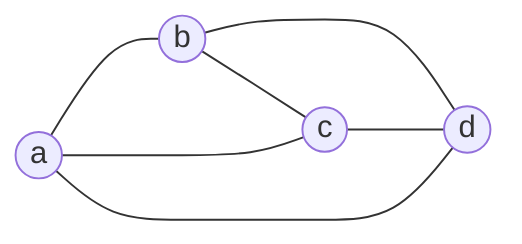
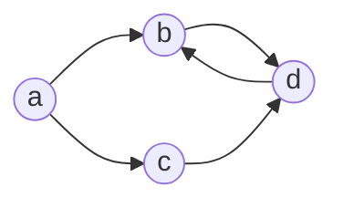
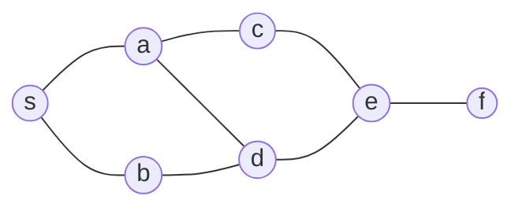
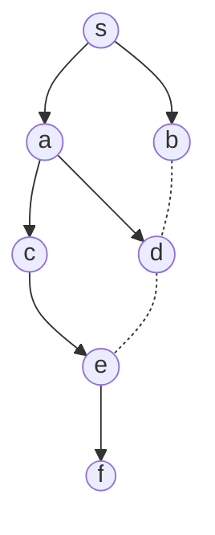
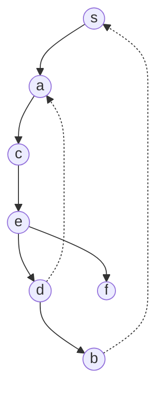

# 1 图的形式化定义与基本概念

> **修订说明**：本稿按审查意见修正逻辑、记号与格式问题，部分定义重排并补充了必要的引理与证明，编号整体顺延。
> 逐项改动见文末“改动记录 / Errata”；标注“需验证”处请对照教材确认。

## 1.1 无向图与有向图

> [!success] Definition 1.1 Simple undirected graph
> 一个**简单无向图**（simple undirected graph）是一个有序对 $G=\lang V,E \rang$，其中：
>
> - $V$ 是有限非空集合，称为**顶点集**（vertex set），其元素称为顶点（vertex 或 node）；
> - $E\subseteq\big\lbrace\{u,v\}\mid u,v\in V,\ u\ne v\big\rbrace$，称为**边集**（edge set）。每条边是由两个不同顶点组成的无序对。

> [!success] Definition 1.2 Directed graph
> 一个**有向图**（directed graph，digraph）是一个有序对 $G=\lang V,E \rang$，其中：
>
> - $V$ 是有限非空的顶点集；
> - $E\subseteq V\times V$ 是**弧集**（arc set）。弧 $\langle u,v\rangle$ 表示一条从 $u$ 指向 $v$ 的有向边。
>
> 对有向图，$\langle u,v\rangle$ 与 $\langle v,u\rangle$ 通常是两条不同的弧。按此定义，有向图不含平行弧，但允许自环 $\langle u,u\rangle$。

我们可以将无向边 $\{u,v\}$ 看作有向图中的两条方向相反的弧 $\langle u,v\rangle$ 和 $\langle v,u\rangle$，但这种对应只是表示上的转换，不意味着二者在定义上相同。

**约定**：本笔记只讨论有限图，记 $n=|V|$、$m=|E|$。未特别说明时，“图”指简单无向图；讨论有向图、多重图或其他图类时会明确指出。



_图 1.1 无向图示例（4 个顶点、6 条边，即完全图 $K_4$，见 Definition 1.17）。_



_图 1.2 有向图示例：弧 $\langle a,b\rangle,\langle a,c\rangle,\langle b,d\rangle,\langle c,d\rangle,\langle d,b\rangle$。_

> [!success] Definition 1.3 Multigraph
> 简单图的边集是顶点对的集合，无法表示重复的边。对多重图，边视为具有独立标识的对象，并为每条边指定端点：
>
> - **无向多重图**：三元组 $G=(V,E,\varepsilon)$，其中 $V$ 为有限非空顶点集，$E$ 为有限边集，
>   $$
>   \varepsilon:E\to\{X\subseteq V\mid 1\le|X|\le2\}
>   $$
>   指定每条边的端点集；
> - **有向多重图**：$\varepsilon:E\to V\times V$，$\varepsilon(e)=\langle u,v\rangle$ 表示 $e$ 是从 $u$ 到 $v$ 的弧。

> [!success] Definition 1.4 Self-loop, parallel edges and simple graph
>
> - **自环**（self-loop）：端点相同的边，即 $|\varepsilon(e)|=1$（无向）或 $\varepsilon(e)=\langle u,u\rangle$（有向）；
> - **平行边**（parallel edges）：满足 $\varepsilon(e)=\varepsilon(e')$ 的两条不同的边；有向时称平行弧；
> - **简单图**（simple graph）：不含自环和平行边的图。
>
> 允许自环或平行边的图称为多重图。Definition 1.1 中的图即 $\varepsilon(e)=e$ 的简单无向图。Definition 1.2 中的有向图不含平行弧，但允许自环；不含自环的称为**简单有向图**。

## 1.2 邻居集和度

### 1.2.1 无向图中的邻居集和度

> [!success] Definition 1.5 Adjacency, neighbors, endpoints and incidence
> 对于无向图中的一条边 $e=\{u,v\}$，称：
>
> - $u$ 与 $v$ **邻接**（adjacent）；
> - $u$ 是 $v$ 的**邻居**（neighbor），反之亦然；
> - $u,v$ 是 $e$ 的**端点**（endpoints）；
> - 边 $e$ **关联于**（incident to）顶点 $u$ 和 $v$。

> [!success] Definition 1.6 Neighborhood
> 对无向图 $G=\lang V,E \rang$ 中的顶点 $u\in V$，其**邻居集**（neighborhood）定义为
>
> $$
> N(u)=\{v\in V\mid \{u,v\}\in E\}.
> $$
>
> 即 $N(u)$ 是与 $u$ 邻接的所有顶点组成的集合。

> [!success] Definition 1.7 Degree
> 对无向图（含多重图）中的顶点 $u$，其**度**（degree）$\deg(u)$ 定义为与 $u$ 关联的边端数：每条关联的非自环边贡献 $1$，每个自环贡献 $2$。
>
> 对简单无向图，$\deg(u)=|N(u)|$。对多重图，度不能用邻居集的基数表示。

> [!tldr] Theorem 1.8 Handshaking lemma
> 对任意有限无向多重图（允许多重边和自环），
>
> $$
> \sum_{u\in V}\deg(u)=2|E|.
> $$
>
> **证明**：每条边恰有两个边端；自环两个端点重合，但按 Definition 1.7 仍贡献 $2$。因此每条边对度数之和总共贡献 $2$。

> Corollary 1.9
> 记 $n_{\mathrm{odd}}$ 为图中度为奇数的顶点个数，则 $n_{\mathrm{odd}}$ 为偶数。
>
> **证明**：度为偶数的顶点之和为偶数，而 $\sum\deg(u)=2|E|$ 为偶数，故度为奇数的顶点之和为偶数，其项数 $n_{\mathrm{odd}}$ 必为偶数。

### 1.2.2 有向图中的邻居集和度

> [!success] Definition 1.10 Neighbors in directed graph
> 对有向图中的弧 $\langle u,v\rangle$，称 $v$ 为 $u$ 的**出邻居**（out-neighbor），称 $u$ 为 $v$ 的**入邻居**（in-neighbor）。

> [!success] Definition 1.11 Neighborhood and degree in directed graph
> 对有向图 $G=\lang V,E \rang$ 中的顶点 $u$，定义：
>
> - **入邻居集**：$N^-(u)=\{v\in V\mid \langle v,u\rangle\in E\}$；
> - **入度**：$\deg^-(u)=|N^-(u)|$；
> - **出邻居集**：$N^+(u)=\{v\in V\mid \langle u,v\rangle\in E\}$；
> - **出度**：$\deg^+(u)=|N^+(u)|$。
>
> 自环 $\langle u,u\rangle$ 同时使 $u$ 的入度和出度各增加 $1$。对有向多重图，$\deg^+(u)$、$\deg^-(u)$ 分别定义为以 $u$ 为起点、终点的弧数。

> [!tldr] Theorem 1.12 Handshaking lemma for digraphs
> 对任意有限有向（多重）图，
>
> $$
> \sum_{u\in V}\deg^+(u)=\sum_{u\in V}\deg^-(u)=|E|.
> $$
>
> **证明**：每条弧恰为其起点贡献一个出度、为其终点贡献一个入度（自环两者落在同一顶点上）。

## 1.3 图的表示：数据结构

### 1.3.1 邻接矩阵

> [!success] Definition 1.13 Adjacency matrix
> 对顶点编号为 $1,2,\dots,n$ 的图，邻接矩阵是一个 $n\times n$ 矩阵 $A$。
>
> - 对简单无向图：
>
>   $$
>   A[u][v]=\begin{cases}
>   1,&\{u,v\}\in E,\\
>   0,&\{u,v\}\notin E.
>   \end{cases}
>   $$
>
>   此时 $A$ 为对称矩阵，主对角线元素均为 $0$。
>
> - 对有向图：
>
>   $$
>   A[u][v]=\begin{cases}
>   1,&\langle u,v\rangle\in E,\\
>   0,&\langle u,v\rangle\notin E.
>   \end{cases}
>   $$
>
>   此时 $A[u][v]$ 表示从 $u$ 到 $v$ 是否存在弧，矩阵通常不对称。
>
> - 对多重图，矩阵元素取相应端点之间的边（弧）数；无向自环对 $A[u][u]$ 的计数约定（计 $1$ 或计 $2$）应事先说明。

### 1.3.2 邻接表

> [!success] Definition 1.14 Adjacency list
> 在图 $G=\lang V,E \rang$ 的**邻接表**（adjacency list）中，为每个顶点 $u$ 维护一个列表，存储与 $u$ 邻接的顶点；对于有向图，通常存储 $u$ 的所有出邻居。

邻接表有多种实现方式。常见实现包括链表、动态数组、链式前向星（forward star）；有向图也可以使用十字链表（orthogonal list）等结构。

### 1.3.3 链式前向星

链式前向星是一种基于数组存储邻接表的实现方式，常用于竞赛编程中的静态图。（“链式前向星”为 OI 社区常用译名，与教材中 forward star 的对应关系需验证。）

- `e[i]` 存储第 $i$ 条弧或边的信息：
  - `e[i].to`：该弧的终点；
  - `e[i].nxt`：同一起点的下一条弧在 `e[]` 中的下标；
  - `e[i].w`：边权（可选）。
- `head[u]` 存储顶点 $u$ 的第一条出弧在 `e[]` 中的下标；若不存在出弧，则为 `-1`。

```cpp
struct Edge { int to, nxt, w; } e[MAXM];
int head[MAXN], cnt;
// 初始化：memset(head, -1, sizeof head); cnt = 0;
void add(int u, int v, int w) { // 加弧 <u,v>，头插
    e[cnt] = {v, head[u], w};
    head[u] = cnt++;
}
// 遍历 u 的出弧：for (int i = head[u]; ~i; i = e[i].nxt)
```

对于无向图，通常将每条无向边存储为两条方向相反的记录（`add(u,v,w); add(v,u,w);`），以便遍历任一端点的邻接边。

### 1.3.4 邻接矩阵与邻接表的比较

比较假设：邻接表为链表或动态数组实现，插入边时不查重（链表头插或数组末尾追加，后者摊还 $O(1)$）；有向图中 $\deg(u)$ 指 $\deg^+(u)$；无向图的每条边需更新两处，渐近阶不变。

| 特性               | 邻接矩阵      | 邻接表              | 链式前向星          |
| ------------------ | ------------- | ------------------- | ------------------- |
| 空间复杂度         | $\Theta(n^2)$ | $\Theta(n+m)$       | $\Theta(n+m)$       |
| 查询边是否存在     | $\Theta(1)$   | $O(1+\deg(u))$      | $O(1+\deg(u))$      |
| 枚举顶点的所有邻居 | $\Theta(n)$   | $\Theta(1+\deg(u))$ | $\Theta(1+\deg(u))$ |
| 插入边（不查重）   | $\Theta(1)$   | $O(1)$              | $O(1)$              |
| 删除边             | $\Theta(1)$   | $O(1+\deg(u))$      | $O(1+\deg(u))$      |

若插入时需先查重，则邻接表与链式前向星的插入也为 $O(1+\deg(u))$。

## 1.4 同构与子图

> [!success] Definition 1.15 Graph isomorphism
> 设 $G=\lang V,E \rang$ 与 $H=(U,F)$ 为同类型的图（同为简单无向图，或同为 Definition 1.2 意义下的有向图）。若存在双射 $f:V\to U$，使得边关系被保持，则称 $G$ 与 $H$ **同构**（isomorphic）。
>
> - 对无向图：对任意不同顶点 $a,b\in V$，有
>
>   $$
>   \{a,b\}\in E\iff\{f(a),f(b)\}\in F.
>   $$
>
> - 对有向图：对任意 $a,b\in V$（允许 $a=b$），有
>
>   $$
>   \langle a,b\rangle\in E\iff\langle f(a),f(b)\rangle\in F.
>   $$
>
> 同构图的结构相同，只是顶点名称不同。

> [!success] Definition 1.16 Subgraph
> 设 $G=\lang V,E \rang$。若 $V'\subseteq V$ 且 $E'\subseteq E$，并且 $E'$ 中每条边（弧）的端点都属于 $V'$，则称 $G'=(V',E')$ 为 $G$ 的**子图**（subgraph）。若 $E'$ 恰好包含 $G$ 中两个端点都在 $V'$ 内的全部边，则称 $G'$ 为由 $V'$ 诱导的**诱导子图**（induced subgraph）。

## 1.5 完全图、二分图和正则图

> [!success] Definition 1.17 Complete graph and clique
> 若简单无向图 $G=\lang V,E \rang$ 满足任意两个不同顶点都相邻，即
>
> $$
> \forall u,v\in V,\quad u\ne v\implies\{u,v\}\in E,
> $$
>
> 则称 $G$ 为**完全图**（complete graph），在同构意义下记为 $K_n$（$n=|V|$）。
>
> **团**（clique）通常指图中一个顶点子集，其诱导子图是完全图；因此，“完全图”指整张图的结构，“团”常指图内的完全子图。

> [!success] Definition 1.18 Bipartite graph
> 若无向图 $G=\lang V,E \rang$ 的顶点集可以划分为两个不相交集合 $L$ 和 $R$，满足 $V=L\cup R$、$L\cap R=\varnothing$，且每条边的一个端点在 $L$ 中、另一个端点在 $R$ 中，则称 $G$ 为**二分图**（bipartite graph）。也就是说，二分图内部同一侧的顶点之间没有边（因此也没有自环）。

> [!success] Definition 1.19 Complete bipartite graph
> 设 $|L|=p$、$|R|=q$。若二分图的边集为 $E=\{\{u,v\}\mid u\in L,\ v\in R\}$，即两侧每对顶点都相邻，则称 $G$ 为**完全二分图**（complete bipartite graph），在同构意义下记为 $K_{p,q}$。

> [!success] Definition 1.20 Regular graph
> 设整数 $r\ge0$。若简单无向图 $G=\lang V,E \rang$ 满足
>
> $$
> \forall u\in V,\quad\deg(u)=r,
> $$
>
> 则称 $G$ 为 **$r$-正则图**（$r$-regular graph）。

# 2 路径、连通和距离

## 2.1 游走、迹、路径与环

> [!success] Definition 2.1 Walk
> 设 $G$ 为图（可为多重图）。$G$ 中的一个**游走**（walk）是顶点与边交替的序列
>
> $$
> W=(v_0,e_1,v_1,e_2,\dots,e_k,v_k),
> $$
>
> 其中 $e_i\in E$，且对无向图 $\varepsilon(e_i)=\{v_{i-1},v_i\}$，对有向图 $\varepsilon(e_i)=\langle v_{i-1},v_i\rangle$（即每一步沿弧的方向前进）。游走的**长度**是边数 $k$，允许 $k=0$，允许顶点和边重复出现。若 $v_0=v_k$，称为**闭合游走**（closed walk）。
>
> 在简单图中，边由端点唯一确定，游走可简写为顶点序列 $(v_0,\dots,v_k)$，要求 $\{v_{i-1},v_i\}\in E$ 或 $\langle v_{i-1},v_i\rangle\in E$。

> [!success] Definition 2.2 Trail
> 若一个游走的边 $e_1,\dots,e_k$ 两两不同，则称为**迹**（trail）；若同时 $v_0=v_k$，称为**闭合迹**（closed trail）。迹可以重复经过同一个顶点。

> [!success] Definition 2.3 Path
> 若一个游走的顶点 $v_0,\dots,v_k$ 两两不同，则称为**路径**（path）。路径的边必然两两不同，长度为其边数。

> [!success] Definition 2.4 Cycle
> 设 $W=(v_0,e_1,\dots,e_k,v_k)$ 为闭合游走。若 $k\ge1$，边 $e_1,\dots,e_k$ 两两不同，且 $v_0,\dots,v_{k-1}$ 两两不同，则称 $W$ 为**环**或**圈**（cycle）。有向图中的环（有向环）还要求每一步沿弧的方向。
>
> - 自环对应 $k=1$ 的环；一对平行边对应 $k=2$ 的环；
> - 简单无向图中必有 $k\ge3$；简单有向图中 $k\ge2$（互为反向的两条弧构成 $2$-环）。

注意：游走允许顶点和边重复；迹只要求边不重复；路径不允许顶点重复。包含关系为：路径 $\subseteq$ 迹 $\subseteq$ 游走。三者不应混用。

## 2.2 无向图的连通性

> [!success] Definition 2.5 Connected vertices and connected graph
> 对于无向图 $G=\lang V,E \rang$：
>
> - 若存在一条从 $u$ 到 $v$ 的路径，则称 $u$ 与 $v$ **连通**（长度为 $0$ 的路径使每个顶点与自身连通）；
> - 若任意两个顶点都连通，则称 $G$ 为**连通图**（connected graph）；
> - 否则称 $G$ 为**非连通图**（disconnected graph）。

### 2.2.1 连通分量

连通是 $V$ 上的等价关系，其等价类即连通分量。

> [!success] Definition 2.6 Connected component
> 无向图 $G$ 的一个**连通分量**（connected component）是顶点集的一个极大子集 $C\subseteq V$，使得 $C$ 中任意两个顶点都连通。这里的“极大”是指不能再向 $C$ 中加入 $V\setminus C$ 的顶点而仍保持连通。
>
> 等价地，连通分量可以看成由该顶点集及其所有相关边构成的极大连通子图。不同连通分量的顶点之间不存在边。

## 2.3 有向图的连通性

> [!success] Definition 2.7 Reachability and strong connectivity
> 设 $G=\lang V,E \rang$ 为有向图。
>
> - 若存在从 $u$ 到 $v$ 的有向路径，则称 $v$ **从 $u$ 可达**（reachable from $u$）；
> - 若 $u$ 可以到达 $v$，且 $v$ 也可以到达 $u$，则称 $u$ 与 $v$ **强连通**（strongly connected）；
> - 若任意两个顶点都强连通，则称 $G$ 为**强连通图**（strongly connected graph）。

> [!success] Definition 2.8 Weakly connected graph
> 设 $G$ 为有向图。若将每条弧 $\langle u,v\rangle$ 忽略方向，替换为无向边 $\{u,v\}$ 后所得无向图是连通图，则称 $G$ 为**弱连通图**（weakly connected graph）。

### 2.3.1 强连通分量

强连通是 $V$ 上的等价关系，其等价类即强连通分量。

> [!success] Definition 2.9 Strongly connected component
> 有向图 $G$ 的一个**强连通分量**（strongly connected component，SCC）是顶点集的一个极大子集 $C\subseteq V$，使得 $C$ 中任意两个顶点都强连通。

## 2.4 最短路径与距离

> [!success] Definition 2.10 Shortest path (unweighted)
> 在无权图中，路径的长度按边数计算。在所有从 $u$ 到 $v$ 的路径中，长度最短的路径称为从 $u$ 到 $v$ 的**最短路径**（shortest path）。带权图中的最短路径见第 5 章。

> [!success] Definition 2.11 Distance
> 无权图中，从 $u$ 到 $v$ 的最短路径长度称为两点间的**距离**（distance），记为 $d(u,v)$。若不存在从 $u$ 到 $v$ 的路径，则定义 $d(u,v)=\infty$。无向图中 $d(u,v)=d(v,u)$；有向图中一般 $d(u,v)\ne d(v,u)$。

无权图中，最短游走必为路径（否则删去闭合部分可得更短游走），故距离也等于最短游走的长度。

## 2.5 图的遍历

图的两种基础遍历方式是广度优先搜索（BFS）和深度优先搜索（DFS）。它们都可以从指定顶点出发，系统地访问该顶点可达的所有顶点，但访问顺序不同，生成的遍历树也不同。若图不连通（有向图则为从起点不能到达全部顶点），从单个起点出发只能遍历起点的可达部分；**完整遍历**则在每棵树结束后，任取一个未访问顶点作为新起点重新开始，所得的树构成 BFS 森林或 DFS 森林。有向图中“邻居”均指出邻居。

### 2.5.1 广度优先搜索（BFS）

BFS 通常使用队列实现，并维护 $\mathrm{dist}[\cdot]$ 与 $\mathrm{par}[\cdot]$：

1. 初始化：$\mathrm{dist}[s]=0$，标记 $s$ 并入队；
2. 取出队首顶点 $u$，依次检查其邻居 $v$；若 $v$ 尚未访问，则标记 $v$，令 $\mathrm{dist}[v]=\mathrm{dist}[u]+1$、$\mathrm{par}[v]=u$，并入队；
3. 重复第 2 步直到队列为空。

> [!tldr] Theorem 2.12 BFS 与无权最短路径
> 在无权图中，从起点 $s$ 运行 BFS 后，对每个可从 $s$ 到达的顶点 $v$，有 $\mathrm{dist}[v]=d(s,v)$。

由 $\mathrm{par}$ 指针确定的边 $\{\mathrm{par}[v],v\}$ 构成 **BFS 树**。

**复杂度**：使用邻接表时为 $O(n+m)$；使用邻接矩阵时为 $O(n^2)$。

### 2.5.2 深度优先搜索（DFS）

DFS 可以通过递归或显式栈实现：访问顶点 $u$ 后，先递归访问一个尚未访问的邻居；当当前顶点没有未访问的邻居时，再回溯到上一个顶点继续探索。

DFS 过程中，可以记录每个顶点的**发现时间** $\mathrm{disc}[v]$ 与**完成时间** $\mathrm{fin}[v]$。发现时间表示首次访问顶点的时刻，完成时间表示该顶点的所有邻接边都已检查完毕的时刻。

**有向图中的边分类**：在有向图的 DFS 中，每条弧按其在 DFS 森林中的关系分为四类（此处祖先、后代按 Definition 4.8 在 DFS 森林上理解，并约定顶点是自身的祖先）：

1. **树边**（tree edge）：沿该弧首次发现其终点；
2. **回边**（back edge）：指向自身或其 DFS 祖先的弧（此时该祖先已被发现、尚未完成），自环属于回边；
3. **正向边**（forward edge）：指向其 DFS 真后代，但不是树边；
4. **横叉边**（cross edge）：以上三类以外的边，即两个端点之间没有祖先—后代关系。

对无向图的标准 DFS，每条边只分类一次（沿树边回看父节点不算新的边），且只分为树边和回边，不会出现正向边、横叉边。

> [!tldr] Theorem 2.13 有向无环图的 DFS 判定
> 有向图 $G$ 是有向无环图（directed acyclic graph，DAG），即不含有向环（按 Definition 2.4，含自环与 $2$-环），当且仅当对 $G$ 做完整 DFS（遍历全部顶点）时不存在回边。

**复杂度**：邻接表实现为 $O(n+m)$；邻接矩阵实现为 $O(n^2)$。

### 2.5.3 同一张图上的 BFS 与 DFS

取下图 $G$，邻接表中的邻居按字母顺序存储，从 $s$ 出发。



_图 2.1 原图 $G$：$n=7$，$m=8$。_

**BFS**：访问次序为 $s,a,b,c,d,e,f$，$\mathrm{dist}$ 依次为 $0,1,1,2,2,3,4$。树边为 $sa,sb,ac,ad,ce,ef$，非树边为 $bd,de$。



_图 2.2 BFS 树。实线为树边（父→子），虚线为非树边。_

**DFS**：访问次序为 $s,a,c,e,d,b,f$。树边为 $sa,ac,ce,ed,db,ef$，回边为 $da$（$d$ 回到祖先 $a$）与 $bs$（$b$ 回到祖先 $s$）。



_图 2.3 DFS 树。实线为树边，虚线为回边（子孙→祖先）。_

对比可见：BFS 树按距离分层，树中 $s$ 到各点的路径即最短路径；DFS 树沿分支尽量深入，高度更大。具体次序受邻接表中邻居存储顺序影响。

# 3 欧拉通路和哈密顿通路

欧拉问题关心能否恰好经过图的每条边一次；哈密顿问题关心能否恰好访问图的每个顶点一次。二者关注的对象不同，因此判定方法也有很大差异：欧拉通路和欧拉回路有简洁的度数判定定理，而哈密顿通路和哈密顿圈通常更难判定。

## 3.1 欧拉通路与欧拉回路

> [!success] Definition 3.1 Euler trail and Euler circuit
> 设 $G$ 为无向图（可为多重图）。
>
> - 若一条**迹**（trail）恰好经过 $G$ 中每条边一次，则称它为 $G$ 的**欧拉通路**（Euler trail）；
> - 若一条闭合迹恰好经过 $G$ 中每条边一次，则称它为 $G$ 的**欧拉回路**（Euler circuit）。
>
> 欧拉通路允许重复经过顶点，但不允许重复经过边。对多重图，不同的平行边视为不同的边。

> [!tldr] Theorem 3.2 Euler's theorem
> 设 $G$ 为有限无向多重图，且至少有一条边。忽略所有孤立顶点后，假设剩余部分连通，则：
>
> 1. $G$ 存在欧拉回路，当且仅当每个顶点的度都是偶数；
> 2. $G$ 存在欧拉通路但不存在欧拉回路，当且仅当恰好有两个顶点的度为奇数，此时欧拉通路的两个端点恰为这两个奇度顶点。
>
> 注：连通性假设不可去掉。若含边的顶点不在同一个连通分量中，则不存在经过全部边的迹；孤立顶点不影响对边的遍历。

## 3.2 哈密顿通路与哈密顿圈

> [!success] Definition 3.3 Hamilton path and Hamilton cycle
> 设 $G$ 为简单无向图。
>
> - 若一条路径恰好访问 $G$ 中的每个顶点一次，则称它为**哈密顿通路**（Hamilton path）；
> - 若一个环（Definition 2.4）恰好访问 $G$ 中的每个顶点一次，则称它为**哈密顿圈**（Hamilton cycle），中文教材也称哈密顿回路。

> [!tldr] Theorem 3.4 Dirac's theorem
> 设 $G$ 为一个简单图，顶点数为 $n\ge3$。若
>
> $$
> \forall v\in V,\quad \deg(v)\ge\frac n2,
> $$
>
> 则 $G$ 具有哈密顿圈。该条件是充分条件，并非必要条件。

> [!tldr] Theorem 3.5 Ore's theorem
> 设 $G$ 为一个简单图，顶点数为 $n\ge3$。若任意两个不相邻的不同顶点 $u,v$ 都满足
>
> $$
> \deg(u)+\deg(v)\ge n,
> $$
>
> 则 $G$ 具有哈密顿圈。该条件同样是充分条件。

# 4 树

## 4.1 森林与树

> [!success] Definition 4.1 Forest and acyclic graph
> 不含环（Definition 2.4）的无向图称为**无环图**（acyclic graph），也称**森林**（forest）。无环图不含自环和平行边，因此是简单图；森林的每个连通分量都是一棵树（Definition 4.3）。

> [!tldr] Theorem 4.2 Leaves of acyclic graphs
> 设 $G$ 为有限无向无环图。则 $G$ 至少有一个顶点的度为 $0$ 或 $1$；若 $G$ 的某个连通分量至少有两个顶点，则该分量中至少有两个度为 $1$ 的顶点。
>
> **证明**：设该分量含至少两个顶点，取其中一条最长路径 $P=(v_0,\dots,v_k)$，则 $k\ge1$。若 $v_0$ 有异于 $v_1$ 的邻居 $x$：$x\notin P$ 时可延长 $P$，与最长性矛盾；$x\in P$ 时 $x=v_j$（$j\ge2$）与 $P$ 的一段构成环，与无环矛盾。故 $\deg(v_0)=1$，同理 $\deg(v_k)=1$，且 $v_0\ne v_k$。若所有分量均为单顶点，则存在度为 $0$ 的顶点。

> [!success] Definition 4.3 Tree
> **树**（tree）是一个非空、连通、无环的无向图。

> [!tldr] Theorem 4.4 Unique path in a tree
> 树中任意两个顶点之间有且仅有一条路径。
>
> **证明**：存在性由连通性给出（最短游走必为路径）。若 $u,v$ 之间有两条不同路径，取它们第一次分歧的位置及其后第一次重新汇合的位置，这两段路径构成一个环，与无环矛盾。

> [!tldr] Theorem 4.5 Number of edges in a tree
> 设 $T=\lang V,E \rang$ 为一棵树，则
>
> $$
> |E|=|V|-1.
> $$
>
> **证明**：对 $|V|$ 归纳。$|V|=1$ 时无边（无自环）。$|V|\ge2$ 时，$T$ 连通故无孤立顶点，由 Theorem 4.2 存在度为 $1$ 的顶点 $v$。$v$ 不可能是任何路径的内部顶点，故 $T-v$ 仍连通且无环，是 $|V|-1$ 个顶点的树，边数为 $|V|-2$，加回 $v$ 的那条边得 $|V|-1$。

> Corollary 4.6
> 对于任意一棵树 $T$：
>
> - 添加一条连接两个不相邻顶点的新边（结果仍为简单图），会产生且只产生一个环；
> - 删除任意一条边，都会使图不连通。
>
> **证明**：设新边为 $e=\{u,v\}$。含 $e$ 的环恰由 $e$ 与一条 $u$–$v$ 路径构成，由 Theorem 4.4 这样的路径唯一；不含 $e$ 的环不存在（$T$ 无环）。若删除边 $e=\{u,v\}$ 后仍连通，则 $u,v$ 之间存在不含 $e$ 的路径，与长度为 $1$ 的路径 $(u,e,v)$ 是两条不同路径，与 Theorem 4.4 矛盾。

## 4.2 有根树

### 4.2.1 有根树

> [!success] Definition 4.7 Rooted tree, parent and child
> 将树 $T$ 中的一个顶点 $r\in V$ 指定为**根**（root），则称所得结构为**有根树**（rooted tree）。
>
> 对 $v\ne r$，由 Theorem 4.4，从 $r$ 到 $v$ 的路径唯一；该路径上 $v$ 的前一个顶点称为 $v$ 的**父节点**（parent），记为 $p(v)$，同时 $v$ 称为 $p(v)$ 的**子节点**（child）。根没有父节点。

通常将根放在树的上方，并按层次排列其他顶点。

### 4.2.2 祖先、后代与子树

> [!success] Definition 4.8 Ancestor, descendant and subtree
> 设 $T$ 为根为 $r$ 的有根树。对于顶点 $u$：
>
> - 若顶点 $v$ 位于从根 $r$ 到 $u$ 的唯一路径上，且 $v\ne u$，则称 $v$ 是 $u$ 的**祖先**（ancestor）；特别地，$u$ 的父节点是它的直接祖先。
> - 若 $u$ 是 $v$ 的祖先，则称 $v$ 是 $u$ 的**后代**（descendant）；特别地，$u$ 的子节点是它的直接后代。
> - 没有子节点的顶点称为**叶节点**（leaf）；至少有一个子节点的顶点称为**内部节点**（internal node）。
> - 以 $u$ 为根、由 $u$ 及其所有后代构成的树称为以 $u$ 为根的**子树**（subtree）。其顶点集为
>
>   $$
>   V_u=\{v\in V\mid u\text{ 位于从根 }r\text{ 到 }v\text{ 的路径上}\},
>   $$
>
>   边集则由 $T$ 中两个端点都属于 $V_u$ 的边构成。
>
> 根节点没有父节点，并且是其他所有顶点的祖先。

> [!success] Definition 4.9 Depth and height
> 设 $T$ 为根为 $r$ 的有根树，$u\in V$。
>
> - 顶点 $u$ 的**深度**（depth）$\operatorname{dep}(u)$ 是从根 $r$ 到 $u$ 的唯一路径长度；
> - 树 $T$ 的**高度**（height）是所有顶点深度的最大值。
>
> 按此约定，根的深度为 $0$，只有一个顶点的树的高度为 $0$。

### 4.2.3 二叉树

> [!success] Definition 4.10 Binary tree and k-ary tree
> **二叉树**（binary tree）是有根树，并且每个顶点至多有两个子节点。更一般地，若每个顶点至多有 $k$ 个子节点，则称其为 **$k$-叉树**（$k$-ary tree）。
>
> 注意：二叉树的定义限制的是子节点数量，而不是无根树中的顶点度。一个顶点的度不超过 $2$ 并不是二叉树的正确判定条件。本笔记的二叉树不区分左、右子节点；数据结构中的二叉树还需额外指定左右次序。

> [!success] Definition 4.11 Full binary tree
> **严格二叉树**（国内）或**满二叉树**（国外）（full binary tree）是指每个内部节点都恰有两个子节点的二叉树。更一般地，若一棵 $k$-叉树的每个内部节点都恰有 $k$ 个子节点，则称其为**满 $k$-叉树**（full $k$-ary tree）。

## 4.3 哈夫曼树

> [!success] Definition 4.12 Weighted path length
> 设有限符号集 $S=\{s_1,s_2,\dots,s_n\}$，并给定正权值函数 $w:S\to\mathbb R_{>0}$。考虑一棵有根二叉树 $T$，其叶节点与 $S$ 中的符号一一对应，符号 $s_i$ 对应的叶节点记为 $\ell(s_i)$。称
>
> $$
> \operatorname{WPL}(T)=\sum_{i=1}^{n}w(s_i)\operatorname{dep}(\ell(s_i))
> $$
>
> 为 $T$ 的**加权路径长度**（weighted path length，WPL）。

> [!success] Definition 4.13 Optimal binary tree
> 在所有叶节点与 $S$ 中的符号一一对应的有根二叉树中，使 $\operatorname{WPL}(T)$ 最小的树称为**最优二叉树**（optimal binary tree）。最优二叉树一般不唯一。

> [!tldr] Lemma 4.14 Optimal trees are full
> 当 $n\ge2$ 时，最优二叉树是满二叉树。
>
> **证明**：若某内部节点 $x$ 只有一个子节点 $c$，则用 $c$ 的子树取代 $x$ 的子树（删去 $x$）。该子树内所有叶的深度减 $1$，而权值均为正，WPL 严格减小，与最优性矛盾。

> [!success] Definition 4.15 Huffman tree
> **哈夫曼算法**：初始时有 $n$ 棵单节点树，各节点权值为 $w(s_i)$。重复 $n-1$ 次：取根权值最小的两棵树，新建一个根，以这两棵树为其两个子树，新根权值为二者之和。最终得到的树称为**哈夫曼树**（Huffman tree）。
>
> 取最小权值时若有并列，不同选择可得不同的哈夫曼树；哈夫曼树必为满二叉树。

> [!tldr] Lemma 4.16
> 设 $s_a,s_b$ 是 $S$ 中权值最小的两个符号（$n\ge2$）。则存在一棵最优二叉树，其中 $\ell(s_a)$ 与 $\ell(s_b)$ 是兄弟，且位于最大深度。
>
> **证明**：取最优树 $T$（由 Lemma 4.14 为满二叉树）。最深叶的兄弟也是叶，设这对兄弟叶为 $x,y$。把 $\ell(s_a)$ 与 $x$ 所对应的符号互换，WPL 的变化量为 $(w_a-w_x)(\operatorname{dep}x-\operatorname{dep}\ell(s_a))\le0$，其中 $w_a\le w_x$ 且 $\operatorname{dep}x\ge\operatorname{dep}\ell(s_a)$。同理互换 $s_b$ 与 $y$。互换后仍最优。

> [!tldr] Theorem 4.17 Optimality of Huffman tree
> 哈夫曼树是最优二叉树。
>
> **证明**：对 $n$ 归纳。$n=1$ 时只有单节点树，$\operatorname{WPL}=0$。设 $n\ge2$，$s_a,s_b$ 为最小权值的两个符号，哈夫曼算法首先将它们合并为新符号 $z$（$w_z=w_a+w_b$）。令 $S'=S\setminus\{s_a,s_b\}\cup\{z\}$。叶 $\ell(s_a),\ell(s_b)$ 为兄弟的树 $T$ 与 $S'$ 上的树 $T'$（把这对兄弟收缩为叶 $z$）一一对应，且
>
> $$
> \operatorname{WPL}(T)=\operatorname{WPL}(T')+w_a+w_b.
> $$
>
> 哈夫曼算法后续步骤即在 $S'$ 上运行，由归纳假设得到 $S'$ 的最优树 $H'$，展开 $z$ 得到哈夫曼树 $H$。由 Lemma 4.16，存在最优树 $T^*$ 使 $s_a,s_b$ 为兄弟，设其对应 $T'^*$，则
>
> $$
> \operatorname{WPL}(T^*)=\operatorname{WPL}(T'^*)+w_a+w_b\ge\operatorname{WPL}(H')+w_a+w_b=\operatorname{WPL}(H),
> $$
>
> 故 $H$ 最优。

> [!success] Definition 4.18 Prefix code and Huffman code
> 若一组二进制码字中任一码字都不是另一码字的前缀，则称其为**前缀码**（prefix code）。
>
> 对哈夫曼树的每个内部节点，将通往其两个子节点的边分别标记为 $0$ 和 $1$（满二叉树保证每个内部节点恰有两个子节点）。符号 $s_i$ 的**哈夫曼编码**（Huffman code）$C_H(s_i)$ 是从根到其对应叶节点的路径上各边标记按顺序组成的二进制串：
>
> $$
> C_H:S\to\{0,1\}^*,\qquad |C_H(s_i)|=\operatorname{dep}(\ell(s_i)).
> $$
>
> 由于每个符号都对应叶节点，而叶节点不可能是另一个叶节点的祖先，所以哈夫曼编码是前缀码。其加权编码长度为
>
> $$
> \sum_{i=1}^{n}w(s_i)|C_H(s_i)|=\operatorname{WPL}(T).
> $$
>
> 当 $w(s_i)$ 是概率且 $\sum_i w(s_i)=1$ 时，上式就是平均编码长度。
>
> **例外**：$n=1$ 时树仅一个节点，上式给出空码字；实际编码时通常约定为该符号分配单比特编码 `0`，此约定不满足 $|C_H(s_1)|=\operatorname{dep}$ 的公式。

## 4.4 生成树

> [!success] Definition 4.19 Spanning tree
> 设 $G=\lang V,E \rang$ 为连通无向图。若 $T=\lang V,E'\rang$ 是 $G$ 的子图且是一棵树，则称 $T$ 为 $G$ 的**生成树**（spanning tree）。生成树包含原图的全部顶点，但只保留其中一部分边。

> [!success] Definition 4.20 Spanning forest
> 设 $G=\lang V,E \rang$ 为无向图。若 $F\subseteq E$ 使 $\lang V,F\rang$ 无环，且 $\lang V,F\rang$ 与 $G$ 具有相同的连通分量划分，则称 $\lang V,F\rang$ 为 $G$ 的**生成森林**（spanning forest）。等价地，它由 $G$ 的每个连通分量各取一棵生成树组成。

**环路消除法**：从连通图 $G$ 出发，反复删除任意一条位于某个环上的边。删除环上的边不会破坏连通性；当图中不再有环时，所得子图就是 $G$ 的一棵生成树。对不连通的图，对每个连通分量分别操作即得生成森林。

# 5 带权图

## 5.1 带权图与路径权长

> [!success] Definition 5.1 Weighted graph
> 设 $G=\lang V,E \rang$ 为图，$w:E\to\mathbb R$ 为权值函数。称二元组 $(G,w)$ 为**带权图**（weighted graph），习惯上也直接称 $G$ 为带权图；$w(e)$ 称为边 $e$ 的**权值**（weight）。若进一步有 $w(e)\ge0$，则称为非负带权图。

> [!success] Definition 5.2 Weighted length
> 对游走 $W=(v_0,e_1,\dots,e_k,v_k)$，定义其**权长**（weighted length）为
>
> $$
> w(W)=\sum_{i=1}^{k}w(e_i).
> $$
>
> 路径的权长同理。为与 Definition 2.1 的“长度”（边数）区分，带权情形统一称“权长”；无权图相当于每条边权值为 $1$。

> [!success] Definition 5.3 Shortest path (weighted)
> 在所有从 $u$ 到 $v$ 的路径中，权长最小的路径称为带权图中从 $u$ 到 $v$ 的**最短路径**，其权长记为 $\delta(u,v)$；若不存在路径，则 $\delta(u,v)=\infty$。

权值范围会影响算法是否适用，例如 Dijkstra 算法要求 $w(e)\ge0$。进一步说明：

- 有向图中，若从 $s$ 可达一个权长为负的环，则游走的权长没有下界，此时“最短游走”不存在。路径因顶点互异只有有限条，最小权长路径仍存在，但常规 SSSP 算法的正确性不再成立，通常即按“最短路径不存在”处理。若无负权环，则任意游走删去环后得到的路径权长不增，最短游走可取为路径。
- 无向图中，一条权为负的边 $e=\{u,v\}$ 就给出闭合游走 $(u,e,v,e,u)$，权长 $2w(e)<0$，因此带负权边的无向图一般不讨论最短游走。

## 5.2 最短路径问题

最短路径问题要求在给定的图中，找到权长最小的路径。

> [!success] Definition 5.4 SSSP and APSP
>
> - **单源最短路径问题**（Single-Source Shortest Paths，SSSP）：给定一个起点 $s$，求从 $s$ 到其他可达顶点的最短路径及其权长；
> - **全源最短路径问题**（All-Pairs Shortest Paths，APSP）：求任意两个顶点之间的最短路径权长。

对无权图，最短路径长度按边数计算，可用 BFS 求解；对带权图，需要根据边权条件选择相应算法。

## 5.3 最小生成树问题

> [!success] Definition 5.5 Minimum spanning tree
> 给定带权无向连通图 $G=\lang V,E \rang$ 与权值函数 $w$。**最小生成树**（Minimum Spanning Tree，MST）是使
>
> $$
> w(E_T)=\sum_{e\in E_T}w(e)
> $$
>
> 在所有生成树 $T=(V,E_T)$ 中最小的生成树。

> [!success] Definition 5.6 Minimum spanning forest
> 给定带权无向图 $G=\lang V,E \rang$（不要求连通）。**最小生成森林**（Minimum Spanning Forest，MSF）是使 $\sum_{e\in F}w(e)$ 在所有生成森林 $(V,F)$（Definition 4.20）中最小的生成森林。等价地，在每个连通分量中分别取一棵最小生成树。$G$ 连通时，MSF 即 MST。

# 6 图的特殊类型与应用

## 6.1 平面图

> [!success] Definition 6.1 Planar graph and plane graph
> 若一个无向图可以画在平面上，使任意两条边除共享端点外不相交，则称该图为**平面图**（planar graph）。这里强调的是“存在这样的画法”，而不是某一幅具体画法。
>
> 将图连同其一个固定的平面画法一起考虑时，称为**平面嵌入图**或**平面图形**（plane graph）。平面图可以有多种不同的平面嵌入。

> [!success] Definition 6.2 Bridge, face and degree of face
>
> - **桥**（bridge）：删除后使其所在连通分量变得不连通的边。
>
> 对于一个平面嵌入图：
>
> - **面**（face）是平面中被嵌入图划分出的区域；
> - 无界区域称为**外面**（outer face），其余有界区域称为**内面**（inner face）；
> - 面的边界应按沿边界行走时经过的**边界游走**（boundary walk）来理解；
> - **面的度**（degree of a face）是相应边界游走的长度。若一条桥的两侧都邻接同一个面，则该边在此面边界游走中会被计算两次。

### 6.1.1 欧拉公式

> [!tldr] Theorem 6.3 Euler's formula
> 设 $G$ 为一个连通平面嵌入图，顶点数为 $n$，边数为 $m$，面数为 $f$，则
>
> $$
> n-m+f=2.
> $$
>
> 更一般地，若平面嵌入图有 $c$ 个连通分量，则
>
> $$
> n-m+f=1+c.
> $$

> Corollary 6.4 Planar edge bounds
> 设 $G$ 为连通简单平面图，$n=|V|\ge3$，$m=|E|$。则：
>
> 1. $m\le 3n-6$；
> 2. 若 $G$ 为二分图，则 $m\le 2n-4$；
> 3. 至少存在一个顶点，其度不超过 $5$；
> 4. （需取定平面嵌入）若每个面的度至少为整数 $\ell\ge3$，则
>
>    $$
>    m\le \frac{\ell}{\ell-2}(n-2).
>    $$

### 6.1.2 平面图的判定

> [!success] Definition 6.5 Subdivision
> 设 $G$ 为一个图，$e=\{u,v\}$ 是其中一条边。删除边 $e$，引入一个新顶点 $x$，再添加边 $\{u,x\}$ 和 $\{x,v\}$，所得图称为对 $G$ 的一次**初等细分**（elementary subdivision）。
>
> 若图 $H$ 可以通过对 $G$ 的边进行有限次初等细分得到，则称 $H$ 是 $G$ 的一个**细分图**（subdivision graph）。换言之，细分操作是在边上插入新顶点，将一条边替换成一条更长的路径。

> [!success] Definition 6.6 Homeomorphic graphs
> 设 $G$ 与 $H$ 为两个图。若存在 $G$ 的一个细分图 $G'$ 和 $H$ 的一个细分图 $H'$，使得 $G'$ 与 $H'$ 同构，则称 $G$ 与 $H$ **同胚**（homeomorphic）。记号可写为 $G\cong_h H$。

> [!tldr] Theorem 6.7 Kuratowski's theorem
> 有限图 $G$ 是平面图，当且仅当 $G$ 不含有任何与 $K_5$ 或 $K_{3,3}$ 同胚的子图。等价地，$G$ 非平面，当且仅当它包含 $K_5$ 或 $K_{3,3}$ 的某个细分图作为子图。
>
> - $K_5$ 是具有 $5$ 个顶点的完全图（Definition 1.17）；
> - $K_{3,3}$ 是完全二分图（Definition 1.19）。

> [!success] Definition 6.8 Edge contraction
> 设 $G$ 为一个无向图，$e=\{u,v\}\in E$。将顶点 $u$ 和 $v$ 合并为一个新顶点，并删除边 $e$，称为对边 $e$ 的**收缩**（edge contraction），记为 $G/e$。
>
> 对简单图，收缩一条边不会产生自环，但若 $u,v$ 有公共邻居，则会产生平行边；对多重图，与 $e$ 平行的其他边会变成自环。在简单图的子式理论中，通常将自环删除、平行边合并为一条边，以继续得到简单图。

> [!success] Definition 6.9 Minor
> 设 $G$ 与 $H$ 为两个图。若 $H$ 可以通过对 $G$ 反复进行以下操作得到，则称 $H$ 是 $G$ 的一个**子式**（minor）：
>
> 1. 删除顶点及其关联边；
> 2. 删除边；
> 3. 收缩边。
>
> 记为 $H\preceq G$。这里的“子式”是图论中的 minor，不是矩阵理论中的子式。

> [!tldr] Theorem 6.10 Wagner's theorem
> 有限图 $G$ 是平面图，当且仅当 $G$ 不含有 $K_5$ 或 $K_{3,3}$ 作为子式，即
>
> $$
> G\text{ 是平面图}\iff K_5\npreceq G\ \land\ K_{3,3}\npreceq G.
> $$

Kuratowski 定理通过**细分与同胚**刻画非平面图；Wagner 定理则通过**边收缩与子式**刻画非平面图。两种刻画方式相关，但使用的图操作不同。

## 6.2 图的着色

### 6.2.1 顶点着色

> [!success] Definition 6.11 Vertex coloring
> 设图 $G=\lang V,E \rang$。若函数
>
> $$
> c:V\to\{1,2,\dots,k\}
> $$
>
> 满足每条边 $\{u,v\}\in E$ 的两个端点颜色不同，即 $c(u)\ne c(v)$，则称 $c$ 为 $G$ 的一个**合法顶点着色**（proper vertex coloring），简称顶点着色，并称该着色使用了至多 $k$ 种颜色。含自环的图不存在合法着色，故以下讨论简单图。

> [!success] Definition 6.12 Chromatic number
> 图 $G$ 的**色数**（chromatic number）$\chi(G)$ 是使 $G$ 存在合法顶点着色的最小颜色数。

> [!tldr] Theorem 6.13 Brooks' theorem
> 设 $G$ 为有限连通简单图，$\Delta(G)$ 为其最大度。若 $G$ 既不是完全图，也不是奇数长度的环，则
>
> $$
> \chi(G)\le\Delta(G).
> $$
>
> 若 $G$ 是完全图 $K_n$，则 $\chi(G)=n=\Delta(G)+1$；若 $G$ 是奇环，则 $\chi(G)=3=\Delta(G)+1$。
>
> Brooks 定理讨论的是**顶点着色**。定理要求图连通；对非连通图，色数等于各连通分量色数的最大值。

> [!tldr] Theorem 6.14 Four color theorem
> 若 $G$ 为平面图（简单图），则
>
> $$
> \chi(G)\le4.
> $$
>
> 即任意平面图都可以进行至多四种颜色的合法顶点着色。

### 6.2.2 边着色

> [!success] Definition 6.15 Edge coloring
> 设 $G=\lang V,E \rang$。若函数
>
> $$
> c:E\to\{1,2,\dots,k\}
> $$
>
> 使得任意两条共享端点的不同边颜色不同，则称 $c$ 为 $G$ 的一个**合法边着色**（proper edge coloring），简称边着色。也就是说，共享同一顶点的边不能使用相同颜色。
>
> 使图具有合法边着色所需的最少颜色数称为**边色数**（chromatic index），记为 $\chi'(G)$。

> [!tldr] Theorem 6.16 Vizing's theorem
> 设 $G$ 为有限简单无向图，$\Delta(G)$ 为最大度，则
>
> $$
> \Delta(G)\le\chi'(G)\le\Delta(G)+1.
> $$
>
> - 若 $\chi'(G)=\Delta(G)$，则称 $G$ 为 **I 类图**（class 1 graph）；
> - 若 $\chi'(G)=\Delta(G)+1$，则称 $G$ 为 **II 类图**（class 2 graph）。
