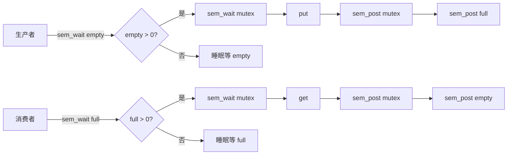
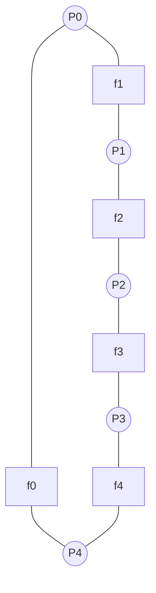
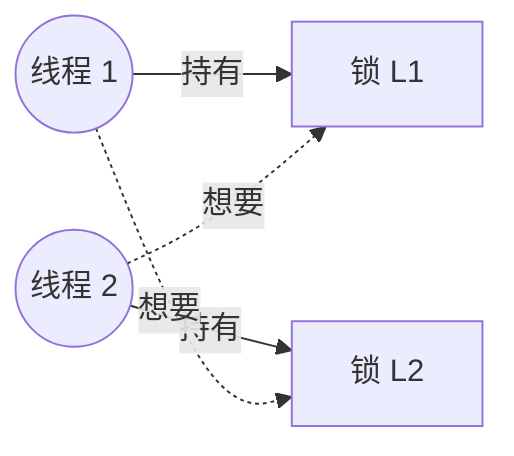

> [!important] 本篇目标
> 承接前两章对 CPU 与内存的虚拟化，本篇进入操作系统中最棘手、也最容易被写错的主题：**并发**。先建立**线程**这一抽象与它的 API（OSTEP 第 26、27 章），再回答"如何在多个执行流之间安全地共享数据"这一**机制**问题（第 28、30、31 章），最后转入**策略**与**工程**问题——经典并发模式、常见缺陷、死锁，以及线程之外的另一条路：基于事件的并发（第 29、32、33 章）。

前两篇里，操作系统始终在"假装"：把一个物理 CPU 装成很多个，把一块物理内存装成每个进程私有的一大片。这一篇要装的假象不太一样——这一次，**同一个地址空间里出现了多个执行流**。它们共享代码、共享堆、共享打开的文件，却各自拥有独立的程序计数器和栈。共享带来了通信的便利，也带来了本书中最难缠的一类缺陷。

> [!question] 关键问题：如何并发
> 多个执行流在同一进程内交错运行，如何保证它们访问共享数据时既正确、又高效？操作系统需要提供哪些原语，硬件又需要提供哪些支持？

---

# 第一部分 线程：抽象与 API

## 3.1 线程是什么

经典观点是：一个程序只有一个执行点——一个程序计数器，用来存放要执行的指令。**多线程**（multi-threaded）程序则有多个执行点，每个线程都有自己的程序计数器，各自取指令、各自执行。换个角度看，每个线程都像是一个独立进程，只有一点区别：**它们共享地址空间**，因而能访问相同的数据。

这一区别看似微小，影响却贯穿整篇：进程之间默认隔离，想共享数据得显式申请共享内存或走 IPC；线程之间默认共享，想隔离反而要费一番功夫。本书后面的并发问题，几乎都源自"共享"二字。

## 3.2 线程的机器状态

单个线程的状态与进程状态非常类似，同样分三类：

| 类别           | 具体内容                         | 说明                                           |
| -------------- | -------------------------------- | ---------------------------------------------- |
| **程序计数器** | 当前执行到哪条指令               | 每个线程一份                                   |
| **寄存器组**   | 通用寄存器、栈指针、标志寄存器等 | 每个线程一份                                   |
| **栈**         | 函数调用、局部变量、返回地址     | **每个线程一份**，这是与单线程进程最显著的区别 |

前两项决定了一个线程被切换出去之后还能不能正确恢复；第三项决定了多个线程的地址空间长什么样。

```text
单线程进程地址空间（示意）：
0KB    +----------------+
       | 程序代码       |
1KB    +----------------+
       | 堆             |  ← 向下增长
2KB    +----------------+
       |                |
       | 空闲           |
       |                |
15KB   +----------------+
       | 栈             |  ← 向上增长
16KB   +----------------+

多线程进程地址空间（示意）：
0KB    +----------------+
       | 程序代码       |
1KB    +----------------+
       | 堆             |
2KB    +----------------+
       | 空闲           |
       +----------------+
       | 栈(2)          |
       +----------------+
       | 空闲           |
15KB   +----------------+
       | 栈(1)          |
16KB   +----------------+
```

多线程进程里，**每个线程都有一个栈**。所有位于栈上的变量、参数、返回值都放在**线程本地存储**（thread-local storage）里，只有所属线程能直接看到。多个栈也破坏了地址空间"堆向上、栈向下、中间空闲"的美感：以前堆和栈可以互不影响地增长，直到空间耗尽；多个栈就没这么简单了。好在通常栈不会很大（除了大量使用递归的程序）。

## 3.3 线程创建与 join

POSIX 的线程创建接口：

```c title="pthread_create"
#include <pthread.h>

int pthread_create(
    pthread_t *thread,
    const pthread_attr_t *attr,
    void *(*start_routine)(void *),
    void *arg
);
```

四个参数：`thread` 用于回传线程句柄；`attr` 指定属性（默认 `NULL` 即可）；`start_routine` 是线程入口函数；`arg` 是传给入口函数的参数。用 `void *` 作为参数和返回值，让线程入口可以接受任意类型、返回任意类型。

```c title="t0.c"
#include <stdio.h>
#include <assert.h>
#include <pthread.h>

void *mythread(void *arg) {
    printf("%s\n", (char *) arg);
    return NULL;
}

int main(int argc, char *argv[]) {
    pthread_t p1, p2;
    int rc;
    printf("main: begin\n");
    rc = pthread_create(&p1, NULL, mythread, "A"); assert(rc == 0);
    rc = pthread_create(&p2, NULL, mythread, "B"); assert(rc == 0);
    rc = pthread_join(p1, NULL); assert(rc == 0);
    rc = pthread_join(p2, NULL); assert(rc == 0);
    printf("main: end\n");
    return 0;
}
```

`pthread_join` 等待一个线程终止，并可取回它的返回值：

```c
int pthread_join(pthread_t thread, void **value_ptr);
```

第二个参数是"指向返回值的指针的指针"，因为 `pthread_join` 需要修改调用者传入的变量。

> [!warning] 不要返回指向线程栈的指针
> 下面这段代码里 `r` 分配在 `mythread` 的栈上，函数返回后这块内存自动失效，返回它的地址是典型的悬垂指针：
>
> ```c
> void *mythread(void *arg) {
>     myret_t r;  // ALLOCATED ON STACK: BAD!
>     r.x = 1; r.y = 2;
>     return (void *) &r;
> }
> ```
>
> 需要返回值时，要么 `malloc` 到堆上，要么把结果写到调用者提供的结构里。

线程创建有点类似于函数调用，但**并不是**"先执行函数再返回"：创建一个线程后，它为被调用的例程创建了一个新的执行线程，这个线程可以独立于调用者运行，可能在创建者返回之前运行，也可能晚得多。到底什么时候运行，由调度器决定。

## 3.4 线程 API 速查

除了创建与 join，pthread 库还提供了锁、条件变量等核心原语（下面各小节会展开其内部原理）：

| 原语     | 接口                                         | 用途                |
| -------- | -------------------------------------------- | ------------------- |
| 线程     | `pthread_create`、`pthread_join`             | 创建、等待          |
| 锁       | `pthread_mutex_lock`、`pthread_mutex_unlock` | 互斥进入临界区      |
| 条件变量 | `pthread_cond_wait`、`pthread_cond_signal`   | 等待 / 通知某个条件 |
| 信号量   | `sem_wait`、`sem_post`                       | 计数式同步          |

使用 pthread 的程序需要包含 `<pthread.h>`，编译时加 `-pthread`：

```text
prompt> gcc -o main main.c -Wall -pthread
```

> [!tip] 线程 API 使用建议
>
> - 线程之间的锁和信号的代码保持简洁；
> - 尽量减少线程之间的交互，每次交互都想清楚；
> - 锁和条件变量必须初始化；
> - 检查返回值（包装成带 `assert` 的函数）；
> - 每个线程都有自己的栈，传参和返回值的生命周期要看清楚；
> - 线程之间通过条件变量发送信号，**不要**用标记变量自旋；
> - 多查 `man`。

---

# 第二部分 机制：同步原语

有了线程，就有了多个执行流。只要它们不碰同一份数据，一切相安无事。麻烦从"共享"开始。

## 3.5 竞态条件与临界区

先看一个几乎人人都写过、却几乎人人都写错过的小程序：

```c title="counter.c"
static volatile int counter = 0;

void *mythread(void *arg) {
    printf("%s: begin\n", (char *) arg);
    int i;
    for (i = 0; i < 1e7; i++) {
        counter = counter + 1;
    }
    printf("%s: done\n", (char *) arg);
    return NULL;
}
```

两个线程各加一千万次，期望结果是 20000000。实际运行，有时对，有时不对，而且**每次错的都不一样**：

```text
main: done with both (counter = 19345221)
main: done with both (counter = 19221041)
```

问题出在 `counter = counter + 1` 上。编译器把它拆成三条指令：

```asm
mov 0x8049a1c, %eax    ; 从内存取 counter 到 eax
add $0x1, %eax         ; eax += 1
mov %eax, 0x8049a1c    ; 把 eax 写回 counter
```

设想 `counter = 50`，线程1执行前两条指令，`eax = 51`，正要写回时发生时钟中断。线程2进入同一段代码，它读到的仍是 50，加 1 得 51，写回。线程1恢复后再写回 51。两次"加一"被合并成了一次，`counter` 从 50 变成 51，而不是 52。

这种"结果取决于代码的时间执行"的情形称为**竞态条件**（race condition）。执行结果因此变得不确定（indeterminate），而不是我们习惯的确定性计算。这段访问共享变量的代码称为**临界区**（critical section）：一段不能由多个线程同时执行的代码。

> [!note] 四个关键术语（Dijkstra 提出）
>
> - **临界区**：访问共享资源（变量或数据结构）的代码片段。
> - **竞态条件**：多个线程大致同时进入临界区、都试图更新共享数据，导致结果出人意料。
> - **不确定性**：程序含有竞态条件，输出因运行而异，取决于谁在何时运行。
> - **互斥**（mutual exclusion）：保证同一时刻只有一个线程进入临界区，从而避免竞态、产生确定输出。

理想情况下，我们希望 `counter = counter + 1` 这样一组指令能**原子地**执行——像一条超级指令，要么整个跑完，要么根本没跑，没有中间状态。但现实中没有"给变量原子加一"的通用硬件指令（更别说"原子更新 B 树"了）。所以我们要做的是：让硬件提供几条**同步原语**，再在它们之上构建通用的同步机制。

## 3.6 锁

最直观的原语是**锁**（lock）。使用方式：

```c
lock_t mutex;      // 全局分配的锁变量
lock(&mutex);
balance = balance + 1;
unlock(&mutex);
```

锁变量保存当前状态：**可用**（unlocked/free）或**被占用**（acquired/locked/held）。`lock()` 尝试获取锁：如果锁可用就成功进入临界区；如果已被占用，调用不会返回，直到持有者调用 `unlock()` 释放。如果有多个线程在等待，其中一个会最终获得锁。

POSIX 把锁称为**互斥量**（mutex）：

```c
pthread_mutex_t lock = PTHREAD_MUTEX_INITIALIZER;

Pthread_mutex_lock(&lock);
balance = balance + 1;
Pthread_mutex_unlock(&lock);
```

一个重要的工程习惯：用**不同的锁保护不同的数据和结构**（细粒度），而不是所有临界区共用一把大锁（粗粒度）。前者允许更多线程真正并发。

### 3.6.1 如何评价一把锁

在动手实现之前，先明确评价标准：

| 标准       | 问题                                                         |
| ---------- | ------------------------------------------------------------ |
| **互斥**   | 能否阻止多个线程同时进入临界区？                             |
| **公平性** | 锁可用时，每个等待线程都有公平机会吗？会饿死吗？             |
| **性能**   | 无竞争 / 单 CPU 竞争 / 多 CPU 竞争三种场景下的时间开销如何？ |

### 3.6.2 控制中断：最朴素但不可用

最早的单处理器方案是在临界区前后关闭、打开中断：

```c
void lock()   { DisableInterrupts(); }
void unlock() { EnableInterrupts(); }
```

简单、直觉上正确：没有中断，线程就能确信它的代码会继续跑下去。但缺点很多：

1. **需要特权**：允许任意线程执行特权操作，等于信任任意程序；恶意程序可以独占 CPU 甚至让系统死机。
2. **不支持多处理器**：另一个 CPU 上的线程照样能进入临界区。
3. **中断丢失**：磁盘完成读取的中断可能被错过，操作系统无法唤醒等待的进程。
4. **效率低**：现代 CPU 上关中断、开中断本身就不便宜。

因此，这种方式只在操作系统内部、且非常有限的情况下使用。

### 3.6.3 硬件原语：测试并设置、比较并交换、LL/SC、获取并增加

现代系统靠硬件提供的**原子指令**来实现锁。几种常见原语：

```c title="TestAndSet"
int TestAndSet(int *old_ptr, int new) {
    int old = *old_ptr;   // 取出旧值
    *old_ptr = new;       // 写入新值
    return old;           // 返回旧值
}
```

整段原子执行。用它实现**自旋锁**：

```c title="spinlock"
typedef struct lock_t { int flag; } lock_t;

void init(lock_t *lock) { lock->flag = 0; }

void lock(lock_t *lock) {
    while (TestAndSet(&lock->flag, 1) == 1)
        ; // spin-wait
}

void unlock(lock_t *lock) { lock->flag = 0; }
```

第一次调用 `TestAndSet`，`flag` 为 0，返回 0，线程跳出循环并原子地把 `flag` 设为 1，获得锁。如果锁已被占用，`flag` 为 1，`TestAndSet` 返回 1，线程继续自旋；直到持有者把 `flag` 清 0，本线程才可能取到锁。

类似地，**比较并交换**（CompareAndSwap）检测 `ptr` 处的值是否与 `expected` 相等，相等才写入新值，并返回旧值。用它实现锁：

```c
void lock(lock_t *lock) {
    while (CompareAndSwap(&lock->flag, 0, 1) == 1)
        ;
}
```

**LL/SC**（链接的加载 / 条件式存储）是另一对原语：`LoadLinked` 取一个值，`StoreConditional` 仅当自那次加载以来该地址未被更新过时才写入并返回 1，否则返回 0。用它实现锁：

```c
void lock(lock_t *lock) {
    while (1) {
        while (LoadLinked(&lock->flag) == 1)
            ; // 等它变 0
        if (StoreConditional(&lock->flag, 1) == 1)
            return; // 成功
        // 否则重来
    }
}
```

**获取并增加**（FetchAndAdd）原子地返回旧值并令其自增。用它实现 **ticket 锁**：

```c title="ticket lock"
typedef struct lock_t {
    int ticket;
    int turn;
} lock_t;

void lock_init(lock_t *lock) {
    lock->ticket = 0;
    lock->turn = 0;
}

void lock(lock_t *lock) {
    int myturn = FetchAndAdd(&lock->ticket);
    while (lock->turn != myturn)
        ; // 轮到自己才进
}

void unlock(lock_t *lock) {
    FetchAndAdd(&lock->turn);
}
```

ticket 锁比测试并设置多了一个性质：**保证所有线程都能拿到锁**——只要拿到 ticket，终会被调度到。测试并设置则可能让某个线程一直自旋。

把这几种原语放在一起对比：

| 原语           | 一句话             | 实现的锁      | 公平性       |
| -------------- | ------------------ | ------------- | ------------ |
| TestAndSet     | 原子地"读旧写新"   | 简单自旋锁    | 无保证       |
| CompareAndSwap | 条件式的原子写     | 简单自旋锁    | 无保证       |
| LL/SC          | 加载后若未被改才写 | 简单自旋锁    | 无保证       |
| FetchAndAdd    | 原子地自增         | **ticket 锁** | **先到先得** |

### 3.6.4 自旋锁的评价

- **互斥**：满足。
- **公平性**：不提供任何保证，自旋线程可能永远自旋，导致饿死。
- **性能**：
  - **单 CPU**：很差。持有锁的线程被抢占后，其他线程自旋一整个时间片，纯属浪费。
  - **多 CPU**：不错（线程数大致等于 CPU 数时）。临界区通常很短，自旋等待其他处理器上的锁不会浪费很多 CPU 周期。

在单处理器上，自旋锁还需要**抢占式调度器**，否则自旋线程永远不会主动放弃 CPU，其他线程也永远无法释放锁。

### 3.6.5 自旋过多：让出 CPU 与休眠替代

如果临界区里线程被抢占，其他线程只能干等。怎么避免这种浪费？

**方法一：主动让出 CPU。** 在自旋时调用 `yield()`：

```c
void lock() {
    while (TestAndSet(&flag, 1) == 1)
        yield();
}
```

`yield()` 让运行态变为就绪态，让其他线程有机会运行。单 CPU 上两个线程时，效果很好；但线程多时，自旋—让出—再自旋的循环依然低效，而且可能饿死。

**方法二：用队列显式排队，挂起等待。** Solaris 提供 `park()`（休眠）和 `unpark(threadID)`（唤醒）两个原语。用它们可以实现**不会饿死、也不会无谓自旋**的锁：

```c title="park/unpark 锁"
typedef struct lock_t {
    int flag;
    int guard;
    queue_t *q;
} lock_t;

void lock(lock_t *m) {
    while (TestAndSet(&m->guard, 1) == 1)
        ; // 用 guard 保护 flag 与队列
    if (m->flag == 0) {
        m->flag = 1;               // 拿锁成功
        m->guard = 0;
    } else {
        queue_add(m->q, gettid()); // 加入等待队列
        m->guard = 0;
        park();                    // 休眠
    }
}

void unlock(lock_t *m) {
    while (TestAndSet(&m->guard, 1) == 1)
        ;
    if (queue_empty(m->q))
        m->flag = 0;                     // 没人等，直接放锁
    else
        unpark(queue_remove(m->q));      // 唤醒下一个
    m->guard = 0;
}
```

几个要点：

- `guard` 本身是一个自旋锁，但保护的只是 `flag` 和队列操作的几条指令，自旋时间非常有限。
- 唤醒下一个线程时，**并不清 `flag`**。被唤醒的线程从 `park()` 返回时尚未持有 `guard`，也无法把 `flag` 设为 1，因此锁直接从释放者转交给下一个等待者。
- `park()` 之前存在**唤醒 / 等待竞争**：即将 `park()` 的线程可能被另一个线程 `unpark()`，但自己还没真正睡下去。Solaris 用 `setpark()` 解决——先表明"我马上要 park"，若期间被 `unpark`，后续 `park` 直接返回。

Linux 提供的对应机制是 **futex**（fast user-space mutex）：每个 futex 关联一个特定的物理内存位置和一个内核队列；无竞争时全在用户态完成，有竞争时才通过 `futex_wait` / `futex_wake` 进入内核。现代 glibc 的锁实现是它的典型用户。

**两阶段锁**（two-phase lock）是这类思想的工程化：先自旋一段时间，希望很快能拿到锁；如果还没拿到，再进入内核休眠。Linux 的 futex 锁就是这种"先自旋一次、不行再睡"的极简版本。

> [!tip] 从恶意调度程序的角度想并发
> 想理解并发原语是否正确，一个有效的方法是把自己想象成一个**恶意调度程序**：会在最不合时宜的时刻中断线程，专门破坏那些看起来"应该没问题"的实现。你能构造出一种执行序列让它出错，它就错了；构造不出来，才说明它可能对。

## 3.7 条件变量

锁解决的是"互斥"，但并发中还有另一类需求：**等待某个条件成立**再继续。例如父线程要等子线程完成（即 `join`）、生产者要等缓冲区非满、消费者要等缓冲区非空。简单的自旋等待：

```c
volatile int done = 0;
// 子线程结束时：done = 1;
// 父线程：while (done == 0) ;
```

能工作，但浪费时间。更糟的是，某些场景下自旋根本无效（比如等待一个只在特定事件发生时才改变的状态）。

> [!question] 关键问题：如何等待一个条件
> 简单的自旋低效，某些情况下甚至错误。线程应该如何等待一个条件？

**条件变量**（condition variable）就是为此设计的：它是一个**显式队列**，条件不满足时线程主动加入队列睡眠；另一个线程改变状态后，唤醒一个或多个等待者。

```c
pthread_cond_t c;
int pthread_cond_wait(pthread_cond_t *c, pthread_mutex_t *m);
int pthread_cond_signal(pthread_cond_t *c);
```

用条件变量解决 join 问题：

```c title="cond_join.c"
int done = 0;
pthread_mutex_t m = PTHREAD_MUTEX_INITIALIZER;
pthread_cond_t  c = PTHREAD_COND_INITIALIZER;

void thr_exit() {
    Pthread_mutex_lock(&m);
    done = 1;
    Pthread_cond_signal(&c);
    Pthread_mutex_unlock(&m);
}

void thr_join() {
    Pthread_mutex_lock(&m);
    while (done == 0)
        Pthread_cond_wait(&c, &m);
    Pthread_mutex_unlock(&m);
}
```

两种执行顺序都能正确工作：

- **父先等、子后唤醒**：父线程检查 `done == 0`，调用 `wait` 进入睡眠（同时释放锁）。子线程设置 `done = 1`，`signal` 唤醒父线程，父线程从 `wait` 返回时重新持有锁，检查 `done == 1`，退出。
- **子先完成、父后检查**：子线程设置 `done = 1`，`signal`（此时无人等待，信号被忽略）。父线程检查时发现 `done == 1`，直接返回。

三个细节都至关重要，缺一不可：

- **`done` 状态变量**必须有。没有它，如果子线程先 `signal`，父线程后 `wait`，就再也没人唤醒父线程。
- **必须加锁**。不加锁会出现微妙的竞态：父线程检查完 `done == 0` 但尚未 `wait` 时被中断，子线程 `signal`，父线程恢复后进入 `wait`，长眠不醒。
- **用 `while` 而不是 `if`**。`pthread_cond_wait` 返回不代表条件一定成立——可能发生**假唤醒**（spurious wakeup）。用循环重新检查总是安全的。

> [!warning] 发信号时要持有锁
> 虽然不总是严格必要，但最简单可靠的做法是：调用 `signal` 和 `wait` 时都持有锁。`wait` 的语义本身就要求调用时持有锁；`signal` 也建议加锁，避免在修改状态与发信号之间引入竞态。

## 3.8 信号量

有了锁和条件变量，可以构建出几乎所有并发原语。**信号量**（semaphore）是 Dijkstra 提出的另一种抽象，可以同时充当锁与条件变量。POSIX 接口：

```c
#include <semaphore.h>
sem_t s;
sem_init(&s, 0, 1);   // 第二个参数 0：同进程内多线程共享
```

两个操作：

```c
int sem_wait(sem_t *s) {
    // 信号量减 1
    // 若结果为负则等待
}

int sem_post(sem_t *s) {
    // 信号量加 1
    // 若有等待者则唤醒一个
}
```

> [!note] 信号量的语义
>
> - `sem_wait`：值 ≥ 1 时立即返回（值减 1）；否则进入等待队列。
> - `sem_post`：值加 1，若有等待者唤醒一个。
> - 信号量的值为负数时，其绝对值就是等待线程数。这一关系有助于理解其行为。

### 3.8.1 用信号量做锁

```c
sem_t m;
sem_init(&m, 0, 1);   // 初值 1：锁可用

sem_wait(&m);
// 临界区
sem_post(&m);
```

只有一个状态"可用 / 占用"，所以这种用法叫**二值信号量**（binary semaphore）。

### 3.8.2 用信号量做条件同步

父线程等待子线程：

```c
sem_t s;

void *child(void *arg) {
    printf("child\n");
    sem_post(&s);   // 子线程完成
    return NULL;
}

int main(int argc, char *argv[]) {
    sem_init(&s, 0, 0);   // 初值 0：先等后放
    printf("parent: begin\n");
    pthread_t c;
    Pthread_create(&c, NULL, child, NULL);
    sem_wait(&s);         // 等子线程
    printf("parent: end\n");
    return 0;
}
```

初值必须是 0。两种情形都对：

- **父先 wait**：把值从 0 减到 -1，睡眠；子 `post` 把值加 1 到 0，唤醒父线程。
- **子先 post**：把值从 0 加到 1；父 `wait` 把值从 1 减到 0，不阻塞，直接返回。

## 3.9 原语一览

三种同步原语的关系：

| 原语            | 语义                     | 可充当                               | 典型用途            |
| --------------- | ------------------------ | ------------------------------------ | ------------------- |
| **锁（mutex）** | 二值，持有/未持有        | 互斥                                 | 临界区              |
| **条件变量**    | 显式等待队列，配合锁使用 | 条件等待                             | 生产者/消费者、join |
| **信号量**      | 计数器                   | 二值信号量可当锁；计数信号量可当条件 | 通用                |

一个有趣的事实：用锁和条件变量实现信号量很容易；反过来用信号量实现条件变量则相当棘手，某些情况下甚至很难做对。

```c title="Zemaphore：基于锁 + 条件变量的信号量"
typedef struct _Zem_t {
    int value;
    pthread_cond_t cond;
    pthread_mutex_t lock;
} Zem_t;

void Zem_init(Zem_t *s, int value) {
    s->value = value;
    Cond_init(&s->cond);
    Mutex_init(&s->lock);
}

void Zem_wait(Zem_t *s) {
    Mutex_lock(&s->lock);
    while (s->value <= 0)
        Cond_wait(&s->cond, &s->lock);
    s->value--;
    Mutex_unlock(&s->lock);
}

void Zem_post(Zem_t *s) {
    Mutex_lock(&s->lock);
    s->value++;
    Cond_signal(&s->cond);
    Mutex_unlock(&s->lock);
}
```

上述实现与 Dijkstra 的信号量有一点差异：值永远不会小于 0（也就是不记录等待者数），这符合 Linux 等实现的行为，也更容易做对。

---

# 第三部分 策略与模式：经典并发问题

有了机制，就要看怎么把机制用对、用好。这部分挑出并发领域几个经典问题，既是练习，也是模式：生产者/消费者、读者—写者、哲学家就餐，以及几种常用的并发数据结构。

## 3.10 生产者/消费者（有界缓冲区）

**问题**：一个或多个生产者线程把生成的数据放入缓冲区，一个或多个消费者线程从缓冲区取走数据。缓冲区容量有限。现实中到处是它的影子：网络服务器的工作队列、`grep file | wc -l` 背后的管道，都是某种有界缓冲区。

共享缓冲区与 `put` / `get`：

```c
int buffer;   // 简化：容量 1
int count = 0;

void put(int value) {
    assert(count == 0);
    count = 1;
    buffer = value;
}

int get() {
    assert(count == 1);
    count = 0;
    return buffer;
}
```

### 3.10.1 第一版：一把锁 + 一个条件变量

```c title="有问题的版本"
cond_t cond;
mutex_t mutex;

void *producer(void *arg) {
    for (int i = 0; i < loops; i++) {
        Pthread_mutex_lock(&mutex);          // p1
        if (count == 1)                      // p2
            Pthread_cond_wait(&cond, &mutex);// p3
        put(i);                              // p4
        Pthread_cond_signal(&cond);          // p5
        Pthread_mutex_unlock(&mutex);        // p6
    }
}

void *consumer(void *arg) {
    for (int i = 0; i < loops; i++) {
        Pthread_mutex_lock(&mutex);          // c1
        if (count == 0)                      // c2
            Pthread_cond_wait(&cond, &mutex);// c3
        int tmp = get();                     // c4
        Pthread_cond_signal(&cond);          // c5
        Pthread_mutex_unlock(&mutex);        // c6
        printf("%d\n", tmp);
    }
}
```

一生产者一消费者时能跑。多消费者时有两个问题。

**问题一：`if` 改 `while`。**

消费者 T1 被唤醒后，真正获得锁之前，另一个消费者 T2 抢先消费掉了数据。T1 返回 `wait` 后不复检就直接 `get()`，断言触发。原因在于条件变量的 **Mesa 语义**：`signal` 只是提示状态发生了变化，并不保证被唤醒者运行时状态仍是当初那样。几乎所有真实系统都采用 Mesa 语义，因此等待者必须**用循环重新检查**条件。

**问题二：一个条件变量不够。**

修复 `if → while` 之后，仍可能出问题。两个消费者都睡在同一个 `cond` 上，生产者放入数据并 `signal` 唤醒一个消费者。该消费者消费后 `signal`——由于它清空了缓冲区，本意是唤醒生产者，但唤醒的可能是另一个消费者。于是消费者醒来发现空，回去睡；生产者也在睡；两个消费者都在睡。三个线程全部睡死。

**根因**：`signal` 不知道该唤醒哪一类线程。正确的做法是**用两个条件变量**区分"等空"与"等满"：

```c title="单值缓冲区：两个条件变量"
cond_t empty, fill;
mutex_t mutex;

void *producer(void *arg) {
    for (int i = 0; i < loops; i++) {
        Pthread_mutex_lock(&mutex);
        while (count == 1)
            Pthread_cond_wait(&empty, &mutex);   // 等空
        put(i);
        Pthread_cond_signal(&fill);              // 通知满
        Pthread_mutex_unlock(&mutex);
    }
}

void *consumer(void *arg) {
    for (int i = 0; i < loops; i++) {
        Pthread_mutex_lock(&mutex);
        while (count == 0)
            Pthread_cond_wait(&fill, &mutex);    // 等满
        int tmp = get();
        Pthread_cond_signal(&empty);             // 通知空
        Pthread_mutex_unlock(&mutex);
        printf("%d\n", tmp);
    }
}
```

从设计上杜绝了"消费者唤醒消费者、生产者唤醒生产者"。

### 3.10.2 推广到多槽位缓冲区

把容量从 1 扩大到 `MAX`：

```c
int buffer[MAX];
int fill = 0, use = 0, count = 0;

void put(int value) {
    buffer[fill] = value;
    fill = (fill + 1) % MAX;
    count++;
}

int get() {
    int tmp = buffer[use];
    use = (use + 1) % MAX;
    count--;
    return tmp;
}
```

等待与信号条件相应改为 `count == MAX` 与 `count == 0`。这样在睡眠前可以生产 / 消费多个值，减少上下文切换，也允许多个生产者、多个消费者并行。

### 3.10.3 用信号量重写

同样的有界缓冲区，也可以用信号量重写。**错误**的第一版：

```c
sem_t empty, full;   // empty 初值 MAX，full 初值 0

void *producer(void *arg) {
    for (int i = 0; i < loops; i++) {
        sem_wait(&empty);   // P1
        put(i);             // P2
        sem_post(&full);    // P3
    }
}

void *consumer(void *arg) {
    while (1) {
        sem_wait(&full);    // C1
        int tmp = get();    // C2
        sem_post(&empty);   // C3
        printf("%d\n", tmp);
    }
}
```

单生产者单消费者、`MAX = 1` 时可行。`MAX > 1` 且多生产者时：两个生产者可能同时通过 `sem_wait(&empty)`，都去写 `buffer[fill]`，覆盖数据。原因是 `put` 本身是临界区，需要互斥保护。

**错误修复**：给整个 `put` 加锁——死锁。

```c
sem_wait(&mutex);
sem_wait(&empty);   // 如果这里阻塞，mutex 就被一直持有
put(i);
```

消费者先运行、持有 `mutex`、等待 `full`，生产者要发 `full` 却拿不到 `mutex`——循环等待。

**正确做法**：把 `mutex` 缩小到只包住 `put` / `get`：

```c title="信号量版有界缓冲区（正确）"
sem_t empty, full, mutex;

void *producer(void *arg) {
    for (int i = 0; i < loops; i++) {
        sem_wait(&empty);     // line p1
        sem_wait(&mutex);     // p1.5
        put(i);               // p2
        sem_post(&mutex);     // p2.5
        sem_post(&full);      // p3
    }
}

void *consumer(void *arg) {
    for (int i = 0; i < loops; i++) {
        sem_wait(&full);      // c1
        sem_wait(&mutex);     // c1.5
        int tmp = get();      // c2
        sem_post(&mutex);     // c2.5
        sem_post(&empty);     // c3
        printf("%d\n", tmp);
    }
}
```



## 3.11 读者—写者锁与哲学家就餐

### 3.11.1 读者—写者锁

并发链表中，插入会修改结构，查找只读。多个查找可以并发，但查找与插入、插入与插入之间必须互斥。**读者—写者锁**（reader-writer lock）就是为这种场景设计的。

```c title="rwlock.c"
typedef struct rwlock_t {
    sem_t lock;       // 保护 readers 计数
    sem_t writelock;  // 写者互斥（或第一个读者持有）
    int readers;      // 当前读者数
} rwlock_t;

void rwlock_init(rwlock_t *rw) {
    rw->readers = 0;
    sem_init(&rw->lock, 0, 1);
    sem_init(&rw->writelock, 0, 1);
}

void rwlock_acquire_readlock(rwlock_t *rw) {
    sem_wait(&rw->lock);
    rw->readers++;
    if (rw->readers == 1)
        sem_wait(&rw->writelock);   // 第一个读者拿写锁
    sem_post(&rw->lock);
}

void rwlock_release_readlock(rwlock_t *rw) {
    sem_wait(&rw->lock);
    rw->readers--;
    if (rw->readers == 0)
        sem_post(&rw->writelock);   // 最后一个读者放写锁
    sem_post(&rw->lock);
}

void rwlock_acquire_writelock(rwlock_t *rw)   { sem_wait(&rw->writelock); }
void rwlock_release_writelock(rwlock_t *rw)   { sem_post(&rw->writelock); }
```

思路很巧妙：第一个读者拿写锁，最后一个读者放写锁；读者之间由 `lock` 保护计数，互不阻塞；写者必须等到没有读者时才能拿到 `writelock`。

但它有明显的**公平性**缺陷：读者源源不断时，写者可能永远等不到——**写者饥饿**。复杂些的版本会加入"写者等待时阻止新读者进入"的逻辑。此外，真实系统中读者—写者锁的开销往往高于简单锁，除非临界区足够长、读多写少，否则未必更快。

> [!tip] 简单的笨办法可能更好（Hill 定律）
> Mark Hill 研究 CPU 缓存时发现：简单的直接映射缓存往往比复杂的集合关联更有效。结论很直白——"**大而笨更好**"。同样的建议适用于锁：能用一个简单自旋锁搞定的，就不必上花哨的读者—写者锁。

### 3.11.2 哲学家就餐

**问题**：5 位哲学家围坐圆桌，相邻两人之间各有一把餐叉（共 5 把）。哲学家有时思考，有时想吃饭；吃饭需要同时拿到左手边和右手边的餐叉。如何安排取叉与放叉，保证不死锁、不饿死、并发度尽可能高？



**错误的实现**：

```c
void getforks() {
    sem_wait(forks[left(p)]);
    sem_wait(forks[right(p)]);
}

void putforks() {
    sem_post(forks[left(p)]);
    sem_post(forks[right(p)]);
}
```

每个哲学家先拿左手边、再拿右手边。若 5 人同时拿起左手边餐叉，就形成环路等待——典型死锁。

**Dijkstra 的经典解法：让一个哲学家反序取叉。**

```c
void getforks() {
    if (p == 4) {                    // 编号最大的哲学家先右后左
        sem_wait(forks[right(p)]);
        sem_wait(forks[left(p)]);
    } else {
        sem_wait(forks[left(p)]);
        sem_wait(forks[right(p)]);
    }
}
```

打破环路，死锁消失。

## 3.12 基于锁的并发数据结构

有了机制，就有了一个通用套路：**先加一把大锁**，验证正确性；有性能问题时，再细粒度化。

> [!tip] 避免不成熟的优化（Knuth 定律）
> "不成熟的优化是所有坏事的根源。"先写出正确的简单版本，再根据实测性能决定要不要优化。并发尤其如此——增加并发不一定更快，锁和上下文切换的开销有时会把收益全部吃掉。

### 3.12.1 并发计数器与懒惰计数器

朴素方案：给整个 `counter` 加一把锁，所有 `increment`、`decrement`、`get` 都在锁内完成。简单、正确，但**扩展性极差**。四个线程各更新 100 万次，总耗时反而比单线程一个线程更新 100 万次还高——所有 CPU 都在等一把锁。

**懒惰计数器**（sloppy counter）是解决之道：

- 每个 CPU 一个**局部计数器**，各配一把局部锁；
- 一个**全局计数器**，配一把全局锁；
- 当某个局部计数达到阈值 `S` 时，把它的值转移给全局，局部清零。

```c title="sloppy counter"
typedef struct counter_t {
    int global;                       // 全局计数
    pthread_mutex_t glock;            // 全局锁
    int local[NUMCPUS];               // 每 CPU 局部计数
    pthread_mutex_t llock[NUMCPUS];   // 每 CPU 局部锁
    int threshold;                    // S
} counter_t;

void update(counter_t *c, int threadID, int amt) {
    pthread_mutex_lock(&c->llock[threadID]);
    c->local[threadID] += amt;
    if (c->local[threadID] >= c->threshold) {
        pthread_mutex_lock(&c->glock);
        c->global += c->local[threadID];
        pthread_mutex_unlock(&c->glock);
        c->local[threadID] = 0;
    }
    pthread_mutex_unlock(&c->llock[threadID]);
}

int get(counter_t *c) {
    pthread_mutex_lock(&c->glock);
    int val = c->global;
    pthread_mutex_unlock(&c->glock);
    return val;   // 近似值
}
```

`S` 是一个明确的取舍：

| `S` | 扩展性             | 精度                        |
| --- | ------------------ | --------------------------- |
| 小  | 差（接近一把大锁） | 高                          |
| 大  | 强                 | 低（最多滞后 `S × CPU 数`） |

获取精确值需要抢下全部锁，这本身就是不可扩展的操作。**懒惰计数器是在准确性和性能之间做选择**——你要读到的究竟是严格精确的值，还是足够接近的值？这取决于你的应用。

### 3.12.2 并发链表

最朴素的加锁链表：

```c title="list.c"
typedef struct node_t {
    int key;
    struct node_t *next;
} node_t;

typedef struct list_t {
    node_t *head;
    pthread_mutex_t lock;
} list_t;

int List_Insert(list_t *L, int key) {
    pthread_mutex_lock(&L->lock);
    node_t *new = malloc(sizeof(node_t));
    if (new == NULL) {
        perror("malloc");
        pthread_mutex_unlock(&L->lock);
        return -1;
    }
    new->key = key;
    new->next = L->head;
    L->head = new;
    pthread_mutex_unlock(&L->lock);
    return 0;
}

int List_Lookup(list_t *L, int key) {
    pthread_mutex_lock(&L->lock);
    node_t *curr = L->head;
    while (curr) {
        if (curr->key == key) {
            pthread_mutex_unlock(&L->lock);
            return 0;
        }
        curr = curr->next;
    }
    pthread_mutex_unlock(&L->lock);
    return -1;
}
```

这种 **"入口加锁、出口放锁"**的写法有一个普遍问题：一旦中途出错，就得在返回前记得释放锁，容易漏。更好的方式是把锁**只放在真正的临界区**：

```c title="list.c：改进"
void List_Insert(list_t *L, int key) {
    // 这一段无需锁：malloc 与初始化不涉及共享状态
    node_t *new = malloc(sizeof(node_t));
    if (new == NULL) { perror("malloc"); return; }
    new->key = key;

    pthread_mutex_lock(&L->lock);
    new->next = L->head;
    L->head = new;
    pthread_mutex_unlock(&L->lock);
}

int List_Lookup(list_t *L, int key) {
    int rv = -1;
    pthread_mutex_lock(&L->lock);
    node_t *curr = L->head;
    while (curr) {
        if (curr->key == key) { rv = 0; break; }
        curr = curr->next;
    }
    pthread_mutex_unlock(&L->lock);
    return rv;
}
```

要点有二：**能放在锁外的工作就放在锁外**（如 `malloc`），以及**单一返回点**，减少出错路径上漏放锁的可能。这一模式对几乎所有并发代码都适用。

如果需要更高并发，还可以做**手递手锁**（hand-over-hand locking）：每个链表节点一把锁，遍历时先拿下一把再放上一把，锁在链表上"传递"过去。理论并发度更高，实际由于频繁加锁 / 解锁的开销，往往并不比一把大锁快——再次印证了"简单通常更好"。

### 3.12.3 并发队列

更精细的设计是 Michael 与 Scott 的并发队列：

```c title="queue.c（简化）"
typedef struct node_t {
    int value;
    struct node_t *next;
} node_t;

typedef struct queue_t {
    node_t *head;
    node_t *tail;
    pthread_mutex_t headLock;
    pthread_mutex_t tailLock;
} queue_t;

void Queue_Init(queue_t *q) {
    node_t *tmp = malloc(sizeof(node_t));
    tmp->next = NULL;
    q->head = q->tail = tmp;   // 假节点
    pthread_mutex_init(&q->headLock, NULL);
    pthread_mutex_init(&q->tailLock, NULL);
}

void Queue_Enqueue(queue_t *q, int value) {
    node_t *tmp = malloc(sizeof(node_t));
    tmp->value = value;
    tmp->next = NULL;

    pthread_mutex_lock(&q->tailLock);
    q->tail->next = tmp;
    q->tail = tmp;
    pthread_mutex_unlock(&q->tailLock);
}

int Queue_Dequeue(queue_t *q, int *value) {
    pthread_mutex_lock(&q->headLock);
    node_t *tmp = q->head;
    node_t *newHead = tmp->next;
    if (newHead == NULL) {
        pthread_mutex_unlock(&q->headLock);
        return -1;   // 空队列
    }
    *value = newHead->value;
    q->head = newHead;
    pthread_mutex_unlock(&q->headLock);
    free(tmp);
    return 0;
}
```

关键在于**头尾各一把锁**：

- 入队只访问 `tail`，出队只访问 `head`，两者互不干扰；
- 初始化时放入一个**假节点**，使头尾操作可以解耦——不需要为了判断空 / 满同时持有两把锁。

这也是许多工业级队列的基础。要支持"空时等待、满时等待"，还需要配合条件变量（这就回到了生产者/消费者问题）。

### 3.12.4 并发散列表

散列表是并发容器最常见的应用场景之一：

```c title="hash.c（简化）"
#define BUCKETS (101)

typedef struct hash_t {
    list_t lists[BUCKETS];
} hash_t;

void Hash_Init(hash_t *H) {
    for (int i = 0; i < BUCKETS; i++)
        List_Init(&H->lists[i]);
}

int Hash_Insert(hash_t *H, int key) {
    int bucket = key % BUCKETS;
    return List_Insert(&H->lists[bucket], key);
}

int Hash_Lookup(hash_t *H, int key) {
    int bucket = key % BUCKETS;
    return List_Lookup(&H->lists[bucket], key);
}
```

每个桶是一个并发链表，自带一把锁。不同桶的访问几乎完全并发。相比"整个散列表一把大锁"，扩展性几乎与 CPU 数线性。原因很简单：**锁的粒度等于数据的分组粒度**，分得越细，竞争越少。

---

# 第四部分 工程：缺陷、死锁与替代方案

机制和模式都摆上台了，但真实世界里的并发代码依然常常出错。这一部分先看看有哪些典型缺陷，再讨论死锁，最后看线程之外的另一条路——基于事件的并发。

## 3.13 常见并发缺陷

Lu 等人分析 MySQL、Apache、Mozilla、OpenOffice 四个项目的并发缺陷：

| 应用       | 用途       | 非死锁 |   死锁 |
| ---------- | ---------- | -----: | -----: |
| MySQL      | 数据库     |     14 |      9 |
| Apache     | Web 服务器 |     13 |      4 |
| Mozilla    | 浏览器     |     41 |     16 |
| OpenOffice | 办公套件   |      6 |      2 |
| **总计**   |            | **74** | **31** |

大多数是**非死锁**问题，而它们绝大多数集中在两种模式上。

### 3.13.1 违反原子性

```c
// 线程 1
if (thd->proc_info) {
    fputs(thd->proc_info, ...);
}

// 线程 2
thd->proc_info = NULL;
```

线程 1 检查 `proc_info` 非空之后，在 `fputs` 执行前被中断；线程 2 将其置空；线程 1 恢复后对空指针解引用，崩溃。

"**违反了多次内存访问中预期的可串行性**"——代码本意是原子的，却没被强制实现原子性。修复几乎总是同一个套路：**给共享数据加锁**。

```c
pthread_mutex_t proc_info_lock = PTHREAD_MUTEX_INITIALIZER;

// 线程 1
pthread_mutex_lock(&proc_info_lock);
if (thd->proc_info) fputs(thd->proc_info, ...);
pthread_mutex_unlock(&proc_info_lock);

// 线程 2
pthread_mutex_lock(&proc_info_lock);
thd->proc_info = NULL;
pthread_mutex_unlock(&proc_info_lock);
```

### 3.13.2 违反顺序

```c
// 线程 1
void init() {
    mThread = PR_CreateThread(mMain, ...);
}

// 线程 2
void mMain(...) {
    mState = mThread->State;
}
```

线程 2 假定 `mThread` 已被初始化。如果线程 1 还没执行完，线程 2 就读空指针——"**两个内存访问的预期顺序被打破了**"。

修复是**强制顺序**。用条件变量保证初始化先于使用：

```c
// 线程 1
void init() {
    mThread = PR_CreateThread(mMain, ...);
    pthread_mutex_lock(&mtLock);
    mtInit = 1;
    pthread_cond_signal(&mtCond);
    pthread_mutex_unlock(&mtLock);
}

// 线程 2
void mMain(...) {
    pthread_mutex_lock(&mtLock);
    while (mtInit == 0)
        pthread_cond_wait(&mtCond, &mtLock);
    pthread_mutex_unlock(&mtLock);
    mState = mThread->State;
}
```

上面两种模式占了非死锁缺陷的 97%。**记住这两类，就解决了绝大多数并发 bug。**

## 3.14 死锁

死锁是最古老的并发问题之一，也是很多程序员面试绕不开的经典题。

```c
Thread 1:          Thread 2:
lock(L1);          lock(L2);
lock(L2);          lock(L1);
```

线程 1 持有 L1 等 L2，线程 2 持有 L2 等 L1，互相等待，谁也走不下去。



### 3.14.1 为什么死锁会发生

- **组件间复杂依赖**：大型系统里，虚拟内存需要文件系统配合读页，文件系统又需要虚拟内存分配缓冲。循环依赖埋得很深。
- **封装**：模块化隐藏了细节，锁的获取可能在你看不到的地方。Java `Vector` 的 `AddAll()` 就是经典例子——`v1.AddAll(v2)` 与 `v2.AddAll(v1)` 并发执行时，可能各自持有 v1、v2 的锁而互相等待。

### 3.14.2 死锁的四个条件

任何死锁都同时具备以下四个条件（Coffman 条件）：

1. **互斥**：线程对所需资源互斥访问（如持有锁）。
2. **持有并等待**：持有资源的同时等待其他资源。
3. **非抢占**：已获得的资源不能被强行收回。
4. **循环等待**：存在一个线程—资源的环形等待链。

破坏其中任意一个，死锁就不会发生。这就是所有预防策略的出发点。

### 3.14.3 死锁预防：破坏四个条件

**破坏循环等待：锁排序。**

约定所有线程按同一**全序**（或**偏序**）获取锁。比如永远先拿 L1 再拿 L2。复杂系统中更常见的是按锁的**地址**排序：

```c
if (m1 > m2) {                // 按地址从高到低加锁
    pthread_mutex_lock(m1);
    pthread_mutex_lock(m2);
} else {
    pthread_mutex_lock(m2);
    pthread_mutex_lock(m1);
}
```

优点是实现简单、逻辑清晰；代价是需要认真设计锁的层次，且在庞大代码库中一旦有人不遵守约定，死锁就会冒出来。

**破坏持有并等待：抢锁前先加一把全局锁。**

```c
lock(prevention);
lock(L1);
lock(L2);
unlock(prevention);
```

问题是这要求提前知道要抢哪些锁，破坏了封装，也降低了并发。

**破坏非抢占：用 `trylock` 失败就回退。**

```c
top:
lock(L1);
if (trylock(L2) == -1) {
    unlock(L1);
    goto top;
}
```

不会死锁，但可能**活锁**（livelock）：两个线程一直重试、一直同时失败。缓解办法是在重试前随机等待一段时间。实现上还有封装、资源释放等问题需要处理。

**破坏互斥：无锁（wait-free）数据结构。**

用比较并交换等硬件原语构造无锁数据结构：

```c
void insert(int value) {
    node_t *n = malloc(sizeof(node_t));
    n->value = value;
    do {
        n->next = head;
    } while (CompareAndSwap(&head, n->next, n) == 0);
}
```

没有锁，也就没有死锁（但可能活锁）。代价是**编写困难、复杂逻辑多、不通用**——很多场景下用锁反而更简单、更快。

### 3.14.4 死锁避免与检测恢复

**调度避免**：如果提前知道每个线程需要哪些锁，可以安排它们的执行时间。例如线程 T1、T2 都需要 L1 和 L2，T3 只需 L2，只要让 T1、T2 不同时运行即可。Dijkstra 的**银行家算法**是这条思路的著名代表。代价是需要全局信息，且往往限制并发，只在嵌入式等场景真正可行。

**检测与恢复**：允许死锁偶尔发生，检测到再处理。数据库系统是最典型的用户：定期运行死锁检测器，构建资源依赖图，发现环就回滚其中一个事务。操作系统层面上，如果死锁极少见且影响可控，"偶尔重启一下"其实也是务实的工程选择。

> [!tip] 不要总是完美（Tom West 定律）
> "不是所有值得做的事情都值得做好。"如果某类故障很少发生、影响也很小，花大力气去预防未必划算。当然，如果你在造航天飞机，这条建议请忽略。

## 3.15 另一种并发：基于事件

线程不是并发的唯一方式。另一种风格是**基于事件的并发**（event-based concurrency），在 GUI 程序和某些网络服务器（如 Node.js）中广泛使用。

**事件循环**的结构极为简单：

```c
while (1) {
    events = getEvents();
    for (e in events)
        processEvent(e);
}
```

主循环等事件发生，然后依次处理。每个事件处理程序执行时，它是系统中唯一的活动——没有并发、没有锁、没有上下文切换。

### 3.15.1 select / poll：等待 I/O

事件循环如何知道"有事发生"？多数系统提供 `select()` 或 `poll()` 系统调用。以 `select()` 为例：

```c
int select(int nfds,
           fd_set *readfds,
           fd_set *writefds,
           fd_set *errorfds,
           struct timeval *timeout);
```

- `readfds`、`writefds`、`errorfds`：分别指定要关注"可读 / 可写 / 异常"的描述符集合；
- 返回后，这些集合被替换为"已就绪"的子集；
- `timeout` 为 `NULL` 时无限期阻塞，设为 0 则立即返回。

```c title="select 事件循环"
while (1) {
    fd_set readFDs;
    FD_ZERO(&readFDs);
    for (int fd = minFD; fd < maxFD; fd++)
        FD_SET(fd, &readFDs);

    int rc = select(maxFD + 1, &readFDs, NULL, NULL, NULL);

    for (int fd = minFD; fd < maxFD; fd++)
        if (FD_ISSET(fd, &readFDs))
            processFD(fd);
}
```

### 3.15.2 为什么简单：没有锁

在单 CPU 上，事件服务器是**真正的单线程**：

- 不可能在事件处理过程中被打断；
- 不需要任何锁；
- 临界区、竞态、死锁——这些概念**统统不存在**。

这是事件模型最吸引人的地方。但代价是另一条铁律：

> [!warning] 请勿阻塞事件服务器
> 事件处理器里不能做阻塞调用——读磁盘、等网络、长时间的 CPU 计算都会让整个服务器卡住。事件模型的所有复杂度几乎都来自这条约束。

### 3.15.3 异步 I/O 与状态管理

现实中，阻塞 I/O 是最常见的阻塞来源。现代操作系统提供**异步 I/O**（AIO）：发出请求后立即返回，稍后查询是否完成。

```c
struct aiocb {
    int aio_fildes;
    off_t aio_offset;
    volatile void *aio_buf;
    size_t aio_nbytes;
};

int aio_read(struct aiocb *aiocbp);            // 发出异步读
int aio_error(const struct aiocb *aiocbp);     // 查询完成状态
```

但异步 I/O 带来一个新问题：**状态管理**。在基于线程的代码里，`read(fd, ...)` 之后紧跟着 `write(sd, ...)`，因为 `sd` 就在线程栈上。在事件模型里，`aio_read` 返回后函数就返回了，`sd` 怎么办？

答案是**延续**（continuation）：把完成后续操作所需的信息打包存储起来，等 I/O 完成时再取出来使用。

```text
发出 aio_read(fd) 之前：
  continuation_table[fd].socket = sd;

aio_error(fd) 表明完成时：
  sd = continuation_table[fd].socket;
  write(sd, buffer, size);
```

Adya 等人称之为**手工栈管理**（manual stack management）：程序员必须自己模拟原本由线程栈自动完成的状态保存与恢复。

### 3.15.4 事件模型的其他难题

- **多 CPU**：单线程的事件服务器利用不了多核。要利用多核，必须开多个事件服务器并行运行，**锁又回来了**。
- **分页**：即便代码逻辑完全不阻塞，页错误（page fault）也会隐式阻塞。频繁发生页错误的事件服务器性能会大幅下滑。
- **语义漂移**：函数从非阻塞改为阻塞，调用它的事件处理程序必须跟着拆分、改造。每次改 API 语义都要重新审视整条链路。
- **接口不统一**：网络用 `select`，磁盘用 AIO，两套接口往往要混用，缺乏统一管理。

### 3.15.5 线程 vs 事件

两种风格各有所长，也各有短板：

| 维度       | 线程                     | 事件                   |
| ---------- | ------------------------ | ---------------------- |
| 编程模型   | 同步、顺序化，符合直觉   | 异步、需要延续         |
| 并发控制   | 需要锁、条件变量、信号量 | 单线程时天然无锁       |
| 调度控制   | 交给操作系统             | 程序员显式控制         |
| 多核扩展   | 天然利用多核             | 必须启动多个事件服务器 |
| 阻塞调用   | 可容忍                   | 绝对禁止               |
| 与系统集成 | 与分页、I/O 等天然兼容   | 与分页等难以集成       |
| 调试难度   | 竞态、死锁难复现         | 回调地狱、状态难追踪   |

正如 Ousterhout 1995 年的名言："对于大多数目的，线程是个坏主意。"——但随后的 20 多年里，两种模型都在演化，没有哪一种彻底胜出。现代系统往往是**混合模式**：事件循环负责 I/O 分发，线程池负责并行处理。

---

# 第五部分 小结

## 3.16 小结

本篇沿着"抽象 → 机制 → 模式 → 工程"的路线走完了并发的全貌：

- **线程**是并发的抽象单位，与进程的最大区别在于**共享地址空间**；
- **竞态条件**和**临界区**是共享带来的根本麻烦，解决问题的钥匙是硬件提供的同步原语；
- **锁**解决互斥，**条件变量**解决等待，**信号量**统一两者；
- 经典模式（生产者/消费者、读者—写者、哲学家）展示了原语的组合用法；
- **死锁**和**非死锁缺陷**是并发代码最常见的两类错误，前者靠破坏四个必要条件、后者靠锁和顺序控制来预防；
- **基于事件**提供了另一条无锁的路径，但代价是复杂度与多核扩展的挑战。

#### 同步原语一览

| 原语        | 语义                   | 可解决    | 主要代价                         |
| ----------- | ---------------------- | --------- | -------------------------------- |
| 锁（mutex） | 二值，持有/未持有      | 互斥      | 自旋浪费 CPU（或上下文切换开销） |
| 条件变量    | 显式等待队列，配锁使用 | 条件等待  | 必须用 `while` 循环 + 持锁       |
| 信号量      | 计数器                 | 锁 + 条件 | 语义容易用错（初值、信号指向）   |

#### 死锁四条件与对应策略

| 条件       | 破坏方式                       |
| ---------- | ------------------------------ |
| 互斥       | 无锁数据结构（wait-free）      |
| 持有并等待 | 一次性原子地抢全部锁           |
| 非抢占     | `trylock` 失败回退（可能活锁） |
| 循环等待   | 锁排序（全序或按地址）         |

#### 两大非死锁缺陷

| 缺陷       | 表现                      | 修复思路                  |
| ---------- | ------------------------- | ------------------------- |
| 违反原子性 | 临界区没有锁保护          | 加锁                      |
| 违反顺序   | 假定 A 先于 B，实际不保证 | 条件变量 / 信号量强制顺序 |

#### 并发工程建议

> [!tip] 并发编程的几条经验
>
> - **先简单，后优化**：先写一把大锁的正确版本，有性能问题再细粒度化；
> - **锁和信号只包住必要的临界区**，能移到锁外的尽早移出；
> - **单入口、单出口**，减少异常路径上漏放锁的可能；
> - **用条件变量同步，不要用标记变量自旋**；
> - **等待条件时用 `while` 循环**，不要用 `if`；
> - **保持锁和信号的代码简洁**，复杂的并发交互容易藏 bug；
> - **不要相信平均值**，对"公平"算法尤其要小心（比如 RR 的周转时间）。
