网络应用是计算机网络存在的理由。如果不能构想出有用的应用，就没有必要设计支持它们的网络协议。

Internet 应用的发展大致分为三个阶段：

| 时期                | 代表应用                                                                                                                                                          |
| ------------------- | ----------------------------------------------------------------------------------------------------------------------------------------------------------------- |
| 20 世纪 70、80 年代 | 文本电子邮件、远程登录、文件传输、新闻组                                                                                                                          |
| 20 世纪 90 年代中期 | 万维网（Web）：网页浏览、搜索、电子商务                                                                                                                           |
| 2000 年以后         | VoIP、视频会议（Skype、FaceTime）、用户生成视频（YouTube）、点播电影（Netflix）、多方在线游戏、社交网络、基于位置的移动应用、移动支付、即时消息（微信、WhatsApp） |

> [!important] 本章目标
> 学习网络应用的原理与实现：
>
> 1. 应用层关键概念：体系结构、进程通信、运输层服务
> 2. 具体协议：HTTP（Web）、SMTP/IMAP（电子邮件）、DNS
> 3. P2P 文件分发与视频流、CDN
> 4. 套接字编程：用 Python 实现 UDP 与 TCP 客户—服务器程序

# 第一部分 网络应用

## 2.1 网络应用原理

研发网络应用的核心是：编写运行在不同端系统上、并通过网络彼此通信的程序。

- Web：浏览器运行在用户主机，Web 服务器程序运行在服务器主机
- 点播视频：客户端运行在手机、平板或 PC，服务器程序通常托管在数据中心

应用开发者只需编写端系统上的软件（C、Java、Python 等），不需要、也无法在路由器、链路层交换机上运行应用层软件。网络核心设备只工作在网络层及以下，这一设计促进了网络应用的快速研发与部署。

### 2.1.1 网络应用体系结构

应用体系结构（application architecture）不同于网络体系结构：

- 网络体系结构固定，向应用提供特定服务集合
- 应用体系结构由开发者设计，规定如何在各端系统上组织应用程序

主流的两种体系结构：**客户—服务器**与 **P2P**。

#### 1. 客户—服务器体系结构

- 服务器：总是打开，具有固定的、周知的 IP 地址
- 客户：向服务器发起请求；客户之间不直接通信
- 典型应用：Web、FTP、Telnet、电子邮件

单台服务器可能难以应付所有请求，因此常用**数据中心**（可含数十万台服务器）构成强大的虚拟服务器，支撑搜索引擎、电子商务、Web 邮件和社交网络。

#### 2. P2P 体系结构

- 对数据中心专用服务器依赖很小甚至没有
- **对等方**（peer）之间直接通信，通常是用户的 PC、笔记本，且间歇连接
- 例：BitTorrent

| 特性     | 说明                                                     |
| -------- | -------------------------------------------------------- |
| 自扩展性 | 每个对等方既产生请求负载，也通过分发文件增加系统服务能力 |
| 成本效率 | 不需要庞大的服务器基础设施和带宽                         |
| 挑战     | 安全性、性能、可靠性（结构高度非集中式）                 |

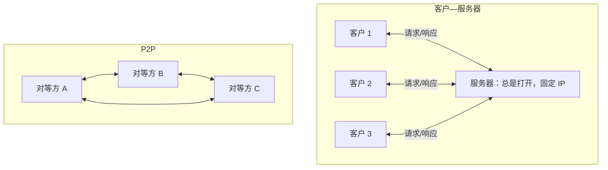

### 2.1.2 进程通信

真正通信的是**进程**（process），而非程序。同一主机上的进程可以通过操作系统的进程间通信机制通信；而不同端系统上的进程，则通过跨网络交换**报文**（message）通信。

#### 1. 客户和服务器进程

> [!success] Definition
> 在一对进程的通信会话中，**发起通信的进程是客户，会话开始时等待联系的进程是服务器**。

- Web：浏览器进程是客户，Web 服务器进程是服务器
- P2P：同一个对等方可同时扮演两种角色，但在每个会话中角色是确定的（请求文件的一方为客户）

#### 2. 进程与网络之间的接口：套接字

进程通过**套接字**（socket）收发报文。类比：进程是房子，套接字是门。

套接字是同一主机内应用层与运输层之间的接口，也称为应用程序与网络之间的 **API**。

开发者能控制：

- 套接字在应用层一侧的一切
- 选择运输层协议，可能设置少量参数（如最大缓存、最大报文段长度）

但对套接字的运输层一侧几乎没有控制权。

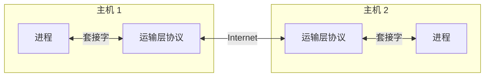

#### 3. 进程寻址

标识接收进程需要两类信息：

1. 主机地址： Internet 中为 **IP 地址**
2. 主机内接收进程（更准确说是接收套接字）的标识符：**端口号**（port number）

> [!note] IPv4 地址为 32 bit，IPv6 地址为 128 bit

| 应用         | 端口号 |
| ------------ | -----: |
| Web（HTTP）  |     80 |
| 邮件（SMTP） |     25 |
| DNS          |     53 |

标准协议的周知端口号列表见 IANA（`www.iana.org`）。

### 2.1.3 可供应用程序使用的运输服务

选择运输层协议类似于在两城之间选择飞机还是火车：不同模式提供不同服务。运输服务可从四个维度分类：

| 维度         | 含义                             | 典型需求                                                                                      |
| ------------ | -------------------------------- | --------------------------------------------------------------------------------------------- |
| 可靠数据传输 | 数据无差错、完整地交付           | 要求可靠：邮件、文件传输、Web、金融应用<br>不严格要求：多媒体                                 |
| 吞吐量       | 发送进程向接收进程交付比特的速率 | **带宽敏感**应用（如多媒体）需要保证一定吞吐量<br>**弹性应用**（邮件、文件传输、Web）可自适应 |
| 定时         | 数据到达时间的上限               | Internet 电话、虚拟环境、视频会议、多方游戏                                                   |
| 安全性       | 传输过程的保密性和完整性         | 需要机密性的应用                                                                              |

补充说明：

- 可用吞吐量因其他会话共享路径带宽而随时间波动；自适应编码可使多媒体应用匹配当前带宽
- 加密可在发送主机对数据加密、在接收主机解密，防止传输途中被观察

### 2.1.4 Internet 提供的运输服务

Internet （TCP/IP 网络）提供两种运输协议：**UDP** 与 **TCP**。开发新应用时首先要选择其一。

| 应用                     | 数据丢失 | 带宽                                          | 时间敏感        |
| ------------------------ | -------- | --------------------------------------------- | --------------- |
| 文件传输 / 下载          | 不能丢失 | 弹性                                          | 否              |
| 电子邮件                 | 不能丢失 | 弹性                                          | 否              |
| Web 文档                 | 不能丢失 | 弹性（几 kbps）                               | 否              |
| Internet 电话 / 视频会议 | 容忍丢失 | 音频几 kbps 到 1 Mbps；视频 10 kbps 到 5 Mbps | 是（约 100 ms） |
| 流式存储音频 / 视频      | 容忍丢失 | 同上                                          | 是（几秒）      |
| 交互式游戏               | 容忍丢失 | 几 kbps 到 10 kbps                            | 是（约 100 ms） |
| 智能手机消息             | 不能丢失 | 弹性                                          | 视情况而定      |

#### 1. TCP 服务

| 服务         | 说明                                                                                                          |
| ------------ | ------------------------------------------------------------------------------------------------------------- |
| 面向连接     | 应用数据流动前，客户与服务器先交换运输层控制信息（**握手**），之后建立 TCP 连接；连接为全双工，结束时必须拆除 |
| 可靠数据传输 | 无差错、按序交付全部字节流，无丢失、无重复                                                                    |
| 拥塞控制     | 网络拥塞时抑制发送进程，并试图使各连接公平共享带宽；惠及 Internet 整体，不一定惠及单个进程                    |

> [!note] TLS
> TCP 与 UDP 本身都不加密，明文口令会以明文经过沿途所有链路，可能被嗅探。**运输层安全**（Transport Layer Security, TLS）是对 TCP 的强化：
>
> - 不是第三种运输协议；在实现上位于应用层与 TCP 之间，由应用侧的 TLS 代码完成（客户端和服务器端都要包含）
> - 拥有与 TCP 套接字类似的 TLS 套接字 API
> - 流程：发送进程把明文交给 TLS 套接字 → TLS 加密 → 交给 TCP 套接字 → 经 Internet 传输 → 接收端 TLS 解密 → 明文交给接收进程
> - 提供：加密、数据完整性、端点鉴别

#### 2. UDP 服务

轻量级运输协议，只提供最低限度服务：

- 无连接，无握手
- 不可靠数据传输：不保证报文到达，可能乱序
- 无拥塞控制：发送端可用任意速率注入数据（实际端到端吞吐量可能因链路受限或拥塞而更低）

#### 3. Internet 运输协议不提供的服务

**吞吐量保证**和**定时保证**，TCP、UDP 都不提供。 Internet 电话等时间敏感应用已运行多年，是因为它们被设计成尽可能应对这种缺失；但时延过大或吞吐量受限时，好的设计也有限度。

| 应用          | 应用层协议                                             | 运输协议                       |
| ------------- | ------------------------------------------------------ | ------------------------------ |
| 电子邮件      | SMTP（RFC 5321）                                       | TCP                            |
| 远程终端      | Telnet（RFC 854）                                      | TCP                            |
| Web           | HTTP（RFC 9110 \~ 9114）                               | TCP（HTTP/3 为 QUIC over UDP） |
| 文件传输      | FTP（RFC 959）                                         | TCP                            |
| 流式多媒体    | HTTP（如 YouTube）、DASH                               | TCP                            |
| Internet 电话 | SIP（RFC 3261）、RTP（RFC 3550）或专用协议（如 Skype） | UDP 或 TCP                     |

Internet 电话容忍少量丢失但需要最低速率，开发者常选 UDP 以避开 TCP 拥塞控制和分组开销。不过，许多防火墙会阻挡 UDP，于是，开发者通常把 TCP 作为备份。

### 2.1.5 应用层协议

> [!success] Definition
> **应用层协议**定义了运行在不同端系统上的应用进程如何相互传递报文，包括：
>
> 1. 报文类型（如请求、响应）
> 2. 各类报文的语法（字段及其描述方式）
> 3. 字段的语义
> 4. 进程何时、如何发送报文及响应的规则

- 公开协议：由 RFC 定义，如 HTTP；遵循标准的浏览器与服务器可互操作
- 专用协议：如 Skype

应用层协议只是网络应用的一部分：

- Web 应用 = HTML 格式标准 + 浏览器 + Web 服务器 + HTTP
- Netflix = 视频服务器 + 记账/管理服务器 + 各端客户端程序 + DASH

### 2.1.6 本章涉及的五种应用

1. Web：极为流行，HTTP 较简单，先讲
2. 电子邮件： Internet 上第一个受欢迎的应用，使用多个应用层协议，比 Web 复杂
3. DNS： Internet 目录服务
4. P2P 文件分发
5. 按需流式视频与 CDN

## 2.2 Web 和 HTTP

20 世纪 90 年代前， Internet 主要用户是研究人员、学者和大学生。90 年代初期**万维网**出现，成为第一个引起公众关注的 Internet 应用。

Web 的吸引力：按需获取、发布简单低廉、超链接和搜索引擎辅助导航、多媒体、表单和 JavaScript 支持交互，并成为 YouTube、Gmail、地图等应用的平台。

### 2.2.1 HTTP 概述

Web 的应用层协议是**超文本传输协议**（HyperText Transfer Protocol，HTTP），分别由客户程序与服务器程序实现，通过交换 HTTP 报文会话。

| 术语             | 含义                                                                             |
| ---------------- | -------------------------------------------------------------------------------- |
| Web 页面（文档） | 由若干**对象**组成；对象是可由 URL 寻址的文件（HTML、JPEG、JS、CSS、视频片段等） |
| 基本 HTML 文件   | 页面的主文件，引用其他对象；1 个 HTML + 5 个 JPEG 的页面共 6 个对象              |
| URL              | 主机名 + 路径名，如 `http://www.someSchool.edu/someDepartment/picture.gif`       |
| 浏览器           | 实现 HTTP 客户端（Chrome、Firefox 等）                                           |
| Web 服务器       | 实现 HTTP 服务器端，存储对象（Apache 等）                                        |

HTTP 使用 **TCP** 作为运输协议：

1. 客户发起到服务器的 TCP 连接，双方通过套接字访问 TCP
2. 客户向套接字发请求报文、从套接字收响应报文；服务器反之
3. TCP 提供可靠传输，HTTP 不必关心丢包、乱序的恢复细节

**HTTP 是无状态协议**：服务器不保存任何关于客户的状态。同一客户几秒内两次请求同一对象，服务器会重新发送，就像忘记了之前所做的一切。

版本：HTTP/1.0（90 年代初）、HTTP/1.1（1997 年标准化，仍广泛使用）、HTTP/2（2015 年）、HTTP/3（2022 年，RFC 9114）。

### 2.2.2 非持续连接和持续连接

客户与服务器经 TCP 通信时，需决定每个请求/响应对是否使用单独 TCP 连接：

- **非持续连接**：每个请求/响应对都使用一个新连接
- **持续连接**：所有请求及响应用同一连接；HTTP 默认使用持续连接，也可配置为非持续

#### 1. 非持续连接的 HTTP

以含 1 个 HTML 与 10 个 JPEG（同一服务器）的页面为例：

1. 客户在 80 端口发起到服务器的 TCP 连接
2. 客户经套接字发送含路径名的 HTTP 请求报文
3. 服务器取出对象，封装进响应报文并发送
4. 服务器通知 TCP 关闭连接（TCP 确认客户完整收到响应后才真正关闭）
5. 客户收到响应并关闭连接，解析 HTML，得到对 10 个 JPEG 的引用
6. 对每个 JPEG 重复步骤 1~4

共产生 11 个 TCP 连接。浏览器可配置**并行连接**数以缩短响应时间。

> [!success] definition
> **往返时间**（Round-Trip Time，RTT）：一个短分组从客户到服务器再返回客户所用的时间，包括传播时延、排队时延和处理时延。

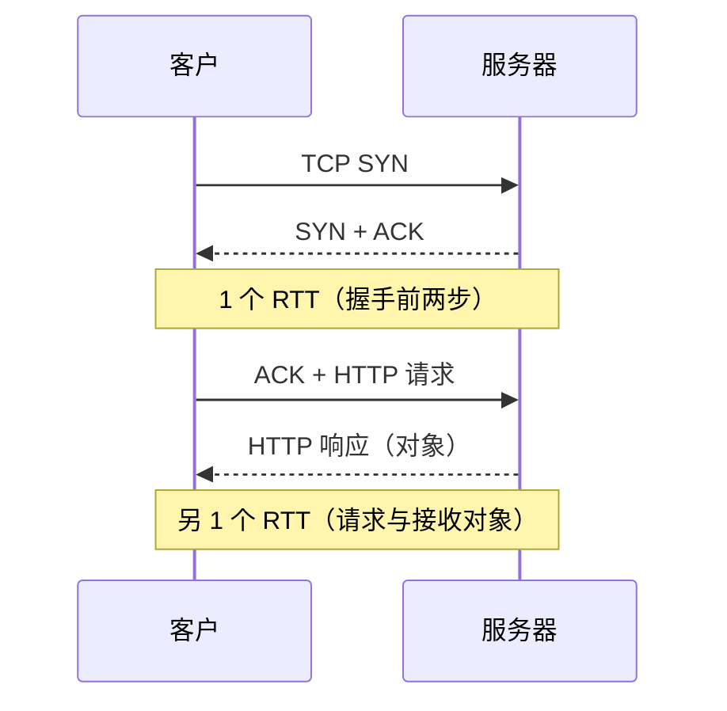

单个对象的响应时间约为：

$$
2\,\text{RTT} + d_{\text{trans}}
$$

其中 $d_{\text{trans}}$ 为服务器传输该对象的时间。

非持续连接的缺点：

1. 每个对象都要新建并维护一条连接，客户与服务器两端都要分配 TCP 缓冲区、保持 TCP 变量，对服务器负担重
2. 每个对象都有 $2\,\text{RTT}$ 的交付时延

#### 2. 持续连接的 HTTP

服务器发送响应后保持连接打开，同一客户与服务器之间的后续请求/响应（甚至多个页面）沿用该连接。若连接闲置超过可配置的超时间隔，服务器关闭它。

**流水线**（pipelining）：不必等待未决请求的回答即连续发出请求。

> [!warning] 关于流水线
> HTTP/1.1 允许流水线，但并非默认启用；受队头阻塞、中间设备兼容性等影响，主流浏览器实践中基本不使用。

**时延对比**：设页面含 1 个 HTML 与 10 个图片，各对象传输时间均为 $d$，忽略其他时延（需验证原书数值）：

| 模式                           | 总时间                                               |
| ------------------------------ | ---------------------------------------------------- |
| 非持续、串行                   | $22\,\text{RTT} + 11d$                               |
| 非持续、并行（5 条连接取图片） | 约 $6\,\text{RTT}$ + 传输时间                        |
| 持续、无流水线                 | $12\,\text{RTT} + 11d$（首对象 2 RTT，其余各 1 RTT） |
| 持续、流水线                   | 约 $3\,\text{RTT} + 11d$                             |

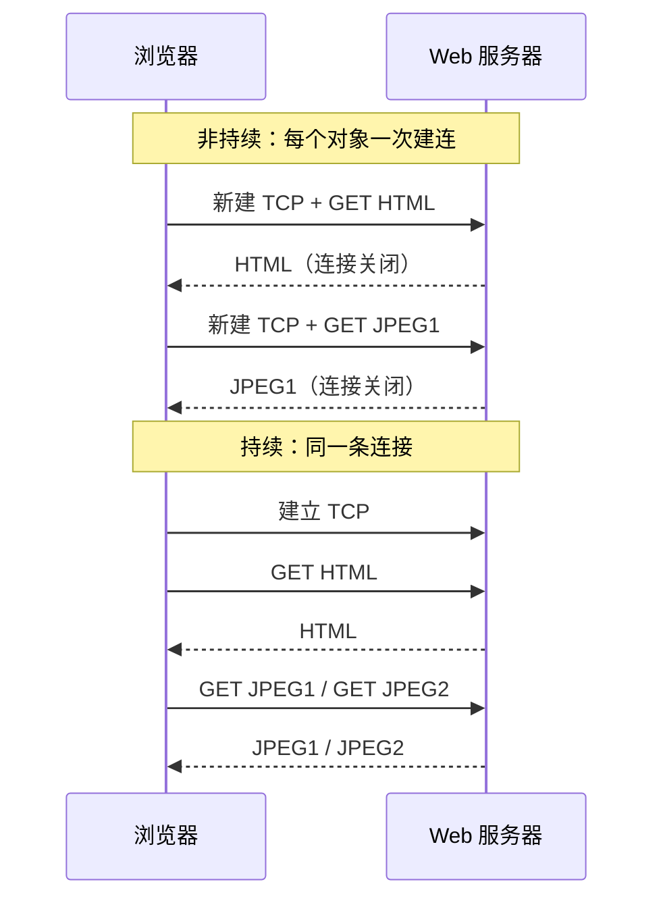

### 2.2.3 HTTP 报文格式

HTTP 报文分为请求报文与响应报文，均为可读 ASCII 文本，每行以回车换行（CRLF）结束，首部之后以空行结束。

#### 1. HTTP 请求报文

```http
GET /somedir/page.html HTTP/1.1
Host: www.someschool.edu
Connection: close
User-agent: Mozilla/5.0
Accept-language: fr
```

第一行是**请求行**，其余是**首部行**。请求行有 3 个字段：方法、URL、HTTP 版本。

| 首部行              | 含义                                             |
| ------------------- | ------------------------------------------------ |
| `Host:`             | 对象所在主机                                     |
| `Connection: close` | 要求服务器发完对象后关闭连接                     |
| `User-agent:`       | 用户代理（浏览器类型），服务器可据此发送不同版本 |
| `Accept-language:`  | 期望的语言版本，没有则发默认版本                 |

**请求报文通用格式**

```
方法 sp URL sp 版本 crlf
首部字段名: sp 值 crlf
...
首部字段名: sp 值 crlf
crlf
实体体
```

`sp` 表示空格，`crlf` 表示回车换行。

| 方法   | 用途                                    |
| ------ | --------------------------------------- |
| GET    | 请求对象；实体体通常为空                |
| POST   | 常用于表单提交，实体体含用户输入        |
| HEAD   | 与 GET 类似，但响应不含对象，常用于调试 |
| PUT    | 上传对象到指定路径                      |
| DELETE | 删除服务器上的对象                      |

表单也可使用 GET，把输入附在 URL 后，例如 `www.somesite.com/animalsearch?a=monkeys&b=bananas`。

> [!note] 说明
> 原书写作 `animalsearch?monkeys&bananas`，为简化写法；实际格式为 `?key=value&key=value`。

#### 2. HTTP 响应报文

```http
HTTP/1.1 200 OK
Connection: close
Date: Tue, 18 Aug 2015 15:44:04 GMT
Server: Apache/2.2.3 (CentOS)
Last-Modified: Tue, 18 Aug 2015 15:11:03 GMT
Content-Length: 6821
Content-Type: text/html

(data data data data data ...)
```

三部分：**状态行**、首部行、实体体（包含请求的对象）。状态行有 3 个字段：协议版本、状态码、状态短语（reason phrase）。

| 首部行              | 含义                                                                 |
| ------------------- | -------------------------------------------------------------------- |
| `Connection: close` | 发完报文后关闭 TCP 连接                                              |
| `Date:`             | 服务器取出对象、插入响应并发送的时间（**不是**对象的创建或修改时间） |
| `Server:`           | 产生响应的服务器软件                                                 |
| `Last-Modified:`    | 对象创建或最后修改时间，对缓存至关重要                               |
| `Content-Length:`   | 对象字节数                                                           |
| `Content-Type:`     | 对象类型（以此为准，而非文件扩展名；补充说明）                       |

| 状态码 | 短语                       | 含义                               |
| -----: | -------------------------- | ---------------------------------- |
|    200 | OK                         | 请求成功                           |
|    301 | Moved Permanently          | 永久转移，新 URL 在 `Location:` 中 |
|    304 | Not Modified               | 条件 GET 中对象未改，可用缓存      |
|    400 | Bad Request                | 请求无法被理解                     |
|    404 | Not Found                  | 对象不在服务器上                   |
|    505 | HTTP Version Not Supported | 不支持该 HTTP 版本                 |

可用 Telnet 观察真实报文：

```bash
telnet gaia.cs.umass.edu 80
```

输入 `GET /kurose_ross/interactive/index.php HTTP/1.1` 与 `Host: gaia.cs.umass.edu` 后连按两次回车。不过现在已经不接受 HTTP/1.1 的明文请求了，必须使用 HTTPS。

浏览器和服务器包含的首部行取决于产品、版本、配置，以及浏览器是否已有可能过期的缓存对象。

### 2.2.4 用户与服务器的交互：Cookie

HTTP 服务器无状态，简化了设计，使其能同时处理数千个 TCP 连接。但站点常需要识别用户（限制访问、关联内容与身份）。**Cookie**（RFC 6265）即为此设计。

#### 1. Cookie 的 4 个组件

1. HTTP 响应报文中的 `Set-cookie:` 首部行
2. HTTP 请求报文中的 `Cookie:` 首部行
3. 用户端系统中由浏览器管理的 cookie 文件
4. Web 站点的后端数据库

#### 2. 工作过程（Susan 访问 Amazon）

1. 请求到达 Amazon 服务器；服务器生成唯一识别码，在后端数据库建立表项
2. 响应中携带 `Set-cookie: 1678`
3. 浏览器在 cookie 文件中添加一行（主机名 + 识别码）
4. 之后每次请求，浏览器查 cookie 文件，在请求中加入 `Cookie: 1678`

Amazon 无需知道 Susan 的姓名，却能跟踪"用户 1678"的访问顺序，实现购物车、推荐，以及注册后的"一键购物"。

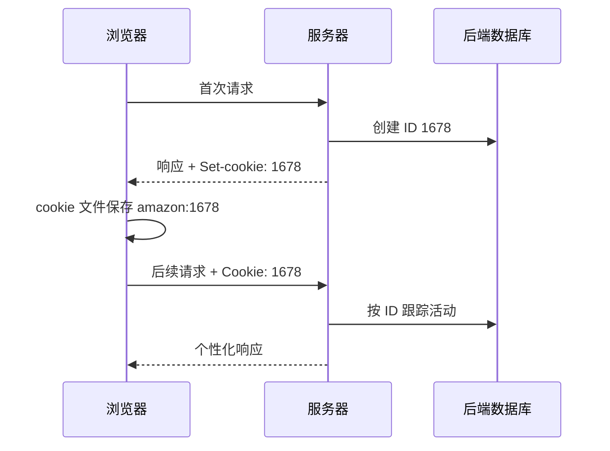

Cookie 可在无状态 HTTP 之上建立用户会话层（如 Web 邮件登录后的会话）。但结合账户信息，站点能获知大量用户信息并可能出售给第三方，因此存在隐私争议。

> [!note] 补充：Cookie 常用属性
> | 属性 | 作用 |
> | --- | --- |
> | `Domain` / `Path` | 限定 cookie 发送的域与路径 |
> | `Expires` / `Max-Age` | 过期时间；若缺失则为会话 cookie |
> | `Secure` | 仅经 HTTPS 发送 |
> | `HttpOnly` | 禁止脚本读取，缓解 XSS 窃取 |
> | `SameSite` | 限制跨站发送，缓解 CSRF |
>
> 第三方 cookie（由页面所嵌入的其他域设置）是跨站跟踪的主要手段，现多被浏览器限制。

### 2.2.5 Web 缓存

**Web 缓存器**（代理服务器）代表初始服务器满足 HTTP 请求，有自己的磁盘存储，保存最近请求过的对象副本。

过程（请求 `http://www.someschool.edu/campus.gif`）：

1. 浏览器与缓存器建立 TCP 连接并发送请求
2. 缓存器检查本地副本：有则直接响应
3. 无则与初始服务器建立连接并请求对象
4. 收到后存储副本，并回送给浏览器

缓存器既是服务器（对浏览器）又是客户（对初始服务器），通常由 ISP 购买安装（大学、住宅 ISP 等）。

部署原因：

1. 缩短客户请求的响应时间（尤其是客户到缓存器的带宽远高于到初始服务器时）
2. 减少机构接入链路的流量，推迟带宽升级、降低费用，并减少整个 Internet 上的 Web 流量

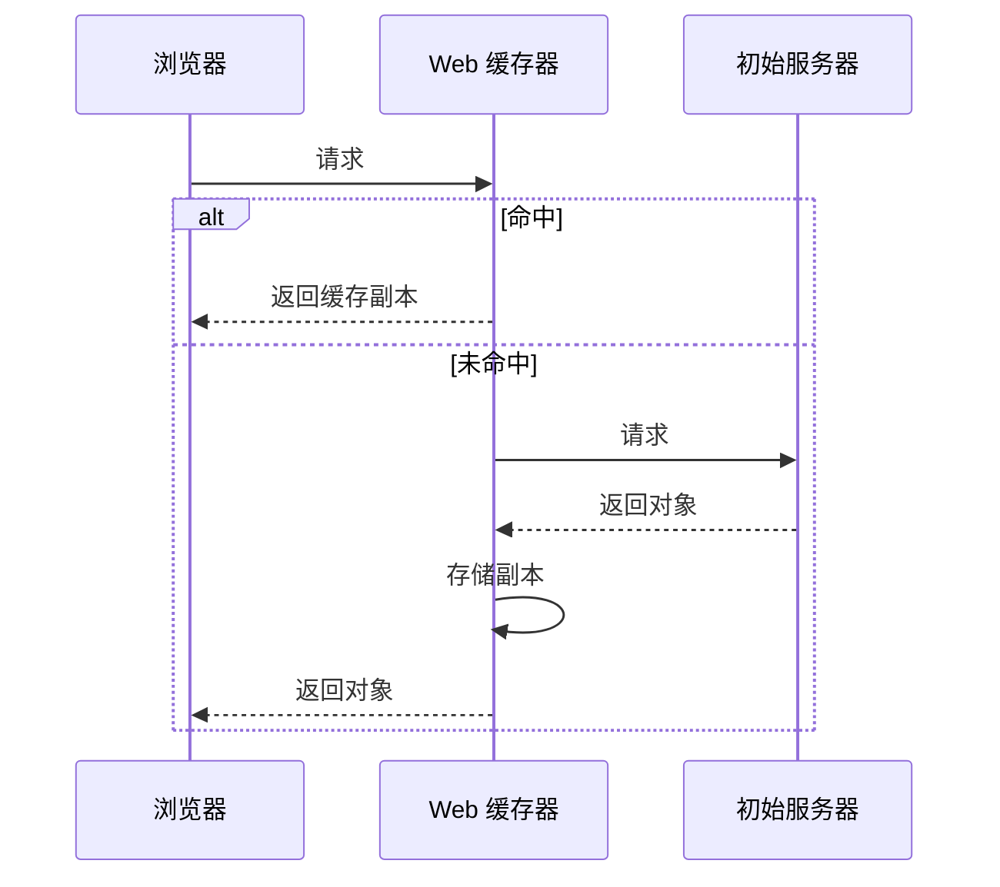

#### 1. 缓存示例计算

场景：机构 LAN 高速；接入链路 15 Mbps；对象平均 1 Mb；平均请求率 15 次/s；请求报文可忽略； Internet 时延（接入链路侧路由器转发请求起到收到响应止）平均 2 s。

无缓存时，接入链路流量强度：

$$
\frac{15\ \text{req/s} \times 1\ \text{Mb}}{15\ \text{Mbps}} = 1.0
$$

流量强度趋近 1，排队时延急剧增大（可达分钟量级），总响应时间由此恶化。

安装缓存器，设命中率为 0.4（现实中常在 0.2~0.7）：

- 40% 请求由缓存器经 LAN 响应，时延约 10 ms 以内
- 60% 请求仍经接入链路，流量强度降为 $0.6$，接入链路时延较小（约几十毫秒量级，需验证原书取值）

平均时延（以 10 ms 近似接入时延）：

$$
0.4 \times 0.010 + 0.6 \times (2 + 0.010) \approx 1.21\ \text{s}
$$

无需升级接入链路，响应时间反而更低；缓存器成本低，很多使用廉价 PC 上的公共域软件。

**CDN**：通过**内容分发网**（CDN），Web 缓存器作用日益重要。CDN 公司在 Internet 上安装大量地理分散的缓存器，使流量本地化。第三方 CDN 如 Akamai；专用 CDN 如 Google、Netflix。

#### 2. 条件 GET

缓存中的副本可能陈旧。**条件 GET** 允许缓存器验证其是否最新：请求使用 GET 方法并包含 `If-Modified-Since:` 首部行。

1. 缓存器首次获取对象时，同时存储响应中的 `Last-Modified:`
2. 一周后另一用户请求该对象，缓存器发送条件 GET：`If-Modified-Since:` 的值等于存储的 `Last-Modified:`
3. 若未修改：服务器返回 `304 Not Modified` 且**实体体为空**（避免浪费带宽、缩短响应时间），缓存器可转发缓存副本
4. 若已修改：返回 `200 OK` 与新对象，缓存器更新缓存

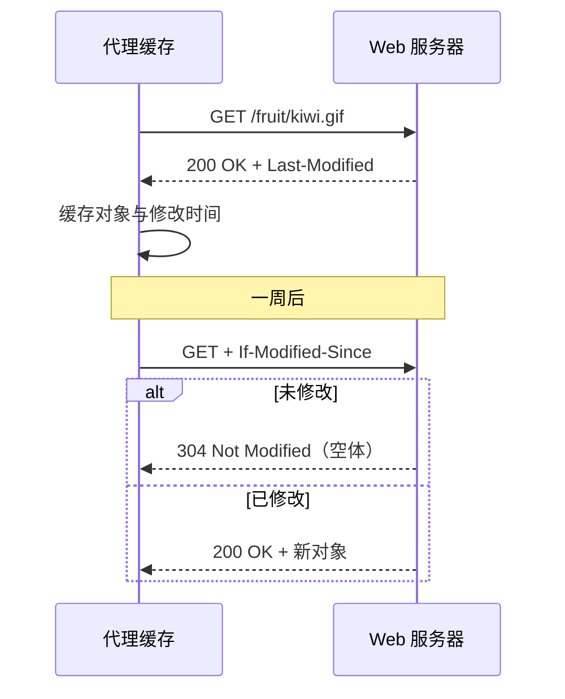

> [!note] 补充：其他缓存机制
>
> - `Cache-Control`（如 `max-age`、`no-store`）由服务器声明对象可缓存多久，期间缓存器无需向服务器验证
> - `ETag` + `If-None-Match`：以对象内容的标识符代替时间戳作为验证条件，比 `Last-Modified` 更精确

### 2.2.6 HTTP/2 与 HTTP/3

HTTP/2（2015 年，RFC 7540；现由 RFC 9113 取代）是 HTTP/1.1 之后的首个新版本。其目标是**减小感知时延**，手段：

- 单一 TCP 连接上的请求/响应**多路复用**
- 请求优先级
- 服务器推（server push）
- HTTP 首部压缩

HTTP/2 **不改变**方法、状态码、URL、首部字段，改变的是数据格式化方式与客户—服务器之间的传输方式。

#### 1. HTTP/1.1 的问题：队头阻塞

HTTP/1.1 使用单一持续 TCP 连接传送页面时存在**队头阻塞**（HOL blocking）：页面顶部的大视频片段先传，后面的小对象被迫等待。

HTTP/1.1 的应对是打开多个并行 TCP 连接（常多达 6 条）。TCP 拥塞控制使每条连接大致平分瓶颈带宽，$n$ 条连接共享时每条约得 $1/n$，所以打开多条并行连接也让浏览器占到更多带宽。

HTTP/2 的目标是减少并行连接数，从而：

- 减少服务器打开和维护的套接字数
- 让 TCP 拥塞控制按设计工作

同时需要新机制避免 HOL 阻塞。

#### 2. HTTP/2 成帧

方案：把每个报文拆成**小帧**，在同一 TCP 连接上交错发送。

示例：一个页面含 1 个 1000 帧的视频和 8 个各 2 帧的小对象。

- 交错发送：视频发 1 帧、每个小对象各发 1 帧，如此两轮，共 $2 + 8 \times 2 = 18$ 帧后所有小对象发完
- 不交错：小对象需等视频发完，共 $1000 + 8 \times 2 = 1016$ 帧

成帧子层处理流程：响应被划分为帧（首部字段一帧，报文体一帧或多帧）→ 与其他响应的帧交错发送 → 客户端成帧子层重组 → 浏览器照常处理；请求同样分帧。帧采用**二进制编码**，解析更高效、帧更小、更不易出错。

#### 3. 优先级与服务器推

- 优先级：客户为每个响应分配 1~256 的权重（数值越大优先级越高），还可声明报文之间的依赖关系
- 服务器推：服务器分析 HTML，在客户请求之前主动推送所需对象，省去等待请求的时延

> [!warning] 服务器推的现状
> 由于 HTTP/2 Server Push 的实际使用率较低，且其性能收益不稳定，甚至可能造成性能下降，Chrome 自 106 版起移除了对 HTTP/2 Server Push 的支持。现代 Web 应用通常使用 103 Early Hints、preload 等机制替代 Server Push。

#### 4. HTTP/3

**QUIC** 是在 UDP 之上实现的新型"运输"协议（运行在应用层），具备报文复用（交错）、每流流控、低时延连接建立等特征。**HTTP/3** 即运行在 QUIC 之上的 HTTP，已于 2022 年标准化（RFC 9114）。QUIC 将多流复用下沉到运输层，使单个流的丢包不再阻塞其他流。

| 版本     | 连接模型             | 复用         | 首部压缩 | 运输层                    |
| -------- | -------------------- | ------------ | -------- | ------------------------- |
| HTTP/1.0 | 非持续               | 无           | 无       | TCP                       |
| HTTP/1.1 | 持续（流水线很少用） | 多条并行连接 | 无       | TCP                       |
| HTTP/2   | 单连接               | 帧交错       | 有       | TCP（TCP 层队头阻塞仍在） |
| HTTP/3   | 单 QUIC 连接         | 流级复用     | 有       | QUIC / UDP                |

## 2.3 Internet 中的电子邮件

电子邮件是**异步**通信媒介：快速、易分发、便宜；现代邮件支持附件、超链接、HTML 文本和图片。

系统有三个主要组成部分：

1. **用户代理**（user agent）：读、回复、转发、保存、撰写报文。如 Outlook、Thunderbird、Gmail 网页端
2. **邮件服务器**（mail server）：体系结构的核心，每个收件人在其上有一个**邮箱**
3. **SMTP**：简单邮件传输协议，邮件服务器之间的主要应用层协议

发送路径：发送方用户代理 → 发送方邮件服务器（外出报文队列）→ 接收方邮件服务器 → 接收方邮箱。Bob 读取邮件时，其邮件服务器用用户名和口令鉴别他。

若 Alice 的服务器无法投递，会把报文留在队列中，通常每 30 分钟左右重试；几天仍失败则删除报文并通知 Alice。

SMTP 使用 TCP，每台邮件服务器同时运行 SMTP 客户端（发送时）和服务器端（接收时）。

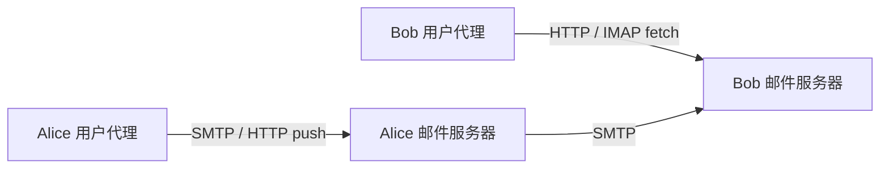

### 2.3.1 SMTP

SMTP（RFC 5321）比 HTTP 古老得多。它保留某些继承技术的特征：**邮件报文体（不只是首部）限用 7 比特 ASCII**。这在 80 年代早期合理，但在多媒体时代很不便：二进制数据需先编码为 ASCII 再解码还原，而 HTTP 不需要。

#### 1. 基本操作

1. Alice 通过用户代理写信，提供 `bob@someschool.edu`
2. 用户代理将报文送到 Alice 的邮件服务器，进入报文队列
3. SMTP 客户发现队列中的报文，创建到 Bob 邮件服务器 SMTP 服务器的 TCP 连接
4. 初始握手后，SMTP 客户发送报文
5. Bob 的服务器接收报文并放入其邮箱
6. Bob 方便时用用户代理阅读

SMTP **一般不使用中间邮件服务器**，即使两台服务器相隔半个地球（如香港与圣路易斯），TCP 连接也是直接建立。若对方未开机，报文留在发送方服务器上等待重试。

客户在 **25 端口**建立到服务器的 TCP 连接。握手阶段，客户给出发送方与接收方邮件地址；SMTP 依赖 TCP 的可靠传输。有更多报文发往同一服务器时，在同一连接上重复，否则指示 TCP 关闭连接。

#### 2. SMTP 对话示例

客户 `crepes.fr`，服务器 `hamburger.edu`（`C:` 为客户发送，`S:` 为服务器发送）：

```
S: 220 hamburger.edu
C: HELO crepes.fr
S: 250 Hello crepes.fr, pleased to meet you
C: MAIL FROM: <alice@crepes.fr>
S: 250 alice@crepes.fr ... Sender ok
C: RCPT TO: <bob@hamburger.edu>
S: 250 bob@hamburger.edu ... Recipient ok
C: DATA
S: 354 Enter mail, end with "." on a line by itself
C: Do you like ketchup?
C: How about pickles?
C: .
S: 250 Message accepted for delivery
C: QUIT
S: 221 hamburger.edu closing connection
```

- 客户发送 5 条命令：`HELO`、`MAIL FROM`、`RCPT TO`、`DATA`、`QUIT`
- 以单独一行的句点（即 `CRLF.CRLF`）表示报文结束
- 服务器对每条命令回送回答码和可选的英文解释
- SMTP 使用**持续连接**：多个报文可复用同一连接，每个报文以新的 `MAIL FROM: <发件人地址>` 开始、以单独句点结束，全部发完后才发 `QUIT`

可用 `telnet serverName 25` 直接与 SMTP 服务器对话，收到 220 回答后依次输入上述命令。

### 2.3.2 邮件报文格式

邮件首部（RFC 5322）与报文体以空行分隔。每个首部行为"关键词: 值"。

- 必需：`From:`、`To:`
- 可选：`Subject:` 等

> [!warning] 区分
> 首部行是邮件报文自身的一部分；SMTP 命令（`MAIL FROM`、`RCPT TO`）是握手协议的一部分，二者即使含相同词汇也不同。

```
From: alice@crepes.fr
To: bob@hamburger.edu
Subject: Searching for the meaning of life.
```

### 2.3.3 邮件访问协议

SMTP 将邮件交付到 Bob 的邮件服务器邮箱后，Bob 的用户代理需要取回。邮件服务器不放在 Bob 的 PC 上，因为那要求 PC 永远在线；典型做法是用户代理访问总是开机的共享邮件服务器。

Alice 的用户代理通常不直接对 Bob 的服务器发起 SMTP：

1. 用户代理用 SMTP 或 HTTP 将邮件推入自己的邮件服务器
2. 该服务器作为 SMTP 客户中继到 Bob 的服务器

分两步是为了让 Alice 的服务器能反复重试（如每 30 分钟一次）；否则用户代理无法处理目的服务器不可达。若自己的服务器宕机，Alice 可通知系统管理员。

取回邮件是**拉**操作，而 SMTP 是**推**协议，所以 Bob 的用户代理不能用 SMTP 取信：

| 方式             | 说明                                                                 |
| ---------------- | -------------------------------------------------------------------- |
| HTTP             | Web 邮件或手机客户端（如 Gmail）；服务器需同时具有 HTTP 与 SMTP 接口 |
| IMAP（RFC 3501） | Internet 邮件访问协议，双向操作，支持在服务器上管理邮件              |
| POP3             | 简单的邮件下载协议，单向从服务器下载邮件到本地设备                   |

HTTP 与 IMAP 方式都支持在服务器上管理文件夹、移动或删除邮件、标记重要邮件。

## 2.4 DNS： Internet 的目录服务

主机有两种标识方式：

| 标识                          | 优点                                               | 缺点                                     |
| ----------------------------- | -------------------------------------------------- | ---------------------------------------- |
| 主机名（如 `www.google.com`） | 便于记忆                                           | 几乎不含位置信息；长度不定，路由器难处理 |
| IP 地址（如 `121.7.106.83`）  | 定长、有层次结构，从左到右越来越具体地指出主机位置 | 难记                                     |

### 2.4.1 DNS 提供的服务

**域名系统**（Domain Name System，DNS）负责主机名到 IP 地址的转换，包括：

1. 一个由分层的 **DNS 服务器**实现的分布式数据库
2. 一个使主机能够查询该数据库的**应用层协议**

DNS 运行在 **UDP** 之上，使用 **53 端口**；服务器通常运行 BIND 软件（Berkeley Internet Name Domain）。

> [!note] 实践原则
> DNS 是应用层协议（客户—服务器模式、通过端到端运输协议传送报文），但它不直接与用户交互，而是为其他应用提供名字到地址的核心功能。把复杂性放在网络边缘，是 Internet 体系结构的典型设计。

DNS 被 HTTP、SMTP 等协议使用。例：浏览器请求 `www.someschool.edu/index.html` 时：

1. 浏览器从 URL 抽取主机名，交给本机 DNS 客户端
2. DNS 客户端向 DNS 服务器发送查询，最终收到含 IP 地址的回答
3. 浏览器向该 IP 的 80 端口发起 TCP 连接

DNS 会带来额外时延（有时相当可观）；所需地址常缓存在"附近的"DNS 服务器中，以降低时延和 DNS 流量。

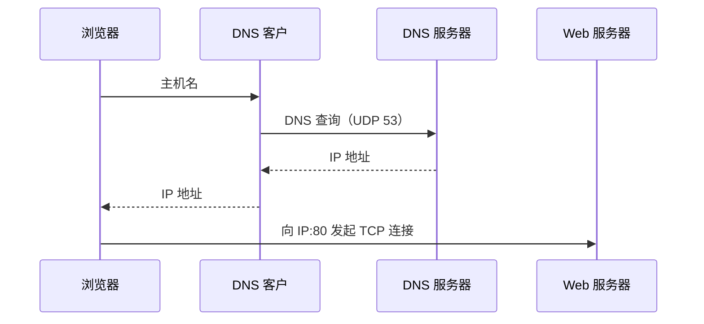

DNS 还提供其他服务：

| 服务           | 说明                                                                                                                                         |
| -------------- | -------------------------------------------------------------------------------------------------------------------------------------------- |
| 主机别名       | 复杂的**规范主机名**（如 `relay1.west-coast.enterprise.com`）可有别名（`enterprise.com`、`www.enterprise.com`）；别名更好记                  |
| 邮件服务器别名 | 让邮件地址简洁（如 `bob@yahoo.com`）；MX 记录允许公司的邮件服务器与 Web 服务器使用同一别名                                                   |
| 负载分配       | 一个规范主机名对应多个服务器主机的不同 IP 地址<br>DNS 每次回答时轮转地址次序，从而在冗余服务器间分配负载<br>如 Akamai 等以更复杂方式使用 DNS |

> [!note] 说明
> 获取邮件服务器规范主机名请求 **MX** 记录，获取其他服务器规范主机名请求 **CNAME** 记录。使得邮件服务器与 Web 服务器可以使用同一别名（如 `yahoo.com`），但各自有不同的规范主机名。

DNS 由 RFC 1034、1035 定义，并由后续 RFC 更新。

### 2.4.2 DNS 工作机理概述

应用调用 DNS 客户端，客户端向网络发送 DNS 查询，所有查询与回答都是 UDP 数据报、端口 53，经毫秒到数秒收到回答。对调用方而言 DNS 是提供直接转换服务的"黑盒"。

#### 1. 为什么不用单一集中式服务器

| 问题               | 说明                                                       |
| ------------------ | ---------------------------------------------------------- |
| 单点故障           | 服务器崩溃则整个 Internet 瘫痪                             |
| 通信容量           | 一台服务器需处理全部查询                                   |
| 远距离集中式数据库 | 不可能邻近所有客户（如纽约的服务器对澳大利亚客户时延很大） |
| 维护               | 需为所有主机保留记录并频繁更新                             |

结论：集中式设计没有可扩展性，DNS 采用**分布式、层次**数据库。

#### 2. 分布式、层次数据库

三类 DNS 服务器：

| 类型                | 作用                                                                                                                                                  |
| ------------------- | ----------------------------------------------------------------------------------------------------------------------------------------------------- |
| 根 DNS 服务器       | 提供 TLD 服务器的 IP 地址。逻辑上 13 套（A~M），由 12 个组织管理，IANA 协调；实际实体数以上千计，具体数字随年份变化（需验证；原书第 7 版为 400 多个） |
| 顶级域（TLD）服务器 | 每个顶级域（`com`、`org`、`edu`，及 `uk`、`fr`、`cn` 等国家域）对应一组；提供权威 DNS 服务器的 IP 地址                                                |
| 权威 DNS 服务器     | 机构保存的、将公共可访问主机名映射到 IP 的记录；可自建，也可付费托管                                                                                  |

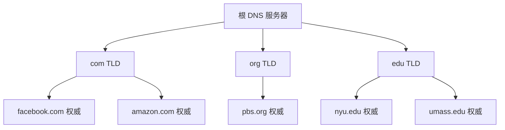

**本地 DNS 服务器**（默认名字服务器）严格说不属于该层次，但至关重要。每个 ISP 都有一台，其地址通常通过 DHCP 配置；它通常"邻近"主机，并充当代理，把查询转发进层次结构。

#### 3. 查询示例：解析 `gaia.cs.umass.edu`

设主机 `cse.nyu.edu` 的本地 DNS 服务器为 `dns.nyu.edu`，目标权威服务器为 `dns.umass.edu`。

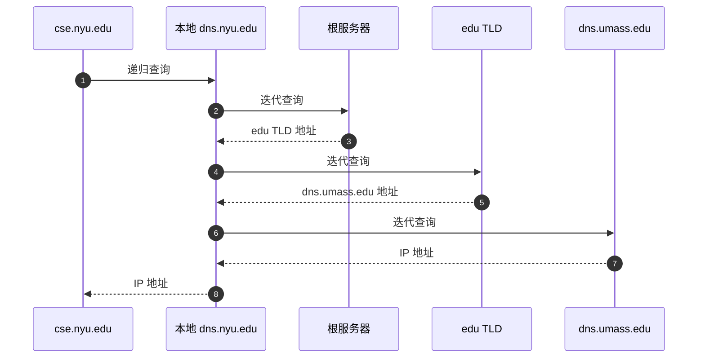

共 8 份报文（4 查询 + 4 回答）。若 TLD 只知道某个中间服务器（如 `dns.umass.edu` 再指向系办的 `dns.cs.umass.edu`），则多出 1 轮查询与回答，共 **10 份报文**。

|      | 递归查询                             | 迭代查询                                         |
| ---- | ------------------------------------ | ------------------------------------------------ |
| 含义 | 被查询服务器以请求方名义负责获得映射 | 被查询服务器直接返回下一步该问谁，由请求方继续查 |
| 实践 | 主机 → 本地 DNS                      | 本地 DNS → 根/TLD/权威                           |

理论上所有查询都可以是递归的，但实践通常按上述模式。

#### 4. DNS 缓存

服务器收到回答后，可将映射缓存在本地；之后对同一主机名的查询可直接回答（即使它不是权威服务器）。映射并非永久，缓存条目到期丢弃，一般在几分钟到几天之间。

本地服务器也缓存 TLD 服务器地址，因此多数查询绕过根服务器。此外，操作系统和浏览器也各有自己的 DNS 缓存。

### 2.4.3 DNS 记录和报文

DNS 服务器存储**资源记录**（Resource Record，RR）。在教学中，通常将一条 RR 抽象表示为四元组 `(Name, Value, Type, TTL)`；严格的 DNS 协议格式还包含 `Class` 等字段。TTL（Time To Live）规定该记录在缓存中的最长有效时间。

DNS 响应报文可以包含一条或多条 RR，也可能不包含 RR。RR 可以出现在 Answer、Authority 和 Additional Section 中。

| Type  | Name     | Value                       | 示例                                       |
| ----- | -------- | --------------------------- | ------------------------------------------ |
| A     | 主机名   | IPv4 地址                   | `(relay1.bar.foo.com, 145.37.93.126, A)`   |
| AAAA  | 主机名   | IPv6 地址                   | `(relay1.bar.foo.com, 2001:db8::1, AAAA)`  |
| NS    | 域名     | 该域的权威 DNS 服务器主机名 | `(foo.com, dns.foo.com, NS)`               |
| CNAME | 主机别名 | 规范主机名                  | `(www.foo.com, relay1.bar.foo.com, CNAME)` |
| MX    | 邮件域名 | 邮件服务器主机名及优先级    | `(foo.com, (10, mail.foo.com), MX)`        |

> [!note] CNAME 的特殊规则
> CNAME 用于将一个**别名**映射到规范主机名。一个域名一旦存在 CNAME RR，就不能再存在其他普通 RR；因此 CNAME 不能与 A、AAAA、MX、NS 等记录共存。
>
> 例如：
>
> `www.foo.com. IN CNAME relay1.bar.foo.com.`
>
> 是合法的典型用法，而不能同时存在：
>
> `www.foo.com. IN A 145.37.93.126`

- 权威服务器含该主机名的 A 记录；非权威服务器可能因缓存而含 A 记录
- 非权威服务器含包含该主机名的域的 NS 记录，以及 NS 记录所指服务器的 A 记录，例如 edu TLD 服务器含 `(umass.edu, dns.umass.edu, NS)` 与 `(dns.umass.edu, 128.119.40.111, A)`

#### 1. DNS 报文

只有查询与回答两种报文，**格式相同**：

| 区域            | 内容                                                                                    |
| --------------- | --------------------------------------------------------------------------------------- |
| 首部（12 字节） | 16 比特标识符（回答复制之，用于匹配）、标志、问题数、回答 RR 数、权威 RR 数、附加 RR 数 |
| 问题区域        | 被查询的名字与类型（如 A、MX）                                                          |
| 回答区域        | 对所查名字的 RR（可含多条，如冗余服务器的多个 IP）                                      |
| 权威区域        | 其他权威服务器的记录                                                                    |
| 附加信息区域    | 其他有帮助的记录（如 MX 回答附带邮件服务器的 A 记录）                                   |

首部标志：查询/回答（0/1）、权威（回答者是权威服务器时置位）、希望递归、递归可用。

可用 `nslookup`（多数 Windows/UNIX 平台自带，也有 Web 站点提供）直接向任意 DNS 服务器发送查询。

#### 2. 在 DNS 数据库中插入记录

以创业公司 `networkutopia.com` 为例：

1. 在**注册登记机构**注册域名（验证唯一性、录入 DNS、收费）。ICANN 向各注册机构授权，现有许多机构竞争（1999 年前仅 Network Solutions）
2. 提供基本与辅助权威服务器的名字和 IP（如 `dns1.networkutopia.com` / `212.212.212.1`）
3. 注册机构向 TLD `com` 服务器录入 NS 与 A 记录：`(networkutopia.com, dns1.networkutopia.com, NS)`、`(dns1.networkutopia.com, 212.212.212.1, A)`
4. 自己在权威服务器中配置 Web 服务器的 A 记录和邮件服务器的 MX 记录

早期记录靠静态配置文件，现在 DNS 协议增加了 UPDATE 选项支持动态增删（RFC 2136、3007）。

验证访问过程：Alice 的主机 → 本地 DNS → （必要时根）→ `com` TLD（返回 NS 与 A）→ 向 `212.212.212.1` 查询 `www.networkutopia.com` 的 A 记录（如 `212.212.71.4`）→ 浏览器向该 IP 发起 TCP 连接并发送 HTTP 请求。

#### 3. 关注安全性：DNS 脆弱性

| 攻击                      | 说明                                                                      | 实例 / 防护                                                                                                                                                              |
| ------------------------- | ------------------------------------------------------------------------- | ------------------------------------------------------------------------------------------------------------------------------------------------------------------------ |
| DDoS 带宽洪泛（根服务器） | 向根服务器洪泛分组，使合法请求得不到回答                                  | 2002-10-21 对 13 台根服务器发送大量 ICMP ping，影响很小：根服务器有分组过滤器；本地 DNS 缓存了 TLD 地址而绕过根                                                          |
| DDoS（TLD 服务器）        | 向 TLD 服务器洪泛 DNS 请求，更难过滤，也无法像根那样绕过                  | 2016-10-21 针对 DNS 服务商的攻击，来自感染 Mirai 的 10 万多物联网设备（摄像头、打印机、路由器、婴儿监视器等），持续近一天，波及亚马逊、推特、Netflix、GitHub、Spotify 等 |
| 中间人攻击                | 截获主机请求并返回伪造回答                                                | DNSSEC                                                                                                                                                                   |
| DNS 投毒                  | 向 DNS 服务器发送伪造回答，使其缓存伪造记录，从而把用户重定向到攻击者站点 | DNSSEC（已较广泛部署，相关标准如 RFC 4033）                                                                                                                              |

## 2.5 P2P 文件分发

前面的应用均为客户—服务器体系结构，依赖总是打开的基础设施服务器。本节研究 P2P 的典型应用：从单一服务器向大量对等方分发大文件（Linux 发行版、补丁、视频）。

- 客户—服务器：服务器必须向每个对等方各发一份副本，负担极大
- P2P：每个对等方可把已收到的任意部分重新分发给其他对等方，协助服务器

最流行的协议是 **BitTorrent**（由 Bram Cohen 研发，有许多独立实现的客户端）。

### 2.5.1 P2P 体系结构的扩展性

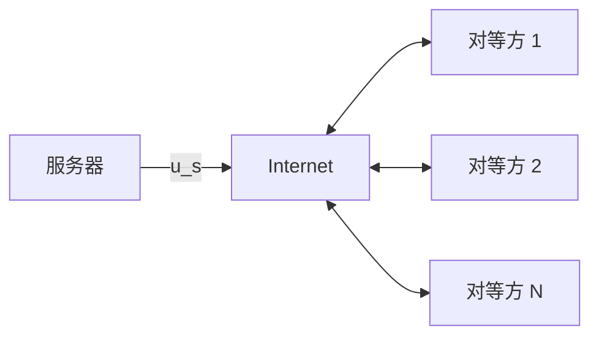

符号与假设：

- $u_s$：服务器上载速率；$u_i$、$d_i$：第 $i$ 个对等方的上载、下载速率
- $F$：文件长度（bit）；$N$：对等方数量
- **分发时间**：所有 $N$ 个对等方得到文件副本所需时间
- 假设：Internet 核心带宽充足，瓶颈仅在接入链路；双方不参与其他应用，上下行带宽全部可用于分发

#### 1. 客户—服务器的分发时间 $D_{CS}$

- 服务器必须发送 $NF\text{ bit}$，故时间至少为 $NF/u_s$
- 令 $d_{\min}=\min\{d_1,\dots,d_N\}$，最慢者至少需要 $F/d_{\min}$

$$
D_{CS} = \max\left\{\frac{NF}{u_s},\ \frac{F}{d_{\min}}\right\}
\tag{2-1}
$$

该下界可通过调度实际达到。$N$ 足够大时由 $NF/u_s$ 决定，**随 $N$ 线性增长**：对等方从 1000 增至 100 万，时间增加 1000 倍。

#### 2. P2P 的分发时间 $D_{P2P}$

三项下界：

1. 服务器至少把文件每个比特发送一次：$F/u_s$
2. 最慢下载者：$F/d_{\min}$
3. 总上载能力 $\displaystyle u_{\text{total}} = u_s + \sum_{i=1}^N u_i$，需交付 $NF\text{ bit}$：$NF/u_{\text{total}}$

$$
D_{P2P} \ge \max\left\{\frac{F}{u_s},\ \frac{F}{d_{\min}},\ \frac{NF}{u_s+\displaystyle\sum_{i=1}^{N}u_i}\right\}
\tag{2-2}
$$

当一收到比特就能重新分发时，存在达到该下界的方案；实际分发的是文件块，式 (2-2) 是很好的近似，故取

$$
D_{P2P} = \max\left\{\frac{F}{u_s},\ \frac{F}{d_{\min}},\ \frac{NF}{u_s+\sum_{i=1}^{N}u_i}\right\}
\tag{2-3}
$$

两种体系结构的最小分发时间（设 $F/u=1$ 小时，$u_s=10u$，所有对等方上载速率均为 $u$，$d_{\min}\ge u_s$）

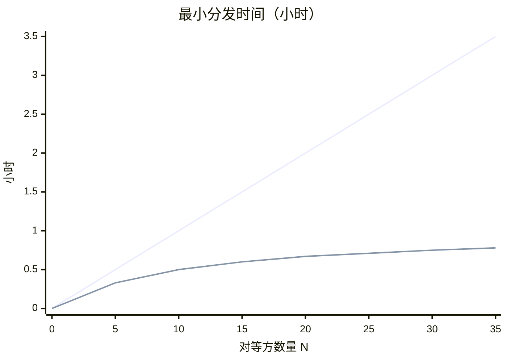

> [!note] 图注
> 上方直线为客户—服务器：$D_{CS}=N/10$ 小时；下方曲线为 P2P：$D_{P2P}=\max\{0.1,\ N/(10+N)\}$ 小时。后者对任意 $N$ 都小于 1 小时，即**自扩展**：对等方既是比特的消费者，也是重新分发者。

### 2.5.2 BitTorrent

- **Torrent**：描述一个文件分发任务的元数据集合，包含文件信息、文件划分方式、piece 哈希等信息。
- **洪流（swarm）**：参与某个 torrent 文件分发的所有对等方（peer）的集合
- 对等方首次加入时通常不拥有任何 piece，边下载边向其他 peer 上传已经获得的 piece；获得完整文件后，可以成为**种子**（seed）继续上传，也可以离开；未完成下载的 peer 也可能暂时离开，并在以后重新加入。
- **追踪器（tracker）**：传统 BitTorrent 中用于协助 peer 发现的基础设施节点。peer 加入某 torrent 时向 tracker 注册，并周期性发送状态信息；tracker 返回当前 swarm 中部分 peer 的地址列表。

> [!note] 补充
> 现代 BitTorrent 客户端通常还支持分布式散列表（DHT）和 Peer Exchange（PEX）进行 peer 发现，因此可以不依赖中心化 tracker。磁力链接（magnet link）通常只提供 torrent 的 info hash 等信息，客户端可通过 DHT、PEX 或 tracker 查找对应 peer。

#### 1. 邻近对等方

新对等方 Alice 加入时，追踪器随机选一个子集（如 50 个）把 IP 发给她；Alice 尝试与它们建立 TCP 连接，成功的称为**邻近对等方**，其集合会随时间波动。

#### 2. 请求块：最稀缺优先

Alice 周期性询问各邻居的块列表，然后对自己缺少的块发出请求。选择请求顺序用**最稀缺优先**（rarest first）：优先请求在邻居中副本最少的块，使稀缺块更快被重新分发，大致均衡各块在洪流中的副本数。

#### 3. 响应块：对换算法与一报还一报（tit-for-tat）

- 对每个邻居持续测量向她发送数据的速率，选出速率最高的 **4 个邻居**，向他们发送块（**疏通** unchoked），每 10 秒重新计算
- 每 30 秒再随机选择另一个邻居（如 Bob）发送块；若 Bob 的回报足够高，可能进入 Alice 的前 4 名，如此双方对换，趋向找到彼此匹配的速率
- 随机选择也让新对等方有机会得到块，从而有东西可换
- 其余邻居被**阻塞**（choked），收不到块

BitTorrent 还有一些未讨论的机制：片（piece）与更小的块（子片）、流水线、随机优先选择、残局模式、反怠慢。

> [!note] 说明
> 原书对 piece、chunk 的称呼与 BitTorrent 规范中的 piece/block 不完全一致，需核对原文用词（需验证）。

一报还一报的激励机制已被证实可以被规避（如 BitTyrant 研究），但 BitTorrent 生态仍取得成功。若无此激励，大多数用户会成为搭便车者。

**分布式散列表**（DHT）是另一种 P2P 技术：数据库记录分布在多个对等方上，在 BitTorrent 等中得到广泛实现。

## 2.6 视频流和内容分发网

流式视频（Netflix、YouTube、Amazon、TikTok 等）占 2024 年全球 Internet 流量的 65% 以上、移动网络流量的 75% 左右。

### 2.6.1 Internet 视频

视频是以恒定速率（如每秒 24 或 30 张）展现的图像序列；数字图像由像素阵列组成。视频可压缩，用**比特率**权衡质量，比特率越高质量越好。

例：单一 2 Mbps 视频在 67 分钟内约耗费 1 GB 存储和流量。流式视频最重要的性能度量是**平均端到端吞吐量**，必须至少等于压缩视频的比特率才能连续播放。

同一视频可压缩成多个版本（如 300 kbps、1 Mbps、3 Mbps），用户按当前带宽选择。

### 2.6.2 HTTP 流和 DASH

**HTTP 流**：视频作为普通文件存放在 HTTP 服务器，有特定 URL。客户发起 TCP 连接并发送 HTTP GET，服务器以网络允许的最快速率发送；客户缓存字节，超过预设门限后开始播放，一边播放一边接收。

缺陷：**所有客户收到相同编码的视频**，而可用带宽因人、因时而异。

**DASH**（Dynamic Adaptive Streaming over HTTP，经 HTTP 的动态适应性流）：

- 视频编码为多个不同比特率的版本，每个版本有各自的 URL
- 服务器提供**告示文件**（manifest），列出各版本 URL 及比特率
- 客户先取告示文件，然后用 HTTP GET（指定 URL 与字节范围）一次请求一个几秒长的块
- 下载时测量接收带宽，并运行**速率决定算法**：缓存多、带宽高则选高速率版本；缓存少、带宽低则选低速率版本

DASH 使不同接入速率的客户获得不同质量，并能适应会话中的带宽变化，对移动用户尤其重要。

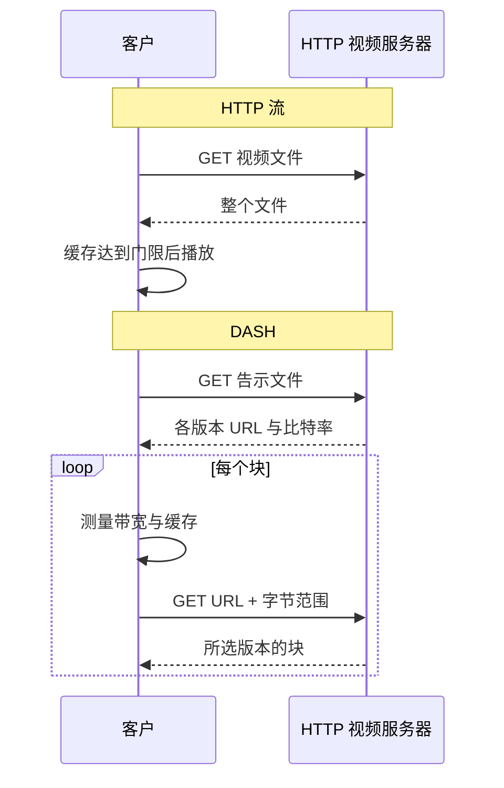

### 2.6.3 内容分发网

YouTube 每天向全世界用户分发数亿条流。单一大型数据中心方案有三个问题：

1. 客户远离数据中心时路径长、经过多个 ISP，端到端吞吐量由瓶颈链路决定，易低于视频消耗速率，造成停滞（路径越长越可能）
2. 流行视频被反复经相同链路发送，浪费带宽，并反复向连接数据中心的 ISP 付费
3. 单点故障

**内容分发网**（Content Distribution Network，CDN）管理分布在多个地理位置的服务器，存储视频和其他内容（文档、图片、音频）的副本，并把用户请求导向能提供最佳体验的位置。

| 类型       | 说明                   | 例子                       |
| ---------- | ---------------------- | -------------------------- |
| 专用 CDN   | 内容提供商自有         | Google 的 CDN 分发 YouTube |
| 第三方 CDN | 代表多个内容提供商分发 | Akamai、Limelight、Level-3 |

> [!info] Google 的 CDN 与数据中心基础设施
>
> Google 为其服务部署了大规模专用网络和 CDN 基础设施，采用分层架构，将计算任务和内容分发分别部署在不同位置。
>
> | 层级                                       | 规模                                                       | 职责                                                                  |
> | ------------------------------------------ | ---------------------------------------------------------- | --------------------------------------------------------------------- |
> | 大规模数据中心（large-scale data centers） | 全球多个大型数据中心，每个包含大量服务器                   | 提供动态和个性化内容，例如搜索结果、Gmail、用户相关数据处理           |
> | 网络边缘站点（network edge sites）         | 部署在全球 ISP 附近，包括 Google Global Cache（GGC）等节点 | 缓存并提供较静态内容，例如 YouTube 视频、Google Play 内容             |
> | 深入集群（enter-deep clusters）            | 部署在接入 ISP 网络内部的小型服务器集群，通常一个机架规模  | 进一步靠近用户，通过缓存提供静态内容，降低访问延迟和 ISP 外部链路压力 |
>
> Google 使用自己的专用全球网络连接各个数据中心和边缘节点。
>
> 当用户访问 Google 服务时：
>
> 1. 请求首先经过用户所在 ISP；
> 2. 静态内容可能直接由附近的深入集群（enter-deep cluster）或边缘缓存返回；
> 3. 对于需要计算或个性化处理的内容，请求会通过 Google 专用网络转发到大型数据中心；
> 4. 大型数据中心生成动态内容并返回结果。

CDN 通常采用两种不同的服务器安置原则：

|      | 深入（enter deep）                                                 | 邀请做客（bring home）                                 |
| ---- | ------------------------------------------------------------------ | ------------------------------------------------------ |
| 做法 | 在遍及全球的接入 ISP 中部署大量小集群（Akamai 首创，数以千计位置） | 在少量关键位置（通常是 IXP）建造大集群（Limelight 等） |
| 优点 | 靠近端用户，链路和路由器少，时延低、吞吐量高                       | 维护与管理开销较低                                     |
| 缺点 | 高度分布，维护管理困难                                             | 对端用户时延较高、吞吐量较低                           |

**拉策略**：许多 CDN 不预先推送视频，而是客户请求未存储的视频时，集群从中心仓库或其他集群取回，边流式传输边存本地副本；存储满时删除不常请求的视频。

#### 1. CDN 操作：用 DNS 截获并重定向请求

示例：内容提供商 NetCinema 雇用第三方 CDN King CDN，视频 URL 如 `http://video.netcinema.com/6Y7B23V`。

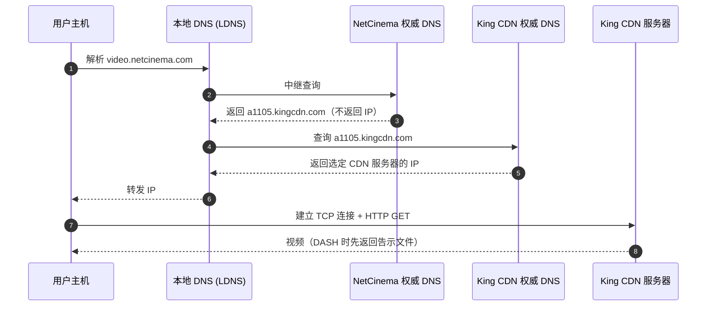

#### 2. 集群选择策略

CDN 经 DNS 查询得知的是客户 **LDNS** 的 IP，据此选择集群：

| 策略         | 做法                                                                 | 缺陷                                                                                                 |
| ------------ | -------------------------------------------------------------------- | ---------------------------------------------------------------------------------------------------- |
| 地理上最邻近 | 用商用地理位置数据库（Quova、MaxMind）把 LDNS 映射到位置，选最近集群 | 地理最近不等于网络路径最短；有的用户配置远地 LDNS，LDNS 位置不等于用户位置；忽略时延与带宽随时间变化 |
| 实时测量     | 集群周期性向全球 LDNS 发探测分组（ping、DNS 请求），测时延和丢包     | 许多 LDNS 被配置为不响应探测                                                                         |

### 2.6.4 学习案例：Netflix 和 YouTube

#### 1. Netflix

由两部分组成：**亚马逊云**与 Netflix 自己的**专用 CDN（Open Connect）**。

亚马逊云承担：

1. Web 站点与后端数据库：注册、登录、计费、目录、推荐
2. 内容摄取：接收制片厂母带并上传
3. 内容处理：为不同播放器（PC、手机、游戏机）和比特率生成多种版本，以支持 DASH
4. 向 CDN 上载各版本

专用 CDN：2007 年起初雇用 3 家第三方 CDN，后自建，在 IXP（200 多处）和住宅 ISP 内（数百处）安装服务器机架。每台服务器有若干 10 Gbps 端口、100 TB 以上存储；IXP 机架通常有数十台、存整个视频库，本地 ISP 机架可能仅一台、只存最流行的视频。

- Netflix **不用拉缓存**，而是在**非高峰时段推**，不足以存整个库的位置只推最流行的视频（按逐日数据判断）

交互流程：用户选片 → 亚马逊云中的软件确定哪些 CDN 服务器有该片、并选"最好的"（优先本 ISP 机架，其次邻近 IXP）→ 向客户发送该服务器 IP 与资源配置文件（含各版本 URL）→ 客户与服务器用专用版 DASH 交互，用 HTTP GET 的字节范围请求约 4 秒长的块。

因专用 CDN 只分发视频，Netflix 得以简化：**不需要 DNS 重定向**（亚马逊云直接告知客户用哪台服务器）；**用推缓存**而非拉缓存。

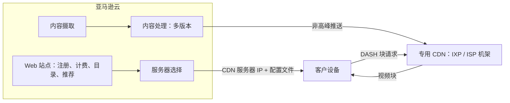

#### 2. YouTube

每分钟有数百小时视频上传、每天数十亿次观看（约 2020 年数据）；2005 年上线，2006 年被Google 收购。设计是专用的，通过测量可知大致原理：

- 与 Netflix 类似，用Google 专用 CDN，在数百个 IXP/ISP 位置部署集群
- 与 Netflix 不同，使用**拉缓存**和 **DNS 重定向**
- 集群选择：多数情况下选与客户 RTT 最低的集群；为均衡负载，有时经 DNS 把客户指向更远集群
- 采用 HTTP 流，常提供少量不同比特率的版本，并用 HTTP 字节范围请求限制传输量，以节约被重定位或提前终止而浪费的带宽
- 上传同样经 HTTP；所有处理（转换格式、生成多个比特率版本）发生在Google 数据中心

# 第二部分 套接字编程

## 2.7 套接字编程：生成网络应用

网络应用由一对程序（客户、服务器）组成，运行后成为两个进程，通过套接字读写数据通信。开发者的主要任务就是编写这两个程序。

| 类型         | 说明                                                                           |
| ------------ | ------------------------------------------------------------------------------ |
| 开放协议实现 | 实现 RFC 等标准文档定义的协议（如 HTTP），遵守标准则可互操作，应使用周知端口号 |
| 专用网络应用 | 应用层协议不公开，开发者完全控制，应避免使用周知端口号                         |

开发者首先要决定用 TCP 还是 UDP：TCP 提供可靠字节流，UDP 发送独立数据报、不保证交付。本节用 Python 3 写示例（行数少、便于说明套接字概念），应用为**大写转换**：

1. 客户从键盘读一行字符并发给服务器
2. 服务器转成大写并回送
3. 客户显示结果

示例代码刻意精简，生产代码需加入大量异常处理。

> [!note] 说明
> 示例中 `serverName = 'hostname'` 为占位符，实际应替换为服务器主机名或 IP 地址。

### 2.7.1 UDP 套接字编程

使用 UDP 时，发送进程在把数据报推出套接字之前必须附上**目的地址**：

- 目的主机的 IP 地址（供路由器选路）
- 目的套接字的端口号（区分主机上的不同套接字）

源地址（源 IP + 源端口）同样附在数据报上，但通常由操作系统自动完成。服务器须先运行，端口号取 12000。

以大写转换为例，UDP 客户与服务器的交互过程如下：

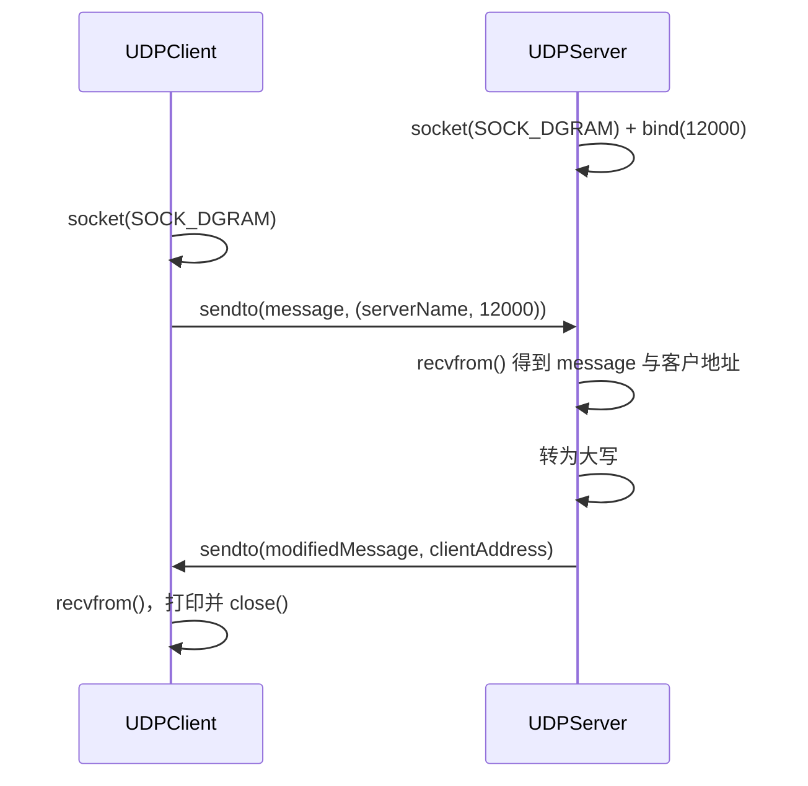

#### 1. UDPClient.py

```python
from socket import *

serverName = 'hostname'   # 占位符：服务器主机名或 IP
serverPort = 12000

clientSocket = socket(AF_INET, SOCK_DGRAM)   # IPv4 + UDP
message = input('Input lowercase sentence: ')
clientSocket.sendto(message.encode(), (serverName, serverPort))

modifiedMessage, serverAddress = clientSocket.recvfrom(2048)
print(modifiedMessage.decode())
clientSocket.close()
```

要点：

- `AF_INET` 表示 IPv4，`SOCK_DGRAM` 表示 UDP 套接字
- 创建客户套接字时不指定端口号，由操作系统分配
- `sendto()` 为报文附上目的地址 `(serverName, serverPort)`；`serverName` 若为主机名，会自动执行 DNS 查询
- `recvfrom(2048)` 一次读取**一个完整数据报**，返回数据与源地址；缓存 2048 字节在多数情况下够用
- `encode()` / `decode()` 完成字符串与字节的转换

#### 2. UDPServer.py

```python
from socket import *

serverPort = 12000
serverSocket = socket(AF_INET, SOCK_DGRAM)
serverSocket.bind(('', serverPort))          # 显式绑定端口
print("The server is ready to receive")

while True:
    message, clientAddress = serverSocket.recvfrom(2048)
    modifiedMessage = message.decode().upper()
    serverSocket.sendto(modifiedMessage.encode(), clientAddress)
```

要点：

- 与客户的最大区别是 `bind()`：把端口 12000 与服务器套接字绑定，使发往该端口的数据报都交给此套接字
- `while True` 使服务器无限期处理来自任何客户的数据报
- `recvfrom()` 同时给出**客户地址**，作为返回地址用于回送

测试：先在服务器主机上运行 `UDPServer.py`，再在客户主机上运行 `UDPClient.py`（确保其中的服务器名正确）。

### 2.7.2 TCP 套接字编程

TCP 面向连接：数据流动前客户与服务器先握手建立连接，之后发送数据**不需要每次附加目的地址**，只需把字节放进连接。

服务器有两种套接字：

| 套接字                           | 作用                                      |
| -------------------------------- | ----------------------------------------- |
| 欢迎套接字（`serverSocket`）     | 所有客户初始接触的入口，"敲欢迎之门"      |
| 连接套接字（`connectionSocket`） | `accept()` 时为特定客户新建，专用于该客户 |

客户通过创建 TCP 套接字并 `connect()` 到服务器欢迎套接字的地址发起三次握手（对程序透明）。从应用角度看，客户套接字与服务器连接套接字之间是一根"管道"，TCP 保证字节**可靠、按序**到达，且双方都可收发。

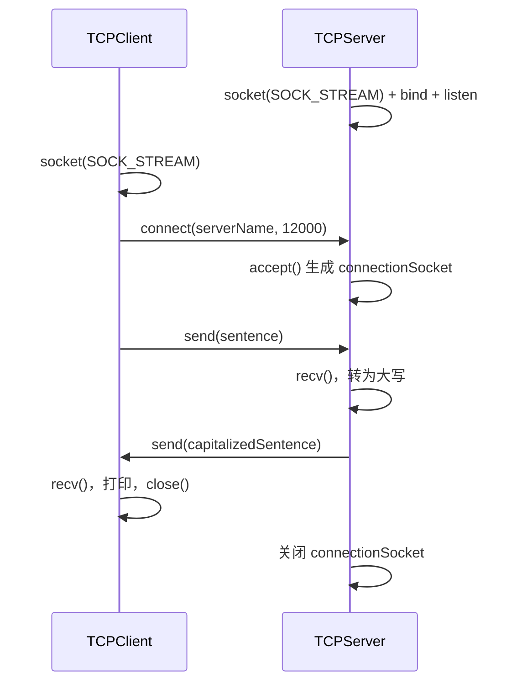

#### 1. TCPClient.py

```python
from socket import *

serverName = 'servername'   # 占位符
serverPort = 12000

clientSocket = socket(AF_INET, SOCK_STREAM)   # TCP 套接字
clientSocket.connect((serverName, serverPort))  # 三次握手

sentence = input('Input lowercase sentence: ')
clientSocket.send(sentence.encode())

modifiedSentence = clientSocket.recv(1024)
print('From Server: ', modifiedSentence.decode())
clientSocket.close()
```

要点：

- `SOCK_STREAM` 表示 TCP；`connect()` 发起握手，建立连接
- `send()` 只把字节放入连接，不需要像 UDP 那样附加地址
- `recv(1024)` **最多**读取 1024 字节，立即返回已到达的数据，**不会等待回车，也不保证一次读完整条消息**

> [!warning] TCP 是字节流，没有报文边界
> 原书称"字符累积在 `modifiedSentence` 中直到回车"，这并不准确。一次 `send()` 可能被 `recv()` 分多次读到，多次 `send()` 也可能被一次 `recv()` 合并读到。需要消息边界时，应用须自行约定（定长、长度前缀或分隔符）并循环 `recv()`；对短句示例，一次 `recv()` 通常就够。UDP 的 `recvfrom()` 则每次返回一个完整数据报。

- `close()` 关闭套接字，也即关闭连接，引起客户 TCP 向服务器 TCP 发送一个 TCP 报文段（见第 3 章）

#### 2. TCPServer.py

```python
from socket import *

serverPort = 12000
serverSocket = socket(AF_INET, SOCK_STREAM)
serverSocket.bind(('', serverPort))
serverSocket.listen(1)                        # 聆听连接请求
print('The server is ready to receive')

while True:
    connectionSocket, addr = serverSocket.accept()   # 为该客户新建套接字
    sentence = connectionSocket.recv(1024).decode()
    connectionSocket.send(sentence.upper().encode())
    connectionSocket.close()                  # 只关闭连接套接字
```

要点：

- `listen(1)`：参数是 **backlog**，即等待被 `accept()` 的未决连接队列的上限（Python 3.5 起可省略）
- `accept()` 阻塞等待，返回新的 `connectionSocket` 与客户地址；握手在此完成
- 服务器只关闭 `connectionSocket`；`serverSocket` 保持打开，可继续接受其他客户

#### 3. UDP 与 TCP 套接字编程对比

|                | UDP                                          | TCP                                              |
| -------------- | -------------------------------------------- | ------------------------------------------------ |
| 套接字类型     | `SOCK_DGRAM`                                 | `SOCK_STREAM`                                    |
| 建立连接       | 无                                           | 客户 `connect()`；服务器 `listen()` + `accept()` |
| 服务器套接字数 | 1 个（所有客户共用）                         | 欢迎套接字 + 每客户一个连接套接字                |
| 发送           | `sendto(data, addr)`，每次带目的地址         | `send(data)`，无需地址                           |
| 接收           | `recvfrom()`，一次一个完整数据报，附带源地址 | `recv()`，字节流，无报文边界                     |
| 可靠性         | 不保证交付与顺序                             | 可靠、按序                                       |

建议在两台主机上运行并修改程序（例如服务器统计字母 `s` 的个数、客户可连续发送多个句子），并完成本章末尾的套接字编程作业。

## 2.8 小结

本章学习了网络应用的概念与实现：

- **体系结构**：客户—服务器与 P2P；进程通信、套接字、运输层服务（TCP、UDP）
- **协议**：HTTP（无状态、持续/非持续连接、Cookie、缓存、条件 GET、HTTP/2/3）、SMTP 与邮件访问协议（IMAP、POP3）、DNS（分层分布式数据库、递归/迭代查询、缓存、RR）
- **P2P**：用式 (2-1) 与式 (2-3) 对比分发时间，说明其自扩展性；BitTorrent 的最稀缺优先与一报还一报
- **视频流与 CDN**：DASH、DNS 重定向、集群选择；Netflix 与 YouTube 案例
- **套接字编程**：UDP 与 TCP 的客户—服务器实现

协议的定义（1.1 节）：**两个或多个通信实体之间交换的报文的格式与次序，以及对报文或其他事件的发送/接收所采取的操作。** 本章对具体应用层协议的研究使该定义有了实际内涵。

本章仅说明了 TCP 与 UDP 提供**什么**服务模型，尚未说明**如何**提供（如 TCP 如何实现可靠数据传输）。下一章将转入运输层。
