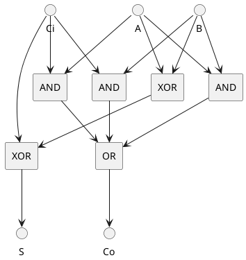
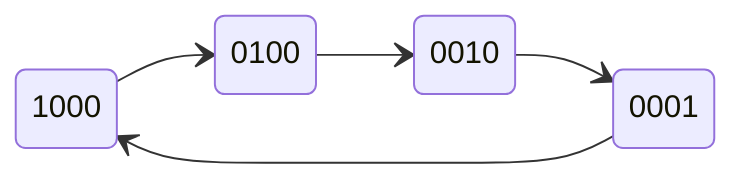
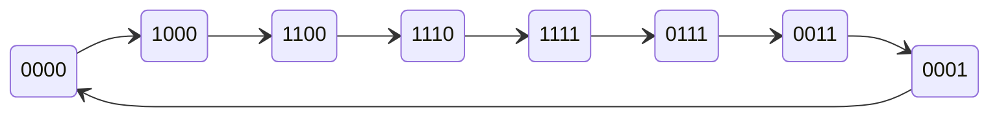
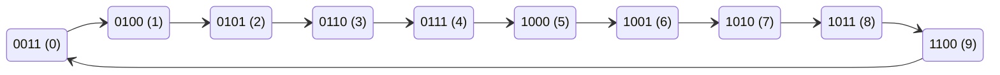
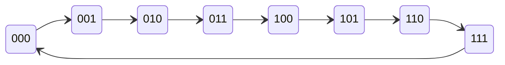
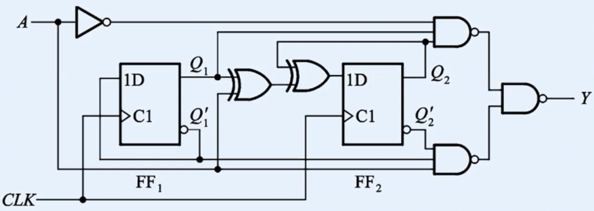
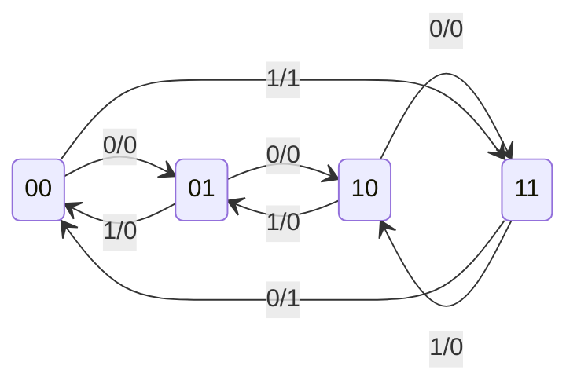

# 一、数制与编码基础

## 1. 数制转换

- **十进制 → 二进制**
  - **整数部分：** 除2取余，逆序排列
  - **小数部分：** 乘2取整，顺序排列
- **二进制 → 十进制**：按权展开相加。
- **二进制 ↔ 八进制**：三位并一位。
- **二进制 ↔ 十六进制**：四位并一位（注意位数不够补零）。

> [!question] 例1
> 将十进制数 $-13.625$ 转换为二进制数。

**解**：

1.  整数部分
    | 整数部分 | 余数 |
    | :---: | :---: |
    | 13 ÷ 2 | 1 |
    | 6 ÷ 2 | 0 |
    | 3 ÷ 2 | 1 |
    | 1 ÷ 2 | 1 |

    逆序排列余数：$1101$

2.  小数部分
    | 小数部分 | 整数 |
    | :---: | :---: |
    | 0.625 × 2 | 1 |
    | 0.25 × 2 | 0 |
    | 0.5 × 2 | 1 |

    顺序排列整数：$101$
    所以 $-13.625_{10} = -1101.101_2$

## 2. 机器数的编码

- **原码**：最高位为符号位（0正1负），其余为数值位。
- **反码**：正数同原码，负数符号位不变，其余位取反。
- **补码**：正数同原码，负数反码加一。
  - _重点：_ $N$位补码的表示范围：$-(2^{N-1}) \sim + (2^{N-1} -1)$。
- **其他编码**：
  - **BCD码**：将每个十进制数位用4位二进制表示
    - **8421码**：最常用的BCD码，权值分别为8、4、2、1。
    - **5421码**： 另一种BCD码，权值分别为5、4、2、1。具有自补码特性（即 $9 - n$ 的补码为 $n$ 的补码）。
  - **余3码**：8421码 + 3。具有自补码特性，常用于数字电路中。
  - **格雷码**：相邻两个数之间只有一位不同。
    - _计算：_ 若 $G_i$ 为格雷码的第 $i$ 位，$B_i$ 为二进制码的第 $i$ 位，则有：
      $$
      G_n=B_n,\qquad G_i = B_i \oplus B_{i+1}, \quad i=1,\,2,\,\dots,\,n-1
      $$
    - _反推：_ 若 $B_n$ 为二进制码的第 $n$ 位，
      $$
      B_n=G_n,\qquad B_i = G_i \oplus B_{i+1}, \quad i=1,\,2,\,\dots,\,n-1
      $$

> [!question] 例2
> 试写出63的八位源码、反码、补码、8421码、5421码、余3码。

**解**：

1.  十进制数63的二进制表示为 $00111111$。
2.  原码：$00111111$，反码：$11000000$，补码：$11000001$。
3.  8421码：$6\rightarrow 0\times 8 + 1\times 4 + 1\times 2 + 0\times 1 = 6$
    $3\rightarrow 0\times 8 + 0\times 4 + 1\times 2 + 1\times 1 = 3$，所以8421码为 $0110\ 0011$。
4.  5421码：$6\rightarrow 0\times 5 + 1\times 4 + 1\times 2 + 0\times 1 = 6$
    $3\rightarrow 0\times 5 + 0\times 4 + 1\times 2 + 1\times 1 = 3$，所以5421码为 $0110\ 0011$。
5.  余3码：$6\rightarrow 6 + 3 = 9 \rightarrow (9)_{10} = (1001)_{2}$，$3\rightarrow 3+3=6 \rightarrow (6)_{10} = (0110)_{2}$，所以余3码为 $1001\ 0110$。

> [!question] 例3
> 给定一组余3码 $1001\ 0101$，试将其转换为典型8位格雷码。

**解**：

1.  将余3码转换为8421码：
    - $1001-0011=0110$，$0101-0011=0001$，所以8421码为 $0110\ 0001$。
2.  将8421码转换为二进制码：
    - $0110\ 0001$ 对应的十进制数为 $61$，其二进制表示为 $00111101$。
3.  将二进制码转换为格雷码：
    | 位数 | 8 | 7 | 6 | 5 | 4 | 3 | 2 | 1 |
    | --- | :--: | :--: | :--: | :--: | :--: | :--: | :--: | :--: |
    | 二进制码 | 0 | 0 | 1 | 1 | 1 | 1 | 0 | 1 |
    | 格雷码 | 0 | 0 | 1 | 0 | 0 | 0 | 1 | 1 |

---

# 二、逻辑代数

## 1. 逻辑运算

- 基本逻辑运算：与（AND）、或（OR）、非（NOT）。
  - 与：$A \cdot B$，输出为1当且仅当 $A=1$ 且 $B=1$。
  - 或：$A + B$，输出为1当且仅当 $A=1$ 或 $B=1$。
  - 非：$A',\;\bar{A}$，输出为1当且仅当 $A=0$。
- 复合逻辑运算：与非（NAND）、或非（NOR）、异或（XOR）、同或（XNOR）。
  - 与非：$A \uparrow B = \overline{(A \cdot B)}$
  - 或非：$A \downarrow B = \overline{(A+B)}$
  - **异或**：$A \oplus B = A\bar{B} + \bar{A}B$
  - 同或：$A \odot B = AB + \bar{A}\bar{B}$

- **布尔代数的基本定律**：
  | 定律 | 公式 | 对偶 |
  | ---------- | ------------------------------------------------------- | ------------------------------------------------------ |
  | 交换律 | $A + B = B + A$ | $A \cdot B = B \cdot A$ |
  | 结合律 | $A + (B + C) = (A + B) + C$ | $A \cdot (B \cdot C) = (A \cdot B) \cdot C$ |
  | 分配律 | $A + B \cdot C = (A + B) \cdot (A + C)$ | $A \cdot (B + C) = (A \cdot B) + (A \cdot C)$ |
  | 吸收律 | $A + (A \cdot B) = A$ | $A \cdot (A + B) = A$ |
  | 消去律 | $A + \bar{A}B = A + B$ | $A \cdot (\bar{A}+B) = A \cdot B$ |
  | 德摩根律 | $\overline{A + B} = \bar{A} \cdot \bar{B}$ | $\overline{A \cdot B} = \bar{A} + \bar{B}$ |
  | 蕴含律 | $AB + \bar{A}C + BC = AB + \bar{A}C$ | $(A + B)(B + C)(\bar{A} + C) = (A + B)(\bar{A} + C)$ |
  | 异或非定理 | $\overline{A\bar{B} + \bar{A}B} = \bar{A}\bar{B} + A B$ | $\overline{AB + \bar{A}\bar{B}} = \bar{A}B + A\bar{B}$ |
- 香农展开定理：对于任意布尔函数 $f(x_1, x_2, \dots, x_n)$，有
  $$
  f(x_1, x_2, \dots, x_n) = x_i f(1, x_2, \dots, x_n) + \bar{x}_i f(0, x_2, \dots, x_n)
  $$
  对任意 $i=1,2,\dots,n$ 成立。
- **对偶规则与反演规则**：
  - 对偶规则：将逻辑式中的$(\;\cdot\;,\,+) 、(0,\,1)、(\oplus,\,\odot)$互换，得到的式子称为原式的对偶式。若两个逻辑表达式相等，则它们的对偶式也相等。
  - 反演规则：在对偶式的基础上，将变量取反，得到的式子称为原式的反演式。反演式与原式恒等。（广义德摩根律）

## 2. 最小项与最大项

设 $f: \{0,1\}^n \to \{0,1\}$ 为定义在 $n$ 个布尔变量 $\bm{x} = (x_1, x_2, \dots, x_n)$ 上的布尔函数。

### 2.1 定义与性质

对于任意赋值向量 $\bm{a} = (a_1, a_2, \dots, a_n) \in \{0,1\}^n$，定义其整数索引为

$$
j(\bm{a}) = \prod_{i=1}^{n} a_i \cdot 2^{n-i}
$$

记 $x_i^1 = x_i$，$x_i^0 = \bar{x}_i$

- **最小项 ($m_j$)**：对应赋值 $\bm{a}$ 的最小项为
  $$
  m_{j(\bm{a})}(\bm{x}) = \prod_{i=1}^{n} x_i^{a_i}
  $$
  当且仅当 $\bm{x} = \bm{a}$ 时，$m_{j(\bm{a})}(\bm{x}) = 1$。
- **最大项 ($M_j$)**：对应赋值 $\bm{a}$ 的最大项为
  $$
  M_{j(\bm{a})}(\bm{x}) = \sum_{i=1}^{n} x_i^{1-a_i}
  $$
  当且仅当 $\bm{x} = \bm{a}$ 时，$M_{j(\bm{a})}(\bm{x}) = 0$

最小项与最大项互为反函数：

$$
m_j = \overline{M_j}, \qquad M_j = \overline{m_j}
$$

全部最小项的析取为 $1$，全部最大项的合取为 $0$：

$$
\sum_{j=0}^{2^n-1} m_j = 1, \qquad
\prod_{j=0}^{2^n-1} M_j = 0
$$

### 2.2 真值赋值集合

函数值为 $1$ 和 $0$ 的赋值集合分别为：

- **使函数为 $1$ 的赋值集**：$S_1 = \{\bm{a} \in \{0,1\}^n \mid f(\bm{a}) = 1\}$
- **使函数为 $0$ 的赋值集**：$S_0 = \{\bm{a} \in \{0,1\}^n \mid f(\bm{a}) = 0\}$

显然，$S_1 \cap S_0 = \varnothing$，且 $S_1 \cup S_0 = \{0,1\}^n$。

### 2.3 范式唯一性定理

- **定理 1（最小项表达式）**：对于任意布尔函数 $f(\bm{x})$，存在唯一的索引子集 $I_m \subseteq \{0,1,\dots,2^n-1\}$，使得
  $$
  f(\bm{x}) = \sum_{j \in I_m} m_j(\bm{x}),
  \qquad I_m = \{j(\bm{a}) \mid \bm{a} \in S_1\}
  $$
  当 $S_1 = \varnothing$ 时，$f$ 为恒 $0$ 函数，析取和定义为布尔零元 $0$。
- **定理 2（最大项表达式）**：对于任意布尔函数 $f(\bm{x})$，存在唯一的索引子集 $I_M \subseteq \{0,1,\dots,2^n-1\}$，使得
  $$
  f(\bm{x}) = \prod_{j \in I_M} M_j(\bm{x}),
  \qquad I_M = \{j(\bm{a}) \mid \bm{a} \in S_0\}
  $$
  当 $S_0 = \varnothing$ 时，$f$ 为恒 $1$ 函数，合取积定义为布尔幺元 $1$。

## 3. 卡诺图化简 (核心技能)

看视频吧

1. [2分钟搞定卡诺图](https://www.bilibili.com/video/BV12BZyB7EJh/)
2. [卡诺图化简详解](https://www.bilibili.com/video/BV1P7ZYY9EDX/)

# 三、组合逻辑电路设计

## 1. 组合逻辑电路的分析

分析是设计的逆过程。题目给出一张逻辑电路图，让你说出它是干什么的。

**分析四步法（必须熟记）：**

1.  **写表达式**：从输入到输出，逐级写出每个逻辑门的输出表达式。
2.  **列真值表**：将输入变量的所有组合代入表达式，算出输出值，填入真值表。
3.  **化简表达式**：利用布尔代数或卡诺图将表达式化简（如果需要）。
4.  **得出结论**：根据真值表或化简后的表达式，说明电路的**逻辑功能**（如：全加器、多数表决器、奇偶校验器等）。

> [!example] 例1
> 分析下图所示的逻辑电路，说明它的功能。
>
> ```plantuml
> @startuml
> skinparam defaultFontName Arial
> skinparam nodesep 20
> skinparam ranksep 20
>
> rectangle "A" as A
> rectangle "B" as B
> rectangle "C" as C
>
> rectangle "AND" as And1
> rectangle "AND" as And2
> rectangle "AND" as And3
> rectangle "OR" as Or1
>
> ' 连线
> A --> And1
> B --> And1
> A --> And2
> C --> And2
> B --> And3
> C --> And3
> And1 --> Or1
> And2 --> Or1
> And3 --> Or1
> Or1 --> F
> @enduml
> ```
>
> 1. **写表达式**：$F = AB + AC + BC$
> 2. **列真值表**：略（在纸上列写8种输入组合，代入计算）。
> 3. **看功能**：当A、B、C三个输入中，有**两个或两个以上**为1时，输出F为1。
> 4. **结论**：这是一个**三人多数表决器**（少数服从多数）。

## 2. 组合逻辑电路的设计

**设计四步法（经典流程）：**

1.  **逻辑抽象**：确定输入变量（如A、B、C）和输出变量（如F），并定义它们取值为0或1的含义。
2.  **列真值表**：根据文字描述的逻辑关系，列出真值表。
3.  **化简表达式**：用卡诺图或布尔代数进行化简，得到最简逻辑表达式。
4.  **画逻辑图**：根据最简表达式，使用所需的逻辑门（如与门、或门、与非门）画出电路图。

### 例题2：设计一个“1位全加器”

**需求描述**：设计一个全加器，输入为被加数 $A$，加数 $B$，以及低位进位 $C_i$。输出为本位和 $S$ 和进位输出 $C_o$。

**设计过程：**

1. **真值表**（列出8种输入组合）：

|  A  |  B  | Ci  |  S  | Co  |
| :-: | :-: | :-: | :-: | :-: |
|  0  |  0  |  0  |  0  |  0  |
|  0  |  0  |  1  |  1  |  0  |
|  0  |  1  |  0  |  1  |  0  |
|  0  |  1  |  1  |  0  |  1  |
|  1  |  0  |  0  |  1  |  0  |
|  1  |  0  |  1  |  0  |  1  |
|  1  |  1  |  0  |  0  |  1  |
|  1  |  1  |  1  |  1  |  1  |

2. **化简表达式**（用卡诺图）：
   - $S = \bar{A}\bar{B}C_i + \bar{A}B\bar{C}_i + AB\bar{C}_i + ABC_i = A \oplus B \oplus C_i$
   - $C_o = \bar{A}BC_i + A\bar{B}C_i + AB\bar{C}_i + ABC_i = AB + AC_i + BC_i$
3. **画逻辑图**：
   - **和 $S$**：使用两个异或门实现 $S = (A \oplus B) \oplus C_i$。
   - **进位 $C_o$**：使用三个与门和一个或门实现 $C_o = AB + AC_i + BC_i$。



## 3. 二级门电路设计（最简逻辑变换）

在实际工程中，芯片厂商可能只提供**与非门**或**或非门**（因为它们制造工艺最简单，速度最快）。我们必须把化简后的“与或式”转换为我们手头有的门电路形式。

### 3.1 用“与非门”实现（与非-与非式）

**方法**：对最简“与或式”**两次取反**，然后应用摩根定律。

- **例子**：已知 $F = AB + CD$
- 第一步：$F = \overline{\overline{AB + CD}}$
- 第二步：应用摩根定律，$F = \overline{(\overline{AB}) \cdot (\overline{CD})}$
- **电路**：用两个与非门得到 $\overline{AB}$ 和 $\overline{CD}$，再用一个与非门把它们合起来。

### 3.2 用“或非门”实现（或非-或非式）

**方法**：先求反函数 $F'$ 的最简“与或式”，然后对 $F'$ 取反，应用摩根定律。

- **例子**：已知 $F = (A+B)(C+D)$
- 求反：$F' = A'B' + C'D'$
- 对 $F'$ 两次取反：$F = \overline{\overline{A'B' + C'D'}}$
- 应用摩根定律：$F = \overline{(\overline{A'B'}) \cdot (\overline{C'D'})} = \overline{(A+B) \cdot (C+D)}$
- **电路**：用两个或非门得到 $(A+B)$ 和 $(C+D)$，再用一个或非门（实现非与）把它们合起来。

### 3.3 用“与或非门”实现

**方法**：直接对反函数 $F'$ 化简，得到 $F' = AB + CD$ 的形式，然后用一个与或非门直接输出 $F$。

## 4. 多输出门电路设计

多输出电路是指**同一个电路有多个输出端**。设计的核心原则是：**找出多个输出函数之间共同的逻辑项，共享子表达式，以减少逻辑门的总数**。

### 例题3：设计一个多输出电路

**需求**：输出 $F_1$ 和 $F_2$ 的逻辑表达式如下：

- $F_1 = AB + BC + AC$
- $F_2 = AB + BC + A'C$

**常规设计（不共享）**：

- $F_1$ 需要：AB、BC、AC 三个与门，一个或门。
- $F_2$ 需要：AB、BC、A'C 三个与门，一个或门。
- 总共需要 **6个与门 + 2个或门**。

**多输出优化设计（找公共项）**：
观察发现，**$AB$ 和 $BC$ 是两者共有的项**。

- 我们只需要产生 $AB$、$BC$、$AC$、$A'C$ 这四个与项。
- 然后把 $AB$ 和 $BC$ 的输出分别接到两个或门的输入端。
- 总共只需要 **4个与门 + 2个或门**（省了2个与门）。

**这就是多输出电路设计的核心思想：共享子逻辑，减少门数。**

## 5. 组合逻辑电路的险象（竞争冒险）与消除

### 5.1 什么是竞争与冒险？

- **竞争**：当一个逻辑门的**两个输入端同时向相反方向变化**时（例如一个从0变1，另一个从1变0），由于信号传输延迟不同，到达输出端的时间有先后，这种现象叫竞争。
- **冒险**：由于竞争，导致电路输出端出现一个**不应有的窄脉冲（毛刺）**，这个现象叫冒险。

### 5.2 静态与动态冒险

- **静态冒险**：一次变化只会引起一次竞争，输出端可能出现一个不应有的窄脉冲。
  - **0型冒险**：如果表达式在某种输入组合下，能化简成 $F = A + \bar{A}$ 的形式，则会产生**0型冒险**（输出本应保持1，但可能会跳变到0）。
  - **1型冒险**：如果表达式能化简成 $F = A \cdot \bar{A}$ 的形式，则会产生**1型冒险**（输出本应保持0，但可能会跳变到1）。
- **动态冒险**：一次变化可能引起多次竞争，输出端可能出现多个不应有的窄脉冲。
- 功能冒险：多个信号同时变化，可能导致输出端出现不应有的窄脉冲。

### 5.3 卡诺图判别法

在化简后的卡诺图中，如果**两个相切的圈（相邻但不相交）** 之间，存在某个变量在一个圈里是原变量，在另一个圈里是反变量，那么这两个圈的交界处就可能存在冒险。

### 5.4 消除冒险的方法

1.  **增加冗余项（代数法）**：在卡诺图中，给相切的两个圈再画一个“**重合圈**”把它们连起来。这样表达式里就多了一个冗余项，消除了冒险。
2.  **增加滤波电容（硬件法）**：在输出端并接一个小电容，吸收掉窄脉冲毛刺（会导致波形变缓，适合对速度要求不高的电路）。
3.  **加选通脉冲（时序法）**：在电路稳定后，才让选通脉冲打开输出门，避开信号变化时的竞争期。

---

# 四、组合逻辑器件

- 使能端（Enable）是指**控制器件工作与否的输入端**，通常为高电平有效（1使能，0禁止），也有低电平有效的器件。
  - 常见使能端标记
    - G1、G2、G3：一般的使能端，通常为高电平有效。若有多个使能端，则所有使能端都为高电平时，器件才工作。
    - S：表示被选中（Select），被选中时输出端才有输出，否则输出端为高阻态。
    - GND：表示接地端，通常为低电平有效。

多个使能端提供了多路选择的功能，方便通过编码选择器件的工作状态。

## 1. 编码器

- **功能**：将二进制码转换为特定的编码形式，使其具有特定含义

### 二进制编码器

- 输入：$N$ 位独热码（仅有一位为1，其余为0），用 $I_0, I_1, \dots, I_{N-1}$ 表示。
- 输出：$n$ 位二进制码，$n = \lceil \log_2 N \rceil$，用 $Y_0, Y_1, \dots, Y_{n-1}$ 表示。若 $I_j = 1$，输出有

  $$
  \sum_{i=0}^{n-1} Y_i \cdot 2^i = j
  $$

  即输出的二进制码表示输入独热码的索引。

- 命名：$N$线-$n$线编码器
  - 常用的有 8-3 编码器、16-4 编码器等。

### 优先编码器

- **优先级**：预设的输入优先级，允许同时输入多路信号，只对优先级最高的信号编码。
  - 最常用的优先级预设：只看输入端为 1 的**最高位**，即 $I_{N-1}$ 的优先级最高，$I_0$ 的优先级最低。
- 使用时常在输入和输出端加上非门，形成**低电平有效的编码器**。
- 命名：$N$线-$n$线优先编码器
  - 常用的有74LS148（8-3优先编码器）、74LS147（10-4优先编码器）等，均为低电平有效，高位优先。

## 2. 译码器

- **功能**：将编码器的输出信号还原为输入信号。
- **应用**：常用于地址译码、数据选择等场合。
- 同样常在输入和输出端加上非门，形成**低电平有效的译码器**。
- 命名：$n$线-$N$线译码器
  - 常用的有 3-8 译码器（74LS138）， 4-16 译码器（74LS154）等，均为低电平有效。

### 地址译码器

- **功能**：将 CPU 的地址总线信号译码为片选信号，选择特定的存储器或外设。
- 输入：CPU 地址总线的高位地址信号，通常为 $A_{n-1}, A_{n-2}, \dots, A_0$。
- 输出：片选信号 $CS_0, CS_1, \dots, CS_{N-1}$，每个片选信号对应一个存储器或外设。

## 4. 多路复用器 (MUX / 数据选择器)

- **功能**：利用选择控制端，从多路输入数据中选出1路送到输出端。
- 输入：$N$路数据输入 $D_0, D_1, \dots, D_{N-1}$，$n$位选择控制端 $S_0, S_1, \dots, S_{n-1}$，$n = \lceil \log_2 N \rceil$。
- 输出：$Y$，输出的值为被选择的输入数据，即
  $$
  Y = D_j, \quad j = \sum_{i=0}^{n-1} S_i \cdot 2^i
  $$
- 可以将译码器的输出连接到数据通路的使能端，就是一个多路复用器的实现方式。
- 命名：$N$选1多路复用器
  - 常用的有 4选1、8选1（74LS151）等。
    - 双4选1多路复用器（74LS153）将两个独立的4选1复用器组合在一起，输出端为 $Y_0$ 和 $Y_1$，选择控制端为 $S_0$ 和 $S_1$，使能端为 $G_0$ 和 $G_1$。
      - 注意到，选择控制端 $S_0$ 和 $S_1$ 是两个复用器共享的
- **应用**：常用于数据选择、信号切换等场合。

### 扩展多路选择器

- **功能**：将多个多路复用器级联，实现更多路数的选择。
- **应用**：常用于需要更多输入通道的场合。

## 5. 三态门 (Tri-State Gate)

- 三态：
  - **高电平**：输出为逻辑1。
  - **低电平**：输出为逻辑0。
  - **高阻态**：输出端呈现高阻抗状态，相当于断开电路，用Z表示。
- 输入：数据输入 $D$，使能端 $E$。
- 输出：$Y$，输出的值为
  $$
  Y = \begin{cases}
  D, & E = 1 \\
  Z, & E = 0
  \end{cases}
  $$
- 可在使能端或输出端加上非门，实现不同的逻辑功能。

## 6. 奇偶校验器 (Parity Generator / Checker)

- 输入：数据输入 $D_0, D_1, \dots, D_{N-1}$。
- 输出：奇偶校验位 $P$
  - **奇校验**：$P = D_0 \oplus D_1 \oplus \dots \oplus D_{N-1}$
  - **偶校验**：$P = \overline{D_0 \oplus D_1 \oplus \dots \oplus D_{N-1}}$

## 7. 数值比较器 (Comparator)

- 输入：两个二进制数值输入 $A = A_{n-1}A_{n-2}\dots A_0$ 和 $B = B_{n-1}B_{n-2}\dots B_0$。
- 输出：三个比较结果 $A>B$、$A=B$、$A<B$。
- **实现方式**：一位比较器可以通过逻辑门实现，多个一位比较器可以级联实现多位数值比较。
  - **串行比较**：使用一个一位比较器，从高位开始逐位比较，直到找到不同的位，速度较慢。
  - **并行比较**：使用多个一位比较器，同时比较所有位，速度较快。
- **应用**：常用于数字电路中的大小比较、排序等场合。

## 8. 只读存储器 (ROM)

- **功能**：将输入地址信号映射到预先存储的输出数据，实现固定逻辑功能。
- 输入：地址输入 $A_0, A_1, \dots, A_{n-1}$。
- 输出：数据输出 $D_0, D_1, \dots, D_{m-1}$。
- **实现方式**：通过查找表（LUT）实现，将地址输入作为索引，从存储器中读取对应的数据输出。

---

# 五、Verilog HDL

强烈推荐视频[五分钟认识Verilog](https://www.bilibili.com/video/BV1iq4y1v7G6/)

## 1. 标识符

- 变量名或模块名，必须以字母或下划线开头，后续可以跟字母、数字、`_`和`$`。
- 注释：
  - 单行注释：`//`
  - 多行注释：`/* ... */`

## 2. 数据类型

- 物理量类型：`wire`（导线型）、`reg`（寄存器型）、`memory`（存储器型）等
- 抽象量类型：`integer`（整数型）、`real`（实数型）、`time`（时间型）、`parameter`（参数型）等
- 数字、参数型均为常量、物理量为变量。
- input、output、inout是端口类型，表示模块的输入、输出和双向端口。
  - input：默认wire型，可以用reg型，但不能用memory型。
  - output：默认wire型，可以用reg型，但不能用memory型。
  - inout：默认wire型，不能用memory型或reg型。

### 整数

表达方式：`<size>'<base><value>`

- `<size>`：number，表示位宽，默认为32位。
- `<base>`：进制，`b`二进制，`o`八进制，`d`十进制，`h`十六进制。
- `<value>`：数值，按指定进制表示。
  例如
- `4'b1010` 表示4位二进制数1010
- `8'ha2` 表示8位十六进制数A2

### 逻辑值

- `0`：逻辑0
- `1`：逻辑1
- `x`：未知值（未初始化或冲突）
- `z`：高阻态（断开电路）

### 参数型

```verilog
parameter weight = 8, height = 4; // 定义两个参数，weight为8，height为4
```

### wire型

wire型变量用于表示电路中的导线，通常用于连接不同的逻辑单元。也是默认的数据类型。

定义：`wire [<size>-1:0] <name>;`，其中`<size>`表示位宽，不写时默认为32位，`<name>`表示变量名。

```verilog
wire [7:0] data; // 定义一个8位的wire型变量data
```

### reg型

reg型变量用于表示寄存器，通常用于存储状态或数据。

reg只能在`initial`或`always`块中赋值，不能在`assign`语句中赋值。

定义：`reg [<size>-1:0] <name>;`，其中`<size>`表示位宽，`<name>`表示变量名。

```verilog
reg [3:0] count; // 定义一个4位的reg型变量count
```

## 3. 运算符

| 运算符                   | 描述       |
| ------------------------ | ---------- |
| `+`、`-`、`*`、`/`、`%`  | 算术运算符 |
| `&`、`\|`、`^`、`~`      | 位运算符   |
| `&&`、`\|\|`、`!`        | 逻辑运算符 |
| `==`、`!=`、`===`、`!==` | 等式运算符 |
| `<<`、`>>`               | 移位运算符 |
| `? :`                    | 条件运算符 |
| `=`、`<=`                | 赋值运算符 |
| `<`、`>`、`<=`、`>=`     | 比较运算符 |
| `{}`                     | 拼接运算符 |

例如`{date[3], date[2], date[1], date[0]}`=`date[3:0]`

## 4. 语句

### 赋值

连续赋值

```verilog
wire [7:0] a, b, c;
// assign <wire_name> = <expression>;  连续赋值语句
assign c = a & b; // 将a和b按位与的结果赋值给c
```

过程赋值

```verilog
initial begin   // 初始块，仿真开始时执行一次
    count = 0;          // 初始赋值语句
end
```

```verilog
/*
always @(<敏感信号列表>) begin  当出现敏感信号时执行
    过程赋值语句
    if、case、for、while等语句都可以在这里使用
end
*/
always @(posedge clk) begin  // 在时钟上升沿触发
    count <= count + 1;      // 过程赋值语句，非阻塞赋值
end

always @(negedge rst_n) begin  // 在复位信号下降沿触发
    count <= 0;              // 过程赋值语句，非阻塞赋值
end

always @(posedge clk or negedge rst_n) begin  // 在时钟上升沿或复位信号下降沿触发
    if (!rst_n) begin
        count <= 0;          // 复位时赋值为0
    end else begin
        count <= count + 1;  // 时钟上升沿时计数加1
    end
end
```

值得注意的是，verilog不是编程语言，而是硬件描述语言，所有的语句都是**并行执行**的，也就是说，语句顺序并不指定执行顺序。

### 条件语句

条件语句必须在`always`块中使用，不能在`initial`块中使用。

```verilog
if (condition) begin
    // 条件为真时执行的语句
end else if (another_condition) begin
    // 另一个条件为真时执行的语句
end else begin
    // 条件都不满足时执行的语句
end
```

`if`语句的条件判断是顺序执行的，先判断第一个条件，如果为真，则执行对应的语句块，否则继续判断下一个条件，直到找到满足条件的语句块或执行`else`语句块。

因此，`if`语句电路时延较大，占用硬件资源较少，适合**少量条件判断**的场景。

```verilog
case (expression)
    value1: begin
        // expression等于value1时执行的语句
    end
    value2: begin
        // expression等于value2时执行的语句
    end
    default: begin
        // expression不等于任何case值时执行的语句
    end
endcase
```

`case`语句的条件判断是并行执行的，所有的case值同时与expression进行比较，找到匹配的case值后，执行对应的语句块。

因此，`case`语句电路时延较小，占用硬件资源较多，适合**大量条件判断**的场景。

## 5. 组合逻辑元件的Verilog实现

### 多路选择器

#### 2输入8位多路复用器

```verilog
module mux2to1_8bit (
    input  wire [7:0] in0,
    input  wire [7:0] in1,
    input  wire       sel,
    output wire [7:0] out
);
    assign out = sel ? in1 : in0;
endmodule
```

#### 4输入8位多路复用器

```verilog
module mux4to1_8bit (
    input  wire [7:0] in0,
    input  wire [7:0] in1,
    input  wire [7:0] in2,
    input  wire [7:0] in3,
    input  wire [1:0] sel,
    output wire [7:0] out
);
    assign out = (sel == 2'b00) ? in0 :
                 (sel == 2'b01) ? in1 :
                 (sel == 2'b10) ? in2 : in3;
endmodule
```

### 三态缓冲器

```verilog
module tri_state_buffer (
    input  wire       in,
    input  wire       enable,
    output wire       out
);
    assign out = enable ? in : 1'bz;
endmodule

// 8位三态缓冲器
module tri_state_buffer_8bit (
    input  wire [7:0] in,
    input  wire       enable,
    output wire [7:0] out
);
    assign out = enable ? in : 8'bz;
endmodule
```

### 译码器

#### 2-4译码器

```verilog
module decoder_2to4 (
    input  wire [1:0] in,
    input  wire       enable,
    output wire [3:0] out
);
    assign out = enable ? (4'b0001 << in) : 4'b0000;
endmodule

// 带使能端的2-4译码器（低电平有效）
module decoder_2to4_active_low (
    input  wire [1:0] in,
    input  wire       enable_n,
    output wire [3:0] out_n
);
    wire [3:0] out;
    assign out = enable_n ? 4'b0000 : (4'b0001 << in);
    assign out_n = ~out;
endmodule
```

#### 7段显示译码器

```verilog
module decoder_7seg (
    input  wire [3:0] in,
    output wire [6:0] seg
);
    // 段位定义：{a, b, c, d, e, f, g}
    assign seg = (in == 4'h0) ? 7'b1111110 :
                 (in == 4'h1) ? 7'b0110000 :
                 (in == 4'h2) ? 7'b1101101 :
                 (in == 4'h3) ? 7'b1111001 :
                 (in == 4'h4) ? 7'b0110011 :
                 (in == 4'h5) ? 7'b1011011 :
                 (in == 4'h6) ? 7'b1011111 :
                 (in == 4'h7) ? 7'b1110000 :
                 (in == 4'h8) ? 7'b1111111 :
                 (in == 4'h9) ? 7'b1111011 :
                 (in == 4'hA) ? 7'b1110111 :
                 (in == 4'hB) ? 7'b0011111 :
                 (in == 4'hC) ? 7'b1001110 :
                 (in == 4'hD) ? 7'b0111101 :
                 (in == 4'hE) ? 7'b1001111 :
                                7'b1000111; // 4'hF
endmodule
```

### 编码器

#### 8-3优先编码器

```verilog
module priority_encoder_8to3 (
    input  wire [7:0] in,
    output wire [2:0] out,
    output wire       valid
);
    assign valid = |in;
    assign out = in[7] ? 3'd7 :
                 in[6] ? 3'd6 :
                 in[5] ? 3'd5 :
                 in[4] ? 3'd4 :
                 in[3] ? 3'd3 :
                 in[2] ? 3'd2 :
                 in[1] ? 3'd1 : 3'd0;
endmodule

// 低电平有效的8-3优先编码器（如74LS148）
module priority_encoder_8to3_active_low (
    input  wire [7:0] in_n,
    output wire [2:0] out_n,
    output wire       gs_n,    // 组信号，低电平有效表示有输入
    output wire       eo_n     // 级联输出，低电平有效表示无输入
);
    wire [7:0] in = ~in_n;
    wire [2:0] out;
    wire       valid;

    priority_encoder_8to3 u_enc (
        .in(in),
        .out(out),
        .valid(valid)
    );

    assign out_n = ~out;
    assign gs_n  = ~valid;
    assign eo_n  = valid;
endmodule
```

### 奇偶校验器

#### 9输入奇偶校验器

```verilog
module parity_checker_9bit (
    input  wire [8:0] in,
    output wire       parity_even,  // 偶校验位
    output wire       parity_odd    // 奇校验位
);
    wire parity = ^in;  // 异或归约
    assign parity_even = parity;
    assign parity_odd  = ~parity;
endmodule

// 通用N位奇偶校验器
module parity_checker #(
    parameter WIDTH = 9
)(
    input  wire [WIDTH-1:0] in,
    output wire             parity_even,
    output wire             parity_odd
);
    wire parity = ^in;
    assign parity_even = parity;
    assign parity_odd  = ~parity;
endmodule
```

### 比较器

#### 8位数值比较器

```verilog
module comparator_8bit (
    input  wire [7:0] a,
    input  wire [7:0] b,
    output wire       gt,  // a > b
    output wire       eq,  // a == b
    output wire       lt   // a < b
);
    assign gt = (a > b);
    assign eq = (a == b);
    assign lt = (a < b);
endmodule
```

#### 64位数值比较器

```verilog
module comparator_64bit (
    input  wire [63:0] a,
    input  wire [63:0] b,
    output wire        gt,
    output wire        eq,
    output wire        lt
);
    assign gt = (a > b);
    assign eq = (a == b);
    assign lt = (a < b);
endmodule

// 通用N位比较器
module comparator #(
    parameter WIDTH = 8
)(
    input  wire [WIDTH-1:0] a,
    input  wire [WIDTH-1:0] b,
    output wire             gt,
    output wire             eq,
    output wire             lt
);
    assign gt = (a > b);
    assign eq = (a == b);
    assign lt = (a < b);
endmodule
```

### 全加器

```verilog
module full_adder (
    input  wire a,
    input  wire b,
    input  wire cin,
    output wire sum,
    output wire cout
);
    assign sum  = a ^ b ^ cin;
    assign cout = (a & b) | (a & cin) | (b & cin);
endmodule

// 8位全加器（串行进位）
module full_adder_8bit (
    input  wire [7:0] a,
    input  wire [7:0] b,
    input  wire       cin,
    output wire [7:0] sum,
    output wire       cout
);
    wire [7:0] carry;

    full_adder fa0 (.a(a[0]), .b(b[0]), .cin(cin),     .sum(sum[0]), .cout(carry[0]));
    full_adder fa1 (.a(a[1]), .b(b[1]), .cin(carry[0]), .sum(sum[1]), .cout(carry[1]));
    full_adder fa2 (.a(a[2]), .b(b[2]), .cin(carry[1]), .sum(sum[2]), .cout(carry[2]));
    full_adder fa3 (.a(a[3]), .b(b[3]), .cin(carry[2]), .sum(sum[3]), .cout(carry[3]));
    full_adder fa4 (.a(a[4]), .b(b[4]), .cin(carry[3]), .sum(sum[4]), .cout(carry[4]));
    full_adder fa5 (.a(a[5]), .b(b[5]), .cin(carry[4]), .sum(sum[5]), .cout(carry[5]));
    full_adder fa6 (.a(a[6]), .b(b[6]), .cin(carry[5]), .sum(sum[6]), .cout(carry[6]));
    full_adder fa7 (.a(a[7]), .b(b[7]), .cin(carry[6]), .sum(sum[7]), .cout(carry[7]));

    assign cout = carry[7];
endmodule

// 8位全加器（并行前瞻进位，更快）
module full_adder_8bit_cla (
    input  wire [7:0] a,
    input  wire [7:0] b,
    input  wire       cin,
    output wire [7:0] sum,
    output wire       cout
);
    wire [7:0] g = a & b;      // 生成进位
    wire [7:0] p = a ^ b;      // 传播进位
    wire [7:0] c;

    assign c[0] = cin;
    assign c[1] = g[0] | (p[0] & cin);
    assign c[2] = g[1] | (p[1] & g[0]) | (p[1] & p[0] & cin);
    assign c[3] = g[2] | (p[2] & g[1]) | (p[2] & p[1] & g[0]) | (p[2] & p[1] & p[0] & cin);
    assign c[4] = g[3] | (p[3] & g[2]) | (p[3] & p[2] & g[1]) | (p[3] & p[2] & p[1] & g[0]) | (p[3] & p[2] & p[1] & p[0] & cin);
    assign c[5] = g[4] | (p[4] & c[4]);
    assign c[6] = g[5] | (p[5] & c[5]);
    assign c[7] = g[6] | (p[6] & c[6]);
    assign cout = g[7] | (p[7] & c[7]);

    assign sum = p ^ c;
endmodule
```

---

# 六、 时序逻辑元件

| 组合逻辑元件         | 时序逻辑元件                               |
| -------------------- | ------------------------------------------ |
| 任意时刻输入决定输出 | 输出不仅取决于当前输入，还取决于过去的状态 |

## 1. 锁存器 (Latch) 与 触发器 (Flip-Flop)

- _区别_：锁存器不含时钟（电平触发），触发器带时钟（边沿触发，理想状态）。
- **基本RS锁存器**：$Q^* = \bar{R}Q + S$，当 $R = S = 1$ 时，输出不定态。
- **边沿触发器（核心）**：
  - **D触发器**：$Q_{n+1} = D$。可以是电平触发或边沿触发，常用于寄存器。
  - **JK触发器**：$Q_{n+1} = J\bar{Q}_n + \bar{K}Q_n$。解决了 SR 锁存器的输出不定态问题，脉冲触发。
  - **T触发器**：$Q_{n+1} = T \oplus Q_n$（当$T=1$时翻转）。
- 触发类型
  - **电平触发**：在时钟信号为高电平或低电平时，触发器的状态可以改变。
  - **边沿触发**：在时钟信号的上升沿或下降沿时，触发器的状态才会改变。
    - **脉冲触发**：触发器在时钟信号的上升沿或下降沿时，状态改变，但状态与电平时信号变化有关。

```verilog title="D触发器"
module VrDff(
    input       CLK,    // 时钟信号
    input       D,      // 数据输入
    output  reg Q       // 输出
)
    always @(posedge CLK) begin     // 在时钟上升沿触发
        Q <= D;
    end
endmodule

module VrDff_C(
    input       CLK,    // 时钟信号
    input       CLRN,   // 异步清零信号
    input       D,      // 数据输入
    output  reg Q       // 输出
)
    always @(posedge CLK or negedge CLRN) begin     // 在时钟上升沿或异步清零信号下降沿触发
        if (!CLRN) Q <= 0;      // 异步清零
        else Q <= D;            // 正常数据传输
    end
endmodule
```

```verilog title="JK触发器"
module VrJkff(
    input       CLK,    // 时钟信号
    input       J,      // J输入
    input       K,      // K输入
    input       rst,    // 复位信号
    output  reg Q       // 输出
)
    wire rst_n;
    assign rst_n = ~rst;   // 复位信号取反，低电平有效
    always @(posedge CLK or negedge rst_n) begin     // 在时钟上升沿或复位信号下降沿触发
        if (!rst_n) Q <= 0;      // 异步清零
        else
            Q <= J & ~Q | ~K & Q;  // JK触发器状态转移
    end
endmodule
```

## 2. 触发器类型转换

通过对输入进行调整，使一种触发器能实现其他触发器的功能

### JK → D、T、SR

#### 1. JK → D

比较两者的次态方程：

$$
Q_{n+1} = J\bar{Q}_n + \bar{K}Q_n \quad Q_{n+1} = D \implies D = J\bar{Q}_n + \bar{K}Q_n
$$

等式两边同时乘以 $Q_n + \bar{Q}_n$，得到

$$
D(Q_n + Q_n') = J\bar{Q}_n + \bar{K}Q_n \implies \begin{cases}
J = D\\
K = \bar{D}
\end{cases}
$$

#### 2. JK → T

注意到只要令 $J = K = T$，那么

$$
Q_{n+1} = J\bar{Q}_n + \bar{K}Q_n = T\bar{Q}_n + \bar{T}Q_n = T \oplus Q_n
$$

即实现了 T 触发器的功能。

#### 3. JK → SR

事实上，JK 触发器就是 SR 触发器的改进版，解决当 $S = R = 1$ 时输出不定态的问题。只要令 $J = S$，$K = R$，就可以实现 SR 触发器的功能。

### D → JK、T、SR

由于 D 触发器就是原原本本跟随输入的触发器，把 D 触发器转换为其他类型的触发器，几乎就是从头实现其他触发器的次态方程。

## 3. 寄存器

### 基本寄存器

一个 $n$ 位寄存器由 $n$ 个触发器（通常为 D 触发器）组成，用于存储 $n$ 位二进制数据。寄存器可以通过时钟信号控制数据的写入和读取。

### 移位寄存器

每当信号（通常为时钟信号上升沿）到来时，寄存器中的数据会向左或向右移动一位。

移位寄存器可以实现数据的串行输入和串行输出，也可以实现数据的并行输入和并行输出。

```verilog title="8位串入并出移位寄存器"
module Vr8bitSRparout(
    input       CLK,    // 时钟信号
    input       CLR,    // 同步清零信号
    input       SERIN,  // 串行数据输入
    output  reg [7:0] Q // 并行数据输出
)
    always @(posedge CLK) begin
        if (CLR) Q <= 0;          // 同步清零
        else Q <= {Q[6:0], SERIN};   // 左移一位，串行输入
    end
endmodule
```

## 4. 计数器

计数器是在时钟信号作用下、状态按照固定顺序循环变化的时序电路。

- **模（模数 $M$）**：一个计数循环包含的有效状态数。$n$ 位二进制计数器最多有 $2^n$ 个状态，故 $M \le 2^n$，未被使用的状态称为**无效状态**。
- **分类**
  - 按触发方式：**同步计数器**（所有触发器共用同一时钟）、**异步计数器**（前级输出作为后级时钟，逐级翻转）。
  - 按计数方向：**加法**、**减法**、**可逆**（加减由控制端决定）。
  - 按编码：自然二进制、8421 码/余三码等十进制编码、环形、扭环形。
- **同步与异步的特点**

  | 项目 | 同步计数器 | 异步计数器 |
  | --- | --- | --- |
  | 时钟 | 所有触发器共用 | 逐级触发 |
  | 工作速度 | 快，无累积延迟 | 慢，延迟随位数累积 |
  | 输出 | 可并行译码，无毛刺 | 状态变化有先后，译码易产生尖峰毛刺 |
  | 结构 | 较复杂 | 简单 |

  > [!note]
  > 异步计数器又称**行波计数器**：进位像波纹一样逐级传递，位数越多延迟越大，因此高速电路一般采用同步结构。

- **自启动**：若电路从任一无效状态出发，都能在若干时钟后进入有效循环，就称该计数器**具有自启动能力**。

### 环形计数器

- **结构**：$n$ 个触发器首尾相接，每来一个时钟，唯一的 $1$ 沿环移动一位：
  $$
  D_i = Q_{i-1},\qquad D_0 = Q_{n-1}
  $$
- **特点**：
  - 模为 $n$，$n$ 个触发器只计 $n$ 个数，状态利用率低（$2^n$ 个状态里只用 $n$ 个）。
  - 每个状态只有一位为 $1$，输出天然是**独热码**，译码只需取对应位，电路最简单。
  - 有效循环之外的其余状态均为无效状态；特别地，全 $0$ 会原地保持，不会自启动。
- **自启动**：把反馈改为对低位端的或非，即 $D_0 = \overline{Q_0 + Q_1 + \cdots + Q_{n-2}}$，即可让无效状态自动进入有效循环。

以 4 位为例，$1$ 沿环移动，模为 $n = 4$：



### 扭环形计数器（约翰逊计数器）

- **结构**：在环形计数器的基础上，把末级的**反相输出**反馈到第一级：
  $$
  D_0 = \bar{Q}_{n-1}
  $$
- **特点**：
  - 模为 $2n$，是环形计数器的两倍，状态利用率也提高一倍。
  - 相邻状态之间只有**一个触发器翻转**，状态变化符合格雷码式的相邻关系，译码时**不会产生竞争冒险（毛刺）**。
  - 有效状态数为 $2n$，其余 $2^n - 2n$ 个为无效状态。
- **自启动**：无效状态本身可能构成另外的循环，通过修改反馈逻辑或加预置，可使其自动回到有效循环。

以 4 位为例，共 $2n = 8$ 个有效状态，首尾相接：



### 例：余三码十进制计数器

余三码的十进制数 $d$ 对应二进制 $d + 3$，因此 $0 \sim 9$ 的编码恰好是**连续的**二进制码 $0011 \sim 1100$，状态按顺序循环，模为 10：



**特点**：由于余三码连续，计数体只有“加 $1$”和端点回绕两步，逻辑非常省；十进制值等于 $q - 3$；有效状态 $0011 \sim 1100$ 共 10 个，其余 6 个为无效状态，可借复位实现自启动。

```verilog title="余三码十进制计数器"
module counter_excess3 (
    input  wire       clk,
    input  wire       rst_n,
    output reg  [3:0] q            // 余三码输出
);
    always @(posedge clk or negedge rst_n) begin
        if (!rst_n)            q <= 4'b0011;   // 复位于余三码 0
        else if (q == 4'b1100) q <= 4'b0011;   // 1100(9) -> 0011(0) 回绕
        else                   q <= q + 1'b1;  // 其余状态直接加 1
    end
endmodule
```

### 例：4 位递增/递减计数器

$n$ 位可逆计数器，控制端 $up = 1$ 时递增，$up = 0$ 时递减。递增时沿状态图前进，递减时反向。下图为 3 位示例（4 位在此基础上扩展为 $2^4 = 16$ 个状态）：



**特点**：模为 $2^n$，输出就是自然二进制数；端点处自动回绕（$1111 \to 0000$，或 $0000 \to 1111$）；进位输出 $C = Q_{n-1} \cdots Q_0$（计满全 $1$ 时有效），可用于级联扩模。

```verilog title="4 位递增/递减计数器"
module counter_updown #(
    parameter W = 4
)(
    input  wire         clk,
    input  wire         rst_n,
    input  wire         up,       // 1: 递增, 0: 递减
    output reg  [W-1:0] q
);
    always @(posedge clk or negedge rst_n) begin
        if (!rst_n) q <= 0;
        else        q <= up ? q + 1'b1 : q - 1'b1;
    end
endmodule
```

> [!note]
> 递减到 $q = 0$ 时，`q - 1'b1` 借位后回绕到 `1111`，这是补码运算的自然结果，不必额外判断。

# 七、时序逻辑电路设计

## 1. 时序逻辑电路分析

**分析步骤**

1. 确定输入、输出、状态变量及其编码方式。
2. 写出次态方程和输出方程。
3. 画出真值表，列出所有输入组合下的次态和输出。
4. 画出状态转移图，标明每个状态的输出。

> [!question] 例一
> 

**解**：图中输入 $A$，输出 $Y$，状态变量$Q_1, Q_2$

$Q_1, Q_2$ 均为 D 触发器的输出，故次态方程为：

$$
Q_1^* = Q_1'\qquad Q_2^* = A \oplus Q_1 \oplus Q_2
$$

输出方程为：

$$
Y = \overline{\overline{AQ_1Q_2}\cdot\overline{AQ_1'Q_2'}}
= AQ_1Q_2 + AQ_1'Q_2'
$$

状态转换表如下：

|  A  | clk | Q2  | Q1  |  Y  |
| :-: | :-: | :-: | :-: | :-: |
|  0  |  0  |  0  |  0  |  0  |
|  0  |  1  |  0  |  1  |  0  |
|  0  |  2  |  1  |  0  |  0  |
|  0  |  3  |  1  |  1  |  1  |
|  0  |  4  |  0  |  0  |  0  |
|  1  |  0  |  0  |  0  |  1  |
|  1  |  1  |  1  |  1  |  0  |
|  1  |  2  |  1  |  0  |  0  |
|  1  |  3  |  0  |  1  |  0  |
|  1  |  4  |  0  |  0  |  0  |

状态转移图如下：

