第六章讨论了链路层如何把数据报从一个节点送到相邻节点，并介绍了以太网、交换机等技术。对于有线网络而言，链路通常由双绞线、光纤等物理介质构成，信号传播路径相对固定；而无线网络把电磁波作为传输介质，多个设备共享无线信道，信号还会受到距离、障碍物、反射和其他发射设备的影响。

无线网络带来的变化不只是把网线换成无线电波。无线信道具有**时变、容量受限和共享**等特点，设备还可能在通信过程中移动。因此，无线网络除了要解决普通链路层的成帧和介质访问问题，还必须处理信道质量变化、隐藏终端、设备接入、能量管理和移动性管理等问题。

本章主要研究 WiFi 和 5G 两类无线接入网络，并在最后简要介绍蓝牙、定位、卫星和物联网无线网络。与前几章偏向自顶向下的组织方式不同，本章先从无线信道的物理层讲起：只有理解无线电波如何传播、比特如何编码到波形中，才能进一步理解无线接入网为什么采用 OFDMA、CSMA/CA、MIMO 等技术。

> [!important] 本章目标
> 理解无线网络的基本结构、无线信道特性与移动性支持：
>
> 1. 无线网络概述：无线接入网、无线核心网、基站、基础设施模式与自组织网络
> 2. 无线物理层：无线电波、功率、带宽、噪声、SNR、Shannon 容量、路径损耗、多径、MIMO 与频谱
> 3. 编码与调制：从比特到符号，再到电磁波形；QPSK、QAM 与自适应调制
> 4. 无线接入网：FDM、OFDM、OFDMA、CSMA/CA、WiFi 帧格式，以及 5G RAN 的信道和协议栈
> 5. 接入网管理：网络发现与接入、MAC 调度、睡眠/唤醒和能量管理
> 6. 无线核心网：5G 网络功能、UPF 隧道、SIM 身份、注册与 PDU 会话建立
> 7. 移动性：WiFi 与 5G 的切换机制，以及传统 Internet 移动性方案
> 8. 其他无线网络：蓝牙、GPS/WiFi 定位、低轨卫星和 IoT 无线网络

> [!note] 术语对照
> 全章统一使用下列译名：
>
> | 统一用语       | 含义 / 别称                                             |
> | -------------- | ------------------------------------------------------- |
> | 基站           | 蜂窝 gNB/eNB；WiFi 中称接入点（AP）                     |
> | 用户设备（UE） | 手机等蜂窝终端；WiFi 中称无线设备/站点                  |
> | 切换           | handoff / handover                                      |
> | 信道           | 有三种含义，正文按需写明"WiFi 信道""物理信道""逻辑信道" |

# 第一部分 无线网络概述与物理层

## 7.1 无线网络概述

无线网络的目标与有线网络相同：让终端设备能够通过网络交换数据。但由于无线设备通过无线电信道接入网络，其网络结构中有几个反复出现的组成部分。

### 7.1.1 无线网络的基本组成

| 组成部分                                  | 含义                                                                                             | 典型形式                         |
| ----------------------------------------- | ------------------------------------------------------------------------------------------------ | -------------------------------- |
| **无线接入网**（wireless access network） | 位于网络边缘，通过无线信道把终端接入更大的网络，主要提供链路层服务                               | 蜂窝网络中的 RAN；WiFi 中的 WLAN |
| **无线核心网**（wireless core network）   | 位于接入网与外部网络之间，由服务器、存储、路由器和链路组成，提供身份、移动性管理及数据转发等服务 | 运营商的 4G/5G Core              |
| **无线设备**（wireless device）           | 运行应用程序并通过无线接入网通信的终端                                                           | 手机、平板、笔记本、传感器、家电 |
| **基站**（base station）                  | 与关联的无线设备收发分组，并在设备与更大网络之间中继数据                                         | 蜂窝基站、WiFi 接入点 AP         |

无线接入网可以看作一种特殊的局域网：它的地理范围有限，通常由单一服务提供商或组织管理，主要负责把终端接入网络。

- 在蜂窝网络中，无线接入网称为**无线电接入网**（Radio Access Network，RAN）。5G 基站在 3GPP 标准中称为 gNodeB（gNB），4G 基站称为 eNodeB（eNB）。本文统一称为"基站"。
- 在 WiFi 网络中，无线接入网称为**无线局域网**（Wireless Local Area Network，WLAN），基站通常称为**接入点**（Access Point，AP）。
- 蜂窝网络有运营商提供的核心网；WiFi 则没有与 4G/5G Core 对应的专用无线核心网。企业通常直接使用原有的以太网、交换机、路由器等基础设施管理 WiFi，因此可以把 WiFi 看成企业网络中的另一种链路层技术。

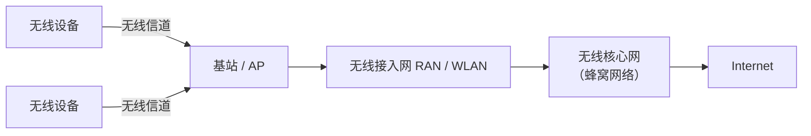

无线设备与基站建立关联（association），需要同时满足两个条件：

1. 设备处于基站的无线通信范围内；
2. 设备与基站已经执行相应协议，使基站能够充当设备与更大网络之间的数据中继。

基站向设备发送帧的方向称为**下行**（downstream / downlink）；设备向基站发送帧的方向称为**上行**（upstream / uplink）。一个基站通常同时服务多个无线设备。

### 7.1.2 基础设施模式与自组织网络

无线设备可以工作在两种基本模式下：

| 模式                                    | 特点                                                                                          | 例子                        |
| --------------------------------------- | --------------------------------------------------------------------------------------------- | --------------------------- |
| **基础设施模式**（infrastructure mode） | 设备关联到基站，由网络基础设施提供地址分配、身份认证、访问控制和路由等服务                    | 通常的 WiFi、蜂窝网络       |
| **自组织网络**（ad hoc network）        | 没有基站或固定基础设施，设备需要自行组织网络，并承担路由、地址分配和类似 DNS 的名称解析等任务 | 蓝牙网络，以及部分 IoT 网络 |

WiFi 可以工作在基础设施模式或自组织模式。本章讨论 WiFi 时，默认采用有 AP 的基础设施模式。蓝牙则是典型的自组织无线网络。

### 7.1.3 移动性与切换

当移动设备离开一个基站的覆盖范围、进入另一个基站的覆盖范围时，它需要改变接入点，即改变当前关联的基站。这个过程称为**切换**（handoff 或 handover）。

切换会带来一系列问题：设备的位置发生变化后，网络如何找到它？发往设备的数据报如何转发到新的基站？设备在 TCP 连接或语音、视频通话期间移动时，如何避免连接中断？这些问题将在 7.5 节讨论。

## 7.2 无线网络的物理层

有线网络中的物理层通常可以用比特传输速率、误码率和传播时延等少数指标描述。但无线信道的传播环境复杂得多：信号强度会随距离变化，可能受到噪声和其他设备干扰，还可能经由多条路径到达接收端。因此，理解无线网络必须先理解无线信道本身。

### 7.2.1 无线信道的特性

#### 1. 无线电波的基本参数

发射端天线中的时变电流会产生电磁波（无线电波），电磁波在空间中传播，并在接收端天线中产生电流。发送方通过改变电磁波的某些特性，把信息编码到信号中。电磁波主要有以下参数：

| 参数                              | 含义                                                                        |
| --------------------------------- | --------------------------------------------------------------------------- |
| **振幅**（amplitude）             | 某一时空位置上波的高度，反映电场强度的大小                                  |
| **波长**（wavelength，$\lambda$） | 波形中相邻两个波峰之间的距离                                                |
| **周期**（cycle time）            | 波形连续两个波峰经过同一位置所需的时间                                      |
| **频率**（frequency）             | 周期的倒数，单位为赫兹（Hz）；$1\text{ MHz}=10^6$ 个周期/秒                 |
| **相位**（phase）                 | 波形在一个周期中所处的位置，通常用角度表示，范围为 $0^\circ$ 到 $360^\circ$ |

电磁波具有传播方向，其传播速度约为光速：

$$
c = 3\times 10^8\ \text{m/s}
$$

#### 2. 发射功率与信号带宽

**功率**（power）是发射端单位时间内注入电磁波的能量，可以直观理解为信号强度。无线网络中的功率通常以毫瓦（mW）表示，也可以用 dBm 表示；本章主要采用线性功率单位 mW。

| 量              | 定义                         | 例                                                                       |
| --------------- | ---------------------------- | ------------------------------------------------------------------------ |
| 功率比（dB）    | $10\log_{10}(P_1/P_2)$       | 0 dB = 1 倍；3 dB ≈ 2 倍；10 dB = 10 倍；20 dB = 100 倍；30 dB = 1000 倍 |
| 绝对功率（dBm） | $10\log_{10}(P/1\text{ mW})$ | 0 dBm = 1 mW；20 dBm = 100 mW；30 dBm = 1 W                              |

理想情况下，电磁波只包含一个频率；实际发射信号的能量则会分布在一段频率范围内。**功率谱密度函数**（Power Spectral Density，PSD）描述信号功率如何随频率分布。信号通常围绕某个**载波频率**（carrier frequency）分布。

**无线信号带宽**（bandwidth）是信号占据的频率范围宽度，单位为 Hz。例如，一个信号若占据 2.427 GHz 到 2.429 GHz 的频段，其带宽就是 2 MHz。

> [!warning] 无线信号带宽不等于链路传输速率
> 无线物理层的带宽衡量的是频率范围，单位为 Hz；网络中常说的链路"带宽"有时指比特传输速率或容量，单位为 bit/s。两者不是同一个量。通常频率带宽越大，可支持的比特传输速率越高，但二者并非简单相等。
>
> 例如，在单空间流、短保护间隔条件下，20 MHz 的 802.11n WiFi 信道最大传输速率为 72.2 Mbps；40 MHz 信道最大传输速率为 150 Mbps。

#### 3. 噪声与信噪比 SNR

无线信号在传播过程中会受到噪声影响。常见噪声来源包括：

- **其他发射设备**：2.4–2.5 GHz 等免许可频段被 WiFi、蓝牙、Zigbee、婴儿监视器、车库门遥控器等设备共同使用。不同网络通常不会彼此协调，因此一个网络的发送信号可能成为另一个网络的干扰。
- **电磁辐射源**：电动机、微波炉等设备可能向外辐射电磁波。
- **热噪声与电子噪声**：环境中的热扰动以及发射端、接收端电子器件本身的不完善都会引入噪声。

**信噪比**（Signal-to-Noise Ratio，SNR）是接收信号功率与噪声功率之比，通常用分贝（dB）表示：

$$
SNR_{dB}=10\log_{10}\left(\frac{P_{signal}}{P_{noise}}\right)
$$

其中 $P_{signal}$ 和 $P_{noise}$ 均为线性功率。SNR 为 0 dB 表示信号功率与噪声功率相等；SNR 越高，接收端越容易从噪声中恢复原始信号。

#### 4. Shannon 信道容量

**Shannon 容量定理**给出了给定信道带宽与信噪比条件下，信道能够实现的无差错传输速率上限：

$$
C=B\log_2\left(1+\frac{P_{signal}}{P_{noise}}\right)
$$

其中：

- $C$：信道容量，单位 bit/s；
- $B$：无线信号带宽，单位 Hz；
- $P_{signal}/P_{noise}$：线性信噪比，不能直接把以 dB 表示的数值代入。

Shannon 容量是理论上限，而不是实际协议一定能够达到的速率。无论采用多复杂的编码和调制方式，实际传输速率都不能超过这一上限。

由公式可以得到两个重要结论：

1. **在 SNR 固定的假设下，容量与带宽线性增长**。增加可用频谱，可以提高潜在传输速率。（实际中噪声功率随带宽增加，SNR 会下降，故该结论只在固定 SNR 时成立。）
2. **高 SNR 时，继续提高 SNR 的收益逐渐减小**。容量只随 SNR 的对数增长，因此增加发射功率并不能无限制地提升速率。

> [!example] 例题：带宽比功率更值钱
> 设 $B=20$ MHz，SNR = 20 dB，即线性值 100：
>
> $$
> C=20\times10^6\log_2(1+100)\approx133\text{ Mbps}
> $$
>
> - 带宽翻倍至 40 MHz（SNR 不变）：$C\approx266$ Mbps
> - SNR 翻倍（20 dB → 约 23 dB，线性值约 200），带宽不变：$C=20\times10^6\log_2(201)\approx153$ Mbps，仅增加约 20 Mbps

#### 5. 路径损耗与隐藏终端

无线电波在传播过程中会逐渐减弱，这种现象称为**路径损耗**（path loss）或**衰减**（attenuation）。在无遮挡的视距（Line of Sight，LoS）传播条件下，接收功率近似满足反平方关系：

$$
P_{received}\sim\frac{P_{transmitted}}{f^2d^2}
$$

其中 $f$ 是信号频率，$d$ 是发送端与接收端之间的距离。直观上，电磁波能量向空间扩散；距离变为原来的 2 倍时，能量分布到约 4 倍的球面面积上，单位面积接收到的功率约降为原来的 $1/4$。

上述距离和频率的平方关系对应自由空间路径损耗。实际环境中的路径损耗指数通常更大：室外城市环境中约为 3，室内环境中可能达到 4 或更高（经验取值，需验证来源）。由此可见：

- 低频无线电波通常适合远距离、低速率通信，例如无线电导航；
- 高频无线电波通常用于较短距离的地面通信，例如蜂窝网络和 WiFi；
- 在相同带宽下，频率从 5 GHz 提高到 50 GHz，接收功率可能降低到原来的 $1/100$（$f^2$ 增大 100 倍）。

路径损耗还会导致**隐藏终端问题**（hidden terminal problem）。考虑 A、B、C 三个节点：A 可以听到 B，C 也可以听到 B，但 A 与 C 相距较远或被障碍物阻挡，彼此无法检测到对方的信号。若 A 和 C 都要向 B 发送数据，它们可能分别侦听信道并认为信道空闲，随后同时发送，最终在 B 处发生碰撞。

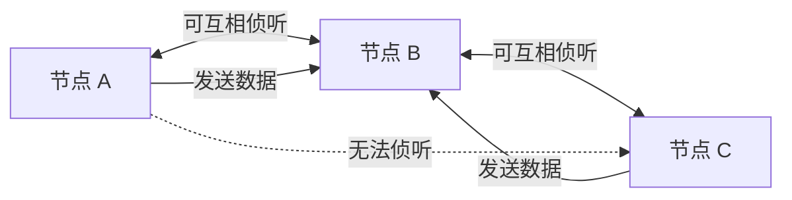

隐藏终端问题说明：**发送端感知到信道空闲，并不意味着接收端不会发生碰撞**。

与之对应的是**暴露终端问题**（exposed terminal problem）：某节点侦听到邻近节点正在发送而推迟自己的发送，但实际上两次发送的接收端互不影响，造成信道资源浪费。隐藏终端导致"该等没等"，暴露终端导致"不该等却等了"。这两类问题，加上无法在发送时检测碰撞，是 WiFi 使用 CSMA/CA，并引入 RTS/CTS 预约机制的重要原因（7.3.1 节）。

#### 6. 多径传播与时延扩展

无线信号不一定沿着唯一的直线路径到达接收端。部分信号可能直接到达接收端，另一部分则会被建筑物、树木等物体反射，沿着更长的路径稍后到达。这种现象称为**多径传播**（multipath propagation）。

同一时刻发出的信号会以多个不同的到达时刻抵达接收端，导致接收信号在时间上发生扩展，称为**时延扩展**（delay spread）。接收端需要从这些叠加的信号中恢复原始波形，因此多径传播会增加信号处理难度。

多径还限制了发送端改变信号的速度。发送端必须为一个脉冲及其多径反射留出足够时间，使它们在下一个脉冲到达前完成接收；否则前后两个脉冲及其反射会在时间上重叠，形成**符号间干扰**。因此，多径传播会限制信号变化速率，进而限制比特传输速率。与时延扩展对应的频域概念是**相干带宽**。

#### 7. 多天线技术：MIMO

传统无线系统通常在发送端和接收端各使用一根天线。**多输入多输出**（Multiple-Input and Multiple-Output，MIMO）则在发送端和接收端都使用多根天线，以利用多条无线传播路径提高链路吞吐量。接收端使用多根天线，也可以在一定程度上获得更强的总接收信号。

MIMO 主要通过两种不同方式利用多径：

**（1）空间分集（spatial diversity）**

发送端发送同一信息的冗余副本，接收端通过多根天线、不同传播路径接收这些副本。由于不同路径受到的衰减和多径影响可能不同，接收端可以选择 SNR 最大的信号，或先校准不同信号的相位，再加权合并，从而提高信号质量、降低误码率。

例如，发送端发送信号 $x$，两根接收天线分别得到：

$$
y_1=H_{1,1}(x),\qquad y_2=H_{1,2}(x)
$$

$H_{1,1}()$ 和 $H_{1,2}()$ 表示信号经过不同传播路径后产生的振幅、相位等变化。接收端利用信号处理技术，从多个接收结果中恢复原始信号。

**（2）空间复用（spatial multiplexing）**

发送端通过不同天线并行发送不同的数据流，接收端则从多个天线收到的混合信号中分离出原始数据流。这样可以在同一时间、同一频率资源上并行传输多路信息，提高吞吐量。

例如，两根发送天线分别发送 $x_1$ 和 $x_2$，两根接收天线得到：

$$
y_1=H_{1,1}(x_1)+H_{2,1}(x_2)
$$

$$
y_2=H_{1,2}(x_1)+H_{2,2}(x_2)
$$

接收端需要根据接收到的 $y_1$、$y_2$ 估计原始的 $x_1$、$x_2$。实际系统会估计信道状态，并结合编码、调制和信号处理算法完成解码。

| 技术         | 发送内容               | 主要目标                 |
| ------------ | ---------------------- | ------------------------ |
| **空间分集** | 同一信息的多个冗余副本 | 抵抗多径衰落，提高可靠性 |
| **空间复用** | 多路不同的信息流       | 并行传输，提高吞吐量     |

#### 8. 波束成形与定向天线

**波束成形**（beamforming）是把无线信号集中发送到特定用户或区域，而不是向所有方向均匀辐射。它通常使用天线阵列，通过调整各天线信号的相位和振幅，使目标方向上的信号产生相长干涉，而其他方向上的信号尽可能相互抵消，从而形成定向波束。

波束成形可以动态调整波束方向，以跟踪移动中的用户。其主要作用包括：

- 增强目标接收端的信号强度，从而支持更高的数据速率；
- 减少信号向其他方向泄漏，降低对其他用户的干扰；
- 延伸覆盖范围，改善覆盖边缘的连接质量；
- 更有效地利用频谱，提高网络整体容量。

WiFi、现代蜂窝网络和卫星通信都使用波束成形技术。

#### 9. 多用户 MIMO（MU-MIMO）

前面讨论的 MIMO 主要面向单个用户，称为**单用户 MIMO**（SU-MIMO）。**多用户 MIMO**（MU-MIMO）则利用不同天线子集，同时向多个设备发送数据。蜂窝基站和 WiFi 5/6 的 AP 都支持 MU-MIMO。

MU-MIMO 可以结合空间分集和波束成形，为不同设备同时建立空间传输通道。**Massive MIMO** 指使用大规模天线阵列（现代 5G 基站的阵列可包含多达 64 个发射波束成形单元，以及数量相当的接收天线单元）来实现 MU-MIMO，二者不是同义词。

#### 10. 无线电频谱

无线电频谱是电磁频谱中约 3 Hz 到 3 THz 的范围。频谱是一种稀缺资源，各国通常由政府分配具体频段用于不同用途；国际电信联盟（ITU）负责协调相关频谱事务。

无线频谱的使用方式主要分为两类：

| 类型                                  | 含义                                                       | 典型场景                 |
| ------------------------------------- | ---------------------------------------------------------- | ------------------------ |
| **授权频谱**（licensed spectrum）     | 发射设备必须取得政府许可才能使用特定频段                   | 商用蜂窝网络             |
| **免许可频谱**（unlicensed spectrum） | 无需为每台设备单独申请频谱许可证，但必须遵守功率等使用规则 | WiFi、蓝牙、家用无线设备 |

蜂窝运营商通常通过频谱拍卖等方式获得授权频谱。由于频谱、基站站址和基础设施建设成本较高，运营商需要通过服务收费覆盖成本。为了提高频谱利用率，也出现了允许非授权主体在满足特定条件时共享授权频段的方案，例如美国 3.5 GHz CBRS 频段；认知无线电（cognitive radio）则尝试动态检测并使用暂时空闲的频谱。

免许可频谱允许更多设备自由使用，但设备之间通常缺乏统一协调，因此更容易发生相互干扰。运行在免许可频谱上的无线网络必须采用相应机制避免、缓解或响应干扰。

常见无线网络频段如下（以美国频谱分配为例，其他国家和地区略有差异）：

| 频段                                 | 网络类型           | 使用方式  | 特点                             |
| ------------------------------------ | ------------------ | --------- | -------------------------------- |
| 2.4 GHz（2.40–2.49 GHz）             | WiFi、蓝牙、Zigbee | 免许可    | 设备种类多，容易受到其他设备干扰 |
| 5 GHz（5.17–5.83 GHz）               | WiFi               | 免许可    | 802.11a/h/n/ac/ax 等             |
| 6 GHz（约 5.9–7.12 GHz）             | WiFi               | 免许可    | 802.11ax（WiFi 6E）/be 等        |
| 低于 1 GHz 的若干频段                | 蜂窝网络           | 授权      | 覆盖距离较远，速率相对较低       |
| 1.8 GHz、3.3–3.8 GHz、6 GHz 等中频段 | 蜂窝网络           | 授权      | 在覆盖距离与数据速率之间折中     |
| 3.5 GHz CBRS                         | 蜂窝网络           | 授权/共享 | 可用于专用 5G 等场景             |
| 26、40、50、66 GHz 等高频段          | 5G 蜂窝网络        | 授权      | 毫米波，覆盖距离较短、速率较高   |
| 915 MHz（902–928 MHz）               | LoRa / IoT         | 免许可    | 低功耗广域物联网                 |

从覆盖范围看，蜂窝频段通常可以分为低频、中频和高频：低频覆盖距离较远但速率较低；中频在覆盖与速率之间取得折中；高频（毫米波）能够提供很高的速率，但覆盖范围较短。

### 7.2.2 编码与调制：从比特到波形

无线发送端需要把链路层交付的比特转换成能够通过电磁波传播的信号。这个过程可以分为**编码**和**调制**两个阶段：编码把原始比特变成更适合在噪声信道中传输的比特序列；调制再把这些比特映射为符号，并将符号表示为具体的电磁波形。接收端执行相反过程，把接收到的波形还原为比特。

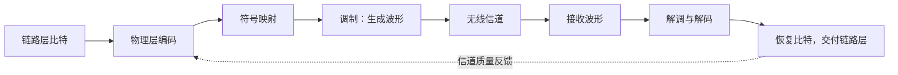

#### 1. 物理层编码

物理层编码可以在原始比特中加入冗余信息，以降低噪声导致的错误。例如，将每个数据比特重复一次：

$$
d_1d_2\cdots d_8\quad\longrightarrow\quad d_1d_1'd_2d_2'\cdots d_8d_8'
$$

这里 $d_i'$ 是 $d_i$ 的副本。接收端可以利用多个副本恢复原始数据。需要注意，物理层加入的冗余比特与链路层 CRC 等差错检测字段不同：链路层帧中的 CRC 比特进入物理层后，也会像普通数据比特一样受到物理层编码的保护。

编码还可以对比特重新排序（交织），把原本相邻的冗余比特分散到传输序列的不同位置。这样，即使某一段连续比特受到突发噪声破坏，接收端解交织后，每个数据比特可能仍保留足够的正确副本。更复杂的编码技术能够以更高效率实现差错保护。

#### 2. 调制：振幅、频率和相位

**调制**（modulation）把编码后的比特映射为无线载波的波形。最基本的三种方式分别改变无线电波的振幅、频率或相位：

| 调制方式     | 英文缩写                      | 编码手段                   |
| ------------ | ----------------------------- | -------------------------- |
| **振幅调制** | ASK（Amplitude Shift Keying） | 在不同时间区间改变载波振幅 |
| **频率调制** | FSK（Frequency Shift Keying） | 在不同时间区间改变载波频率 |
| **相位调制** | PSK（Phase Shift Keying）     | 在不同时间区间改变载波相位 |

接收端通过测量收到信号的振幅、频率或相位，判断发送端传输的比特。频率和相位的检测还要求发送端与接收端保持良好的时钟同步。

#### 3. 正交相移键控 QPSK

最简单的调制例子用两种信号状态表示 0 和 1，每个状态只能编码 1 bit。若使用更多状态，就能让一个符号表示多个比特。

**正交相移键控**（Quadrature Phase Shift Keying，QPSK）把输入比特每两个一组，形成四种符号：`00`、`01`、`10`、`11`，再使用四种不同相位表示它们。QPSK 中各信号振幅相同，相位分别为 $45^\circ$、$135^\circ$、$225^\circ$ 和 $315^\circ$，相邻相位相差 $90^\circ$。

因此，一个 QPSK 符号可以表示 2 bit。符号速率是比特速率的一半，接收端有更长时间完成每个符号的信号处理。

**星座图**（constellation diagram）用平面上的点表示调制符号：点的角度表示相位，点到原点的距离表示振幅。QPSK 的四个符号位于同一圆周上，分别对应四种相位。

#### 4. 正交振幅调制 QAM

QPSK 只改变相位；**正交振幅调制**（Quadrature Amplitude Modulation，QAM）则同时改变振幅和相位。星座图中的可选点数决定了 QAM 的阶数：

| 调制方式                  | 符号数 | 每个符号携带的比特数 |
| ------------------------- | ------ | -------------------- |
| 4-QAM（与 QPSK 基本等价） | 4      | 2 bit                |
| 16-QAM                    | 16     | 4 bit                |
| 64-QAM                    | 64     | 6 bit                |
| 256-QAM                   | 256    | 8 bit                |
| 1024-QAM                  | 1024   | 10 bit               |
| 4096-QAM                  | 4096   | 12 bit               |

$M$ 阶 QAM 每个符号携带 $\log_2 M$ bit。调制阶数越高，一个符号携带的比特越多，因而潜在传输速率越高。但星座点也会变得更加密集，接收信号受到噪声影响后更容易被判定为相邻的错误符号，导致符号错误率和比特错误率上升。

#### 5. 自适应调制

无线信道质量会随时间变化，因此发送端和接收端需要根据当前信道条件选择合适的调制方式。**自适应调制**（adaptive modulation）就是根据信噪比等测量结果动态调整调制阶数。

例如，若目标是让比特错误率（Bit Error Rate，BER）低于 $10^{-4}$，示例策略：

| 信噪比 SNR        | 调制方式 | 取舍                                   |
| ----------------- | -------- | -------------------------------------- |
| $SNR<13$ dB       | 4-QAM    | 星座点较稀疏，抗噪声能力较好，速率较低 |
| $13\le SNR<17$ dB | 16-QAM   | 在满足误码率约束下提高速率             |
| $SNR\ge17$ dB     | 64-QAM   | 信道质量较好时获得更高传输速率         |

当 SNR 变化时，发送端可以动态切换调制方式，在满足误码率要求的前提下尽可能提高吞吐量。这需要接收端测量信道质量，并向发送端反馈，以便双方协调调整。

# 第二部分 无线接入网络

## 7.3 无线接入网

7.2 节介绍了无线信道的物理层特性，以及比特如何通过编码和调制转换为无线信号。接下来转向链路层：多个无线设备如何共享信道、设备如何接入网络，以及基站如何安排帧的发送。

本节主要以两种无线接入网为例：**802.11 WiFi WLAN** 和 **4G/5G RAN**。二者都建立在前面介绍的无线信道与调制技术之上，但在介质访问、控制机制和网络架构方面有不同的实现。

### 7.3.1 无线信道共享

第六章介绍了多路访问信道的三类共享方式：

1. **信道划分**：将频率、时间或码资源划分给不同节点；
2. **随机接入**：节点竞争信道，发送冲突后再退避重传；
3. **轮流协议**：节点按顺序获得发送机会。

这些思路同样适用于无线网络。本节重点讨论 OFDMA 和 CSMA/CA，并说明无线信道如何划分上行、下行资源。

#### 1. FDM 与 OFDM：信道和子信道

**频分复用**（Frequency-Division Multiplexing，FDM）把一个较宽的频段划分为多个较窄的子信道，每个子信道分配给不同的数据传输。相邻子信道之间通常留出一小段不发送信号的频率范围，称为**保护带**（guard band），避免相邻子信道互相干扰。

**正交频分复用**（Orthogonal Frequency-Division Multiplexing，OFDM）通过调制各子信道的载波，使不同子信道的信号即使在频谱上重叠，也能利用正交性相互抵消，从而不必像传统 FDM 那样在子信道之间预留保护带。

| 技术 | 子信道关系             | 子信道间保护带 | 频谱效率 |
| ---- | ---------------------- | -------------- | -------- |
| FDM  | 子信道之间留出间隔     | 通常需要       | 较低     |
| OFDM | 利用正交性允许频谱重叠 | 不需要         | 较高     |

> [!note] OFDM 仍有保护措施
> OFDM 子载波之间无需保护带，但仍保留**频带边缘保护**，并在时域为每个符号加入**保护间隔**（循环前缀）以抵抗多径造成的符号间干扰。

无线频谱十分稀缺，OFDM 能够更充分地利用可用频谱，因此被广泛用于 WiFi 和蜂窝网络。

#### 2. OFDMA：把频率和时间一起划分

**正交频分多址**（Orthogonal Frequency-Division Multiple Access，OFDMA）在 OFDM 的基础上同时使用频分和时分：既把信道分成多个频率子信道，又把每个子信道划分成连续的时间小单元。

OFDMA 的基本资源单位是**资源元素**（Resource Element，RE）：一个子载波频率上的一个时间微时隙。发送端可以在一个 RE 中发送一个符号。原书给出的典型参数如下：

| 网络                    | RE 子载波带宽 | 符号时间长度（不含循环前缀） |
| ----------------------- | ------------- | ---------------------------- |
| 4G/5G（以 4G 参数举例） | 15 kHz        | 约 66.6 μs                   |
| 支持 OFDMA 的 WiFi      | 78 kHz        | 约 12.8 μs                   |

实际调度时通常不会单独分配一个 RE，而是把相邻的多个 RE（在时间和频率上相邻）组合起来：

- 4G/5G 将 RE 组合成**资源块**（Resource Block，RB）；
- 支持 OFDMA 的 WiFi 将 RE 组合成**资源单元**（Resource Unit，RU）。

同一 RB/RU 中的符号使用相同的调制方式和发射功率。基站或无线设备通过一个或多个 RB/RU 发送数据。

以 4G 为例，一个 RB 包含 12 个相邻子载波和 7 个连续时间微时隙，共计 84 个符号（含循环前缀的 7 个符号共 0.5 ms）。5G 和 WiFi 定义了不同的 RB/RU 组合尺寸。

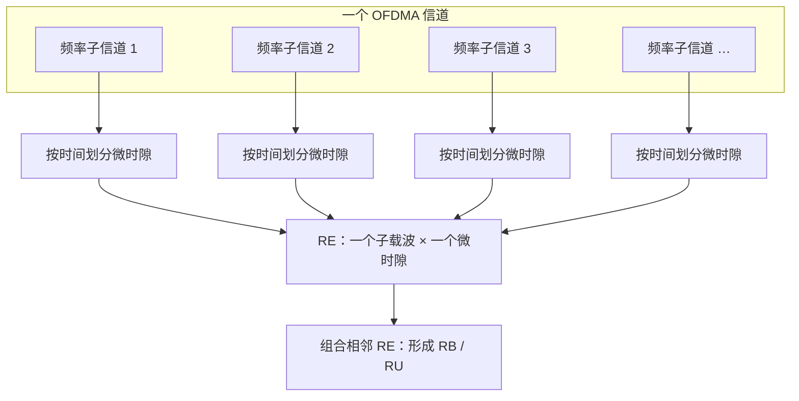

OFDMA 的关键优势是可以把不同时间、频率资源分配给不同设备，使多个设备能够同时收发数据，而不必让每个设备独占整个信道。

#### 3. 随机接入：ALOHA 与 CSMA/CA

随机接入协议不需要为每个节点预先分配固定发送时刻，节点有数据时即可竞争信道。若两个或更多发送端的信号在接收端发生重叠，就会产生碰撞，接收端无法正确解码，随后需要通过更高层或链路层的重传机制恢复数据。

需要注意：**碰撞发生在接收端的信号叠加处，而不是发送端本地**。发送端可能彼此听不到，但它们的信号仍可能在共同接收端相互干扰。

ALOHA 协议最初用于无线卫星网络，如今仍用于卫星、IoT 网络，以及 4G/5G 的部分控制面功能。WiFi 则使用**带碰撞避免的载波侦听多路访问**（Carrier Sense Multiple Access with Collision Avoidance，CSMA/CA）。

#### 4. CSMA/CA：带碰撞避免的载波侦听

CSMA/CA 与 CSMA 一样，采用"先侦听、后发送"的基本思路，但它需要应对无线网络的两个特殊问题：

- **隐藏终端**：发送设备可能听不到另一个隐藏设备的发送，但二者的数据会在目的设备处发生碰撞。
- **无法有效进行碰撞检测**：无线设备自身发射信号的强度通常远大于接收信号。设备在发送时很难同时检测到其他设备的微弱信号，因此无法像以太网 CSMA/CD 那样边发送边检测碰撞，并在碰撞后立即停止。

因此，WiFi 发送端一旦开始发送帧，通常必须把整帧发送完毕。为了避免浪费整个帧的发送时间，CSMA/CA 更强调**尽量避免碰撞**，并使用链路层确认机制。

**链路层 ACK**：目的设备正确收到帧并通过 CRC 检查后，等待一个很短的时间间隔——**短帧间间隔**（Short Inter-Frame Spacing，SIFS），然后返回 ACK。若发送端在规定时间内没有收到 ACK，就认为帧可能丢失或发生错误，并重新竞争信道后重传。达到最大重传次数仍未收到 ACK，则放弃该帧。

CSMA/CA 的发送过程如下：

1. 设备有帧待发送，先侦听信道。
2. 若信道空闲，等待**分布式帧间间隔**（Distributed Inter-Frame Space，DIFS）后发送；若信道忙，则选择一个随机退避值。
3. 信道空闲时，退避计数器递减；信道变忙时，计数器冻结。计数器到 0 后，设备发送完整帧。
4. 发送端等待 ACK。收到 ACK 表示发送成功；未收到 ACK，则重新进入退避阶段，并从更大的随机取值区间选择退避值。

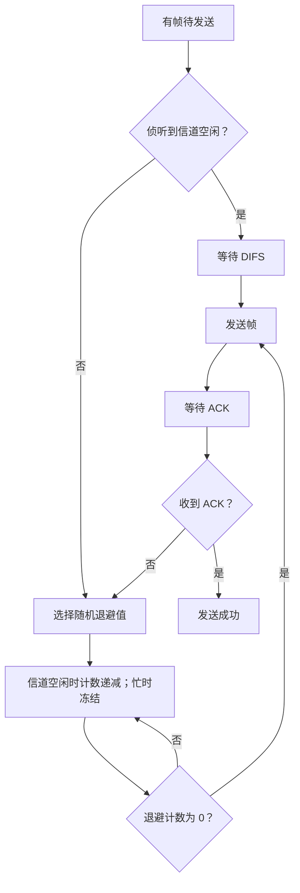

> [!question] 为什么 CSMA/CA 不能像 CSMA/CD 那样"发现碰撞就停"？
> 以太网 CSMA/CD 能够在碰撞后检测并中止发送，因此即使两台设备同时等到第三台设备发送结束后再发送，碰撞也最多浪费部分帧时间。
>
> WiFi 无法检测并中止碰撞，一旦发生碰撞，整个帧都可能白白发送。因此，多个设备发现信道忙后，会先各自随机退避；退避值较小的设备先发送，其他设备在侦听到它的发送后冻结计数器，从而尽可能避免碰撞。
>
> 这种方法仍不能完全消除碰撞：隐藏设备可能互相听不到，或者两个退避值过于接近，先发送设备的信号还未传播到另一台设备时，后者就开始发送。

#### 5. RTS/CTS：处理隐藏终端

WiFi 的 CSMA/CA 还提供一种可选的信道预约机制：**请求发送**（Request to Send，RTS）和**允许发送**（Clear to Send，CTS）。

考虑 A 和 C 都要向 AP（B）发送数据，但 A、C 彼此隐藏的情况。A 正在向 B 发送长数据帧时，C 听不到 A 的发送；若 C 直接发送，就可能与 A 的数据在 B 处碰撞。RTS/CTS 通过先发送短控制帧预约信道，减少长数据帧发生碰撞的概率。

1. 发送端先发送 RTS，说明后续 DATA 和 ACK 总共需要占用信道的时间。
2. 目的端收到 RTS 后，广播 CTS。
3. 发送端收到 CTS 后，才发送 DATA。
4. 目的端收到 DATA 后，等待 SIFS 并发送 ACK。
5. 能听到 CTS 的其他设备会在 CTS 指定的预约时间内保持静默。

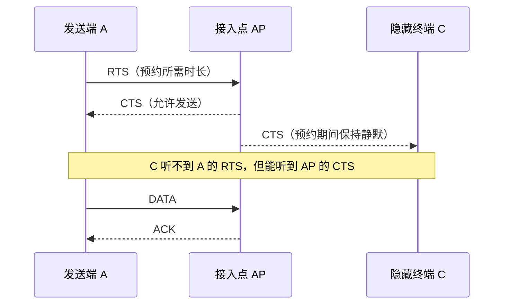

RTS/CTS 有两个作用：

- 隐藏设备在听到 CTS 后会保持静默，从而降低长 DATA 帧发生碰撞的概率；
- RTS、CTS 帧较短，即使控制帧本身发生碰撞，浪费的信道时间也比长数据帧少。

但 RTS/CTS 不能保证预约一定成功，因为 RTS 或 CTS 本身也可能因衰落或噪声丢失。并且控制帧会增加时延和信道开销，因此通常只在传输较长数据帧时使用。

### 7.3.2 WiFi：802.11 无线局域网

WiFi 已成为家庭、学校、办公室、机场和公共场所最重要的无线接入技术。正如以太网统治了有线局域网，IEEE 802.11（通常称为 WiFi）也成为无线局域网的主流标准。

IEEE 802.11 标准由 IEEE 802.11 工作组制定。WiFi 联盟为其中主要的商用标准提供 WiFi 品牌认证，因此常用 WiFi 代际来描述不同版本的 802.11 标准。本章中将"WiFi"和"802.11"近似作为同义词使用。

#### 1. 802.11 标准的演进

| IEEE 802.11 标准 | WiFi 代际                 | 发布年份 | 理论最大速率 | 频段（GHz）     | 信道带宽（MHz）      | 主要物理层技术              |
| ---------------- | ------------------------- | -------- | ------------ | --------------- | -------------------- | --------------------------- |
| 802.11b          | —                         | 1999     | 11 Mbps      | 2.4             | 22                   | 直接序列扩频                |
| 802.11g          | —                         | 2003     | 54 Mbps      | 2.4             | 20                   | OFDM                        |
| 802.11n          | WiFi 4                    | 2009     | 600 Mbps     | 2.4、5          | 20、40               | OFDM、MIMO（首次引入）      |
| 802.11ac         | WiFi 5                    | 2013     | 6.9 Gbps     | 5               | 20、40、80、160      | OFDM、MIMO、MU-MIMO（下行） |
| 802.11ax         | WiFi 6（6E 扩展到 6 GHz） | 2020     | 9.5 Gbps     | 2.4、5（6E：6） | 20、40、80、160      | OFDM、OFDMA、MIMO           |
| 802.11be         | WiFi 7                    | 2024     | 30 Gbps 以上 | 2.4、5、6       | 20、40、80、160、320 | OFDM、OFDMA、MIMO           |

WiFi 标准的演进不仅仅是单用户峰值速率不断提高，还包括以下变化：

- **频段扩展**：从最初主要使用 2.4 GHz，扩展到 5 GHz 和 6 GHz。2.4 GHz 频段有大量消费电子设备共同使用，容易受到干扰。
- **信道带宽增加**：WiFi 信道的最小带宽通常为 20 MHz，更宽的信道可以通过绑定相邻的多个 20 MHz 信道实现。一个 WiFi 网络通常工作在其中一个信道上。
- **物理层技术演进**：从扩频技术发展到 OFDM，再到 WiFi 4 引入 MIMO、WiFi 6 引入 OFDMA，以更好地服务于机场、体育场和大型企业等高密度部署环境。

在高密度部署场景中，目标不只是让一个用户达到最高吞吐量，还要让大量用户能够同时高效地发送和接收数据。

#### 2. 基本服务集 BSS 与接入点 AP

802.11 无线局域网的基本构成单元是**基本服务集**（Basic Service Set，BSS）。一个 BSS 包含两个或更多无线节点，其中通常有一个中心节点，即**接入点**（Access Point，AP）。

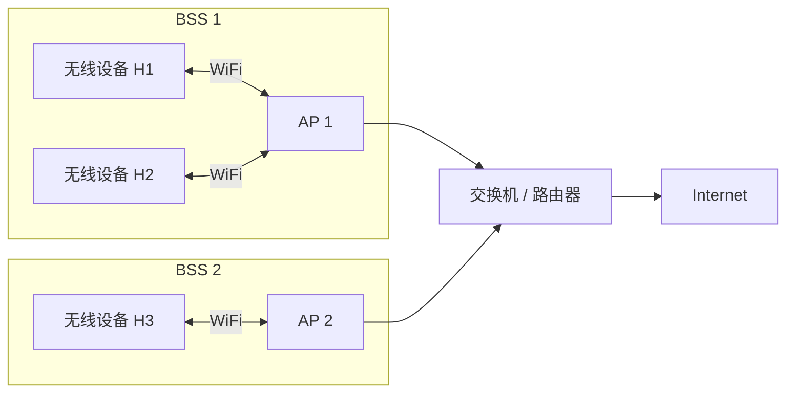

每个 BSS 中的无线设备都通过 AP 与网络通信。在本章讨论的基础设施模式下，即使同一 BSS 内的两台设备相互通信，帧也必须先发给 AP，再由 AP 中继，设备之间不能直接互发。

在家庭网络中，AP、二层交换机和三层路由器经常集成在同一台设备中。不过从 802.11 标准的角度看，AP 本身是一个**仅工作在链路层**的设备，它负责 WiFi 与有线以太网之间的帧转发。

#### 3. WiFi 信道结构

WiFi 将 2.4 GHz、5 GHz 和 6 GHz 频段划分为多个编号信道。以 2.4 GHz 为例，802.11 定义了 11 个部分重叠的信道（美国），相邻信道中心频率间隔为 5 MHz，而每个信道带宽为 20 MHz（802.11b 为 22 MHz）。两个信道只有在编号至少相差 5（中心频率间隔不小于 25 MHz）时才不重叠，因此常见的三个互不重叠信道组合是 **1、6、11**。

若多个 AP 位于同一物理区域，分别使用信道 1、6、11，它们的无线传输可以避免因频谱重叠而互相干扰。相反，若使用重叠信道，不同 WiFi 网络中的设备可能相互干扰。

#### 4. WiFi 6 中 CSMA/CA、OFDM 与 OFDMA 的协同

传统 WiFi 通过 CSMA/CA 竞争信道，并使用 OFDM 在整个信道带宽上传输。WiFi 6（802.11ax）及后续标准还支持 OFDMA：AP 可以把一个信道划分成多个 RU，同时向多个设备发送数据，或协调多个设备同时向 AP 发送数据。

问题在于：同一网络中可能同时存在只支持传统 OFDM 的旧设备和支持 OFDMA 的新设备，如何让它们共享信道？

WiFi 6 引入了**多用户 RTS**（Multi-User RTS，MU-RTS）机制，对 RTS/CTS 进行扩展：

1. AP 首先使用 CSMA/CA 竞争信道，然后发送 MU-RTS。
2. MU-RTS 中包含 OFDMA RU 的分配信息，指出哪些 RU 将分配给哪些设备，以及本次传输预计占用信道的时长。
3. MU-RTS 使用 OFDM 发送，因而旧式 OFDM 设备也能收到。
4. 只支持 OFDM 的设备按照传统方式返回 CTS；支持 OFDMA 的设备则在分配给自己的频率资源上返回 CTS。
5. 若预约成功，AP 就可以在预约时间内使用 OFDMA，把不同 RU 分配给多个设备并行发送。

上行方向也由 AP 通过 MU-RTS 等机制进行协调。这样，CSMA/CA 负责竞争并预约整个信道，OFDM 保证不同代际设备能够接收控制信息，而 OFDMA 在预约成功后完成多用户并行传输。

#### 5. 802.11 MAC：WiFi 链路层

WiFi 的链路层由**介质访问控制**（MAC）子层实现。设备和 AP 的 MAC 都包含数据平面与控制平面：

| 部分             | 职责                             | 典型功能                           |
| ---------------- | -------------------------------- | ---------------------------------- |
| **MAC 数据平面** | 在无线设备与 AP 之间传送链路层帧 | 承载 IP 数据报、ARP 分组等         |
| **MAC 控制平面** | 管理无线链路的控制过程           | RTS/CTS、ACK/NAK、Beacon、功率管理 |
| **MAC 调度器**   | 安排控制帧和数据帧何时发送       | 为无线介质上的帧分配发送机会       |

无线用户设备运行 Internet 协议栈的五层；AP 在标准意义上只实现链路层，并在一侧使用 WiFi 与无线设备通信，在另一侧使用以太网与路由器通信。

#### 6. 802.11 帧格式

802.11 帧与以太网帧有相似之处，但为了支持无线链路和 AP 转发，802.11 帧还包含一些专用字段。

**（1）数据字段与 CRC**

帧的载荷通常是 IP 数据报、MAC 控制帧或 ARP 分组。载荷字段最大允许 2312 字节，但实际通常小于 1500 字节。帧尾包含 32 bit 的 CRC，用于检测传输过程中的比特错误。无线链路比有线链路更容易发生比特错误，因此 CRC 尤为重要。

**（2）四个地址字段**

802.11 帧最显著的特点之一是包含四个地址字段，每个字段都可以容纳一个 6 字节 MAC 地址。基础设施模式下主要使用前三个地址字段；第四个地址字段用于 AP 之间的无线转发或 mesh。

| 地址字段      | 含义                                             | 发送方向上的典型取值                                                   |
| ------------- | ------------------------------------------------ | ---------------------------------------------------------------------- |
| **Address 1** | 无线帧的接收者地址                               | 发送端是无线设备时，填 AP 的 MAC；发送端是 AP 时，填目标无线设备的 MAC |
| **Address 2** | 无线帧的发送者地址                               | 填当前发送设备的 MAC；若 AP 发送，则填 AP 的 MAC                       |
| **Address 3** | 与该 BSS 所连接子网中的路由器接口相关的 MAC 地址 | 填路由器接口 R1 的 MAC 地址                                            |
| **Address 4** | 无线转发等场景下使用                             | 本章的基础设施模式不讨论                                               |

为什么前三个地址仍然不够用？关键在于：AP 需要在 WiFi 和以太网之间转发帧，而 AP 本身不理解 IP 地址。Address 3 帮助无线设备和 AP 知道数据报在所在子网中的最终链路层地址，即路由器接口的 MAC 地址。

考虑路由器接口 R1 向无线设备 H1 发送数据报：

1. 路由器根据 H1 的 IP 地址，通过 ARP 获得 H1 的 MAC 地址。
2. 路由器把 IP 数据报封装到以太网帧中，源 MAC 为 R1，目的 MAC 为 H1。
3. AP 收到以太网帧后，将其转换为 802.11 帧：Address 1 填 H1，Address 2 填 AP 自身，Address 3 填 R1。
4. H1 收到帧后，可以从 Address 3 得知路由器接口 R1 的 MAC 地址。

反方向上，H1 向 R1 发送数据报时：

1. H1 创建 802.11 帧，Address 1 填 AP 的 MAC，Address 2 填 H1 的 MAC，Address 3 填 R1 的 MAC。
2. AP 收到帧后转换成以太网帧，源 MAC 填 H1，目的 MAC 填 R1。

因此，Address 3 对于把 BSS 与有线局域网互联至关重要。

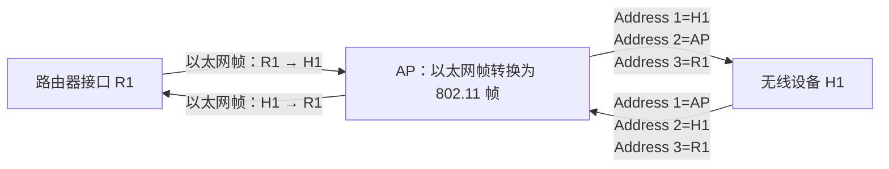

**（3）序列号、持续时间与帧控制字段**

- **序列号字段**：由于 ACK 可能丢失，发送端可能重传同一个帧。序列号帮助接收端区分新帧与旧帧的重复副本，避免把重传帧误认为新的数据。
- **持续时间字段**：表示发送端预约信道的时间长度，通常覆盖数据帧和 ACK 的发送时间，单位为微秒。数据帧、RTS 和 CTS 中都可以携带该字段。
- **帧控制字段**：包含类型、子类型和功率管理等子字段。类型与子类型用于区分控制帧和数据帧，例如 RTS、CTS、ACK；功率管理位用于指示设备的睡眠状态。

### 7.3.3 5G 无线电接入网 RAN

5G 蜂窝网络的无线接入部分称为**无线电接入网**（Radio Access Network，RAN）。本节主要讨论 5G，同时在必要时对照 4G LTE。5G RAN 依靠前面介绍的无线信道、OFDM 和 OFDMA 技术实现无线通信。

#### 1. 5G 网络的整体架构

5G 网络主要由边缘的 RAN 和位于其后的 5G 核心网（5G Core）构成。

- **RAN**：由用户设备、无线信道和基站组成。3GPP 标准把用户设备称为 UE（User Equipment），把 5G 无线接口称为 NR（New Radio），把 5G 基站称为 gNB（Next Generation Node B）。为便于理解，本文仍统一称为"用户设备""无线信道"和"基站"。
- **5G Core**：由连接 RAN 与运营商外部网络的链路、路由器、服务器和核心网功能组成。核心网负责身份认证、接入授权、移动性管理等控制面服务，以及用户数据转发等服务。

RAN 相当于蜂窝网络的第一跳无线接入网，类似于 WiFi 中的 WLAN，但 5G 基站比普通 WiFi AP 复杂得多，承担更多控制与管理功能。

5G 核心网的链路和路由器通常仍采用有线网络技术，并使用前几章学习过的 Internet 协议。控制面和数据面的分离在 5G 中仍然存在，只是数据面通常称为**用户面**（user plane）。这种控制面与用户面分离，类似 4G 引入的 **CUPS**（Control Plane and User Plane Separation），在 5G 架构中是天然设计。

核心网或基站附近还可以部署应用服务器，让应用数据不必离开运营商网络就完成处理，这称为**本地分流/本地出口**（local breakout）。例如，应用服务器可以部署在基站附近或 5G 核心网的边缘云中，以便直接与 RAN 中的设备通信。

#### 2. 4G/5G RAN 的物理信道资源

4G 和 5G RAN 使用 OFDMA 共享无线信道。前面介绍过，一个 RE 是一个子载波上的一个时间微时隙，多个相邻 RE 可以组合为 RB。

| 项目            | 4G                                             | 5G                                                                     |
| --------------- | ---------------------------------------------- | ---------------------------------------------------------------------- |
| 子载波间隔/带宽 | 15 kHz                                         | 15、30、60、120、240 kHz 等多种配置                                    |
| 时间长度        | 一个微时隙约 66.6 μs                           | 子载波间隔越大，微时隙越短                                             |
| RB 组成         | 12 个相邻子载波 × 7 个连续微时隙，共 84 个符号 | 支持多种 RE 组合方式                                                   |
| 信道带宽        | 1.4、3、5、10、15、20 MHz                      | 继承 4G 带宽；FR1（6 GHz 以下）最高 100 MHz，FR2（毫米波）最高 400 MHz |

原书以 4G 的 10 MHz 信道为例：它包含 50 个频率并行的 RB，每个 RB 占据一个不同的频率子信道。

5G NR 的参数集（numerology）示意如下（时隙长度等数值为按 $2^\mu$ 缩放的结果，适用频段需验证）：

| 子载波间隔 | 时隙长度  | 符号时长（不含 CP） | 典型使用           |
| ---------- | --------- | ------------------- | ------------------ |
| 15 kHz     | 1 ms      | 约 66.7 μs          | FR1，与 4G 一致    |
| 30 kHz     | 0.5 ms    | 约 33.3 μs          | FR1                |
| 60 kHz     | 0.25 ms   | 约 16.7 μs          | FR1 / FR2          |
| 120 kHz    | 0.125 ms  | 约 8.3 μs           | FR2（毫米波）      |
| 240 kHz    | 0.0625 ms | 约 4.2 μs           | 主要用于同步信号块 |

频谱资源还可以进一步按层次聚合：

- **子载波/子信道**：构成频率维度上的基本资源；
- **信道**：由若干子载波组成，具有一定的总带宽；
- **频段**（band）：由一个或多个信道聚合而成。

国家监管机构将授权频段分配给运营商，运营商获得频段后，再决定如何把频段划分为信道，以及把信道划分为子载波。

#### 3. 上行、下行与物理信道

无线资源分为两个方向：

- **下行**：基站向用户设备发送数据；
- **上行**：用户设备向基站发送数据。

蜂窝网络中的下行流量通常明显多于上行流量，原书给出的典型比例约为 10:1。运营商可以采用两种方式划分上、下行资源：

| 双工方式            | 英文全称                     | 划分方式                               |
| ------------------- | ---------------------------- | -------------------------------------- |
| **时分双工**（TDD） | Time Division Duplexing      | 同一频率在不同时间段分别用于上行和下行 |
| **频分双工**（FDD） | Frequency Division Duplexing | 使用不同频率分别承载上行和下行         |

确定上行和下行的时间、频率资源后，4G/5G 再把 RB 划分到不同的物理信道中。主要物理信道如下：

| 方向 | 物理信道  | 英文全称                          | 作用                                                            |
| ---- | --------- | --------------------------------- | --------------------------------------------------------------- |
| 下行 | **PDSCH** | Physical Downlink Shared Channel  | 承载下行用户面数据，以及基站发给设备的控制面消息                |
| 下行 | **PDCCH** | Physical Downlink Control Channel | 告知设备：下行在哪些 RB 上接收数据，以及上行可使用哪些 RB       |
| 下行 | **PBCH**  | Physical Broadcast Channel        | 广播设备发现和接入蜂窝网络所需的信息                            |
| 上行 | **PUSCH** | Physical Uplink Shared Channel    | 承载上行用户面数据，以及设备发给基站的控制面消息                |
| 上行 | **PRACH** | Physical Random-Access Channel    | 设备首次接入网络时请求与基站建立连接，采用随机接入              |
| 上行 | **PUCCH** | Physical Uplink Control Channel   | 请求基站分配未来可用的 PUSCH RB，并承载测量信息和链路层 ACK/NAK |

除了物理信道，5G 还定义了**逻辑信道**。逻辑信道按照信息的语义对数据进行分类，再映射到上行或下行物理信道上。需要注意，"信道"一词在无线网络中有多种含义，可能指频谱划分（WiFi 信道）、物理资源（物理信道），也可能指逻辑信息类别（逻辑信道）。

#### 4. 5G RAN 链路层协议栈

与 WiFi 一样，5G RAN 的链路层也包含用户面和控制面：

- **用户面**负责在设备与基站之间传送用户数据；
- **控制面**负责配置和管理无线资源、控制用户面帧传输，并支持设备接入、移动性管理和功率控制等功能。

5G RAN 的链路层进一步划分为多个子层：

| 子层                                         | 所属平面               | 主要职责                                                                   |
| -------------------------------------------- | ---------------------- | -------------------------------------------------------------------------- |
| **RRC**（Radio Resource Control）            | 控制面                 | 建立、维护和释放逻辑信道；管理连接状态；参与移动性管理；测量并报告信道质量 |
| **SDAP**（Service Data Adaptation Protocol） | 用户面                 | 为数据流分配 QoS Flow ID，并把流映射到无线资源，以支持 QoS 保证            |
| **PDCP**（Packet Data Convergence Protocol） | 用户面                 | IP 首部压缩，以及可选的加密和消息完整性检查                                |
| **RLC**（Radio Link Control）                | 用户面                 | 分段与重组；使用序列号、CRC、ACK/NAK 和 ARQ 实现可靠帧传输                 |
| **MAC**（Medium Access Control）             | 用户面与控制面相关功能 | 调度控制帧和用户帧，把数据分段并映射到 OFDMA 资源块                        |

RRC 通过控制消息配置本地链路层和物理层状态，并与对端 RRC 协同。SDAP、PDCP、RLC、MAC 则逐层处理用户数据。与 WiFi 相对简单的链路层帧相比，5G 帧会叠加多个子层的首部字段；各子层通常包含消息类型、序列号或标识符、载荷等信息。

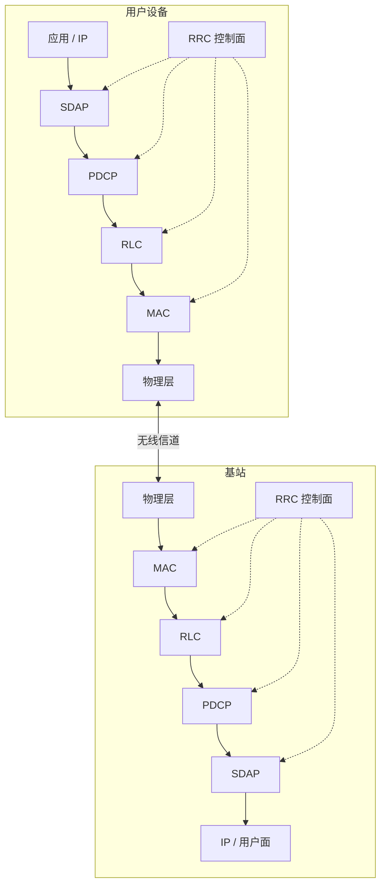

#### 5. 5G 基站功能拆分：RU、DU 与 CU

早期 2G、3G、4G 基站通常以单体设备实现，由单一厂商提供一个集成化的专用设备。5G 开始推动**基站功能解耦**（disaggregation）：把基站功能拆分为多个功能单元，并通过标准化接口协同工作。

常见的功能单元包括：

| 功能单元 | 英文全称         | 说明                                               |
| -------- | ---------------- | -------------------------------------------------- |
| **RU**   | Radio Unit       | 负责射频相关功能，连接天线与数字处理部分           |
| **DU**   | Distributed Unit | 承担部分较靠近无线侧、对时延要求较高的基带处理功能 |
| **CU**   | Central Unit     | 承担更高层的基站处理功能                           |

RU、DU、CU 可以部署在基站现场、边缘云或中心云，具体取决于通信时延和实时性要求。功能拆分使不同厂商可以分别实现不同组件，降低进入门槛，促进竞争和创新。

3GPP 定义了相关功能单元与架构；**O-RAN 联盟**则进一步规定这些单元之间的开放接口，以支持多厂商设备互操作。

#### 6. 5G RAN 控制面的软件化

5G 的另一种解耦发生在控制面：由于 RRC 控制面与用户面分离，RAN 控制功能可以采用类似 SDN 的方式实现，形成**软件定义 RAN**（SD-RAN）。

SD-RAN 控制器的主要组成如下：

- **控制面代理**：向 5G Core 提供符合 3GPP 标准的接口，使 RAN 控制面能够与核心网中的网络功能交互。
- **RAN 智能控制器**（RAN Intelligent Controller，RIC）：负责管理 RAN 状态并下发控制决策。RIC 包含与底层 RAN 通信的模块、RAN 范围内的状态管理模块，以及面向应用控制过程的接口。原书写作"Real-time Intelligent Controller"，标准名称为 RAN Intelligent Controller，需验证。
- **RAN 节点信息库**（R-NIB）：保存控制决策所需的网络状态，包括信道状态、连接状态、设备身份和 QoS 需求等。
- **xApps**：运行在 RIC 平台上的独立应用程序，可以访问 R-NIB，并执行负载均衡、设备切换、QoS 配置等控制逻辑。

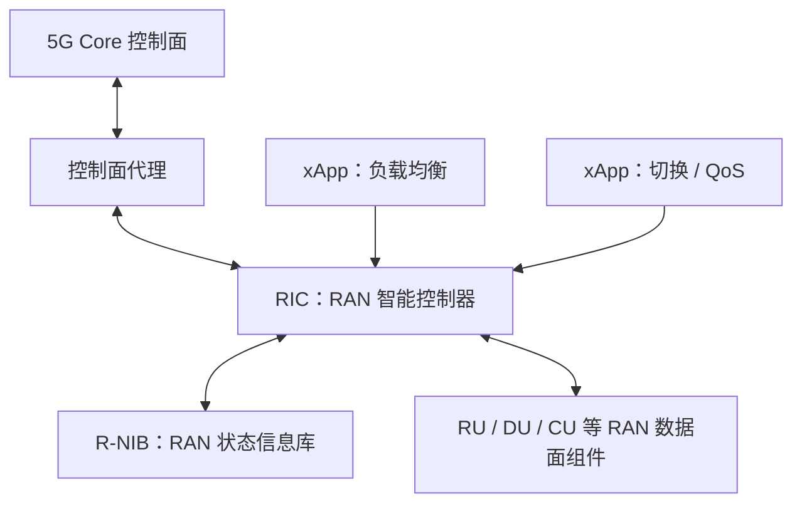

Open RAN 是 SD-RAN 的重要实践之一。"开放"主要指组件之间存在明确、标准化的接口，使不同厂商的组件能够互操作。

### 7.3.4 无线网络发现与接入

任何接入网都需要让设备发现网络基础设施并完成接入。对于无线网络，基站通常周期性发送**信标**（beacon），宣布网络存在，并广播网络名称、传输能力和无线信道参数等信息。设备通过扫描可能使用的无线信道，监听这些信标。

无线标准通常不规定设备必须选择哪个网络。设备可以根据最近连接过的网络、用户配置的优先级、信号强度等因素进行选择。蜂窝设备通常优先选择其 SIM 卡所属运营商的网络。

#### 1. WiFi 网络接入

WiFi 设备发现 AP 并选定目标后，向 AP 发送 **802.11 关联请求帧**（association request frame），AP 返回**关联响应帧**（association response frame）。设备还需要通过 WPA 完成网络认证与密钥协商（例如关联后的四次握手），这一步可以发生在关联之前或之后，具体取决于认证方式。

完成 WiFi 关联后，设备还需要加入 AP 所属的 IP 子网。通常设备通过 AP 向子网发送 DHCP Discover，获取 IP 地址及其他网络配置。此后，网络中的其他设备就可以把它看作该子网中一个具有 IP 地址的普通主机。

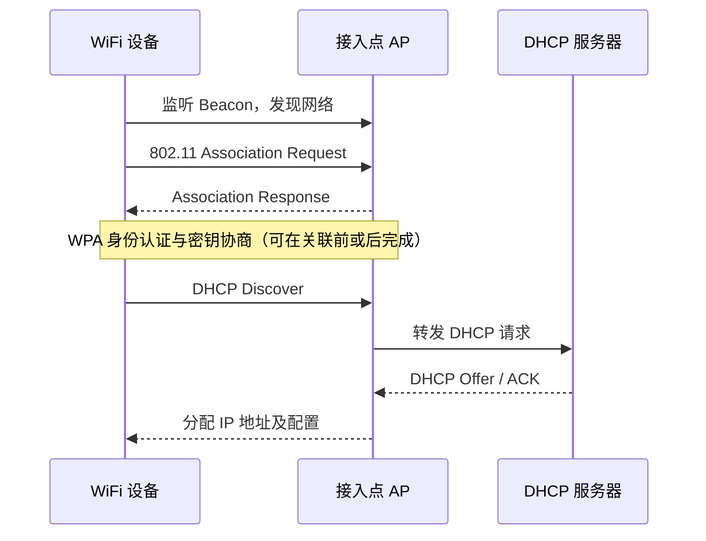

#### 2. 5G 网络接入

5G 接入比 WiFi 更复杂。设备不是只接收一个包含全部信息的 Beacon，而是通过多个步骤逐步获得同步和网络信息。

**第一步：同步并获取系统信息。**

1. 设备先检测**主同步信号**（Primary Synchronization Signal，PSS），用它与基站时钟同步。
2. 设备再检测**辅同步信号**（Secondary Synchronization Signal，SSS），获得初始网络标识。
3. 设备读取**主信息块**（Master Information Block，MIB），其中包含子载波间隔、该小区是否允许接入等信息。MIB 由 PBCH 承载。
4. PSS、SSS 和 PBCH（含 MIB）共同构成**同步信号块**（Synchronization Signal Block，SSB）。
5. 设备根据 SSB 进一步定位并接收系统信息块（System Information Blocks，SIB）。其中最重要的是 SIB1，它包含运营商的移动国家代码（MCC）、移动网络代码（MNC）、基站标识，以及可接受的最低接收信号质量等信息。

原书给出的参数：PSS 和 SSS 每 5 ms 在每个 5G 信道中心的 127 个子载波上广播；SIB1 每 80 ms 发送一次。（5 ms 更像 SSB 突发窗口长度，默认 SSB 周期常见为 20 ms；SIB1 周期亦需核对，均需验证。）

**第二步：请求建立 RAN 连接。**

设备决定加入某个网络后，基站仍然不知道该设备的存在，而且设备尚未获得可用于普通上行通信的 RB。因此，设备通过小区的上行随机接入信道（PRACH）发起随机接入，并向基站发送 **RRC 连接建立请求**（RRC connection setup request）。（实际流程中先发送 PRACH 前导码，之后才发送 RRC 请求，此处为简化。）

**第三步：建立 RAN 信令连接。**

基站响应 RRC 连接建立请求，发送 **RRC 连接建立响应**（RRC connection setup response）。至此，设备与基站能够在 RAN 内交换控制消息。

> [!warning] 完成 RAN 接入不等于完成 5G 网络注册
> 此时设备还没有向 5G Core 识别并认证自己的身份，也没有获得 IP 地址。因此，它还不能通过 UPF 收发普通用户数据。完整入网过程还需要 5G Core 参与，见 7.4.3 节。

### 7.3.5 RAN/WLAN 中的传输调度

MAC 层的重要职责之一，是决定基站何时向哪个设备发送数据，以及为设备分配哪些上行资源。这个过程称为**MAC 调度**（MAC scheduling）。在 4G/5G 和支持 OFDMA 的 WiFi 6/7 等高密度部署场景中，可能有数十甚至数百个设备同时等待传输，调度器因此非常重要。

与有线链路不同，无线链路的总吞吐量会明显受到调度顺序影响。原因在于：距离基站较近、视距条件较好的设备，往往可以使用更高阶调制方式，以更高速率收发数据；距离较远或多径影响较大的设备则可能只能使用较低速率。此外，MIMO 和波束成形也会影响可同时服务的设备集合。因此，选择哪些设备、在什么时刻发送，会改变无线链路的整体吞吐量。

3GPP 和 WiFi 标准并不规定唯一的 MAC 调度算法，具体算法由网络设备厂商或运营商选择。调度策略也是不同网络提供商之间的重要差异之一。

#### 1. 调度需要考虑的因素

| 因素               | 核心问题                                       | 典型取舍                             |
| ------------------ | ---------------------------------------------- | ------------------------------------ |
| **信道质量感知**   | 是否优先服务信道质量较好的设备？               | 有利于提高总吞吐量                   |
| **设备公平性**     | 是否让不同设备获得相近的吞吐量？               | 公平性提高时，总吞吐量可能下降       |
| **业务类别优先级** | 是否区分控制面、用户面，以及实时与非实时流量？ | 实时业务和控制消息可能需要更高优先级 |
| **QoS 感知**       | 是否根据服务质量要求分配资源？                 | 需要考虑不同业务的时延、速率等要求   |

下面介绍四种代表性调度算法。设 $d_{ik}(t)$ 表示时刻 $t$ 设备 $i$ 在第 $k$ 个 RB 上预计能够获得的吞吐量，$R_i(t)$ 表示设备 $i$ 的平均吞吐量。

#### 2. 轮询调度 RR

**轮询调度**（Round Robin，RR）按照轮次为每个设备分配相同数量的 RB。

- 优点：每个设备都有机会获得资源，调度过程简单；
- 缺点：它只保证分配的 RB 数量相同，不保证实际吞吐量相同，因为不同设备的信道质量可能不同。

因此，RR 是按资源分配轮次公平，但不一定实现吞吐量公平；同时它不考虑信道质量，也不考虑 QoS。

#### 3. 最大吞吐量调度 MT

**最大吞吐量调度**（Maximum Throughput，MT）优先把 RB 分配给在该 RB 上信道质量最好、且有待发送数据的设备。

5G 基站会周期性广播位于已知 RB 位置的参考信号。设备根据接收质量测量结果，周期性向基站报告 4 bit 的**信道质量指示**（Channel Quality Indication，CQI）。基站利用 CQI 估计每个设备在各 RB 上可以使用的调制方式和预计吞吐量 $d_{ik}(t)$。

MT 在每个调度时刻选择：

$$
(i^*,k^*)=\arg\max_{i,k}d_{ik}(t)
$$

将 $RB_{k^*}$ 分配给设备 $i^*$，再重复上述过程，直到所有 RB 都被分配。

MT 能提高整体吞吐量，是一种信道感知调度，但**不公平**：信道质量始终最好的设备可能获得绝大多数甚至全部 RB。

#### 4. 盲等吞吐量调度 BET

**盲等吞吐量调度**（Blind Equal Throughput，BET）希望让所有设备获得相近的平均吞吐量。调度器为每个设备维护一个吞吐量估计值：

$$
R_i(t)=\beta r_i(t)+(1-\beta)R_i(t-1)
$$

其中：

- $r_i(t)$：设备 $i$ 在时段 $t$ 实际获得的吞吐量；
- $R_i(t)$：设备 $i$ 的平均吞吐量估计；
- $0<\beta<1$：平滑系数，$\beta$ 越大，越重视最近测量值。

该公式是**指数加权移动平均**（Exponentially Weighted Moving Average，EWMA），前面在 TCP RTT 估计（3.5.3 节）中也见过。

BET 每次把一个 RB 分配给当前平均吞吐量最小且有数据等待发送的设备，并不断重复。它明确追求吞吐量公平，但不考虑 QoS；由于实际吞吐量受信道质量影响，因此它也间接反映了部分信道状况。

#### 5. 比例公平调度 PF

**比例公平调度**（Proportional Fairness，PF）试图在最大化吞吐量与保证设备公平性之间取得平衡。它选择使下式最大的设备 $i$ 和 RB $k$：

$$
(i^*,k^*)=\arg\max_{i,k}\frac{d_{ik}(t)}{R_i(t)}
$$

其中分子 $d_{ik}(t)$ 越大，代表当前 RB 能带来的吞吐量越高；分母 $R_i(t)$ 越小，代表该设备过去获得的平均吞吐量越低。因此，PF 同时倾向于选择当前信道较好、又没有获得太多历史资源的设备。

每次选择后分配对应 RB，并重复直到所有 RB 分配完成。PF 是信道感知的，并试图提供一定程度的公平性。

> [!example] 例题：MT 与 PF 的差别
> 两台设备 A、B 竞争同一个 RB，数值为示意：
>
> | 设备 | 当前可得吞吐量 $d(t)$ | 历史平均吞吐量 $R(t)$ | $d/R$ |
> | ---- | --------------------- | --------------------- | ----- |
> | A    | 10                    | 8                     | 1.25  |
> | B    | 2                     | 1                     | 2.0   |
>
> - MT 比较 $d$：$10>2$，分配给 A；
> - PF 比较 $d/R$：$2.0>1.25$，分配给 B。
>
> 若 A 的信道一直比 B 好，MT 会让 B 长期得不到资源；PF 因 B 的历史平均吞吐量低而抬高其优先级，使两者轮流获得资源，吞吐量并未被完全牺牲。

四种算法对比如下：

| 算法 | 主要目标                 | 是否考虑信道质量 | 公平性                         |
| ---- | ------------------------ | ---------------- | ------------------------------ |
| RR   | 轮流分配相同数量 RB      | 否               | 资源轮次公平，不保证吞吐量公平 |
| MT   | 最大化当前总吞吐量       | 是               | 较差，可能偏向信道最好的设备   |
| BET  | 使设备平均吞吐量趋于相等 | 间接考虑         | 强调吞吐量公平                 |
| PF   | 平衡吞吐量和公平性       | 是               | 提供一定程度的公平性           |

本节仅介绍了代表性算法。实际网络还可能结合硬/软资源预约、优先级调度、实时业务调度和虚拟化调度等机制。

### 7.3.6 能量管理：睡眠与唤醒

无线设备通常由电池供电，持续开启无线收发器会消耗大量能量。因此，许多无线网络都支持**睡眠/唤醒周期**：设备有数据要处理时唤醒，没有工作时进入睡眠状态，以减少无线收发电路处于开启状态的时间。

无线通信能耗不容忽视。原书引用的测量结果显示，LTE 无线电在发送、接收或等待接收时功耗约为 1000–3500 mW，而关闭时低于 15 mW；在运行常见应用的 4G/5G 设备中，通信可能占总能耗的 20% 到 50% 以上。

无线网络的睡眠/唤醒机制可以分为两类：

| 方式                                                  | 工作方式                                                                               | 代表网络                     |
| ----------------------------------------------------- | -------------------------------------------------------------------------------------- | ---------------------------- |
| **协调式睡眠/唤醒**（coordinated sleep/wake）         | 设备与基站协商睡眠状态和下次唤醒时间；基站缓存发往睡眠设备的数据，等待设备醒来后再发送 | WiFi、5G                     |
| **非协调式唤醒并发送**（uncoordinated wake-and-send） | 设备仅在有数据要发送时主动唤醒，发送后等待可能的下行响应，再重新睡眠                   | LoRaWAN Class A、BLE、NB-IoT |

#### 1. WiFi 的协调式睡眠/唤醒

WiFi 设备准备睡眠时，会在 802.11 帧头中把**功率管理位**（power-management bit）设为 1，通知 AP 自己将进入睡眠。AP 随后缓存发给该设备的帧，直到设备唤醒。

设备唤醒后监听 AP 的 Beacon。Beacon 中包含**流量指示映射**（Traffic Indication Map，TIM），用于指示 AP 是否缓存了发给该设备的帧：

- 若没有待接收帧，设备可以继续睡眠；
- 若有待接收帧，设备向 AP 发送轮询请求，要求 AP 发送缓存的数据。

WiFi 6 还引入了**目标唤醒时间**（Target Wake Time，TWT），允许设备与 AP 协商睡眠时长和唤醒时刻，适合只需偶尔报告数据的 IoT 设备。

#### 2. 5G 的协调式睡眠/唤醒

5G 设备在连接状态下可以使用**非连续接收**（Discontinuous Reception，DRX）周期进行低功耗睡眠。DRX 包括短周期和长周期两种阶段：

1. 设备收到基站的数据后启动活动定时器。
2. 若一段时间内没有收发活动，定时器到期，设备进入短 DRX 睡眠周期。
3. 每个短周期结束时，设备短暂唤醒，检查基站是否有下行数据待发，也检查自己是否有数据要发送。
4. 若多个短周期内仍没有活动，设备进一步进入长 DRX 周期。
5. 基站在设备睡眠时收到下行数据，会先缓存数据；设备在长周期末唤醒后发现有待接收数据，再进入活动状态并接收数据。

睡眠时间越长，设备能耗越低，但下行数据可能需要等待更久。若数据在 $t_3$ 到达基站、设备在 $t_5$ 才真正收到，那么睡眠带来的额外时延为：

$$
\Delta t=t_5-t_3
$$

经过更长时间的不活动，5G 设备还可能进入 **Idle** 或 **Inactive** 状态。此时要重新建立 RAN 中的活动状态才能发送或接收用户数据；在 Inactive 状态移动时，RAN 和核心网还需要执行额外的移动性处理。

#### 3. LoRaWAN 的非协调式唤醒并发送

LoRa 是面向简单 IoT 设备的低功耗、低速率无线技术，常用于把传感器读数发送到数公里范围内的网关。最简单的 LoRa Class A 设备采用非协调式唤醒并发送：

1. 设备有传感器数据时唤醒；
2. 不事先与网关预约信道，直接发送 LoRa 帧；
3. 发送后短暂等待网关可能返回的下行数据；
4. 没有后续数据时重新进入睡眠。

若网关在设备睡眠期间有数据要发送，就必须等待设备下一次主动唤醒并建立联系。BLE 和 4G LTE NB-IoT 也支持设备主动唤醒并发送，但设备唤醒后需要先联系控制节点或基站，获得可用的信道发送时隙。

# 第三部分 无线核心网、移动性与其他无线网络

## 7.4 无线核心网

7.3 节讨论了无线接入网：设备如何通过第一跳无线链路与基站通信。接下来从无线网络边缘进入核心网。

5G Core 除了负责在 RAN 与 Internet 之间转发数据报，还提供用户身份管理、接入认证、移动性管理和服务订阅等控制面与管理面服务。

WiFi 没有与 5G Core 对应的专用无线核心网。企业通常使用传统 IP 网络中的管理和控制机制管理 WiFi；因此，本节主要讨论 5G 核心网。

### 7.4.1 5G 核心网与网络功能

5G Core 采用**基于服务的架构**（Service-Based Architecture，SBA）。核心网不再像早期蜂窝网络那样主要由若干独立的专用设备组成，而是把功能定义为一组**网络功能**（Network Functions，NFs），每个网络功能通过服务接口向其他功能提供能力。

这种架构更适合将功能实现为云环境中的微服务，并体现了 5G 的几个重要设计方向：从专用设备转向服务、控制面与用户面分离，以及通过软件实现网络功能。

#### 1. 重要网络功能

5G Core 中最核心的三个网络功能是 UPF、AMF 和 SMF：

| 网络功能 | 英文全称                                | 主要职责                                                               |
| -------- | --------------------------------------- | ---------------------------------------------------------------------- |
| **UPF**  | User Plane Function                     | 用户面数据转发，在 RAN 与更大 Internet 之间转发数据报                  |
| **AMF**  | Access and Mobility Management Function | 负责设备接入授权、连接建立和移动性管理，是核心网控制面的关键功能       |
| **SMF**  | Session Management Function             | 管理设备会话，包括 IP 地址分配、会话策略、计费状态和用户面转发路径建立 |

三者的关系可以概括为：AMF 负责组织设备入网和移动性管理；SMF 负责建立、管理数据会话；UPF 负责真正转发用户数据。

- **UPF** 是 5G 用户面中的核心功能，设备发往 Internet 以及从 Internet 返回设备的数据报都要经过相应 UPF。其具体工作方式将在 7.4.2 节讨论。
- **AMF** 是 5G 控制面的核心功能。它与认证服务器功能 AUSF 协作完成设备认证，并与其他功能协调设备接入。AMF 是唯一直接与用户设备交换核心网控制消息的网络功能，通过 N1 接口与设备通信；它也通过 N2 接口与基站交换控制消息。3GPP 把这类接口称为**参考点**（reference point）。
- **SMF** 管理每个设备的数据会话，负责选择 UPF、配置用户面转发路径，并协调分配 IP 地址以及访问控制和计费等状态。

#### 2. 数据、认证与策略相关功能

除上述三个核心功能外，5G Core 还包含若干管理用户数据、认证信息和网络策略的功能：

| 网络功能 | 英文全称                           | 主要职责                                           |
| -------- | ---------------------------------- | -------------------------------------------------- |
| **UDM**  | Unified Data Management            | 管理设备资料、用户服务和认证相关信息               |
| **UDR**  | Unified Data Repository            | 为网络功能提供外部数据存储，保存用户和网络状态     |
| **UDSF** | Unstructured Data Storage Function | 提供非结构化数据存储能力                           |
| **AUSF** | Authentication Server Function     | 与 AMF 协作，对希望接入网络的设备执行身份认证      |
| **NEF**  | Network Exposure Function          | 向第三方应用开放部分网络数据和网络功能服务         |
| **AF**   | Application Function               | 代表应用与网络功能交互，支持本地分流等应用服务     |
| **SEPP** | Security Edge Protection Proxy     | 为不同运营商网络之间的网络功能交互提供安全边界代理 |
| **NRF**  | Network Repository Function        | 提供网络功能的自动注册与发现                       |
| **PCF**  | Policy Control Function            | 提供策略控制与管理，涉及移动性、QoS 和漫游等策略   |
| **NSSF** | Network Slice Selection Function   | 在网络切片选择中发挥关键作用                       |

UDM 可以把数据保存在自身实现中，也可以使用 UDR 作为外部数据仓库。多个网络功能通过远程方式访问 UDR 时，可以采用无状态事务：网络功能本身不必长期保存全部数据状态，从而更适合云环境中的扩展与故障恢复。其他网络功能和第三方应用也可以使用 UDR、UDSF 存取数据。

NEF 和 AF 为部署在基站附近或核心网中的本地应用提供网络能力，使应用能够访问经授权的网络数据和服务。

当用户漫游到非归属运营商网络时，认证需要由用户归属网络的 AUSF 完成，访问网络与归属网络之间的认证消息通过各自的 SEPP 安全通信。

#### 3. 网络功能发现、网络切片与服务交互

5G Core 中网络功能数量较多，网络功能需要能够自动注册和发现其他功能。**NRF** 负责提供网络功能注册与发现服务，减少复杂的手工配置。

**网络切片**（network slicing）是 5G 引入的重要概念：把底层 RAN 和核心网资源虚拟化，在共享物理资源的基础上建立多个逻辑网络。其思路类似于传统 IP 网络中的 VPN：多个逻辑网络共享同一套物理网络资源，但在逻辑上相互区分。NSSF 在网络切片选择中发挥中心作用。

网络功能之间可以采用不同交互方式，标准并不强制指定唯一方式：

- **请求/响应**（request/response）：沿用传统客户端/服务器模式，可通过 HTTP 或远程过程调用实现。
- **订阅/通知**（subscribe/notify，也称 publish/subscribe）：客户端先订阅某个服务，服务端在结果可用时主动通知客户端。

> [!note] 与 SDN 的联系
> 5G Core 从专用设备转向服务、采用软件化实现，并明确区分控制面与用户面。这些设计方向与前面学习的 SDN 控制平面演进有相似之处。

### 7.4.2 用户面功能 UPF

5G 数据面本质上仍是一个 IP 网络，许多转发机制与前面章节学习的 Internet 相同。但 5G 控制面会配置数据面，使其支持传统 IP 网络中不一定具备的服务，例如 QoS 和**隧道**。本节重点讨论隧道。

#### 1. 5G 中的隧道

隧道在 4.3.4 节（IPv6 迁移）中已经介绍：在两个 IP 设备之间建立一条虚拟链路，让中间复杂的网络在逻辑上表现为一条链路。6.5 节的 MPLS 也体现了类似思想。

在 5G 网络中，每个设备都会在其基站与对应 UPF 之间建立一条隧道。这样，基站和 UPF 之间的整个回传网络（backhaul）都可以被抽象为设备专属的一条虚拟链路。

#### 2. GTP 封装与数据转发

设备加入 5G 网络时，SMF 会负责建立基站与 UPF 之间的隧道。以 Internet 发往无线设备的数据报为例：

1. UPF 收到目的地址为某个无线设备的数据报。
2. UPF 使用 **GPRS 隧道协议**（GPRS Tunneling Protocol，GTP），把原始 IP 数据报封装在 UDP 数据报中。
3. 该 UDP 数据报再作为一个新的 IP 数据报的载荷，通过核心网回传网络发送到基站。
4. 基站收到外层 IP 数据报后，解封装 UDP/GTP，取出原始 IP 数据报。
5. 基站把原始数据报通过无线 RAN 转发给目标设备。

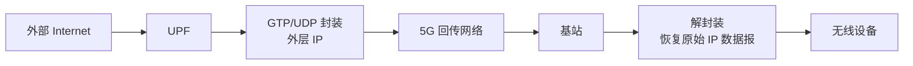

数据报在隧道中形成"数据报嵌套数据报"的结构：

| 层次           | 内容                   | 作用                             |
| -------------- | ---------------------- | -------------------------------- |
| 内层 IP 数据报 | 原始设备数据报         | 最终交付给无线设备               |
| GTP/UDP        | 隧道封装信息           | 标识并承载隧道中的用户数据       |
| 外层 IP 数据报 | UPF 到基站的 IP 数据报 | 让回传网络能够按普通 IP 路由转发 |

#### 3. 为什么 5G 要使用隧道？

在纯 5G IP 网络中使用隧道，并不是为了让 IPv4 与 IPv6 互通，而是为了支持设备移动。

假设没有隧道：设备从一个基站移动到另一个基站后，核心网中的所有回传路由器都需要知道设备当前连接在哪个基站，并更新该设备的转发信息。运营商网络中设备数量巨大，这会让路由器承担大量与用户位置相关的状态维护工作。

有了隧道后，只有隧道端点 UPF 需要知道设备当前连接的基站。回传网络中的其他路由器只需要按照普通 IP 路由规则，把外层数据报转发到基站即可。设备移动时，网络只需更新 UPF 的隧道端点，而不必让整个回传网络跟踪每个设备的位置。

因此，**UPF 是设备用户面数据转发的锚点**：在设备接入 5G 网络期间，无论设备当前连接到哪个基站，UPF 都可以保持面向外部 Internet 的数据转发关系。

### 7.4.3 用户身份、注册与会话建立

在 7.3.4 节中，设备已经发现 5G 网络，并与基站建立了 RAN 信令连接。但此时设备还没有真正完成 5G 入网：它尚未向核心网提供身份并完成认证，也没有获得 IP 地址，因而不能通过 UPF 收发普通用户数据。

设备完整加入 5G 网络需要两个过程：

1. **注册**（registration）：设备向网络提供身份信息，并与网络完成双向认证；
2. **PDU 会话建立**（PDU session establishment）：为设备分配 IP 地址，并在设备与 UPF 之间建立用户面数据通路。

#### 1. SIM 卡与用户身份

4G/5G 设备通常需要物理 **SIM 卡**（Subscriber Identity Module），或软件形式的 **eSIM**。SIM 卡提供用户和归属网络的全球身份信息。在蜂窝网络中，SIM 是用户的全球网络身份凭据。

SIM 中通常包含以下信息：

- **IMSI**（International Mobile Subscriber Identity，国际移动用户识别码）：由三部分组成：
  - **MCC**（Mobile Country Code）：3 位数字，表示移动国家代码；
  - **MNC**（Mobile Network Code）：2 位或 3 位数字，表示移动网络代码；
  - **MSIN**（Mobile Subscription Identification Number）：移动用户识别号码，在归属网络中唯一标识 SIM。
- **密码学密钥与 PIN**：用于设备接入网络时的认证。
- **本地网络身份信息**：记录当前或最近访问过的网络，以帮助设备选择网络。
- SIM 也可能保存电话号码、联系人和短信等信息。

> [!note] 5G 中的身份隐藏
> 在 5G 中，用户永久标识（SUPI，如 IMSI）不再以明文在空口发送，而是用归属网络的公钥加密为 **SUCI**（Subscription Concealed Identifier）后发送，以防 IMSI 被窃听。下文流程中"IMSI / 身份信息"按此理解。

MCC 与 MNC 一起标识 SIM 的**归属网络**（home network），即提供 SIM 并与用户建立订阅关系的运营商。用户离开归属网络覆盖区域后，可能接入其他运营商的网络，这称为**漫游**（roaming）。漫游时可使用的服务取决于用户套餐以及归属网络与访问网络之间的结算协议。

#### 2. 5G 注册与 PDU 会话建立

AMF 在设备注册和会话建立过程中起协调作用。它是唯一直接与设备交换核心网控制消息的网络功能，并组织 AUSF 完成认证、SMF 完成会话建立。

**注册过程**：

1. 设备与基站先通过 RRC 请求/响应建立 RAN 信令连接。
2. 基站为设备选择一个 AMF 实例，并向 AMF 发送注册请求。
3. AMF 联系设备，获取设备身份信息。
4. AMF 把身份信息交给 AUSF，由 AUSF 与设备执行双向认证。
5. 若设备接入的是访问网络（而非归属网络），认证由归属网络执行（见 7.4.1 的说明）。
6. 认证成功后，AMF 将设备身份和订阅服务信息登记到本地 UDM，并向设备返回注册接受消息。

**PDU 会话建立过程**：

1. 设备向 AMF 发送 PDU Session Establishment Request。
2. AMF 选择一个 SMF 实例，负责管理该设备的数据会话。
3. SMF 通过 UDM 检查设备请求的会话参数是否符合用户订阅和策略。
4. SMF 选择一个 UPF，并建立设备当前基站与该 UPF 之间的隧道。
5. SMF 经 AMF 和基站把隧道信息、IPv4 地址及其他会话信息返回给设备。
6. 基站与设备进一步配置 RAN 用户面。

完成以上步骤后，设备才真正具备通过 5G 网络发送和接收用户数据的能力。

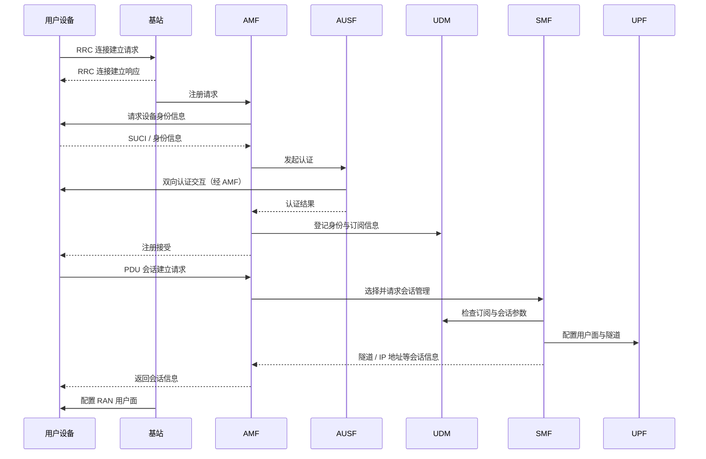

上面的流程只展示了主要交互。实际会话建立还会涉及 PCF、Charging Function 等功能；若使用 IPv6，也需要额外的配置步骤。5G 认证的具体密码学过程将在后续安全章节讨论。

## 7.5 移动性

无线设备可能在通信期间移动，因此无线网络需要在设备改变接入点时，尽可能保持已有通信不中断。例如，设备正在进行 TCP 连接或语音、视频通话时，从一个基站移动到另一个基站，网络仍然需要把发往该设备的数据报转发到正确位置。

WiFi 和 5G 都支持设备在一定范围内移动，但二者的移动性支持有很大区别：WiFi 主要在链路层处理接入点之间的切换；5G 则由 RAN 和核心网协同处理，支持更大范围内的移动。

### 7.5.1 移动性原理

#### 1. 移动性的范围

可以根据设备能否在通信不中断的情况下跨越接入网和运营商网络，区分三种移动场景：

| 场景                             | 移动范围                                                            | 是否需要网络协调       | 示例                         |
| -------------------------------- | ------------------------------------------------------------------- | ---------------------- | ---------------------------- |
| **单个接入网内部移动**           | 只在一个 WLAN/RAN 内活动                                            | 主要由当前接入网处理   | 用户在同一 AP 覆盖范围内移动 |
| **同一运营商网络内跨接入网移动** | 在同一运营商的多个接入网之间移动，同时维持 IP 通信和 TCP 等高层连接 | 由同一运营商网络协调   | 手机在运营商不同小区之间移动 |
| **跨运营商网络移动**             | 在不同运营商的网络之间漫游                                          | 需要多个运营商之间协调 | 用户连接到访问运营商的网络   |

本节重点讨论第二种场景。跨运营商移动涉及更复杂的信令和商业结算安排，我们不展开讨论。

#### 2. 移动性支持的位置：链路层还是网络层

支持移动性时，首先要决定移动性由哪一层负责：

- **只在链路层支持移动性**：设备可以在多个无线接入点之间移动，但通常必须处于同一个 IP 子网中。因为发往设备的 IP 数据报仍会被路由到原来的子网，链路层只负责在这个子网内找到设备。企业 WiFi 主要采用这种方式。
- **网络层及更高层支持移动性**：设备可以在运营商网络内不同接入网之间移动。核心网需要知道设备当前连接的接入网，并把 Internet 发来的数据报转发到相应位置。5G（以及 3G、4G）采用这种方式。

#### 3. 为什么切换，以及由谁发起

设备改变接入点可能是因为当前无线信号质量下降，切换到另一个基站能够获得更高吞吐量或更低时延；也可能是网络主动进行负载均衡，把设备从负载较高的接入网迁移到其他接入网。

WiFi 和 5G 标准并不规定必须使用哪种算法决定是否切换、切换到哪个目标基站。这通常由网络运营商或设备实现决定，也是持续研究的问题。

设备通常会测量周围基站的信号质量，并把测量结果报告给当前基站：

- 5G 设备可以测量基站广播的参考信号，并报告 CQI 等信道质量信息；
- WiFi 设备可以测量附近 AP 的接收信号强度指示（Received Signal Strength Indicator，RSSI）。

这些测量结果可以用于决定是否切换。网络也可能利用历史信息或机器学习预测未来的移动位置和信号质量，提前发起切换。

#### 4. 切换需要完成的工作

设备从一个基站切换到另一个基站时，需要完成两项重要任务：

1. **转移设备状态**：把设备的认证状态、服务权限等控制面状态从原基站转移到新基站，避免设备必须完全断开并重新接入。
2. **更新数据转发路径**：调整路由器、交换机或隧道中的转发状态，使发往设备的数据报能够沿新的接入路径到达设备，并保证上行数据能够正确返回网络。

### 7.5.2 WiFi 网络中的移动性

IEEE 802.11 采用**仅在链路层支持移动性**的方式，因此 WiFi 设备通常只能在同一 IP 子网中的 AP 之间无缝移动。

一个传统 BSS 包含一个 AP 和若干无线设备。若把多个 BSS 连接起来，并让它们使用相同 SSID、处于同一 IP 子网，就形成**扩展服务集**（Extended Service Set，ESS）。

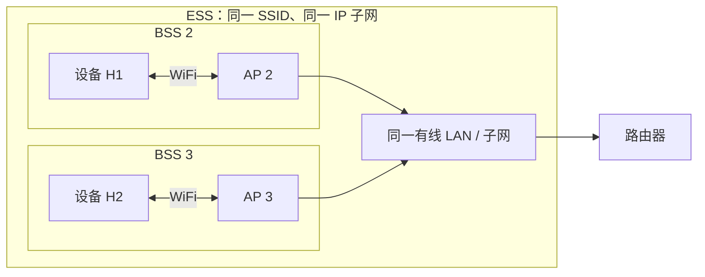

在 ESS 内从 AP2 移动到 AP3 时，设备的网络层身份和 IP 子网没有改变，因此从网络层视角看，设备并没有离开原来的网络。IEEE 802.11 通过一组修订支持 ESS 内的漫游：

| 修订                               | 作用                                              |
| ---------------------------------- | ------------------------------------------------- |
| 802.11r（Fast BSS Transition，FT） | 加快设备在 ESS 内 AP 之间移动时的 802.1X 认证过程 |
| 802.11k                            | 邻居报告，帮助设备获知附近可用 AP                 |
| 802.11v                            | BSS 转换管理，AP 可向设备建议切换到 ESS 内其他 AP |

大型 WiFi 设备厂商还会提供专有的移动性管理方案，用于改进同一 ESS 内 AP 之间的切换。

### 7.5.3 5G 网络中的移动性

与 WiFi 仅在链路层处理移动性不同，5G 的移动性是整个网络范围内的工作，需要 RAN 和 5G Core 协同完成。蜂窝网络从早期移动电话时代起，就把跨小区保持通话作为基本服务，因此移动性一直是蜂窝网络架构中的核心能力。

#### 1. 5G 切换的目标状态

假设一个正在通信的 5G 设备从源 RAN 的**源基站**（source base station）切换到目标 RAN 的**目标基站**（target base station）。设备正在与 Internet 中的远端主机维持 TCP 连接，并通过隧道与核心网中的 UPF 进行数据传输。

切换完成后，需要满足：

- 设备与目标基站建立 RAN 连接；
- 源基站释放原先维护的设备状态；
- 设备与 UPF 之间的隧道改为终止于目标基站（假设 UPF 本身不变）；
- 5G Core 中与设备位置相关的状态更新为目标基站。

#### 2. 5G 切换的三个阶段

**阶段一：作出切换决策。**

1. 设备测量周围可检测到的基站的无线信道质量，并将测量结果报告给当前源基站。
2. 源基站判断是否需要切换；若需要，则向目标基站发送切换请求。
3. 目标基站判断是否接受该设备，并把结果返回源基站。

**阶段二：在基站之间转移设备。**

1. 源基站向设备发送重新配置消息，指示设备切换到目标基站。
2. 源基站向目标基站发送状态转移消息，把设备的 RAN 状态交给目标基站。
3. 设备与目标基站建立新的 RAN 连接。
4. 设备向目标基站发送重新配置完成消息，目标基站与源基站完成最后的确认交互。

此阶段中，UPF 隧道端点暂时仍然保持在源基站。为了避免切换期间下行数据报丢失，源基站不再直接通过原 RAN 交付数据，而是把发往设备的数据报转发给目标基站；目标基站先缓存这些数据，等待设备完成新连接。

**阶段三：更新核心网状态与 UPF 隧道。**

1. 目标基站通知 AMF，再由 AMF 通知 SMF：设备已经切换到目标基站。
2. SMF 通知 UPF，把该设备隧道的基站端点改为目标基站。
3. UPF 向源基站发送数据结束标记（data-end marker），表示隧道端点已经切换。
4. 源基站收到标记后通知目标基站，目标基站交付先前缓存的数据报；后续数据报则由 UPF 直接通过新隧道发送到目标基站。
5. 完成清理和确认交互后，切换结束。

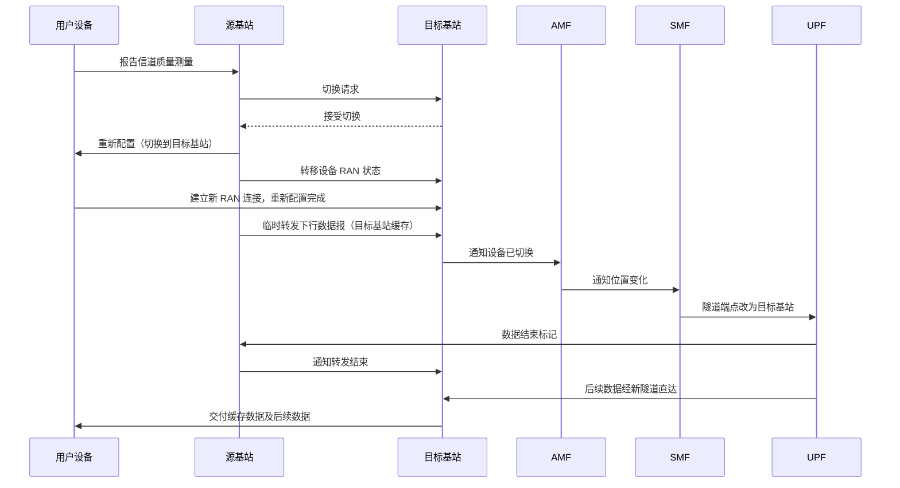

可以看到，5G 切换不仅是设备与 AP 之间重新关联，还包括设备状态迁移、数据报临时转发、核心网位置状态更新和 UPF 隧道重新配置。因此，移动性是一个跨越 RAN 与 Core 的网络范围操作。

#### 3. Idle/Inactive 状态下的移动

上面的流程假设设备处于活动状态。若设备为了节能已经进入更长、更深的睡眠状态，切换会更复杂：

- 在 **Idle** 状态下，设备需要执行额外步骤，重新建立在 RAN 中的活动状态，才能收发用户数据；核心网只知道设备所在的**跟踪区**，需要通过**寻呼**（paging）定位设备；
- 在 **Inactive** 状态下，设备移动可能需要 RAN 和核心网共同执行额外的切换处理。

网络可以通过**跟踪区更新**（tracking area update）让核心网知道设备所在的大致区域，再通过寻呼定位设备当前所在的 RAN。（原书称 Inactive 状态下"核心网甚至可能不知道设备位于哪个 RAN"，通常 Inactive 状态核心网侧仍保持连接并由 RAN 寻呼，两种状态的区别需验证。）

跨运营商网络的切换还需要两个运营商之间进行信令交互，复杂程度更高。

### 7.5.4 Internet 中的移动性

传统的非蜂窝 Internet 并没有广泛部署类似 5G 的移动性基础设施，但这并不是因为缺乏技术方案。**Mobile IP** 架构和协议早在 1996 年前后就已经通过 RFC 标准化（RFC 2002），此后也有更安全、更通用的 Internet 移动性方案研究。

Mobile IP 没有得到广泛部署，可能与商业模式和应用需求不足有关。蜂窝网络较早就提供了移动语音服务和全球移动数据服务，并形成了付费订阅、归属网络、访问网络以及运营商间漫游结算等商业体系。传统 Internet ISP 则缺乏同样成熟的漫游商业基础设施。

因此，目前移动 Internet 接入主要依靠两种技术配合：

- 真正移动、需要随时随地通信时，使用蜂窝网络；
- 固定或局部移动时，使用 WiFi 或有线网络。

## 7.6 蓝牙、定位、卫星与物联网无线网络

前面主要讨论了 WiFi 和 5G 网络。除此之外，还有许多面向特定场景设计的无线网络：蓝牙侧重短距离、低功耗的个人设备互联；定位系统为设备提供位置信息；卫星网络提供大范围覆盖；物联网网络则需要在覆盖范围、能耗和数据速率之间作出取舍。

### 7.6.1 蓝牙网络

**蓝牙**（Bluetooth）最初常被用作有线连接的替代方案，例如连接键盘、鼠标、耳机、音箱、手表或汽车音响。它具有三个典型特点：

- **短距离**：通常只有数十米或更短；
- **低功耗**：适合电池供电的外围设备；
- **低成本**：适合大规模消费电子设备部署。

因此，蓝牙网络也被称为**无线个人区域网络**（Wireless Personal Area Network，WPAN），其小型网络结构也常被称为微微网（piconet）。

虽然蓝牙网络规模不大，但它综合使用了许多链路层技术：

| 技术                   | 在蓝牙中的用途                 |
| ---------------------- | ------------------------------ |
| TDM / FDM              | 将时间和频率资源划分为多个信道 |
| 随机退避               | 避免多个设备同时响应造成碰撞   |
| 轮询                   | 由中心设备授予外围设备发送机会 |
| 差错检测与纠正         | 提高无线传输的可靠性           |
| 可靠数据传输与流量控制 | 管理数据交付和发送速率         |

#### 1. 跳频与信道组织

蓝牙工作在未经许可的 **2.4 GHz ISM 频段**，与微波炉、车库门开关、无绳电话等设备共享频谱，因此需要专门应对干扰。

蓝牙把时间和频率结合起来使用：

- 将频谱划分为 **79 个频率信道**；
- 每个信道上的时间划分为长度为 **625 μs** 的时隙；
- 发送方在一个时隙内使用一个频率信道，并按照预先确定的规则在后续时隙切换频率。

这种技术称为**跳频扩频**（Frequency-Hopping Spread Spectrum，FHSS）。它的关键思想是：某个频率受到干扰时，影响通常只落在少数时隙中，而不会持续破坏整个通信过程。系统还可以根据 SNR 等指标，动态从跳频序列中移除干扰严重的信道。只要采用不同的跳频模式，多个蓝牙网络便可以在同一物理空间共存。

#### 2. 微微网与中心控制器

蓝牙网络是**自组织网络**（ad hoc network），不需要基站等固定网络基础设施。多个设备可以组织为一个微微网，其中最多有 8 个活动设备：

- 一个设备担任**中心控制器**（central controller）；
- 其余设备担任外围设备（peripheral）；
- 通信只发生在中心控制器与外围设备之间，不支持外围设备之间直接通信。

中心控制器负责协调整个微微网：

| 控制内容 | 中心控制器的职责                                     |
| -------- | ---------------------------------------------------- |
| 时钟     | 决定时隙边界和微微网的时间基准                       |
| 跳频     | 决定相邻时隙使用的频率序列                           |
| 成员管理 | 控制外围设备加入网络                                 |
| 发射功率 | 控制外围设备使用的功率级别（100 mW、2.5 mW 或 1 mW） |
| 信道访问 | 通过轮询授予外围设备发送机会                         |

#### 3. 邻居发现与加入网络

蓝牙设备需要自行发现周围的设备并组织网络。建立微微网主要分为两个阶段：**邻居发现**与**寻呼加入**。

**阶段一：邻居发现（inquiry）。**

1. 中心控制器在不同频率信道上发送一组 32 条 inquiry 消息；
2. 该发送序列最多重复 128 次；
3. 周围的客户端设备监听自己选择的频率，等待收到 inquiry 消息；
4. 客户端收到消息后，随机等待 0～0.3 秒，以降低多个设备同时响应的碰撞概率；
5. 客户端向中心控制器发送包含自身设备 ID 的响应。

**阶段二：寻呼（paging）。**

发现设备后，中心控制器可以邀请其中一部分加入微微网。寻呼过程类似于 WiFi 设备与 AP 关联，但这里的 paging 与 5G 中的寻呼不是同一过程。

1. 中心控制器针对某个特定客户端发送 32 条相同的邀请消息，每条消息使用不同频率；
2. 客户端收到邀请后返回 ACK；
3. 中心控制器向客户端发送跳频信息、时钟同步信息和活动成员地址；
4. 随后中心控制器按照跳频序列轮询客户端，确认其已经加入网络。

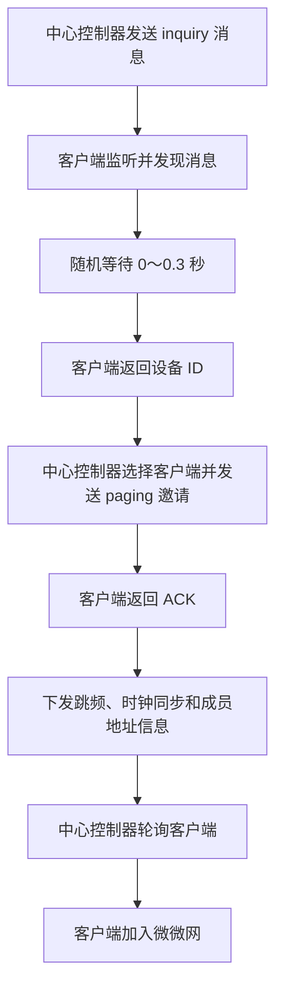

#### 4. 蓝牙协议栈

蓝牙的协议栈是围绕有限的个人设备互联服务设计的，与 Internet 和 5G 的协议栈有所不同。最明显的区别是：蓝牙协议栈**没有网络层，也没有传统意义上的运输层**。

- **没有网络层**：蓝牙通信通常只发生在中心控制器和外围设备之间，属于单跳通信，不需要通过多跳转发实现路由。
- **没有传统运输层**：运输层的许多服务由蓝牙的**逻辑链路控制与适配协议**（Logical Link Control and Adaptation Protocol，L2CAP）提供。

L2CAP 提供的服务包括可靠数据传输、流量控制、分段、面向连接与无连接服务，以及供上层应用使用的 API。它还可以为连接预留周期性时隙，适合带宽需求和时序要求较明确的多媒体应用。

蓝牙也存在多跳扩展，例如 Scatternet 和较新的 Low Energy Mesh，但这些扩展的部署范围仍然有限。较新的蓝牙版本还进一步强调低功耗和安全性。

### 7.6.2 位置发现：GPS 与 WiFi 定位

许多移动应用都依赖设备的地理位置，例如出行、地图和附近服务应用。智能手机通常通过结合**全球定位系统**（Global Positioning System，GPS）和 **WiFi 定位系统**（WiFi Positioning System，WPS）来估计自身位置。

#### 1. GPS 定位

GPS 由 30 多颗卫星组成星座。每颗卫星持续广播自己的位置和当前时间，接收设备根据收到的信息估算地理位置。

GPS 能够工作，依赖于几个条件：

- 卫星配备稳定的原子钟，彼此之间以及与地面时钟保持同步；
- 卫星能够精确知道自己的位置；
- 接收设备至少需要接收到 **4 颗卫星**的信号，才能利用**三边测量**（trilateration）方程估计自身位置（三个空间坐标，加上接收机时钟偏差）。

GPS 并非在任何环境下都能提供准确定位。若无法与至少 4 颗卫星保持视距，或信号受到其他高频通信系统干扰，定位精度就会受到影响。高楼林立的城市环境尤其容易遮挡 GPS 信号。

#### 2. WiFi 定位

WiFi 定位通过维护一个包含大量 AP 信息的数据库来辅助定位。数据库由 Google、Apple、Microsoft 等公司维护，记录 AP 的：

- **BSSID**（AP 的 MAC 地址，全局唯一；SSID 是网络名称，大量 AP 同名，不能用于定位）；
- 估计地理位置。

以 Android 手机与 Google 定位服务为例：

1. 手机扫描周围 AP 的 Beacon，获得各 AP 的 BSSID 和接收信号强度；
2. 手机将这些信息发送给云端定位服务，并在可用时一并提供 GPS 位置；
3. 定位服务根据接收信号强度估计手机与各 AP 的距离；
4. 利用这些距离进行三边测量，得到 WiFi 定位结果；
5. 将 WiFi 定位结果与 GPS 定位结果结合，形成更可靠的位置估计并返回手机。

那么，定位服务又如何知道每个 AP 的地理位置？答案是利用大量手机的反向测量：经过某个 AP 附近的手机会报告 AP 的信号强度以及手机自身估计的位置。定位服务收集大量此类数据后，就可以反过来估计 AP 的位置。

> [!note] GPS 与 WiFi 定位互相补充
> GPS 利用卫星广播的位置和时间信息定位设备；WiFi 定位则利用周围 AP 的位置数据库和信号强度辅助定位。手机帮助定位 AP，AP 又帮助定位手机，两者结合可以改善复杂环境下的位置估计。

### 7.6.3 卫星网络

卫星通信长期使用**地球静止轨道卫星**（Geostationary Earth Orbit，GEO），近年来则出现了快速发展的**低地球轨道卫星**（Low Earth Orbit，LEO）网络。两者在轨道高度、往返时延和网络结构上存在明显差异。

| 类型 |                                 轨道高度 |                                       往返时延（RTT） | 特点与用途                                                               |
| ---- | ---------------------------------------: | ----------------------------------------------------: | ------------------------------------------------------------------------ |
| GEO  | 约 35,786 km（常记作 35,000～36,000 km） | 纯传播约 480～560 ms；原书取值约 800 ms（口径需验证） | 相对地面观察者位置固定，常用于电视广播、环境感知和偏远地区 Internet 接入 |
| LEO  |                         约 500～1,200 km |                                              约 30 ms | 轨道较低、时延较短，卫星持续相对地面运动，适合宽带 Internet 等服务       |

GEO 卫星与地球自转同步，位于赤道上空，因此从地面观察时几乎固定在天空中的同一位置。LEO 卫星则离地面更近，通常体积更小、成本更低，但需要大量卫星协同覆盖。GEO 的时延与第 1 章的修订口径一致（地面站经卫星到另一地面站的单向传播约 240～280 ms）。

#### 1. LEO 卫星网络架构

LEO 卫星网络通常由卫星星座、卫星链路和地面站组成：

| 组成部分                      | 作用与特点                                                                                                     |
| ----------------------------- | -------------------------------------------------------------------------------------------------------------- |
| **卫星星座**（constellation） | 多颗在轨运行的 LEO 卫星构成网络；卫星相对地面高速移动，原书给出的速度约为 27,000 km/h                          |
| **卫星链路**                  | 卫星无线收发设备在地面形成覆盖区域，称为 footprint；下行信号向覆盖范围内的地面站广播，上行则由地面站单播至卫星 |
| **地面站**（ground station）  | 通过卫星链路发送、接收数据报；若同时接入地面 Internet，还可以充当卫星网络与地面 Internet 之间的网关            |

LEO 卫星的覆盖区域称为**波束覆盖区**（footprint）。一个典型 LEO 卫星的覆盖直径约为 15 英里，而地面站通常只能在约 10 分钟内处于某颗卫星的覆盖范围内，之后卫星便会移动到视野之外。

卫星之间也可以通过**星间链路**（Inter-Satellite Links，ISLs）直接连接。近年部分星座已部署激光星间链路。

#### 2. LEO 卫星网络的移动性

WiFi 和 5G 网络中的移动性主要来自用户设备的移动；LEO 卫星网络则不同，**网络基础设施本身的高速移动**是主要挑战。

地面站只能在短时间内连接到某颗卫星，因此需要频繁从当前卫星切换到另一颗仍处于覆盖范围内的卫星。这个过程同样涉及切换，但与 5G 相比，卫星网络的切换机制仍不够成熟，切换期间可能发生分组丢失。

此外，LEO 卫星网络不像蜂窝网络那样拥有类似 3GPP 的统一标准化组织，因此不同卫星网络的具体实现仍具有较强的专有性。

#### 3. 空中的一条链路，还是空中的一个网络？

卫星网络可以采用两种不同的架构：**弯管架构**（bent pipe）与**空中网络**（network in the sky）。

**弯管架构：**

- 每颗卫星都被看作一条链路；
- 每段卫星链路的两端都是地面站；
- 端到端路径由多段单跳卫星链路组成；
- 数据报每经过一跳，都要从空中返回地面，再进入下一段卫星链路。

**空中网络架构：**

- 卫星之间通过星间链路直接连接；
- 数据报可以在返回地面之前，先经过多颗卫星转发；
- 由于卫星相对地面以及彼此之间都在移动，星间链路会动态变化；
- 链路拓扑持续变化，使 LEO 网络中的路由选择成为具有挑战性的问题。

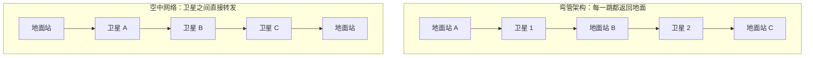

两种架构的核心区别在于：弯管架构把卫星当作一段段链路，而空中网络架构把卫星本身组织成一个能够多跳转发的网络。

### 7.6.4 物联网无线网络

**物联网**（Internet of Things，IoT）的目标是把通常体积较小、能量受限并具备一定计算能力的设备连接起来，使其能够感知、监测、报告和控制物理世界中的各种现象。

典型应用包括：

- **制造业**：监测压力、振动、温度、湿度和设备状态；
- **物流与供应链**：跟踪资产、运输过程和货物状态；
- **农业与环境**：监测降雨、风速、土壤状况以及动物活动；
- **智慧城市**：监测空气、水质、天气、照明、交通和人群活动；
- **个人健康**：通过可穿戴设备进行健康监测。

IoT 应用场景众多，网络需求也各不相同。原书借助三个维度描述 IoT 网络技术：**覆盖范围、能耗和数据速率**。不同技术通常只能重点满足其中两个维度，没有一种技术能够同时在三个方面都占优。

#### 1. 低能耗、低数据速率：短距离网络

这一类技术强调低能耗和低数据速率，通常适合短距离通信。

| 技术                            | 特点                                                                                                                                                                        |
| ------------------------------- | --------------------------------------------------------------------------------------------------------------------------------------------------------------------------- |
| **IEEE 802.11ah**               | WiFi 的一种变体，保留 BSS 和信道等结构，但采用精简的 802.11 帧格式；工作在未经许可的 900 MHz 频段，速率约为数百 kbps 至 5～10 Mbps（需验证），配合中继时覆盖范围可达约 1 km |
| **Bluetooth Low Energy（BLE）** | 蓝牙面向 IoT 的低能耗扩展；支持设备主动唤醒并发送数据                                                                                                                       |
| **Zigbee**                      | 较早的 IoT 无线技术，建立在 IEEE 802.15.4 的低速率无线个人区域网络物理层和 MAC 层之上                                                                                       |

#### 2. 低能耗、广覆盖：低功耗广域网络

这一类技术在尽量降低能耗的同时扩大覆盖范围，数据速率通常较低。

| 技术        | 标准与网络结构                                                                                                                                           | 频段、速率与特点                                                                                              |
| ----------- | -------------------------------------------------------------------------------------------------------------------------------------------------------- | ------------------------------------------------------------------------------------------------------------- |
| **LoRaWAN** | 由 LoRa Alliance 制定规范，ITU-T 已将其认可为国际标准（原书写作"由 ITU 标准化"，需验证）；包含服务器、网关和 IoT 设备，采用星中之星（star-of-stars）拓扑 | 使用 902～928 MHz 未经许可频段（美国）；每信道速率约 0.3～50 kbit/s；Class A 设备采用设备主动唤醒并发送的机制 |
| **NB-IoT**  | 3GPP 的 4G 标准，沿用 4G RAN 的许多组成部分，例如基站和用户设备                                                                                          | 信道带宽约 200 kHz，数据速率约 250 kbps；下行使用 OFDM，上行使用单载波 FDMA；支持设备主动唤醒并发送           |

其中，LoRaWAN 与前面介绍的 WiFi、5G 链路层方案不同，它是**网络级标准**，不仅定义单段链路，还涉及服务器和网关等网络组件。

#### 3. 广覆盖、高数据速率：LTE-M 与 5G

**LTE-M**（Long Term Evolution for Machines）是面向 IoT 的另一种 3GPP LTE 标准。与 NB-IoT 相比，它提供更完整的 LTE 功能：

- 支持设备在不同基站之间移动；
- 信道带宽约为 NB-IoT 的数倍（约 1.4 MHz 对 200 kHz，约 7 倍；原书写作 5 倍，需验证）；
- 更强调广域覆盖与较高数据速率。

5G 对 IoT 的支持也在持续发展。原书提到两个与 IoT 密切相关的通信应用类别：

- **海量机器类通信**（massive Machine Type Communications，mMTC）：面向大量机器设备接入；
- **超可靠低时延通信**（Ultra-Reliable and Low-Latency Communications，URLLC）：强调通信的可靠性和低时延。

#### 4. IoT 无线网络技术的取舍

| 需求侧重点      | 代表技术                          | 主要特点                             |
| --------------- | --------------------------------- | ------------------------------------ |
| 低能耗 + 低速率 | 802.11ah、BLE、Zigbee             | 短距离、低功耗，适合传感器和个人设备 |
| 低能耗 + 广覆盖 | LoRaWAN、NB-IoT                   | 覆盖范围大，但数据速率较低           |
| 广覆盖 + 高速率 | LTE-M，以及逐步增强 IoT 支持的 5G | 支持更丰富的数据传输和移动性需求     |

> [!important] 没有适用于所有 IoT 场景的无线技术
> IoT 设备的部署环境、供电条件、通信距离和数据量差别很大。选择网络技术时，需要根据具体应用在覆盖范围、能耗和数据速率之间权衡，而不是简单地追求某个指标最大化。

## 7.7 小结

无线网络已经深刻改变了通信方式，并持续推动 Internet 接入和移动应用的发展。与有线网络相比，无线网络最大的不同在于其通信媒介——无线电信道具有时变、共享、容量受限和容易受到干扰等特点。因此，本章先从物理层入手，再逐步讨论无线接入网、核心网和移动性。

本章的主要内容可以归纳为：

| 部分                   | 核心内容                              | 需要掌握的关键点                                                                                                                 |
| ---------------------- | ------------------------------------- | -------------------------------------------------------------------------------------------------------------------------------- |
| **7.1 无线网络概述**   | 无线接入网、核心网、设备和基站        | 区分 RAN、Core、基站、基础设施模式与自组织网络；理解上行、下行和切换                                                             |
| **7.2 无线网络物理层** | 无线信道特性、编码与调制              | $C=B\log_2(1+SNR)$；路径损耗 $\propto f^2d^2$；多径与时延扩展；隐藏终端；MIMO 的分集与复用；QAM 每符号 $\log_2M$ bit；自适应调制 |
| **7.3 无线接入网络**   | WiFi 与 5G RAN                        | OFDM/OFDMA、CSMA/CA、RTS/CTS、802.11 三个地址字段、5G 物理信道与链路层子层、网络发现、RR/MT/BET/PF 调度、睡眠与唤醒              |
| **7.4 无线核心网**     | 5G Core 的网络功能和用户面            | AMF、SMF、UPF 分工；SIM 与 IMSI/SUCI；注册与 PDU 会话；GTP 隧道与 UPF 锚点                                                       |
| **7.5 移动性**         | WiFi、5G 与传统 Internet 的移动性支持 | 链路层与网络范围的移动性；5G 切换三阶段：决策、基站间转移、核心网与 UPF 更新                                                     |
| **7.6 其他无线网络**   | 蓝牙、定位、卫星与 IoT                | 跳频与微微网；GPS（至少 4 颗卫星）与 WiFi 定位（BSSID）；GEO/LEO 与弯管、空中网络；IoT 的覆盖、能耗、速率取舍                    |

本章围绕无线网络回答了三个层次的问题：

1. **无线信号如何传输？** 无线电波在传播中会受到路径损耗、噪声和多径效应影响；编码、调制、MIMO 和波束成形等技术用于提高通信可靠性与容量。
2. **设备如何共享无线信道并接入网络？** WiFi 和 5G 采用不同的接入机制，但都需要解决信道共享、网络发现、连接建立、调度和能量管理等问题。
3. **设备移动时如何保持网络服务？** WiFi 主要支持同一 ESS 内的局部移动；5G 则由 RAN 和核心网共同维护设备身份、位置和数据转发路径，并通过切换更新连接状态与隧道端点。

WiFi 与 5G 的横向对比如下：

| 对比项   | WiFi（802.11）                    | 5G                                       |
| -------- | --------------------------------- | ---------------------------------------- |
| 基站     | AP，仅链路层                      | gNB，功能可拆分为 RU/DU/CU               |
| 频谱     | 免许可（2.4/5/6 GHz）             | 授权为主                                 |
| 介质接入 | CSMA/CA 竞争，WiFi 6 起可用 OFDMA | 基站集中调度，OFDMA                      |
| 调度     | 以竞争为主，AP 可协调             | MAC 调度器（RR、MT、BET、PF 等）         |
| 核心网   | 无专用核心网，依赖企业 IP 网络    | 5G Core（AMF/SMF/UPF 等）                |
| 身份认证 | WPA                               | SIM + 双向认证（SUCI）                   |
| 移动性   | 链路层，限同一 IP 子网（ESS）     | 网络范围，RAN 与 Core 协同，UPF 隧道锚点 |
| 能耗管理 | 功率管理位、TIM、TWT              | DRX、Idle/Inactive                       |

最后，蓝牙、定位、卫星和 IoT 网络说明：无线网络并不存在一种适用于所有场景的统一架构。设备功耗、通信距离、数据速率、移动性和网络部署方式不同，都会影响技术选择。
