网络层分为两个相互作用的部分：**数据平面**关注每台路由器如何在本地把分组从输入链路转发到输出链路；**控制平面**关注网络范围的路由选择，决定分组从源到目的所经过的端到端路径。

转发是数据平面的本地操作，通常在纳秒级完成；路由选择是控制平面的网络范围处理，通常在秒级运行。本章研究后者，即"计算并安装转发表"的机制。

控制平面有两种实现方式：

| 方式                  | 说明                                                                 |
| --------------------- | -------------------------------------------------------------------- |
| 每路由器控制          | 路由选择算法运行在**每台路由器**中，各路由器通信协作算出转发表       |
| 逻辑集中式控制（SDN） | 控制平面与数据平面明确分离，由**逻辑上集中的控制器**计算并分发转发表 |

本章先讨论通用的路由选择算法，再讨论因特网中的 OSPF 与 BGP，最后介绍 SDN 控制平面、ICMP 和网络管理协议。


> [!important] 本章目标
> 理解网络层控制平面的原理与实现：
>
> 1. 控制平面概述：每路由器控制与逻辑集中式控制
> 2. 路由选择算法：链路状态算法（LS，Dijkstra）与距离向量算法（DV，Bellman-Ford）
> 3. 自治系统内部的路由选择：OSPF
> 4. 自治系统间的路由选择：BGP，以及 IP 任播与路由选择策略
> 5. SDN 控制平面：控制器、OpenFlow 协议，数据平面与控制平面的交互
> 6. ICMP：差错报告、ping 与 Traceroute
> 7. 网络管理：SNMP/MIB 与 NETCONF/YANG

# 第一部分 路由选择算法与自治系统路由

## 5.1 网络层控制平面概述

控制平面负责计算、维护并安装路由器或交换机中的**转发状态**（转发表、流表）。数据平面据此执行转发（4.2.1 节、4.4 节）。

传统网络中，控制平面和数据平面通常实现在同一台路由器内；SDN 则将二者明确分离：

- **数据平面**：交换机、路由器等转发设备，执行"匹配加操作"（4.4 节）
- **控制平面**：逻辑集中的控制器，计算、下发并管理转发表或流表

### 5.1.1 两种控制平面实现方式

#### 1. 每路由器控制

每台路由器运行路由选择算法，与其他路由器的路由选择组件通信，共同算出转发表。OSPF、BGP 都基于这种方式（5.3 节、5.4 节）。

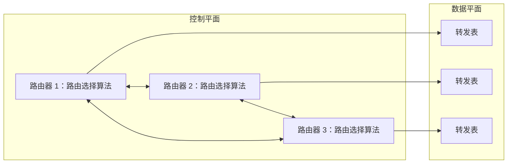

#### 2. 逻辑集中式控制

逻辑集中的控制器计算转发表或流表，分发给每台设备。每台设备中有一个**控制代理**（Control Agent，CA），负责与控制器通信，并按其命令配置本地表。SDN 采用这一思想（5.5 节）。

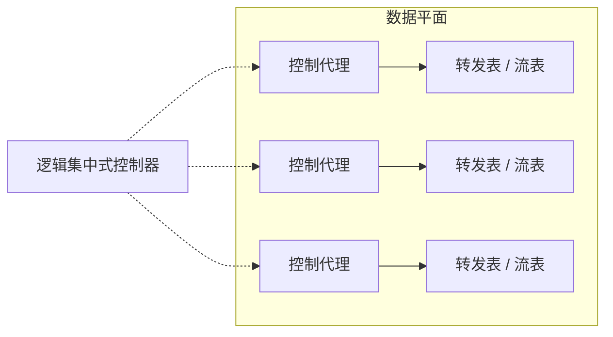

> [!note] "逻辑集中"不等于物理单台
> 控制器通常由多台服务器分布式实现，以提高容错性与扩展性，但对上层表现为一个集中的服务。

SDN 的逻辑集中式控制已用于生产网络，例如 Google B4 全球广域网、Microsoft SWAN、Comcast ActiveCore、Deutsche Telekom Access 4.0，以及 4G/5G 蜂窝网络控制、数据中心内部与数据中心之间的网络（具体清单需验证）。

## 5.2 路由选择算法

路由选择算法的目标是找出从发送方到接收方的**最低开销路径**。实际路由选择还会受到策略约束，例如某个组织可能不允许自己的路由器转发其他组织之间的流量。

用图形式化：$G=(N,E)$，$N$ 为节点（路由器）集合，$E$ 为边（物理链路）集合；$c(x,y)$ 为边 $(x,y)$ 的开销，若 $(x,y)\notin E$ 则 $c(x,y)=\infty$。路径 $(x_1,x_2,\dots,x_p)$ 的开销为

$$
c(x_1,x_2)+c(x_2,x_3)+\dots+c(x_{p-1},x_p)
$$

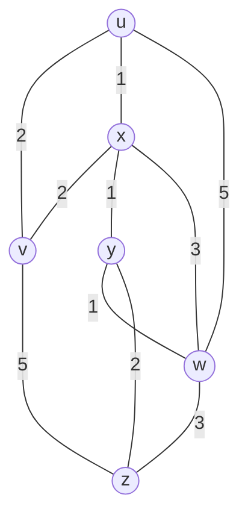

> [!warning] 需验证
> 本图 v–z、w–z 两条边与原书图 5-4 的对应关系需对照原图（可能为 v–w 3、w–z 5）。下文 Dijkstra 结果在两种图下相同。

从 $u$ 到 $w$ 的最低开销路径是 $(u,x,y,w)$，开销 $1+1+1=3$；直连 $(u,w)$ 开销 5，$(u,x,w)$ 开销 4。

**算法分类**：

| 维度     | 类别                        | 特点                                                         |
| -------- | --------------------------- | ------------------------------------------------------------ |
| 信息范围 | **全局式**（global）        | 具有完整的全局网络知识，如**链路状态**（LS）算法             |
|          | **分散式**（decentralized） | 每个节点只与邻居交换信息、迭代计算，如**距离向量**（DV）算法 |
| 变化方式 | 静态                        | 路由变化缓慢，通常人工调整                                   |
|          | 动态                        | 随流量负载或拓扑变化而改变                                   |
| 开销含义 | 负载敏感                    | 链路开销动态反映当前拥塞水平                                 |
|          | 负载迟钝                    | 链路开销不明确反映当前拥塞                                   |

当前因特网的路由选择算法（RIP、OSPF、BGP）大多是**负载迟钝**的。

> [!note] 术语
> "全局式"指算法使用全局网络信息，但每个节点仍可以独立运行该算法。它不同于逻辑集中式控制，后者由控制器统一计算并下发结果。

### 5.2.1 链路状态路由选择算法

**链路状态**（Link State，LS）算法：每个节点通过**链路状态广播**（洪泛）向网络中所有其他节点发送链路状态分组，内容为自己所连链路的标识及开销。最终所有节点拥有统一完整的网络视图，各自运行 **Dijkstra 算法**，算出从自己到所有其他节点的最低开销路径。

> [!success] definition：Dijkstra 算法的记号
>
> - $D(v)$：源节点到 $v$ 的当前最低开销路径的开销
> - $p(v)$：该路径上 $v$ 的前一个节点
> - $N'$：已确定最低开销路径的节点集合

前提：**所有边开销非负**。

```text
源节点 u 的 LS 算法
N' = {u}
for all v:
    if v 是 u 的邻居: D(v) = c(u,v), p(v) = u
    else: D(v) = ∞
loop:
    找出不在 N' 中且 D(w) 最小的 w
    将 w 加入 N'
    for w 的每个邻居 v 且 v 不在 N':
        if D(w) + c(w,v) < D(v):      # 经 w 到 v 更近
            D(v) = D(w) + c(w,v); p(v) = w
until N' = N
```

**正确性**。设 $\delta(u,v)$ 为真实最低开销。循环不变式：$N'$ 中每个节点 $v$ 满足 $D(v)=\delta(u,v)$。

1. **基础**：$N'=\{u\}$，$D(u)=0=\delta(u,u)$。
2. **保持**：设本轮选出 $w$（$D(w)$ 最小且 $w\notin N'$）。取 $u\to w$ 的一条最低开销路径，设其首次离开 $N'$ 的边为 $(a,b)$，$a\in N'$，$b\notin N'$。由不变式 $D(a)=\delta(u,a)$，且 $a$ 加入 $N'$ 时已松弛边 $(a,b)$，故

   $$
   D(b)\le\delta(u,a)+c(a,b)\le\delta(u,w)
   $$

   最后一步用到路径上其余各边非负。又 $w$ 是 $D$ 最小者，故 $D(w)\le D(b)\le\delta(u,w)$。而 $D(w)$ 是某条真实路径的开销，$D(w)\ge\delta(u,w)$，所以 $D(w)=\delta(u,w)$。

3. **终止**：每轮 $N'$ 恰增加一个节点，$\lvert N\rvert-1$ 轮后 $N'=N$。

若存在负权边，第 2 步中 $D(b)\le\delta(u,w)$ 不再成立。

**示例**（对上图，源为 $u$；步骤 2 中 $D(v)=D(y)=2$ 并列，任选，下表先加入 $y$，最终结果相同）：

| 步骤 | $N'$            | $D(v),p(v)$ | $D(w),p(w)$ | $D(x),p(x)$ | $D(y),p(y)$ | $D(z),p(z)$ |
| ---- | --------------- | ----------- | ----------- | ----------- | ----------- | ----------- |
| 0    | `{u}`           | 2, u        | 5, u        | 1, u        | ∞           | ∞           |
| 1    | `{u,x}`         | 2, u        | 4, x        | 1, u        | 2, x        | ∞           |
| 2    | `{u,x,y}`       | 2, u        | 3, y        | 1, u        | 2, x        | 4, y        |
| 3    | `{u,x,y,v}`     | 2, u        | 3, y        | 1, u        | 2, x        | 4, y        |
| 4    | `{u,x,y,v,w}`   | 2, u        | 3, y        | 1, u        | 2, x        | 4, y        |
| 5    | `{u,x,y,v,w,z}` | 2, u        | 3, y        | 1, u        | 2, x        | 4, y        |

结果构成一棵以 $u$ 为根的**最低开销路径树**：$u\to v$，$u\to x\to y\to w$，$y\to z$。据此得到 $u$ 的转发表：

| 目的地     | 下一跳链路 |
| ---------- | ---------- |
| v          | `(u, v)`   |
| w、x、y、z | `(u, x)`   |

**复杂度**：使用数组保存未确定节点时，Dijkstra 的朴素实现为 $O(\lvert N\rvert^2)$。使用二叉堆时，在常见实现下可达到 $O((\lvert N\rvert+\lvert E\rvert)\log\lvert N\rvert)$。链路状态报文总量取决于洪泛实现，简化模型下约为 $O(\lvert N\rvert\lvert E\rvert)$ 条。

**路由振荡**。链路开销若反映当前负载（负载敏感），LS 可能发生振荡。设节点 $s$、$t$ 之间有两条并行链路 A 和 B，开销等于链路承载的流量；现在有两条各占一个单位流量的流从 $s$ 到 $t$。

| 轮  | 链路 A 载荷（开销） | 链路 B 载荷（开销） | 各路由器的决策 |
| --- | ------------------- | ------------------- | -------------- |
| 0   | 2（2）              | 0（0）              | 两条流都改选 B |
| 1   | 0（0）              | 2（2）              | 两条流都改选 A |

之后无限往复。原因：所有路由器几乎同时运行 LS，又依据相同的开销做出相同的决策。

> [!warning] 解决方法
>
> - 不让所有路由器同时运行 LS
> - 随机化链路状态通告的发送时间
> - 不让链路开销过度依赖瞬时负载

### 5.2.2 距离向量路由选择算法

**距离向量**（Distance-Vector，DV）算法是**迭代的、异步的、分布式的、自终止的**：每个节点只与直连邻居交换信息；没有更新时不再发送，算法自行终止。

> [!success] definition：Bellman-Ford 方程
> 令 $d_x(y)$ 为 $x$ 到 $y$ 的最低开销，则
>
> $$
> d_x(y)=\min_{v\in N(x)}\{\,c(x,v)+d_v(y)\,\}
> $$
>
> 最低开销路径必先走到某个邻居 $v$，再沿 $v$ 的最低开销路径到 $y$。使上式取最小的邻居 $v^*$ 就是 $x$ 到 $y$ 的下一跳。

节点 $x$ 维护：到每个邻居的开销 $c(x,v)$；自己的距离向量 $D_x=[D_x(y):y\in N]$；每个邻居的距离向量 $D_v$。

```text
在每个节点 x：
Initialization:
    Dx(x) = 0
    for y in N 且 y ≠ x:
        if y 是 x 的邻居: Dx(y) = c(x,y)
        else: Dx(y) = ∞
    向每个邻居 w 发送 Dx = [Dx(y): y in N]
Loop:
    等待 到某邻居的链路开销变化 或 收到某邻居 w 的距离向量 Dw
    for y in N: Dx(y) = min_v { c(x,v) + Dv(y) }
    if 任一 Dx(y) 发生变化: 向所有邻居发送 Dx
forever
```

**收敛性**。拓扑与开销不再变化时，同步迭代下第 $k$ 轮之后，各节点已得到所有"至多 $k$ 跳"路径中的最低开销。最低开销路径（开销非负）至多 $\lvert N\rvert-1$ 跳，故至多 $\lvert N\rvert-1$ 轮后无更新，算法自终止。

**三节点示例**：$c(x,y)=2$，$c(x,z)=7$，$c(y,z)=1$。

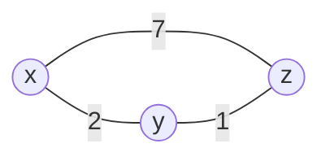

| 时刻       | $D_x=[x,y,z]$ | $D_y=[x,y,z]$ | $D_z=[x,y,z]$    |
| ---------- | ------------- | ------------- | ---------------- |
| 初始       | [0, 2, 7]     | [2, 0, 1]     | [7, 1, 0]        |
| 交换一次后 | [0, 2, **3**] | [2, 0, 1]     | [**3**, 1, 0]    |
| 再交换     | 无变化        | 无变化        | 无变化，算法终止 |

例如 $D_x(z)=\min\{2+1,\ 7+0\}=3$，故 $x$ 到 $z$ 的下一跳是 $y$。

| 节点 | 到 z 的下一跳     |
| ---- | ----------------- |
| x    | y                 |
| y    | z                 |
| z    | —（目的地即自身） |

#### 1. 链路开销变化

**开销减少**：好消息传播快，检测到变化的节点更新向量并通知邻居，很快收敛。

**开销增加**：坏消息传播慢，可能形成环路。

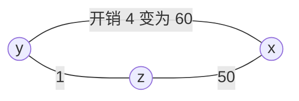

> [!warning] 无穷计数（count-to-infinity）
> 原来 $D_y(x)=4$，$D_y(z)=1$，$D_z(y)=1$，$D_z(x)=5$（经 $y$）。链路 $y$–$x$ 开销升为 60：
>
> - $y$：$D_y(x)=\min\{60+0,\ 1+5\}=6$，通告给 $z$
> - $z$：$D_z(x)=\min\{50+0,\ 1+6\}=7$，通告给 $y$
> - $y$：8，$z$：9……
>
> 每轮 $D_y(x)$ 与 $D_z(x)$ 各增 2。设 $D_y(x)=6+2k$，当 $1+D_y(x)\ge c(z,x)=50$，即 $D_y(x)\ge49$ 时，$z$ 改用直连（开销 50）。$y$ 与 $z$ 各更新约 22 次，合计约 44 次（原书约 44 轮；具体轮数随计数口径而异）。
>
> 关键结论：收敛所需的更新次数随新旧开销之差**线性增长**。其间 $y$、$z$ 之间的分组会来回转发。

#### 2. 毒性逆转

> [!tip] 毒性逆转（poisoned reverse）
> 若 $z$ 经 $y$ 到达 $x$，则 $z$ 向 $y$ 通告 $D_z(x)=\infty$（尽管 $z$ 知道它实际是 5）。
>
> 在上例中，链路开销升为 60 后：
>
> - $y$：$D_y(x)=\min\{60+0,\ 1+\infty\}=60$，通告给 $z$
> - $z$：$D_z(x)=\min\{50+0,\ 1+60\}=50$，直接走 $z$–$x$ 链路
>
> 两轮即收敛。

毒性逆转只对**两个直接邻居**之间的环路有效。若环路涉及三个或更多节点（例如 $y$ 经 $z$、$z$ 经 $w$、$w$ 经 $y$），每个节点只向自己的下一跳通告 $\infty$，对环上其他邻居仍通告有限值，环路依然可以形成。

#### 3. LS 与 DV 的比较

| 比较项     | 链路状态 LS                                                  | 距离向量 DV                                                    |
| ---------- | ------------------------------------------------------------ | -------------------------------------------------------------- |
| 信息范围   | 全局信息                                                     | 局部邻居信息                                                   |
| 报文复杂度 | 洪泛，简化模型下约 $O(\lvert N\rvert\lvert E\rvert)$ 条      | 仅在邻居间交换；收敛时间随拓扑与开销变化                       |
| 计算与收敛 | 算法 $O(\lvert N\rvert^2)$，通常较快                         | 可能较慢，可能出现路由环路、无穷计数                           |
| 典型问题   | 负载敏感时可能振荡                                           | 无穷计数、环路                                                 |
| 健壮性     | 路由器主要通告**自己所连链路**的状态，各路由器独立计算转发表 | 错误的距离向量可能影响**任意或所有目的地**，错误沿邻居关系扩散 |
| 代表协议   | OSPF、IS-IS                                                  | RIP、早期 ARPAnet；BGP 是其路径向量变体                        |

# 第二部分 因特网路由协议、SDN 与网络管理

## 5.3 因特网中自治系统内部的路由选择：OSPF

若把所有路由器看作同质集合，会遇到两个问题：

| 问题     | 说明                                                             |
| -------- | ---------------------------------------------------------------- |
| 规模     | 因特网规模巨大，所有路由器间广播链路状态并计算路由的开销无法承受 |
| 管理自治 | 各 ISP 希望按自己的方式管理网络，并对外隐藏内部拓扑              |

解决办法是把路由器组织进**自治系统**（Autonomous System，AS）：

- 一个 AS 由通常处于相同管理控制下的一组路由器组成；一个 ISP 的网络可能是一个 AS，大型 ISP 也可能划分为多个 AS
- 每个 AS 有 **AS 号**（ASN），公共 AS 号全局唯一（另有私有 AS 号，16 位范围为 64512～65534）
- 在同一 AS 内运行的协议称为**自治系统内部路由选择协议**（intra-AS），如 OSPF；AS 之间则用 BGP（5.4 节）

### 5.3.1 OSPF：开放最短路径优先

**OSPF**（Open Shortest Path First）是**链路状态**协议：用洪泛传播链路状态，用 Dijkstra 算法计算最低开销路径。

- 无分区域时，每台路由器构建整个 AS 的拓扑；划分区域后，仅构建所在区域的拓扑。无论哪种情形，都以自己为根算出最短路径树
- OSPF 支持 IPv4 和 IPv6，分别有相应版本的协议规范（OSPFv2：RFC 2328；OSPFv3：RFC 5340）
- OSPF 报文直接由 IP 承载，IP 首部协议号为 **89**（协议号见 IANA 协议号表，4.3.1 节表中未列）

主要机制：

| 机制           | 说明                                                                       |
| -------------- | -------------------------------------------------------------------------- |
| 链路状态广播   | 链路状态变化时向 AS 内其他路由器洪泛；同时通过周期性刷新维护链路状态数据库 |
| HELLO 报文     | 检测直连邻居是否存活                                                       |
| 链路状态数据库 | 每台路由器据此运行 Dijkstra                                                |

OSPF 的优点：

| 特性             | 说明                                                     |
| ---------------- | -------------------------------------------------------- |
| 安全             | 支持报文鉴别，具体机制取决于协议版本和实现               |
| 多条相同开销路径 | 到某目的地有多条开销相同的路径时可同时使用，实现负载分担 |
| 单播与多播       | MOSPF 利用现有链路状态数据库支持多播路由                 |
| 层次化区域       | 见下                                                     |

**区域**（area）：一个 OSPF AS 可划分为多个区域，各区域运行自己的 LS 算法。**区域边界路由器**（ABR）负责区域间路由；**主干区域**（area 0）负责连接其他区域，并包含 AS 内所有 ABR。

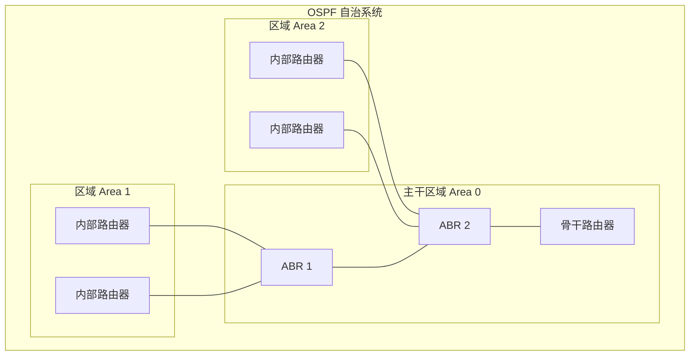

区域间分组的路径分三步：

1. 在源所在区域内路由到该区域的 ABR
2. 经主干区域路由到**目的区域**的 ABR
3. 在目的区域内路由到目的地

另有 **AS 边界路由器**，连接其他 AS，负责把外部路由引入本 AS。

> [!note] 其他 AS 内部协议
>
> - **RIP**：距离向量协议，以**跳数**为度量，最大 15 跳（16 表示不可达）
> - **IS-IS**：与 OSPF 类似的链路状态协议，也广泛用于大型运营商网络

> [!important] 实践原则：设置 OSPF 链路权值
> OSPF 不规定权值策略，只提供机制。管理员可以：
>
> - 把所有链路权值设为 1，得到**最少跳数**路由
> - 使权值与链路容量成反比，鼓励流量走高带宽链路
> - 按流量工程目标反推权值，使 OSPF 算出的路径达到期望的网络利用率

## 5.4 ISP 之间的路由选择：BGP

当分组跨越多个 AS 时，需要**自治系统间路由选择协议**。因特网中的 AS 使用 **BGP**（Border Gateway Protocol，边界网关协议，BGP-4：RFC 4271）交换跨域可达性信息。

### 5.4.1 BGP 的作用

BGP 主要完成两个任务：

1. 从邻居 AS **获得前缀可达性信息**，使每个子网能向因特网其余部分通告自己
2. 按策略和可达性信息**确定到各前缀的最佳路由**，并将结果用于配置转发表

BGP 路由的对象是 **CIDR 前缀**（4.3.2 节），而不是单个 IP 地址。例如 `138.16.68/22` 包含 $2^{10}=1024$ 个地址。转发表项为 `(prefix, interface)`。

BGP 是**路径向量**协议：通告中携带到前缀的 AS 路径。AS-PATH 是路径向量属性之一，不意味着 BGP 等同于距离向量协议。BGP 对等体（peer）之间通过 TCP 连接交换四种报文，通常使用端口 179：

| 报文         | 作用                           |
| ------------ | ------------------------------ |
| OPEN         | 打开与对等体的连接并鉴别发送方 |
| UPDATE       | 通告新路径，或撤销旧路径       |
| KEEPALIVE    | 保持连接；也用于确认 OPEN      |
| NOTIFICATION | 报告差错，并关闭连接           |

### 5.4.2 通告 BGP 路由信息

**网关路由器**位于 AS 边缘并连接其他 AS；**内部路由器**只连接本 AS 内的主机与路由器。

| 连接类型 | 含义                                                |
| -------- | --------------------------------------------------- |
| eBGP     | 不同 AS 的网关路由器之间的 BGP 会话                 |
| iBGP     | 同一 AS 内路由器之间的 BGP 会话，不一定对应物理链路 |

> [!note] iBGP 的要求
> 默认情况下，从 iBGP 学到的路由**不会再通告给其他 iBGP 对等体**。因此 AS 内通常需要全互联 iBGP 会话，或者使用路由反射器等扩展机制。下图只画出代表性会话。

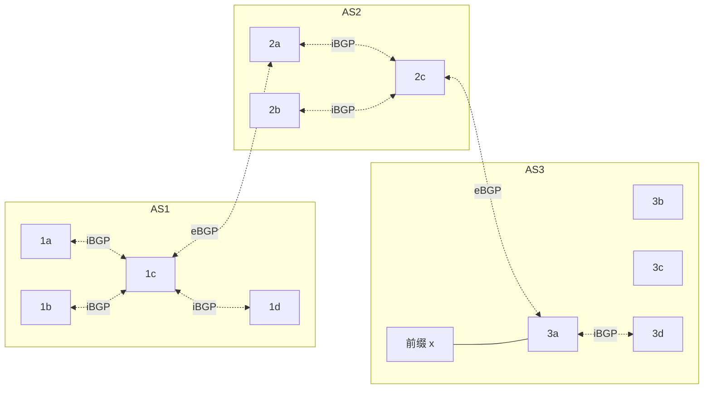

设前缀 $x$ 在 AS3，通告过程：

1. AS3 的 `3a` 向 AS2 的 `2c` 发送 eBGP 报文 `AS3 x`
2. `2c` 经 iBGP 向 AS2 中其他路由器通告 `AS3 x`
3. AS2 的 `2a` 向 AS1 的 `1c` 发送 eBGP 报文 `AS2 AS3 x`
4. `1c` 经 iBGP 向 AS1 中所有路由器通告 `AS2 AS3 x`

**多条路径**：若 AS1 与 AS3 间增加一条直连对等链路，则 AS1 到 $x$ 有两条候选路径：`AS2 AS3 x` 与 `AS3 x`。

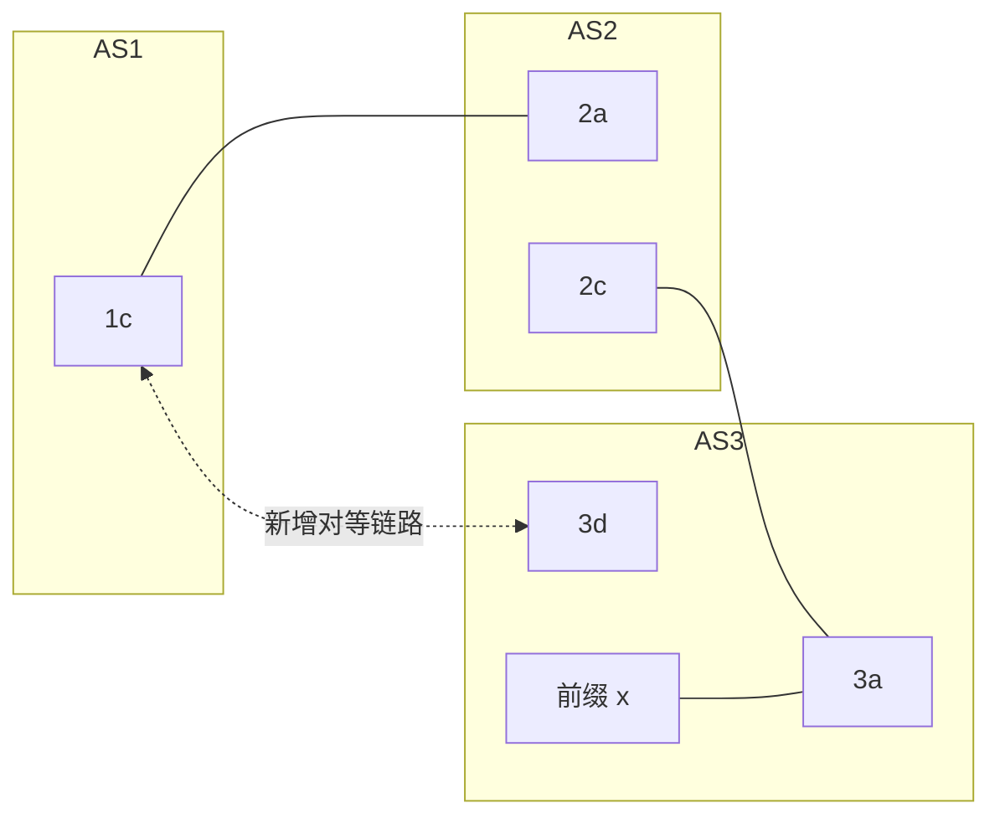

> [!warning] 需验证
> 新增链路的 AS1 一端画为 1c，而 1c 已是通往 AS2 的 eBGP 网关。原书可能用 1d–3d，需对照原图。

### 5.4.3 确定最好的路由

BGP 路由 = 前缀 + **属性**，两个重要属性：

| 属性     | 含义                                                                                      |
| -------- | ----------------------------------------------------------------------------------------- |
| AS-PATH  | 通告经过的 AS 列表，**也用于环路检测**：路由器在 AS-PATH 中看到自己的 AS 号，就拒绝该通告 |
| NEXT-HOP | 到达该前缀时使用的下一跳路由器地址，具体取值取决于会话类型和路由策略                      |

例如，AS1 从 AS2 学到 `AS2 AS3; x` 时，NEXT-HOP 通常指向 AS2 一侧的出口路由器地址。

#### 1. 热土豆路由选择

**热土豆路由选择**（hot potato routing）：尽快把分组送出本 AS，即选择到 NEXT-HOP 开销最小的出口网关。步骤：

1. BGP 学到到前缀 $x$ 的多个网关
2. 用 AS 内部路由信息（如 OSPF）算出到每个网关的最低开销
3. 选择开销最小的网关，在转发表中加入 `(x, I)`，$I$ 为通往该网关的接口

它只关心本 AS 内部的开销，不关心 AS 外部的端到端开销，因此同一 AS 内不同路由器可能为同一前缀选择不同的**出口网关**。

> [!example] 例：热土豆决策
> AS1 内路由器 $r$ 经 BGP 学到前缀 $x$ 的两个出口网关 $g_1$、$g_2$，且两条路由的本地偏好、AS-PATH 长度相同。OSPF 算得 $r\to g_1$ 开销 6，$r\to g_2$ 开销 9。
>
> 规则 1、2 无法区分，进入规则 3：选 $g_1$（6 < 9），转发表加入 `(x, 通往 g_1 的接口)`。
>
> 另一台路由器 $r'$ 若到 $g_2$ 更近，则会选 $g_2$。同一 AS 内不同路由器对同一前缀选出不同出口，这是热土豆的典型结果。

#### 2. BGP 路由选择算法

对同一前缀有多条路由时，依次应用以下规则，直到剩下一条：

| 顺序 | 规则                                                     |
| ---- | -------------------------------------------------------- |
| 1    | **本地偏好**（local preference）最高者，由 AS 的策略决定 |
| 2    | **AS-PATH 最短**者                                       |
| 3    | NEXT-HOP 路由器**最近**者（热土豆）                      |
| 4    | 仍有多条时，用 BGP 标识符等规则选择                      |

> [!note] 补充：实际实现的选路顺序
> 以上四步是原书的简化。真实实现在本地偏好与 AS-PATH 之后，还会比较 origin 类型、MED（多出口鉴别）、eBGP 优于 iBGP、到 NEXT-HOP 的 IGP 开销（即热土豆）、路由器 ID 等，具体顺序与细节因厂商而异。

### 5.4.4 IP 任播

> [!success] definition：IP 任播
> 把多个地理分散的服务器配置为**相同的 IP 地址**，并用 BGP 通告该地址。路由器根据策略和路由属性，把请求交给路由意义上较优的实例。

典型应用是 **DNS 根服务器**。根服务器使用少量稳定的地址标识服务，并在全球部署多个实例。

CDN 实践中不一定使用 IP 任播：BGP 路由变化可能使同一 TCP 连接的不同分组到达不同的服务器实例。

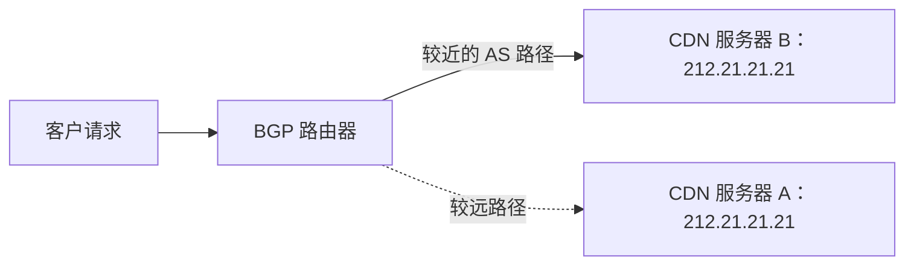

### 5.4.5 路由选择策略

BGP 是**面向策略**的协议，策略可压倒最短 AS 路径、热土豆等性能考虑。

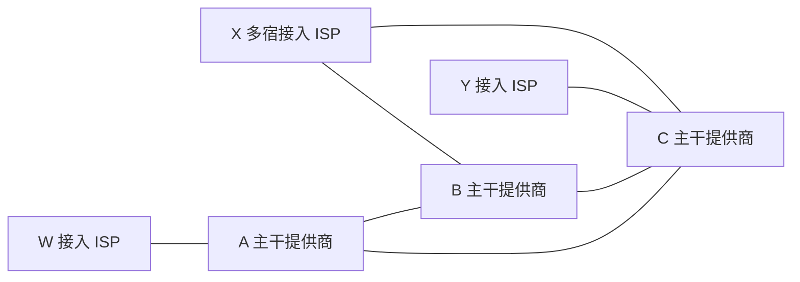

X 是多宿接入 ISP（连接 B 和 C），不希望转发 B 与 C 之间的**穿越流量**，因此向 B、C 通告"我除自身外没有到其他目的地的路径"。同理，B 不愿替 A 和 C 免费转发穿越流量，会控制对 C 的通告。

> [!important] 经验法则
> 任何穿越某 ISP 主干网的流量，其源或目的至少有一个必须在该 ISP 的客户网络中。

在常见的商业互联策略中，可以概括为以下导入/导出规则：

| 路由学自 | 通告给客户 | 通告给对等体 | 通告给提供商 |
| -------- | :--------: | :----------: | :----------: |
| 客户     |     是     |      是      |      是      |
| 对等体   |     是     |      否      |      否      |
| 提供商   |     是     |      否      |      否      |

本地偏好通常按经济利益设置为：**客户 > 对等体 > 提供商**。具体策略由各 AS 自行决定。

> [!important] 实践原则：为什么 AS 间与 AS 内部路由协议不同？
>
> |      | AS 间（BGP）     | AS 内部（OSPF 等）           |
> | ---- | ---------------- | ---------------------------- |
> | 策略 | 占主导           | 同一管理控制下，影响小       |
> | 规模 | 须扩展到海量网络 | 过大时可划分为多个 AS 或区域 |
> | 性能 | 次要于策略       | 更关注路径性能与开销         |

### 5.4.6 在因特网中发布一个前缀

为小公司建立因特网存在的步骤：

1. 与本地 ISP 签约，获得物理连接
2. 从 ISP 获得一段地址，如一个 `/24` 块（4.3.2 节）
3. 为服务器分配 IP 地址（可用 DHCP）
4. 申请域名，如 `xanadu.com`（2.4 节）
5. 在权威 DNS 服务器中配置域名到 IP 的映射
6. 本地 ISP 用 BGP 通告你的前缀
7. 因特网路由器逐步学到该前缀
8. 外部用户经 DNS 得到服务器 IP，并由 BGP 路由到达你的网络

> [!note] 说明
> 若该 `/24` 来自 ISP 的地址块，ISP 通常以聚合前缀通告（CIDR 聚合），不必单独通告这个 `/24`。

> [!warning] BGP 的安全边界
> BGP 会话可以使用认证机制保护，但这不等于能够验证某个 AS 是否有权通告某个前缀。错误或恶意的通告仍可能造成**前缀劫持**或路由泄露。RPKI 和路由源验证可以对前缀授权关系提供额外验证。

## 5.5 SDN 控制平面

SDN 体系结构有四个关键特征：

1. **基于流的转发**：即 4.4 节的匹配加操作与流表
2. **数据平面与控制平面分离**
3. 网络控制功能位于**数据平面交换机外部**
4. **可编程**的网络

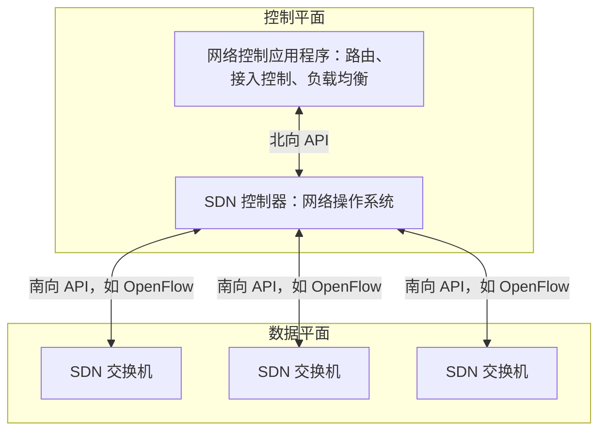

### 5.5.1 SDN 控制器和网络控制应用程序

控制器可分为三层：

| 层                      | 作用                                                       | 接口                      |
| ----------------------- | ---------------------------------------------------------- | ------------------------- |
| 北向 API 层（面向应用） | 供网络控制应用程序读写网络状态和流表，订阅网络事件         | **北向接口**，如 REST     |
| 网络范围状态管理层      | 维护主机、链路、交换机、流表、统计信息等状态，提供统一视图 | —                         |
| 通信层                  | 与受控设备通信                                             | **南向接口**，如 OpenFlow |

控制器虽逻辑集中，物理上可以由多台服务器分布式实现，以获得高可用性、容错性和扩展性。OpenDaylight、ONOS 等项目都体现了这种控制器架构。

### 5.5.2 OpenFlow 协议

OpenFlow 运行在控制器与交换机之间，通常基于 **TCP**，并可以使用 TLS 保护通信。具体端口和安全配置由协议版本与实现决定（现行默认端口为 6653，旧版为 6633，需验证）。

| 方向                          | 报文      | 作用                                 |
| ----------------------------- | --------- | ------------------------------------ |
| 控制器 → 交换机（控制器发起） | 特性      | 查询交换机特性，交换机回复其能力     |
|                               | 配置      | 查询或设置交换机配置参数             |
|                               | 修改状态  | 增加、删除、修改流表项，设置端口特性 |
|                               | 读状态    | 收集流表、端口统计与计数器           |
|                               | 发送分组  | 让交换机从指定端口发出指定分组       |
| 交换机 → 控制器（异步）       | 流删除    | 通知某流表项已删除                   |
|                               | 端口状态  | 通知端口状态变化                     |
|                               | packet-in | 把未匹配或指定的分组送给控制器       |

> [!important] 实践原则：软件定义广域网
> 大型数据中心互联网络可以采用 SDN 控制平面：
>
> - 根据应用优先级和流量需求，在多条路径间分配流量
> - 使用可编程交换机，控制器与交换机通过独立的管理网络通信（该句出处需验证）
> - 通过控制器集群提高控制平面的可用性和容错性

### 5.5.3 数据平面和控制平面交互示例

链路状态路由在 SDN 中的实现：Dijkstra 运行在控制器上的外部应用中，交换机只向控制器报告链路状态，不再互相洪泛。

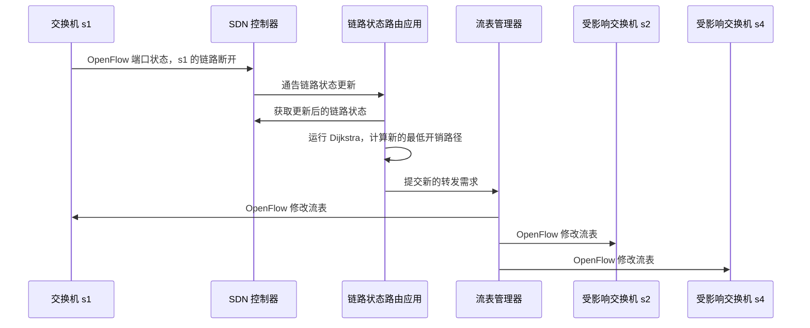

> [!note] 说明
> 图中的受影响交换机用于说明控制器下发新流表的过程；实际更新范围由网络拓扑和受影响的流决定。

### 5.5.4 SDN 的过去与未来

SDN 的思想与早期控制平面和数据平面分离的研究一脉相承。NFV（4.5 节）与 SDN 是可以结合使用的两种思想，但二者关注的问题不同：NFV 关注网络功能的软件化，SDN 关注网络控制逻辑的可编程化。

> [!note] 补充：两种开源控制器对照（超出原书正文）
>
> |          | OpenDaylight                                               | ONOS                                                             |
> | -------- | ---------------------------------------------------------- | ---------------------------------------------------------------- |
> | 特点     | 开源、模块化，支持多种南向协议，可使用 YANG 等模型抽象设备 | 分布式核心，强调高可用性和**意图框架**，屏蔽底层设备与协议的差异 |
> | 北向接口 | REST、RESTCONF、NETCONF                                    | REST API、意图框架                                               |

## 5.6 ICMP：因特网控制报文协议

**ICMP**（RFC 792）用于主机和路由器之间沟通网络层信息，典型用途是**差错报告**。ICMP 报文承载在 IP 数据报中（协议号 1，4.3.1 节），因此在体系结构上位于 IP 之上，但它属于网络层。报文含类型、编码，以及引起差错的数据报的**首部和前 8 字节**，使发送方能确定出错的数据报。

| 类型 | 编码 | 描述                           |
| ---: | ---: | ------------------------------ |
|    0 |    0 | 回显回答（对 ping 的回答）     |
|    3 |    0 | 目的网络不可达                 |
|    3 |    1 | 目的主机不可达                 |
|    3 |    2 | 目的协议不可达                 |
|    3 |    3 | 目的端口不可达                 |
|    3 |    6 | 目的网络未知                   |
|    3 |    7 | 目的主机未知                   |
|    4 |    0 | 源抑制（已废弃的拥塞控制机制） |
|    8 |    0 | 回显请求                       |
|    9 |    0 | 路由器通告                     |
|   10 |    0 | 路由器请求                     |
|   11 |    0 | TTL 过期                       |
|   12 |    0 | IP 首部损坏                    |

**ping**：发送类型 8、编码 0 的回显请求，目的主机返回类型 0、编码 0 的回显回答。ping 直接使用 ICMP，没有运输层端口。

**Traceroute**（1.4.3 节）：

1. 源主机发送一系列 UDP 数据报，目的端口设为不太可能被使用的端口
2. 第 1 个数据报 TTL = 1，第 2 个 TTL = 2，依此类推
3. 第 $n$ 个数据报到达第 $n$ 台路由器时 TTL 过期，路由器丢弃并回送 ICMP 超时报文（类型 11，编码 0）。报文通常包含路由器的 IP 地址和原始数据报的一部分
4. 数据报到达目的主机时，目的主机返回 ICMP 端口不可达（类型 3，编码 3）

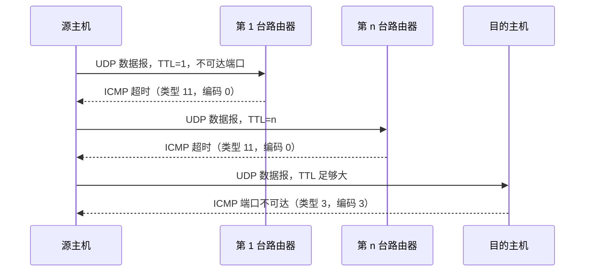

源主机据此得到路径上的路由器地址和往返时延。显示的路由器名称通常由 traceroute 根据地址执行反向 DNS 查询得到。

> [!note] 补充
> 不同系统和工具可以使用 UDP、ICMP 回显请求或其他探测报文。路由器可能对 ICMP 限速或过滤，因此 Traceroute 结果可能不完整。IPv6 使用 ICMPv6（RFC 4443）。

## 5.7 网络管理、SNMP 和 NETCONF/YANG

**网络管理**是对网络硬件、软件和人的因素的设置、综合与协调，以监视、测试、轮询、配置、分析、评价和控制网络及网元资源。关键组件：

| 组件         | 说明                                                                                 |
| ------------ | ------------------------------------------------------------------------------------ |
| 管理服务器   | 运行在网络运营中心（NOC）的集中式工作站，收集、处理、分析数据，配置并控制被管设备    |
| 被管设备     | 主机、路由器、交换机、中间盒、调制解调器、传感器等                                   |
| 设备数据     | 配置数据（如 IP 地址）、运行数据（如 OSPF 邻居列表）、设备统计（如丢包数、风扇转速） |
| 网络管理代理 | 运行在被管设备上，与管理服务器通信并执行本地操作                                     |
| 网络管理协议 | 在管理服务器与代理之间查询状态、设置参数、接收异常通知                               |

| 方式         | 特点                                           |
| ------------ | ---------------------------------------------- |
| CLI          | 命令行接口，厂商特定，易出错，不易扩展         |
| SNMP/MIB     | 查询与监控设备状态，适合运行数据与统计         |
| NETCONF/YANG | 面向全网络的抽象视图，强调配置管理与事务性操作 |

### 5.7.1 SNMP 与 MIB

**SNMP** 是应用层网络管理协议，有请求—响应与**陷阱**两种常用模式。SNMP PDU 通常作为 UDP 数据报的载荷；传统约定中，代理监听 161 端口，陷阱发送到 162 端口。SNMPv3 在此基础上提供基于用户的鉴别与加密。

| SNMPv2/v3 PDU  | 方向                             | 描述                                |
| -------------- | -------------------------------- | ----------------------------------- |
| GetRequest     | 管理者 → 代理                    | 取一个或多个 MIB 对象实例的值       |
| GetNextRequest | 管理者 → 代理                    | 取列表或表格中下一个对象实例的值    |
| GetBulkRequest | 管理者 → 代理                    | 批量取值，如大表中的值              |
| InformRequest  | 管理者 → 管理者                  | 向远程管理实体通知其可访问的 MIB 值 |
| SetRequest     | 管理者 → 代理                    | 设置一个或多个对象实例的值          |
| Response       | 代理 → 管理者，或管理者 → 管理者 | 对请求的响应                        |
| SNMPv2-Trap    | 代理 → 管理者                    | 向管理者通知异常事件                |

Get/Set 类 PDU 的格式：PDU 类型、请求 ID、差错状态、差错索引，以及变量绑定（名字、值）。

> [!note] 说明
> 不同 SNMP 版本的 Trap 编码格式不同。SNMPv1 使用专门的 Trap PDU；SNMPv2-Trap 使用与其他协议数据单元更接近的格式。

**MIB**（管理信息库）中的对象用 **SMI**（管理信息结构）定义，可以是计数器、状态变量、配置参数或描述性信息。例：

```text
ipSystemStatsInDelivers OBJECT-TYPE
    SYNTAX      Counter32
    MAX-ACCESS  read-only
    STATUS      current
    DESCRIPTION "成功交付给 IP 上层协议（含 ICMP）的数据报总数"
    ::= { ipSystemStatsEntry 18 }
```

### 5.7.2 NETCONF 与 YANG

**NETCONF**（RFC 6241）用于检索、设置和修改配置数据，也可以查询运行数据与统计信息，并订阅设备通知。它使用 XML 编码的 RPC 报文，通过安全的面向连接会话传输；SSH 是常见的承载方式（默认端口 830），也可以根据实现使用其他安全传输。

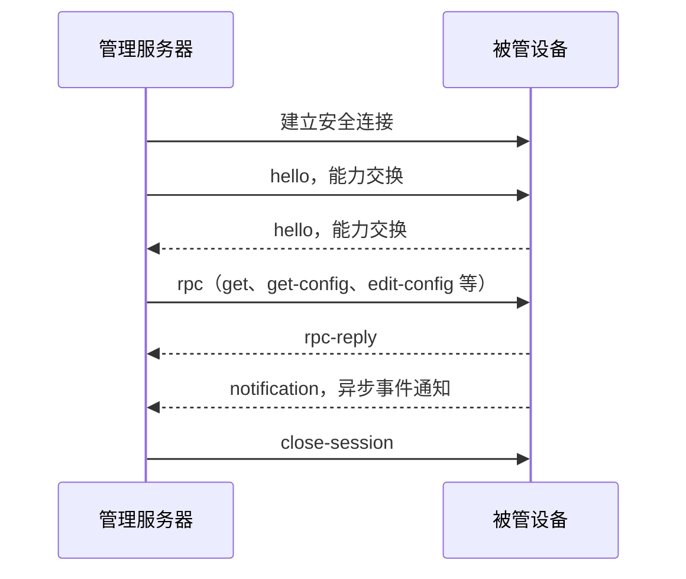

| 操作                    | 描述                                   |
| ----------------------- | -------------------------------------- |
| `<get-config>`          | 检索指定配置的全部或部分               |
| `<get>`                 | 检索配置**与**运行状态数据的全部或部分 |
| `<edit-config>`         | 更改指定配置的全部或部分               |
| `<lock>` / `<unlock>`   | 锁定或解锁配置数据存储                 |
| `<create-subscription>` | 启动事件通知订阅                       |
| `<notification>`        | 设备向服务器发送异步事件通知           |
| `<close-session>`       | 关闭会话                               |

设置接口 MTU 的请求（回复为 `<ok/>`，出错为 `<rpc-error>`）：

```xml
<rpc message-id="101" xmlns="urn:ietf:params:xml:ns:netconf:base:1.0">
  <edit-config>
    <target><running/></target>
    <config>
      <top xmlns="http://example.com/schema/1.2/config">
        <interface>
          <name>Ethernet0/0</name>
          <mtu>1500</mtu>
        </interface>
      </top>
    </config>
  </edit-config>
</rpc>
```

**YANG**（RFC 7950）是网络管理数据建模语言，用于定义数据的结构、语义、配置约束、运行状态和通知。它与 SNMP 的 SMI 类似，但更强调配置模型、数据约束和网络级抽象。上例对应的 YANG 模块示意：

```text
module example-config {
  namespace "http://example.com/schema/1.2/config";
  prefix ex;
  container top {
    list interface {
      key "name";
      leaf name { type string; }
      leaf mtu  { type uint16; }
    }
  }
}
```

**RESTCONF**（RFC 8040）是以 HTTP 为传输、基于 YANG 的管理接口，也可以作为控制器或网络管理系统的北向接口。

## 5.8 小结

本章研究网络层控制平面，即网络范围的、决定分组端到端路径并配置管理网络层组件与服务的逻辑。

- **控制平面概述**：转发是数据平面的本地操作，路由选择是控制平面的网络范围处理。控制平面可采用**每路由器控制**（OSPF、BGP），也可采用**逻辑集中式控制**（SDN）
- **路由选择算法**：**LS** 采用全局信息与 Dijkstra 算法，负载敏感时可能振荡；**DV** 基于 Bellman-Ford 方程，只与邻居交换信息，可能出现无穷计数与路由环路，毒性逆转只能缓解邻居间的环路
- **OSPF**：AS 内部的链路状态协议，支持报文鉴别、等开销多路径和层次化区域
- **BGP**：AS 之间的路径向量协议，通告前缀可达性并按策略选择路由。选路会综合本地偏好、AS-PATH、NEXT-HOP 等属性；路由源验证仍需要额外机制
- **SDN**：分离数据平面与控制平面，逻辑集中的控制器通过北向和南向接口管理交换机
- **ICMP**：网络层的差错报告与诊断协议，支撑 ping 与 Traceroute
- **网络管理**：SNMP/MIB 侧重状态查询与监控，NETCONF/YANG 侧重配置管理与数据建模

|            | 每路由器控制               | 逻辑集中式控制（SDN）        |
| ---------- | -------------------------- | ---------------------------- |
| 计算位置   | 分散在每台路由器           | 逻辑集中的控制器             |
| 路由器角色 | 运行路由选择协议，自行计算 | 控制代理，按控制器命令转发   |
| 代表       | OSPF、BGP                  | OpenFlow、OpenDaylight、ONOS |
| 特点       | 与因特网现状一致，逐步演进 | 可编程、灵活，便于集中管理   |

|            | OSPF                       | BGP                              |
| ---------- | -------------------------- | -------------------------------- |
| 范围       | AS 内部                    | AS 之间                          |
| 算法类型   | 链路状态（Dijkstra）       | 路径向量                         |
| 度量       | 链路权值（管理员设定）     | 无统一度量，按属性与策略逐步比较 |
| 承载协议   | 直接承载于 IP（协议号 89） | TCP（端口 179）                  |
| 策略的作用 | 影响小                     | 占主导                           |
| 对象       | 路由器与子网               | CIDR 前缀                        |
