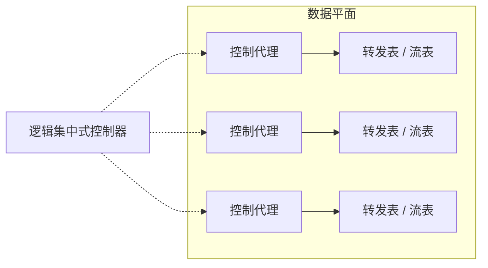
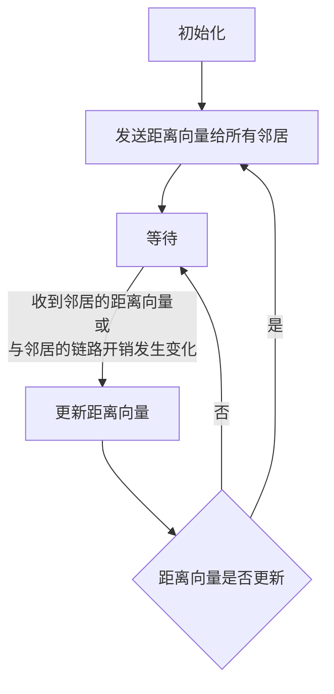
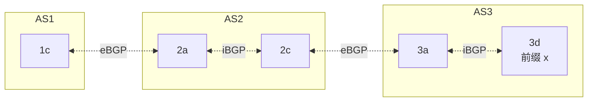
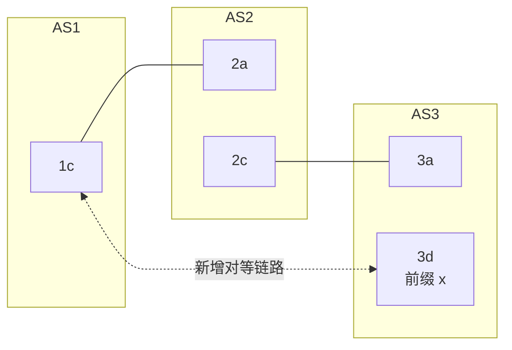
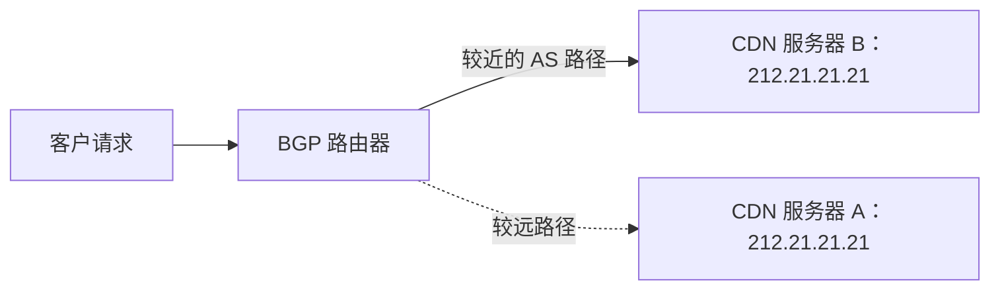
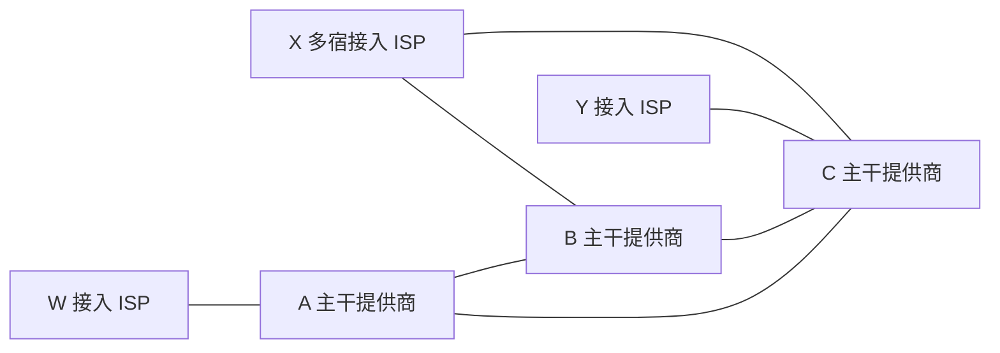
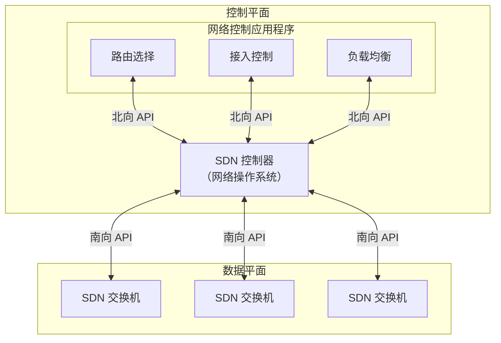
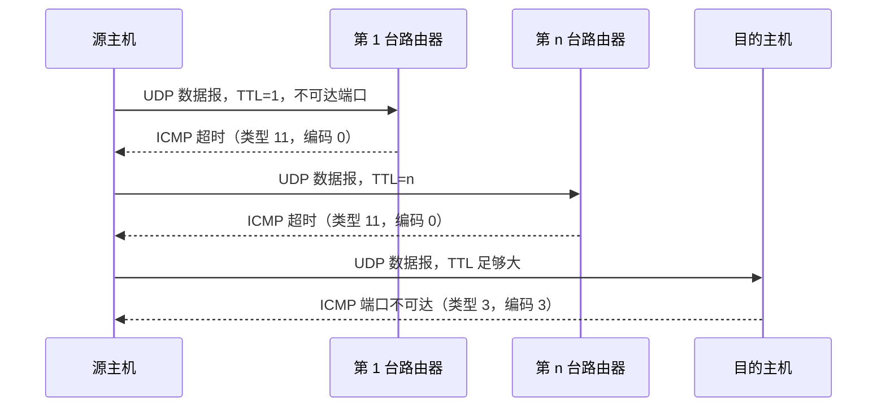
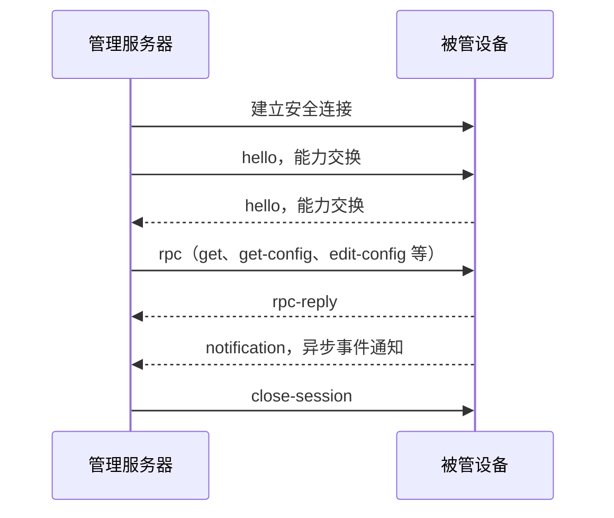

网络层分为两个相互作用的部分：**数据平面**关注每台路由器如何在本地把分组从输入链路转发到输出链路；**控制平面**关注网络范围的路由选择，决定分组从源到目的所经过的端到端路径。

转发是数据平面的本地操作，通常在纳秒级完成；路由选择是控制平面的网络范围处理，通常在秒级运行。本章研究后者，即"计算并安装转发表"的机制。

控制平面有两种实现方式：

| 方式                  | 说明                                                                 |
| --------------------- | -------------------------------------------------------------------- |
| 每路由器控制          | 路由选择算法运行在**每台路由器**中，各路由器通信协作算出转发表       |
| 逻辑集中式控制（SDN） | 控制平面与数据平面明确分离，由**逻辑上集中的控制器**计算并分发转发表 |

本章先讨论通用的路由选择算法，再讨论 Internet 中的 OSPF 与 BGP，最后介绍 SDN 控制平面、ICMP 和网络管理协议。


> [!important] 本章目标
> 理解网络层控制平面的原理与实现：
>
> 1. 控制平面概述：每路由器控制与逻辑集中式控制
> 2. 路由选择算法：链路状态算法（LS，Dijkstra）与距离向量算法（DV，Bellman-Ford）
> 3. 自治系统内部的路由选择：OSPF
> 4. 自治系统间的路由选择：BGP，以及 IP 任播与路由选择策略
> 5. SDN 控制平面：控制器、OpenFlow 协议，数据平面与控制平面的交互
> 6. ICMP：差错报告、ping 与 Traceroute
> 7. 网络管理：SNMP/MIB 与 NETCONF/YANG

# 第一部分 路由选择算法与自治系统路由

## 5.1 网络层控制平面概述

控制平面负责计算、维护并安装路由器或交换机中的**转发状态**（转发表、流表）。数据平面据此执行转发（4.2.1 节、4.4 节）。

传统网络中，控制平面和数据平面通常实现在同一台路由器内；SDN 则将二者明确分离：

- **数据平面**：交换机、路由器等转发设备，执行"匹配加操作"（4.4 节）
- **控制平面**：逻辑集中的控制器，计算、下发并管理转发表或流表

### 5.1.1 两种控制平面实现方式

#### 1. 路由器控制

每台路由器运行路由选择算法，与其他路由器的路由选择组件通信，共同算出转发表。OSPF、BGP 都基于这种方式（5.3 节、5.4 节）。

#### 2. 逻辑集中式控制

一个逻辑上集中的控制器统一计算转发表（或流表），再分发给网络中的每台设备。

每台设备内部有一个**控制代理**（Control Agent，CA），其主要功能是：

- 与控制器通信
- 按照控制器的指令配置本地流表

控制代理之间**不直接交互**，也不主动参与转发表的计算。



> [!warning] "逻辑集中"不等于单台物理设备
> 控制器通常由多台服务器分布式实现，以提高容错性与扩展性，但对上层表现为一个集中的服务。

SDN 正是采用这种逻辑集中式控制思想。目前已在生产网络中得到广泛应用，例如：

- Google 的数据中心内部网络与全球广域网（ORION / B4）
- Microsoft SWAN
- 运营商接入网与 4G/5G 蜂窝网络控制平面
- 数据中心内部及数据中心之间的互联网络

## 5.2 路由选择算法

路由选择算法的目标是找出从发送方到接收方的**最低开销路径**。实际路由选择还会受到策略约束，例如某个组织可能不允许自己的路由器转发其他组织之间的流量。

用图论的语言来说，就是找到从源节点到目的节点的**最短路径**，节点间的边权重即为链路开销。

**算法分类**：

| 维度     | 类别                        | 特点                                                         |
| -------- | --------------------------- | ------------------------------------------------------------ |
| 信息范围 | **集中式**（centralized）   | 具有完整、全局性的网络知识，如**链路状态**（LS）算法         |
|          | **分散式**（decentralized） | 每个节点只与邻居交换信息、迭代计算，如**距离向量**（DV）算法 |
| 变化方式 | 静态                        | 路由变化缓慢，通常人工调整                                   |
|          | 动态                        | 随流量负载或拓扑变化而改变                                   |
| 开销含义 | 负载敏感                    | 链路开销动态反映当前拥塞水平                                 |
|          | 负载迟钝                    | 链路开销不明确反映当前拥塞                                   |

当前 Internet 的路由选择算法（RIP、OSPF、BGP）大多是**负载迟钝**的。

> [!note] 术语
> "集中式"指算法使用全局网络信息，但每个节点仍可以独立运行该算法。它不同于逻辑集中式控制，后者由控制器统一计算并下发结果。

### 5.2.1 链路状态路由选择算法

**链路状态**（Link State，LS）算法：每个节点通过**链路状态广播**（**洪泛**）向网络中所有其他节点发送链路状态分组，内容为自己所连链路的标识及开销。最终所有节点拥有统一完整的网络视图，之后，每个节点独立运行相同的 LS 算法，计算出到所有目的地的最低代价路径。

最常用的 LS 算法是 **[[shortest-path#dijkstra-算法|Dijkstra 算法]]**。

当链路开销与负载相关（负载敏感）时，可能出现**路由振荡**。设节点 $s$、$t$ 之间有两条并行链路 A 和 B，开销等于链路承载的流量；现在有两条各占一个单位流量的流从 $s$ 到 $t$。

| 轮  | 链路 A 载荷（开销） | 链路 B 载荷（开销） | 各路由器的决策 |
| :-: | :-----------------: | :-----------------: | :------------: |
|  0  |       2（2）        |       0（0）        | 两条流都改选 B |
|  1  |       0（0）        |       2（2）        | 两条流都改选 A |
|  2  |       2（2）        |       0（0）        | 两条流都改选 B |
| ... |         ...         |         ...         |      ...       |

之后无限往复。所有路由器几乎同时运行 LS，又依据相同的开销做出相同的决策。

解决方法

- 不让所有路由器同步运行 LS
  - 比如，随机化链路状态通告的发送时间
- ~~让链路开销不依赖瞬时负载~~（那还怎么避开拥塞？）

### 5.2.2 距离向量路由选择算法

**距离向量**（Distance-Vector，DV）算法是一种迭代的、异步的、分布式的、自终止的路由选择算法。每个节点只与其直连邻居交换距离向量，并根据邻居提供的信息更新自己的路由估计。当网络状态稳定且各节点的距离向量不再发生变化时，算法最终收敛，不再产生新的更新通告。

设网络中所有节点的集合为 $N$，相关符号定义如下：

- $N_x$：节点 $x$ 的邻居集合，即与 $x$ 直接相连的所有节点。
- $c(x,y)$：节点 $x$ 到其邻居 $y$ 的链路开销。
- $D_x(y)$：节点 $x$ 当前估计的到目的节点 $y$ 的最低开销。
- $D_x=[D_x(y):y\in N]$：节点 $x$ 的距离向量，记录其到网络中各个节点的距离估计。

每个节点 $x$ 维护

- 到每个直连邻居的链路开销 $c(x,v)$
- 自己的距离向量 $D_x$
- **每个邻居的距离向量** $D_v\quad v \in N_x$

在每个节点 $x$ 上，DV 算法按照以下流程运行：



其中，各个步骤的具体含义如下。

- **初始化**：令节点 $x$ 到自身的距离为 $0$，到直连邻居 $y$ 的距离为链路开销 $c(x,y)$，到其他节点的距离为 $\infty$。即

  $$
  D_x(y)=
  \begin{cases}
  0, & y=x,\\
  c(x,y), & y\in N_x,\\
  \infty, & \text{其他情况}.
  \end{cases}
  $$

- **发送距离向量**：节点 $x$ 将自己的当前距离向量发送给所有直连邻居。

- **更新距离向量**：当节点 $x$ 收到邻居的新距离向量，或发现与邻居之间的链路开销发生变化时，便根据最新信息重新计算到各个目的节点的距离估计。

节点更新距离向量时所依据的规则称为 **Bellman-Ford 方程**：

$$
D_x(y)=\min_{v\in N_x}
\bigl\{c(x,v)+D_v(y)\bigr\},\quad y\ne x
$$

该方程的含义是：对于目的节点 $y$，节点 $x$ 分别计算经过每个直连邻居 $v$ 到达 $y$ 的候选开销 $c(x,v)+D_v(y)$，再从中取最小值，作为自己到 $y$ 的最新距离估计。

> [!question] 为什么更新距离向量时，需要比较经过所有邻居的候选开销，而不是直接与之前的最优结果相比较？
> 例如，若节点 $a\to d$ 的最优路径是 $a\overset{2}{\to} b\overset{3}{\to}  d$，另一条路径是 $a\overset{3}{\to} c\overset{4}{\to} d$，则 $D_a(d)=5$。若链路 $b\to d$ 的开销升为 10，经更新后，$D_a(d)$ 变为 $\min\{2+10,\ 3+4\}=7$。
>
> 一旦我们只与之前的最优结果比较，结果仍然是 5，丝毫未察觉到链路开销的变化。
>
> 简言之，就是原先的最优路径的开销可能增大，必须重新比较经过各个邻居的候选开销，才能确定原先的最优路径是否仍然最优。

**收敛性**：拓扑与开销不再变化时，同步迭代下第 $k$ 轮之后，各节点已得到所有"至多 $k$ 跳"路径中的最低开销。最低开销路径（开销非负）至多 $\lvert N\rvert-1$ 跳，故至多 $\lvert N\rvert-1$ 轮后不再产生更新，算法自终止。

#### 1. 链路开销改变与链路故障

**开销减少**：好消息传播快，检测到变化的节点更新向量并通知邻居，很快收敛。

**开销增加**：坏消息传播慢，可能形成**路由选择环路**（routing loop）。

> [!warning] 无穷计数
>
> ```mermaid
> graph LR
>     y(("y")) ---|" 4 → 60"| x(("x"))
>     y ---|1| z(("z"))
>     z ---|50| x
> ```
>
> 原来 $D_y(x)=4$，$D_y(z)=1$，$D_z(y)=1$，$D_z(x)=5$（经 $y$）。链路 $y$–$x$ 开销升为 60：
>
> - $y$：$D_y(x)=\min\{60+0,\ 1+5\}=6$，通告给 $z$
> - $z$：$D_z(x)=\min\{50+0,\ 1+6\}=7$，通告给 $y$
> - $y$：8，$z$：9……
>
> 每轮 $D_y(x)$ 与 $D_z(x)$ 各增 2。设 $D_y(x)=4+2k$，当 $1+D_y(x)\ge c(z,x)=50$，即 $D_y(x)\ge49$ 时，$z$ 改用直连（开销 50）。$y$ 与 $z$ 各更新 23 次，合计 46 次。
>
> 收敛所需的更新次数随新旧开销之差线性增长。在此期间，$y$ 与 $z$ 之间的分组会来回转发，形成路由选择环路，导致距离估计值缓慢增长，即无穷计数（count-to-infinity）。

#### 2. 毒性逆转

> [!tip] 毒性逆转（poisoned reverse）
> 针对**两个邻居之间**的环路问题，DV 算法可采用毒性逆转策略：
>
> 若 $z$ 经 $y$ 到达 $x$，则 $z$ 向 $y$ 通告 $D_z(x)=\infty$（尽管 $z$ 知道它实际是 5）。
>
> 在上例中，链路开销升为 60 后：
>
> - $y$：$D_y(x)=\min\{60+0,\ 1+\infty\}=60$，通告给 $z$
> - $z$：$D_z(x)=\min\{50+0,\ 1+60\}=50$，直接走 $z$–$x$ 链路
>
> 再来一轮就收敛了，避免了环路。

毒性逆转只对两个邻居之间的环路有效。若环路涉及三个或更多节点（例如 $y$ 经 $z$、$z$ 经 $w$、$w$ 经 $y$），每个节点只向自己的下一跳通告 $\infty$，对环上其他邻居仍通告有限值，环路依然可以形成。

#### 3. LS 与 DV 的比较

| 比较项     | 链路状态 LS                                                  | 距离向量 DV                                                    |
| ---------- | ------------------------------------------------------------ | -------------------------------------------------------------- |
| 信息范围   | 全局信息                                                     | 局部邻居信息                                                   |
| 报文复杂度 | 洪泛，简化模型下约 $O(\lvert N\rvert\lvert E\rvert)$ 条      | 仅在邻居间交换；收敛时间随拓扑与开销变化                       |
| 计算与收敛 | 算法 $O(\lvert N\rvert^2)$，较快                             | 较慢，可能出现路由环路和无穷计数                               |
| 典型问题   | 负载敏感时可能振荡                                           | 无穷计数、环路                                                 |
| 健壮性     | 路由器主要通告**自己所连链路**的状态，各路由器独立计算转发表 | 错误的距离向量可能影响**任意或所有目的地**，错误沿邻居关系扩散 |
| 代表协议   | OSPF、IS-IS                                                  | RIP、早期 ARPAnet；BGP 是其路径向量变体                        |

## 5.3 Internet 中自治系统内部的路由选择：OSPF

若把所有路由器看作同质集合，会遇到两个问题：

| 问题     | 说明                                                                |
| -------- | ------------------------------------------------------------------- |
| 规模     | Internet 规模巨大，所有路由器间广播链路状态并计算路由的开销无法承受 |
| 管理自治 | 各 ISP 希望按自己的方式管理网络，并对外隐藏内部拓扑                 |

解决办法是把路由器组织进**自治系统**（Autonomous System，AS）：

- 一个 AS 由通常处于相同管理控制下的一组路由器组成；一个 ISP 的网络可能是一个 AS，大型 ISP 也可能划分为多个 AS
- 一个公共 AS 由 RIR 分配的全局的 AS 号（ASN）唯一标识（也有私有 ASN，用于内网环境）
- 在同一 AS 内运行的协议称为**自治系统内部路由选择协议**（intra-AS routing protocol），如 OSPF；AS 之间则用 BGP（5.4 节）

### 5.3.1 开放式最短路径优先

**开放式最短路径优先**（Open Shortest Path First，**OSPF**）是**链路状态**协议：用洪泛传播链路状态，用 Dijkstra 算法计算最低开销路径。

- 不划分区域时，每台路由器构建整个 AS 的拓扑；划分区域后，仅构建所在区域的拓扑。无论哪种情形，都以自己为根算出最短路径树
- OSPF 支持 IPv4 和 IPv6，分别有相应版本的协议规范（OSPFv2：RFC 2328；OSPFv3：RFC 5340）
- OSPF 报文直接由 IP 承载，IP 首部协议号为 **89**

主要机制：

| 机制           | 说明                                                                       |
| -------------- | -------------------------------------------------------------------------- |
| 链路状态广播   | 链路状态变化时向 AS 内其他路由器洪泛；同时通过周期性刷新维护链路状态数据库 |
| HELLO 报文     | 检测直连邻居是否存活                                                       |
| 链路状态数据库 | 每台路由器据此运行 Dijkstra                                                |

OSPF 的优点：

- **安全**
  - 路由器之间的交换（如链路状态更新）支持认证（默认不认证）
  - 可配置两种认证方式：
    - **简单认证**：在每台路由器上配置相同密码，报文中以明文携带密码（安全性较低）
    - **密码学认证**：基于共享密钥。发送方对报文内容追加密钥后计算 HMAC 或 MD5 哈希，并将哈希值放入报文；接收方用相同密钥验证。同时使用序列号防止重放攻击
  - 只有受信任的路由器才能参与 AS 内的 OSPF，防止恶意注入错误路由信息

- **多条相同开销路径**
  - 当到达某目的地存在多条开销相同的路径时，OSPF 允许同时使用这些路径（不必只选一条），从而实现负载分担

- **单播与多播集成支持**
  - Multicast OSPF（MOSPF，RFC 1584）是对 OSPF 的简单扩展，利用现有 OSPF 链路状态数据库，并增加一种新的链路状态通告类型，以支持多播路由
  - 现代网络中，OSPF 与 PIM（Protocol Independent Multicast，独立于协议的多播路由选择协议）结合使用，PIM 负责组成员管理和多播树构建，OSPF 负责单播路由选择

- **AS 内层次化支持**
  - 一个 OSPF 自治系统可划分为多个区域（area）
    - 每个区域独立运行自己的链路状态路由算法，区域内路由器向本区域所有其他路由器广播链路状态
    - 每个区域有一个或多个**区域边界路由器**（ABR），负责将数据包路由到区域外
  - AS 中只有一个**主干区域**（Area 0）：
    - 负责其他区域之间的流量转发
    - 包含 AS 内所有 ABR，也可包含部分非边界路由器
  - **区域间路由路径**（三步）：
    1. 在源区域内路由到该区域的 ABR
    2. 经主干区域路由到目的区域的 ABR
    3. 在目的区域内路由到最终目的地
  - 另有 **AS 边界路由器**，连接其他自治系统，负责将外部路由引入本 AS

    ```mermaid
    ---
    title: OSPF 自治系统
    ---
    flowchart TB
        subgraph Area0["主干区域 Area 0"]
            B1["ABR 1"]
            B2["ABR 2"]
            BR["骨干路由器"]
        end
        subgraph Area1["区域 Area 1"]
            R1["内部路由器"]
            R2["内部路由器"]
        end
        subgraph Area2["区域 Area 2"]
            R3["内部路由器"]
            R4["内部路由器"]
        end
        R1 --- B1
        R2 --- B1
        R3 --- B2
        R4 --- B2
        B1 --- B2
        B2 --- BR
    ```

> [!info] 其他 AS 内部协议
>
> - **RIP**：距离向量协议，以**跳数**（hop count）为度量，最大 15 跳（16 表示不可达）
> - **IS-IS**：与 OSPF 类似的链路状态协议，也广泛用于大型运营商网络

> [!important] 设置 OSPF 链路权值
> 先前的讨论中，我们总是默认链路权值已经设置好。而在实际网络中，我们常常根据流量工程目标反过来设置链路权值，以便 OSPF 算出我们期望的路由路径。比如，管理员可以：
>
> - 把所有链路权值设为 1，得到**最少跳数**路由
> - 使权值与链路容量成反比，鼓励流量走高带宽链路
> - 按流量工程目标反推权值，使 OSPF 算出的路径达到期望的网络利用率

## 5.4 ISP 之间的路由选择：BGP

当分组跨越多个 AS 时，需要**自治系统间路由选择协议**来协调来自不同 AS 的路由信息。边界网关协议（Border Gateway Protocol，**BGP**）是 Internet 中**唯一**的 AS 间路由选择协议，它是异步和分布式的，将不同 AS 的路由器连接起来，形成全球 Internet 的路由选择系统。

### 5.4.1 BGP 的作用

对于 AS 内部的目的地，转发表的条目由该 AS 的内部路由协议决定。但对于 AS 外部的目的地，就需要 BGP 来发挥作用。

BGP 以 IP 地址前缀为单位通告可达性信息，并为这些前缀选择路由。每个前缀代表一个子网或一组子网。因此，路由器的转发表项形式为

$$
(x, I)
$$

其中 $x$ 是前缀，如 `138.16.68.0/22`，$I$ 是路由器某个接口的编号

BGP 主要完成两个任务：

1. 从邻居 AS **获得前缀的可达性信息**。使每个子网能向 Internet 其余部分通告自己，声明"我能到达前缀 $x$，请把分组发给我"
2. 按策略和可达性信息**确定到各前缀的最佳路由**，并将结果用于配置转发表

BGP 是**路径向量**协议：通告中携带到前缀的 AS 路径。BGP 对等体（peer）之间通过 TCP 连接交换五种报文，通常使用端口 179：

| 报文          | 作用                           |
| ------------- | ------------------------------ |
| OPEN          | 打开与对等体的连接并鉴别发送方 |
| UPDATE        | 通告新路径，或撤销旧路径       |
| KEEPALIVE     | 保持连接；也用于确认 OPEN      |
| NOTIFICATION  | 报告差错，并关闭连接           |
| ROUTE-REFRESH | 请求对等体重新发送路由信息     |

### 5.4.2 通告 BGP 路由信息

**网关路由器**位于 AS 边缘并连接其他 AS；**内部路由器**只连接本 AS 内的主机与路由器。

| 连接类型 | 含义                                                |
| -------- | --------------------------------------------------- |
| eBGP     | 不同 AS 的网关路由器之间的 BGP 会话                 |
| iBGP     | 同一 AS 内路由器之间的 BGP 会话，不一定对应物理链路 |

> [!note] iBGP 的要求
> 默认情况下，从 iBGP 获取到的路由信息**不会再通告给其他 iBGP 对等体**。因此 AS 内通常需要**全互联** iBGP 会话，或者使用路由反射器等扩展机制。



设前缀 $x$ 在 AS3，通告过程：

1. AS3 的 `3a` 向 AS2 的 `2c` 发送 eBGP 报文 `AS3 x`
2. `2c` 经 iBGP 向 AS2 中其他路由器通告 `AS3 x`
3. AS2 的 `2a` 向 AS1 的 `1c` 发送 eBGP 报文 `AS2 AS3 x`
4. `1c` 经 iBGP 向 AS1 中所有路由器通告 `AS2 AS3 x`

如此一来，AS1 和 AS2 的所有路由器都知道了 $x$ 的存在和到达路径。

**多条路径**：若 AS1 与 AS3 间新增一条直连链路，则 AS1 到 $x$ 有两条候选路径：`AS2 AS3 x` 与 `AS3 x` 都会被通告给 AS1 的路由器。



### 5.4.3 确定最好的路由

当一个前缀有多条候选路由时，BGP 需要一些额外信息与选择算法来决定最优路由。

当路由器通过 BGP 连接通告前缀时，它在前缀中包含一些 **BGP 属性**（BGP attribute），这里列出最重要的两个：

| 属性     | 作用                                                                                      |
| -------- | ----------------------------------------------------------------------------------------- |
| AS-PATH  | 通告经过的 AS 列表，**也用于环路检测**：路由器在 AS-PATH 中看到自己的 AS 号，就丢弃该通告 |
| NEXT-HOP | 到达该前缀时使用的下一跳路由器地址，具体取值取决于会话类型和路由策略                      |

例如，AS1 中的每台路由器都知道了到前缀 `x` 的两台 BGP 路由（格式为`NEXT-HOP; AS-PATH; x`）：

- `2a与 AS1 相连的接口 IP; AS2 AS3; x`
- `3d与 AS1 相连的接口 IP; AS3; x`

NEXT-HOP 的 IP 并不属于 AS1，但它所在的子网是直接和 AS1 相连的。

#### 1. 热土豆路由选择

**热土豆路由选择**（hot potato routing）：尽快把分组送出本 AS，即选择到 **NEXT-HOP 开销最小的路由**。步骤：

1. BGP 获得通往前缀 $x$ 的多个 NEXT-HOP 路由器（网关）
2. 用 AS 内部路由信息（如 OSPF）算出到每个 NEXT-HOP 的最低开销
3. 选择开销最小的 NEXT-HOP，在转发表中加入 `(x, I)`，$I$ 为通往该出口网关的端口

它只关心本 AS 内部的开销，不关心 AS 外部的端到端开销，因此同一 AS 内不同路由器可能为同一前缀选择不同的**出口网关**。

#### 2. BGP 路由选择算法

实践中，BGP 的路由选择算法通常按以下顺序进行：

| 顺序 | 规则                                                 |
| ---- | ---------------------------------------------------- |
| 1    | **本地偏好**（local preference）最高者，由管理员决定 |
| 2    | **AS-PATH 最短**者                                   |
| 3    | NEXT-HOP 路由器**最近**者（热土豆）                  |
| 4    | 仍有多条时，用 BGP 标识符等规则选择                  |

> [!note] 补充：实际实现的选路顺序
> 以上四步是简化模型，并非所有 BGP 实现的完整选路顺序。实际设备通常还会排除 NEXT-HOP 不可达或被路由策略拒绝的路由，并根据实现和配置考察其他条件。厂商还能自定义额外属性与规则。

### 5.4.4 IP 任播

> [!success] Definition IP Anycast
> 多个地理位置分散的服务器共享**同一个 IP 地址**，并通过 BGP 通告。路由器根据 BGP 路由策略，将流量导向路由意义上最近（最优）的服务器实例。

经由任播，客户端可以在多个提供同一服务的服务器中，选择一个近处的实例。这降低了延迟、提高了可用性，并在服务器实例间分担负载。

典型应用是 **DNS 根服务器**。根服务器使用少量稳定的地址标识服务，并在全球部署多个实例。

不过，CDN 服务器需要更加小心地使用任播，这是因为 BGP 路由不稳定，BGP路由选择变化能够导致相同连接的不同分组到达服务器的不同实例。这对于无状态的服务（如 DNS）是可以接受的，但对于需要**会话保持**的服务（如视频流、在线游戏）则可能导致问题，如连接中断、缓存失效等。

因此，依据具体应用场景，CDN也会使用 **DNS 重定向**或**HTTP 重定向**实现就近访问。



### 5.4.5 路由选择策略

BGP 是**面向策略**的协议，本地管理员设置的策略可压倒最短 AS 路径、热土豆等性能考虑。实际中，BGP 的路由选择策略通常按商业考量来设置：



- X 是多宿接入 ISP（连接 B 和 C），不希望转发 B 与 C 之间的**穿越流量**，因此会向 B、C 通告"我除自身外没有到其他目的地的路径"
- B 从 A 学到路径 `A W`，B 会通告 `B A W` 给其客户 X，却可能不愿意通告给 C

> [!important] 经验法则
> 任何流经某 ISP 骨干网的流量，其源或目的（或两者）必须是该 ISP 的客户；否则该流量就是在免费使用该 ISP 的网络。

本地偏好通常按经济利益设置为：**客户 > 对等体 > 提供商**。具体策略由各 AS 自行决定。

> [!important] 实践原则：为什么 AS 间与 AS 内部路由协议不同？
>
> |      | AS 间（BGP）                   | AS 内部（OSPF 等）           |
> | ---- | ------------------------------ | ---------------------------- |
> | 策略 | 占主导，因为商业利益或信任问题 | 同一管理控制下，影响小       |
> | 规模 | 须扩展到海量网络               | 过大时可划分为多个 AS 或分层 |
> | 性能 | 次要于策略                     | 更关注路径性能与开销         |

### 5.4.6 综合：出现在 Internet 上

假如你创立了一家小公司 Xanadu，希望全世界的用户都能访问你的网站，需要以下步骤：

1. 与本地 ISP 签约，获得物理连接（记得配置好路由器）
2. 从 ISP 获得 IP 地址前缀，如一个 `/24` 块（4.3.2 节）
3. 为服务器分配 IP 地址（可用 DHCP）
4. 申请域名，如 `xanadu.com`（2.4 节）
5. 在权威 DNS 服务器中配置域名到 IP 的映射
6. 本地 ISP 用 BGP 通告你的前缀，使得 Internet 中几乎所有的路由器都学到该前缀
7. 外部用户经 DNS 得到服务器 IP，并由 BGP 路由到达你的网络

> [!note] 说明
> 若该 `/24` 来自 ISP 的地址块，ISP 通常以聚合前缀通告（CIDR 聚合），不必单独通告这个 `/24`。

> [!warning] BGP 的安全边界
> BGP 会话可以使用认证机制保护，但这不等于能够验证某个 AS 是否有权通告某个前缀。错误或恶意的通告仍可能造成**前缀劫持**或路由泄露。RPKI 和路由源验证可以对前缀授权关系提供额外验证。

---

# 第二部分 SDN 与网络管理

## 5.5 SDN 控制平面

延续 4.4 对一般化 SDN 转发的讨论，本节将重点介绍 SDN 的控制逻辑及配置。

SDN 体系结构有四个关键特征：

1. **基于流的转发**：即 4.4 节的匹配加操作与流表
2. **数据平面与控制平面分离**
3. 网络控制功能位于**数据平面交换机外部**
   控制平面由若干**网络控制应用程序**和**SDN 控制器**（或网络操作系统）组成
   - 网络控制应用程序：实现路由选择、接入控制、负载均衡等功能
   - SDN 控制器：
     - 维护网络状态信息
     - 为网络控制应用程序提供网络信息
     - 提供监视、编程和控制下面的网络设备的接口供网络控制应用程序使用
4. **可编程**的网络：编程而成的网络控制应用程序使用 SDN 控制器提供的接口来控制网络行为



### 5.5.1 SDN 控制器和网络控制应用程序

控制器可分为三层：

- **对于网络控制应用程序层的接口**：供网络控制应用程序读写网络状态和流表，订阅网络事件。通过北向 API如 REST、RESTCONF、gRPC 等与网络控制应用程序通信
- **网络范围状态管理层**：维护主机、链路、交换机、流表、统计信息等状态，提供统一视图
- **通信层：SDN控制器和受控网络设备之间的通信**：通过南向 API 与受控设备通信、获取设备与链路状态、控制流表等

逻辑上，控制器被视为单一实体，物理上却可以由多台服务器分布式实现，以获得高可用性、容错性和扩展性。OpenDaylight、ONOS 等项目都体现了这种控制器架构。

### 5.5.2 OpenFlow 协议

OpenFlow 运行在控制器与交换机之间，通常基于 **TCP**，使用 6653 的默认端口号，并可以使用 TLS 保护通信。下面的表格列出了 OpenFlow 的部分重要报文及其作用：

<table>
  <tr>
    <th>方向</th>
    <th>报文</th>
    <th>作用</th>
  </tr>
  <tr>
    <td rowspan = "5" align="center">控制器 → 交换机<br>（控制器发起）</td>
    <td>特性</td>
    <td>查询交换机特性，交换机回复其能力</td>
  </tr>
  <tr>
    <td>配置</td>
    <td>查询或设置交换机配置参数</td>
  </tr>
  <tr>
    <td>修改状态</td>
    <td>增加、删除、修改流表项，设置端口特性</td>
  </tr>
  <tr>
    <td>读状态</td>
    <td>收集流表、端口统计与计数器</td>
  </tr>
  <tr>
    <td>发送分组</td>
    <td>让交换机从指定端口发出指定分组</td>
  </tr>
  <tr>
    <td rowspan = "3" align="center">交换机 → 控制器<br>（异步）</td>
    <td>流删除</td>
    <td>通知某流表项已删除</td>
  </tr>
  <tr>
    <td>端口状态</td>
    <td>通知端口状态变化</td>
  </tr>
  <tr>
    <td>分组入</td>
    <td>把未匹配或指定的分组送给控制器</td>
  </tr>
</table>

### 5.5.3 数据平面和控制平面交互示例

假设交换机 `s1` 与 `s2` 之间的链路发生故障，网络使用基于 Dijkstra 算法的最短路径路由，控制平面使用 OpenFlow 与交换机通信。

1. **故障检测与上报**：`s1` 检测到与 `s2` 的链路失效，通过 OpenFlow 的 `Port-Status` 消息通知控制器

2. **更新链路状态数据库**：控制器接收通知后，将链路状态变化告知链路状态管理器，由其更新链路状态数据库

3. **通知路由应用**：Dijkstra 路由应用此前已经注册了链路状态变化通知，因此收到拓扑变化事件

4. **重新计算最短路径**：路由应用从链路状态管理器获取更新后的拓扑，运行 Dijkstra 算法，计算新的最低开销路径

5. **确定流表更新范围**：路由应用向流表管理器提交新的转发需求，由流表管理器确定哪些交换机的哪些流表项需要修改

6. **下发新的流表项**：流表管理器通过 OpenFlow 向受影响的交换机下发规则

> [!note] SDN 控制器案例研究：ONOS 与 Orion
>
> 早期 SDN 采用单一的 OpenFlow 协议和 NOX 控制器，如今控制器种类已大幅增加。以下介绍两个典型的逻辑集中式 SDN 控制器。
>
> #### 1. ONOS 控制器（Open Network Operating System）
>
> 由开放网络基金会（ONF）创建并维护的开源 SDN 控制器，具有三层架构
>
> - **北向抽象与协议**
>   - 独特的**意图框架（Intent Framework）**：应用只需声明高级服务需求（如“让主机 A 与主机 B 连通”或“禁止 A 与 B 通信”），无需关心具体实现细节。
>   - 状态信息可通过同步查询或异步监听（回调）获取。
> - **分布式核心**
>   - 维护全网链路、主机、设备状态。
>   - 以服务形式部署在多台互联服务器上，每台运行相同的 ONOS 软件。
>   - 通过复制与协调机制，向上层应用和底层设备提供**逻辑集中**的抽象。
> - **南向抽象与协议**
>   - 屏蔽底层主机、链路、交换机及协议的异构性。
>   - 使分布式核心与具体设备和协议解耦。
>
> #### 2. Orion 控制器（Google）
>
> Orion 是 Google 的第二代 SDN 控制平台，用于控制 Jupiter 数据中心网络和 B4 广域网，整体架构与 ONOS 类似。网络划分为多个域，由独立的控制器实例管理，以实现负载分担和故障隔离。
>
> **核心机制：** Orion 以网络信息库（NIB）为核心，通过发布/订阅（pub/sub）机制实现网络状态的集中管理与变化通知。其核心组件包括 Topology Manager（管理网络拓扑）、Config Manager（管理设备配置）和 Flow Manager（协调预期与实际流状态）。
>
> **核心特点——意图网络（Intent-based Networking）：**
>
> - **声明式管理：** 应用描述期望的网络状态（What），而非具体操作步骤（How）
> - **意图驱动配置：** 高层意图相对稳定，底层应用根据网络状态变化持续调整配置
> - **状态一致性：** 意图、配置与设备状态通过 NIB 和 pub/sub 机制关联，推动实际网络状态与预期意图保持一致

### 5.5.4 SDN 的过去与未来

SDN 的分离思想由来已久。早期的 TYMNET 和 AT&T Spider 网络就已采用集中式控制，并将数据平面与控制平面分离。20 世纪 90 年代至 21 世纪初，这一思路再次受到关注。随后，Ethane 项目将集中控制、基于流的转发和“匹配—动作”机制结合起来，并进一步推动了 OpenFlow 的发展。

SDN 带来的重要变革，是将传统网络设备中紧密结合的数据转发与控制功能分开：以通用交换硬件承担数据转发，并通过软件实现复杂的控制逻辑。网络功能虚拟化（NFV）也体现了类似的思路，即利用通用服务器、交换设备和存储资源，替代依赖专用硬件与专有软件的复杂网络中间盒。

随着 SDN 的应用不断深入，如何保证控制器在设备故障、链路中断等情况下仍能稳定运行，并在故障发生后迅速恢复，成为如今 SDN 架构设计中备受瞩目的问题。

## 5.6 ICMP： Internet 控制报文协议

**ICMP**（RFC 792）用于主机和路由器之间沟通网络层信息，典型用途是**差错报告**。例如，当路由器找不到到目的地的路由时，它会向源主机发送 ICMP 目的不可达报文。

ICMP 报文承载在 IP 数据报中（协议号 1），因此在体系结构上位于 IP 之上，但它却属于网络层。同 TCP/UDP 一样，当主机接收到协议号为 1 的数据报时，会分解出 ICMP 报文并交给 ICMP 处理。

典型的 ICMP 报文包含以下部分：

- **Type**：1 Byte，报文类型
- **Code**：1 Byte，进一步区分具体的差错
- **Checksum**：2 Byte，ICMP 报文的校验和
- **Message Body**：可变长度的报文体，取决于 Type/Code 的组合，例如
  - 目的不可达报文（Type=3）包含原始 IP 数据报的首部和其前 8 Byte 的有效载荷
  - 超时报文（Type=11）同上

这些原始数据用于帮助源主机识别引发差错的数据报，并将差错与相应的网络层或传输层处理过程关联起来。

> [!warning] 不同 Type/Code 的 ICMP 报文格式是不同的

| ICMP Type | Code | Description             |
| --------: | ---: | ----------------------- |
|         0 |    0 | 回显应答（`ping` 应答） |
|         3 |    0 | 目的网络不可达          |
|         3 |    1 | 目的主机不可达          |
|         3 |    2 | 目的协议不可达          |
|         3 |    3 | 目的端口不可达          |
|         3 |    6 | 目的网络未知            |
|         3 |    7 | 目的主机未知            |
|         8 |    0 | 回显请求                |
|         9 |    0 | 路由器通告              |
|        10 |    0 | 路由器请求              |
|        11 |    0 | TTL 过期                |
|        12 |    0 | 坏的IP首部              |

> [!important] ping
> 大名鼎鼎的 `ping` 命令就是发送 ICMP 回显请求（类型 8，编码 0）报文，并等待回显回答（类型 0，编码 0）。大多数 TCP/IP 实现直接在操作系统中支持 ping 服务器，也就是说，被 ping 主机的内核直接响应回显请求，无需应用层进程。

第一章介绍的 **Traceroute** 正是利用 ICMP 报文来探测网络路径：

1. 源主机发送一系列 UDP 数据报，目的端口设为不太可能被使用的端口
2. 第 1 组数据报 TTL = 1，第 2 组 TTL = 2，依此类推（一般的，一组有 3 个具有相同 TTL 的数据报，以便测量平均往返时延、丢包等）
3. 第 $n$ 组数据报到达第 $n$ 台路由器时 TTL 过期，路由器丢弃并回送 ICMP 超时报文（类型 11，编码 0）。报文通常包含路由器的 IP 地址和原始数据报的一部分
4. 数据报到达目的主机时，目的主机（大概率）返回 ICMP 端口不可达（类型 3，编码 3），此时 Traceroute 停止发送数据报



源主机据此得到路径上的路由器地址和往返时延。显示的路由器名称通常由 traceroute 根据地址执行反向 DNS 查询得到。

不过，许多路由器和防火墙会阻止 ICMP 报文，导致 Traceroute 无法显示完整路径。Traceroute 也可以使用 ICMP 回显请求/回答报文，或者 TCP SYN 报文来探测路径。

> [!note] IPv6 中的 ICMPv6
> IPv6 中的 ICMPv6（RFC 4443）是 IPv4 ICMP 的升级与扩展版本，其主要特征包括：
>
> - **重新整理与扩展类型/代码**：除了继承 ICMPv4 的核心差错报告与回显功能外，还针对 IPv6 的新架构调整了报文定义。
> - 新增**分组太大**（Packet Too Big）类型报文：由于 IPv6 路由器**不在中途对数据报进行分片**（分片仅在源主机端进行），当分组大小超过出链路的 MTU 时，路由器会直接丢弃该分组，并向源主机发送“分组太大”的 ICMPv6 报文，促使源主机执行**路径 MTU 发现**（Path MTU Discovery）。
> - **集成邻居发现功能**（NDP）：ICMPv6 除差错报告与回显功能外，还承载 IPv6 邻居发现协议 NDP 的报文。NDP 支持邻居地址解析、路由器请求与通告、邻居可达性检测及重复地址检测等功能

## 5.7 网络管理、SNMP 和 NETCONF/YANG

**网络管理**是对网络硬件、软件和人的因素的设置、综合与协调，以监视、测试、轮询、配置、分析、评价和控制网络及网元资源。

### 5.7.1 网络管理框架

网络管理的关键组件：

- **管理服务器（Managing server）**：运行在网络运营中心（NOC）的集中式应用，是控制网络管理信息收集、分析与指令下发的中心
- **被管设备（Managed device）**：网络中的硬件与软件资产（如路由器、交换机、主机等），内部包含许多可配置的组件与状态
- **数据（Data / 状态）**：与被管设备相关的信息
  - **配置数据**：管理员显式配置的参数（如接口 IP 地址）
  - **运行数据**：设备动态获取的信息（如 OSPF 邻居列表）
  - **设备统计信息**：随运行不断更新的计数器与状态（如丢包数、风扇转速）

- **网络管理代理（Network management agent）**：运行在被管设备上的软件进程，负责响应管理服务器的指令并执行本地操作
- **网络管理协议（Network management protocol）**：运行于服务器与代理之间，用于状态查询与异常通告，为管理员提供监视、测试、配置等接口

三种主流的网络管理方式：

- **CLI（命令行界面）**：
  - **方式**：通过 Console、Telnet 或 SSH 直接在设备上输入专有命令
  - **优缺点**：厂商和设备强相关、晦涩、极易出错，难以自动化扩展（家用路由器的 Web 菜单也属于单机管理范畴，同样无法扩展）
- **简单网络管理协议 SNMP / 管理信息库 MIB**：
  - **方式**：通过 SNMP 协议查询或设置设备 MIB 中定义的对象
  - **优缺点**：包含设备无关的通用 MIB；非常适合**监控与状态统计**，但在设备配置和支持大规模网络方面存在明显短板
- **NETCONF / YANG（现代网络管理方案）**：
  - **方式**：采用抽象、全网和整体的视角，专注于高级配置管理与跨设备原子操作
  - **优缺点**：由 **YANG**（数据建模语言）与 **NETCONF**（通信协议）组合构成，是目前解决大规模网络自动化配置的主流趋势

### 5.7.2 SNMP 与 MIB

#### 1. SNMP 协议

**简单网络管理协议**（Simple Network Management Protocol）第三版（SNMPv3）是处于应用层的网络管理协议，有两种常用模式

- 请求—响应：管理服务器向代理发送请求，代理返回响应
- **陷阱**：代理向管理服务器发送**陷阱报文**（trap messages），用于通知异常事件（如接口故障、链路中断等）

SNMP PDU 通常作为 UDP 数据报的载荷；传统约定中，代理监听 161 端口，陷阱发送到 162 端口。SNMPv3 在此基础上提供基于用户的鉴别与加密。

| SNMPv2/v3 PDU  | 方向            | 描述                                |
| -------------- | --------------- | ----------------------------------- |
| GetRequest     | 管理者 → 代理   | 取一个或多个 MIB 对象实例的值       |
| GetNextRequest | 管理者 → 代理   | 取列表或表格中下一个对象实例的值    |
| GetBulkRequest | 管理者 → 代理   | 批量取值，如大表中的值              |
| InformRequest  | 管理者 → 管理者 | 向远程管理实体通知其可访问的 MIB 值 |
| SetRequest     | 管理者 → 代理   | 设置一个或多个对象实例的值          |
| Response       | 代理 ↔ 管理者   | 对以上请求的响应                    |
| SNMPv2-Trap    | 代理 → 管理者   | 向管理者通知异常事件，不要求响应    |

#### 2. MIB 与 SMI

**管理信息库**（Management Information Base，MIB）是网络管理中用于存储和描述网络设备信息的集合。MIB 中的对象用 **SMI**（管理信息结构）定义，可以是计数器、状态变量、配置参数或描述性信息。

一个 32 位只读计数器对象的 SMI 定义示例：

```text
ipSystemStatsInDelivers OBJECT-TYPE
    SYNTAX      Counter32
    MAX-ACCESS  read-only
    STATUS      current
    DESCRIPTION "成功交付给 IP 上层协议（含 ICMP）的数据报总数"
    ::= { ipSystemStatsEntry 18 }
```

### 5.7.3 NETCONF 与 YANG

#### 1. NETCONF 协议

**NETCONF**（RFC 6241）用于检索、设置和修改配置数据，也可以查询运行数据与统计信息，并订阅设备通知。它使用 XML 编码的**远程过程调用**（Remote Procedure Call，RPC）报文，通过安全的面向连接会话传输；SSH 是常见的承载方式（默认端口 830），也可以根据实现使用其他安全传输。



| 操作                    | 描述                                   |
| ----------------------- | -------------------------------------- |
| `<get-config>`          | 检索指定配置的全部或部分               |
| `<get>`                 | 检索配置**与**运行状态数据的全部或部分 |
| `<edit-config>`         | 更改指定配置的全部或部分               |
| `<lock>` / `<unlock>`   | 锁定或解锁配置数据存储系统             |
| `<create-subscription>` | 启动事件通知订阅                       |
| `<notification>`        | 设备向服务器发送异步事件通知           |
| `<close-session>`       | 关闭会话                               |

设置接口 MTU 的请求（回复为 `<ok/>`，出错为 `<rpc-error>`）：

```xml
<rpc message-id="101" xmlns="urn:ietf:params:xml:ns:netconf:base:1.0">
  <edit-config>
    <target><running/></target>
    <config>
      <top xmlns="http://example.com/schema/1.2/config">
        <interface>
          <name>Ethernet0/0</name>
          <mtu>1500</mtu>
        </interface>
      </top>
    </config>
  </edit-config>
</rpc>
```

#### 2. YANG 数据建模语言

**YANG**（RFC 7950）是一种网络管理数据建模语言，用于定义数据的结构、语义、配置约束、运行状态和通知。它与 SNMP 的 SMI 类似，但更强调配置模型、数据约束和网络级抽象。上例对应的 YANG 模块示意：

```text
module example-config {
  namespace "http://example.com/schema/1.2/config";
  prefix ex;
  container top {
    list interface {
      key "name";
      leaf name { type string; }
      leaf mtu  { type uint16; }
    }
  }
}
```

**RESTCONF**（RFC 8040）是以 HTTP 为传输、基于 YANG 的管理接口，也可以作为控制器或网络管理系统的北向接口。

## 5.8 小结

本章研究网络层控制平面，即网络范围的、决定分组端到端路径并配置管理网络层组件与服务的逻辑。

- **控制平面概述**：转发是数据平面的本地操作，路由选择是控制平面的网络范围处理。控制平面可采用**每路由器控制**（OSPF、BGP），也可采用**逻辑集中式控制**（SDN）
- **路由选择算法**：**LS** 采用全局信息与 Dijkstra 算法，负载敏感时可能振荡；**DV** 基于 Bellman-Ford 方程，只与邻居交换信息，可能出现无穷计数与路由环路，毒性逆转只能缓解邻居间的环路
- **OSPF**：AS 内部的链路状态协议，支持报文鉴别、等开销多路径和层次化区域
- **BGP**：AS 之间的路径向量协议，通告前缀可达性并按策略选择路由。选路会综合本地偏好、AS-PATH、NEXT-HOP 等属性；路由源验证仍需要额外机制
- **SDN**：分离数据平面与控制平面，逻辑集中的控制器通过北向和南向接口管理交换机
- **ICMP**：网络层的差错报告与诊断协议，支撑 ping 与 Traceroute
- **网络管理**：SNMP/MIB 侧重状态查询与监控，NETCONF/YANG 侧重配置管理与数据建模

|            | 每路由器控制                   | 逻辑集中式控制（SDN）        |
| ---------- | ------------------------------ | ---------------------------- |
| 计算位置   | 分散在每台路由器               | 逻辑集中的控制器             |
| 路由器角色 | 运行路由选择协议，自行计算     | 控制代理，按控制器命令转发   |
| 代表       | OSPF、BGP                      | OpenFlow、OpenDaylight、ONOS |
| 特点       | 与 Internet 现状一致，逐步演进 | 可编程、灵活，便于集中管理   |

|            | OSPF                       | BGP                              |
| ---------- | -------------------------- | -------------------------------- |
| 范围       | AS 内部                    | AS 之间                          |
| 算法类型   | 链路状态（Dijkstra）       | 路径向量                         |
| 度量       | 链路权值（管理员设定）     | 无统一度量，按属性与策略逐步比较 |
| 承载协议   | 直接承载于 IP（协议号 89） | TCP（端口 179）                  |
| 策略的作用 | 影响小                     | 占主导                           |
| 对象       | 路由器与子网               | CIDR 前缀                        |
