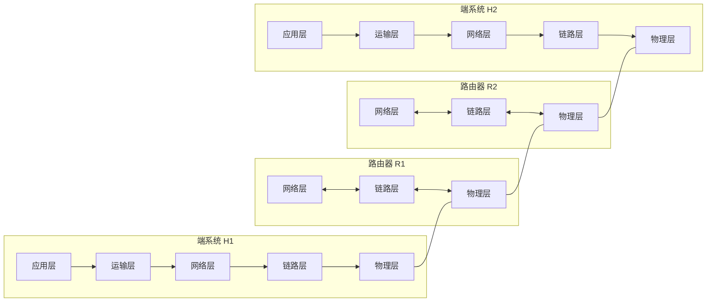
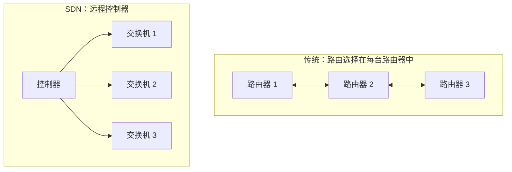
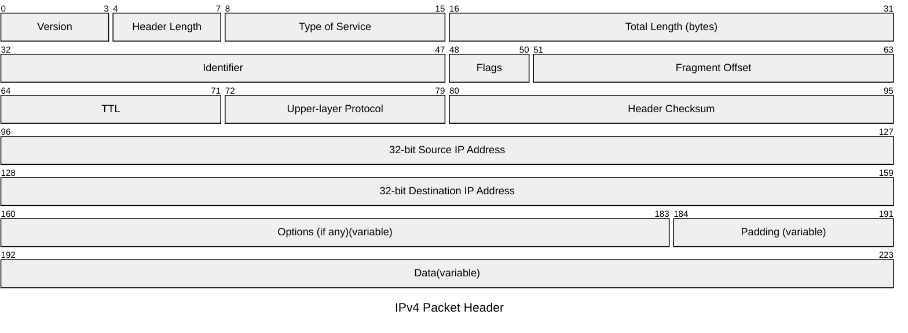
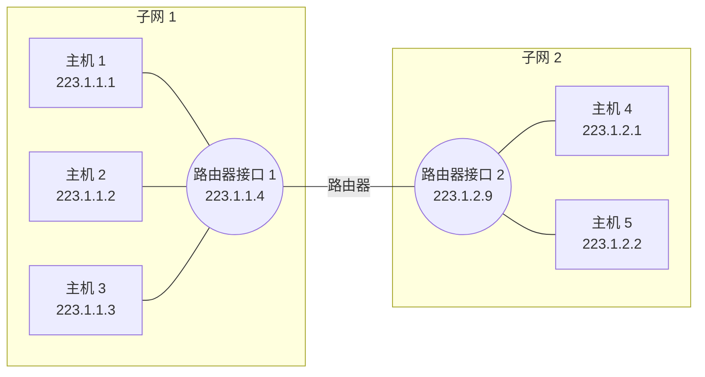
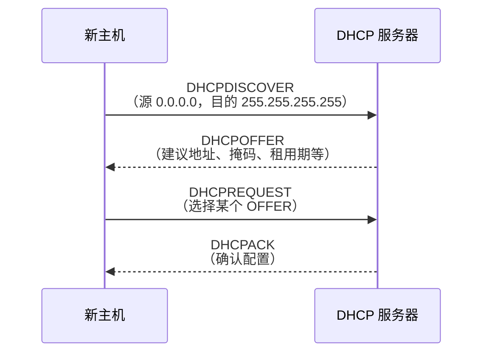
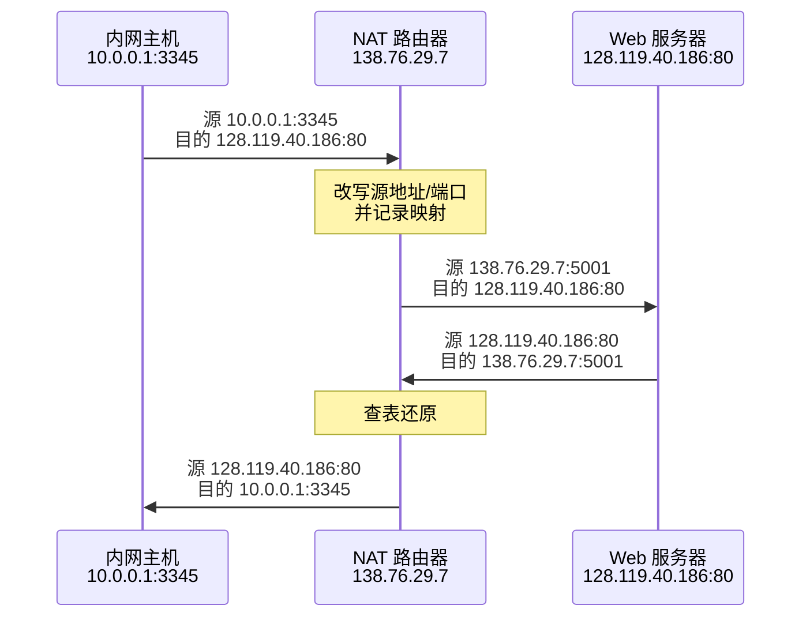
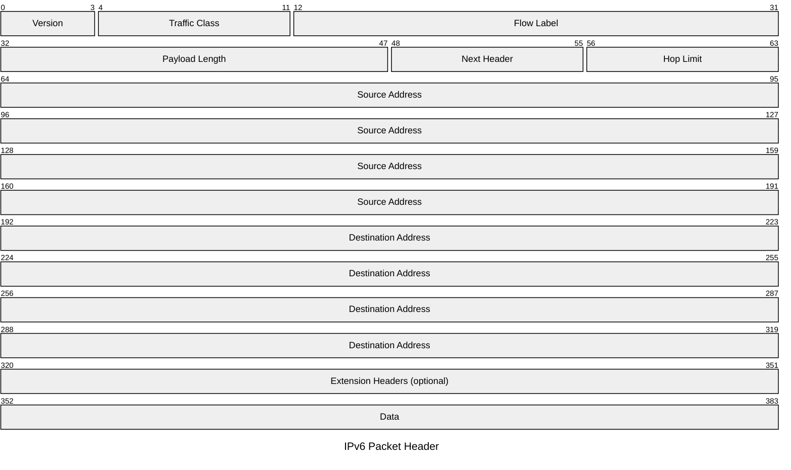
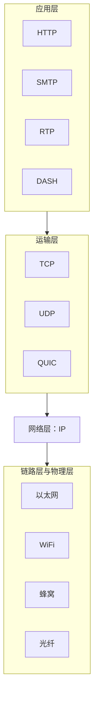

在前一章中我们看到，运输层的报文段必须依靠网络层的主机到主机通信服务，才能从一台端系统到达另一台端系统。运输层工作时并不知道、也不必知道这项服务如何实现。

本章和下一章打开网络层这个"黑盒子"，考察它如何实现主机到主机通信。与只在端系统中实现的应用层、运输层不同，网络层存在于每一台主机和每一个路由器中，必须在亿万台设备上保持一致，因此是协议栈中最具挑战性的部分。

网络层分解为两个相互作用的部分：

| 部分                          | 关注点                                                                   | 内容                                |
| ----------------------------- | ------------------------------------------------------------------------ | ----------------------------------- |
| **数据平面**（data plane）    | 每台路由器的**本地**功能：到达某条输入链路的数据报如何转发到某条输出链路 | 传统 IP 转发、广义转发              |
| **控制平面**（control plane） | **网络范围**的逻辑：数据报沿源到目的的端到端路径如何路由                 | 路由选择算法、OSPF、BGP、SDN 控制器 |

本章研究数据平面，下一章研究控制平面。

> [!important] 本章目标
> 理解网络层数据平面的原理与实现：
>
> 1. 网络层概述：转发与路由选择的区别、转发表，控制平面的传统方法与 SDN 方法
> 2. 路由器工作原理：输入端口、交换结构、输出端口、路由选择处理器；排队与分组调度
> 3. 网际协议 IPv4：数据报格式与分片、编址、CIDR、DHCP、NAT
> 4. IPv6：首部格式、相对 IPv4 的变化，以及迁移
> 5. 广义转发与 SDN：OpenFlow 的匹配加操作模型与流表
> 6. 中间盒：NAT、防火墙与 IDS、性能增强设备，以及 IP 细腰与端到端原则

# 第一部分 路由器机制与 IP 协议

## 4.1 网络层概述

设主机 H1 向 H2 发送信息，路由器就负责在两者之间转发数据报

- 数据平面：负责从其输入链路向其输出链路转发数据报。提供转发能力
- 控制平面：协调转发操作，决定数据报经过的路由器路径。提供转发方向



> [!note] 路由器在数据平面只有缩短的协议栈
> 路由器转发数据报时只涉及网络层及以下，不运行端系统上的应用和运输协议。但路由器的控制平面和管理仍会用到上层协议，如 BGP 运行在 TCP 之上、SNMP 运行在 UDP 之上。

### 4.1.1 转发和路由选择：数据平面和控制平面

网络层要实现"把分组从发送主机移到接收主机"，需要两种功能：转发与路由选择。

- 转发

  分组到达路由器的一条输入链路时，路由器须把它移到适当的输出链路。转发是数据平面**最主要、最常见**的功能。数据平面还包括排队、调度、首部处理（TTL、检验和）、NAT、过滤等。

- 路由选择

  计算分组从源到目的所采用路径的算法称为**路由选择算法**（routing algorithm），在控制平面中实现。

| 概念     | 含义                                                         | 时间尺度 | 实现     | 所在平面 |
| -------- | ------------------------------------------------------------ | -------: | -------- | -------- |
| 转发     | 把分组从输入链路接口移到适当输出链路接口的路由器**本地**操作 |   纳秒级 | 通常硬件 | 数据平面 |
| 路由选择 | 确定分组从源到目的端到端路径的**网络范围**处理               |     秒级 | 通常软件 | 控制平面 |

路由器检查到达分组首部的一个或多个字段值，在**转发表**（forwarding table）中查找，确定输出接口。示例如下：

| 首部值 | 输出接口 |
| ------ | -------: |
| 0100   |        3 |
| 0110   |        2 |
| 0111   |        2 |
| 1001   |        1 |

> [!note] 补充：路由表与转发表
> 路由选择协议计算出的信息保存在**路由表**（RIB），据此生成供数据平面快速查找的**转发表**（FIB）。本章关注给定转发表后路由器内部如何转发，下一章关注表的内容如何算出。

#### 1. 控制平面：传统方法

路由选择算法运行在**每台路由器**中，各路由器通过**路由选择协议**交换路由选择报文，各自算出转发表。若转发表由操作员手工配置，则易出错、对拓扑变化响应慢、不可扩展，因此需要自动的路由选择协议。

#### 2. 控制平面：SDN 方法

**软件定义网络**（Software-Defined Networking，SDN）把控制平面与数据平面明确分离：路由器（分组交换机）只做转发，**远程控制器**计算并分发转发表，二者通过报文通信。控制器在逻辑上集中，物理上可以分布以提高可靠性。网络行为因此更灵活、可编程。



### 4.1.2 网络服务模型

**网络服务模型**定义分组在发送与接收主机之间的端到端传输特性。网络层可能提供的服务：

| 服务                 | 说明                          |
| -------------------- | ----------------------------- |
| 确保交付             | 分组最终到达目的地            |
| 有时延上界的确保交付 | 在特定上界内交付，如 100 ms   |
| 有序交付             | 按发送顺序到达                |
| 确保最小带宽         | 模仿固定比特率链路，如 1 Mbps |
| 安全性               | 源加密、目的解密，提供机密性  |

Internet 网络层只提供**尽力而为服务**（best-effort service）：不保证交付、顺序、时延上界和最小带宽。

看起来，尽力而为只是“根本没有服务”的体面说法。然而，尽管有其他提供更多服务的网络体系结构（如 ATM），Internet 的尽力而为服务与在此基础上构建的运输层协议和应用层协议的结合，也已经经受住了时间的考验，广泛用于多种多样的应用。

## 4.2 路由器工作原理

> [!warning] 术语
> 转发和交换是从业人员经常混用的两个术语，我们之后也经常互换使用。
>
> 分组交换机和路由器也经常被混用，不过我们需要更小心的对待它们。我们约定
>
> - 分组交换机：通用分组交换设备，根据分组首部字段中的值，从输入链路接口到输出链路接口转移分组
>   - 链路层交换机：基于链路层帧中的字段值做出转发决定，因此被称为链路层设备
>   - 路由器：基于网络层数据报中的首部字段值做出转发决定。因此是网络层设备

一台通用路由器有 4 个组件：**输入端口、交换结构、输出端口、路由选择处理器**。

#### 1. 输入端口

**输入端口**（Input Ports）负责接收数据包，并确定其应从哪个输出端口转发，主要承担以下功能：

1. 物理层处理：完成入链路的物理接口连接与信号接收
2. 链路层处理：执行链路层协议所需的处理，使路由器能够与直接相连的链路对端进行通信
3. 转发表查询：查询转发表（Forwarding Table），确定数据包应转发到哪个输出端口，再通过交换结构进行转发
4. 控制分组处理：将携带路由协议信息等控制信息的分组转交给路由选择处理器

> [!note] 端口
> 路由器的**物理**输入、输出端口不同于网络应用和套接字使用的**软件**端口（如 TCP/UDP 端口）。路由器支持的物理端口数量因设备类型而异，运营商边缘路由器通常需要支持大量高速端口。

#### 2. 交换结构

**交换结构**（Switching Fabric）负责连接路由器的输入端口与输出端口，实现数据包在路由器内部的转移。

- 核心功能：根据输入端口的转发结果，将数据包从相应的输入端口传送到目标输出端口
- 作用范围：完全位于路由器内部，可以理解为路由器内部用于交换数据包的网络

#### 3. 输出端口

**输出端口**（Output Ports）负责接收来自交换结构的数据包，并将其发送到对应的出链路。主要功能包括：

1. 缓存数据包：暂存从交换结构接收到的数据包
2. 链路层处理：执行发送数据包所需的链路层功能
3. 物理层处理：将数据包转换为适合在物理链路上传输的信号，并发送出去

对于支持双向通信的链路，通常会在同一线路卡（Line Card）上配置与该链路对应的输入端口和输出端口。

#### 4. 路由选择处理器

**路由选择处理器**（Routing Processor）主要负责路由器的控制平面功能，具体包括：

1. 运行路由协议：执行路由协议，获取网络拓扑及路由信息
2. 维护路由信息：维护路由表及相关的链路状态信息
3. 生成转发表：根据路由信息计算转发表，并安装到输入端口
4. 支持 SDN 架构：在软件定义网络（SDN）路由器中，与远程控制器通信，接收控制器计算的转发表项，并将其安装到路由器的输入端口
5. 网络管理：执行路由器的网络管理功能（5.7）

传统路由器通常由自身的路由选择处理器运行路由协议并计算转发表；在 SDN 架构中，转发决策可以由远程控制器计算，再下发给路由器。

> [!question] 为何数据平面用硬件、控制平面用软件？
> 看时间尺度。100 Gbps 输入链路上 64 字节（512 bit）数据报的到达间隔仅仅为 $512/10^{11}=5.12$ ns；若多个端口共享一块线路卡，处理流水线还须更快。因此转发用专用芯片实现。控制平面以毫秒到秒的尺度运行，用软件实现就足够。

### 4.2.1 输入端口处理和基于目的地转发

查找是输入端口的关键功能。若每个 32 比特目的地址一个表项，会有超过 40 亿个表项，不可行，因此使用**前缀匹配**。

示例：转发表以地址范围给出：

| 目的地址范围                                                                  | 链路接口 |
| ----------------------------------------------------------------------------- | -------: |
| `11001000 00010111 00010000 00000000` ~ `11001000 00010111 00010111 11111111` |        0 |
| `11001000 00010111 00011000 00000000` ~ `11001000 00010111 00011000 11111111` |        1 |
| `11001000 00010111 00011001 00000000` ~ `11001000 00010111 00011111 11111111` |        2 |
| 其他                                                                          |        3 |

可压缩为前缀形式：

| 前缀                         | 链路接口 |
| ---------------------------- | -------: |
| `11001000 00010111 00010`    |        0 |
| `11001000 00010111 00011000` |        1 |
| `11001000 00010111 00011`    |        2 |
| 其他                         |        3 |

注意到存在目的地址 `11001000 00010111 00011000 10101010` 同时匹配 24 位前缀和 21 位前缀。当有多个匹配时，路由器选择**最长前缀匹配**（longest prefix match），即选择匹配位数最多的前缀。

Gbps 速率下，查找须在纳秒级完成，简单线性搜索是远远不够的。不仅要使用硬件执行查找，还应使用快速查找算法。

此外，内存访问延迟也值得关注，采用嵌入式 DRAM 和更快的 SRAM（作为缓存）是常见做法。同时，**三态内容可寻址存储器**（Ternary Content-Addressable Memory, TCAM）也被广泛用于实现高速前缀匹配，可实现 $O(1)$ 查找。

除查找外，输入端口还要检查版本号、检验和、TTL，并重写 TTL 与检验和，更新网络管理计数器。

> [!success] definition：匹配加操作（Match Plus Action）
>
> 基于目的地的转发是“匹配加操作”这一更一般抽象的一个特例：匹配数据包或帧首部中的某些字段，然后执行相应的操作。
>
> | 设备         | 匹配字段                          | 操作                                                                 |
> | ------------ | --------------------------------- | -------------------------------------------------------------------- |
> | 路由器       | 目的 IP 地址                      | 确定下一跳和输出接口，并转发分组                                     |
> | 链路层交换机 | 目的链路层地址（如目的 MAC 地址） | 根据转发表定向转发<br>对未知目的地址、广播帧等，按相应规则泛洪或过滤 |
> | 防火墙       | 源/目的 IP 地址、传输层端口号等   | 根据匹配规则过滤分组，例如丢弃分组                                   |
> | NAT          | 源 IP + 源端口                    | 改写源 IP 与端口，再转发                                             |
>
> 这种“匹配加操作”的抽象广泛应用于现代网络设备，也是**广义转发**（generalized forwarding）的核心概念，将在第 4.4 节进一步讨论。

### 4.2.2 交换

**分组经交换结构**（switching fabric）从输入端口转移到输出端口，主要有以下三种方式：

#### 1. 经内存交换

- 基本机制
  1. 早期路由器由 CPU（路由选择处理器）控制分组交换
  2. 输入端口收到分组后，通过中断通知路由选择处理器
  3. 路由选择处理器将分组复制到内存，提取目的 IP 地址并查询转发表。
  4. 将分组复制到相应输出端口的缓冲区

- 主要瓶颈
  - 在共享系统总线模型中，内存每秒最多可以读入或写出 $B$ 个分组
  - 每个分组都需要经历一次内存写入和一次内存读取，因此总转发吞吐量满足
    $$
    T<\frac{B}{2}
    $$
  - 由于共享系统总线上的读写操作不能同时进行，即使两个分组要转发到不同的输出端口，也不能同时完成上述交换过程

> [!info] 现代的内存交换
> 现代共享内存交换结构可以由输入线路卡上的处理逻辑完成地址查找和内存写入，而不必完全依赖 CPU。

#### 2. 经总线交换

- 基本机制
  1. 输入端口为分组添加交换结构内部使用的标签，指示目标输出端口
  2. 输入端口将分组发送到共享总线上
  3. 所有输出端口都能接收到该分组，但只有标签匹配的输出端口保留它
  4. 输出端口移除内部标签，再继续转发分组

- 主要瓶颈
  - 所有输入端口共享同一条总线，因此单一共享总线一次只能传输一个分组
  - 多个输入端口同时有分组需要交换时，除一个分组外，其他分组必须等待
  - 总体交换速度受到总线带宽的限制

- 适用场景
  - 适用于交换容量要求相对较低的场景

#### 3. 经互联网络交换

互联网络通过多个输入端口、输出端口之间的连接路径实现分组交换，主要包括以下形式。

- 纵横式交换机（Crossbar Switch）
  - 基本结构
    - 具有 $N$ 个输入端口和 $N$ 个输出端口
    - 使用 $N$ 条输入总线和 $N$ 条输出总线，共有 $2N$ 条总线
    - 每条输入总线与每条输出总线的交点构成交叉点，共有 $N^2$ 个交叉点
    - 交换结构控制器可以控制交叉点的开闭，从而建立输入端口到目标输出端口的传输路径

  - 并行交换
    - 不同输入端口的分组可以同时转发到不同输出端口
    - 例如，输入端口 A 向输出端口 Y 转发分组的同时，输入端口 B 可以向输出端口 X 转发另一个分组

  - **非阻塞**性质
    - 只要没有其他分组占用目标输出端口，分组就不会因为交换结构内部缺少可用路径而被阻塞
    - 同一输入端口在一个交换时隙内不能同时向两个输出端口发送两个分组
    - 同一输出端口在一个交换时隙内也不能同时接收两个分组。因此，多个分组争用同一输出端口时，仍然需要排队和调度

- 多级互联网络（Multistage Interconnection Network）
  - 基本机制
    - 使用多个阶段的交换元件构成交换结构
    - 更复杂的结构可以在减少交叉点数量的同时提高并行处理能力，但可能引入内部阻塞或需要重排

- 并行交换结构（Parallel Switching Fabrics）
  - 基本机制
    - 将多个交换结构并行连接到输入端口和输出端口
    - 多个交换结构共同承担分组转发任务，以扩展总体交换容量

| 交换方式       | 特点                                                           |
| -------------- | -------------------------------------------------------------- |
| 经内存交换     | 分组通过内存完成输入到输出的转移，受内存访问和共享总线带宽限制 |
| 经总线交换     | 分组通过共享总线传输，主要受单一总线带宽限制                   |
| 经互联网络交换 | 通过专门的连接网络建立交换路径，可支持多个分组并行转发         |

### 4.2.3 输出端口处理

输出端口从缓存中取出分组，执行链路层和物理层发送功能。当多个输入分组同时发往同一输出端口时，到达速率可能超过输出链路速率，分组须在输出端口排队。

### 4.2.4 何处出现排队

排队因到达速率暂时超过处理或发送速率而产生；缓存耗尽则**丢包**。队列可出现在输入端口和输出端口。

#### 1. 输入排队

假设交换结构速率等于输入线路速率，也就是输出端口一次只能接收一个分组。若两个输入队列的队首分组都发往输出端口 Y，一次只能转发一个，另一个只能等待。

> [!warning] 队头阻塞（HOL）
> 当输入队列的队首分组等待输出端口时，队列中其他分组即使目的地不同，也无法转发，造成**队头阻塞**（head-of-line blocking）。

Karol 指出，采用 FIFO 输入队列、均匀随机到达、$N\to\infty$ 时，吞吐量上限为 $2-\sqrt2\approx58.6\%$，超过后队列将无限增长。

#### 2. 输出排队

当交换结构的总处理速率达到输入线路速率的 $N$ 倍时（$N$ 为输入端口数），可以在理想条件下避免输入端排队。但如果多个输入端口的分组同时发往同一个输出端口，这些分组仍然需要等待。

当输出缓存被占满时，交换机必须根据丢弃策略处理新到达的分组。常见方式包括：

- **弃尾**（Drop-tail）：缓存已满时，直接丢弃新到达的分组
- 其他丢弃策略：根据具体策略丢弃新到达的分组，或移除队列中已有的分组

在缓存填满之前，路由器可以通过主动队列管理提前丢弃分组，或对支持 ECN 的分组设置拥塞标记。

这类**主动队列管理**（Active Queue Management, AQM）策略可以帮助缓解拥塞问题，促使发送方降低发送速率，从而减少排队和丢包的发生。

输出排队的一个直接后果是：输出端口需要一个**分组调度器**，在排队的分组中选择下一个发送的分组。

#### 3. 缓存多大才够用

输入输出端口的缓存大小往往不好决定，传统经验告诉我们：缓存大小 $B$ 应该等于往返时延与链路容量的乘积

$$
B=\text{RTT}\times C
$$

然而，研究表明，若有 $N$ 个 TCP 流共享链路，缓存大小可以缩小为

$$
B=\frac{\text{RTT}\times C}{\sqrt N}
$$

|        | 优点               | 缺点                               |
| ------ | ------------------ | ---------------------------------- |
| 大缓存 | 吸收突发、丢包率低 | 排队时延大、RTT 增大、TCP 响应变慢 |
| 小缓存 | 时延低             | 丢包率高                           |

> [!note] 缓存膨胀（Bufferbloat）
> 假设家庭网络的上行链路容量为 $10\text{ Mb/s}$，平时网络往返时延只有 $20\text{ ms}$。当用户上传大文件时，路由器会不断收到需要发送的数据。如果路由器的缓存过大，来不及发送的数据就会在缓存中排队。
>
> 例如，若缓存中积累了 $8\text{ Mb}=1\text{ MB}$ 的数据，那么仅这些数据就需要
>
> $$
> \frac{8\text{ Mb}}{10\text{ Mb/s}}
> \approx800\text{ ms}
> $$
>
> 才能发送完。此时，原本只有 $20\text{ ms}$ 的网络请求，可能因为排队而增加数百毫秒的延迟。
>
> 用户仍然可以正常上传文件，但网页点击、语音通话和在线游戏的响应会明显变慢。这就是**缓存膨胀（bufferbloat）**：过大的缓存虽然能够吸收流量突发、减少丢包，却可能造成严重的排队时延。

### 4.2.5 分组调度

分组调度决定路由器按照什么顺序，将输出队列中的分组发送到输出链路。

#### 1. FIFO（First-In-First-Out，先进先出）

- **队列结构：** 单个队列
- **基本规则：** 按照分组到达输出队列的先后顺序进行传输
- **工作机制：**
  1. 新到达的分组加入队列尾部
  2. 链路空闲时，传输队首分组
  3. 分组传输完成后，将其移出队列，再处理下一个分组
- **特点：**
  - 实现简单，顺序公平。
  - 不区分分组的优先级。
  - 如果没有分组等待，链路可以保持空闲。

#### 2. 优先队列（Priority Queuing）

- **队列结构：** 多个不同优先级的队列，例如高优先级队列和低优先级队列
- **基本规则：** 每次选择分组时，优先从最高优先级的非空队列中取出分组
- **工作机制：**
  1. 分组到达时，根据预先设置的规则确定其优先级
  2. 分组进入对应的优先级队列
  3. 链路空闲时，优先传输最高优先级非空队列中的分组
  4. 同一优先级队列内部通常采用 FIFO
- **特点：**
  - 可以优先处理实时语音、网络控制等重要流量
  - 低优先级分组可能等待较长时间；如果高优先级流量持续不断，低优先级分组甚至可能出现饥饿现象
  - 通常采用**非抢占式调度（non-preemptive）**：分组开始传输后，不会因为更高优先级的分组到达而中断

#### 3. 轮转调度（Round-Robin，RR）

- **队列结构：** 多个队列，每个队列对应一个分组类别
- **基本规则：** 按照固定顺序轮流检查各个队列，每轮从每个非空队列中取出一个分组进行传输
- **工作机制：**
  1. 依次访问不同类别的队列
  2. 每次从当前非空队列中取出队首分组
  3. 该分组传输完成后，转向下一个队列
  4. 如果轮到某个队列时，该队列为空，则跳过它，继续检查下一个队列
- **特点：**
  - 不同类别可以轮流获得服务，避免调度器始终只服务某一个队列。
  - 在基本 RR 中，各个非空队列每轮获得一次发送机会。
  - **RR 是工作守恒的（work-conserving）**：只要至少有一个队列中存在等待传输的分组，链路就不会仅仅因为轮到空队列而闲置。
  - 每轮服务一个分组并不意味着不同类别获得的带宽一定相等；分组大小、到达情况等因素都会影响实际带宽分配。

#### 4. 加权公平排队（Weighted Fair Queuing，WFQ）

- **队列结构：** 多个队列，每个队列对应一个分组类别 $i$
- **基本规则：** 根据不同类别的权重，分配链路的服务份额，而不只是让每个队列轮流发送一个分组
- **参数说明：**
  - $R>0$：输出链路总传输速率
  - $U=\{1,2,\dots,N\}$：分组类别集合
  - $w_i>0$：$w_i$ 表示类别 $i$ 的权重，$w: U\to \mathbb{R}^{>0}$
  - $$
    S(t)=\{i\in U\mid Q_i(t)>0\}
    $$
    其中 $Q_i(t)$ 表示时刻 $t$ 时类别 $i$ 队列中的待传输数据量

- 广义处理器共享（Generalized Processor Sharing, GPS）理想模型下的服务速率：对任意时刻 $t$，若 $S(t)\neq\varnothing$，则对每个 $i\in S(t)$，其服务速率为

  $$
  R_i(t) =R\frac{w_i}{\displaystyle\sum_{j\in S(t)}w_j} \geq R\frac{w_i}{\displaystyle\sum_{j\in U}w_j}
  $$

- **示例：**
  假设链路速率为 $R=12\text{ Mbps}$。类别 1 的权重为 2，类别 2 的权重为 1，并且两个类别都有分组持续等待。类别 1 的理想化服务速率为

  $$
  12\times\frac{2}{2+1}=8\text{ Mbps}
  $$

  类别 2 的理想化服务速率为

  $$
  12\times\frac{1}{2+1}=4\text{ Mbps}
  $$

  因此，两个类别按照 **2:1** 的比例分享链路速率。

- **特点：**
  - 可以根据业务需求为不同类别分配不同权重。
  - 高权重类别在竞争服务时，获得的理想化服务份额更大。
  - GPS 是连续共享服务的理想模型，实际网络中的 WFQ 则通过分组调度近似实现这种公平分配。

## 4.3 网际协议：IPv4、寻址、IPv6 及其他

Internet 网络层的关键协议是网际协议（IP），目前有 IPv4 与 IPv6 两个版本在使用。

### 4.3.1 IPv4 数据报格式

网络层分组称为**数据报**（datagram）。IPv4 首部（无选项时 20 字节）布局如下，每行 32 比特：



| 字段               | 说明                                                                                      |
| ------------------ | ----------------------------------------------------------------------------------------- |
| 版本 4bit          | IPv4 为 4                                                                                 |
| 首部长度 4bit      | 以 32 比特字为单位，无选项时为 5（20 字节），也指示数据从何处开始                         |
| 服务类型 8bit      | TOS 现代定义为 **DSCP**（6 bit，区分服务类型）+ **ECN**（2 bit，显式拥塞通告）            |
| 数据报长度 16bit   | 首部 + 数据的总字节数，最大 65535，实际受链路 MTU 限制                                    |
| 标识、标志、片偏移 | 用于分片，见下                                                                            |
| TTL 8bit           | 每经一台路由器减 1，为 0 时丢弃（并回送 ICMP 超时报文，见 1.4.3 节 Traceroute），防止环路 |
| 协议 8bit          | 指示数据交给哪个上层协议                                                                  |
| 首部检验和 16bit   | 只检测 IP 首部，算法同 3.3.2 节。TTL 每跳都变，故路由器每跳须重算                         |
| 选项 （可变长度）  | 扩展首部，很少使用                                                                        |
| 填充 （可变长度）  | 使首部长度为 32 bit 的整数倍                                                              |

| 协议号 | 上层协议                       |
| -----: | ------------------------------ |
|      1 | ICMP                           |
|      6 | TCP                            |
|     17 | UDP                            |
|     41 | IPv6 封装（隧道，见 4.3.4 节） |

协议号是粘合网络层与运输层的"胶水"，作用类似端口号粘合运输层与应用层，也类似链路层帧中的类型字段。

> [!note] IP 与 TCP/UDP 都做差错检测的原因
>
> - IP 只覆盖 IP 首部，TCP/UDP 覆盖整个报文段
> - TCP/UDP 原则上不必与 IP 属于同一协议栈
> - 数据在路由器内存中也可能出错（3.3.2 节端到端原则）。

#### IP 分片

不同链路的 **MTU**（链路可承载的最大 IP 数据报长度）不同。数据报大于出链路 MTU 时，须分成多个**片**（fragment），每片是独立的数据报。片只在**目的主机**重组：

- 同一数据报的各片有相同的**标识**
- **标志**中 DF 位为 1 表示禁止分片，路由器遇到大于 MTU 的数据报时丢弃，并回送 ICMP "需要分片"消息
- **标志**中 MF 位为 1 表示后面还有片，最后一片为 0
- **片偏移**以 8 字节为单位，指示该片数据在原数据报数据中的位置，因此除最后一片外，每片数据长度须为 8 的倍数

例：4000 字节数据报（20 字节首部 + 3980 字节数据），出链路 MTU = 1500，每片最多 $1500-20=1480$ 字节数据（恰为 8 的倍数）：

| 片  | 数据长度 | 总长度 | 片偏移 |  MF |
| --- | -------: | -----: | -----: | --: |
| 1   |     1480 |   1500 |      0 |   1 |
| 2   |     1480 |   1500 |    185 |   1 |
| 3   |     1020 |   1040 |    370 |   0 |

若任意一片丢失，整个数据报作废，因此分片对性能不利；IPv6 取消了路由器分片（4.3.4 节）。

### 4.3.2 IPv4 编址

IPv4 地址长 32 比特，共 $2^{32}\approx40$ 亿个，用点分十进制记法，如 `193.32.216.9` 即 `11000001 00100000 11011000 00001001`。

> [!success] Definition Interface
> 主机与物理链路之间的边界称为**接口**（interface）。
>
> 主机通常只有一个接口，路由器则有多个。IP 地址与**接口**相关联，而不是与主机或路由器本身相关联。

这些接口的 IP 地址不能随意选择。一个接口的 IP 地址的一部分由其连接的子网决定。

连到同一个网络的若干主机接口和一个路由器接口具有相同的**前缀**（prefix），构成一个**子网**（subnet）。



IP 编址为子网 1 分配一个地址 `223.1.1.0/24`，其中的`/24`记号也称为**子网掩码**（subnet mask）的 CIDR 表示法，表示前 24 比特是定义了子网的网络前缀，后 8 比特用于子网内主机接口。

> [!note] 子网掩码
> 子网掩码是一个 32 比特的二进制数，前 $x$ 位为 1，后 $32-x$ 位为 0。子网掩码与 IP 地址按位与运算，得到网络前缀。`/24` 的子网掩码为 `11111111.11111111.11111111.00000000`，即 `255.255.255.0`。

> [!tip] 识别子网
> 把每个接口从主机或路由器上分开，得到若干孤立的网络岛，每个岛就是一个子网。点对点链路本身也构成一个子网。

原则上，不同的子网可以有完全不同的网络前缀。不过，同个公司或组织的不同子网通常具有类似的网络前缀。

#### 1. CIDR 编址

因特网的地址分配策略称为**无类别域间路由**（Classless Inter-Domain Routing，CIDR，发音为“cider”）。CIDR 将子网寻址的概念进一步推广。

CIDR 地址格式：

$$
a.b.c.d/x
$$

- 前 $x$ 位是**网络前缀**（network prefix），标识一个组织或网络。
- 后 $32 - x$ 位用于区分该组织内部的主机（以及可能的子网）。

组织通常被分配一块**连续的地址空间**（即具有相同前缀的地址范围）。组织内部所有设备的 IP 地址都共享这个共同前缀。

组织外部的路由器在转发发往该组织的数据报时，**只需查看前 $x$ 位**即可。因此，外部路由器的转发表中只需一条形如 `a.b.c.d/x` 的条目，就能覆盖整个组织。这大大减小了转发表的规模。

组织内部的路由器则需要进一步查看剩余的 $32 - x$ 位，以完成更精细的转发。这些低位比特还可以继续进行子网划分。

CIDR 最大的优势是**地址聚合**（也叫路由聚合）。一个 `/x` 的地址块可以包含 $2^{y-x}$ 个 `/y` 的地址块。

**典型例子**：  
ISP Fly-By-Night-ISP 拥有地址块 `200.23.16.0/20`。该块包含 $2^{23-20} = 8$ 个连续的 `/23` 块，可分配给 8 个组织：

| 组织 | 地址块           |
| ---- | ---------------- |
| 0    | `200.23.16.0/23` |
| 1    | `200.23.18.0/23` |
| 2    | `200.23.20.0/23` |
| …    | …                |
| 7    | `200.23.30.0/23` |

每个 `/23` 块包含 $2^9 = 512$ 个地址（第三字节每次增加 2）。

外界路由器只需维护一条路由：`200.23.16.0/20` → 交给 Fly-By-Night-ISP，就能覆盖全部 8 个组织的地址。

如果组织 1 后来改接到另一家 ISP（ISPs-R-Us），ISPs-R-Us 会通告更具体的路由 `200.23.18.0/23`。外部路由器根据**最长前缀匹配**原则，会把发往该块的分组优先交给 ISPs-R-Us，而不是原来的 `/20` 路由。

CIDR 出现之前，Internet 采用**分类编址**（classful addressing）：

- A 类：网络部分 8 位（`/8`）
- B 类：网络部分 16 位（`/16`）
- C 类：网络部分 24 位（`/24`）

这种固定长度的划分带来严重问题：

- C 类（`/24`）最多只能容纳 $2^8 - 2 = 254$ 台主机，对很多组织来说太小。
- B 类（`/16`）可支持约 65,534 台主机，对中小型组织来说又太大。

例如，一个只有 2000 台主机的组织往往被分配整个 B 类地址，导致大量地址浪费，并加速了 B 类地址空间的耗尽。CIDR 通过灵活的前缀长度彻底解决了这个问题。

| 特殊地址                                            | 用途                                 |
| --------------------------------------------------- | ------------------------------------ |
| `10.0.0.0/8`<br>`172.16.0.0/12`<br>`192.168.0.0/16` | 私有地址（RFC 1918）                 |
| `127.0.0.0/8`                                       | 回环地址                             |
| `169.254.0.0/16`                                    | 链路本地地址（APIPA）                |
| `0.0.0.0`                                           | 未指定地址（如 DHCP 发现报文源地址） |
| `255.255.255.255`                                   | 受限广播地址（本子网所有主机）       |

#### 2. 组织如何获得地址块

组织通常向其 ISP 申请一段地址。ISP 从自己已获得的更大地址块中划分出一部分分配给该组织。

ISP 自身的地址块又从哪里来？全球 IP 地址空间由 **ICANN**（Internet Corporation for Assigned Names and Numbers）统一管理。ICANN 根据 [RFC 7020] 的指导原则，将地址分配给五大**区域互联网注册机构**（Regional Internet Registries, RIR）：

| 地区 | 北美 | 欧洲     | 亚太  | 拉丁美洲 | 非洲    |
| ---- | ---- | -------- | ----- | -------- | ------- |
| RIR  | ARIN | RIPE NCC | APNIC | LACNIC   | AFRINIC |

各 RIR 再负责本地区 ISP 与组织的地址分配与管理。

ICANN 参与 DNS 根区管理与根服务器系统协调，并运营 L-Root；全球根服务器系统由多个独立组织共同运营。

> [!info]
> IANA 的 IPv4 空闲地址池已于 2011 年正式耗尽。这是推动 NAT 大规模部署和 IPv6 加速发展的直接原因。

#### 3. 主机如何获得地址：DHCP

组织获得地址块后，路由器接口地址通常由管理员手动配置；主机地址则普遍通过**动态主机配置协议**（Dynamic Host Configuration Protocol，DHCP）自动获取。

DHCP 可自动为新加入网络的主机分配：

- IP 地址
- 子网掩码
- 默认网关（第一跳路由器）
- 本地 DNS 服务器地址

因此 DHCP 常被称为**即插即用**（plug-and-play）或**零配置**（zero-conf）协议。它特别适合主机频繁加入/离开的场景（如宿舍、图书馆、企业网、无线局域网）。

##### 协议基本特点

- 运行在 **UDP** 之上
- 服务器端口：**67**
- 客户端端口：**68**
- 客户端-服务器模型
- 每个子网可有 DHCP 服务器；若无，则由路由器上的 **DHCP 中继代理**（relay agent）转发请求

##### 四步交互过程



1. **DHCP Discover**  
   新主机尚无 IP 地址，发送广播报文（源地址 `0.0.0.0`，目的地址 `255.255.255.255`）寻找 DHCP 服务器。

2. **DHCP Offer**  
   服务器（可能有多台）用广播或单播回复，提供建议的 IP 地址、子网掩码、租用期（lease time，常见为数小时到数天）等信息。

3. **DHCP Request**  
   客户端选择其中一个 Offer，再次广播请求，确认所选配置。

4. **DHCP ACK**  
   服务器确认分配，交互完成。客户端即可在租用期内使用该地址。

租用期到期前，客户端可申请续租。管理员也可配置“固定绑定”，让特定主机每次都获得相同 IP。

> [!note] DHCP 的局限性
> 主机移动到新子网时会获得**新的 IP 地址**，从而导致已有 TCP 连接中断。移动 IP、蜂窝网络等技术可解决此问题（见后续章节）。

### 4.3.3 网络地址转换 NAT

随着家庭/小型办公室（SOHO）网络的普及，每台设备（手机、平板、打印机、智能电视等）都需要 IP 地址。若每个家庭都向 ISP 申请独立的公网地址块，会面临两个问题：

- ISP 可能已无足够连续的公网地址可分配
- 普通用户根本不想（也不该）自己管理 IP 地址

**NAT**（Network Address Translation）使专用网络使用私有地址（如 `10.0.0.0/8`），经一个或少量公网地址访问Internet 。私有地址只在本地网络内有意义，不会出现在公网。

NAT 路由器对外表现为一个具有单一 IP 地址的设备。所有从家庭出去的流量源地址都是 NAT 路由器的公网地址；所有进入家庭的流量目的地址也必须是该公网地址。内部网络的细节被完全隐藏。

NAT 路由器的工作：关键在于 **NAT 转换表**，它同时记录 **IP 地址 + 端口号** 的映射。

**出站方向**（内网 → 公网）：

1. 内网主机发送报文（源 IP:端口 = 私有地址:本地端口）
2. NAT 路由器改写：
   - 源 IP → 自己的公网 IP
   - 源端口 → 一个当前未使用的新端口
3. 在转换表中记录映射关系
4. 重新计算 IP 与运输层校验和后发出

**入站方向**（公网 → 内网）：

1. 外部服务器回复的报文目的地址是 NAT 的公网 IP + 新端口
2. NAT 路由器查表，还原为原来的私有地址:本地端口
3. 改写后转发到内网主机

端口号有 16 bit，故单个公网地址最多支持约 6 万个并发连接。



NAT 的优点：

- 极大缓解 IPv4 地址短缺
  - 甚至部分运营商也会使用 NAT （Carrier-grade NAT, CGN）将本就由 NAT 连接的家庭网络再 NAT 到运营商的公网地址。两层 NAT 极大节约了 IPv4 地址
- 更换 ISP 时内网无需重新编号
- 部署简单，对用户几乎透明
- 客观上隐藏了内部网络结构（但这不是安全机制）

> [!warning] 主要批评
>
> 1. **端口号被误用为主机寻址**
>
>    端口本应用于标识进程，NAT 却用它区分主机。这导致：
>    - 内网服务器难以被外部主动访问
>    - P2P 应用需要额外的 **NAT 穿越**技术（STUN、TURN、UPnP、ICE 等）
>
> 2. **违反分层与端到端原则**
>
>    路由器本应只处理到网络层，NAT 却修改了运输层端口号，破坏了“主机直接对话、中间节点不改地址”的端到端透明性。
>
> 这些问题在 IPv6 大规模部署后可从根本上缓解，但目前 NAT 仍是现实网络中不可或缺的技术。

### 4.3.4 IPv6

IPv6 的主要动机是 IPv4 地址空间耗尽。地址由 32 比特扩到 128 比特，首部也简化。

**地址表示**：8 组 16 比特，每组 4 位十六进制，用冒号分隔，如 `2001:0db8:0000:0000:0000:0000:0000:0001`。每组前导 0 可省略，连续的全 0 组可用 `::` 压缩，但**只能压缩一次**，上例可写为 `2001:db8::1`。

除单播、组播外，IPv6 新增了任播（anycast）地址：数据报会被投递到一组主机中的任意一台（通常是路由意义上“最近”的一台）。

#### 1. IPv6 数据报格式

**IPv6 首部**固定 40 字节，每行 32 比特：



| 字段             | 长度        | 说明                                                                               |
| ---------------- | ----------- | ---------------------------------------------------------------------------------- |
| 版本             | 4 比特      | 版本号，值为 6                                                                     |
| 流量类型         | 8 比特      | 类似 IPv4 的 TOS，用于区分优先级                                                   |
| 流标签           | 20 比特     | 标识数据流，供支持该机制的网络设备识别和进行特定处理（如实时音视频、高优先级业务） |
| 有效载荷长度     | 16 比特     | 40 字节固定首部之后的字节数                                                        |
| 下一个首部       | 8 比特      | 指示载荷交给哪个协议（TCP/UDP 等），也用于链接扩展首部                             |
| 跳限制           | 8 比特      | 类似 TTL，每经过一跳减 1，减到 0 则丢弃                                            |
| 源地址和目的地址 | 各 128 比特 | 源地址和目的地址                                                                   |
| 扩展首部         | 可变        | 选项不再放在基本首部中，而是以扩展首部的形式通过“下一个首部”字段链式链接。         |

与 IPv4 相比，IPv6 的主要变化：

| 变化             | 说明                                                                                                                    |
| ---------------- | ----------------------------------------------------------------------------------------------------------------------- |
| 地址扩大         | 128 比特，并新增**任播**地址                                                                                            |
| 定长 40 字节首部 | 处理更快                                                                                                                |
| 流标签           | 支持对特定流进行特殊处理（QoS、实时服务等）                                                                             |
| 取消路由器分片   | 只能由源主机分片。数据报太大时，路由器丢弃并回送 ICMPv6"分组太大"，源用更小数据报重发。IPv6 要求链路 MTU 至少 1280 字节 |
| 取消首部检验和   | 依赖链路层和运输层的检验和；因此 UDP 在 IPv6 中校验和变为强制                                                           |
| 选项外置         | 以扩展首部形式通过"下一个首部"链接                                                                                      |
| ICMPv6           | ICMP 的全新版本，功能更强大                                                                                             |

#### 2. 从 IPv4 到 IPv6 的迁移

技术的更新总不是一蹴而就的。目前最常用的两种过渡技术是：

- **双栈**（dual-stack）：节点同时运行 IPv4 和 IPv6 协议栈，根据对端能力选择使用哪种协议
- **隧道**（tunneling）：两台 IPv6 节点之间隔着 IPv4 网络时，把完整的 IPv6 数据报封装进 IPv4 数据报的载荷中进行传输。

  ```mermaid
  flowchart LR
      A["IPv6 节点 A"] --> B["隧道入口 B"]
      B -->|"IPv4 封装 IPv6<br>协议号 41"| C["IPv4 路由器"]
      C --> D["IPv4 路由器"]
      D --> E["隧道出口 E"]
      E -->|"解封装"| F["IPv6 节点 F"]
  ```

  - 隧道入口把整个 IPv6 数据报放入 IPv4 载荷，目的地址设为隧道出口
  - 中间 IPv4 路由器只按普通 IPv4 转发，完全不知道内部是 IPv6
  - 隧道出口解封装后继续按 IPv6 转发

> [!note] 部署现状
> IPv6 部署初期进展缓慢，但近年持续加速。根据公开统计：
>
> - Google 客户端 IPv6 访问比例已接近或超过 50%；
> - 各国差异较大，部分经济体终端侧采用率已达 40%–60%
>
> IPv4 + NAT 显著延长了 IPv4 的寿命，IPv4 与 IPv6 共存的时代或许迟迟不会结束。
>
> 网络层协议的变更极其困难（像给房子换地基），而应用层新协议的部署则相对容易（像给房子刷漆）。未来网络层的演进仍会缓慢发生，但时间尺度远长于应用层的变化。

# 第二部分 广义转发、中间盒与互联网架构

## 4.4 广义转发和 SDN

传统目的地址转发只根据目的 IP 地址做“匹配 → 转发到某输出端口”。**广义转发**（Generalized Forwarding）将其扩展为更强大的 match-plus-action 范式：

- Match：可匹配多个协议层的多个首部字段（甚至入端口）
- Action：可执行转发、丢弃、改写首部、复制到多个端口等多种动作

这种抽象由远程控制器统一计算并下发到各交换机的**流表**（flow table）中，正是 **SDN**（Software-Defined Networking）的核心思想。OpenFlow 是最早也是最有影响力的实现这一抽象的标准。

每个 OpenFlow 流表项包含三部分：

1. 匹配字段（Match Fields）：首部字段值的集合，入分组将与之匹配
2. 计数器（Counters）：记录与该流表项匹配的分组数量，以及表项最近一次更新以来经过的时间等信息
3. 操作（Actions）：指定匹配成功后要执行的处理；一个表项可以包含零个或多个动作

> [!tip] 流表是一个 API
> 流表本质上是一个API，经由这种抽象，每台分组交换机的行为能够被编程，乃至改变整个网络的行为。

### 4.4.1 匹配

OpenFlow 1.0 可匹配的字段跨越链路层、网络层和运输层（后续版本已扩展到更多字段）：

| 层级   | 可匹配字段                                                 |
| ------ | ---------------------------------------------------------- |
| 链路层 | 入端口、源 MAC、目的 MAC、以太网类型、VLAN ID、VLAN 优先级 |
| 网络层 | 源 IP、目的 IP、IP 协议号、IP TOS                          |
| 运输层 | TCP/UDP 源端口、TCP/UDP 目的端口                           |

- 支持通配符（例如 `128.119.*.*`）
- 每条流表项有优先级，多条匹配时选最高优先级的
- 未匹配的分组可丢弃或送往控制器

OpenFlow 如此明目张胆地违法我们之前所学的分层原则，使得同一设备既能做三层路由，也能做二层交换。

### 4.4.2 操作

匹配成功后可执行的主要动作包括：

- **转发**：转发到指定物理端口、广播、组播，或上送给远程控制器
- **丢弃**：没有操作的流表项表明某个匹配的分组应当被丢弃
- **修改字段**：改写最多 10 个首部字段（除 IP 协议号外），然后再转发

动作可组合，并按指定顺序执行。

> [!warning] table-miss
> 分组不匹配任何表项时的行为由交换机配置决定：OpenFlow 1.0 默认上送控制器，1.3 起若无 table-miss 表项则丢弃。下文的例子中，未匹配的分组都被丢弃。

### 4.4.3 运行中的匹配加操作：OpenFlow 例子

网络：

- 主机 h1\~h6 连到交换机 s1\~s3（各有 4 个接口），控制器集中下发流表
- h1`10.1.0.1`、h2`10.1.0.2`、h3`10.2.0.3`、h4`10.2.0.4`、h5`10.3.0.5`、h6`10.3.0.6`

  | 分组交换机 | 端口1 | 端口2 | 端口3 | 端口4 |
  | :--------: | :---: | :---: | :---: | :---: |
  |     s1     |  s3   |  h1   |  h2   |  s2   |
  |     s2     |  s3   |  s1   |  h3   |  h4   |
  |     s3     |  h6   |  h5   |  s1   |  s2   |

#### 简单转发

要求：来自 h5/h6 且目的地址为 h3/h4 的分组，采用 s3 → s1 → s2 的路径，避免使用 s3 与 s2 之间的直连链路。

| 交换机 | 匹配                                                   | 操作       |
| ------ | ------------------------------------------------------ | ---------- |
| s3     | `IP Src=10.3.*.*`；`IP Dst=10.2.*.*`                   | Forward(3) |
| s1     | `Ingress Port=1`；`IP Src=10.3.*.*`；`IP Dst=10.2.*.*` | Forward(4) |
| s2     | `Ingress Port=2`；`IP Dst=10.2.0.3`                    | Forward(3) |
| s2     | `Ingress Port=2`；`IP Dst=10.2.0.4`                    | Forward(4) |

s1 的表项同时匹配入端口与 IP 地址，这是传统基于目的地转发做不到的。

#### 均衡负载

要求：目的为 `10.1.*.*` 的分组中，来自 h3 的走 s2–s1 链路，来自 h4 的走 s2–s3 链路。

| 交换机 | 匹配                                | 操作       |
| ------ | ----------------------------------- | ---------- |
| s2     | `Ingress Port=3`；`IP Dst=10.1.*.*` | Forward(2) |
| s2     | `Ingress Port=4`；`IP Dst=10.1.*.*` | Forward(1) |

这种基于入端口（源）的行为，仅靠目的 IP 转发无法实现。

#### 防火墙

要求：s2 只允许来自 s3 所连主机的流量进入。

| 交换机 | 匹配                                 | 操作       |
| ------ | ------------------------------------ | ---------- |
| s2     | `IP Src=10.3.*.*`；`IP Dst=10.2.0.3` | Forward(3) |
| s2     | `IP Src=10.3.*.*`；`IP Dst=10.2.0.4` | Forward(4) |

没有其他表项时，其余分组被丢弃。

通过改变流表规则，同一组分组交换设备即可实现不同的逻辑行为，而不必把每种功能都固化成独立的专用设备

> [!note] 更高的可编程性
> 匹配加操作流表的可编程性其实相当有限。要是如一般的编程语言那样，拥有变量、算术、逻辑、函数和条件语句，以及专门为以线速处理数据报而设计的结构，那就再好不过了。
>
> 编程协议独立的分组处理器（Programmable Protocol-Independent Packet Processors，P4）于是应运而生，引发了不小的关注。

### 4.4.4 中间盒

> [!success] definition：中间盒（middlebox）
> RFC 3234：在源主机与目的主机之间的数据路径上，执行**除 IP 路由器标准功能以外**其他功能的中间设备或功能实体。

| 功能类别 | 典型例子                                    |
| :------: | ------------------------------------------- |
| 地址转换 | 网络地址转换（NAT）                         |
| 安全服务 | 防火墙、入侵检测系统（IDS）、应用层邮件过滤 |
| 性能增强 | 压缩、内容缓存、负载均衡                    |

#### 1. 防火墙

**防火墙**位于内部网络与Internet 之间，检查分组并丢弃可疑分组，分三类：

| 类型             | 机制                                                         |
| ---------------- | ------------------------------------------------------------ |
| 无状态分组过滤器 | 逐个分组检查：源/目的 IP、端口、协议类型、TCP 标志位等       |
| 有状态过滤器     | 跟踪连接状态，只放行属于已建立连接的分组                     |
| 应用网关         | 在应用层检查并转发，如要求用户先认证才能向外建立 Telnet 会话 |

规则示例：

| 策略                                           | 设置                                                 |
| ---------------------------------------------- | ---------------------------------------------------- |
| 禁止进入的 Web 访问                            | 丢弃所有目的端口为 80 的进入分组                     |
| 禁止进入的 TCP 连接，发往内部 Web 服务器的除外 | 丢弃所有进入的 TCP SYN，除非目的为该服务器的 80 端口 |
| 阻止进入的 UDP 流量，DNS 除外                  | 丢弃进入的 UDP 分组，目的端口 53 的除外              |

#### 2. 入侵检测系统

**入侵检测系统**（Intrusion Detection System，IDS）执行**深度分组检查**，检查首部和有效载荷，分特征检测（匹配已知攻击特征）与异常检测（发现统计上异常的流量）两类，发现可疑时产生警报。**入侵防止系统**（Intrusion Prevention System，IPS）还会直接阻塞分组。

#### 3. 网络功能虚拟化

中间盒增多使运营管理成本上升。**网络功能虚拟化**（NFV）把中间盒功能软件化，运行在通用服务器上，也可部署在云中。

## 4.5 互联网架构原则

Internet 的巨大成功吸引了大量研究者和工程师的关注。RFC 1958 总结了 Internet 的设计原则：

- **目标是连接**：Internet 的目标是连接，而不是提供某种特定服务
- **工具是 IP**：IP 协议是唯一的工具
- **智能在端到端**：智能应放在通信端点，而不是隐藏在网络中

### 4.5.1 IP 细腰

互联网协议栈呈现明显的“细腰”形状：物理层、链路层、运输层、应用层协议种类繁多，但网络层只有一个协议——**IP**。



不过，随着中间盒的出现，它的“细腰”可能确实会变宽一些（中年发福？）。

### 4.5.2 端到端原则

某些功能只有在通信端点具备应用所需的完整信息时，才能被正确、完整地实现；因此，这些功能应主要由端系统负责，而不能完全依赖网络内部设备。

例如在可靠传输中，分组可能因链路故障、路由器故障或缓存相关问题而在网络中丢失。网络层无法知道哪些分组丢失了，也无法知道哪些分组是重复的。即使一些链路层协议可以提供局部差错控制，也无法保证端到端的可靠性。只有通信双方的应用层才能知道哪些分组是丢失的，哪些是重复的，从而实现可靠传输。

中间盒的兴起一定程度上挑战了端到端原则，也引发了持续的架构讨论。

## 4.6 小结

本章聚焦网络层的数据平面，即每台路由器如何决定“把到达某个输入端口的分组转发到哪个输出端口”。

- **转发与路由选择**：转发是数据平面的本地操作（纳秒级、硬件），路由选择是控制平面的网络范围过程（秒级、软件）；转发表把首部值映射为输出接口，**最长前缀匹配**选择最具体的表项
- **路由器**：输入端口、交换结构、输出端口、路由选择处理器协同工作；交换可经内存、总线或互联网络；排队可发生在输入端口（含 HOL）或输出端口；缓存需权衡丢包与时延（$RTT\cdot C/\sqrt N$），AQM 与调度（FIFO、优先权、RR、WFQ）管理排队
- **IPv4**：数据报字段各司其职，**分片**由标识、标志、片偏移实现，仅在目的主机重组；编址基于接口与子网，CIDR 聚合地址，DHCP 即插即用，NAT 以私有地址加端口复用公网地址
- **IPv6**：128 比特地址，固定 40 字节首部，取消路由器分片和首部检验和，引入流标签；以双栈和隧道迁移
- **广义转发与 SDN**：OpenFlow 用匹配 + 操作的流表抽象，可统一实现转发、丢弃、改写首部等多种功能。远程控制器集中计算并下发流表，实现网络行为的可编程
- **中间盒与互联网架构**：NAT、防火墙、IDS、缓存在数据路径上执行转发以外的功能；IP 细腰与端到端原则是理解 Internet 架构的关键

|          | 转发       | 路由选择 |
| -------- | ---------- | -------- |
| 平面     | 数据平面   | 控制平面 |
| 范围     | 路由器本地 | 网络范围 |
| 实现     | 硬件       | 软件     |
| 时间尺度 | 纳秒       | 秒       |
