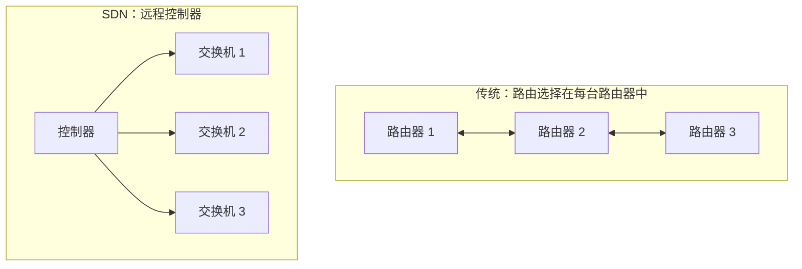
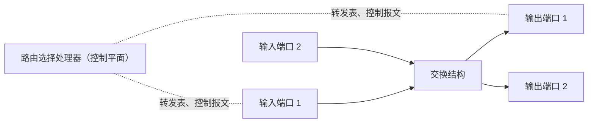
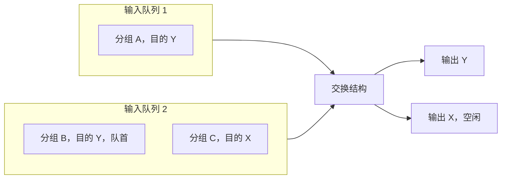
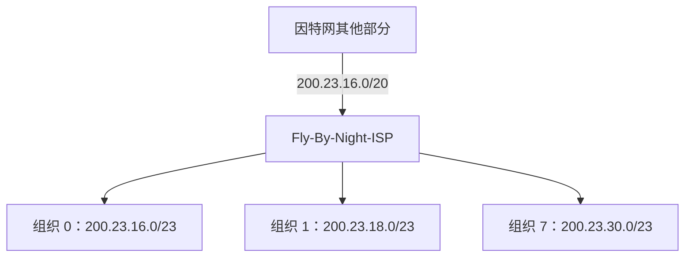
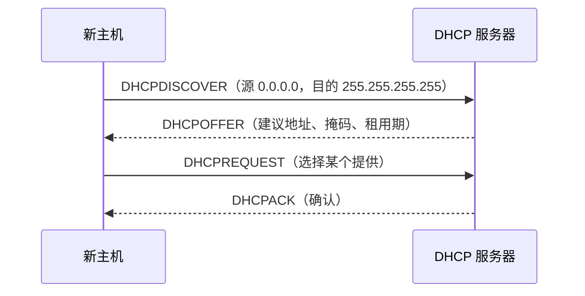
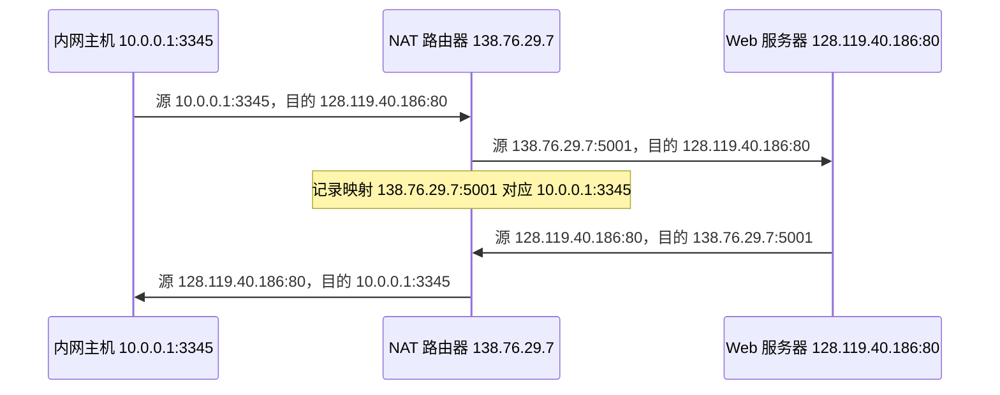
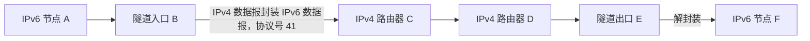
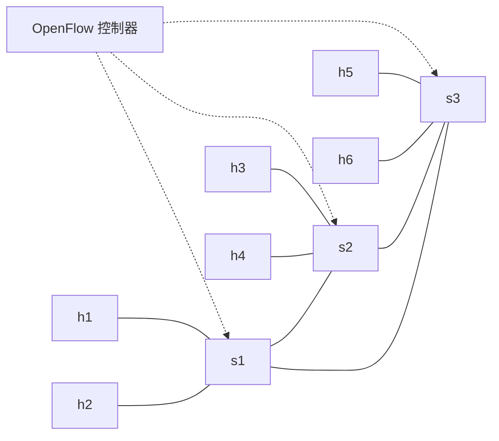
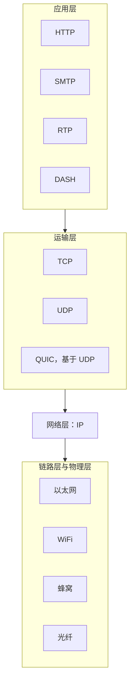

在前一章中我们看到，运输层的报文段必须依靠网络层的主机到主机通信服务，才能从一台端系统到达另一台端系统。运输层工作时并不知道、也不必知道这项服务如何实现。

本章和下一章打开网络层这个"黑盒子"，考察它如何实现主机到主机通信。与只在端系统中实现的应用层、运输层不同，网络层存在于每一台主机和每一个路由器中，必须在亿万台设备上保持一致，因此是协议栈中最具挑战性的部分。

网络层分解为两个相互作用的部分：

| 部分                          | 关注点                                                                   | 内容                                |
| ----------------------------- | ------------------------------------------------------------------------ | ----------------------------------- |
| **数据平面**（data plane）    | 每台路由器的**本地**功能：到达某条输入链路的数据报如何转发到某条输出链路 | 传统 IP 转发、泛化转发              |
| **控制平面**（control plane） | **网络范围**的逻辑：数据报沿源到目的的端到端路径如何路由                 | 路由选择算法、OSPF、BGP、SDN 控制器 |

本章研究数据平面，下一章研究控制平面。

> [!important] 本章目标
> 理解网络层数据平面的原理与实现：
>
> 1. 网络层概述：转发与路由选择的区别、转发表，控制平面的传统方法与 SDN 方法
> 2. 路由器工作原理：输入端口、交换结构、输出端口、路由选择处理器；排队与分组调度
> 3. 网际协议 IPv4：数据报格式与分片、编址、CIDR、DHCP、NAT
> 4. IPv6：首部格式、相对 IPv4 的变化，以及迁移
> 5. 泛化转发与 SDN：OpenFlow 的匹配加操作模型与流表
> 6. 中间盒：NAT、防火墙与 IDS、性能增强设备，以及 IP 细腰与端到端原则

## 4.1 网络层概述

设主机 H1 向 H2 发送信息：H1 的网络层取得运输层报文段，封装成数据报发给相邻路由器 R1；中间路由器逐跳转发；H2 的网络层从相邻路由器收到数据报，提取报文段并向上交付。

> [!note] 路由器在数据平面只有缩短的协议栈
> 路由器转发数据报时只涉及网络层及以下，不运行端系统上的应用和运输协议。但路由器的控制平面和管理仍会用到上层协议，如 BGP 运行在 TCP 之上、SNMP 运行在 UDP 之上。

### 4.1.1 转发和路由选择：数据平面和控制平面

网络层要实现"把分组从发送主机移到接收主机"，需要两种功能：转发与路由选择。

#### 1. 转发

分组到达路由器的一条输入链路时，路由器须把它移到适当的输出链路。转发是数据平面**最主要、最常见**的功能。数据平面还包括排队、调度、首部处理（TTL、检验和）、NAT、过滤等。

#### 2. 路由选择

计算分组从源到目的所采用路径的算法称为**路由选择算法**（routing algorithm），在控制平面中实现。

| 概念     | 含义                                                         | 时间尺度 | 实现     | 所在平面 |
| -------- | ------------------------------------------------------------ | -------: | -------- | -------- |
| 转发     | 把分组从输入链路接口移到适当输出链路接口的路由器**本地**操作 |   纳秒级 | 通常硬件 | 数据平面 |
| 路由选择 | 确定分组从源到目的端到端路径的**网络范围**处理               |     秒级 | 通常软件 | 控制平面 |

> [!example] 类比
> 转发好比汽车进入立交桥时选择出口，是单点的即时决策；路由选择好比出发前规划整个行程，是全局的事先规划。

#### 3. 转发表

路由器检查到达分组首部的一个或多个字段值，在**转发表**（forwarding table）中查找，确定输出接口。

| 首部值 | 输出接口 |
| ------ | -------: |
| 0100   |        3 |
| 0110   |        2 |
| 0111   |        2 |
| 1001   |        1 |

首部值为 `0110` 的分组被转发到接口 2。

> [!note] 补充：路由表与转发表
> 路由选择协议计算出的信息保存在**路由表**（RIB），据此生成供数据平面快速查找的**转发表**（FIB）。本章关注给定转发表后路由器内部如何转发，下一章关注表的内容如何算出。

#### 4. 控制平面：传统方法

路由选择算法运行在**每台路由器**中，各路由器通过**路由选择协议**交换路由选择报文，各自算出转发表。若转发表由操作员手工配置，则易出错、对拓扑变化响应慢、不可扩展，因此需要自动的路由选择协议。

#### 5. 控制平面：SDN 方法

**软件定义网络**（Software-Defined Networking，SDN）把控制平面与数据平面明确分离：路由器（分组交换机）只做转发，**远程控制器**计算并分发转发表，二者通过报文通信。控制器在逻辑上集中，物理上可以分布以提高可靠性。网络行为因此更灵活、可编程（4.4 节、第 5 章）。

### 4.1.2 网络服务模型

**网络服务模型**定义分组在发送与接收主机之间的端到端传输特性。网络层可能提供的服务：

| 服务                 | 说明                          |
| -------------------- | ----------------------------- |
| 确保交付             | 分组最终到达目的地            |
| 有时延上界的确保交付 | 在特定上界内交付，如 100 ms   |
| 有序交付             | 按发送顺序到达                |
| 确保最小带宽         | 模仿固定比特率链路，如 1 Mbps |
| 安全性               | 源加密、目的解密，提供机密性  |

因特网网络层只提供**尽力而为服务**（best-effort service）：不保证交付、顺序、时延上界和最小带宽。其他体系结构（如 ATM）可提供更强的保证。尽力而为服务加上适当的带宽供给，以及带宽自适应的应用层协议（如 DASH），已被证明"足够好"，支撑了流式视频和实时会议。IP 服务不可靠，也正是 TCP 在其上构建端到端可靠传输的原因。

## 4.2 路由器工作原理

一台通用路由器有 4 个组件：**输入端口、交换结构、输出端口、路由选择处理器**。

| 组件           | 功能                                                                             |
| -------------- | -------------------------------------------------------------------------------- |
| 输入端口       | 物理层终结、链路层处理、**查找**转发表确定输出端口、把控制分组送给路由选择处理器 |
| 交换结构       | 把输入端口连到输出端口，是路由器内部的核心网络                                   |
| 输出端口       | 存储来自交换结构的分组，执行链路层与物理层发送功能                               |
| 路由选择处理器 | 运行路由选择协议，维护路由表，计算转发表；SDN 中与控制器通信；网络管理           |

**为何数据平面用硬件、控制平面用软件？** 看时间尺度。100 Gbps 输入链路上 64 字节（512 bit）数据报的到达间隔为 $512/10^{11}=5.12$ ns；若多个端口共享一块线路卡，处理流水线还须更快。因此转发用专用芯片实现。控制平面以毫秒到秒的尺度运行，用软件实现即可。

### 4.2.1 输入端口处理和基于目的地转发

查找是输入端口的关键功能。若每个 32 比特目的地址一个表项，会有超过 40 亿个表项，不可行，因此使用**前缀匹配**。

示例：转发表以地址范围给出：

| 目的地址范围                                                                  | 链路接口 |
| ----------------------------------------------------------------------------- | -------: |
| `11001000 00010111 00010000 00000000` ~ `11001000 00010111 00010111 11111111` |        0 |
| `11001000 00010111 00011000 00000000` ~ `11001000 00010111 00011000 11111111` |        1 |
| `11001000 00010111 00011001 00000000` ~ `11001000 00010111 00011111 11111111` |        2 |
| 其他                                                                          |        3 |

可压缩为前缀形式：

| 前缀                         | 链路接口 |
| ---------------------------- | -------: |
| `11001000 00010111 00010`    |        0 |
| `11001000 00010111 00011000` |        1 |
| `11001000 00010111 00011`    |        2 |
| 其他                         |        3 |

目的地址 `11001000 00010111 00011000 10101010` 同时匹配 24 位前缀和 21 位前缀。

> [!success] definition：最长前缀匹配
> 设转发表前缀集合为 $T$，对目的地址 $a$，选取
>
> $$
> p^*=\arg\max_{p\in T,\ a\ \text{匹配}\ p}\lvert p\rvert
> $$
>
> 并按 $p^*$ 对应的接口转发。上例最长前缀为 24 位，转发到**接口 1**。

> [!example] 类比
> 如 1.3 节的邮政系统：邮件地址同时匹配"B 市"与"B 市 X 区"时，按更具体的 X 区处理。

吉比特速率下，查找须在纳秒级完成，不能线性搜索。常用硬件查找、SRAM 缓存，以及**三态内容可寻址存储器**（TCAM）：每个比特可为 0、1 或"不关心"，一个表项可一次匹配整个地址范围，几乎在常数时间内返回结果。

除查找外，输入端口还要检查版本号、检验和、TTL，并重写 TTL 与检验和，更新网络管理计数器。

> [!success] definition：匹配加操作
> 基于目的地转发是更一般抽象的特例：**匹配**某些首部字段，然后执行某些**操作**。
>
> | 设备         | 匹配字段           | 操作           |
> | ------------ | ------------------ | -------------- |
> | 路由器       | 目的 IP            | 转发到输出端口 |
> | 链路层交换机 | 目的 MAC           | 转发帧         |
> | 防火墙       | 源/目的 IP、端口等 | 允许或丢弃     |
> | NAT          | IP 地址、端口号    | 重写首部字段   |
>
> 4.4 节回到这一抽象。

### 4.2.2 交换

分组经交换结构从输入端口移到输出端口，常见三种方式：

| 方式       | 机制                                                                    | 瓶颈                                                                          | 适用                                       |
| ---------- | ----------------------------------------------------------------------- | ----------------------------------------------------------------------------- | ------------------------------------------ |
| 经内存     | 输入端口中断 CPU，分组复制进内存，查表后复制到输出端口                  | 内存带宽。若每秒最多读写 $B$ 个分组，总吞吐量低于 $B/2$（每个分组读写各一次） | 早期路由器；现代版本由线路卡处理查找与存储 |
| 经总线     | 输入端口给分组加内部标签，经共享总线广播，仅标签匹配的输出端口保存      | 一次只能一个分组跨越总线，受总线速率限制                                      | 小型局域网和企业网路由器                   |
| 经互联网络 | 如**纵横式交换机**（crossbar）：$2N$ 条总线连接 $N$ 个输入与 $N$ 个输出 | 同一输出端口的分组须等待                                                      | 高端路由器                                 |

纵横式交换机**非阻塞**：只要没有其他分组正被转发到同一输出端口，转发到该端口的分组就不会被阻塞，不同输出的分组可并行转发。

### 4.2.3 输出端口处理

输出端口从缓存中取出分组，执行链路层和物理层发送功能。当多个输入分组同时发往同一输出端口时，到达速率可能超过输出链路速率，分组须在输出端口排队。

### 4.2.4 何处出现排队

排队因到达速率暂时超过处理或发送速率而产生；缓存耗尽则**丢包**。队列可出现在输入端口和输出端口。

#### 1. 输入排队

设交换结构速率等于输入线路速率（假设）。若两个输入队列的队首分组都发往输出端口 Y，一次只能转发一个，另一个只能等待。

> [!warning] 队头阻塞（HOL）
> 输入队列中的分组须等待通过交换结构，**即使它的目的输出端口空闲**，因为队首另一个分组阻塞了它。

结论（需验证）：FIFO 输入队列、均匀随机到达、$N\to\infty$ 时，吞吐量上限为 $2-\sqrt2\approx58.6\%$，超过后队列无界增长直至丢包。缓解办法：提高交换结构的加速比，或使用**虚拟输出队列**（VOQ）。

#### 2. 输出排队

即使交换结构速率是输入线路速率的 $N$ 倍（$N$ 为输入端口数），输入排队可避免，但 $N$ 个分组仍可能同时到达同一输出端口，输出端口仍要排队。缓存满时须选择**丢弃策略**：丢弃到达的分组（**弃尾**，drop-tail），或移除已排队的分组。

#### 3. 缓存多大才够用

传统经验：缓存等于往返时延与链路容量的乘积

$$
B=RTT\times C
$$

例：RTT = 250 ms，$C=10$ Gbps，则 $B=2.5$ Gb。研究表明，核心链路上有 $N$ 条独立 TCP 流时，所需缓存约为

$$
B=\frac{RTT\times C}{\sqrt N}
$$

例：$N=10^4$ 时约 25 Mb（需验证）。缓存是双刃剑：

|        | 优点               | 缺点                               |
| ------ | ------------------ | ---------------------------------- |
| 大缓存 | 吸收突发、丢包率低 | 排队时延大、RTT 增大、TCP 响应变慢 |
| 小缓存 | 时延低             | 丢包率高                           |

> [!note] 缓存膨胀（bufferbloat）
> 家庭路由器向游戏服务器发送 TCP 段：发一个分组需 20 ms，RTT 为 200 ms。若有 25 个分组的突发进入队列，排队时延约为 $25\times20=500$ ms，已超过 RTT。可见不仅吞吐量重要，**最小化时延**同样重要，缓存不是越大越好。

**主动队列管理**（AQM）在队列变长前就丢弃或**标记**分组，促使发送方降速。常见算法有 RED、PIE、CoDel。若标记而不丢弃，就是第 3 章的 ECN。

### 4.2.5 分组调度

分组调度决定排队分组通过输出链路的顺序。以下例子设每个分组传输时间为 1 个时间单位。

| 规则                | 机制                                                                              |
| ------------------- | --------------------------------------------------------------------------------- |
| FIFO                | 按到达输出队列的先后顺序传输                                                      |
| 优先权排队          | 分类进入不同优先权队列；总是从非空的最高优先权队列取；同类内 FIFO；通常**非抢占** |
| 循环排队（RR）      | 分类但无优先权，轮流服务各个非空的类队列                                          |
| 加权公平排队（WFQ） | RR 的推广，每类 $i$ 有权重 $w_i$                                                  |

**优先权示例**：分组 1、2 为低优先权（到达时刻 0、0.2），分组 3、4 为高优先权（到达时刻 0.5、0.7）。分组 1 已开始传输，非抢占，故传输顺序为 $1,3,4,2$；FIFO 的顺序为 $1,2,3,4$。

**RR 示例**：类 1 有分组 1、2、4，类 2 有分组 3、5，均在时刻 0 到达，则服务顺序为 $1,3,2,5,4$。若分组 5 直到时刻 3.5 才到达，则轮到类 2 时它为空，立即服务类 1 的分组 4，顺序变为 $1,3,2,4,5$。这说明 RR 是**保持工作**的（work-conserving）：只要有分组排队，链路就不空闲。

**WFQ**：设链路速率为 $R$，$S$ 为有分组排队的类的集合。类 $i\in S$ 获得的服务速率为

$$
R\cdot\frac{w_i}{\sum_{j\in S}w_j}
$$

因 $S\subseteq$ 全部类，故类 $i$ 在有排队时至少获得

$$
R\cdot\frac{w_i}{\sum_{j\ \text{全部}}w_j}
$$

这是理想化的（广义处理器共享）模型，实际实现是分组化的近似。

> [!important] 实践原则：网络中立性
> 分组调度可对不同类别流量提供不同级别服务，类别可依据首部字段、地址、端口、应用类型，甚至付费。美国的监管历程（时间线，需持续关注）：
>
> | 时间         | 事件                                                                    |
> | ------------ | ----------------------------------------------------------------------- |
> | 2015         | FCC《保护和促进开放互联网的命令》：不得阻塞、不得限流、不得付费优先     |
> | 2017         | FCC《恢复互联网自由秩序命令》撤销上述规则，转向要求 ISP 透明            |
> | 2024 年 4 月 | FCC 重新通过网络中立性规则                                              |
> | 2025 年 1 月 | 第六巡回法院裁定 FCC 无权这样做（依据 Loper Bright 判决），规则未能生效 |
>
> 截至 2026 年 10 月，联邦层面没有网络中立性规则；若干州（如加利福尼亚、科罗拉多、华盛顿）有自己的立法（需验证）。网络中立性至今仍有争议。

## 4.3 网际协议：IPv4、寻址、IPv6 及其他

因特网网络层的关键协议是网际协议（IP），目前有 IPv4 与 IPv6 两个版本在使用。

### 4.3.1 IPv4 数据报格式

网络层分组称为**数据报**（datagram）。IPv4 首部（无选项时 20 字节）布局如下，每行 32 比特：

| 行   | 字段（比特数）                                            |
| ---- | --------------------------------------------------------- |
| 1    | 版本（4）、首部长度（4）、服务类型（8）、数据报长度（16） |
| 2    | 标识（16）、标志（3）、片偏移（13）                       |
| 3    | 寿命 TTL（8）、协议（8）、首部检验和（16）                |
| 4    | 源 IP 地址（32）                                          |
| 5    | 目的 IP 地址（32）                                        |
| 6 起 | 选项（可变）、数据                                        |

| 字段               | 说明                                                                                                             |
| ------------------ | ---------------------------------------------------------------------------------------------------------------- |
| 版本               | IPv4 为 4                                                                                                        |
| 首部长度           | 以 32 比特字为单位，无选项时为 5（20 字节），也指示数据从何处开始                                                |
| 服务类型           | 现代定义为 **DSCP**（6 bit，区分服务）+ **ECN**（2 bit，显式拥塞通告，见 3.7.2）                                 |
| 数据报长度         | 首部 + 数据的总字节数，最大 65535，实际受链路 MTU 限制                                                           |
| 标识、标志、片偏移 | 用于分片，见下                                                                                                   |
| TTL                | 每经一台路由器减 1，为 0 时丢弃（并回送 ICMP 超时报文，见 1.4.3 节 Traceroute），防止环路                        |
| 协议               | 指示数据交给哪个上层协议                                                                                         |
| 首部检验和         | 只检测 IP 首部，算法同 3.3.2 节：每 2 字节为一个数，反码求和，和的反码为检验和。TTL 每跳都变，故路由器每跳须重算 |
| 选项               | 扩展首部，很少使用                                                                                               |

| 协议号 | 上层协议                       |
| -----: | ------------------------------ |
|      1 | ICMP                           |
|      6 | TCP                            |
|     17 | UDP                            |
|     41 | IPv6 封装（隧道，见 4.3.4 节） |

协议号是粘合网络层与运输层的"胶水"，作用类似端口号粘合运输层与应用层，也类似链路层帧中的类型字段。

IP 与 TCP/UDP 都做差错检测的原因：IP 只覆盖 IP 首部，TCP/UDP 覆盖整个报文段；TCP/UDP 原则上不必与 IP 属于同一协议栈；数据在路由器内存中也可能出错（3.3.2 节端到端原则）。

#### 1. IP 分片

不同链路的**最大传输单元**（MTU，链路层帧能携带的最大数据量）不同。数据报大于出链路 MTU 时，须分成多个**片**（fragment），每片是独立的数据报。片只在**目的主机**重组：

- 同一数据报的各片有相同的**标识**
- **标志**中 MF 位为 1 表示后面还有片，最后一片为 0
- **片偏移**以 8 字节为单位，指示该片数据在原数据报数据中的位置，因此除最后一片外，每片数据长度须为 8 的倍数

例：4000 字节数据报（20 字节首部 + 3980 字节数据），出链路 MTU = 1500，每片最多 $1500-20=1480$ 字节数据（恰为 8 的倍数）：

| 片  | 数据长度 | 总长度 | 片偏移 |  MF |
| --- | -------: | -----: | -----: | --: |
| 1   |     1480 |   1500 |      0 |   1 |
| 2   |     1480 |   1500 |    185 |   1 |
| 3   |     1020 |   1040 |    370 |   0 |

偏移按 $1480/8=185$、$2960/8=370$ 计算，数据总和 $1480+1480+1020=3980$。若任一片丢失，整个数据报作废，运输层须重传，因此分片对性能不利；IPv6 取消了路由器分片（4.3.4 节）。

### 4.3.2 IPv4 编址

IPv4 地址长 32 比特，共 $2^{32}\approx40$ 亿个，用点分十进制记法，如 `193.32.216.9` 即 `11000001 00100000 11011000 00001001`。

#### 1. 接口

主机与物理链路之间的边界称为**接口**（interface）。主机通常只有一个，路由器有多个。

> [!success] definition
> IP 地址与**接口**相关联，而不是与主机或路由器本身相关联。

#### 2. 子网

连到同一个网络的若干主机接口和一个路由器接口具有相同的前缀，构成一个**子网**（subnet），记为 `223.1.1.0/24`。`/24` 是**子网掩码**（`255.255.255.0`），表示左侧 24 比特是子网地址。

> [!tip] 识别子网
> 把每个接口从主机或路由器上分开，得到若干孤立的网络岛，每个岛就是一个子网。点对点链路本身也构成一个子网。

#### 3. CIDR

**CIDR**（Classless Inter-Domain Routing，无类别域间路由选择）把子网寻址推广为 `a.b.c.d/x`：前 $x$ 比特是网络前缀，其余 $32-x$ 比特用于组织内部的主机和子网。

CIDR 的关键好处是**地址聚合**（路由聚合）：一个 `/x` 块包含 $2^{y-x}$ 个 `/y` 块。例：ISP Fly-By-Night-ISP 拥有 `200.23.16.0/20`，包含 $2^{23-20}=8$ 个 `/23`，分给 8 个组织：

| 组织 | 地址块           |
| ---- | ---------------- |
| 0    | `200.23.16.0/23` |
| 1    | `200.23.18.0/23` |
| 2    | `200.23.20.0/23` |
| …    | …                |
| 7    | `200.23.30.0/23` |

每个 `/23` 有 $2^9=512$ 个地址，故第三字节每次增加 2。外界路由器只需一条"`200.23.16.0/20` 交给 Fly-By-Night-ISP"，就代表这 8 个组织。

若组织 1 改连 ISPs-R-Us，后者通告更具体的 `200.23.18.0/23`，则外部路由器依 4.2.1 节的最长前缀匹配，把发往该块的分组交给 ISPs-R-Us。

CIDR 之前使用**分类编址**：网络部分固定为 8、16、24 比特（A、B、C 类）。C 类 `/24` 只能容纳约 254 台主机（太小），B 类 `/16` 约 65534 台（太大），造成浪费。

| 特殊地址                                        | 用途                               |
| ----------------------------------------------- | ---------------------------------- |
| `10.0.0.0/8`、`172.16.0.0/12`、`192.168.0.0/16` | 私有地址（RFC 1918）               |
| `127.0.0.0/8`                                   | 环回                               |
| `169.254.0.0/16`                                | 链路本地                           |
| `0.0.0.0`                                       | 未指定（如 DHCPDISCOVER 的源地址） |
| `255.255.255.255`                               | 受限广播：交付给同一子网的所有主机 |

#### 4. 获取地址

组织通常从 ISP 的地址块中划分一段。全球地址由 ICANN 管理，分配给五个区域注册机构（ARIN、RIPE NCC、APNIC、LACNIC、AFRINIC）。IANA 的 IPv4 空闲地址池已于 2011 年分配完毕（需验证），这是 NAT 与 IPv6 的直接动因。

主机地址通常用 **DHCP**（动态主机配置协议）获得。DHCP 可自动提供 IP 地址、子网掩码、默认网关（第一跳路由器）和本地 DNS 服务器地址，因此称为**即插即用**或零配置协议。DHCP 运行在 UDP 之上，服务器端口 67、客户端口 68。

客户尚无地址，DISCOVER 以广播发出；OFFER 与 REQUEST 通常也用广播。地址有**租用期**，到期可续租。缺陷：主机移到新子网时会得到新地址，TCP 连接中断（移动 IP 等可解决，见第 7 章）。

### 4.3.3 网络地址转换 NAT

**NAT**（Network Address Translation）使专用网络使用私有地址（如 `10.0.0.0/8`），经一个或少量公网地址访问因特网。私有地址只在本地网络内有意义。NAT 路由器对外表现为一个具有单一 IP 地址的设备。

NAT 路由器的工作：

1. **出站分组**：把源 IP:端口改写为 NAT 的公网地址与一个新端口，并在 **NAT 转换表**中记录映射
2. **入站分组**：按目的地址:端口查表，还原为私网地址:端口
3. 改写后重算 IP 与运输层检验和
4. 表项长时间无流量则回收

| 公网地址:端口    | 私网地址:端口 |
| ---------------- | ------------- |
| 138.76.29.7:5001 | 10.0.0.1:3345 |

端口号 16 比特，故单个公网地址最多支持约 6 万个并发连接。

优点：缓解 IPv4 地址不足；更换 ISP 不必给内网重新编号；部署简单。注意 NAT **不是安全机制**，内部结构不对外可见只是副作用。

> [!warning] NAT 的争议
>
> 1. **端口号被用作主机寻址**：端口本用于进程寻址。内部服务器难以被外部主动访问，P2P 等需要 **NAT 穿越**（如 UPnP、STUN）
> 2. **违反分层与端到端原则**：路由器应只处理到第三层，NAT 却读写运输层字段，并使主机失去全球可达性（地址透明性）

### 4.3.4 IPv6

IPv6 的主要动机是 IPv4 地址空间耗尽。地址由 32 比特扩到 128 比特，首部也简化。

**地址表示**：8 组 16 比特，每组 4 位十六进制，用冒号分隔，如 `2001:0db8:0000:0000:0000:0000:0000:0001`。每组前导 0 可省略，连续的全 0 组可用 `::` 压缩，但**只能压缩一次**，上例可写为 `2001:db8::1`。

**IPv6 首部**固定 40 字节，每行 32 比特：

| 行   | 字段（比特数）                                   |
| ---- | ------------------------------------------------ |
| 1    | 版本（4）、流量类型（8）、流标签（20）           |
| 2    | 有效载荷长度（16）、下一个首部（8）、跳限制（8） |
| 3~6  | 源地址（128）                                    |
| 7~10 | 目的地址（128）                                  |

| 字段         | 说明                                                         |
| ------------ | ------------------------------------------------------------ |
| 流量类型     | 类似 IPv4 的 TOS                                             |
| 流标签       | 标识需要特殊处理的流，可用于 QoS                             |
| 有效载荷长度 | 40 字节首部之后的字节数                                      |
| 下一个首部   | 指示载荷交给哪个协议，类似 IPv4 协议字段，也用于链接扩展首部 |
| 跳限制       | 类似 TTL，每跳减 1                                           |

| 变化             | 说明                                                                                                                              |
| ---------------- | --------------------------------------------------------------------------------------------------------------------------------- |
| 地址扩大         | 128 比特，并新增**任播**地址                                                                                                      |
| 定长 40 字节首部 | 处理更快                                                                                                                          |
| 流标签           | 支持特殊处理的流                                                                                                                  |
| 取消路由器分片   | 只能由源主机分片。数据报太大时，路由器丢弃并回送 ICMPv6"分组太大"，源用更小数据报重发。IPv6 要求链路 MTU 至少 1280 字节（需验证） |
| 取消首部检验和   | 依赖链路层和运输层的检验和；因此 UDP 在 IPv6 中检验和必需（3.3.2 节）                                                             |
| 选项外置         | 以扩展首部形式通过"下一个首部"链接                                                                                                |
| ICMPv6           | ICMP 的新版本                                                                                                                     |

#### 从 IPv4 到 IPv6 的迁移

不可能设定一个"标志日"让所有设备同时升级。常用两种方法：

- **双栈**（dual-stack）：节点同时运行 IPv4 与 IPv6，按对方能力选择（需验证）
- **建隧道**（tunneling）：IPv6 数据报被封装在 IPv4 数据报的数据字段中，经 IPv4 路由器传输

B 把整个 IPv6 数据报放进 IPv4 数据报的载荷，目的地址设为 E；C、D 按 IPv4 正常转发；E 解封装后按 IPv6 继续转发。

> [!note] 部署现状（时效，需持续关注）
> IPv6 部署持续增长，但因测量口径不同而差别较大：Google 的统计中，原生 IPv6 访问比例于 2026 年 3 月 28 日单日首次超过 50%（50.10%）；同期 Cloudflare 测得约 40.1% 的 HTTP 请求为 IPv6，APNIC 测得约 43%（均需验证）。各国差异很大。IPv4 加 NAT 延长了 IPv4 的寿命，IPv4 与 IPv6 将长期共存。

## 4.4 泛化转发和 SDN

基于目的地转发是"匹配加操作"的特例。**泛化转发**中，匹配字段可来自链路层、网络层、运输层；操作可包括转发、丢弃、复制、多播、重写首部字段、上送控制器。

OpenFlow 中的匹配加操作表称为**流表**（flow table）。每个**流表项**包括：

1. 匹配的首部字段值集合
2. **计数器**集合（匹配的分组数、字节数、距上次匹配的时间等）
3. **操作**集合

流表项支持通配符，并有优先级：分组匹配多个表项时选优先级最高者。OpenFlow 1.0 的匹配字段：

| 层级   | 字段                                               |
| ------ | -------------------------------------------------- |
| 端口   | 入端口                                             |
| 链路层 | 源 MAC、目的 MAC、以太网类型、VLAN ID、VLAN 优先权 |
| 网络层 | 源 IP、目的 IP、IP 协议、IP TOS                    |
| 运输层 | TCP/UDP 源端口、TCP/UDP 目的端口                   |

> [!note] 说明
> 以上为教学简化。后续版本支持多级流表和更多字段，工业界也在转向 P4 等更通用的方式（需验证）。

**操作**：转发（到某端口、广播、多播、上送控制器）、丢弃（无操作的表项即丢弃）、修改字段、复制。

> [!warning] table-miss
> 分组不匹配任何表项时的行为由交换机配置决定：OpenFlow 1.0 默认上送控制器，1.3 起若无 table-miss 表项则丢弃（需验证）。下面的例子假设"丢弃"。

### 4.4.1 运行中的匹配加操作：OpenFlow 例子

网络：主机 h1~h6 连到交换机 s1~s3（各有 4 个接口），控制器集中下发流表；h1、h2 在 s1（`10.1.0.1`、`10.1.0.2`），h3、h4 在 s2（`10.2.0.3`、`10.2.0.4`），h5、h6 在 s3（`10.3.0.5`、`10.3.0.6`）。

| 交换机 | 端口 1 | 端口 2 | 端口 3 | 端口 4 |
| ------ | ------ | ------ | ------ | ------ |
| s1     | s3     | h1     | h2     | s2     |
| s2     | s3     | s1     | h3     | h4     |
| s3     | h5     | h6     | s1     | s2     |

> [!note] 说明
> 端口分配按下面流表反推而得，原书图中端口号需核对（需验证）。

**例 1：简单转发**。h5、h6 发往 h3、h4 的分组走 s3 → s1 → s2：

| 交换机 | 匹配                                               | 操作       |
| ------ | -------------------------------------------------- | ---------- |
| s3     | `IPSrc=10.3.*.*` 且 `IPDst=10.2.*.*`               | Forward(3) |
| s1     | `入端口=1` 且 `IPSrc=10.3.*.*` 且 `IPDst=10.2.*.*` | Forward(4) |
| s2     | `入端口=2` 且 `IPDst=10.2.0.3`                     | Forward(3) |
| s2     | `入端口=2` 且 `IPDst=10.2.0.4`                     | Forward(4) |

s1 的表项同时匹配入端口与 IP 地址，这是传统基于目的地转发做不到的。

**例 2：负载均衡**。h3 发往 `10.1.*.*` 的分组走 s2-s1 直连链路，h4 的走 s2-s3-s1：

| 交换机 | 匹配                           | 操作       |
| ------ | ------------------------------ | ---------- |
| s2     | `入端口=3` 且 `IPDst=10.1.*.*` | Forward(2) |
| s2     | `入端口=4` 且 `IPDst=10.1.*.*` | Forward(1) |

这种基于入端口（源）的行为，仅靠目的 IP 转发无法实现。

**例 3：防火墙**。s2 只接收来自 s3 一侧主机（`10.3.*.*`）的流量：

| 交换机 | 匹配                                 | 操作       |
| ------ | ------------------------------------ | ---------- |
| s2     | `IPSrc=10.3.*.*` 且 `IPDst=10.2.0.3` | Forward(3) |
| s2     | `IPSrc=10.3.*.*` 且 `IPDst=10.2.0.4` | Forward(4) |

没有其他表项时，其余分组被丢弃（见上面的 table-miss 说明）。

OpenFlow 流表是有限形式的可编程性。**P4** 是更通用的协议无关分组处理器编程语言，支持变量、算术、条件等，使工程师能定义分组如何被解析和处理。

## 4.5 中间盒

> [!success] definition：中间盒（middlebox）
> RFC 3234：在源主机与目的主机之间的数据路径上，执行除 IP 路由器标准功能之外其他功能的任何中间盒子。

| 类型     | 例子                           | 功能                         |
| -------- | ------------------------------ | ---------------------------- |
| NAT 转换 | NAT 路由器                     | 重写地址和端口，实现私有地址 |
| 安全服务 | 防火墙、IDS、邮件过滤器        | 阻塞、检测、过滤恶意流量     |
| 性能增强 | Web 缓存、负载均衡器、压缩设备 | 缓存、分发请求、压缩         |

#### 1. 防火墙

**防火墙**位于内部网络与因特网之间，检查分组并丢弃可疑分组，分三类：

| 类型             | 机制                                                         |
| ---------------- | ------------------------------------------------------------ |
| 无状态分组过滤器 | 逐个分组检查：源/目的 IP、端口、协议类型、TCP 标志位等       |
| 有状态过滤器     | 跟踪连接状态，只放行属于已建立连接的分组                     |
| 应用网关         | 在应用层检查并转发，如要求用户先认证才能向外建立 Telnet 会话 |

规则示例：

| 策略                                           | 设置                                                 |
| ---------------------------------------------- | ---------------------------------------------------- |
| 禁止进入的 Web 访问                            | 丢弃所有目的端口为 80 的进入分组                     |
| 禁止进入的 TCP 连接，发往内部 Web 服务器的除外 | 丢弃所有进入的 TCP SYN，除非目的为该服务器的 80 端口 |
| 阻止进入的 UDP 流量，DNS 除外                  | 丢弃进入的 UDP 分组，目的端口 53 的除外              |

#### 2. 入侵检测系统

**IDS** 执行**深度分组检查**，检查首部和有效载荷，分特征检测（匹配已知攻击特征）与异常检测（发现统计上异常的流量）两类，发现可疑时产生警报。**入侵防止系统**（IPS）还会直接阻塞分组。

#### 3. 网络功能虚拟化

中间盒增多使运营管理成本上升。**网络功能虚拟化**（NFV）把中间盒功能软件化，运行在通用服务器上，也可部署在云中。

#### 4. IP 细腰与端到端原则

> [!important] 实践原则：因特网架构原则
> RFC 1958：目标是连接，工具是因特网协议，智能是端到端的，而不是隐藏在网络中。

中间盒打破了这种分层：NAT 改写网络层与运输层字段，防火墙使用网络层、运输层甚至应用层信息。

因特网协议栈像"沙漏"：应用层有众多协议，链路层/物理层有多种技术，而网络层统一为 **IP**，即"细腰"。任何底层技术都能承载任何上层应用，不同底层网络因此得以互联。

> [!note] 端到端原则
> 某些功能只有借助通信端点上的应用知识和帮助才能完全正确实现。例如可靠数据传输：路由器可能崩溃、链路可能断开，因此端点必须实现差错控制（第 3 章 TCP）。链路层的可靠只是单跳的，这正是 1.5 节"链路层可靠是单跳可靠，TCP 可靠是端到端可靠"的深层原因。

本章的许多设计，如尽力而为服务、IPv6 取消首部检验和而依赖运输层检验和、对 NAT 的争议，都可以从端到端原则理解。

## 4.6 小结

本章研究网络层数据平面，即每台路由器如何本地转发分组。

- **转发与路由选择**：转发是数据平面的本地操作（纳秒级、硬件），路由选择是控制平面的网络范围过程（秒级、软件）；转发表把首部值映射为输出接口，**最长前缀匹配**选择最具体的表项
- **路由器**：输入端口、交换结构、输出端口、路由选择处理器协同工作；交换可经内存、总线或互联网络；排队可在输入端口（含 HOL，吞吐量上限约 58.6%）或输出端口；缓存需权衡丢包与时延（$RTT\cdot C/\sqrt N$），AQM 与调度（FIFO、优先权、RR、WFQ）管理排队
- **IPv4**：数据报字段各司其职，**分片**由标识、标志、片偏移完成；编址基于接口与子网，CIDR 聚合地址，DHCP 即插即用，NAT 以私有地址加端口复用公网地址
- **IPv6**：128 比特地址，固定 40 字节首部，取消路由器分片和首部检验和；以双栈和隧道迁移
- **泛化转发与 SDN**：OpenFlow 用匹配加操作的流表统一转发、丢弃、改写，控制器集中计算并下发
- **中间盒与架构**：NAT、防火墙、IDS、缓存在数据路径上执行转发以外的功能；IP 细腰与端到端原则是理解因特网架构的关键

|          | 转发       | 路由选择 |
| -------- | ---------- | -------- |
| 平面     | 数据平面   | 控制平面 |
| 范围     | 路由器本地 | 网络范围 |
| 实现     | 硬件       | 软件     |
| 时间尺度 | 纳秒       | 秒       |

下一章进入网络层的控制平面：路由选择算法如何确定分组的端到端路径，OSPF 和 BGP 如何交换路由信息，以及 SDN 控制器如何集中计算并分发转发表。
