前面几章介绍了 Internet 的协议体系，以及应用层、传输层、网络层和链路层如何协同完成数据传输。但网络能够把数据送到目的地，并不意味着通信就是安全的：数据报可能被窃听、篡改或伪造，通信双方也可能遭到冒充，攻击者还可能通过耗尽系统资源阻止合法用户访问网络。

网络安全要解决的问题不只是"把数据加密"。通信双方通常还需要确认对方的身份，检测消息是否被修改，并确保攻击者不能通过重放旧消息来冒充当前通信。对于组织网络而言，还需要在网络边界控制流量，并持续检测可疑活动。

本章先介绍安全通信的基本目标，再从密码学出发，逐步建立加密、消息完整性、数字签名和端点认证等机制。随后按照协议栈自顶向下的顺序，讨论电子邮件、TLS、IPsec 和无线网络中的安全协议，最后介绍防火墙与入侵检测系统。

> [!note] 修订说明
> 依据审查意见修订：补全 TLS 1.3 的服务器认证（CertificateVerify）与加密握手，修正 ESP Next Header、标题层级与编号，并补充 RSA 例题与证明、ap5.0 与中间人攻击、哈希与 HMAC、证书链、IPsec 模式对照等内容。
> 逐项改动见文末"改动记录 / Errata"；存疑数据保留原书取值并标"需验证"。

> [!important] 本章目标
> 理解网络安全的基本目标、密码学原理及其在 Internet 协议中的应用：
>
> 1. 网络安全概述：机密性、消息完整性、端点认证、运行安全与常见攻击
> 2. 密码学基础：明文/密文、对称密钥、公钥密码、分组密码、CBC、RSA 与 Diffie-Hellman
> 3. 消息完整性：密码学哈希函数、消息认证码 MAC、数字签名、公钥证书与 CA
> 4. 端点认证：身份声明、IP 欺骗、密码窃听、重放攻击与 nonce，以及中间人攻击
> 5. 分层安全协议：安全电子邮件 PGP、传输层安全 TLS、网络层安全 IPsec
> 6. 无线网络安全：WPA3-Personal、WPA3-Enterprise 与 5G 认证和密钥协商
> 7. 运行安全：无状态（传统）分组过滤器、有状态过滤器、应用网关、IDS 与 IPS

> [!note] 术语对照
> 全章统一使用下列译名。注意 MAC 在不同上下文中有不同含义：
>
> | 统一用语                 | 英文 / 缩写                      | 含义                                                                   |
> | ------------------------ | -------------------------------- | ---------------------------------------------------------------------- |
> | 明文                     | plaintext                        | 加密前可直接理解的数据                                                 |
> | 密文                     | ciphertext                       | 加密算法输出、需要密钥才能恢复的数据                                   |
> | 对称密钥密码             | symmetric-key cryptography       | 加密和解密使用同一个共享秘密密钥                                       |
> | 公钥密码                 | public-key cryptography          | 使用一对公钥和私钥的密码体制                                           |
> | 会话密钥                 | session key                      | 为一次通信会话生成的临时对称密钥                                       |
> | 密码学哈希函数           | cryptographic hash function      | 将任意长度输入映射为固定长度摘要                                       |
> | 消息认证码               | Message Authentication Code，MAC | 基于共享密钥验证消息来源和完整性                                       |
> | 介质访问控制             | Media Access Control，MAC        | 链路层中控制共享介质访问的子层；不要与消息认证码混淆                   |
> | 数字签名                 | digital signature                | 使用签名者私钥生成、由公钥验证的密码学签名                             |
> | 随机数挑战               | nonce                            | 在协议中仅使用一次的随机值，用于证明交互的新鲜性                       |
> | 证书颁发机构             | Certification Authority，CA      | 验证实体身份并签发公钥证书的可信机构                                   |
> | 安全关联                 | Security Association，SA         | IPsec 两端之间用于确定安全处理参数的单向逻辑关系                       |
> | 安全参数索引             | Security Parameter Index，SPI    | 标识 IPsec 安全关联的 32 位值                                          |
> | 无状态（传统）分组过滤器 | stateless packet filter          | 逐个检查数据报首部、不跟踪连接的过滤器（4.4.4 节称"无状态分组过滤器"） |
> | 入侵检测系统             | Intrusion Detection System，IDS  | 检测可疑流量并向管理员告警                                             |
> | 入侵防御系统             | Intrusion Prevention System，IPS | 检测并主动过滤可疑流量                                                 |

# 第一部分 网络安全与密码学基础

## 8.1 网络安全概述

假设 Alice 希望通过 Internet 向 Bob 发送一条消息。两人之间的通信信道并不可信：攻击者 Trudy 可能监听信道、记录传输内容，甚至主动插入、修改或删除消息。因此，Alice 和 Bob 不仅要关心消息能否到达，还要关心消息在传输过程中是否安全。

### 8.1.1 安全通信的目标

安全通信通常需要满足以下性质：

| 安全目标       | 英文                     | 含义                                     | 主要解决的问题                         |
| -------------- | ------------------------ | ---------------------------------------- | -------------------------------------- |
| **机密性**     | confidentiality          | 只有发送方和预期接收方能够理解消息内容   | 防止窃听者读取数据                     |
| **消息完整性** | message integrity        | 接收方能够判断消息是否在传输过程中被修改 | 防止篡改、插入或删除消息               |
| **端点认证**   | end-point authentication | 通信双方能够确认对方的身份               | 防止冒充通信实体                       |
| **运行安全**   | operational security     | 通过网络边界控制和攻击检测保护组织网络   | 防止未授权访问、恶意流量和拒绝服务攻击 |

其中，机密性通常通过加密实现；消息完整性和身份认证则需要消息认证码、数字签名、证书或挑战—响应协议等机制。运行安全更多依赖防火墙、入侵检测系统等网络设备与管理策略。

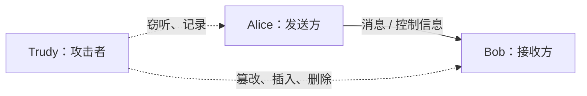

### 8.1.2 攻击者的能力与常见攻击

在不安全的通信信道上，攻击者通常可能具有以下能力：

- **窃听（eavesdropping）**：监听并记录信道上传输的控制消息和数据消息。
- **消息篡改（modification）**：修改消息内容或协议字段。
- **消息插入与删除（insertion / deletion）**：伪造新消息，或丢弃原本应该到达接收方的消息。

这些能力可能引发多种攻击（1.6 节已做过总览，此处从安全目标角度重新归类）：

| 攻击            | 基本方式                           | 可能造成的后果                 |
| --------------- | ---------------------------------- | ------------------------------ |
| 窃取信息        | 监听未加密的通信                   | 获取密码、个人信息或业务数据   |
| 身份冒充        | 伪造源地址、凭据或身份信息         | 让接收方误以为攻击者是合法实体 |
| 会话劫持        | 插入或伪造通信中的消息             | 接管已经建立的通信会话         |
| 重放攻击        | 记录合法消息，并在之后重新发送     | 让接收方把旧消息误认为当前操作 |
| 中间人攻击      | 同时扮演通信双方，转发并可修改消息 | 双方都以为在与对方直接通信     |
| 拒绝服务（DoS） | 大量发送请求或耗尽系统资源         | 阻止合法用户访问服务           |

安全通信并不只发生在人类用户之间。DNS 服务器、路由器、网络管理系统以及客户端和服务器进程也需要验证彼此的身份与消息来源。例如，攻击者若能向路由器注入伪造的链路状态信息，就可能影响网络拓扑计算和转发表配置。

## 8.2 密码学原理

**密码学**（cryptography）通过数学算法和密钥，把原始数据转换为攻击者难以理解的形式；接收方则利用相应密钥恢复原始数据。密码学最直观的用途是提供机密性，但它也为消息完整性、身份认证和数字签名提供基础。

### 8.2.1 基本术语与加密模型

原始消息称为**明文**（plaintext），加密后得到的内容称为**密文**（ciphertext）。加密算法以明文和密钥为输入，解密算法则以密文和密钥为输入：

$$
c=E_K(m),\qquad m=D_K(c)
$$

其中：

- $m$：明文消息；
- $c$：密文；
- $E_K$：使用密钥 $K$ 的加密算法；
- $D_K$：使用密钥 $K$ 的解密算法。

现代密码算法通常是公开的，算法本身不需要保密；真正需要保密的是密钥。这样，即使攻击者知道正在使用哪一种算法，也不能仅凭算法和截获的密文恢复明文。

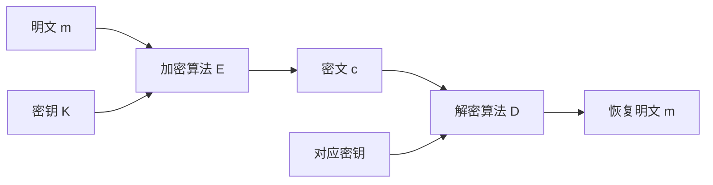

密码体制按密钥使用方式可以分为两类：**对称密钥密码**和**公钥密码**。前者要求通信双方预先拥有同一个秘密，后者使用公钥和私钥组成的密钥对。

### 8.2.2 对称密钥密码

**对称密钥密码**（symmetric-key cryptography）使用相同的秘密密钥完成加密和解密。Alice 与 Bob 必须事先安全地获得共享密钥 $K_S$，之后才能通过不安全信道交换密文：

$$
c=E_{K_S}(m),\qquad m=D_{K_S}(c)
$$

其主要优点是加解密效率高，适合大量数据的快速处理；主要困难是**密钥分发**：双方必须先通过某种安全方式获得相同的密钥。

#### 1. 经典替换密码

**凯撒密码**（Caesar cipher）把明文中的每个字母替换为字母表中向后偏移 $k$ 位的字母。$k$ 就是密钥。例如，$k=3$ 时，`a` 被替换为 `d`，`b` 被替换为 `e`。由于只有 25 种有效偏移量，攻击者可以很快穷举所有密钥。

**单表替换密码**（monoalphabetic cipher）不再使用固定偏移，而是为字母表中的每个字母指定一个唯一替换字母。理论上有 $26!$ 种映射，但它仍然容易受到**频率分析**攻击：自然语言中不同字母以及常见字母组合出现的频率并不均匀，攻击者可以利用这些统计规律推测替换关系。

**多表替换密码**（polyalphabetic cipher）使用多个替换表，并按照约定的模式轮流编码。相同的明文字母可能因为所处位置不同而被编码成不同的密文字母，从而削弱简单的字母频率分析。

根据攻击者能够获得的信息，可以区分三种典型攻击模型：

| 攻击模型                                    | 攻击者掌握的信息                               |
| ------------------------------------------- | ---------------------------------------------- |
| **唯密文攻击**（ciphertext-only attack）    | 只能获得密文，尝试从密文统计规律推断明文       |
| **已知明文攻击**（known-plaintext attack）  | 已知部分明文及其对应密文，利用对应关系推断密钥 |
| **选择明文攻击**（chosen-plaintext attack） | 可以自行选择明文，并获得对应密文               |

这些经典密码的安全性很弱，但它们说明了一个重要问题：仅仅让密文"看起来像乱码"并不代表加密是安全的。现代密码系统依赖密钥空间、算法设计和严格的安全分析，而不是依赖攻击者不知道加密规则。

#### 2. 分组密码

现代对称密钥密码中，常见的一类是**分组密码**（block cipher）。它把输入消息切分为固定长度的比特块，每次将一个明文块映射为一个等长密文块。

若分组长度为 $k$ bit，则每个输入块有 $2^k$ 种可能取值。一个理想分组密码可以看作这些输入值上的一一映射；密钥决定具体采用哪一种映射。若使用穷举攻击，攻击者需要尝试所有可能密钥。密钥长度为 $n$ bit 时，密钥空间大小为：

$$
2^n
$$

常见分组密码包括：

| 算法 | 分组长度 |                           密钥长度 | 说明                                                              |
| ---- | -------: | ---------------------------------: | ----------------------------------------------------------------- |
| DES  |   64 bit |                             56 bit | 经典分组密码，密钥空间已不足以抵御现代穷举能力                    |
| 3DES |   64 bit | 名义 168 bit（有效强度约 112 bit） | 通过三次 DES 运算增强安全性；已被标准机构弃用（年份与出处需验证） |
| AES  |  128 bit |                128、192 或 256 bit | 广泛使用的现代分组密码标准                                        |

实际算法不会存储一个包含所有输入输出组合的巨大映射表，而是通过多轮可计算的置换、替换和密钥操作来模拟复杂的映射关系。每一轮都使输入比特的影响逐渐扩散到更多输出比特。

#### 3. 分组链接：CBC

如果对每个明文块独立加密，那么相同的明文块会产生相同的密文块。攻击者即使不能直接解密，也可能从重复的密文模式推测消息结构。因此，对长消息加密时，需要让不同位置的相同明文块产生不同的密文。

**密码分组链接模式**（Cipher Block Chaining，CBC）通过把前一个密文块与当前明文块进行异或，再执行分组加密，避免各分组相互独立。发送方首先生成一个随机的 $k$ bit 初始向量（Initialization Vector，IV），并将其明文发送给接收方，记为 $c(0)$：

$$
\begin{aligned}
c(0)&=IV \\
c(i)&=E_{K_S}\left(m(i)\oplus c(i-1)\right),\quad i\geq 1
\end{aligned}
$$

接收方使用相同的密钥解密，并与前一个密文块异或，恢复明文：

$$
m(i)=D_{K_S}(c(i))\oplus c(i-1)
$$

其中，$\oplus$ 表示逐位异或。CBC 的处理过程如下：

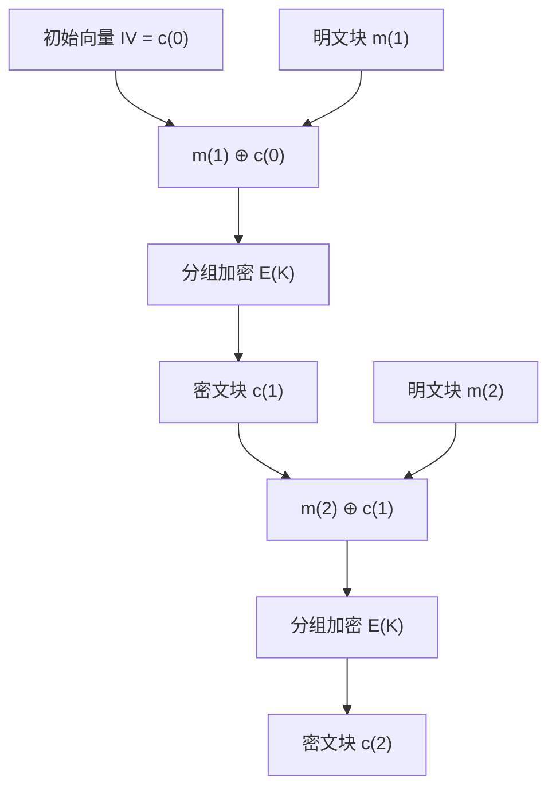

IV 不需要保密，但必须随消息传递，使接收方能够解密第一个分组。后续分组使用前一个密文块作为链接值，因此只需额外传输一个 IV。CBC 解决了独立分组产生重复密文模式的问题；它本身并不提供消息认证，完整性仍需由 MAC 等机制保证。

### 8.2.3 公钥密码

**公钥密码**（public-key cryptography）又称非对称密码。每个实体拥有一对密钥：

- **公钥**（public key）：可以公开发布，任何人都可以获得；
- **私钥**（private key）：由密钥所有者秘密保存。

假设 Bob 拥有公钥 $K_B^+$ 和私钥 $K_B^-$。Alice 想向 Bob 发送机密消息时，使用 Bob 的公钥加密：

$$
c=E_{K_B^+}(m)
$$

Bob 使用自己的私钥解密：

$$
m=D_{K_B^-}(c)=D_{K_B^-}(E_{K_B^+}(m))
$$

因为只有 Bob 持有对应的私钥，所以只有 Bob 能恢复消息内容。公钥密码解决了双方必须预先共享同一个秘密密钥的问题，但公钥必须能够被可信地绑定到其所有者身份上；否则，攻击者可以用自己的公钥冒充 Bob（见 8.4.3 节中间人攻击）。

#### 1. RSA

**RSA** 是一种经典公钥密码算法，安全性依赖于大整数分解问题的计算困难性。RSA 使用模运算。$a\bmod n$ 表示 $a$ 除以 $n$ 后的余数，例如：

$$
19\bmod 5=4
$$

模运算满足：

$$
\begin{aligned}
(a+b)\bmod n&=((a\bmod n)+(b\bmod n))\bmod n\\
(a-b)\bmod n&=((a\bmod n)-(b\bmod n))\bmod n\\
(ab)\bmod n&=((a\bmod n)(b\bmod n))\bmod n
\end{aligned}
$$

RSA 密钥生成过程如下：

1. 选择两个大素数 $p$ 和 $q$。
2. 计算模数 $n=pq$，以及 $z=(p-1)(q-1)$。
3. 选择一个与 $z$ 互素的整数 $e$，作为公钥指数。
4. 选择整数 $d$，使得 $ed\bmod z=1$，即 $d$ 是 $e$ 模 $z$ 的乘法逆元。
5. 公钥为 $K_B^+=(n,e)$，私钥为 $K_B^-=(n,d)$。

加密与解密分别为：

$$
\boxed{c=m^e\bmod n}\qquad
\boxed{m=c^d\bmod n}
$$

其中，待加密消息需要表示为小于 $n$ 的整数。

> [!example] 例题：玩具 RSA
> 取 $p=5$、$q=7$，则 $n=35$、$z=24$；选择 $e=5$（与 24 互素），取 $d=29$，因为 $5\times29-1=144=6\times24$，即 $ed\bmod z=1$。
>
> - 加密 $m=12$：$12^2=144\equiv4$，$12^4\equiv16$，$12^5\equiv16\times12=192\equiv17\pmod{35}$，得 $c=17$
> - 解密：分别模 5 与模 7 验算 $17^{29}$：
>   - 模 5：$17\equiv2$，指数 $29\bmod4=1$，故 $2^{29}\equiv2$，与 $12\bmod5=2$ 一致
>   - 模 7：$17\equiv3$，指数 $29\bmod6=5$，故 $3^{29}\equiv3^5=243\equiv5$，与 $12\bmod7=5$ 一致
>   - 由中国剩余定理得 $17^{29}\equiv12\pmod{35}$，恢复明文
>
> 实际系统必须使用 2048 位以上的模数，并配合 OAEP 等填充方案，不能直接对明文做上述"教科书 RSA"；这组小数值不具备安全性。

**RSA 的正确性证明。** 要证 $(m^e)^d\bmod n=m$，其中 $0\le m<n$。因 $ed\bmod z=1$，存在整数 $k\ge0$ 使 $ed=1+kz=1+k(p-1)(q-1)$。

1. 先看模 $p$。若 $p\mid m$，则 $m^{ed}\equiv0\equiv m\pmod p$。否则由费马小定理 $m^{p-1}\equiv1\pmod p$，于是
   $$
   m^{ed}=m\cdot\left(m^{p-1}\right)^{k(q-1)}\equiv m\pmod p
   $$
2. 同理可得 $m^{ed}\equiv m\pmod q$。
3. $p,q$ 为不同素数，由中国剩余定理，$m^{ed}\equiv m\pmod{pq}$，即 $m^{ed}\bmod n=m$。$\blacksquare$

公钥密码的运算开销通常高于对称密钥密码，因此实际系统一般不会用 RSA 直接加密大量数据，而是将它与对称加密结合使用。

#### 2. 会话密钥

假设 Alice 需要向 Bob 发送大量数据。她可以先随机生成一个对称密钥 $K_S$，用它加密数据；再使用 Bob 的公钥加密 $K_S$，将加密后的会话密钥与加密数据一起发送：

$$
\begin{aligned}
c_m&=E_{K_S}(m)\\
c_K&=E_{K_B^+}(K_S)
\end{aligned}
$$

Bob 先用私钥恢复 $K_S$，再用 $K_S$ 解密数据。这样既利用了公钥密码解决密钥分发问题，又利用了对称密码处理大规模数据时的高效率。

#### 3. Diffie-Hellman 密钥协商

**Diffie-Hellman（DH）密钥协商**允许两个从未共享秘密的实体，在公开信道上协商出相同的共享秘密，而不直接传输该秘密。它与 RSA 的用途有所不同：DH 的核心任务是建立共享密钥，而不是直接加密一段消息。

Alice 和 Bob 公开选定一个大素数 $p$ 和 $p$ 的一个原根（生成元）$g$。随后，两人分别选择自己的私有随机数 $S_A$ 和 $S_B$，并计算公开值：

$$
X_A=g^{S_A}\bmod p,\qquad
X_B=g^{S_B}\bmod p
$$

双方交换公开值，但不公开私有随机数。Alice 使用 Bob 的公开值计算：

$$
K=X_B^{\,S_A}\bmod p=g^{S_BS_A}\bmod p
$$

Bob 使用 Alice 的公开值计算：

$$
K=X_A^{\,S_B}\bmod p=g^{S_AS_B}\bmod p
$$

由于 $S_AS_B=S_BS_A$，双方得到相同的共享秘密 $K$。窃听者虽然知道 $p$、$g$ 和双方的公开值，却难以由此反推出私有随机数：这依赖于**离散对数问题**的计算困难性。

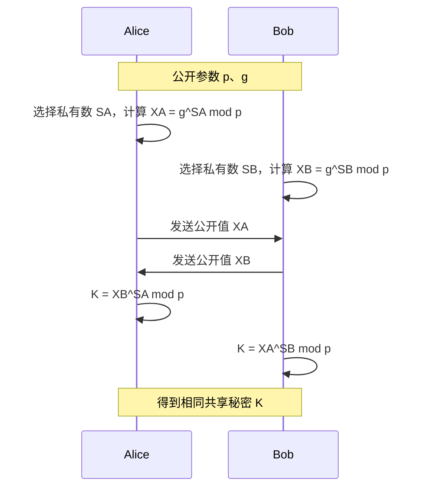

> [!warning] DH 本身不提供认证
> DH 只保证"双方得到相同的秘密"，并不保证对方是谁。中间人 Trudy 可以分别与 Alice、Bob 各做一次 DH，得到两个不同的共享秘密，并在两侧转发、解密、再加密消息，而双方毫无察觉。因此 TLS、IKE 等协议在使用 DH 时，必须配合证书或数字签名认证对方（见 8.6、8.7 节）。

> [!note] RSA 与 Diffie-Hellman 的区别
> RSA 通过公钥加密、私钥解密，可以用于加密少量数据或会话密钥；Diffie-Hellman 则让双方通过交换公开参数协商出共享秘密。二者都使用公钥密码学思想，但解决的问题并不相同。

> [!note] 后量子密码（需验证，随年份变化）
> RSA 与 DH 的安全性依赖大整数分解与离散对数问题，在大规模量子计算机面前不再安全。业界已开始部署后量子密钥封装机制，例如 TLS 中把经典 ECDH 与后量子 KEM 组合的混合密钥交换。具体标准与部署现状需标注年份与出处。

## 8.3 消息完整性与数字签名

加密解决的是机密性：攻击者即使截获消息，也难以理解其内容。但**加密并不自动保证消息完整性**。攻击者仍可能修改密文或替换消息；接收方还需要确认消息确实来自声称的发送方。

例如，在链路状态路由算法（如 OSPF）中，每台路由器会向其他路由器通告自己的邻居和链路开销。如果攻击者伪造链路状态消息，其他路由器可能根据错误的网络拓扑计算路由。因此，接收方需要验证两件事：消息确实由声称的发送方生成，而且消息在传输过程中没有被篡改。

### 8.3.1 密码学哈希函数

**哈希函数**（hash function）把任意长度的输入消息 $m$ 映射为固定长度的摘要：

$$
h=H(m)
$$

Internet 校验和和 CRC 也会把数据映射为固定长度的值，但它们主要用于检测传输差错，并不具备密码学安全性。**密码学哈希函数**至少需要具备以下性质：

| 性质       | 含义                                        | 理想强度（输出 $n$ bit）        |
| ---------- | ------------------------------------------- | ------------------------------- |
| 抗原像     | 给定 $h$，难以找到 $m$ 使 $H(m)=h$          | 约 $2^n$ 次尝试                 |
| 抗第二原像 | 给定 $x$，难以找到 $y\neq x$ 使 $H(y)=H(x)$ | 约 $2^n$ 次尝试                 |
| 抗碰撞     | 难以找到任意 $x\neq y$ 使 $H(x)=H(y)$       | 约 $2^{n/2}$ 次尝试（生日攻击） |

抗碰撞性使攻击者难以构造另一个不同消息，却保留原消息的摘要。简单校验和不具备这一性质：可以通过调整消息中的字符，使不同内容的消息具有相同的累加校验结果，攻击者就能在不被发现的情况下替换消息。

哈希函数常用于生成消息摘要。摘要长度固定，因此即使原始消息很长，也可以对其摘要执行后续的认证或签名操作。

| 算法                |     摘要长度 | 现状                                                   |
| ------------------- | -----------: | ------------------------------------------------------ |
| MD5                 |      128 bit | 碰撞已可实用构造（约 2004 年起），不应再用于签名或证书 |
| SHA-1               |      160 bit | 2017 年出现实用碰撞（SHAttered），不应再用于签名或证书 |
| SHA-2（SHA-256 等） | 224～512 bit | 现行常用选择                                           |
| SHA-3               | 224～512 bit | 与 SHA-2 结构不同，作为备选标准                        |

原书以 MD5 和 SHA-1 说明哈希函数的工作方式；本节需要掌握的是哈希摘要的作用，以及密码学哈希与普通校验和在安全目标上的区别。

### 8.3.2 消息认证码 MAC

如果 Alice 仅仅发送消息和哈希值：

$$
(m,H(m))
$$

这种方法并不能认证发送者。攻击者可以自行构造伪造消息 $m'$，并计算 $H(m')$，然后将 $(m',H(m'))$ 发送给 Bob。Bob 重新计算哈希后仍会得到一致结果。

因此，Alice 和 Bob 还需要共享一个攻击者不知道的秘密密钥 $s$，称为**认证密钥**（authentication key）。基于共享密钥计算的消息认证码的教学形式为：

$$
MAC=H(m\Vert s)
$$

其中 $\Vert$ 表示拼接。发送方发送 $(m,MAC)$；接收方使用同一个密钥重新计算 MAC，并比较两者是否相等：

1. Alice 使用共享密钥 $s$ 和消息 $m$ 计算 MAC。
2. Alice 将消息和 MAC 一起发送给 Bob。
3. Bob 使用相同的密钥计算 MAC；若计算结果与收到的 MAC 相同，则消息通过认证检查。

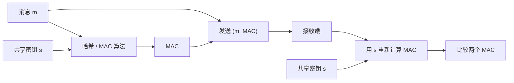

> [!warning] $H(m\Vert s)$ 仅为教学简化
> 对 MD5、SHA-1、SHA-2 这类迭代结构的哈希函数，直接拼接构造存在**长度扩展攻击**：攻击者已知 $H(m\Vert s)$ 时，无需知道 $s$ 即可计算出 $H(m\Vert s\Vert\text{pad}\Vert x)$。实际标准使用 **HMAC**：
>
> $$
> \text{HMAC}(s,m)=H\big((s\oplus opad)\,\Vert\,H((s\oplus ipad)\,\Vert\,m)\big)
> $$
>
> 其中 $ipad$、$opad$ 为规定的固定填充常量。两层嵌套消除了长度扩展攻击。

MAC 不需要加密算法，因此在通信双方只关心消息来源和完整性、不要求隐藏消息内容时，MAC 是一种开销较低的机制。例如，路由器可以利用 MAC 验证收到的路由控制消息（5.3 节 OSPF 的密码学认证即基于此）。

需要注意，MAC 使用的是共享密钥：双方都知道密钥，因此任何一方都能够生成合法 MAC。它可以帮助接收方确认消息来自某个共享密钥持有者，但不能像数字签名那样向第三方证明消息只能由某一个特定实体生成，即不具备**不可否认性**。

### 8.3.3 数字签名

**数字签名**（digital signature）用于证明某个消息或文档由特定实体签署，并使接收方能够检测内容是否被修改。数字签名需要具备两个基本性质：

- **可验证性**：接收方能够利用签名者的公钥验证签名。
- **不可伪造性**：在私钥安全的前提下，其他人无法冒充签名者生成有效签名。

假设 Bob 要对消息 $m$ 签名。按照 RSA 的教学模型，Bob 使用自己的私钥生成签名：

$$
Sig=D_{K_B^-}(m)
$$

Alice 收到消息和签名后，使用 Bob 的公钥验证：

$$
E_{K_B^+}(Sig)=m
$$

如果验证结果与收到的消息一致，就说明签名与 Bob 的密钥对相匹配。若消息被修改为 $m'$，原签名通常无法通过验证。

对长消息直接执行公钥运算开销较大，因此实际方案通常先计算消息摘要，再对摘要签名：

$$
Sig=D_{K_B^-}(H(m))
$$

接收方执行两个操作：

1. 使用 Bob 的公钥验证数字签名，得到签名所对应的摘要；
2. 自己计算收到消息的哈希值，并比较两个摘要。

只有两个摘要一致，消息才通过签名验证。数字签名同时提供发送者认证和消息完整性，但**不提供机密性**：原始消息可以保持明文发送，任何人都能读取它。

> [!warning] 签名不是"用私钥解密"
> 上述 $D_{K_B^-}$ 写法仅为 RSA 教学模型，用来突出"私钥签、公钥验"的对称性，且与 8.2.3 中"解密"的含义容易混淆。实际使用的是 RSA-PSS、ECDSA、EdDSA 等专门的签名方案，签名与加密是两种不同的操作，密钥也不应混用。

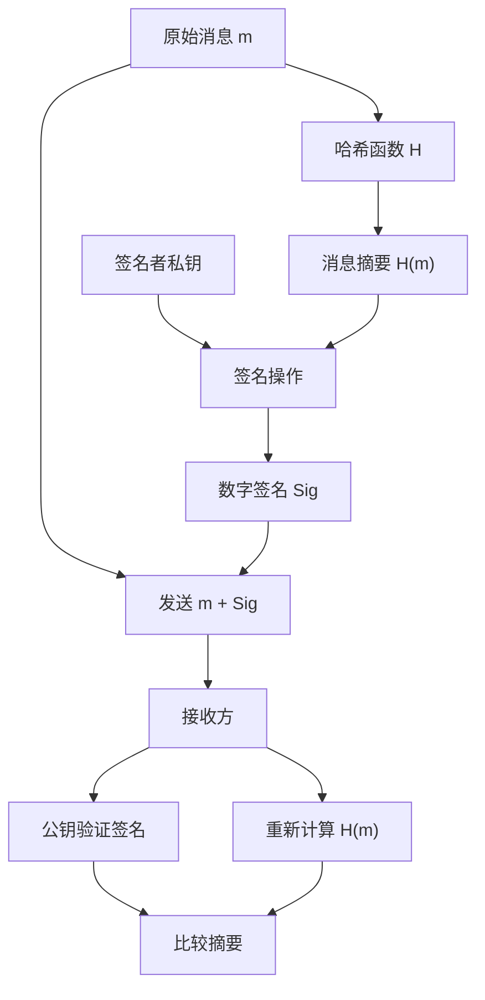

#### 1. 消息认证码与数字签名的比较

| 比较项     | 消息认证码 MAC                 | 数字签名                       |
| ---------- | ------------------------------ | ------------------------------ |
| 密钥       | 通信双方共享同一个认证密钥     | 签名者使用私钥，验证者使用公钥 |
| 验证者     | 必须持有共享密钥               | 只需要可信的签名者公钥         |
| 完整性     | 可以                           | 可以                           |
| 来源认证   | 证明消息来自共享密钥持有者之一 | 可以绑定到特定私钥持有者       |
| 不可否认性 | 无，因为验证者也能生成 MAC     | 有（私钥未泄露的前提下）       |
| 第三方验证 | 不适合                         | 可以由第三方使用公钥验证       |
| 典型代价   | 较低                           | 通常较高，需要公钥密码机制     |

#### 2. 公钥证书与证书颁发机构

数字签名能够证明消息由某个私钥对应的实体签署，但接收方首先必须确认自己拿到的公钥确实属于该实体。否则，攻击者可以声称自己是 Bob，并把自己的公钥交给 Alice；Alice 使用攻击者的公钥验证签名，仍可能得到"验证成功"的结果。

因此，需要一种把公钥与实体身份绑定起来的机制。通常由**证书颁发机构**（Certification Authority，CA）完成：

1. CA 按照一定流程验证实体身份。
2. CA 创建证书，将实体身份与其公钥绑定。
3. CA 使用自己的私钥对证书进行数字签名。
4. 接收方使用可信 CA 的公钥验证证书，从证书中取得经过认证的实体公钥。

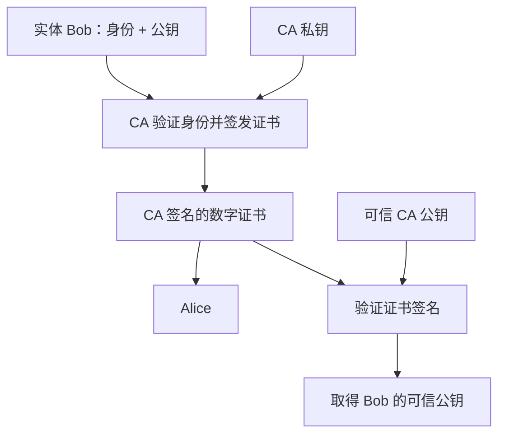

X.509 证书包含的典型字段如下：

| 字段               | 含义                                                                                                                                 |
| ------------------ | ------------------------------------------------------------------------------------------------------------------------------------ |
| Version            | X.509 证书版本                                                                                                                       |
| Serial number      | CA 为证书分配的唯一序列号                                                                                                            |
| Signature          | CA 对证书签名所使用的算法                                                                                                            |
| Issuer name        | 签发证书的 CA 身份                                                                                                                   |
| Validity period    | 证书有效期的起止时间                                                                                                                 |
| Subject name       | 证书所对应实体的身份                                                                                                                 |
| Subject public key | 实体的公钥及其算法参数                                                                                                               |
| Extensions         | 扩展字段，其中 SAN（Subject Alternative Name）列出证书适用的域名；现代 TLS 按 SAN 而非 Subject name 匹配域名（原书可能省略，需验证） |

证书并不是"公钥本身"，而是由可信 CA 签名的身份—公钥绑定声明。信任证书最终依赖于对 CA 身份验证流程及其公钥的信任。

**证书链。** 实际中通常不是根 CA 直接给每个网站签发证书，而是形成层级：

| 层次                       | 说明                                                       |
| -------------------------- | ---------------------------------------------------------- |
| 根 CA（root CA）           | 其自签名证书预置于操作系统或浏览器的信任库中，私钥离线保管 |
| 中间 CA（intermediate CA） | 由根 CA 签发，负责日常签发终端证书                         |
| 终端实体证书（leaf）       | 网站或用户的证书，由中间 CA 签发                           |

验证者从叶证书开始，逐级用上一级的公钥验证签名，直到某个预置的根证书，并检查有效期、域名与撤销状态。

**证书撤销。** 私钥泄露或证书误发时，需要在有效期结束前使证书失效，常见机制有证书撤销列表（CRL）与在线证书状态协议（OCSP）。撤销检查的现状与实现差异较大（需验证）。

## 8.4 端点认证

**端点认证**（end-point authentication）是指通信中的一方在网络上向另一方证明自己的身份。例如，用户登录邮件服务器时，服务器需要确认当前连接的用户确实是其声称的用户。

端点认证与消息完整性相关，但二者并不相同：消息完整性关注某一条消息是否来自特定发送者、是否被修改；端点认证关注当前正在通信的实体是否真实存在于连接的另一端，即对方是否是一个"活着的"通信参与者。

认证通常在真正的数据交换之前执行。通过认证协议建立双方认可的身份后，双方才继续运行应用协议、路由协议或其他业务协议。

### 8.4.1 从简单身份声明到挑战—响应

可以逐步设计一个认证协议，并观察每种方案的缺陷：

| 协议  | 认证方式                                                    | 问题                                                   |
| ----- | ----------------------------------------------------------- | ------------------------------------------------------ |
| ap1.0 | Alice 直接发送"我是 Alice"                                  | 没有证据，任何人都可以这样声明                         |
| ap2.0 | Bob 检查 IP 源地址是否属于 Alice                            | 攻击者可以进行 IP 欺骗（IP spoofing）                  |
| ap3.0 | Alice 发送共享密码                                          | 密码可能被窃听者直接截获                               |
| ap3.1 | Alice 加密密码后发送                                        | 攻击者可以记录密文并在之后重放                         |
| ap4.0 | Bob 发送一次性随机数，Alice 加密后返回                      | 可验证对方知道共享密钥，并且响应的是本次挑战           |
| ap5.0 | Bob 发送 nonce，Alice 用私钥签名返回，Bob 用 Alice 公钥验证 | 不需要预先共享密钥，但公钥来源若不可信，易受中间人攻击 |

**ap2.0：基于 IP 地址的认证。** 如果 Alice 总是从固定 IP 地址通信，Bob 可以检查数据报的源地址。但 IP 源地址字段可以被伪造，攻击者只要构造源地址为 Alice 的数据报，就可能绕过这种检查。这类攻击称为 **IP 欺骗**（IP spoofing）。

**ap3.0：基于密码的认证。** Alice 直接向 Bob 发送密码。问题在于密码本身会经过网络；如果攻击者能够监听通信，就可以窃取密码。Telnet 等未加密协议中的登录密码尤其容易受到这种攻击。

**ap3.1：加密密码。** 假设 Alice 和 Bob 共享对称密钥 $K_{A-B}$，Alice 可以加密密码后发送。这样攻击者无法直接读出密码，但仍然可以记录密文，并在之后原样发送给 Bob。Bob 无法判断收到的是 Alice 当前生成的消息，还是攻击者重放的旧消息。

### 8.4.2 Nonce 与重放攻击防御

**Nonce** 是协议中只使用一次的随机数。它可以让接收方判断消息是否针对当前这次交互生成，而不是对过去某次交互的简单重放。

ap4.0 使用挑战—响应机制完成认证：

1. Alice 向 Bob 发送身份声明："我是 Alice"。
2. Bob 生成一个新的随机数 $R$，并发送给 Alice。
3. Alice 使用双方共享的秘密密钥 $K_{A-B}$ 加密 $R$，得到 $E_{K_{A-B}}(R)$，再返回给 Bob。
4. Bob 解密收到的结果，并检查是否等于自己刚刚生成的 $R$。若相等，则说明响应方知道共享密钥，并且能够处理本次新挑战。

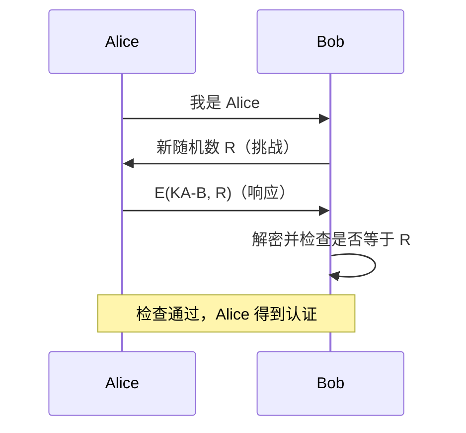

攻击者即使记录了过去的密文响应，也无法直接通过下一次认证：新会话中 Bob 会产生新的 $R$，旧响应解密后不会等于新的随机数。

> [!important] 本节核心
> 加密可以隐藏密码，但不能单独防止重放。认证协议需要让接收方确认响应与当前会话相关；nonce 通过"一次性挑战"提供这种新鲜性。

### 8.4.3 公钥认证与中间人攻击

ap4.0 要求双方预先共享对称密钥。若改用公钥，可得 ap5.0：

1. Alice 向 Bob 发送"我是 Alice"。
2. Bob 发送 nonce $R$。
3. Alice 用自己的私钥对 $R$ 签名并返回。
4. Bob 用 Alice 的公钥验证签名。若通过，说明响应方持有 Alice 的私钥。

这一协议不需要预先共享秘密，但引入新问题：**Bob 怎么知道自己手里的"Alice 的公钥"真的是 Alice 的？** 若 Trudy 能把自己的公钥冒充为 Alice 的公钥交给 Bob，就会发生**中间人攻击**（man-in-the-middle attack）：

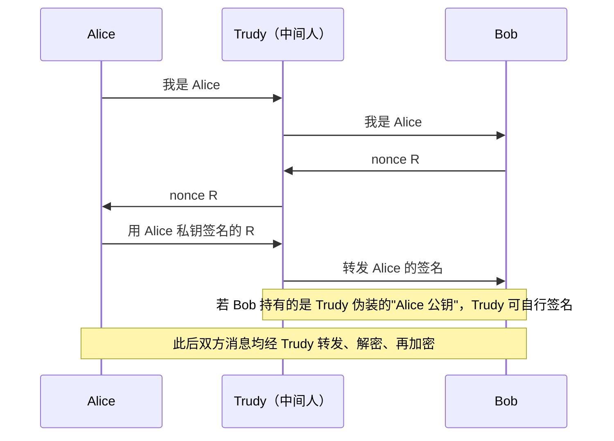

问题的根源在于**公钥缺少可信来源**，这正是 8.3.3 节证书与 CA 要解决的问题：由可信第三方对"身份—公钥"绑定进行签名。

# 第二部分 网络协议中的安全机制

安全服务可以部署在 Internet 协议栈的不同层次。部署位置不同，受保护的通信范围也不同：应用层安全保护某个具体应用；传输层安全保护使用该传输安全服务的应用通信；网络层安全可以保护两个网络实体之间的所有 IP 数据报；链路层安全则保护经过特定链路的帧。

| 安全部署层次    | 保护范围                         | 典型技术          |
| --------------- | -------------------------------- | ----------------- |
| 应用层          | 特定应用中的消息                 | PGP、安全电子邮件 |
| 传输层 / 进程间 | 客户端与服务器进程间的通信       | TLS               |
| 网络层 / 主机间 | 两个主机或路由器之间的 IP 数据报 | IPsec、VPN        |
| 链路层          | 一条链路上的帧                   | WiFi 安全机制     |

为什么需要在多个层次提供安全服务？网络层安全能够提供较大范围的保护，但通常不能替代应用层身份认证。例如，电子商务网站仍然需要确认下单用户的身份和权限；仅仅验证 IP 数据报并不足以完成用户级认证。另一方面，在较高层部署安全功能通常更容易，不必修改整个网络基础设施。

## 8.5 安全电子邮件

电子邮件是应用层安全的典型例子。Alice 向 Bob 发送邮件时，通常希望满足以下要求：

- **机密性**：Trudy 无法读取邮件内容。
- **发送方认证**：Bob 能确认邮件确实来自 Alice。
- **消息完整性**：邮件在传输过程中没有被修改。
- **接收方认证**：Alice 能确认邮件发送给的是 Bob，而不是冒充 Bob 的攻击者。

### 8.5.1 安全电子邮件的构造

#### 1. 仅提供机密性

最直接的方法是使用对称密钥加密邮件。但这要求 Alice 和 Bob 事先安全地共享密钥，密钥分发并不容易。

也可以使用 Bob 的公钥加密邮件，Bob 再使用自己的私钥解密。但公钥加密长消息的效率较低。因此，实际设计采用混合加密：

1. Alice 随机生成一次性对称会话密钥 $K_S$。
2. Alice 使用 $K_S$ 加密邮件内容 $m$。
3. Alice 使用 Bob 的公钥 $K_B^+$ 加密会话密钥 $K_S$。
4. Alice 将加密后的邮件和加密后的会话密钥一起发送给 Bob。
5. Bob 使用自己的私钥恢复 $K_S$，再用 $K_S$ 解密邮件。

$$
\boxed{\left(E_{K_S}(m),\ E_{K_B^+}(K_S)\right)}
$$

这样，公钥密码只处理较短的会话密钥，大量邮件数据则由效率更高的对称密码处理。

#### 2. 提供发送方认证与消息完整性

仅使用加密不能证明邮件来自 Alice。为此，Alice 可以对邮件内容生成数字签名：

1. 计算邮件摘要 $H(m)$。
2. 使用 Alice 的私钥 $K_A^-$ 对摘要签名，得到 $Sig_A$。
3. 将原始邮件和数字签名一起发送。
4. Bob 使用 Alice 的公钥验证签名，并将验证得到的摘要与自己计算的 $H(m)$ 比较。

若两者一致，Bob 就可以验证邮件来源及内容完整性。这里的邮件内容本身仍然是明文，因此任何能够截获邮件的人都可以读取内容。

#### 3. 同时提供机密性、发送方认证与完整性

可以将上述两种机制组合起来：Alice 先把原始邮件与数字签名组成一个待加密消息，再对这个整体进行混合加密。Bob 收到后先恢复会话密钥并解密，再验证 Alice 的数字签名。

```mermaid
flowchart TD
    M["邮件 m"] --> H["计算 H(m)"]
    H --> S["Alice 私钥签名"]
    M --> P["组合邮件与签名"]
    S --> P
    P --> E1["用会话密钥 KS 加密"]
    KS["随机生成 KS"] --> E1
    KS --> E2["用 Bob 公钥加密 KS"]
    E1 --> OUT["发送加密邮件 + 加密的 KS"]
    E2 --> OUT
```

这个设计实现了邮件内容的机密性、发送方认证与消息完整性。它也依赖公钥证书：Alice 必须确认自己使用的是 Bob 的真实公钥，Bob 也必须取得 Alice 的可信公钥。

### 8.5.2 PGP

**Pretty Good Privacy（PGP）** 是一种经典的安全电子邮件方案。PGP 的整体设计与前面介绍的混合加密方案一致：可以选择数字签名、加密，或者同时使用两者。

- 发送方可以先对邮件计算摘要，再使用自己的私钥签名，以支持消息来源验证和完整性检查。
- 发送方可以随机生成对称会话密钥，用其加密邮件，再使用接收方的公钥加密会话密钥，以提供机密性。
- 接收方先用自己的私钥恢复会话密钥，再解密邮件；随后使用发送方的公钥验证数字签名。

PGP 在公钥认证方面采用了不同于传统 CA 的**信任网络**（web of trust）。用户可以为自己认为可信的用户名—公钥绑定关系签名，也可以表达对其他用户为公钥背书能力的信任。用户还可以通过线下交换公钥并互相签名的方式建立信任关系。

OpenPGP 是 PGP 思想的开放标准化发展形式，为邮件和数据文件提供机密性、数字签名与消息完整性（RFC 4880 已被 RFC 9580 取代，需验证并标注年份）。

## 8.6 传输层安全：TLS

**传输层安全**（Transport Layer Security，TLS）为客户端和服务器进程之间的通信提供机密性、数据完整性和端点认证。TLS 最初主要运行在 TCP 之上，为 TCP 提供的字节流服务增加安全保护；TLS 1.3 也被集成到 QUIC 中，用于保护基于 UDP 的进程间通信。

没有 TLS 的 Web 交易可能遭到以下攻击：窃听者读取订单和支付信息；攻击者修改订单内容；恶意服务器冒充真实网站，窃取用户信息。因此，TLS 除了加密数据，还需要验证服务器身份并保护消息完整性。

### 8.6.1 TLS 的基本过程

先考虑一个简化的"近似 TLS"（almost-TLS）模型。它把 TLS 过程分为三个阶段：握手、密钥派生和数据传输。该模型用于理解基本原理，不应与实际 TLS 1.3 的握手细节混为一谈。

#### 1. 握手

客户端 Bob 与服务器 Alice 首先建立 TCP 连接，然后进行安全握手：

1. Bob 向 Alice 发送 Hello 消息。
2. Alice 返回自己的数字证书，其中包含公钥。Bob 使用可信 CA 的公钥验证证书，从而确认该公钥属于 Alice。
3. Bob 生成一个仅用于本次 TLS 会话的主秘密（Master Secret，MS），并使用 Alice 的公钥加密后发送。
4. Alice 使用自己的私钥解密，得到相同的 MS。

握手完成后，Alice 和 Bob 共享主秘密，而旁观者无法直接取得它。

> [!note] almost-TLS 与 TLS 1.3 的关键差别
> almost-TLS 由客户端用服务器的 RSA 公钥加密主秘密（密钥传输）。一旦服务器私钥日后泄露，攻击者就能解密此前录制的全部会话。TLS 1.3 取消了这种方式，只使用**临时 DH**（每次连接生成新的 DH 密钥对）协商共享秘密，从而具有**前向保密**：即使服务器长期私钥日后泄露，过去的会话仍然安全。

#### 2. 密钥派生

不宜将同一个主秘密直接用于所有方向和所有安全操作。双方从 MS 派生出四个用途不同的密钥：

| 密钥  | 用途                            |
| ----- | ------------------------------- |
| $E_B$ | Bob 到 Alice 方向的数据加密密钥 |
| $M_B$ | Bob 到 Alice 方向的 HMAC 密钥   |
| $E_A$ | Alice 到 Bob 方向的数据加密密钥 |
| $M_A$ | Alice 到 Bob 方向的 HMAC 密钥   |

两个方向使用不同的密钥，可以避免双向通信时混用同一组密钥；加密与完整性检查也使用不同密钥。

#### 3. 数据传输与记录

TCP 提供的是字节流，并不知道应用层消息的边界。TLS 将应用数据划分为多个**记录**（record），逐条保护每个记录：

1. 发送方将应用数据划分为记录。
2. 使用方向对应的 HMAC 密钥计算记录的完整性标签。
3. 将记录与 HMAC 一起加密。
4. 把密文记录交给 TCP 传输。

仅对每条记录分别计算 HMAC 仍不足以保护整个字节流的顺序。攻击者可能重排、重放或删除记录，而每条记录自身的内容仍然可以通过单独的完整性检查。因此，TLS 还需要**序列号**：发送方维护递增计数器，并在计算 HMAC 时把序列号纳入认证数据；接收方按顺序维护对应计数器。这样，记录被重排或重放时，完整性验证就会失败。

> [!note] 先认证后加密的简化模型
> 上述"先算 HMAC、再一起加密"的顺序只是简化模型。这种 MAC-then-encrypt 的组合在 CBC 等模式下曾暴露出填充预言类攻击。现代做法是使用 AEAD 算法，在一次操作中同时完成加密与认证（见 8.6.2 节）。

#### 4. TLS 记录格式

原书用一个简化记录格式说明 TLS 的分帧方式：

| 字段    | 作用                                           |
| ------- | ---------------------------------------------- |
| Type    | 表示记录类型，例如握手消息、应用数据或连接关闭 |
| Version | 协议版本信息                                   |
| Length  | 记录长度，帮助接收端从 TCP 字节流中提取记录    |
| Data    | 记录携带的内容                                 |
| HMAC    | 用于验证记录完整性                             |

记录头中的部分字段可用于解析记录；数据内容及认证信息则由相应的安全机制保护。

### 8.6.2 TLS 1.3

TLS 从早期版本逐步演进到 TLS 1.3（RFC 8446，需验证；TLS 1.0 与 1.1 已被弃用，见 RFC 8996）。演进过程既包括修复旧版本中发现的安全问题，也包括移除较弱的密码套件和减少建立安全连接所需的往返时延（RTT）。TLS 的核心目标没有改变：为通信双方提供机密性、完整性和端点认证。

TLS 1.3 的典型握手过程如下：

| 步骤 | 消息                                       | 内容与作用                                                        | 是否加密 |
| ---- | ------------------------------------------ | ----------------------------------------------------------------- | :------: |
| 1    | **ClientHello**                            | 客户端发送支持的版本、密码套件、随机数，以及 DH 参数（key_share） |    否    |
| 2    | **ServerHello**                            | 服务器选定密码套件，返回随机数与自己的 DH 参数                    |    否    |
| —    | （此时双方已可算出共享秘密并派生握手密钥） | 此后的握手消息均受保护                                            |    —     |
| 3    | **EncryptedExtensions**                    | 服务器的其余协商参数                                              |    是    |
| 4    | **Certificate**                            | 服务器的证书链，客户端用可信 CA 验证                              |    是    |
| 5    | **CertificateVerify**                      | 服务器用**证书对应的私钥**对握手记录签名，证明自己持有私钥        |    是    |
| 6    | **Finished（服务器）**                     | 对整个握手记录的 MAC，确认握手未被篡改                            |    是    |
| 7    | **Finished（客户端）**                     | 客户端的对应 MAC                                                  |    是    |
| 8    | 应用数据                                   | 使用从共享秘密派生的流量密钥保护                                  |    是    |

> [!important] 为什么需要 CertificateVerify
> 证书是公开的，谁都可以拿到并原样转发。仅验证证书只能确认"这张证书确实由 CA 签发"，不能证明对端**持有**证书对应的私钥。DH 本身又不提供认证（8.2.3 节）。因此服务器必须用私钥对握手记录签名，客户端验证该签名后，才能确认当前通信的另一端就是证书的合法主人。缺少这一步，中间人可以用自己的 DH 参数与客户端协商，再转发服务器的证书而不被发现。

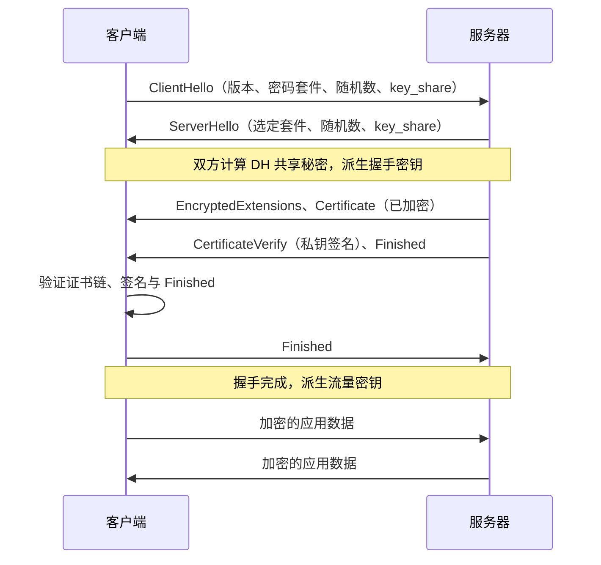

TLS 1.3 使用 **AEAD**（Authenticated Encryption with Associated Data，带关联数据的认证加密）算法，在数据传输阶段同时提供机密性和完整性，而不再像简化模型那样把加密和 HMAC 作为两个独立步骤描述。密钥也不是直接使用一个"主秘密"，而是经 HKDF 逐级派生握手秘密、主秘密和各方向流量密钥（原书措辞需验证）。

在 TCP 上运行 TLS 1.3 时，必须先建立 TCP 连接，然后执行 TLS 握手，合计约 2 RTT（见 3.8 节表格）；当 TLS 1.3 集成在 QUIC 中时，TLS 握手消息参与 QUIC 连接建立，首次连接约 1 RTT。对于曾经通信并保存了会话参数的客户端，还存在 0-RTT 数据的机制，但它需要特别考虑重放风险。

TLS 中的随机数和序列号解决的是不同层面的重放问题：**序列号**用于防止当前会话中的记录被重排或重放；**随机数**使不同连接的密钥协商结果不同，帮助防止攻击者重放过去某次连接的整组握手与数据记录。

连接关闭也需要协议保护。如果只依赖 TCP FIN 结束连接，攻击者可能提前注入 FIN，使接收方误以为数据已经完整到达。TLS 因此使用受保护的关闭消息；若在收到 TLS 关闭消息前就收到 TCP 连接终止信号，接收方应意识到连接可能被截断。

> [!note] 理解 TLS 的关键
> TLS 不只是"把 HTTP 内容加密"。它还要通过证书和 CertificateVerify 认证服务器，通过临时 DH 建立共享秘密并获得前向保密，通过密钥派生区分方向和用途，并通过记录层保护数据完整性、顺序与连接状态。

## 8.7 网络层安全：IPsec 与 VPN

**IPsec**（IP Security）在网络层为 IP 数据报提供安全保护。它可以在主机与主机、路由器与路由器，或主机与路由器之间建立安全通信。与 TLS 主要保护特定进程间的通信不同，IPsec 可以保护两个网络实体之间承载的各种上层流量，包括 TCP、UDP、ICMP 和应用数据，因此常称为提供网络层的**全面覆盖**（blanket coverage）。

### 8.7.1 IPsec 与虚拟专用网

**虚拟专用网**（Virtual Private Network，VPN）是在公共 Internet 上构建逻辑上的专用网络。跨地域组织原本可以自行铺设独立的物理网络，但建设和维护成本很高。VPN 则利用已有 Internet 连接，在数据进入公共网络之前进行加密，使不同办公室、移动员工和总部能够安全交换数据。

例如，总部网关路由器收到发往分支机构的普通 IPv4 数据报后，会把它封装为 IPsec 数据报，再发送到公共 Internet。Internet 中的普通路由器仍然只根据外层 IP 首部转发数据报，并不需要理解内部的 IPsec 内容。数据报到达分支机构网关后，由该网关执行验证、解密和解封装，再把原始数据报转发到内部网络。

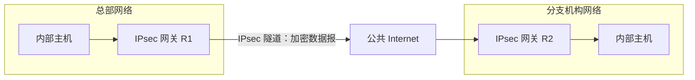

### 8.7.2 AH 与 ESP

IPsec 包含两个主要协议：

| 协议 | 全称                           | IP 协议号 | 提供的服务                       |
| ---- | ------------------------------ | :-------: | -------------------------------- |
| AH   | Authentication Header          |    51     | 源认证、数据完整性；不提供机密性 |
| ESP  | Encapsulating Security Payload |    50     | 源认证、数据完整性和机密性       |

由于 VPN 通常需要加密通信内容，实际应用中 ESP 比 AH 更常见。以下重点讨论 ESP。

IPsec 有两种封装方式，对照如下：

| 比较项                     | 传输模式（transport mode）           | 隧道模式（tunnel mode）            |
| -------------------------- | ------------------------------------ | ---------------------------------- |
| 保护对象                   | 原 IP 数据报的**载荷**（上层报文段） | **整个**原 IP 数据报               |
| IP 首部                    | 沿用原 IP 首部                       | 新增外层 IP 首部，使用隧道两端地址 |
| 原始地址是否受保护         | 否                                   | 是（在 ESP 保护区内）              |
| ESP Trailer 的 Next Header | 上层协议号（如 6、17）               | 4（IPv4）或 41（IPv6）             |
| 典型场景                   | 主机到主机                           | 网关到网关的 VPN、主机到网关       |

### 8.7.3 安全关联 SA

在两个网络实体之间发送 IPsec 数据报之前，双方需要建立一条逻辑关系，称为**安全关联**（Security Association，SA）。SA 是单向的：如果 R1 和 R2 要双向传输受保护的数据，就需要分别建立 R1 → R2 和 R2 → R1 两条 SA。

每条 SA 都包含完成安全处理所需的状态信息，例如：

- 32 bit 的安全参数索引 SPI，用于标识 SA；
- 源端与目的端的网络接口信息；
- 使用的加密算法及加密密钥；
- 使用的完整性算法及认证密钥。

IPsec 实体通常需要维护多条 SA。操作系统内核使用**安全关联数据库**（Security Association Database，SAD）保存这些状态。接收方收到数据报后，可以根据 SPI 找到相应 SA，从而知道应当使用哪种算法和密钥处理数据报。

### 8.7.4 IPsec 数据报与隧道模式

隧道模式更适合网关之间构建 VPN，因此本节重点讨论隧道模式。

假设 R1 收到一个普通 IPv4 数据报，其源地址是总部内部主机，目的地址是分支机构内部主机。R1 将其转换为 ESP 数据报，主要步骤如下：

1. 在原始 IPv4 数据报后添加 ESP Trailer。
2. 使用 SA 指定的加密算法和密钥，对原始数据报及 ESP Trailer 加密。
3. 在加密内容前添加 ESP Header，形成 ESP 封装内容。
4. 对 ESP Header、加密内容等计算认证 MAC。
5. 将 MAC 附加到 ESP 内容之后。
6. 创建新的外层 IP 首部，将整个 ESP 内容作为其载荷。

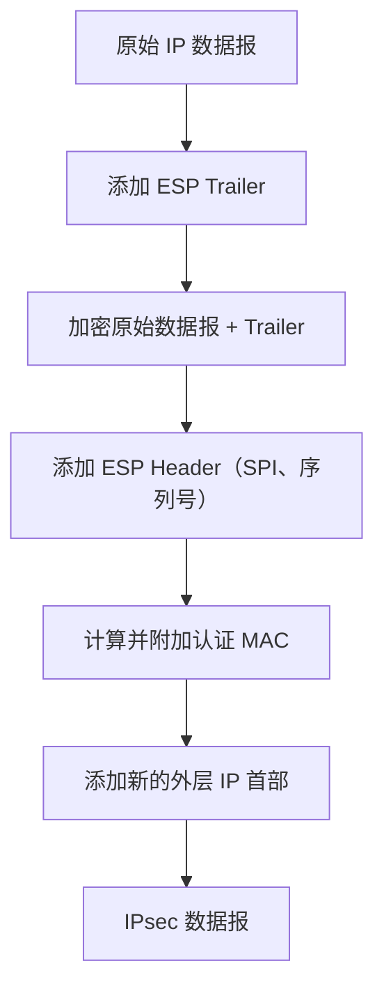

ESP Trailer 包含：

| 字段        | 作用                                                                                                  |
| ----------- | ----------------------------------------------------------------------------------------------------- |
| Padding     | 填充数据，使待加密内容满足分组密码的长度要求                                                          |
| Pad Length  | 指明填充数据的长度                                                                                    |
| Next Header | 标识被保护载荷的协议类型：隧道模式下为 4（IPv4）或 41（IPv6），传输模式下为上层协议号（如 UDP 的 17） |

ESP Header 包含：

| 字段            | 作用                                             |
| --------------- | ------------------------------------------------ |
| SPI             | 标识该数据报使用哪条 SA                          |
| Sequence Number | 序列号，配合接收端的**抗重放窗口**检测重放数据报 |

隧道模式下，**原始 IP 数据报整体被封装在 ESP 保护区域内**，其中原始源/目的 IP 地址也受到保护。外层新 IP 首部则使用隧道两端的网关地址，以便公共 Internet 路由器能够正常转发。ESP 使用 IP 协议号 50 标识。

接收端 R2 的处理过程与发送端相反：

1. 根据外层 IP 首部确认数据报发给自己，并识别 ESP 协议。
2. 读取 SPI，在 SAD 中查找对应 SA。
3. 验证认证 MAC，确认数据来源及完整性。
4. 检查序列号（32 位，配合滑动的抗重放窗口），拒绝重放数据报。
5. 使用 SA 中的密钥解密，并移除填充和 ESP 封装。
6. 取出原始 IP 数据报，继续转发到内部网络。

除了 SAD，IPsec 实体还维护**安全策略数据库**（Security Policy Database，SPD）。SPD 根据源地址、目的地址和协议类型等信息，规定哪些数据报需要进行 IPsec 处理，以及应该使用哪条 SA。可以把二者的职责概括为：**SPD 决定"做什么"，SAD 决定"怎么做"**。

IPsec ESP 在 SA 两端提供以下保护：

- **机密性**：中间路由器和窃听者无法读取原始数据报内容及内部地址。
- **源认证**：接收端能够验证数据报来自持有相应认证密钥的一方。
- **数据完整性**：对数据报的篡改会导致认证检查失败。
- **重放攻击防御**：序列号使接收端能够识别旧数据报的重复发送。

### 8.7.5 IKE：IPsec 的密钥管理

对于只有少量端点的 VPN，管理员可以手动配置 SA、SPI、加密算法和密钥。但当 VPN 包含大量路由器和主机时，手动配置难以维护。IPsec 使用 **Internet Key Exchange（IKE）** 协议自动协商和建立安全关联。

IKE 的主要过程分为两个阶段（此为 IKEv1 的描述；IKEv2（RFC 7296）将其改为 IKE_SA_INIT、IKE_AUTH、CREATE_CHILD_SA 三类交换，原书采用的口径需验证）：

**阶段一：建立 IKE SA。** 两端先使用 Diffie-Hellman 协商共享秘密，并建立一个经过认证和加密的双向 IKE SA。随后双方在该安全通道中证明各自身份，并协商 IPsec SA 将使用的算法。第一阶段建立的主秘密用于后续派生 IPsec 密钥。

**阶段二：建立 IPsec SA。** 双方根据第一阶段建立的秘密，为两个方向分别创建 IPsec SA，并生成对应的加密密钥和认证密钥。完成后，双方就可以使用这些 SA 发送受保护的数据报。

将工作拆成两个阶段，可以避免每次建立 IPsec SA 都重复执行代价较高的公钥密码操作。

IKE 运行在 UDP 之上，默认使用端口 500；当两端之间存在 NAT 时，会改用 UDP 端口 4500 并把 ESP 封装在 UDP 中（NAT 穿越），以避免 NAT 无法处理没有端口号的 ESP 报文（需验证细节）。

## 8.8 无线局域网与 4G/5G 蜂窝网络安全

无线网络中的信号会在一定范围内向外传播，攻击者只需处于无线信号覆盖范围内，就可能监听无线帧。因此，无线网络必须同时考虑身份认证、密钥协商和链路加密。

WiFi 与 5G 都使用本章前面介绍的基础机制：nonce 用于认证过程的新鲜性检查，密码学哈希用于完整性验证，双方协商共享对称密钥，再使用 AES 等算法保护用户数据。

### 8.8.1 802.11 无线局域网安全

WiFi 安全主要有两个目标：

- **双向认证**（mutual authentication）：接入点需要验证客户端身份和访问权限，客户端也需要确认自己连接的是真正想加入的网络。
- **加密**：对客户端与 AP 之间承载用户数据的链路层帧进行加密，防止无线信道上的窃听和篡改。

认证方式取决于网络环境：家庭、咖啡馆和小型办公室通常采用 Personal 模式，由客户端直接与 AP 认证；企业网络则通常采用 Enterprise 模式，由客户端通过 AP 与集中认证服务器交互。

#### 1. WPA3-Personal：SAE

**WPA3-Personal** 使用密码作为共享秘密，认证协议称为 **Simultaneous Authentication of Equals（SAE）**。它使用 Dragonfly 密钥交换的思想，让客户端和 AP 在不直接传输密码的情况下，确认彼此知道同一个共享秘密，并协商出后续加密所需的密钥。

SAE 的主要步骤如下：

1. **Client Commit**：客户端使用密码生成一个密码学安全的值 $element_1$，并生成随机数（nonce），将相关参数发送给 AP。
2. **AP Commit**：AP 使用相同密码验证客户端提交的值，并生成自己的 $element_2$ 和随机数，发送给客户端。
3. **Client Confirm**：客户端根据此前交换的共享秘密和随机数计算确认哈希，并发送给 AP。
4. **AP Confirm**：AP 验证客户端的确认值，再发送自己的确认哈希给客户端。

双方完成 SAE 后，便实现了相互认证，并根据共享秘密和交换的随机值生成**成对主密钥**（Pairwise Master Key，PMK）。每个客户端在认证过程中使用不同随机值，因此会得到不同的 PMK；每次重新加入网络时也会生成新的动态密钥。

随后，在 WLAN 关联过程完成后，客户端与 AP 还会执行第二次握手（四次握手，见 7.3.4 节），从 PMK 派生用于 WiFi 链路层帧加密的密钥。

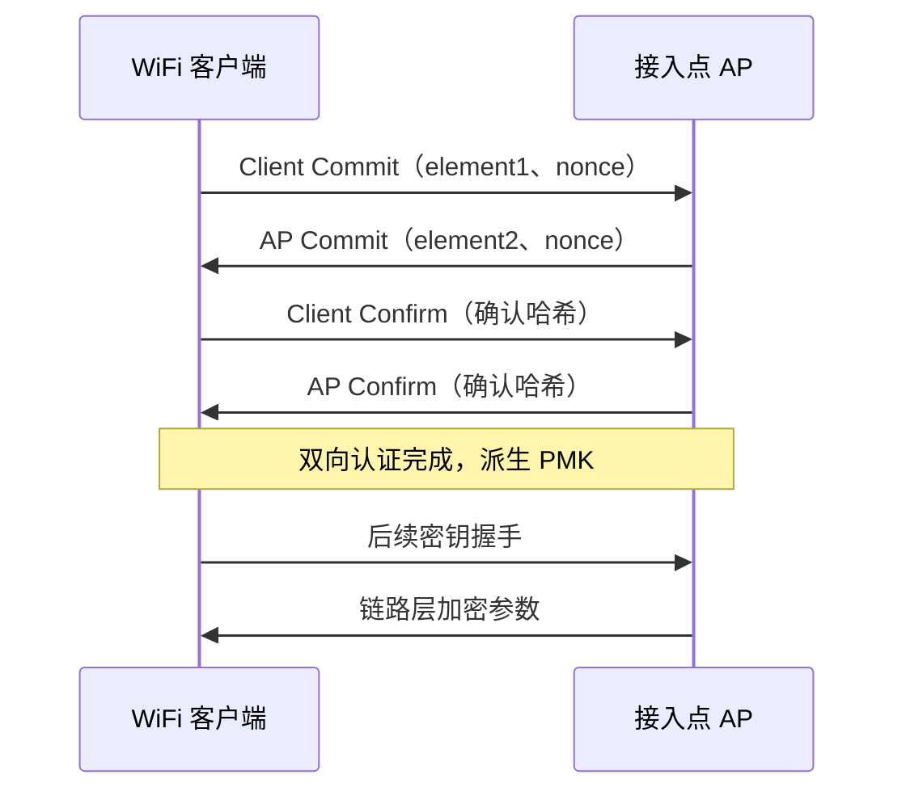

#### 2. WPA3-Enterprise：802.1X 与 EAP

企业 WiFi 通常不希望所有员工共用一个无线密码，而是使用集中式认证服务器管理用户身份和访问权限。IEEE 802.1X 定义了这种基于端口的网络访问认证框架，其中使用**可扩展认证协议**（Extensible Authentication Protocol，EAP）承载认证消息。

以 EAP-TTLS 为例：

1. 客户端完成 AP 信标发现与 WLAN 关联，并表明希望通过 EAP 进行认证。
2. AP 作为中继，把客户端的认证请求通过 RADIUS 协议转发给认证服务器。
3. 客户端与认证服务器建立 TLS 隧道，客户端验证服务器证书。
4. 客户端在加密隧道内向认证服务器提交真实身份和凭据；服务器验证用户身份及密码。
5. 认证服务器通知 AP 客户端认证成功，并提供 PMK。
6. 客户端与 AP 利用 PMK 执行后续握手，生成无线链路加密密钥。

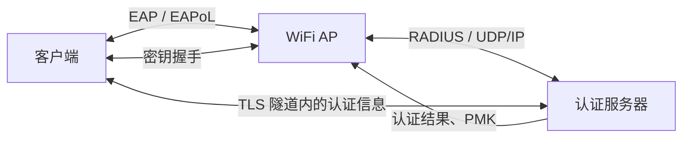

EAP 定义客户端与认证服务器之间的认证消息格式；在无线链路上，EAP 消息通过 EAPoL（EAP over LAN）承载，AP 再将其封装为 RADIUS 消息发往认证服务器。AP 在认证过程中主要负责中继，而不是直接判断企业用户的身份。

WPA3-Enterprise 另有 192 位安全模式，是否展开需核对原书。

### 8.8.2 5G 蜂窝网络安全

5G 网络同样需要双向认证与密钥协商：网络要验证用户设备的身份和服务权限，设备也要确认自己连接的是合法网络。后一个目标尤其重要，因为伪造基站可能诱使设备接入恶意网络。

5G 与 WiFi 企业认证有一些相似之处：认证消息可以通过 EAP 传递，双方依赖预先共享的秘密进行认证，并通过后续密钥派生获得无线链路加密密钥。但 5G 还有一个重要区别：用户设备可能漫游到**访问网络**（visited network），而用户的身份和长期秘密仍保存在其**归属网络**（home network）中。因此，访问网络需要与归属网络中的认证功能协作。

主要网络功能：

| 功能 | 作用                                                                        |
| ---- | --------------------------------------------------------------------------- |
| UE   | 用户设备，持有 SIM 中的身份与共享秘密                                       |
| AMF  | Access and Mobility Management Function，接入与移动性管理功能               |
| SEAF | Security Anchor Function，负责访问侧安全锚定的逻辑功能，位于 AMF 相关流程中 |
| AUSF | Authentication Server Function，归属网络中的认证服务器功能                  |
| UDM  | Unified Data Management，保存用户身份、密钥及服务授权信息                   |

5G 认证的主要流程如下：

1. **注册请求**：UE 向希望加入的网络发送 Registration Request，由访问网络中的 AMF/SEAF 接收。请求携带能够定位归属网络和用户身份的信息，其中用户永久标识（SUPI，如 IMSI）以**加密后的 SUCI** 形式发送，明文 IMSI 不在空口传输（见 7.4.3 节）。SEAF 与归属网络的 AUSF 建立受 TLS 保护的通道，以安全传送认证消息。
2. **生成认证向量**：AUSF 联系归属网络中的 UDM。UDM 使用 UE 与归属网络共享的秘密生成认证向量（Authentication Vector，AV），其中包括随机 nonce、认证令牌、预期响应值 XRES，以及后续密钥派生所需的信息。
3. **发送挑战**：AUSF 将随机 nonce 和认证令牌发送给访问网络中的 SEAF，再由 SEAF 转发给 UE。
4. **设备验证并响应**：UE 使用 SIM 中的共享秘密验证认证令牌的来源与新鲜性，并计算对随机 nonce 的响应 XRESC。随后通过 EAP 消息将响应发送给 SEAF，再由 SEAF 转发给 AUSF。（"XRESC"并非标准名称：标准中 UE 计算 RES\*，网络保存 XRES\*，SEAF 还会用 HXRES\* 做一次比较，原书是否另有记号需验证。）
5. **完成认证并派生密钥**：AUSF 比较 UE 返回的响应与自己保存的 XRES。如果两者一致，则认证 UE 成功。AUSF 同时向访问网络提供一个**锚定密钥**（anchor key），UE 也可以根据相同的共享秘密计算出对应密钥。之后，UE、基站和访问网络中的核心网功能可以从锚定密钥派生会话中使用的其他密钥。

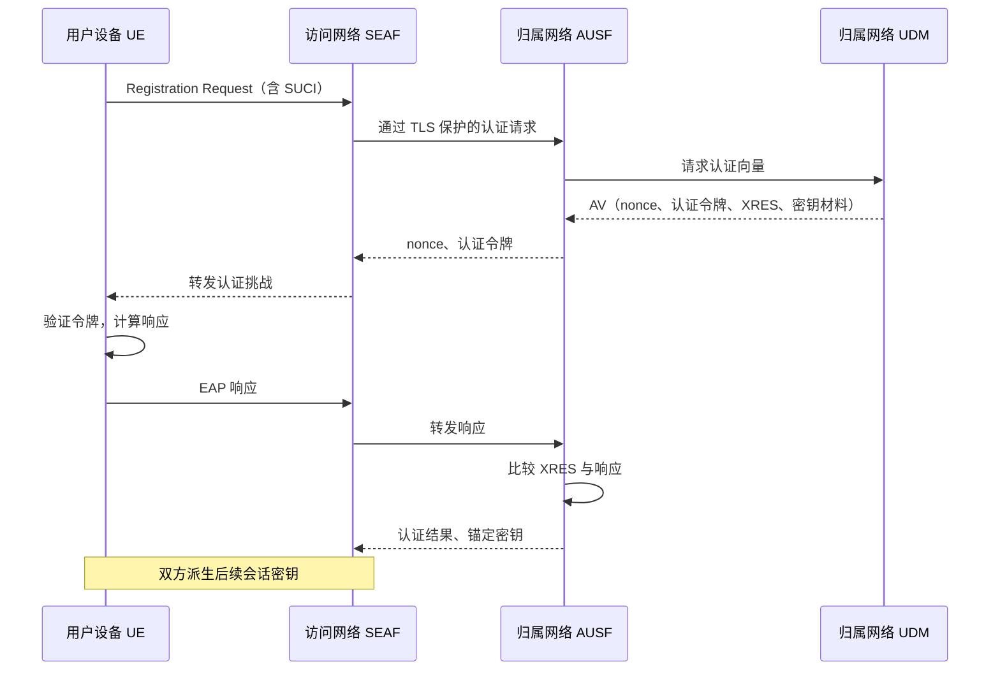

5G 将长期用户秘密保留在 UE 的 SIM 和归属网络中，访问网络负责转发认证过程并获得后续会话所需的密钥材料。这样，访问网络不需要直接保存用户的长期秘密。

# 第三部分 网络运行安全

## 8.9 运行安全：防火墙与入侵检测系统

前面讨论的密码学和安全协议主要解决通信双方之间的安全问题。但一个组织的内部网络还需要面对来自 Internet 的各种攻击，例如恶意软件传播、端口扫描、网络拓扑探测、拒绝服务攻击和应用漏洞利用。

从网络管理员的角度看，组织内部网络需要保护内部资源，同时允许合法的外部通信。防火墙负责控制进出网络的流量；入侵检测系统负责分析流量并发现可疑活动；入侵防御系统则可以进一步阻断可疑流量。

### 8.9.1 防火墙

**防火墙**（firewall）由硬件和软件组成，通常部署在组织内部网络与公共 Internet 之间，按照组织的安全策略允许或阻止数据报通过。防火墙设计应满足三个目标：

1. 所有进出组织网络的流量都经过防火墙。
2. 只有符合本地安全策略的流量才能通过。
3. 防火墙自身必须能够抵御攻击，不能轻易被入侵。

防火墙通常可以分为三类：无状态（传统）分组过滤器、有状态分组过滤器和应用网关（4.4.4 节已做概述，此处展开）。

#### 1. 无状态（传统）分组过滤器

**分组过滤器**（packet filter）逐个检查经过的 IP 数据报，根据管理员配置的规则决定转发或丢弃。它通常依据首部字段进行过滤：

- IP 源地址和目的地址；
- IP 首部中的协议类型，如 TCP、UDP、ICMP、OSPF；
- TCP/UDP 源端口和目的端口；
- TCP 标志位，如 SYN、ACK；
- ICMP 消息类型；
- 数据报进入或离开网络的方向，以及经过的路由器接口。

例如，组织只希望内部用户访问外部 Web 服务，不希望外部主机主动建立到内部服务器的 TCP 连接。可以配置规则，允许内部发出的 TCP 连接访问目的端口 80，并允许相应的返回流量进入；阻止外部发起的新连接。

TCP 首部中的 ACK 标志位可以辅助实现这种策略：TCP 连接的第一个 SYN 段 ACK=0，后续正常连接阶段的段通常 ACK=1。管理员可以过滤从外部进入且 ACK=0 的 TCP 段，阻止外部主机发起连接，同时允许内部主机发起连接后的返回流量。

防火墙规则通常以访问控制列表（Access Control List，ACL）的形式配置在路由器接口上。规则按顺序检查，匹配后执行允许或丢弃操作。**分组过滤器只根据单个数据报及其首部进行判断，并不理解它所属的完整连接。**

规则示例（与 4.4.4 节对应）：

| 策略                                       | 规则（方向：进入内部网络）                                | 注意                                                                                         |
| ------------------------------------------ | --------------------------------------------------------- | -------------------------------------------------------------------------------------------- |
| 禁止外部访问内部 Web                       | 丢弃目的端口 80 的进入分组                                | 同时应考虑 HTTPS（443）                                                                      |
| 禁止外部发起 TCP 连接，内部 Web 服务器除外 | 丢弃进入的、ACK=0 的 TCP 段，除非目的为该服务器的 80 端口 | 依赖 ACK 位，易被伪造 ACK 绕过                                                               |
| 阻止进入的 UDP 流量，DNS 除外              | 丢弃进入的 UDP 分组，**源端口或目的端口为 53** 的除外     | 内部客户发起 DNS 查询后，响应的源端口为 53、目的端口为临时端口，只放行目的端口 53 会误拦响应 |

#### 2. 有状态分组过滤器

无状态过滤器逐个处理数据报，无法判断一个 ACK=1 的入站数据报是否确实属于内部用户已经建立的连接。攻击者可以构造带有 ACK 标志位的伪造数据报，试图绕过简单规则。

**有状态分组过滤器**（stateful packet filter）会跟踪正在进行的 TCP 连接，并维护一张**连接表**（connection table）。防火墙观察 TCP 三次握手，记录连接的端点与状态；当看到 FIN 等结束信号，或连接长时间没有活动时，再删除相应状态。

当一个数据报到达时，有状态过滤器除了检查 ACL，还会查询连接表：

- 若数据报属于已记录的合法连接，则允许其通过；
- 若数据报声称是某个连接的返回流量，但连接表中不存在相应连接，则丢弃该数据报。

因此，有状态过滤器比无状态过滤器掌握更多上下文，既能允许内部用户访问外部服务，也能更有效地阻止外部伪造返回数据报。

#### 3. 应用网关

无状态和有状态分组过滤器主要检查 IP、TCP 和 UDP 首部，无法直接根据应用层身份或内容执行精细策略。例如，组织可能允许部分员工使用 SSH 访问外部服务器，而其他员工不允许；这个策略依赖用户身份，而不是仅仅依赖 IP 地址和端口号。

**应用网关**（application gateway）是针对特定应用的代理服务器，所有该应用的流量都必须经过它。它可以检查应用层数据，并执行用户认证与授权。

例如，要限制内部用户使用 SSH：

1. 路由器过滤规则阻止普通内部主机直接建立外部 SSH 连接，只允许应用网关发起 SSH 连接。
2. 用户先连接到 SSH 应用网关，并提交用户 ID 和密码。
3. 应用网关检查该用户是否有权限访问外部 SSH 服务。
4. 若授权成功，应用网关代表用户连接外部服务器，并在用户与远端服务器之间中继数据。

应用网关的缺点是：每种应用可能需要单独的网关；所有数据都经过网关中继，会带来性能开销；客户端软件还需要知道如何连接网关以及如何指定目标服务器。

| 防火墙类型               | 检查内容                 | 是否跟踪连接   | 能否理解应用层用户身份 |
| ------------------------ | ------------------------ | -------------- | ---------------------- |
| 无状态（传统）分组过滤器 | IP/TCP/UDP/ICMP 首部字段 | 否             | 否                     |
| 有状态分组过滤器         | 首部字段 + 连接状态      | 是             | 否                     |
| 应用网关                 | 应用层消息与数据         | 可结合连接状态 | 可以                   |

#### 4. 代理、匿名性与隐私

代理服务器还可以用于改善用户访问网络时的隐私。例如，用户希望访问某个网站时，不向目标网站暴露自己的 IP 地址，同时不希望本地 ISP 直接看到访问的网站和传输内容。

用户可以先与可信代理建立 TLS 连接，再把目标网站的 HTTP 请求通过加密隧道发送给代理。代理解密请求后，代表用户访问目标网站，并将响应通过 TLS 返回给用户。目标网站看到的是代理的 IP 地址，而本地 ISP 只能看到用户与代理之间的加密通信。

这种方案的缺点是：代理能够同时看到用户的 IP 地址、目标网站地址以及代理与目标网站之间的明文流量。因此，隐私保护依赖于对代理的信任。

**TOR** 采用多级代理的方式增强匿名性：用户在本地对数据做**分层加密**（洋葱路由），典型情况下经过 3 个中继节点，每个节点只能剥去一层，只知道上一跳和下一跳。在中继节点不相互串通的假设下，单个节点难以同时知道通信双方的身份与完整路径（具体跳数与威胁模型需验证）。

### 8.9.2 入侵检测系统

分组过滤器主要检查 IP、TCP、UDP 和 ICMP 首部。为了检测更多攻击，系统还需要执行**深度分组检测**（deep packet inspection），即分析数据报携带的应用层数据，而不只是首部字段。

**入侵检测系统**（Intrusion Detection System，IDS）会检测可疑数据报或数据报序列，并向管理员发送告警；**入侵防御系统**（Intrusion Prevention System，IPS）则可以进一步丢弃或阻止可疑流量。二者的关键技术都是如何判断流量是否可疑。

| 比较项     | IDS                                    | IPS                                            |
| ---------- | -------------------------------------- | ---------------------------------------------- |
| 部署位置   | 常旁路监听（镜像端口），不在转发路径上 | 串联在转发路径上                               |
| 动作       | 告警                                   | 告警并丢弃或阻断                               |
| 对业务影响 | 小，不增加转发时延                     | 误报会直接阻断正常流量，且自身故障可能影响转发 |

IDS 可以检测的活动包括网络映射、端口扫描、TCP 栈扫描、DoS 洪泛攻击、蠕虫和病毒传播，以及操作系统或应用程序漏洞攻击。

组织可以部署多个 IDS 传感器，分别监视不同网络区域，再由中央 IDS 处理器汇总可疑事件并向管理员报警。通常，公共 Web 服务器、权威 DNS 服务器等需要对外提供服务的主机可以放置在**隔离区**（Demilitarized Zone，DMZ），内部高安全区域则受到更严格的访问控制和监控。

#### 1. 基于特征的 IDS

**基于特征的 IDS**（signature-based IDS）维护一个攻击特征数据库。每个特征描述某种已知攻击的流量模式，可以包含单个分组的字段，也可以描述一系列分组的行为。

IDS 逐个检查经过的分组，并与数据库中的攻击特征匹配；若某个分组或分组序列符合特征，就生成告警。网络管理员可以根据组织自身的网络环境修改已有特征或增加新的特征。

其优点是对已知攻击能够进行有针对性的检测；缺点是依赖已有攻击知识，面对尚未建立特征的新攻击可能无法识别。此外，某些正常流量也可能意外匹配特征，产生**误报**；大量特征还会带来处理开销。

#### 2. 基于异常的 IDS

**基于异常的 IDS**（anomaly-based IDS）先观察正常运行时的网络流量，建立流量统计特征，然后检测显著偏离正常模式的活动。例如，ICMP 分组比例突然大幅增加，或者端口扫描和 ping sweep 的数量快速增长，都可能被判定为异常。

这种方法不需要事先掌握每一种攻击的特征，因此有机会发现未知攻击。但难点在于如何准确区分正常变化与真正攻击：统计上异常的流量不一定具有恶意，正常业务变化也可能触发告警。

| IDS 类型 | 检测依据           | 优点               | 局限                       |
| -------- | ------------------ | ------------------ | -------------------------- |
| 基于特征 | 与已知攻击规则匹配 | 对已知攻击检测明确 | 难以发现未知攻击，可能误报 |
| 基于异常 | 与正常流量模型比较 | 有机会识别未知攻击 | 正常流量变化也可能被误判   |

#### 3. Snort

**Snort** 是一个开源 IDS，可以使用 libpcap 捕获网络流量，并依据规则检测可疑分组。下面是一条用于检测外部 ICMP ping 扫描的示例规则：

```text
alert icmp $EXTERNAL_NET any -> $HOME_NET any (msg:"ICMP PING NMAP"; dsize: 0; itype: 8;)
```

这条规则的含义是：当一个 ICMP 分组从外部网络进入内部网络，且 ICMP 类型为 8（Echo Request），同时载荷长度为 0 时，触发一条告警，告警消息为 `ICMP PING NMAP`。由于 nmap 的某些 ping 探测会产生符合这些特征的分组，因此可以利用该规则识别相应的扫描活动。

Snort 的规则库由用户和安全研究人员持续维护。管理员也可以根据组织网络的具体需求，修改已有规则或编写新的规则。

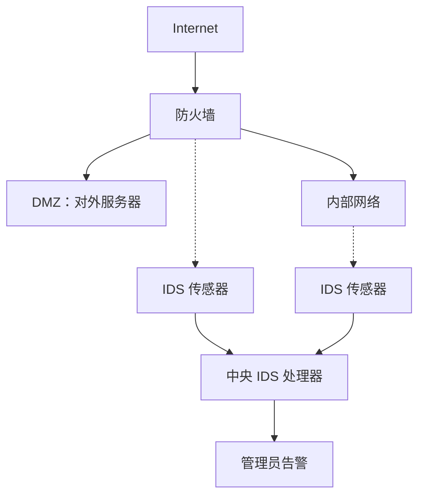

## 8.10 小结

本章讨论了如何利用密码学和网络设备，在不可信的 Internet 环境中建立安全通信。安全通信的主要目标包括机密性、消息完整性和端点认证；组织网络还需要通过运行安全机制限制未授权流量并发现攻击。

- **密码学基础**：对称密钥密码加解密效率高，但要求预先共享秘密；公钥密码通过公钥和私钥解决密钥分发问题，但计算开销较大。RSA 的正确性由费马小定理与中国剩余定理保证；Diffie-Hellman 让双方在公开信道上协商共享秘密，但**自身不提供认证**。实际协议结合两者：公钥机制用于认证或建立密钥，对称机制保护大量数据。
- **消息完整性**：哈希函数生成固定长度摘要，但单独发送哈希无法认证发送者；HMAC 以共享密钥验证来源和完整性；数字签名用私钥签、公钥验，具备不可否认性；CA 签发的证书（及证书链）把公钥与身份绑定。
- **端点认证**：nonce 抵御重放；公钥认证若无可信公钥来源，会遭遇中间人攻击，这正是证书要解决的问题。
- **协议应用**：PGP 在应用层保护电子邮件；TLS 为进程间通信提供安全，TLS 1.3 用临时 DH 获得前向保密，用 CertificateVerify 证明服务器持有私钥；IPsec 在网络层保护 IP 数据报并常用于 VPN；WPA3 和 5G 通过认证、密钥协商和链路加密保护无线通信。
- **运行安全**：防火墙通过分组过滤、有状态连接跟踪和应用网关控制组织网络的访问；IDS/IPS 通过特征匹配或异常检测识别可疑流量。

安全目标与实现机制的对应如下：

| 安全目标   | 基本机制            | PGP              | TLS 1.3                  | IPsec ESP               | WPA3 / 5G                      |
| ---------- | ------------------- | ---------------- | ------------------------ | ----------------------- | ------------------------------ |
| 机密性     | 对称加密 + 会话密钥 | 会话密钥加密邮件 | AEAD                     | ESP 加密                | AES 链路加密                   |
| 消息完整性 | MAC / AEAD / 签名   | 数字签名         | AEAD 标签                | ESP 认证 MAC            | 帧完整性校验                   |
| 端点认证   | nonce、证书、签名   | 信任网络、签名   | 证书 + CertificateVerify | IKE（预共享密钥或证书） | SAE / EAP / 5G AKA             |
| 重放防御   | nonce、序列号       | —                | 序列号 + 随机数          | 序列号 + 抗重放窗口     | nonce、计数器                  |
| 密钥建立   | RSA 加密会话密钥    | 公钥加密 $K_S$   | 临时 DH                  | IKE 中的 DH             | SAE（Dragonfly）、AKA 锚定密钥 |
| 运行安全   | 边界控制与检测      | —                | —                        | —                       | 防火墙、IDS/IPS（8.9 节）      |

本章与全书其他章节的关联：

| 本章内容                 | 相关章节           |
| ------------------------ | ------------------ |
| 攻击类型总览             | 1.6 节             |
| DNSSEC 基于数字签名      | 2.4.3 节           |
| TLS 与传输层、QUIC       | 2.1.4 节、3.8 节   |
| 防火墙与中间盒           | 4.4.4 节           |
| OSPF 的密码学认证（MAC） | 5.3 节             |
| WPA 与 SUCI              | 7.3.4 节、7.4.3 节 |

由此可见，网络安全并不是某一个加密算法或设备能够独立完成的任务，而是由密码学、协议设计、网络边界控制和持续监测共同构成的系统性工作。
