运输层位于应用层和网络层之间，是分层网络体系结构的重要组成部分。在第一章中我们看到，应用层报文需要经由运输层交付给网络层，再通过网络核心送达目的端系统；本章将详细考察这一过程是如何实现的。

运输层为运行在不同主机上的应用进程提供逻辑通信能力。因特网为此提供了两种截然不同的运输协议：**UDP**（User Datagram Protocol，用户数据报协议）和 **TCP**（Transmission Control Protocol，传输控制协议）。二者在可靠性、连接建立和拥塞控制等方面存在根本差异，应用程序开发人员必须根据应用需求选择其一。

> [!important] 本章目标
> 理解运输层的原理与实现：
>
> 1. 运输层服务概述，以及运输层与网络层的关系
> 2. 多路复用与多路分解：端口号与套接字
> 3. 无连接运输 UDP：报文段结构、检验和，以及为何选择 UDP
> 4. 可靠数据传输原理：从 rdt 协议族到流水线协议（GBN、SR）
> 5. 面向连接运输 TCP：连接管理、序号与确认、超时估计、可靠传输与流量控制
> 6. 拥塞控制原理与 TCP 经典拥塞控制：慢启动、拥塞避免、快速恢复
> 7. ECN、基于时延的拥塞控制与公平性
> 8. 运输层功能的演化：QUIC

# 第一部分 运输层基础与 UDP

## 3.1 概述和运输层服务

运输层协议为运行在不同主机上的应用进程之间提供了**逻辑通信（logical communication）**功能。从应用程序的角度看，通过逻辑通信，运行在不同主机上的进程好像直接相连一样，无须考虑承载这些报文的物理基础设施细节；而实际上，这些主机可能位于地球的两侧，中间隔着许多路由器和多种链路。

在发送端，运输层从发送应用程序进程接收报文，并将其转换成运输层分组。用因特网术语来说，该分组称为**运输层报文段（segment）**。转换过程大致如下：运输层先将应用报文划分为较小的块，为每块加上运输层首部，由此生成运输层报文段，再把报文段传递给网络层；网络层则将其封装成网络层分组，即 **IP 数据报（datagram）**，并向目的地发送。

> [!important] 路由器只处理网络层
> 网络路由器仅作用于数据报的网络层字段，不检查封装在其中的运输层报文段字段。3.1.1 节将进一步解释这一事实的含义。


### 3.1.1 运输层和网络层的关系

在协议栈中，运输层刚好位于网络层之上，二者都为运行在主机上的进程提供逻辑通信服务，但服务的对象并不相同：

| 层次   | 提供的逻辑通信                       |
| ------ | ------------------------------------ |
| 网络层 | 主机之间的逻辑通信                   |
| 运输层 | 运行在不同主机上的进程之间的逻辑通信 |

这种差别虽然细微，却很重要。为了建立直觉，考虑一个家庭类比。

> [!example] 家庭类比
> 考虑位于美国东海岸和西海岸的两个家庭，每个家庭有 12 个孩子，两个孩子群体互为堂兄弟姐妹。每周，每个孩子都要给对方家庭的每个孩子写一封信，因此每个家庭每周要向另一家发送 $12 \times 12 = 144$ 封信。
>
> 为了减轻负担，每个家庭安排一个孩子负责收发邮件：西海岸家庭是 Ann，东海岸家庭是 Bill。Ann 和 Bill 每周从各自家庭收集信件，交给邮政服务运送；信件到达对岸后，对方家庭的"Ann 和 Bill"再把信分发给自己的堂兄弟姐妹。

在这个类比中，各要素与网络概念一一对应：

| 类比对象     | 网络概念         |
| ------------ | ---------------- |
| 信封中的信件 | 应用层报文       |
| 堂兄弟姐妹   | 进程             |
| 家庭         | 主机，又称端系统 |
| Ann 和 Bill  | 运输层协议       |
| 邮政服务     | 网络层协议       |

邮政服务为两个家庭之间提供逻辑通信，即主机到主机通信；Ann 和 Bill 则为堂兄弟姐妹之间提供逻辑通信，即进程到进程通信。

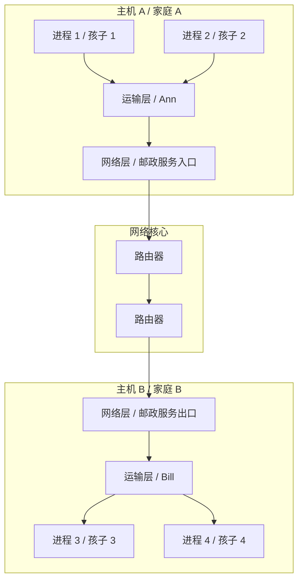

借助这个类比，可以得出关于运输层的几个关键结论：

1. 运输层协议只工作在端系统中，不工作在路由器中。运输层的实现位于端系统的操作系统或应用进程中，而中间路由器只处理网络层字段。
2. 中间路由器不处理运输层首部信息，因此运输层首部只对端系统有意义。
3. 运输层协议能够提供的服务常常受制于底层网络层协议的服务模型。
4. 即使网络层不可靠，运输层也可以通过确认、重传等机制在端到端意义上提供可靠传输。
5. 即使网络层不能保证机密性，运输层也可以通过加密机制提供安全性。

### 3.1.2 因特网运输层概述

因特网为应用层提供了两种截然不同的运输层协议：

| 协议 | 全称           | 服务特点       |
| ---- | -------------- | -------------- |
| UDP  | 用户数据报协议 | 不可靠、无连接 |
| TCP  | 传输控制协议   | 可靠、面向连接 |

无论开发 Web 服务器还是电子邮件应用，应用程序开发人员都必须指定使用 UDP 还是 TCP。这一选择决定了应用将得到怎样的运输服务，也决定了应用需要自行处理哪些问题。

**IP 服务模型。** 因特网网络层协议是 IP，即网际协议（Internet Protocol）。IP 向运输层提供的服务模型是**尽力而为交付服务（best-effort delivery service）**：IP 不保证报文段的交付，不保证报文段按序交付，也不保证报文段中数据的完整性。正因如此，IP 被称为不可靠服务。

**UDP 与 TCP 的服务模型。** UDP 和 TCP 最基本的责任，是将两个端系统间 IP 的交付服务扩展为运行在端系统上的两个进程之间的交付服务。这被称为运输层的**多路复用（multiplexing）**与**多路分解（demultiplexing）**，我们将在 3.2 节详细讨论。

在此基础上，UDP 提供的最低限度服务只有两项：进程到进程的数据交付和差错检查。TCP 除提供 UDP 的这些服务外，还提供四项更重要的服务：

1. 可靠数据传输；
2. 流量控制；
3. 拥塞控制；
4. 面向连接服务。

也就是说，UDP 在 IP 之上只增加了最少的功能，而 TCP 则在 IP 之上构建了一整套机制，把不可靠的数据报服务改造为可靠的字节流服务。

## 3.2 多路复用与多路分解

考虑一台主机上同时运行多个网络应用的情形：一个 HTTP 进程在浏览网页，一个 FTP 进程在下载文件，还有两个 Telnet 进程在进行远程登录。当这些应用的报文段同时从网络层到达主机时，运输层必须把每个报文段中的数据交付给正确的应用程序进程。

运输层多路复用与多路分解的作用，正是**将由网络层提供的主机到主机交付服务，延伸为运行在主机上的应用程序之间的进程到进程交付服务**。在目的主机，运输层从网络层接收报文段，并负责将报文段中的数据交付给适当的应用程序进程；在源主机，运输层则从多个进程收集数据，封装后交给网络层发送。

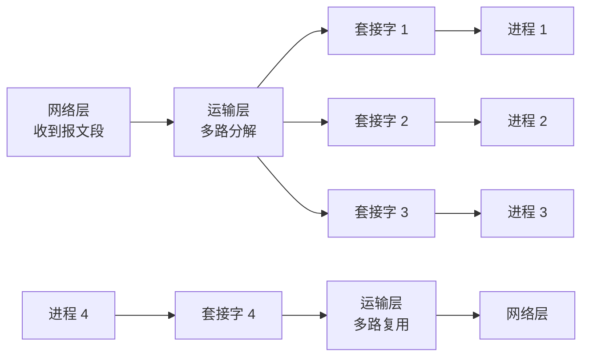

#### 多路分解

将运输层报文段中的数据交付到正确的套接字的工作，称为**多路分解（demultiplexing）**。接收主机的运输层必须能把到达的每个报文段定向到合适的套接字，也就是合适的进程。

#### 多路复用

在源主机上，运输层从不同套接字中收集数据块，为每个数据块封装首部信息（其中包括目的端口号等字段）生成报文段，然后将报文段传递到网络层，这一过程称为**多路复用（multiplexing）**。

多路分解与多路复用的正确工作，依赖于报文段中的一个特殊字段：端口号。

#### 端口号

运输层报文段首部中具有特殊字段，用于指示该报文段所要交付到的套接字，即**源端口号字段**和**目的端口号字段**。端口号是一个 16 比特的数，取值范围为 $0 \sim 65535$。其中，0 ~ 1023 为**周知端口号**，保留给 HTTP、FTP 等知名应用使用；1024 ~ 65535 为**短暂端口号**（又称动态端口号），通常由客户端自动分配。一些常见的周知端口如下：

| 应用 | 端口号 |
| ---- | -----: |
| HTTP |     80 |
| FTP  |     21 |

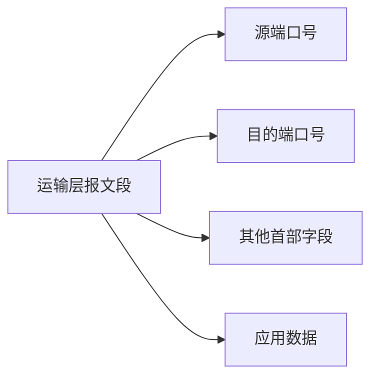

### 3.2.1 无连接的多路复用与多路分解：UDP

UDP 的套接字由二元组标识：

$$
(\text{目的 IP 地址},\ \text{目的端口号})
$$

因此，如果两个 UDP 报文段具有相同的目的 IP 地址和目的端口号，即使源 IP 地址或源端口号不同，也会被交付到同一个 UDP 套接字。

下面通过一个例子说明这一过程。假设主机 A 中的进程使用 UDP 端口 19157，主机 B 中的进程使用 UDP 端口 46428。主机 A 创建 UDP 报文段，其中包含应用数据、源端口号 19157 和目的端口号 46428，然后将其交给网络层发送。主机 B 的运输层收到报文段后，检查目的端口号 46428，并将报文段中的数据交付给绑定在该端口上的套接字。

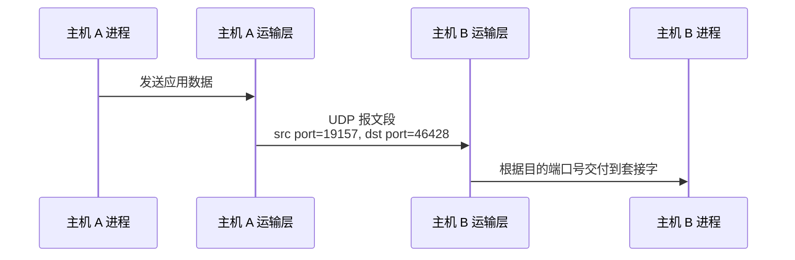

**源端口号的作用。** 源端口号用作"返回地址"的一部分：当主机 B 需要向主机 A 回发报文段时，B 报文段中的目的端口号就取自 A 报文段中的源端口号。


### 3.2.2 面向连接的多路复用与多路分解：TCP

与 UDP 不同，TCP 套接字由四元组标识：

$$
(\text{源 IP 地址},\ \text{源端口号},\ \text{目的 IP 地址},\ \text{目的端口号})
$$

因此，当一个 TCP 报文段到达主机时，主机使用全部 4 个值将报文段定向到相应的套接字。这意味着，两个具有不同源 IP 地址或源端口号的到达 TCP 报文段，将被定向到两个不同的套接字，除非该报文段携带了初始创建连接的请求。

#### TCP 服务器示例

下面通过一个具体例子说明 TCP 的多路复用与多路分解。假设 TCP 服务器在端口 12000 上等待连接，客户创建 TCP 套接字并发起连接：

```python
clientSocket = socket(AF_INET, SOCK_STREAM)
clientSocket.connect((serverName, 12000))
```

服务器通过欢迎套接字接受连接：

```python
connectionSocket, addr = serverSocket.accept()
```

新创建的连接套接字由以下四元组标识：报文段中的源端口号、源主机 IP 地址、报文段中的目的端口号，以及服务器自身 IP 地址。此后，来自同一客户的报文段都将通过该四元组被定向到这个连接套接字。

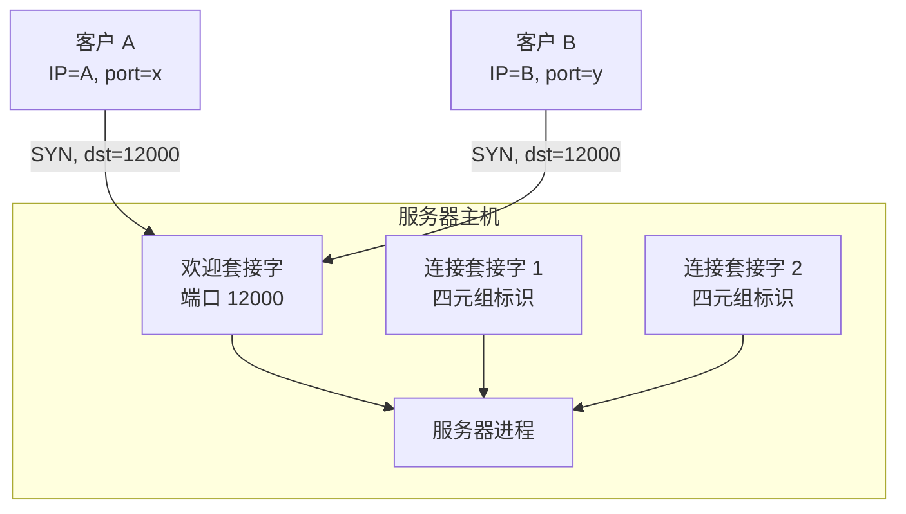

#### Web 服务器与 TCP

Web 服务器通常在端口 80 上运行，所有客户发往该服务器的报文段，其目的端口都是 80。服务器通过源 IP 地址和源端口号区分不同的客户连接：即使两台客户使用相同的目标端口，只要源 IP 地址或源端口号不同，它们的报文段就会被定向到不同的连接套接字。

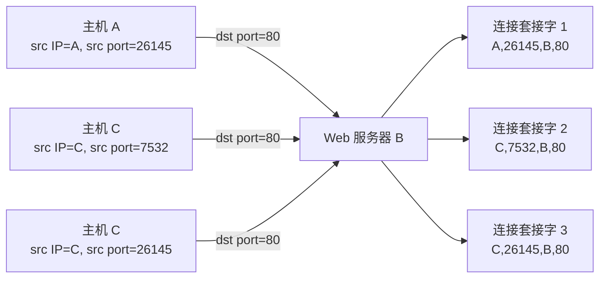

#### 关注安全性：端口扫描

端口号的规律性也为攻击者提供了便利。服务器进程可能在某个打开的端口上等待远程客户连接，攻击者则可以利用这一点，通过端口扫描发现目标主机上开放了哪些端口，进而寻找可攻击的服务。

常用的扫描工具是 `nmap`。对于 TCP，nmap 顺序扫描端口，寻找能够接受 TCP 连接的端口；对于 UDP，nmap 顺序扫描端口，寻找对 UDP 报文段进行响应的端口。系统管理员也可以用同样的工具检查自己主机上的端口暴露情况，及时关闭不必要的服务。

## 3.3 无连接运输：UDP

UDP 只做了运输协议能够做的最少工作。除了复用/分解功能和少量差错检测之外，UDP 几乎没有对 IP 增加别的东西。如果应用程序开发人员选择 UDP 而不是 TCP，那么该应用程序差不多就是直接与 IP 打交道。

UDP 从应用进程得到数据后，附加上源端口号、目的端口号、长度和检验和四个首部字段，然后将形成的报文段交给网络层。UDP 在发送报文段之前，发送方和接收方的运输层实体之间没有握手，因此 UDP 被称为**无连接的**。


既然 TCP 提供可靠数据传输、流量控制和拥塞控制等丰富服务，为什么还有许多应用宁愿选择 UDP 呢？主要原因有四个方面。

#### 1. 应用层控制更精细

采用 UDP 时，只要应用进程将数据传递给 UDP，UDP 就会将数据打包进 UDP 报文段并立即传递给网络层，不存在因拥塞控制而引入的发送遏制。TCP 则不同：它具有拥塞控制机制，会在网络拥塞时遏制发送方。

实时应用通常要求维持最小发送速率、不希望过分延迟报文段传送，并且能容忍一些数据丢失。对这类应用来说，TCP 的服务模型并不特别合适——TCP 的可靠传输和拥塞控制带来的时延与速率波动，反而可能降低应用体验。

#### 2. 无须连接建立

TCP 在开始数据传输之前要经过三次握手（详见 3.5.6 节），这会引入连接建立时延。UDP 不需要任何准备即可进行数据传输，因此不会引入建立连接的时延。这也是 DNS 通常运行在 UDP 之上的主要原因：DNS 查询报文短小、一次请求对应一次响应，建立 TCP 连接的额外往返时延得不偿失。

#### 3. 无连接状态

TCP 需要在端系统中维护连接状态，包括接收缓存、发送缓存、拥塞控制参数，以及序号与确认号参数等。UDP 则不维护任何连接状态。因此，某些服务器（如 DNS 服务器）运行在 UDP 上时，可以免去管理连接状态的开销，从而支持更多活跃客户。

#### 4. 分组首部开销小

UDP 报文段首部只有 8 字节，而 TCP 报文段首部通常为 20 字节。对于报文短小、发送频繁的应用而言，这一差别会累积成可观的带宽开销。

| 协议 |     首部开销 |
| ---- | -----------: |
| TCP  | 通常 20 字节 |
| UDP  |       8 字节 |

当然，UDP 并非万能：选择了 UDP，应用就要自行处理可靠传输、流量控制和拥塞控制等问题。下表总结了流行因特网应用所选用的运输协议：

| 应用             | 应用层协议 | 下面的运输协议 |
| ---------------- | ---------- | -------------- |
| 电子邮件         | SMTP       | TCP            |
| 远程终端访问     | Telnet     | TCP            |
| 安全远程终端访问 | SSH        | TCP            |
| Web              | HTTP       | TCP            |
| 文件传输         | FTP        | TCP            |
| 远程文件服务器   | NFS        | 通常为 UDP     |
| 流式多媒体       | 通常专用   | UDP 或 TCP     |
| 因特网电话       | 通常专用   | UDP 或 TCP     |
| 网络管理         | SNMP       | 通常为 UDP     |
| 名字转换         | DNS        | 通常为 UDP     |

可见，需要可靠数据传输的传统应用（Web、电子邮件、文件传输）都建立在 TCP 之上，而对时延敏感或报文短小的应用则更多地选择 UDP。

### 3.3.1 UDP 报文段结构

UDP 报文段由首部字段和数据字段组成。UDP 首部只有 4 个字段，每个字段 2 字节，共 8 字节：

| 字段       |   长度 | 作用                               |
| ---------- | -----: | ---------------------------------- |
| 源端口号   | 16 bit | 标识发送方端口                     |
| 目的端口号 | 16 bit | 用于多路分解                       |
| 长度       | 16 bit | UDP 报文段总字节数，包括首部和数据 |
| 检验和     | 16 bit | 差错检测                           |

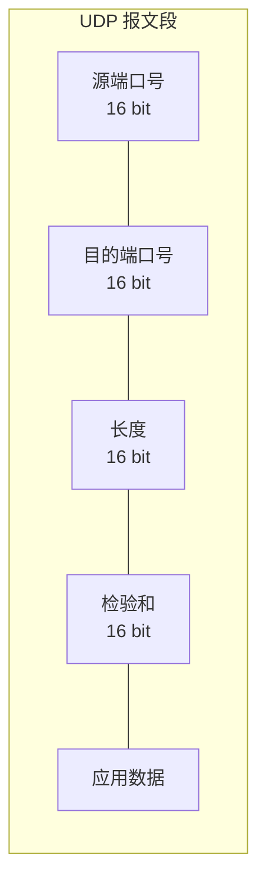

数据字段携带应用层报文，其长度可以为零。检验和字段让接收方能够判断报文段在传输过程中是否发生了比特差错，其计算方法将在下一小节讨论。

### 3.3.2 UDP 检验和

UDP 检验和提供差错检测功能，用于确定 UDP 报文段从源到达目的地时，其中的比特是否发生了改变。即使每个链路都具有差错检测能力，运输层也必须提供端到端的差错检测，原因稍后说明。

检验和的计算方法如下：

1. 将报文段中所有 16 比特字求和；
2. 求和时遇到的任何溢出都被回卷（即把最高位的进位加到结果上）；
3. 对结果进行反码运算（按位取反）；
4. 将结果放入 UDP 检验和字段。

下面通过一个例子说明计算过程。假设有 3 个 16 比特字：

```text
0110011001100000
0101010101010101
1000111100001100
```

前两个字相加：

```text
  0110011001100000
+ 0101010101010101
------------------
  1011101110110101
```

再与第三个字相加：

```text
  1011101110110101
+ 1000111100001100
------------------
1 0100101011000010
```

最高位溢出，按规则回卷：

```text
  0100101011000010
+                1
------------------
  0100101011000011
```

最后取反码，得到检验和：

```text
1011010100111100
```

> [!note] 接收方的验证
> 在接收方，将报文段中全部 16 比特字（包括检验和本身）加在一起。如果没有差错，结果应为全 1；否则说明报文段在传输过程中发生了比特改变，接收方将丢弃该报文段。

**端到端原则。** 既然链路层通常已经提供了差错检测，UDP 为什么还要再提供一遍呢？原因是：我们不能保证源和目的之间所有链路都提供差错检测；即使链路正确传输了比特，报文段在路由器内存中处理时也可能出现比特差错。因此，如果端到端数据传输服务要提供差错检测，就必须在端到端基础上提供差错检测，而不能只依赖下层。这体现了系统设计中著名的**端到端原则（end-to-end principle）**：与其在系统的各个层次重复实现某种功能，不如在端到端的意义上实现一次，以保证功能的正确性。

## 3.4 可靠数据传输原理

可靠数据传输是计算机网络中最基础的问题之一，其本质可以概括为：两个实体怎样才能在一种会丢失或损坏数据的媒介上可靠地通信？值得注意的是，这一问题并非只出现在运输层——链路层和应用层同样可能遇到它，因此本节讨论的原理具有广泛的适用性。

#### 服务模型与服务实现

对上层而言，可靠数据传输协议提供的是一个可靠信道：数据比特不会损坏，数据不会丢失，数据按发送顺序交付。然而，底层信道可能是不可靠的——它可能损坏比特，也可能丢失分组。可靠数据传输协议的任务，就是在不可靠信道之上，向上层提供可靠的服务。

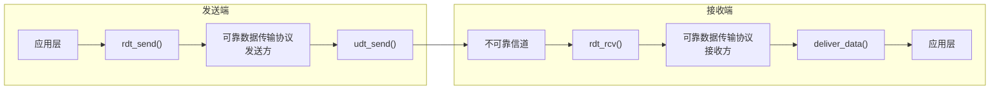

### 3.4.1 构造可靠数据传输协议

下面从最简单的场景开始，逐步增加信道的复杂性，考察可靠数据传输协议是如何一步步构造出来的。

#### 1. rdt1.0：经完全可靠信道的可靠数据传输

首先假设底层信道完全可靠：不丢包、不损坏比特、不发生序号错乱，并且接收方速度足够快。在这种理想情况下，协议非常简单：发送方在上层调用 `rdt_send(data)` 时，构造包含数据的分组并交给不可靠信道发送；接收方收到分组后，提取数据并交付上层。发送方和接收方的状态机各自只有一个状态和一个自环。

**rdt1.0 发送方：**

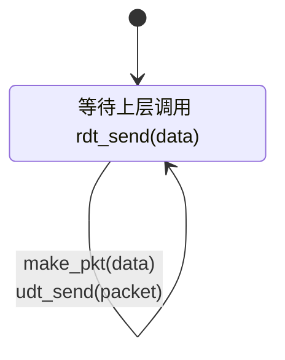

**rdt1.0 接收方：**

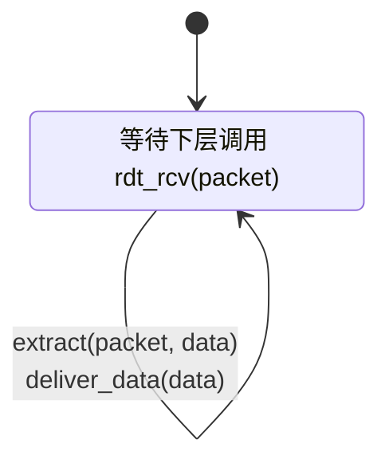

#### 2. rdt2.0：经具有比特差错信道的可靠数据传输

现在假设信道可能损坏比特，即接收方收到的分组可能包含错误。为应对这一问题，需要引入 **ARQ（Automatic Repeat reQuest，自动重传请求）** 协议，它需要三种功能：

1. **差错检测**：接收方能够检测出分组中是否发生了比特差错；
2. **接收方反馈**：接收方将分组的接收情况告知发送方，包括 **ACK**（肯定确认）和 **NAK**（否定确认）；
3. **重传**：发送方在收到 NAK 后，重传上一个分组。

**rdt2.0 发送方：**

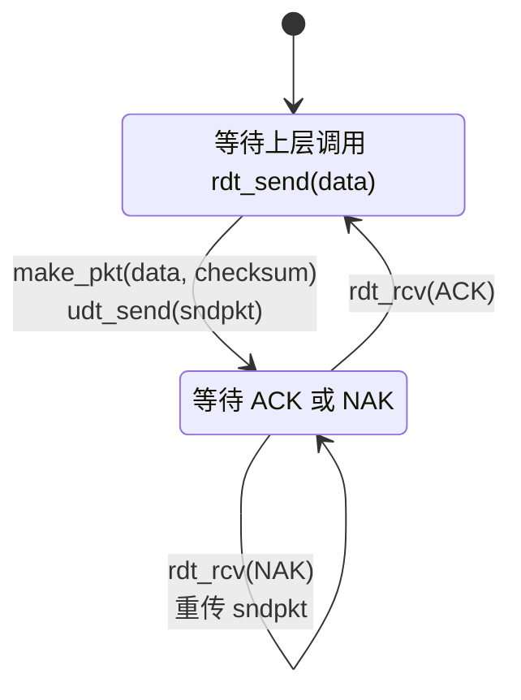

**rdt2.0 接收方：**

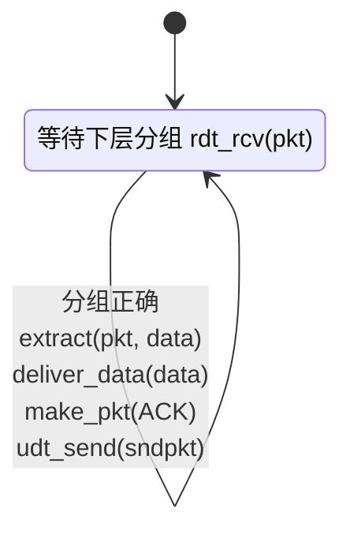

然而 rdt2.0 存在一个致命缺陷：它没有考虑 ACK 或 NAK 分组本身可能受损。如果 ACK/NAK 受损，发送方就无法知道接收方是否正确接收了上一块数据——是接收方正确收到了数据但 ACK 受损，还是数据本身出了问题？发送方无从判断。

解决方法是给数据分组编号，接收方据此判断收到的分组是否为重传分组。对于停等协议（一次只发送一个分组的协议）而言，1 比特序号就足够了。

#### 3. rdt2.1：带序号的 rdt2.0

rdt2.1 在数据分组中加入了序号字段，序号取值为 0 或 1。发送方和接收方都需要在状态中记录当前序号，以及期望收到的 ACK 或 NAK 的序号。发送方不仅要处理收到正确 ACK 和 NAK 的情况，还要处理 ACK/NAK 受损的情形——此时发送方重传上一个分组。接收方同样要处理分组受损的情况：如果收到损坏的分组，接收方重发上一次的 ACK/NAK；如果收到正确的分组，接收方交付数据并发送相应的 ACK。

**rdt2.1 发送方：**

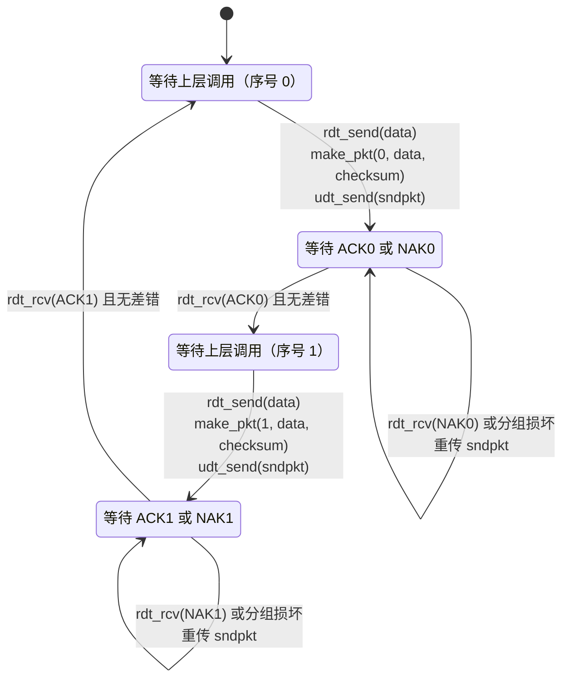

接收方也需要根据序号判断收到的是新分组还是重传分组，从而决定是否交付上层、发送何种确认：收到损坏的分组时丢弃并重发上一次的 ACK/NAK；收到与期望序号相同的正确分组时交付上层并发送 ACK；收到与期望序号相反的正确分组（即重传分组）时丢弃，但重新发送最近一次的 ACK。

#### 4. rdt2.2：无 NAK 的可靠数据传输

rdt2.2 是 rdt2.1 的一个变体，它不使用 NAK，而是通过冗余 ACK 实现类似 NAK 的效果。如果接收方收到失序分组（即序号不是期望值的分组），它对最近正确接收的分组重新发送 ACK。发送方收到同一个分组的两个 ACK，就知道其后的分组没有被正确接收，于是重传该分组。

#### 5. rdt3.0：经具有比特差错和丢包信道的可靠数据传输

现在假设信道不仅可能损坏比特，还可能丢包——分组可能直接消失。为处理丢包，需要新增两种机制：**定时器**和**超时重传**。发送方每次发送分组时启动定时器；如果定时器超时仍未收到 ACK，就重传该分组。

**rdt3.0 发送方：**

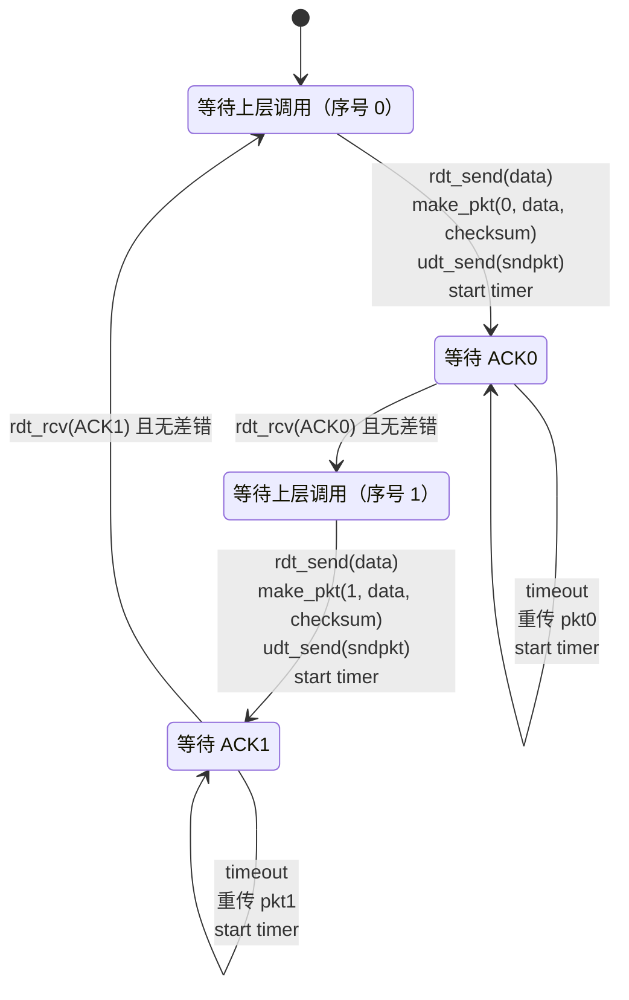

rdt3.0 也称为**比特交替协议（bit alternating protocol）**，因为序号在 0 和 1 之间交替。虽然 rdt3.0 能够在差错和丢包信道上正确工作，但它是停等协议：发送方每发送一个分组就必须等待确认才能发送下一个，这带来了严重的性能问题，3.4.2 节将定量分析这一点。

#### 可靠数据传输机制总结

回顾上述协议的演进过程，可以看到可靠数据传输用到的核心机制：

| 机制         | 用途和说明                             |
| ------------ | -------------------------------------- |
| 检验和       | 用于检测传输分组中的比特错误           |
| 定时器       | 用于超时重传，处理分组或其 ACK 丢失    |
| 序号         | 为数据分组编号，检测丢失分组和冗余分组 |
| 确认         | 接收方告诉发送方某些分组已正确接收     |
| 否定确认     | 接收方告诉发送方某个分组未被正确接收   |
| 窗口、流水线 | 允许一次发送多个未确认分组，提高利用率 |

### 3.4.2 流水线可靠数据传输协议

rdt3.0 是一个停等协议，其性能问题可以通过一个例子清楚地看出。

#### 停等协议的利用率

假设 RTT 为 30 ms，链路速率 $R$ 为 1 Gbps，分组长度 $L$ 为 1000 字节（即 8000 bit）。发送时延为：

$$
t_{\text{trans}} = \frac{L}{R} = \frac{8000}{10^9} = 8\,\mu\text{s}
$$

停等协议的发送方利用率为：

$$
U_{\text{sender}} = \frac{L/R}{RTT + L/R}
$$

代入数值：

$$
U_{\text{sender}} = \frac{0.008\ \text{ms}}{30.008\ \text{ms}} \approx 0.00027
$$

也就是说，发送方只有约万分之 2.7 的时间在发送数据，其余时间都在等待确认。在这种情况下，有效吞吐量只有约 267 kbps，即使链路容量高达 1 Gbps。链路的绝大部分能力都被浪费了。

#### 流水线技术

改进的思路很自然：**允许发送方在等待确认之前发送多个分组**，这就是流水线技术。流水线的引入带来三方面影响：

1. 必须增加序号范围，以便区分更多在途分组；
2. 发送方和接收方可能需要缓存多个分组；
3. 分组出错后的恢复方式变得更加复杂——是重传出错分组之后的所有分组，还是只重传出错的分组？

对应地，存在两种基本的差错恢复方法：**回退 N 步（Go-Back-N，GBN）**和**选择重传（Selective Repeat，SR）**，分别在 3.4.3 节和 3.4.4 节讨论。

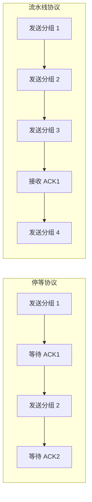

### 3.4.3 回退 N 步（GBN）

在 GBN 协议中，允许发送方流水线式地发送多个分组，但未确认分组数不能超过窗口长度 $N$。GBN 因此也被称为**滑动窗口协议（sliding-window protocol）**。

从发送方的视角看，序号空间被划分为四个区域：

| 序号范围                 | 含义           |
| ------------------------ | -------------- |
| `[0, base-1]`            | 已发送并已确认 |
| `[base, nextseqnum-1]`   | 已发送但未确认 |
| `[nextseqnum, base+N-1]` | 可用，还未发送 |
| `>= base+N`              | 不可用         |

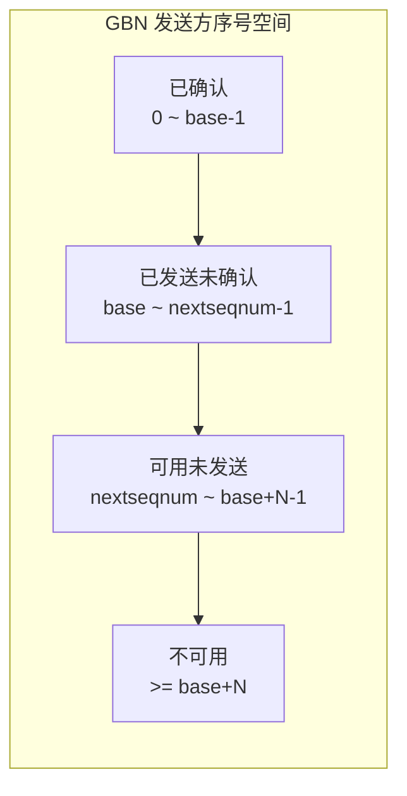

GBN 协议具有以下特点：确认是累积式的，一个确认到达意味着该分组及之前的所有分组都已被正确接收；接收方丢弃所有失序分组，不为其缓存数据；超时后，发送方重传所有已发送但未确认的分组；接收方只需维护一个变量 `expectedseqnum`，无须缓存失序分组。

发送方需要响应三种事件：

| 事件                  | 操作                                           |
| --------------------- | ---------------------------------------------- |
| 上层调用 `rdt_send()` | 若窗口未满，发送分组；若窗口满，缓存或返回上层 |
| 收到 ACK n            | 确认序号 n 及以前所有分组，窗口前移            |
| 超时                  | 重传所有已发送但未确认的分组                   |

接收方需要响应三种事件：

| 事件               | 操作                             |
| ------------------ | -------------------------------- |
| 收到按序且正确分组 | 交付上层，发送 ACK               |
| 收到失序分组       | 丢弃，重发最近按序接收分组的 ACK |
| 收到损坏分组       | 丢弃，重发 ACK                   |

下图演示了 GBN 的工作过程：分组 2 丢失后，接收方对后续的分组 3 和分组 4 都重复确认分组 1（冗余 ACK）；发送方超时后，重传分组 2、3、4。

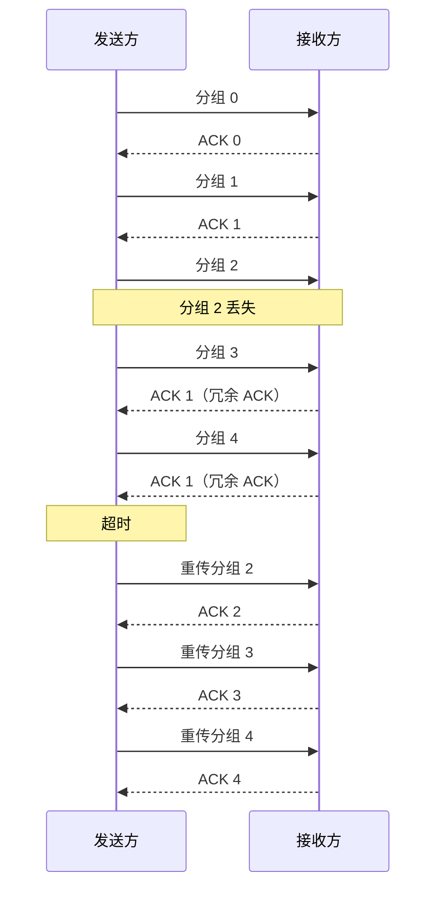

### 3.4.4 选择重传（SR）

GBN 存在一个明显的问题：单个分组差错可能引起大量不必要的重传——分组 2 的丢失导致分组 3 和分组 4 被无谓地重传。在高差错率的链路上，这种浪费相当可观。

SR 协议只重传发送方怀疑出错（即未被确认）的分组，从而避免了 GBN 的浪费。SR 的特点是：接收方逐个确认分组，而不是使用累积确认；接收方缓存失序到达的分组，等待缺失分组补齐后按序交付；发送方和接收方的窗口可能不一致；每个未确认分组通常需要自己的定时器。

发送方的序号空间同样划分为四个状态：

| 状态         | 含义             |
| ------------ | ---------------- |
| 已确认       | 已收到 ACK       |
| 已发送未确认 | 在窗口内但未确认 |
| 可用未发送   | 可以立即发送     |
| 不可用       | 超出窗口         |

接收方的序号空间也划分为四个状态：

| 状态           | 含义               |
| -------------- | ------------------ |
| 失序已缓存     | 已收到但未按序交付 |
| 可接受但未确认 | 在接收窗口内       |
| 期待未收到     | 接收窗口基序号     |
| 不可用         | 超出窗口           |

```mermaid
flowchart LR
    subgraph SRReceiver["SR 接收方窗口"]
        A["失序已缓存"]
        B["可接受但未确认"]
        C["期待未收到"]
        D["不可用"]
    end

    A --> B --> C --> D
```

接收方的行为可以分三种情况讨论：

1. 若分组序号在 $[rcv\_base,\ rcv\_base+N-1]$ 内且正确：缓存该分组，发送选择 ACK；若该分组是窗口基序号，则按序交付能够交付的连续分组。
2. 若分组序号在 $[rcv\_base-N,\ rcv\_base-1]$ 内：这是已确认过的分组的重传，接收方重新发送 ACK。
3. 其他情况：忽略该分组。

SR 协议对窗口长度有一个重要限制：窗口长度必须满足

$$
N \leq \frac{\text{序号空间大小}}{2}
$$

否则，接收方将无法区分新分组和重传分组——重传分组的序号可能与尚未发送的新分组的序号相同。

下图演示了 SR 的工作过程：分组 2 丢失后，接收方缓存了失序到达的分组 3、4、5 并逐个确认；分组 2 超时重传后，接收方按序交付 2、3、4、5。

```mermaid
sequenceDiagram
    participant S as 发送方
    participant R as 接收方

    S->>R: 分组 0
    R-->>S: ACK 0
    S->>R: 分组 1
    R-->>S: ACK 1
    S->>R: 分组 2
    Note over S,R: 分组 2 丢失
    S->>R: 分组 3
    R-->>S: ACK 3（缓存分组 3）
    S->>R: 分组 4
    R-->>S: ACK 4（缓存分组 4）
    S->>R: 分组 5
    R-->>S: ACK 5（缓存分组 5）
    Note over S: 分组 2 超时
    S->>R: 重传分组 2
    R-->>S: ACK 2
    Note over R: 交付 2,3,4,5
```

# 第二部分 TCP、拥塞控制与演化

## 3.5 面向连接的运输：TCP

TCP 是因特网运输层的面向连接的可靠运输协议。前一节建立的可靠数据传输原理，几乎全部体现在 TCP 的设计之中：差错检测、重传、累积确认、定时器、序号和确认号，都是 TCP 用来在不可靠的 IP 服务之上构建可靠服务的基本工具。

### 3.5.1 TCP 连接

TCP 是面向连接的：在应用进程开始发送数据之前，两个进程必须先握手，建立起一条 TCP 连接。TCP 连接具有以下特点：

| 特性     | 说明                               |
| -------- | ---------------------------------- |
| 面向连接 | 传输前需建立连接                   |
| 全双工   | 数据可同时双向传输                 |
| 点对点   | 仅支持单个发送方和单个接收方       |
| 逻辑连接 | 状态只保存在端系统，不保存在路由器 |

值得注意的是"逻辑连接"这一点：TCP 连接的握手报文段、序号和确认号等状态，只存在于端系统的 TCP 协议实体中，沿途路由器并不知道任何 TCP 连接的存在。

```mermaid
flowchart LR
    A["主机 A 进程"] <-->|"TCP 连接"| B["主机 B 进程"]

    subgraph HostA["主机 A"]
        A
        SA["发送缓存"]
        RA["接收缓存"]
    end

    subgraph HostB["主机 B"]
        B
        SB["发送缓存"]
        RB["接收缓存"]
    end
```

#### 最大报文段长度 MSS

TCP 从发送缓存中取出数据并放入报文段，每次放入的数据量受限于**最大报文段长度（Maximum Segment Size，MSS）**。MSS 通常根据链路的**最大传输单元（MTU）**来设置：以太网和 PPP 的 MTU 通常为 1500 字节，而 TCP/IP 首部通常为 40 字节，因此典型 MSS 为

$$
MSS = 1500 - 40 = 1460\ \text{字节}
$$

> [!note] MSS 的含义
> MSS 指的是报文段中应用层数据的最大长度，不包括 TCP 首部。它是对应用数据的限制，而非对整个报文段的限制。

### 3.5.2 TCP 报文段结构

TCP 报文段由首部和数据字段组成。TCP 首部通常为 20 字节，若包含选项则更长。首部各字段的含义如下：

| 字段         |   长度 | 作用                              |
| ------------ | -----: | --------------------------------- |
| 源端口号     | 16 bit | 发送方端口                        |
| 目的端口号   | 16 bit | 接收方端口                        |
| 序号         | 32 bit | 报文段第一个数据字节的字节流编号  |
| 确认号       | 32 bit | 期望收到的下一个字节序号          |
| 首部长度     |  4 bit | 以 32 bit 字为单位的 TCP 首部长度 |
| 保留         |  6 bit | 保留                              |
| 标志位       |  6 bit | ACK、PSH、RST、SYN、FIN、URG      |
| 接收窗口     | 16 bit | 流量控制，指示接收方可接受字节数  |
| 检验和       | 16 bit | 差错检测                          |
| 紧急数据指针 | 16 bit | 紧急数据偏移                      |
| 选项         |   可变 | MSS、窗口缩放、时间戳等           |

```mermaid
flowchart LR
    subgraph TCPHeader["TCP 报文段首部"]
        A["源端口<br/>16 bit"]
        B["目的端口<br/>16 bit"]
        C["序号<br/>32 bit"]
        D["确认号<br/>32 bit"]
        E["首部长度/标志<br/>16 bit"]
        F["接收窗口<br/>16 bit"]
        G["检验和<br/>16 bit"]
        H["紧急指针<br/>16 bit"]
        I["选项<br/>可变"]
    end

    J["应用数据"]

    A --- B --- C --- D --- E --- F --- G --- H --- I --- J
```

#### 序号和确认号

TCP 把应用数据看成一个无结构的、有序的**字节流（byte stream）**。序号建立在这个字节流之上，而不是建立在报文段序列之上：一个报文段的序号，是该报文段首字节的字节流编号。

例如，假设一个文件大小为 500000 字节，MSS 为 1000 字节，初始序号为 0，则各报文段的序号为：

| 报文段  | 序号范围    |
| ------- | ----------- |
| 第 1 个 | 0 ~ 999     |
| 第 2 个 | 1000 ~ 1999 |
| 第 3 个 | 2000 ~ 2999 |
| ...     | ...         |

确认号是主机期望从对方收到的下一个字节序号。例如，主机 A 已收到主机 B 编号为 0 ~ 535 的所有字节，则 A 发往 B 的报文段中，确认号为 536。

TCP 只提供**累积确认**：TCP 确认该流中至第一个丢失字节为止的字节，而不单独确认其后可能已正确收到的字节。

#### Telnet 示例：序号和确认号

下面通过一个 Telnet 交互示例说明序号和确认号的工作方式。假设客户的初始序号为 42，服务器的初始序号为 79，用户键入字符 `'C'`：

```mermaid
sequenceDiagram
    participant U as 用户
    participant A as 主机 A / 客户
    participant B as 主机 B / 服务器

    U->>A: 键入字符 'C'
    A->>B: Seq=42, Ack=79, data='C'
    Note over B: 收到字节 42<br/>期望字节 43
    B-->>A: Seq=79, Ack=43, data='C'
    Note over A: 收到回显字符 'C'<br/>期望字节 80
    A-->>B: Seq=43, Ack=80
```

交互过程可以分解为三步：第一步，客户向服务器发送携带字符 `'C'` 的报文段（Seq=42）；第二步，服务器向客户发送回显字符 `'C'` 的报文段（Seq=79），其中确认号 43 表示已收到客户的 `'C'`，期望收到下一个字节 43；第三步，客户向服务器发送仅含确认信息的报文段（Seq=43，Ack=80），确认服务器回显的数据。

这种把确认信息搭载在反向数据报文段中的方式，称为**捎带（piggybacking）**。它节省了单独发送确认报文段的开销。

### 3.5.3 往返时间的估计与超时

TCP 使用超时/重传机制处理报文段丢失，因此必须回答三个问题：超时间隔应设为多大？如何估计往返时间？如何管理定时器？超时设得过短会造成不必要的重传，设得过长又会加长丢包后的恢复时间，因此 TCP 需要动态地估计 RTT 并据此设置超时间隔。

#### 估计往返时间

TCP 维护一个**样本 RTT（SampleRTT）**，即从发送报文段到收到确认所经历的时间。由于 TCP 发送报文段后通常会持续发送其他报文段，实际测量时只对一个已发送但尚未确认的报文段测量 RTT，然后取最近若干个样本的平均值。

TCP 用 SampleRTT 来更新**估计 RTT（EstimatedRTT）**，更新公式为指数加权移动平均（EWMA）：

$$
EstimatedRTT = (1-\alpha) \cdot EstimatedRTT + \alpha \cdot SampleRTT
$$

推荐取值为 $\alpha = 0.125$，于是

$$
EstimatedRTT = 0.875 \cdot EstimatedRTT + 0.125 \cdot SampleRTT
$$

这一公式让 EstimatedRTT 既不过分敏感于单个样本的波动，又能跟踪 RTT 的长期变化。

#### 估计 RTT 偏差

仅有 EstimatedRTT 还不够：如果 SampleRTT 相对于 EstimatedRTT 波动很大，固定按 EstimatedRTT 设置超时就会频繁误判超时。为此，TCP 还维护 **RTT 偏差（DevRTT）**，用于衡量 SampleRTT 偏离 EstimatedRTT 的程度：

$$
DevRTT = (1-\beta) \cdot DevRTT + \beta \cdot |SampleRTT - EstimatedRTT|
$$

推荐取值为 $\beta = 0.25$。

#### 设置重传超时间隔

综合 EstimatedRTT 和 DevRTT，TCP 将重传超时间隔设置为

$$
TimeoutInterval = EstimatedRTT + 4 \cdot DevRTT
$$

初始推荐值为 1 秒。实际发生超时后，超时间隔将加倍：

```text
第一次超时：0.75s
第二次超时：1.5s
第三次超时：3.0s
```

这种指数退避策略提供了一种受限的拥塞控制：超时越频繁，说明网络状况越差，发送方就应越保守。

### 3.5.4 可靠数据传输

TCP 在 IP 的不可靠服务之上创建可靠数据传输服务。对上层而言，TCP 保证接收进程读出的数据流是无损坏、无间隙、非冗余且按序的——这正是 3.4 节所追求的目标。

#### 简化的 TCP 发送方

TCP 发送方的行为可以概括为如下伪代码：

```c
NextSeqNum = InitialSeqNumber
SendBase = InitialSeqNumber

loop forever {
    switch(event) {

    event: rdt_send(data from upper layer)
        make segment with sequence number NextSeqNum
        if timer not running:
            start timer
        pass segment to IP
        NextSeqNum = NextSeqNum + length(data)
        break;

    event: timeout
        retransmit unacknowledged segment with smallest sequence number
        restart timer
        break;

    event: receive ACK with ack number y
        if y > SendBase:
            SendBase = y
            if there are still unacknowledged segments:
                restart timer
        break;
    }
}
```

```mermaid
flowchart TB
    Start["初始化<br/>NextSeqNum = SendBase = InitialSeqNumber"] --> Wait["等待事件"]

    Wait -->|"上层数据"| Send["生成报文段<br/>序号=NextSeqNum"]
    Send --> TimerCheck{"定时器是否运行？"}
    TimerCheck -->|否| StartTimer["启动定时器"]
    TimerCheck -->|是| PassIP["交给 IP"]
    StartTimer --> PassIP
    PassIP --> UpdateSeq["NextSeqNum += data length"]
    UpdateSeq --> Wait

    Wait -->|"超时"| Retransmit["重传最小序号未确认报文段"]
    Retransmit --> RestartTimer["重启定时器"]
    RestartTimer --> Wait

    Wait -->|"收到 ACK=y"| CheckACK{"y > SendBase？"}
    CheckACK -->|是| UpdateBase["SendBase = y"]
    UpdateBase --> StillUnacked{"还有未确认报文段？"}
    StillUnacked -->|是| RestartTimer2["重启定时器"]
    StillUnacked -->|否| Wait
    RestartTimer2 --> Wait
    CheckACK -->|否| Wait
```

其中，`SendBase` 是最早未确认报文段的序号，`NextSeqNum` 是下一个待分配的序号。注意，只有当 ACK 中的确认号大于 `SendBase` 时，`SendBase` 才会前移——这正是累积确认的体现。

#### 累积确认

累积确认的一个好处是：即使某个确认丢失，后续到达的确认仍能覆盖它。例如，主机 A 发送两个报文段：报文段 1 序号 92、长度 8 字节，报文段 2 序号 100、长度 20 字节。主机 B 收到后先后发送 ACK 100 和 ACK 120。如果 ACK 100 丢失但 ACK 120 到达，则主机 A 知道主机 B 已收到 119 及以前的所有字节，因此不会重传任何报文段。

```mermaid
sequenceDiagram
    participant A as 主机 A
    participant B as 主机 B

    A->>B: Seq=92, 8 bytes
    A->>B: Seq=100, 20 bytes
    B-->>A: ACK=100
    Note over A,B: ACK=100 丢失
    B-->>A: ACK=120
    Note over A: 收到 ACK=120<br/>知道 119 以前都已收到<br/>无需重传
```

#### 快速重传

仅靠超时触发重传存在一个问题：超时周期可能较长。设想发送方发送了 1~5 号报文段，其中 2 号丢失——若等到超时才重传，其间发送方必须空等一个超时间隔。

TCP 可以通过**冗余 ACK** 更早地检测到丢包。冗余 ACK 是再次确认某个报文段的 ACK。TCP 接收方检测到数据流中有间隔时（即收到失序分组），会重复确认最后一个按序接收的数据。发送方如果连续收到对同一数据的 3 个冗余 ACK，就认为该报文段之后的报文段已经丢失，立即执行**快速重传**，而不必等待超时。

```mermaid
sequenceDiagram
    participant S as 发送方
    participant R as 接收方

    S->>R: 报文段 1
    R-->>S: ACK 2
    S->>R: 报文段 2
    Note over S,R: 报文段 2 丢失
    S->>R: 报文段 3
    R-->>S: ACK 2（冗余 ACK 1）
    S->>R: 报文段 4
    R-->>S: ACK 2（冗余 ACK 2）
    S->>R: 报文段 5
    R-->>S: ACK 2（冗余 ACK 3）
    Note over S: 收到 3 个冗余 ACK<br/>快速重传报文段 2
    S->>R: 重传报文段 2
    R-->>S: ACK 6
```

#### TCP：GBN 与 SR 的混合体

TCP 的确认是累积式的，表面上看更像 GBN；但许多 TCP 实现会缓存正确接收但失序的报文段，等待缺失部分补齐后按序交付。此外，TCP 超时后也不会像 GBN 那样重传所有后续分组，而通常只重传丢失的分组。因此，TCP 的差错恢复机制可以认为是 GBN 与 SR 的混合体。

TCP 还可以使用**选择确认（Selective ACK，SACK）**选项：它允许接收方有选择地确认已收到的失序报文段。结合选择重传后，TCP 的行为就更接近 SR 了。

### 3.5.5 流量控制

TCP 为应用进程提供**流量控制（flow control）**服务，以防止发送方使接收方缓存溢出。流量控制是一种速度匹配服务：让发送方的发送速率与接收方应用读取数据的速率相匹配。注意区分它与拥塞控制的目的：

| 机制     | 目的               |
| -------- | ------------------ |
| 流量控制 | 防止接收方缓存溢出 |
| 拥塞控制 | 防止网络拥塞       |

#### 接收窗口

设 `RcvBuffer` 为接收缓存大小，`LastByteRead` 为应用进程从缓存读出的最后一个字节编号，`LastByteRcvd` 为已放入接收缓存的最后一个字节编号。接收缓存中的数据量不能超过缓存容量，即必须满足

$$
LastByteRcvd - LastByteRead \leq RcvBuffer
$$

接收窗口（rwnd）定义为接收缓存的剩余空间：

$$
rwnd = RcvBuffer - (LastByteRcvd - LastByteRead)
$$

接收方将 rwnd 的值放入报文段首部传给发送方。发送方维护 `LastByteSent`（已发送的最后一个字节编号）和 `LastByteAcked`（已确认的最后一个字节编号），并保证

$$
LastByteSent - LastByteAcked \leq rwnd
$$

通过这一机制，发送方未确认的数据量始终不超过接收方的剩余缓存空间。

#### 接收窗口为 0 的问题

如果接收缓存被填满，rwnd 将变为 0，发送方随之停止发送。但问题在于：当接收方的应用进程读出数据、缓存腾出空间后，接收方可能没有任何数据或确认要发送给发送方——于是发送方永远无法知道窗口已经重新打开，连接就此停滞。

> [!tip] TCP 的解决方案
> 当接收窗口为 0 时，TCP 规定发送方继续发送只有一个字节数据的报文段。这些报文段会被接收方确认，而确认报文中将携带最新的非零 rwnd 值，从而让发送方得知窗口已经打开。这虽然浪费了一点带宽，却避免了连接死锁。

### 3.5.6 TCP 连接管理

TCP 连接的建立和释放都需要双方交换特定的控制报文段，这就是所谓的连接管理。建立连接需要三次握手，释放连接则需要四次交互。

#### 三次握手

**第一步：客户发送 SYN。** 客户 TCP 向服务器发送一个特殊报文段：SYN 标志位置 1，不包含应用数据，序号为 `client_isn`（客户随机选择的初始序号）。

**第二步：服务器发送 SYNACK。** 服务器收到 SYN 后，为该连接分配 TCP 缓存和变量，然后向客户发送自己的 SYN 报文段：SYN 置 1，确认号为 `client_isn + 1`（确认已收到客户的 SYN），序号为 `server_isn`（服务器随机选择的初始序号）。

**第三步：客户发送 ACK。** 客户收到 SYNACK 后，也为连接分配缓存和变量，并发送 ACK 报文段：确认号为 `server_isn + 1`，SYN 置 0，且可以携带数据。此后，连接进入已建立状态，可以开始传输应用数据。

```mermaid
sequenceDiagram
    participant C as 客户
    participant S as 服务器

    C->>S: SYN=1<br/>seq=client_isn
    Note over S: 分配缓存和变量
    S-->>C: SYN=1, ACK=1<br/>seq=server_isn<br/>ack=client_isn+1
    Note over C: 分配缓存和变量
    C->>S: SYN=0, ACK=1<br/>seq=client_isn+1<br/>ack=server_isn+1
    Note over C,S: TCP 连接建立
```

#### 连接关闭

任一方都可以终止连接。假设客户发起关闭，过程如下：客户发送 FIN 报文段；服务器确认该 FIN；服务器再发送自己的 FIN；最后客户确认服务器的 FIN。经过这四次交互，连接关闭，相关资源释放。

```mermaid
sequenceDiagram
    participant C as 客户
    participant S as 服务器

    C->>S: FIN
    S-->>C: ACK
    S->>C: FIN
    C-->>S: ACK
    Note over C,S: 连接关闭，资源释放
```

#### TCP 状态

TCP 连接的建立和关闭过程，可以更直观地用状态机来描述。客户 TCP 的典型状态转换如下：

```mermaid
stateDiagram-v2
    [*] --> CLOSED
    CLOSED --> SYN_SENT: 发送 SYN
    SYN_SENT --> ESTABLISHED: 收到 SYNACK 并发送 ACK
    ESTABLISHED --> FIN_WAIT_1: 发送 FIN
    FIN_WAIT_1 --> FIN_WAIT_2: 收到 ACK
    FIN_WAIT_2 --> TIME_WAIT: 收到 FIN 并发送 ACK
    TIME_WAIT --> CLOSED: 等待超时
```

服务器 TCP 的典型状态转换如下：

```mermaid
stateDiagram-v2
    [*] --> CLOSED
    CLOSED --> LISTEN: 创建监听套接字
    LISTEN --> SYN_RCVD: 收到 SYN 并发送 SYNACK
    SYN_RCVD --> ESTABLISHED: 收到 ACK
    ESTABLISHED --> CLOSE_WAIT: 收到 FIN 并发送 ACK
    CLOSE_WAIT --> LAST_ACK: 发送 FIN
    LAST_ACK --> CLOSED: 收到 ACK
```

#### 关注安全性：SYN 洪泛攻击

TCP 连接管理中的一个著名安全弱点，是 **SYN 洪泛攻击（SYN flooding attack）**。攻击者大量发送 TCP SYN 报文段，但不完成第三次握手——服务器为每个 SYN 分配资源、建立半开连接，却永远等不到最后的 ACK，最终资源耗尽，无法再接受合法连接。

防御方法是 **SYN Cookie**。其基本思想是：服务器收到 SYN 时不立即分配资源，而是根据源/目的 IP 地址、端口和一个秘密数计算出一个初始序号 cookie，随 SYNACK 发回；只有当客户返回合法的 ACK（其中包含 cookie + 1）时，服务器才验证 cookie 并创建全开连接。这样，攻击者发送的 SYN 不会在服务器上留下任何状态，资源消耗问题得以避免。

## 3.6 拥塞控制原理

上一节讨论的流量控制用于匹配发送方与接收方的速率，但网络中还有另一个全局性的问题：**拥塞**。拥塞通常由太多源以过高速率发送数据引起。当网络拥塞时，分组重传虽然能恢复丢失的数据，却不能解决拥塞的原因——重传本身反而增加了网络负载，形成恶性循环。因此，需要额外的机制在面临网络拥塞时遏制发送方。

### 3.6.1 拥塞原因与代价

下面通过三种逐步复杂化的场景，考察拥塞是如何产生的，以及它带来怎样的代价。

#### 1. 两个发送方和一台具有无穷大缓存的路由器

考虑两条连接共享一台路由器的输出链路，链路容量为 $R$。两条连接的发送速率之和可以超过 $R$，多余的分组在路由器的缓存中排队。当每条连接的发送速率超过 $R/2$ 时，两条连接的吞吐量之和最多为 $R$，多余的分组只能无限地排队，排队时延趋向无穷大。

代价在于：分组到达速率接近链路容量时，分组会经历巨大的排队时延。

```mermaid
flowchart LR
    A["主机 A<br/>λin"] --> R["路由器<br/>无限缓存"]
    B["主机 B<br/>λin"] --> R
    R --> C["主机 C"]
    R --> D["主机 D"]

    R -- "共享链路容量 R" --> Out["输出链路"]
```

#### 2. 两个发送方和一台具有有限缓存的路由器

现实中路由器的缓存是有限的。当缓存被占满时，到达的分组将被丢弃。由于 TCP 提供可靠传输，发送方检测到丢包后会重传，于是代价包括三个方面：

1. 发送方必须重传丢失的分组；
2. 路由器可能转发了不必要的分组副本——那些最终会被丢弃或已经过时的分组，白白占用了链路带宽；
3. 由于重传消耗了带宽，链路的有效吞吐量下降。

```mermaid
flowchart LR
    A["主机 A"] --> R["路由器<br/>有限缓存"]
    B["主机 B"] --> R
    R -->|可能丢包| C["主机 C"]
    R -->|可能丢包| D["主机 D"]
```

#### 3. 多发送方、多路由器、多跳路径

在更现实的多跳网络中，拥塞的代价进一步放大。考虑一个分组沿 A → R1 → R2 → C 的路径转发：如果该分组在第二跳路由器 R2 处因缓存溢出而被丢弃，那么第一跳路由器 R1 为转发该分组所付出的工作就全部浪费了。

> [!important] 多跳路径中的浪费
> 当一个分组沿路径被丢弃时，每个上游路由器用于接收、处理和转发该分组的传输容量最终都被浪费。

```mermaid
flowchart LR
    A["主机 A"] --> R1["路由器 R1"]
    D["主机 D"] --> R1
    R1 --> R2["路由器 R2"]
    R2 --> C["主机 C"]
    R2 --> B["主机 B"]
```

综合三种场景可以看出：拥塞的根本代价在于，为传输最终被丢弃的分组而付出的链路容量、缓存空间和处理能力全部被浪费；而重传机制虽然保证了可靠性，却进一步加重了网络负担。

### 3.6.2 拥塞控制方法

根据网络层是否向端系统提供显式帮助，拥塞控制方法可分为两类：

| 方法             | 说明                                                   |
| ---------------- | ------------------------------------------------------ |
| 端到端拥塞控制   | 网络层不提供显式拥塞反馈，端系统通过丢包、时延推断拥塞 |
| 网络辅助拥塞控制 | 路由器显式提供拥塞反馈                                 |

TCP 默认采用端到端拥塞控制：网络层（路由器）不向运输层报告拥塞状态，发送方只能通过观察丢包和时延的变化来推断拥塞。

```mermaid
flowchart TB
    subgraph EndToEnd["端到端拥塞控制"]
        A["发送方"] -->|数据| B["网络"]
        B -->|丢包/时延| A
    end

    subgraph NetworkAssisted["网络辅助拥塞控制"]
        C["发送方"] -->|数据| D["路由器标记拥塞"]
        D -->|显式反馈| C
    end
```

网络辅助反馈有两种实现方式：路由器直接发送一个拥塞指示分组给发送方；或者路由器标记从发送方流向接收方的分组，接收方在返回的确认中通知发送方。后一种方式正是 3.7.2 节将要讨论的 ECN 所采用的机制。

## 3.7 TCP 拥塞控制

TCP 发送方根据感知到的网络拥塞程度限制自己的发送速率。为此，TCP 为每条连接维护两个关键变量：**拥塞窗口 `cwnd`** 和**慢启动阈值 `ssthresh`**。发送方未确认数据量的限制为

$$
LastByteSent - LastByteAcked \leq \min\{cwnd,\ rwnd\}
$$

为专注于拥塞控制，通常假设接收缓存足够大（即 rwnd 不构成约束），于是上式简化为

$$
LastByteSent - LastByteAcked \leq cwnd
$$

发送速率近似为

$$
\text{发送速率} \approx \frac{cwnd}{RTT}
$$

**TCP 如何感知拥塞？** TCP 将"丢包事件"定义为以下两种情形之一：报文段超时，或收到 3 个冗余 ACK。当出现丢包事件时，TCP 认为网络可能发生了拥塞，于是降低发送速率；收到新的确认时，则认为网络正在正常交付报文段，可以适当增加发送速率。

**TCP 拥塞控制的指导原则。** 综合上述分析，TCP 拥塞控制遵循三条原则：

1. 丢失报文段意味着拥塞，应降低发送速率；
2. 确认报文段指示网络正在交付报文段，可增加发送速率；
3. TCP 通过不断增加速率来探测可用带宽，出现丢包后再后退。

> [!example] 一个直观的类比
> TCP 的行为类似一个孩子不断向父母要更多糖果，直到被告知"不行"，然后退缩一点，过一会儿再次试探。网络就是这位"父母"，丢包就是那句"不行"。

### 3.7.1 经典 TCP 拥塞控制

经典 TCP 拥塞控制由三部分组成：慢启动、拥塞避免和快速恢复。三者构成一个状态机，根据网络状况在不同状态之间转换。

#### 1. 慢启动

TCP 连接开始时，拥塞窗口初始化为 $cwnd = 1 \times MSS$。每当一个报文段首次被确认，拥塞窗口就增加一个 MSS：

$$
cwnd = cwnd + MSS
$$

于是每经过一个 RTT，发送速率就翻一番——慢启动以指数速率增长。尽管名为"慢"启动，它其实是从 1 个 MSS 开始快速增长的。

```mermaid
sequenceDiagram
    participant S as 发送方
    participant R as 接收方

    S->>R: 1 个报文段
    R-->>S: ACK
    Note over S: cwnd = 2 MSS
    S->>R: 2 个报文段
    R-->>S: ACK, ACK
    Note over S: cwnd = 4 MSS
    S->>R: 4 个报文段
    R-->>S: ACK × 4
    Note over S: cwnd = 8 MSS
```

慢启动在以下三种情形之一出现时结束：

1. 出现超时丢包事件：此时令 `ssthresh = cwnd / 2`，`cwnd = 1 MSS`，重新开始慢启动；
2. `cwnd` 增长到不低于 `ssthresh`：进入拥塞避免状态；
3. 收到 3 个冗余 ACK：执行快速重传，进入快速恢复状态。

#### 2. 拥塞避免

进入拥塞避免后，TCP 以更谨慎的方式增加窗口：每个 RTT 只增加 1 个 MSS，而不是像慢启动那样翻番。常用的实现方法是，每收到一个新 ACK 就将窗口增加 $\dfrac{MSS}{cwnd}$：

$$
cwnd = cwnd + MSS \times \frac{MSS}{cwnd}
$$

举例来说，设 MSS = 1460 字节，cwnd = 14600 字节。一个 RTT 内发送 10 个报文段，每个 ACK 增加 $1/10$ MSS，10 个 ACK 累计增加 1 MSS——正好每个 RTT 增加一个 MSS。

在拥塞避免状态下，如果出现超时，则令 `ssthresh = cwnd / 2`，`cwnd = 1 MSS`，回到慢启动；如果收到 3 个冗余 ACK，则令 `ssthresh = cwnd / 2`，`cwnd = ssthresh + 3 \times MSS`，进入快速恢复。

#### 3. 快速恢复

在快速恢复状态下：每收到一个冗余 ACK，说明又有一个报文段被成功交付，`cwnd` 增加 1 MSS；当丢失报文段的 ACK 到达后，`cwnd` 回到 `ssthresh` 的值，进入拥塞避免；如果期间出现超时，则回到慢启动。

三种状态的转换关系如下图所示：

```mermaid
flowchart TB
    SS["慢启动<br/>cwnd 指数增长"] -->|"cwnd >= ssthresh"| CA["拥塞避免<br/>cwnd 线性增长"]
    CA -->|"3 个冗余 ACK"| FR["快速恢复"]
    FR -->|"新 ACK 到达"| CA
    FR -->|"超时"| SS
    CA -->|"超时"| SS
    SS -->|"超时"| SS
```

**TCP Tahoe 与 TCP Reno。** 不同 TCP 版本对 3 个冗余 ACK 的处理有所不同：TCP Tahoe 无论遇到超时还是冗余 ACK，都将 cwnd 降为 1 MSS 并回到慢启动；TCP Reno 则在收到 3 个冗余 ACK 时将 cwnd 减半、进入快速恢复——这正是快速恢复机制的来源。

| 版本      | 对 3 个冗余 ACK 的处理      |
| --------- | --------------------------- |
| TCP Tahoe | cwnd 降为 1 MSS，进入慢启动 |
| TCP Reno  | cwnd 减半，进入快速恢复     |

```mermaid
flowchart LR
    subgraph Tahoe["TCP Tahoe"]
        A["cwnd=12 MSS"] -->|"3 dupACK"| B["ssthresh=6 MSS<br/>cwnd=1 MSS"]
        B --> C["慢启动"]
    end

    subgraph Reno["TCP Reno"]
        D["cwnd=12 MSS"] -->|"3 dupACK"| E["ssthresh=6 MSS<br/>cwnd=9 MSS"]
        E --> F["快速恢复"]
    end
```

**AIMD。** TCP 拥塞控制常被称为**加性增、乘性减（Additive-Increase Multiplicative-Decrease，AIMD）**：无拥塞时每个 RTT 将窗口增加 1 MSS（加性增），出现拥塞丢包时将窗口减半（乘性减）。AIMD 的一个重要性质是，当多条连接共享同一瓶颈链路时，它倾向于收敛到平等的带宽共享——3.7.3 节将进一步讨论。

```mermaid
flowchart LR
    Increase["加性增<br/>cwnd += 1 MSS / RTT"] --> Loss{"丢包事件？"}
    Loss -->|否| Increase
    Loss -->|是| Decrease["乘性减<br/>cwnd = cwnd / 2"]
    Decrease --> Increase
```

**TCP 平均吞吐量近似。** 设丢包时窗口为 $W$。忽略慢启动阶段，TCP 速率在 $\dfrac{W}{2RTT}$ 和 $\dfrac{W}{RTT}$ 之间锯齿变化，因此平均吞吐量近似为

$$
\text{平均吞吐量} \approx \frac{0.75W}{RTT}
$$

**TCP CUBIC。** TCP CUBIC 是对拥塞避免阶段的重要改进，也是 Linux 等系统中的常见默认版本。其核心思想是：记录上次丢包时的窗口 $W_{\max}$，计算未来时间 $K$（使窗口恰好恢复到 $W_{\max}$ 的时刻），然后用当前时间 $t$ 与 $K$ 之间距离的立方函数来增加窗口。这样，窗口在丢包后迅速接近上次丢包的速率，在接近 $W_{\max}$ 时则谨慎地探测带宽；如果网络状况已经改善，也能较快找到新的操作点。

```mermaid
flowchart LR
    Loss["丢包事件<br/>记录 Wmax"] --> Cubic["CUBIC 窗口增长<br/>基于 (t-K)^3"]
    Cubic --> Near["快速接近 Wmax"]
    Near --> Probe["在 Wmax 附近谨慎探测"]
```

### 3.7.2 网络辅助明确拥塞通告和基于时延的拥塞控制

经典 TCP 完全依赖丢包来感知拥塞，但丢包往往意味着拥塞已经相当严重。能否在丢包发生之前就检测到拥塞呢？这一小节考察两种方法：明确拥塞通告和基于时延的拥塞控制。

#### 明确拥塞通告 ECN

**明确拥塞通告（Explicit Congestion Notification，ECN）** 允许网络在丢包发生之前，就明确地向 TCP 发送方和接收方发出拥塞信号。ECN 在 IP 首部中使用两个比特来表示端点是否支持 ECN 以及分组是否经过拥塞标记。当路由器即将发生拥塞（如缓存将满）时，它对经过的 IP 数据报打上拥塞标记，而不是直接丢弃。接收方收到被标记的分组后，在返回的 TCP ACK 中设置 ECE 比特，将拥塞信号传递给发送方；发送方收到 ECE 后，将拥塞窗口减半，并在后续报文段中设置 CWR 比特，告知接收方自己已经开始降低窗口。

```mermaid
sequenceDiagram
    participant A as 主机 A / 发送方
    participant R as 拥塞路由器
    participant B as 主机 B / 接收方

    A->>R: IP 数据报，ECN 能力位设置
    R->>B: IP 数据报被标记拥塞
    B-->>A: TCP ACK，ECE=1
    Note over A: 收到 ECN 拥塞指示<br/>cwnd 减半
    A->>B: TCP 报文段，CWR=1
```

#### 基于时延的拥塞控制

另一种思路是在丢包之前，根据 RTT 的增大来推断拥塞：当网络开始排队时，往返时延会先于丢包出现增长。

**TCP Vegas** 是这一思路的代表。Vegas 测量最小往返时延 $RTT_{\min}$，并据此估计未拥塞时的吞吐率 $\dfrac{cwnd}{RTT_{\min}}$。如果实际吞吐率接近该值，说明路径未拥塞，可以增加窗口；如果实际吞吐率明显低于该值，说明多余的分组在排队、路径已经拥塞，应当减小窗口。Vegas 的目标是保持管道刚好充满，而不可以更满。

**BBR** 在 Vegas 的思想上构建，并加入了公平竞争机制。Google 已在内部 B4 网络及部分公网服务器上部署 BBR，它在高带宽、高时延的"长肥管道"场景中表现出明显优于经典丢包驱动算法的性能。

### 3.7.3 公平性

最后考虑拥塞控制的公平性问题。设想 K 条 TCP 连接共享同一条瓶颈链路，链路容量为 $R$，且每条连接都有大量数据要发送。如果每条连接的平均速率接近

$$
\frac{R}{K}
$$

那么就认为该拥塞控制机制是公平的。TCP 的 AIMD 机制倾向于实现这种平等的带宽共享：每条连接都以相同的速率增加窗口，丢包时又都以相同比例减小窗口，差距因此不会被放大。

```mermaid
flowchart TB
    A["两条 TCP 连接共享瓶颈链路 R"] --> B["总吞吐 < R"]
    B --> C["两条连接每 RTT 各加 1 MSS"]
    C --> D["总吞吐达到 R，发生丢包"]
    D --> E["两条连接窗口各减半"]
    E --> F["总吞吐 < R"]
    F --> C
```

然而在实际网络中，公平性会受到多种因素影响：

| 因素          | 影响                                       |
| ------------- | ------------------------------------------ |
| 不同 RTT      | RTT 小的连接更快打开窗口，可能获得更高吞吐 |
| UDP 流量      | UDP 无拥塞控制，可能压制 TCP               |
| 并行 TCP 连接 | 一个应用使用多条连接可获得更大带宽份额     |

RTT 不同的连接无法达到完全公平：RTT 小的连接每个往返周期都能增加窗口，增长更快。UDP 应用若不做拥塞控制，更可能长期挤占 TCP 的带宽。而应用通过并行多条 TCP 连接下载，则能获得与连接数成正比的带宽份额——这正是许多下载工具采用多连接的原因。

## 3.8 运输层功能的演化

UDP 和 TCP 是因特网运输层的两大协议，但二者都不是完美无缺的。一方面，TCP 的演化从未停止：TCP CUBIC、DCTCP、CTCP、BBR、TCP Westwood 等新版本，分别面向无线链路、数据中心、高带宽长肥管道等不同场景进行了优化；3.7.1 节讨论的 CUBIC 和 3.7.2 节讨论的 BBR，正是其中的代表。另一方面，应用也在寻求绕过操作系统内核中 TCP 实现的限制，直接在 UDP 之上构建新的运输层服务——其中最具代表性的就是 QUIC。

**QUIC（Quick UDP Internet Connections，快速 UDP 互联网连接）** 是一种运行在 UDP 之上的应用层协议，目标是提高安全 HTTP 的传输性能。在传统的协议栈中，HTTP/2 依次经过 TLS 和 TCP，再交给 IP；而 QUIC 将可靠传输、加密和多路复用一并纳入自身，HTTP/3 直接构建在 QUIC 之上，取代了 HTTP/2 之上的 TCP + TLS 协议栈。

```mermaid
flowchart TB
    subgraph Traditional["传统安全 HTTP"]
        H2a["HTTP/2"] --> TLSa["TLS"]
        TLSa --> TCPa["TCP"]
        TCPa --> IPa["IP"]
    end

    subgraph QUICStack["基于 QUIC 的 HTTP/3"]
        H3["HTTP/3"] --> Q["QUIC"]
        Q --> UDP["UDP"]
        UDP --> IPb["IP"]
    end
```

QUIC 的设计可以从五个方面来理解，它们分别回应了传统 TCP 协议栈在安全性、多路复用、队头阻塞和演化能力上的不足。

#### 1. 面向连接和安全

与 TCP 一样，QUIC 是端点之间面向连接的协议：连接的建立需要握手，以交换源连接 ID 和目标连接 ID 等状态。不同之处在于，QUIC 将连接建立握手与 TLS 加密握手结合起来，所有 QUIC 分组也都经过加密。在传统 TCP + TLS 栈中，TCP 三次握手和 TLS 密钥协商往往需要两到三个 RTT 才能完成；QUIC 把两者合并后，建立一条安全连接所需的往返次数明显减少。对于 HTTPS 这一今天最主流的 Web 访问方式而言，这一改进直接缩短了页面加载的起始时延。

#### 2. 数据流

TCP 把连接视为单一的字节流（3.5.2 节），所有数据共享同一个序号空间。QUIC 则引入了数据流的抽象：一个 QUIC 连接可以承载多条应用级数据流，每条流具有自己的流 ID，并提供可靠、按序、双向的数据交付。在 HTTP/3 中，一个 Web 页面中的每个对象（HTML、CSS、图片、脚本等）可以使用不同的流传输，彼此独立地建立、结束和交付数据。这种设计为应用层提供了比 TCP 更细粒度的并发控制。

```mermaid
flowchart LR
    App["应用数据流 1"] --> Q1["QUIC Stream 1"]
    App2["应用数据流 2"] --> Q2["QUIC Stream 2"]
    App3["应用数据流 3"] --> Q3["QUIC Stream 3"]

    Q1 --> QUIC["QUIC 连接<br/>Connection ID"]
    Q2 --> QUIC
    Q3 --> QUIC

    QUIC --> UDP["UDP"]
```

#### 3. 避免队头阻塞

多数据流抽象带来的直接好处，是消除了传输层的队头阻塞。回顾 3.5.4 节：TCP 提供可靠、按序的字节流，如果某个字节丢失，其后已正确收到的数据也必须等待重传完成后才能交付应用层。反映到 HTTP 上，如果请求 2 的字节在途中丢失，那么请求 3 即使已完整到达，也无法先交付给浏览器——这就是队头阻塞。QUIC 则基于每条数据流分别提供可靠按序交付：一个流中的丢包只影响该流的交付，其他流的数据照常交付。这样，同一页面中不相关对象的传输就不再相互拖累。

```mermaid
flowchart TB
    subgraph TCP_HOL["TCP / HTTP/1.1 队头阻塞"]
        T1["HTTP 请求 1"] --> T2["HTTP 请求 2"]
        T2 --> T3["HTTP 请求 3"]
        Loss["请求 2 丢包"] -.阻塞.-> T3
    end

    subgraph QUIC_NoHOL["QUIC / HTTP/3 多流"]
        S1["Stream 1"]
        S2["Stream 2"]
        S3["Stream 3"]
        Loss2["Stream 2 丢包"] -.仅影响.-> S2
    end
```

#### 4. 可靠数据传输与拥塞控制

QUIC 并没有抛弃本章讨论的经典机制：它提供类似 TCP 的应答机制来实现可靠数据传输，其拥塞控制算法基于 TCP NewReno（NewReno 与 Reno 只有少量区别），同样遵循慢启动、拥塞避免和快速恢复的状态转换。也就是说，QUIC 的可靠传输和拥塞控制与广为人知的 TCP 算法大体相同，只是实现位置从操作系统内核移到了用户空间——这一变化正是 QUIC 最后一个优势的来源。

#### 5. 应用层演化优势

由于 QUIC 是应用层协议，它的更新可以在应用更新的时间尺度上进行：改进拥塞控制算法、调整握手流程或增加新特性，只需升级应用（如浏览器和服务器）本身，而不必修改操作系统内核中的 TCP 实现。相比之下，部署新版本 TCP 要漫长得多——涉及内核升级、中间设备兼容等层层关卡，历史上新 TCP 变种的普及往往要经历十年以上。这正是 QUIC 选择建立在 UDP 之上的重要原因：UDP 几乎不增加任何约束（3.3 节），而自主掌控运输逻辑带来的演化能力，恰恰是 QUIC 的核心竞争力。

## 3.9 小结

本章研究了运输层的原理与实现。我们看到，运输层位于应用层和网络层之间，为运行在不同主机上的应用进程提供逻辑通信；因特网为此提供了 UDP 和 TCP 两种协议，它们在可靠性、连接管理和拥塞控制等方面各有取舍。贯穿本章的主线是：如何在只提供尽力而为交付的 IP 之上，按需构建满足应用要求的运输服务。

本章回顾：

- **多路复用与多路分解**：运输层通过端口号把网络层的主机间交付扩展为进程间交付；UDP 套接字由目的 IP 和目的端口二元组标识，TCP 套接字由四元组标识
- **UDP**：只在 IP 之上增加复用/分解和差错检查，报文段首部仅 8 字节；UDP 提供端到端检验和，体现了端到端原则
- **可靠数据传输原理**：从完全可靠信道上的 rdt1.0 出发，逐步引入差错检测、确认、重传、序号和定时器，构造出应对比特差错和丢包的 rdt3.0；流水线技术进一步催生了 GBN 和 SR 两类协议
- **TCP**：在 IP 之上构建面向连接的可靠字节流服务，使用序号、确认号、超时重传和快速重传保证可靠传输；通过接收窗口 rwnd 实现流量控制，通过三次握手和四次交互管理连接
- **拥塞控制**：TCP 用拥塞窗口 cwnd 限制发送速率，以丢包事件作为拥塞信号；经典拥塞控制由慢启动、拥塞避免和快速恢复三部分组成，具有 AIMD 特性；ECN 和基于时延的方法（Vegas、BBR）则尝试在丢包之前感知拥塞
- **演化**：QUIC 在 UDP 之上实现了可靠、加密、多数据流的运输服务，消除了 TCP 的队头阻塞，也使运输层功能的迭代速度不再受制于操作系统内核

当然，UDP 和 TCP 远非运输层的全部故事，二者也并非完美无缺——正如本章反复看到的，可靠传输、流量控制和拥塞控制之间存在着微妙的权衡，而新的应用场景（无线链路、数据中心、实时音视频）也在不断提出新的要求。运输层的演化仍将继续，但本章讨论的原理——端到端的可靠传输、基于窗口的流量与拥塞控制——始终是理解这些新协议的基石。

下一章我们将讨论链路层：它如何在单条链路上为网络层提供可靠（或不可靠）的帧传输服务。

以下三个附录分别从状态机、协议对比和机制演进三个角度，对本章内容做补充总结。

### 附：TCP 拥塞控制状态机总览

```mermaid
flowchart TB
    Init["连接开始<br/>cwnd = 1 MSS<br/>ssthresh 初始较大"] --> SS["慢启动"]

    SS -->|"收到新 ACK<br/>cwnd += MSS"| SS
    SS -->|"cwnd >= ssthresh"| CA["拥塞避免"]
    SS -->|"超时<br/>ssthresh=cwnd/2<br/>cwnd=1 MSS"| SS
    SS -->|"3 个冗余 ACK<br/>快速重传"| FR["快速恢复"]

    CA -->|"收到新 ACK<br/>cwnd += MSS*MSS/cwnd"| CA
    CA -->|"超时<br/>ssthresh=cwnd/2<br/>cwnd=1 MSS"| SS
    CA -->|"3 个冗余 ACK<br/>ssthresh=cwnd/2<br/>cwnd=ssthresh+3MSS"| FR

    FR -->|"收到新 ACK<br/>cwnd=ssthresh"| CA
    FR -->|"收到冗余 ACK<br/>cwnd += MSS"| FR
    FR -->|"超时<br/>ssthresh=cwnd/2<br/>cwnd=1 MSS"| SS
```

### 附：UDP 与 TCP 对比

| 特性     | UDP               | TCP                 |
| -------- | ----------------- | ------------------- |
| 连接方式 | 无连接            | 面向连接            |
| 可靠性   | 不可靠            | 可靠                |
| 顺序交付 | 不保证            | 保证按序            |
| 流量控制 | 无                | 有                  |
| 拥塞控制 | 无                | 有                  |
| 首部开销 | 8 字节            | 通常 20 字节        |
| 传输单位 | 数据报 / 报文段   | 字节流 / 报文段     |
| 典型应用 | DNS、SNMP、音视频 | Web、邮件、文件传输 |

### 附：可靠数据传输机制演进路线

```mermaid
flowchart LR
    RDT10["rdt1.0<br/>完全可靠信道"] --> RDT20["rdt2.0<br/>比特差错<br/>ACK/NAK"]
    RDT20 --> RDT21["rdt2.1<br/>增加序号<br/>处理受损 ACK/NAK"]
    RDT21 --> RDT22["rdt2.2<br/>无 NAK<br/>冗余 ACK"]
    RDT22 --> RDT30["rdt3.0<br/>丢包<br/>定时器/超时重传"]
    RDT30 --> PIPE["流水线<br/>GBN / SR"]
    PIPE --> TCP["TCP<br/>累积确认 / 快速重传 / SACK"]
```
