> [!note] 改动说明
> 按上一轮检测意见修订：修正检验和例题等错误，补充缺漏，更新时效内容，并与第 1、2 章保持一致（图号、callout、表格风格）。需核对原书的条目标注"需验证"。逐项改动见文末"改动记录 / Errata"。

运输层位于应用层和网络层之间，是分层网络体系结构的重要组成部分。应用层报文经运输层交给网络层，再通过网络核心送达目的端系统；本章考察这一过程如何实现。

运输层为运行在不同主机上的应用进程提供**逻辑通信**（logical communication）。因特网提供两种截然不同的运输协议：**UDP**（User Datagram Protocol，用户数据报协议）与 **TCP**（Transmission Control Protocol，传输控制协议）。二者在可靠性、连接建立和拥塞控制等方面有根本差异，开发者须按应用需求选择其一。

> [!important] 本章目标
> 理解运输层的原理与实现：
>
> 1. 运输层服务概述，以及运输层与网络层的关系
> 2. 多路复用与多路分解：端口号与套接字
> 3. 无连接运输 UDP：报文段结构、检验和，以及为何选择 UDP
> 4. 可靠数据传输原理：从 rdt 协议族到流水线协议（GBN、SR）
> 5. 面向连接运输 TCP：连接管理、序号与确认、超时估计、可靠传输与流量控制
> 6. 拥塞控制原理与 TCP 经典拥塞控制：慢启动、拥塞避免、快速恢复
> 7. ECN、基于时延的拥塞控制与公平性
> 8. 运输层功能的演化：QUIC

## 3.1 概述和运输层服务

运输层协议为运行在不同主机上的应用进程提供**逻辑通信**：从应用角度看，进程好像直接相连，无须考虑承载报文的物理基础设施，而实际上主机可能相隔半个地球，中间有许多路由器和多种链路。

发送端：运输层从发送进程接收报文，（可能）先将其划分为较小的块，为每块加上运输层首部，形成**运输层报文段**（segment），交给网络层；网络层再封装成 **IP 数据报**（datagram）发送。

> [!important] 路由器只处理网络层
> 路由器仅作用于数据报的网络层字段，不检查其中封装的运输层报文段。

**图 3-1** 运输层报文段在网络中的传递


### 3.1.1 运输层和网络层的关系

| 层次   | 提供的逻辑通信                 |
| ------ | ------------------------------ |
| 网络层 | **主机**之间                   |
| 运输层 | 运行在不同主机上的**进程**之间 |

> [!example] 家庭类比
> 美国东、西海岸各有一个家庭，各有 12 个孩子（互为堂兄弟姐妹）。每周每个孩子给对方家庭的每个孩子写一封信，共 $12\times12=144$ 封。每家指定一个孩子（Ann、Bill）统一收发信件，交给邮政服务运送，到达后由对方的 Ann 或 Bill 分发给各孩子。

| 类比对象     | 网络概念       |
| ------------ | -------------- |
| 信封中的信件 | 应用层报文     |
| 堂兄弟姐妹   | 进程           |
| 家庭         | 主机（端系统） |
| Ann 和 Bill  | 运输层协议     |
| 邮政服务     | 网络层协议     |

邮政服务提供家庭到家庭（主机到主机）的通信；Ann 和 Bill 提供孩子到孩子（进程到进程）的通信。

**图 3-2** 类比对应的协议栈结构

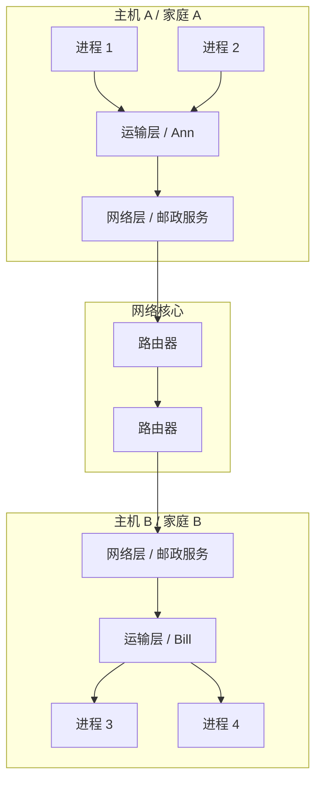

关键结论：

1. 运输层协议只在端系统中实现（操作系统或应用进程内），路由器不实现
2. 运输层首部对端系统有意义；NAT、防火墙等中间盒会读写端口号，属于违背分层的例外做法
3. 运输层能提供的服务受制于网络层的服务模型（如网络层不能保证时延、带宽，运输层也不能）
4. 在此限制之上，运输层仍可增加服务：网络层不可靠时，通过确认与重传提供端到端可靠传输；网络层不保密时，通过加密提供安全性

### 3.1.2 因特网运输层概述

| 协议 | 全称           | 服务特点       |
| ---- | -------------- | -------------- |
| UDP  | 用户数据报协议 | 不可靠、无连接 |
| TCP  | 传输控制协议   | 可靠、面向连接 |

**IP 服务模型**：网络层协议 IP 提供**尽力而为交付服务**（best-effort delivery）：不保证报文段交付、不保证按序、不保证数据完整，因此是**不可靠服务**。

**运输层的基本责任**：把两个端系统间 IP 的主机到主机交付，扩展为两个进程间的交付，即**多路复用与多路分解**（3.2 节）。

| 服务                            | UDP | TCP |
| ------------------------------- | --- | --- |
| 进程到进程交付（多路复用/分解） | 有  | 有  |
| 差错检查                        | 有  | 有  |
| 可靠数据传输                    | 无  | 有  |
| 流量控制                        | 无  | 有  |
| 拥塞控制                        | 无  | 有  |
| 面向连接                        | 无  | 有  |

UDP 在 IP 之上只增加了最少的功能；TCP 则把不可靠的数据报服务改造为可靠的字节流服务。

## 3.2 多路复用与多路分解

一台主机上可同时运行多个网络应用（如一个 HTTP 进程、一个 FTP 进程、两个 Telnet 进程）。报文段从网络层到达时，运输层必须把数据交付给正确的进程。

> [!success] definition
>
> - **多路分解**（demultiplexing）：把运输层报文段中的数据交付到正确的套接字
> - **多路复用**（multiplexing）：在源主机上从多个套接字收集数据块，封装首部（含源、目的端口号等）生成报文段，交给网络层
>
> 二者共同把网络层的主机到主机交付延伸为进程到进程交付。

**图 3-3** 多路分解与多路复用

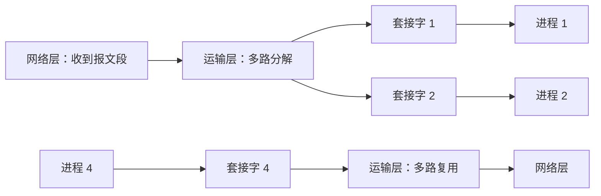

**端口号**：报文段首部含**源端口号**与**目的端口号**字段，各 16 比特，取值 $0\sim65535$。

| 范围          | 名称          | 说明                                                                                            |
| ------------- | ------------- | ----------------------------------------------------------------------------------------------- |
| 0 ~ 1023      | 周知端口      | 保留给 HTTP、FTP 等知名应用                                                                     |
| 1024 ~ 49151  | 注册端口      | 可向 IANA 登记                                                                                  |
| 49152 ~ 65535 | 动态/私有端口 | 客户端临时（短暂）端口通常取自此类；各操作系统默认范围不同（如 Linux 约 32768 ~ 60999，需验证） |

| 应用   | 端口号 |
| ------ | -----: |
| HTTP   |     80 |
| HTTPS  |    443 |
| FTP    |     21 |
| SSH    |     22 |
| Telnet |     23 |
| SMTP   |     25 |
| DNS    |     53 |

### 3.2.1 无连接的多路复用与多路分解：UDP

UDP 套接字由**二元组**标识：

$$
(\text{目的 IP 地址},\ \text{目的端口号})
$$

具有相同目的 IP 与目的端口的 UDP 报文段，即使源 IP 或源端口不同，也交付到同一个套接字。

示例：主机 A 的进程使用端口 19157，主机 B 的进程使用端口 46428。A 生成报文段（源端口 19157，目的端口 46428），B 的运输层按目的端口 46428 交付。**源端口号**充当"返回地址"：B 回发时，目的端口取自 A 报文段中的源端口号。

**图 3-4** UDP 的源/目的端口号

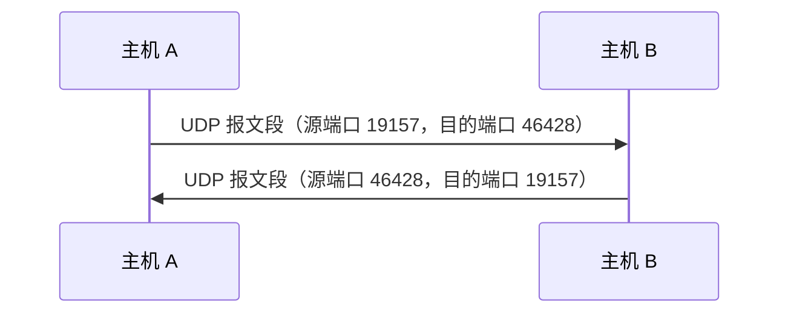

### 3.2.2 面向连接的多路复用与多路分解：TCP

TCP 套接字由**四元组**标识：

$$
(\text{源 IP},\ \text{源端口},\ \text{目的 IP},\ \text{目的端口})
$$

到达的 TCP 报文段用全部 4 个值定向到相应套接字。不同源 IP 或源端口的报文段被定向到不同套接字，除非它携带建立连接的请求。

示例：服务器在端口 12000 的**欢迎套接字**等待连接，客户 `connect()` 后，服务器 `accept()` 创建**连接套接字**，由上述四元组标识。此后来自该客户的报文段都通过四元组交付到该连接套接字。

**图 3-5** 欢迎套接字与连接套接字

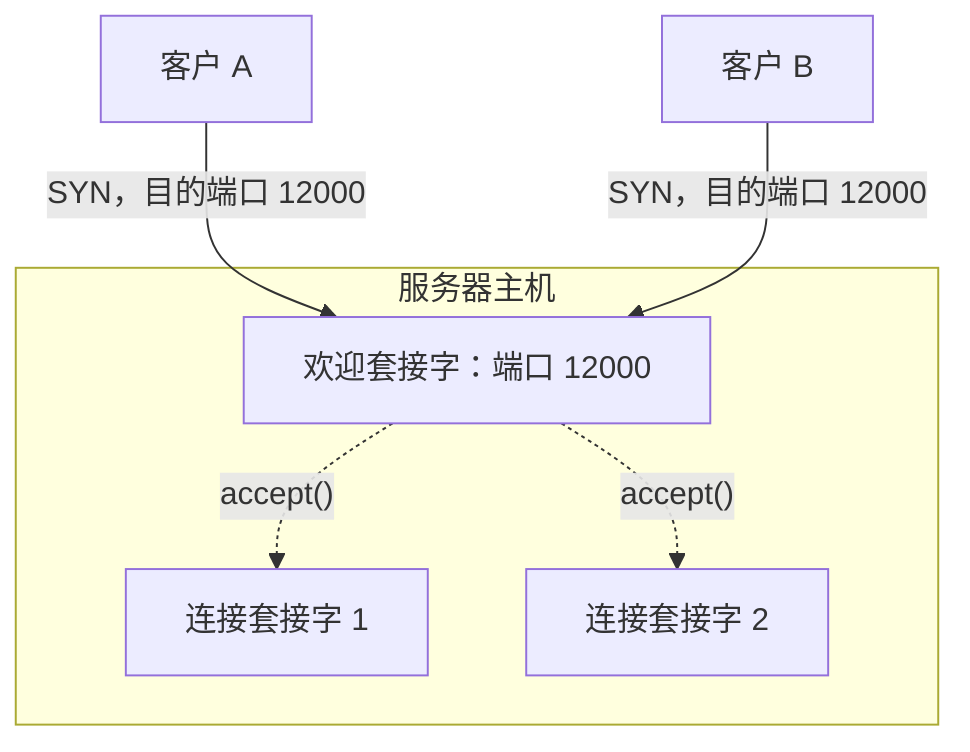

**Web 服务器**：所有客户的报文段目的端口都是 80（HTTPS 为 443），服务器靠源 IP 与源端口区分各连接。

| 报文段 | 源 IP:端口 | 目的端口 | 交付到       |
| ------ | ---------- | -------- | ------------ |
| 1      | A:26145    | 80       | 连接套接字 1 |
| 2      | C:7532     | 80       | 连接套接字 2 |
| 3      | C:26145    | 80       | 连接套接字 3 |

- 非持续 HTTP：每个请求都新建一个连接套接字；持续 HTTP：同一客户的请求复用同一连接套接字
- 繁忙的服务器常为每个连接派生一个进程或线程，各自持有自己的连接套接字

> [!note] 关注安全性：端口扫描
> 服务器进程在开放端口等待连接，攻击者可用**端口扫描**（如 `nmap`）发现目标主机开放了哪些端口，进而寻找可攻击的服务。系统管理员也可用同样工具检查并关闭不必要的服务。TCP 与 UDP 的探测响应见 3.5.6 节"RST"。

## 3.3 无连接运输：UDP

UDP 只做运输协议必须做的最少工作：多路复用/分解和少量差错检测。UDP 从应用进程取得数据后，附加源端口号、目的端口号、长度、检验和四个首部字段，交给网络层。发送前无握手，故称**无连接**。

**图 3-6** UDP 的位置


既然 TCP 服务丰富，为何仍有许多应用选择 UDP？

| 原因             | 说明                                                                                                                                            |
| ---------------- | ----------------------------------------------------------------------------------------------------------------------------------------------- |
| 应用层控制更精细 | 数据一交给 UDP 就立即打包交给网络层，无拥塞控制造成的发送遏制。实时应用要求最小发送速率、不愿过多延迟、能容忍丢失，TCP 的重传与速率波动反而不利 |
| 无须连接建立     | TCP 三次握手引入建连时延。DNS 报文短、一问一答，建立连接得不偿失，故通常运行在 UDP 上（响应较大或使用 DoT/DoH 时可用 TCP）                      |
| 无连接状态       | TCP 须维护接收/发送缓存、拥塞控制参数、序号与确认号等状态；UDP 不维护，同一服务器可支持更多活跃客户                                             |
| 首部开销小       | UDP 首部 8 字节，TCP 通常 20 字节                                                                                                               |

选择 UDP 后，可靠传输、流量控制、拥塞控制等需应用自行处理。

| 应用           | 应用层协议       | 运输协议                                           |
| -------------- | ---------------- | -------------------------------------------------- |
| 电子邮件       | SMTP             | TCP                                                |
| 远程终端       | Telnet、SSH      | TCP                                                |
| Web            | HTTP             | TCP（HTTP/3 为 QUIC over UDP）                     |
| 文件传输       | FTP              | TCP                                                |
| 远程文件服务器 | NFS              | 早期为 UDP，NFSv4 使用 TCP（原书此表较旧，需验证） |
| 流式多媒体     | HTTP/DASH 或专用 | 以 TCP 为主，也可用 UDP（与第 2 章一致）           |
| 因特网电话     | 专用、SIP/RTP    | UDP 或 TCP                                         |
| 网络管理       | SNMP             | 通常为 UDP                                         |
| 名字转换       | DNS              | 通常为 UDP                                         |

### 3.3.1 UDP 报文段结构

首部 4 个字段，各 2 字节，共 8 字节：

| 字段       |   长度 | 作用                          |
| ---------- | -----: | ----------------------------- |
| 源端口号   | 16 bit | 发送方端口                    |
| 目的端口号 | 16 bit | 用于多路分解                  |
| 长度       | 16 bit | 报文段总字节数（首部 + 数据） |
| 检验和     | 16 bit | 差错检测                      |

数据字段承载应用层报文，长度可为零。

### 3.3.2 UDP 检验和

检验和用于判断报文段在传输中是否发生比特改变。

计算方法：

1. 将报文段中所有 16 比特字求和
2. 求和时的溢出**回卷**（把最高位进位加回结果）
3. 对结果取**反码**
4. 填入检验和字段

示例：三个 16 比特字（十六进制 `6660`、`5555`、`8F0C`）。

```text
  0110011001100000
+ 0101010101010101
------------------
  1011101110110101        前两个字之和（BBB5）

  1011101110110101
+ 1000111100001100
------------------
1 0100101011000001        第三个字之和（14AC1），溢出 1 位

  0100101011000001
+                1        回卷
------------------
  0100101011000010        4AC2

检验和 = 取反 = 1011010100111101      B53D
```

接收方将全部 16 比特字（含检验和）相加，无差错时应为全 1：$\text{4AC2}+\text{B53D}=\text{FFFF}$。否则丢弃报文段（有的实现也可交给应用并发出警告）。

> [!note] 补充
> 实际计算还覆盖 IP 伪首部（源/目的 IP、协议、UDP 长度）。IPv4 中检验和可选，IPv6 中必需（需验证）。

**端到端原则**：链路层通常已有差错检测，UDP 仍提供检验和，因为不能保证所有链路都有差错检测，且报文段在路由器内存中处理时也可能出错。**只有端点才能完整保证正确的功能，应在端点实现；下层的实现至多是性能优化。**

## 3.4 可靠数据传输原理

可靠数据传输是网络中最基础的问题之一，不仅出现在运输层，链路层、应用层也会遇到：两个实体如何在可能丢失或损坏数据的媒介上可靠通信？

对上层而言，可靠数据传输协议提供**可靠信道**：数据不损坏、不丢失、按序交付。协议的任务是在不可靠信道之上实现该服务。

**图 3-7** 可靠数据传输的服务模型与服务实现


### 3.4.1 构造可靠数据传输协议

以下状态机的边标签格式为"**事件 / 动作**"。

#### 1. rdt1.0：经完全可靠信道

假设信道完全可靠，接收方能跟上发送速度。发送方与接收方各只有一个状态。

**图 3-8** rdt1.0 发送方与接收方

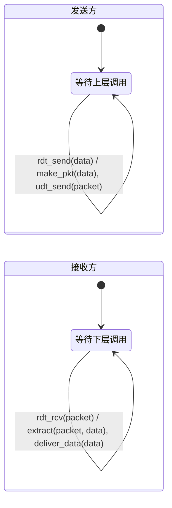

#### 2. rdt2.0：经具有比特差错的信道

信道可能损坏比特。引入 **ARQ**（Automatic Repeat reQuest，自动重传请求）协议，需三种功能：

1. **差错检测**
2. **接收方反馈**：**ACK**（肯定确认）与 **NAK**（否定确认）
3. **重传**：收到 NAK 后重传

发送方处于"等待 ACK 或 NAK"状态时**不接受上层数据**，即一次只处理一个分组，因此是**停等**（stop-and-wait）协议。

**图 3-9** rdt2.0 发送方

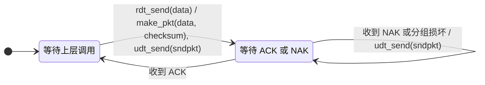

**图 3-10** rdt2.0 接收方

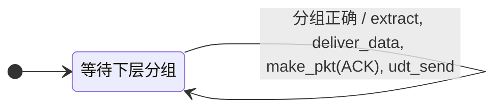

> [!warning] rdt2.0 的缺陷
> 未考虑 ACK/NAK 本身受损。发送方无法判断接收方是否正确收到了数据。
> 若发送方遇到受损的 ACK/NAK 就重发，又会引入**重复分组**，接收方无法区分新分组与重传。
> 解决办法：给数据分组编号。对停等协议，1 比特序号即可。

#### 3. rdt2.1：带序号的 rdt2.0

数据分组带 0/1 序号；**ACK/NAK 不带序号**。发送方遇到受损的 ACK/NAK 时重传。

**图 3-11** rdt2.1 发送方

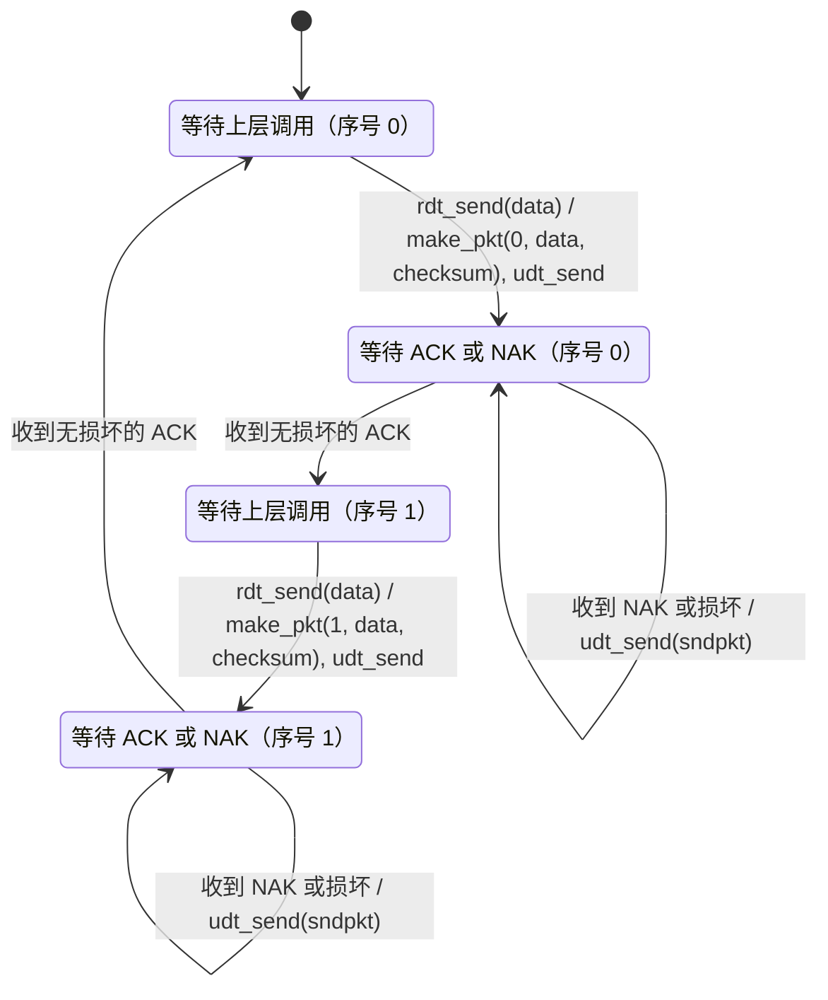

**图 3-12** rdt2.1 接收方

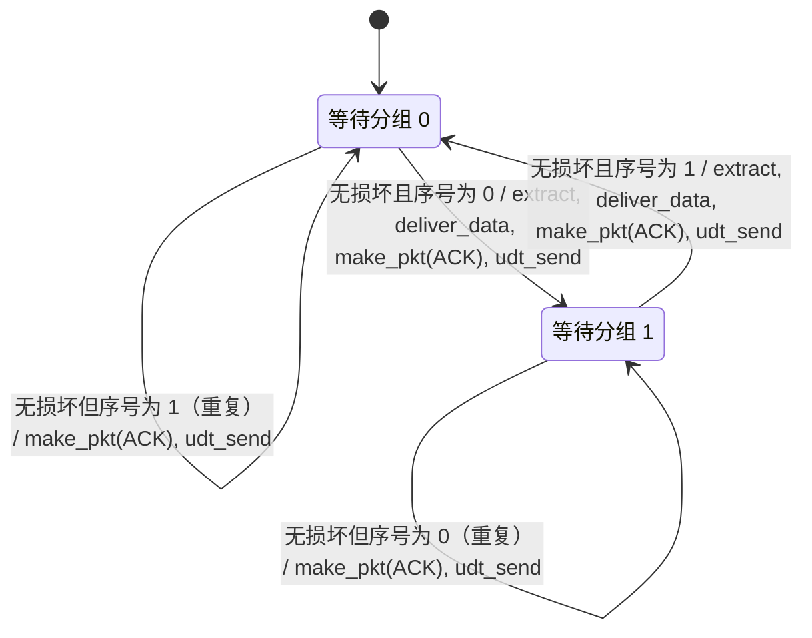

要点：收到**损坏**分组回 **NAK**；收到**重复**分组（序号与期望不符）丢弃，但重发 ACK。

#### 4. rdt2.2：无 NAK

不使用 NAK，改为让 ACK **显式带上被确认分组的序号**：

- 接收方收到损坏或失序分组，就对**最近正确接收**的分组重发 ACK
- 发送方收到对同一分组的**冗余 ACK**，等价于收到 NAK，重传当前分组

#### 5. rdt3.0：经具有比特差错和丢包的信道

信道还可能丢包。新增**定时器**与**超时重传**：发送分组时启动定时器，超时仍无 ACK 就重传。

**图 3-13** rdt3.0 发送方

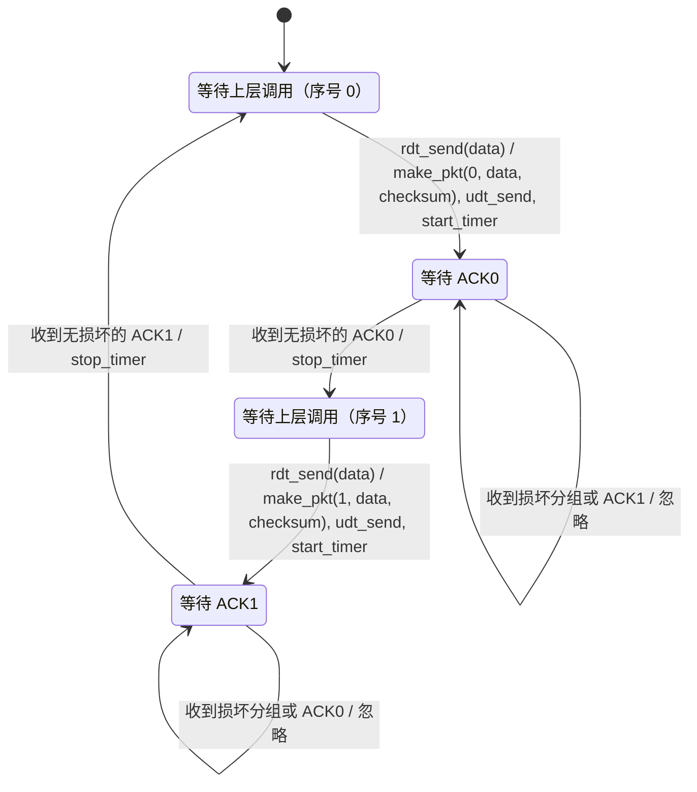

序号在 0、1 之间交替，故 rdt3.0 又称**比特交替协议**（alternating-bit protocol）。接收方同 rdt2.2。

**图 3-14** rdt3.0 的三种典型场景

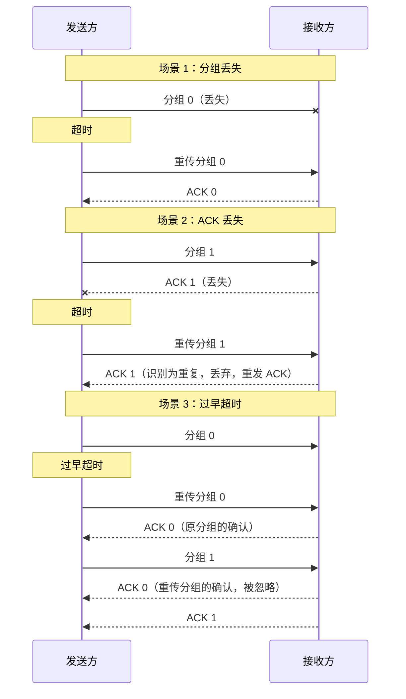

> [!note] 说明
> 场景 3 的前半段：发送方收到第一个 ACK 0 后继续发分组 1，随后到达的第二个 ACK 0 属于序号不符的 ACK，按图 3-13 被忽略，不会触发重传。

#### 6. 可靠数据传输机制与 rdt 演进

| 机制            | 用途                             |
| --------------- | -------------------------------- |
| 检验和          | 检测比特错误                     |
| 定时器          | 超时重传，处理分组或其 ACK 丢失  |
| 序号            | 检测丢失分组与冗余分组           |
| 确认（ACK）     | 接收方告知某分组已正确接收       |
| 否定确认（NAK） | 接收方告知某分组未被正确接收     |
| 窗口、流水线    | 一次发多个未确认分组，提高利用率 |

| 协议     | 信道假设        | 新增机制                      | 遗留缺陷                   |
| -------- | --------------- | ----------------------------- | -------------------------- |
| rdt1.0   | 完全可靠        | 无                            | 无（理想）                 |
| rdt2.0   | 比特差错        | 检验和、ACK/NAK、重传         | ACK/NAK 可能受损；重复分组 |
| rdt2.1   | 同上            | 序号                          | NAK 机制较复杂             |
| rdt2.2   | 同上            | ACK 带序号，冗余 ACK 代替 NAK | 不处理丢包                 |
| rdt3.0   | 比特差错 + 丢包 | 定时器、超时重传              | 停等，利用率低             |
| GBN / SR | 同上            | 窗口、流水线                  | 见 3.4.3、3.4.4            |

### 3.4.2 流水线可靠数据传输协议

rdt3.0 是停等协议，性能很差。设 RTT = 30 ms，$R=1$ Gbps，$L=8000$ bit（1000 字节）：

$$
d_{\text{trans}}=\frac{L}{R}=\frac{8000}{10^9}=8\,\mu\text{s}
$$

$$
U_{\text{sender}}=\frac{L/R}{RTT+L/R}=\frac{0.008}{30.008}\approx0.00027
$$

发送方仅约万分之 2.7 的时间在发送，有效吞吐量约 $8000\text{ bit}/30.008\text{ ms}\approx267$ kbps，而链路容量为 1 Gbps。

**流水线**：允许发送方在等待确认前发送多个分组。若连发 $N$ 个，则

$$
U_{\text{sender}}=\frac{N\cdot L/R}{RTT+L/R}
$$

$N=3$ 时利用率约为停等的 3 倍（约 0.0008）。

流水线的影响：

1. 序号范围必须增大
2. 发送方与接收方可能需要缓存多个分组
3. 分组出错后的恢复方式更复杂：重传出错分组及其后所有分组，还是只重传出错分组？

对应两种基本方法：**回退 N 步**（GBN）与**选择重传**（SR）。

### 3.4.3 回退 N 步（GBN）

发送方可连续发送多个分组，但**未确认分组数不超过窗口长度 $N$**，故 GBN 也称**滑动窗口协议**。

| 序号范围                 | 含义           |
| ------------------------ | -------------- |
| `[0, base-1]`            | 已发送并已确认 |
| `[base, nextseqnum-1]`   | 已发送但未确认 |
| `[nextseqnum, base+N-1]` | 可用，尚未发送 |
| `>= base+N`              | 不可用         |

特点：

- 确认是**累积**的：ACK $n$ 表示序号 $\le n$ 的分组都已正确接收
- 接收方**丢弃所有失序分组**，只维护 `expectedseqnum`
- 发送方只用**一个定时器**，针对最早的未确认分组

| 发送方事件            | 操作                                                         |
| --------------------- | ------------------------------------------------------------ |
| 上层调用 `rdt_send()` | 窗口未满则发送，同时若定时器未运行则启动；窗口满则拒绝或缓存 |
| 收到 ACK $n$          | `base = n+1`；若仍有未确认分组则重启定时器，否则停止         |
| 超时                  | 重传所有已发送但未确认的分组，重启定时器                     |

| 接收方事件         | 操作                               |
| ------------------ | ---------------------------------- |
| 收到按序且正确分组 | 交付上层，发 ACK                   |
| 收到失序或损坏分组 | 丢弃，对最近按序接收的分组重发 ACK |

**序号空间**：设序号用 $k$ 位，空间大小 $M=2^k$。GBN 要求

$$
N\le M-1
$$

若 $N=M$：假设接收方收齐 $M$ 个分组、ACK 全丢，发送方重传的分组 0 与接收方期待的"下一轮新分组 0"序号相同，无法区分。

**图 3-15** GBN 工作过程（$N=4$，分组 2 丢失）

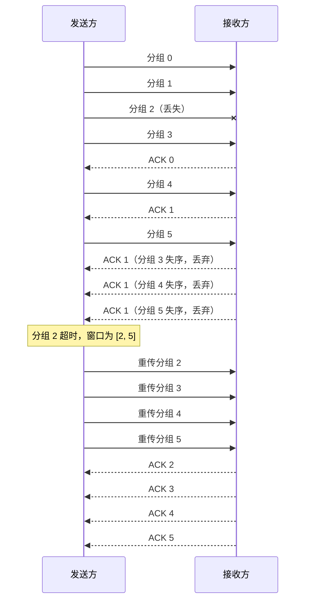

### 3.4.4 选择重传（SR）

GBN 中单个分组差错会引起大量不必要的重传。SR 只重传**怀疑出错**（未被确认）的分组：

- 接收方**逐个确认**正确接收的分组（选择确认）
- 接收方**缓存失序分组**，待缺失分组补齐后按序交付
- 每个未确认分组有**自己的逻辑定时器**
- 发送方与接收方的窗口不必一致

发送方：

| 事件         | 操作                                                               |
| ------------ | ------------------------------------------------------------------ |
| 上层数据     | 序号在发送窗口内则发送并启动该分组的定时器，否则缓存或拒绝         |
| 超时         | 仅重传超时的那个分组，重启其定时器                                 |
| 收到 ACK $n$ | 标记 $n$ 已确认；若 $n$ 为 `send_base`，窗口前移到最小的未确认序号 |

接收方（按序号从小到大的区域）：已交付并确认 → **期待未收到**（`rcv_base`）→ 失序已缓存并确认 → 可接受 → 不可用。

| 到达分组的序号                                        | 操作                                                                |
| ----------------------------------------------------- | ------------------------------------------------------------------- |
| 在 $[\text{rcv\_base},\ \text{rcv\_base}+N-1]$ 且正确 | 缓存并发选择 ACK；若是 `rcv_base`，则交付连续的已缓存分组，窗口前移 |
| 在 $[\text{rcv\_base}-N,\ \text{rcv\_base}-1]$        | 已确认过，重发 ACK                                                  |
| 其他                                                  | 忽略                                                                |

**窗口长度限制**：序号空间大小 $M$ 时必须

$$
N\le\frac{M}{2}
$$

证明：设发送窗口为 $[s,\ s+N-1]$。最坏情况下，接收方已收齐这 $N$ 个分组但所有 ACK 丢失，接收窗口前移到 $[s+N,\ s+2N-1]$。发送方重传的分组序号属于 $[s,\ s+N-1]$，而接收方也可能收到序号属于 $[s+N,\ s+2N-1]$ 的新分组。若这两个区间（模 $M$）重叠，接收方无法区分重传分组与新分组。区间总长度为 $2N$，不重叠当且仅当 $2N\le M$。

> [!note] 说明
> 序号复用还要求网络对分组"最大存活时间"有上限，否则旧分组的迟到副本可能被当作新分组（原书取值需验证）。

**图 3-16** SR 工作过程（$N=4$，分组 2 丢失）

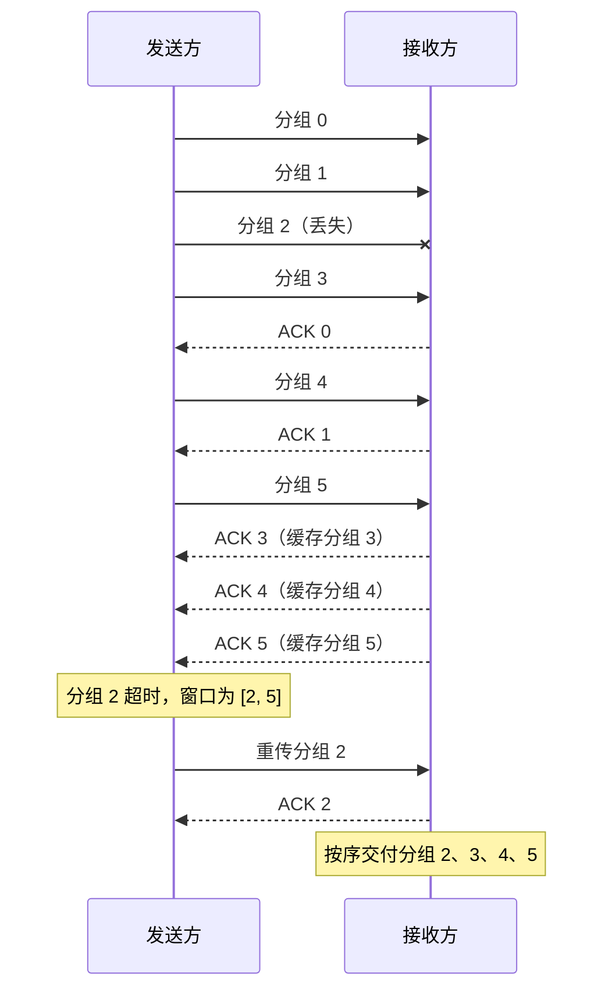

|            | GBN                            | SR                 |
| ---------- | ------------------------------ | ------------------ |
| 确认方式   | 累积                           | 逐个（选择）       |
| 接收方缓存 | 不缓存失序分组                 | 缓存失序分组       |
| 重传范围   | 超时后重传窗口内全部未确认分组 | 只重传超时的分组   |
| 定时器     | 一个                           | 每个未确认分组一个 |
| 窗口上限   | $N\le M-1$                     | $N\le M/2$         |

## 3.5 面向连接的运输：TCP

3.4 节的可靠传输原理几乎全部体现在 TCP 中：差错检测、重传、累积确认、定时器、序号和确认号。

### 3.5.1 TCP 连接

| 特性     | 说明                                                |
| -------- | --------------------------------------------------- |
| 面向连接 | 传输数据前双方先握手建立连接                        |
| 全双工   | 数据可同时双向传输                                  |
| 点对点   | 仅一个发送方和一个接收方                            |
| 逻辑连接 | 连接状态只存在于端系统，路由器不知道 TCP 连接的存在 |

**最大报文段长度**（Maximum Segment Size，MSS）：每个报文段中**应用层数据**的最大长度（不含 TCP 首部），通常按链路 **MTU** 设置。以太网、PPP 的 MTU 通常为 1500 字节，TCP/IP 首部通常 40 字节：

$$
MSS=1500-40=1460\ \text{字节}
$$

### 3.5.2 TCP 报文段结构

| 字段                 |      长度 | 作用                                   |
| -------------------- | --------: | -------------------------------------- |
| 源端口号、目的端口号 | 各 16 bit | 多路复用/分解                          |
| 序号                 |    32 bit | 本报文段第一个数据字节的字节流编号     |
| 确认号               |    32 bit | 期望收到的下一个字节的序号             |
| 首部长度             |     4 bit | 以 32 bit 字为单位                     |
| 保留                 |     4 bit | 保留                                   |
| 标志位               |     8 bit | CWR、ECE、URG、ACK、PSH、RST、SYN、FIN |
| 接收窗口             |    16 bit | 流量控制                               |
| 检验和               |    16 bit | 差错检测                               |
| 紧急数据指针         |    16 bit | 紧急数据偏移                           |
| 选项                 |      可变 | MSS、窗口缩放、时间戳等                |

> [!note] 说明
> 首部布局按 RFC 9293（4 + 4 + 8 = 16 bit），与 3.7.2 节 ECN 用到的 CWR、ECE 一致（需验证）。

| 标志位        | 含义                             |
| ------------- | -------------------------------- |
| CWR、ECE      | ECN 拥塞通告（3.7.2）            |
| URG           | 紧急数据（极少使用）             |
| ACK           | 确认号字段有效                   |
| PSH           | 请接收方尽快交给上层（极少使用） |
| SYN、FIN、RST | 建立、拆除、复位连接             |

#### 1. 序号和确认号

TCP 把数据看成无结构的**字节流**；序号建立在字节流上，不是报文段序列上。

例：文件 500000 字节，MSS = 1000 字节，初始序号为 0，则共 500 个报文段，序号依次为 0、1000、2000……

确认号是期望收到的下一个字节的序号：若 A 已收到 B 的字节 0 ~ 535，则 A 发往 B 的报文段确认号为 536。TCP 只提供**累积确认**，确认到第一个丢失字节为止。

> [!note] 说明
> TCP 规范没有规定接收方如何处理失序报文段，由实现决定；实践中通常缓存失序报文段。

#### 2. Telnet 示例

客户初始序号 42，服务器初始序号 79，用户键入 `C`：

**图 3-17** Telnet 中的序号与确认号

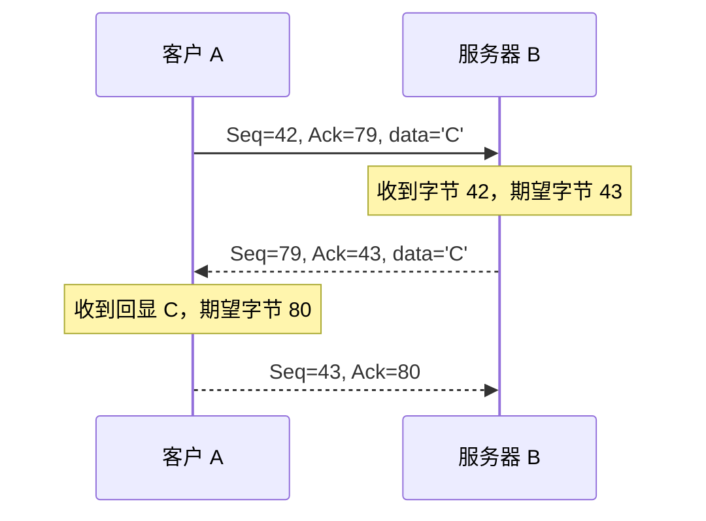

第二个报文段既携带回显数据，又确认了客户的数据，称为**捎带**（piggybacking）。

### 3.5.3 往返时间的估计与超时

超时间隔过短造成不必要的重传，过长则拖慢丢包恢复，因此须据 RTT 动态设置。

**SampleRTT**：从发送报文段到收到其确认的时间。任一时刻只对一个已发送未确认的报文段测量，且**不对重传过的报文段测量**（Karn 算法）。

**EstimatedRTT**：对 SampleRTT 做指数加权移动平均（EWMA），$\alpha=0.125$：

$$
EstimatedRTT=(1-\alpha)\,EstimatedRTT+\alpha\,SampleRTT
$$

**DevRTT**：衡量 SampleRTT 偏离 EstimatedRTT 的程度，$\beta=0.25$：

$$
DevRTT=(1-\beta)\,DevRTT+\beta\,\lvert SampleRTT-EstimatedRTT\rvert
$$

**超时间隔**：

$$
TimeoutInterval=EstimatedRTT+4\cdot DevRTT
$$

初始值推荐 1 秒。发生超时后，间隔**加倍**（指数退避）。例：设当前间隔为 0.75 s，则第 1 次超时后为 1.5 s，第 2 次超时后为 3.0 s。收到新的 ACK 后，间隔重新按上式计算，不再沿用加倍值。指数退避是一种受限的拥塞控制：超时越频繁，发送方越保守。

### 3.5.4 可靠数据传输

TCP 在 IP 的不可靠服务之上提供可靠服务：接收进程读出的数据流无损坏、无间隙、无冗余、按序。

**简化的 TCP 发送方**（忽略流量控制、拥塞控制、快速重传）：

```text
NextSeqNum = SendBase = InitialSeqNumber
loop forever:
  event 应用层交来数据:
    生成序号为 NextSeqNum 的报文段
    若定时器未运行: 启动定时器
    交给 IP; NextSeqNum += length(data)
  event 定时器超时:
    重传序号最小的未确认报文段; 重启定时器
  event 收到确认号为 y 的 ACK:
    若 y > SendBase:            # 累积确认
      SendBase = y
      若仍有未确认报文段: 重启定时器
```

`SendBase` 是最早未确认字节的序号，`NextSeqNum` 是下一个待分配的序号。

典型场景：

| 场景     | 过程                                                                                                                            |
| -------- | ------------------------------------------------------------------------------------------------------------------------------- |
| ACK 丢失 | 超时后重传；接收方识别为重复，丢弃并重发 ACK                                                                                    |
| 过早超时 | A 发出序号 92（8 字节）与 100（20 字节）两个报文段，超时只重传序号最小的未确认报文段 92；ACK 120 在新超时前到达，故不再重传 100 |
| 累积确认 | ACK 100 丢失但 ACK 120 到达，A 知道 119 以前的字节都已收到，无需重传（图 3-18）                                                 |

**图 3-18** 累积确认避免重传

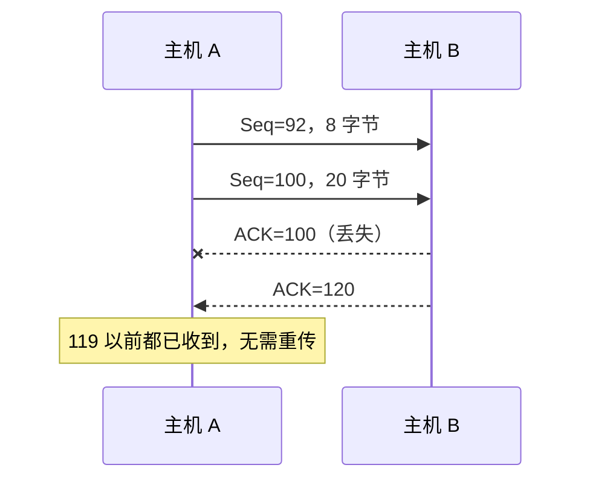

**ACK 生成策略**（RFC 5681）：

| 接收方事件                             | 动作                                                      |
| -------------------------------------- | --------------------------------------------------------- |
| 按序报文段到达，此前数据均已确认       | **延迟 ACK**：最多等 500 ms，若无下一个按序段到达则发 ACK |
| 按序报文段到达，另一个按序段正等待 ACK | 立即发一个累积 ACK，确认两个报文段                        |
| 失序报文段到达（检测到间隔）           | 立即发**冗余 ACK**，指示期望的下一字节序号                |
| 到达的报文段填补了间隔的低端           | 立即发 ACK                                                |

**快速重传**：超时周期可能较长，TCP 用冗余 ACK 更早检测丢包。发送方收到对同一数据的 **3 个冗余 ACK**（即同一 ACK 共 4 个）时，认为该数据之后的报文段已丢失，不等超时立即重传。

**图 3-19** 快速重传（图中确认号以报文段号表示）

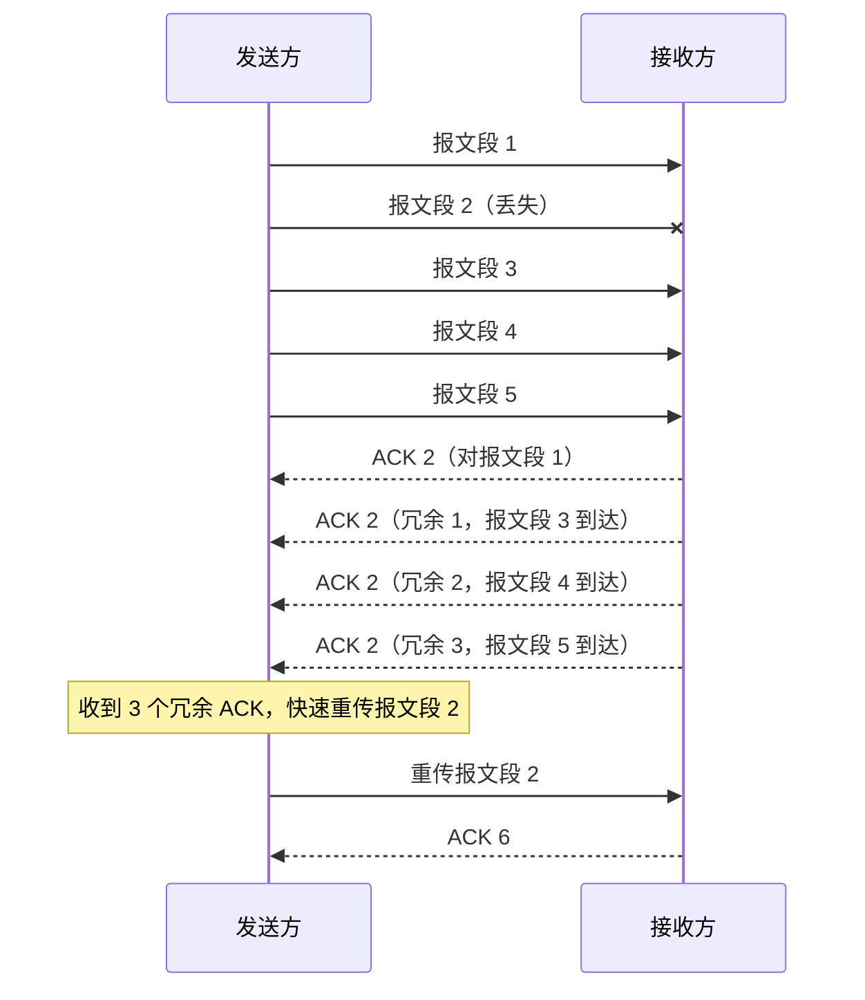

**TCP：GBN 与 SR 的混合体**：确认是累积的（像 GBN），但接收方通常缓存失序报文段，超时后一般只重传最早未确认的报文段，若后续 ACK 先到连这一个也不必重传（像 SR）。选择确认选项（SACK，RFC 2018）使接收方可逐段确认失序数据，更接近 SR。

### 3.5.5 流量控制

**流量控制**防止发送方使接收方缓存溢出，是速度匹配服务。

| 机制     | 目的               |
| -------- | ------------------ |
| 流量控制 | 防止接收方缓存溢出 |
| 拥塞控制 | 防止网络拥塞       |

**接收窗口** rwnd：接收缓存的剩余空间。接收方须保证

$$
LastByteRcvd-LastByteRead\le RcvBuffer
$$

$$
rwnd=RcvBuffer-(LastByteRcvd-LastByteRead)
$$

接收方把 rwnd 放入每个报文段首部；发送方保证

$$
LastByteSent-LastByteAcked\le rwnd
$$

> [!tip] rwnd 为 0 的处理
> 接收缓存满时 rwnd = 0，发送方停止发送；之后接收方若没有数据或确认要发，发送方就永远不知窗口已重新打开。TCP 规定此时发送方继续发送**只含 1 字节数据**的报文段，其确认携带最新的 rwnd。

> [!note] 补充：窗口缩放
> rwnd 仅 16 bit，上限 65535 字节，不足以充满高速、长时延链路。窗口缩放选项（RFC 7323，需验证）可扩大有效窗口。

### 3.5.6 TCP 连接管理

#### 1. 三次握手

1. 客户发送 **SYN** 报文段：SYN = 1，序号为随机选取的 `client_isn`，无应用数据
2. 服务器为该连接分配缓存和变量，回送 **SYNACK**：SYN = 1，ACK = 1，`ack = client_isn + 1`，`seq = server_isn`
3. 客户收到后也分配缓存和变量，发送 ACK：SYN = 0，`ack = server_isn + 1`，可携带数据

> [!note] 说明
> SYN 与 FIN 报文段各**占用 1 个序号**，所以确认号为 isn + 1。

**图 3-20** 三次握手

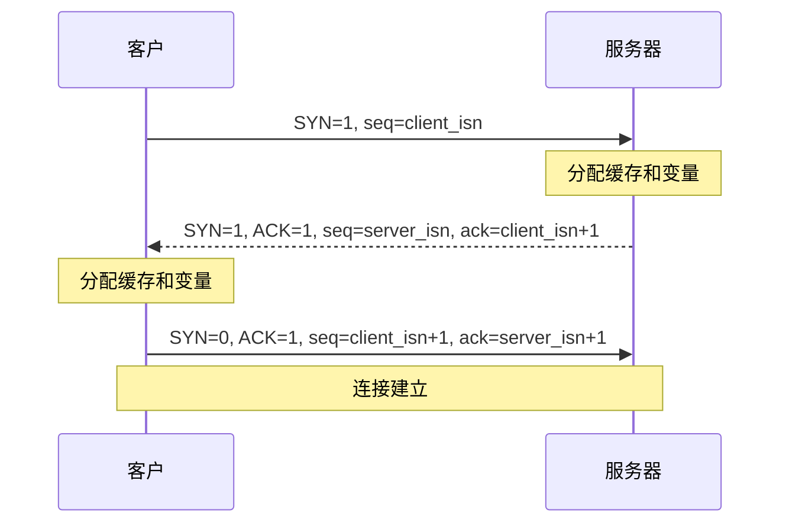

#### 2. 连接关闭

任一方都可发起。客户发 FIN，服务器确认，服务器再发 FIN，客户确认：共四次交互。

**图 3-21** 连接关闭

```mermaid
sequenceDiagram
    participant C as 客户
    participant S as 服务器
    C->>S: FIN
    S-->>C: ACK
    S->>C: FIN
    C-->>S: ACK
    Note over C: TIME_WAIT 后关闭
```

客户在 **TIME_WAIT** 状态停留一段时间（约为 2 倍最大报文段寿命，实现常取 30 秒到 2 分钟，需验证），以便重发丢失的最后一个 ACK，并让旧连接的迟到分组消失。

**图 3-22** TCP 客户状态

```mermaid
stateDiagram-v2
    [*] --> CLOSED
    CLOSED --> SYN_SENT: 发送 SYN
    SYN_SENT --> ESTABLISHED: 收到 SYNACK / 发送 ACK
    ESTABLISHED --> FIN_WAIT_1: 发送 FIN
    FIN_WAIT_1 --> FIN_WAIT_2: 收到 ACK
    FIN_WAIT_2 --> TIME_WAIT: 收到 FIN / 发送 ACK
    TIME_WAIT --> CLOSED: 等待超时
```

**图 3-23** TCP 服务器状态

```mermaid
stateDiagram-v2
    [*] --> CLOSED
    CLOSED --> LISTEN: 创建监听套接字
    LISTEN --> SYN_RCVD: 收到 SYN / 发送 SYNACK
    SYN_RCVD --> ESTABLISHED: 收到 ACK
    ESTABLISHED --> CLOSE_WAIT: 收到 FIN / 发送 ACK
    CLOSE_WAIT --> LAST_ACK: 发送 FIN
    LAST_ACK --> CLOSED: 收到 ACK
```

#### 3. RST 与端口扫描

主机收到的 TCP SYN 所指目的端口没有进程监听时，回送 **RST** 报文段，告知发送方"不要重发"。

| 探测    | 端口开放               | 端口关闭           | 被防火墙过滤 |
| ------- | ---------------------- | ------------------ | ------------ |
| TCP SYN | 回 SYNACK              | 回 RST             | 无响应       |
| UDP     | 可能无响应或应用层响应 | 回 ICMP 端口不可达 | 无响应       |

`nmap` 即利用上述响应差异判断端口状态（需验证细节）。

> [!note] 关注安全性：SYN 洪泛攻击
> 攻击者大量发送 SYN 而不完成第三次握手，服务器为每个 SYN 分配资源并建立**半开连接**，资源耗尽后拒绝合法连接。
> 防御：**SYN Cookie**。服务器收到 SYN 时不分配资源，而用源/目的 IP、端口及一个秘密数计算初始序号（cookie）放入 SYNACK；仅当客户返回的 ACK 的确认号为 cookie + 1 时，才验证并创建连接。攻击者的 SYN 因此不在服务器上留下状态。

## 3.6 拥塞控制原理

流量控制匹配发送方与接收方，而**拥塞**是网络的全局问题，通常由太多源以过高速率发送数据引起。重传能恢复丢失的数据，却不能消除拥塞的原因，反而增加负载。因此需要额外机制在拥塞时遏制发送方。

### 3.6.1 拥塞原因与代价

#### 1. 两个发送方与一台具有无穷大缓存的路由器

两条连接共享容量为 $R$ 的输出链路。每条连接的吞吐量上限为 $R/2$；发送速率接近 $R/2$ 时，路由器队列增长，排队时延趋于无穷。

代价：到达速率接近链路容量时，分组经历巨大的排队时延。

#### 2. 两个发送方与一台具有有限缓存的路由器

缓存有限时，缓存满则丢弃到达分组，发送方须重传。设原始数据速率为 $\lambda_{in}$，含重传的提供载荷为 $\lambda'_{in}$。

| 情形                           | 结果（数值取自原书，需验证）                                        |
| ------------------------------ | ------------------------------------------------------------------- |
| 理想：仅在缓存有空间时发送     | $\lambda'_{in}=\lambda_{in}$，吞吐量上限 $R/2$                      |
| 发送方只在确知丢失时重传       | $\lambda'_{in}=R/2$ 时，有效吞吐量约 $R/3$（其中 $R/6$ 是重传）     |
| 过早超时：重传了仍在排队的分组 | 每个分组平均被转发两次，$\lambda'_{in}\to R/2$ 时有效吞吐量约 $R/4$ |

代价：

1. 发送方须重传以补偿因缓存溢出而丢失的分组
2. 发送方因**过早超时**重传，路由器转发了同一分组的多个副本，浪费链路带宽
3. 上述原因使有效吞吐量下降

#### 3. 多发送方、多路由器、多跳路径

设 A→C 经过 R1、R2，B→D 只经 R2。入流量增大时，R2 处 B→D 的分组占满缓存，A→C 的分组在 R2 被丢弃，R1 为转发它们付出的容量全部浪费。极限情况下 A→C 的端到端吞吐量趋于 0。

**图 3-24** 多跳路径上的拥塞

```mermaid
flowchart LR
    A["主机 A"] --> R1["路由器 R1"] --> R2["路由器 R2"] --> C["主机 C"]
    B["主机 B"] --> R2
    R2 --> D["主机 D"]
```

> [!important] 拥塞崩溃
> 当一个分组沿路径被丢弃时，上游各路由器为转发它所用的传输容量被浪费。重传使情况更糟，最终可能出现**拥塞崩溃**（congestion collapse）：提供载荷很高，而有效吞吐量趋于 0。

### 3.6.2 拥塞控制方法

| 方法             | 说明                                                               |
| ---------------- | ------------------------------------------------------------------ |
| 端到端拥塞控制   | 网络层不提供显式反馈，端系统通过丢包、时延推断拥塞（TCP 默认方式） |
| 网络辅助拥塞控制 | 路由器向端系统提供显式拥塞反馈                                     |

网络辅助反馈有两种实现：路由器直接向发送方发送拥塞指示分组；或路由器标记从发送方到接收方的分组，接收方在返回的确认中通知发送方。后一种方式就是 3.7.2 节的 ECN。

## 3.7 TCP 拥塞控制

TCP 发送方根据感知到的拥塞程度限制发送速率，为每条连接维护**拥塞窗口** `cwnd` 与**慢启动阈值** `ssthresh`。未确认数据量满足

$$
LastByteSent-LastByteAcked\le\min\{cwnd,\ rwnd\}
$$

假设 rwnd 不构成约束，则

$$
LastByteSent-LastByteAcked\le cwnd,\qquad \text{发送速率}\approx\frac{cwnd}{RTT}
$$

**丢包事件**：报文段超时，或收到 3 个冗余 ACK。

指导原则：

1. 丢失的报文段意味着拥塞，应降低发送速率
2. 确认报文段表明网络在交付报文段，可增加发送速率
3. **带宽探测**：不断增加速率，丢包后后退，再继续试探

### 3.7.1 经典 TCP 拥塞控制

#### 1. 慢启动

连接开始时 $cwnd=1\ \text{MSS}$。每收到一个对新数据的 ACK，cwnd 增加 1 MSS，每个 RTT 窗口翻倍，**指数增长**。

> [!note] 说明
> 现代实现的初始窗口常为 10 MSS（RFC 6928，需验证）；此处按教材取 1 MSS。

结束情形：

1. 超时：`ssthresh = cwnd/2`，`cwnd = 1 MSS`，重新慢启动
2. `cwnd >= ssthresh`：进入拥塞避免
3. 3 个冗余 ACK：`ssthresh = cwnd/2`，`cwnd = ssthresh + 3 MSS`，快速重传，进入快速恢复

#### 2. 拥塞避免

每个 RTT 只增加 1 MSS（**线性增长**），实现为每收到一个新 ACK：

$$
cwnd\leftarrow cwnd+MSS\times\frac{MSS}{cwnd}
$$

例：MSS = 1460 B，cwnd = 14600 B，则一个 RTT 内发 10 个报文段，每个 ACK 增加 0.1 MSS，累计 1 MSS。

#### 3. 快速恢复

每收到一个冗余 ACK，cwnd 增加 1 MSS；丢失报文段的新 ACK 到达后，`cwnd = ssthresh`，进入拥塞避免；若超时，`ssthresh = cwnd/2`，`cwnd = 1 MSS`，回到慢启动。

**图 3-25** TCP 拥塞控制状态机

```mermaid
flowchart TB
    Init["连接开始：cwnd = 1 MSS，ssthresh 初始较大"] --> SS["慢启动"]
    SS -->|"新 ACK：cwnd += MSS"| SS
    SS -->|"cwnd >= ssthresh"| CA["拥塞避免"]
    SS -->|"超时：ssthresh = cwnd/2，cwnd = 1 MSS，重传"| SS
    SS -->|"3 个冗余 ACK：ssthresh = cwnd/2，cwnd = ssthresh + 3 MSS，快速重传"| FR["快速恢复"]
    CA -->|"新 ACK：cwnd += MSS*MSS/cwnd"| CA
    CA -->|"超时：ssthresh = cwnd/2，cwnd = 1 MSS，重传"| SS
    CA -->|"3 个冗余 ACK：ssthresh = cwnd/2，cwnd = ssthresh + 3 MSS，快速重传"| FR
    FR -->|"冗余 ACK：cwnd += MSS"| FR
    FR -->|"新 ACK：cwnd = ssthresh"| CA
    FR -->|"超时：ssthresh = cwnd/2，cwnd = 1 MSS，重传"| SS
```

| 事件                   | 慢启动                                          | 拥塞避免               | 快速恢复                      |
| ---------------------- | ----------------------------------------------- | ---------------------- | ----------------------------- |
| 新 ACK                 | `cwnd += MSS`；若 `cwnd >= ssthresh` 转拥塞避免 | `cwnd += MSS·MSS/cwnd` | `cwnd = ssthresh`，转拥塞避免 |
| 冗余 ACK（第 1、2 个） | 计数                                            | 计数                   | `cwnd += MSS`                 |
| 3 个冗余 ACK           | 转快速恢复                                      | 转快速恢复             | —                             |
| 超时                   | 转慢启动                                        | 转慢启动               | 转慢启动                      |

**Tahoe 与 Reno**：

| 版本      | 对 3 个冗余 ACK 的处理                                   |
| --------- | -------------------------------------------------------- |
| TCP Tahoe | `cwnd = 1 MSS`，进入慢启动（超时同）                     |
| TCP Reno  | `ssthresh` 减半，`cwnd = ssthresh + 3 MSS`，进入快速恢复 |

快速恢复在原书中是"推荐而非必需"。例：cwnd = 12 MSS 时 3 个冗余 ACK，Tahoe 得 `ssthresh = 6`，`cwnd = 1`；Reno 得 `ssthresh = 6`，`cwnd = 9`。

**AIMD**（加性增、乘性减）：无丢包时每 RTT 增加 1 MSS，丢包事件时窗口减半，呈锯齿状。

#### 4. 平均吞吐量

设丢包时窗口为 $W$，忽略慢启动，则速率在 $W/(2RTT)$ 与 $W/RTT$ 之间锯齿变化，平均约为

$$
\frac{0.75\,W}{RTT}
$$

窗口从 $W/2$ 每 RTT 增加 1 MSS 至 $W$，一个周期共 $W/2$ 个 RTT，发送报文段数为

$$
\sum_{i=0}^{W/2}\left(\frac{W}{2}+i\right)\approx\frac{W}{2}\cdot\frac{3W}{4}=\frac{3W^2}{8}
$$

每周期丢 1 个，丢包率 $L=\dfrac{8}{3W^2}$，即 $W=\sqrt{\dfrac{8}{3L}}$，于是

$$
\text{平均吞吐量}\approx\frac{0.75\,W\cdot MSS}{RTT}=\frac{1.22\cdot MSS}{RTT\sqrt{L}}
$$

例：MSS = 1500 B，RTT = 100 ms，要达到 10 Gbps，平均窗口需约 83333 个报文段，对应 $L\approx2\times10^{-10}$。可见高速长时延链路对丢包率要求极苛刻，这促成了 CUBIC 等新算法（数值需对照原书验证）。

#### 5. TCP CUBIC

CUBIC 改进拥塞避免阶段，是 Linux 等系统的常见默认算法（RFC 9438，需验证）。记上次丢包时窗口为 $W_{\max}$，丢包后窗口按

$$
W(t)=C\,(t-K)^3+W_{\max}
$$

增长，$t$ 为距丢包的时间，$K$ 是窗口恢复到 $W_{\max}$ 的时刻（$W(K)=W_{\max}$）。窗口先快速接近 $W_{\max}$，靠近时变缓以谨慎探测，越过 $W_{\max}$ 后再加速探测新的操作点。

### 3.7.2 网络辅助明确拥塞通告和基于时延的拥塞控制

经典 TCP 靠丢包感知拥塞，但丢包往往意味着拥塞已较严重。

#### 1. 明确拥塞通告（ECN）

**ECN** 使网络在丢包前就向端点发出拥塞信号。IP 首部用 2 个比特表示端点是否支持 ECN 及分组是否被标记。

1. 路由器即将拥塞（如缓存将满）时，对经过的数据报标记，而不是丢弃
2. 接收方在返回的 TCP ACK 中置 **ECE** 位
3. 发送方收到 ECE，将窗口减半，并在后续报文段中置 **CWR** 位

**图 3-26** ECN

```mermaid
sequenceDiagram
    participant A as 发送方
    participant R as 拥塞路由器
    participant B as 接收方
    A->>R: IP 数据报（支持 ECN）
    R->>B: IP 数据报（标记拥塞）
    B-->>A: TCP ACK，ECE=1
    Note over A: cwnd 减半
    A->>B: TCP 报文段，CWR=1
```

#### 2. 基于时延的拥塞控制

排队开始后 RTT 会先于丢包增大。

**TCP Vegas**：测量最小 RTT，估计未拥塞时的吞吐率 $cwnd/RTT_{\min}$。实际吞吐率接近该值则增大窗口；明显低于该值，说明有分组在排队，则减小窗口。目标是使管道刚好充满，而不过满。

**BBR** 是基于模型的算法：估计瓶颈带宽与最小 RTT，据此控制发送速率。Google 在其 B4 网络及部分公网服务器上部署（部署情况与评价随版本和年份变化，需验证）。BBR 与丢包驱动算法（如 CUBIC）共存时的公平性存在争议。

### 3.7.3 公平性

$K$ 条 TCP 连接共享容量为 $R$ 的瓶颈链路，若每条连接平均速率接近 $R/K$，则称拥塞控制机制是**公平**的。

**AIMD 的收敛**。假设：两条连接 RTT 相同、MSS 相同、都处于拥塞避免、丢包同步发生。设窗口为 $x_1,x_2$，$d=x_1-x_2$。

- 加性增：两者各增 1，$d$ 不变
- 乘性减：$x_i\to x_i/2$，$d\to d/2$

第 $k$ 次丢包后 $\lvert d_k\rvert=\lvert d_0\rvert/2^k\to0$；同时总速率在 $R/2$ 与 $R$ 之间振荡，所以收敛到 $x_1=x_2\approx$ 平分瓶颈带宽。

实际网络中的偏差：

| 因素          | 影响                                                                                                |
| ------------- | --------------------------------------------------------------------------------------------------- |
| 不同 RTT      | RTT 小的连接窗口增长更快，吞吐量更高                                                                |
| UDP 流量      | 无拥塞控制，可能压制 TCP                                                                            |
| 并行 TCP 连接 | 应用开多条连接可获得近似与连接数成比例的份额（例：已有 9 条连接，新应用开 11 条，可得超过一半带宽） |

## 3.8 运输层功能的演化

UDP 与 TCP 都不完美。TCP 一直在演化：CUBIC、DCTCP（数据中心）、Westwood（无线）、BBR 等分别针对不同场景。另一方面，应用也绕开内核 TCP，直接在 UDP 上构建新运输服务，最具代表性的是 **QUIC**（Quick UDP Internet Connections）。

QUIC 是运行在 UDP 之上的应用层协议，目标是提高安全 HTTP 的性能（QUIC 为 RFC 9000，HTTP/3 为 RFC 9114，与第 2 章一致）。传统栈为 HTTP/2 → TLS → TCP → IP；HTTP/3 → QUIC → UDP → IP 则把可靠传输、加密和多路复用纳入 QUIC，取代了 HTTP/2 下面的 TLS + TCP。

**图 3-27** 传统安全 HTTP 与 HTTP/3 的协议栈

```mermaid
flowchart TB
    subgraph Traditional["传统安全 HTTP"]
        H2a["HTTP/2"] --> TLSa["TLS"] --> TCPa["TCP"] --> IPa["IP"]
    end
    subgraph QUICStack["HTTP/3"]
        H3["HTTP/3"] --> Q["QUIC"] --> UDP["UDP"] --> IPb["IP"]
    end
```

#### 1. 面向连接和安全

QUIC 是端点间面向连接的协议，握手交换连接 ID 等状态，并**与 TLS 密钥协商合并**。QUIC 分组的载荷及大部分首部加密（少数字段如连接 ID 明文，需验证）。

建立安全连接所需往返次数：TCP + TLS 1.3 约 2 RTT，TLS 1.2 约 3 RTT；QUIC 首次约 1 RTT，会话恢复可达 0-RTT（需验证）。

#### 2. 数据流

TCP 把连接视为单一字节流。QUIC 的一条连接可承载多条应用级**数据流**，每条流有自己的流 ID，提供可靠、按序的数据交付。HTTP/3 中不同对象可使用不同的流，独立建立、结束和交付。

**图 3-28** QUIC 的多数据流

```mermaid
flowchart LR
    A1["应用数据流 1"] --> Q1["QUIC 流 1"]
    A2["应用数据流 2"] --> Q2["QUIC 流 2"]
    A3["应用数据流 3"] --> Q3["QUIC 流 3"]
    Q1 --> QC["QUIC 连接"]
    Q2 --> QC
    Q3 --> QC
    QC --> UDP["UDP"]
```

#### 3. 避免队头阻塞

TCP 提供可靠按序字节流，某个字节丢失后，其后已到达的数据也必须等待重传完成才能交付。若 HTTP/2 的多个对象复用同一条 TCP 连接，一个对象的丢包会阻塞其他对象，这是**运输层队头阻塞**（与第 2 章中 HTTP/1.1 的应用层队头阻塞不同）。QUIC 对每条流分别保证可靠按序，一条流的丢包只影响该流。

#### 4. 可靠传输与拥塞控制

QUIC 提供类似 TCP 的确认机制，标准文本（RFC 9002）的参考拥塞控制基于 TCP NewReno（与 Reno 差别较小），同样有慢启动、拥塞避免、快速恢复；实际部署也可替换为 CUBIC、BBR。实现位置由内核移到用户空间。

#### 5. 应用层演化优势

QUIC 是应用层协议，升级只需更新浏览器和服务器，不必修改操作系统内核中的 TCP；而 TCP 新变种的普及涉及内核与中间设备，周期往往很长（"十年以上"一说缺乏出处，需验证）。选择 UDP 是因为它几乎不增加约束；部分防火墙会阻挡 UDP，故实践中需保留回退到 TCP 的路径。

|          | TCP + TLS       | QUIC                   |
| -------- | --------------- | ---------------------- |
| 握手往返 | 约 2~3 RTT      | 约 1 RTT，恢复时 0-RTT |
| 加密     | TLS 在 TCP 之上 | 内置                   |
| 队头阻塞 | 整条连接        | 仅单条流               |
| 实现位置 | 操作系统内核    | 用户空间               |
| 升级难度 | 高              | 较低                   |

## 3.9 小结

本章研究了运输层的原理与实现。运输层位于应用层和网络层之间，提供进程到进程的逻辑通信；因特网提供 UDP 与 TCP，二者在可靠性、连接管理和拥塞控制上各有取舍。贯穿本章的主线是：如何在仅提供尽力而为交付的 IP 之上，构建满足应用要求的运输服务。

- **多路复用与多路分解**：用端口号把主机间交付扩展为进程间交付；UDP 套接字由二元组标识，TCP 套接字由四元组标识
- **UDP**：只在 IP 之上增加复用/分解和差错检查，首部 8 字节；端到端检验和体现端到端原则
- **可靠数据传输原理**：从 rdt1.0 出发，逐步引入检验和、确认、序号、定时器，得到 rdt3.0；流水线催生 GBN 与 SR（窗口上限分别为 $M-1$ 与 $M/2$）
- **TCP**：序号、确认号、超时重传、快速重传提供可靠字节流；rwnd 实现流量控制；三次握手与四次交互管理连接
- **拥塞控制**：cwnd 限制发送速率，丢包事件为拥塞信号；经典算法由慢启动、拥塞避免、快速恢复组成，具有 AIMD 特性并趋向公平；ECN、Vegas、BBR 尝试在丢包前感知拥塞
- **演化**：QUIC 在 UDP 上实现可靠、加密、多流的运输服务，消除运输层队头阻塞，并使运输层功能的迭代不再受制于内核

|                    | UDP                            | TCP                          |
| ------------------ | ------------------------------ | ---------------------------- |
| 连接               | 无连接                         | 面向连接                     |
| 可靠性、顺序       | 不保证                         | 可靠、按序                   |
| 流量控制、拥塞控制 | 无                             | 有                           |
| 连接状态           | 无                             | 有（缓存、序号、拥塞参数等） |
| 套接字标识         | 二元组                         | 四元组                       |
| 首部               | 8 字节                         | 通常 20 字节                 |
| 传输单位           | 报文段（数据报语义，无字节流） | 报文段（字节流）             |
| 典型应用           | DNS、SNMP、实时音视频          | Web、邮件、文件传输          |

UDP 与 TCP 远非运输层的全部。可靠传输、流量控制与拥塞控制之间的权衡会随新应用场景（无线链路、数据中心、实时音视频）不断改变，但端到端可靠传输、基于窗口的流量与拥塞控制，始终是理解新协议的基础。

下一章讨论**网络层**：它如何在主机之间转发分组，并确定分组的路径。
