在第四章和第五章中，我们打开了网络层这个"黑盒子"：数据平面决定每台路由器怎样在本地把分组从输入链路转发到输出链路，控制平面决定端到端路径并据此计算转发表。两者合起来，为运输层提供了主机到主机的逻辑通信服务。

但数据报并不会凭空跨越链路。它要从一块网卡出发，经过双绞线、光纤或无线电波到达下一台设备，再交给网络层；若还要继续转发，就换一条链路重新出发。把数据报从一个节点送到**相邻**节点的，正是本章的主角——**链路层**（link layer）。

| 层次   | 传输单位 | 作用范围               | 典型协议              |
| ------ | -------- | ---------------------- | --------------------- |
| 应用层 | 报文     | 进程到进程             | HTTP、DNS             |
| 运输层 | 报文段   | 进程到进程（端到端）   | TCP、UDP              |
| 网络层 | 数据报   | 主机到主机（跨网络）   | IP                    |
| 链路层 | 帧       | 节点到相邻节点（一跳） | 以太网、PPP、802.11   |
| 物理层 | 比特     | 介质上的信号           | 10BASE-T、1000BASE-LX |

链路层处理的信道有两类，它们面对的问题截然不同：

| 信道类型       | 典型场景                                       | 核心问题                   | 代表协议       |
| -------------- | ---------------------------------------------- | -------------------------- | -------------- |
| **广播信道**   | 无线局域网、卫星网、HFC 电缆接入网、早期以太网 | 多节点共享介质，须协调发送 | 802.11、DOCSIS |
| **点对点链路** | 长距离路由器互联、主机连接交换机               | 只有两端，访问控制简单     | PPP、HDLC      |

数据报在端到端路径上逐跳更换链路层协议，每一跳的帧只在这一跳内有效：


由于每条链路可能由不同组织建设、使用不同介质与技术，链路层协议是**本地**的：端到端路径上每一跳都可以换用另一种链路层协议。链路层因此不存在单一的"Internet 级"协议，跨网络的一致性由网络层的 IP 提供。

WiFi 与无线局域网同样属于链路层，但涉及无线介质特有的问题，留待后续章节讨论。

> [!important] 本章目标
> 理解链路层的原理与实现：
>
> 1. 链路层概述：节点、链路与帧；成帧、链路接入、可靠交付、差错检测四项服务；适配器中的软硬件分工
> 2. 差错检测与纠正：奇偶校验、检验和与 CRC，以及各自的检测能力与开销
> 3. 多路访问协议：信道划分、随机接入（ALOHA、CSMA、CSMA/CD）与轮流协议，DOCSIS 的综合运用
> 4. 链路层寻址：MAC 地址、ARP，以及链路层地址与网络层地址如何协同
> 5. 以太网：帧格式、技术演进与交换式以太网
> 6. 链路层交换机：转发、过滤、自学习、STP，以及与路由器的比较
> 7. VLAN、MPLS 与数据中心网络，并以一次 Web 页面请求串起整个协议栈

# 第一部分 链路层基础与差错检测

## 6.1 链路层概述

### 6.1.1 基本术语

| 术语                  | 含义                                      | 举例                              |
| --------------------- | ----------------------------------------- | --------------------------------- |
| **节点**（node）      | 运行链路层协议的设备                      | 主机、路由器、交换机、WiFi 接入点 |
| **链路**（link）      | 连接相邻节点的通信信道                    | 双绞线、光纤、无线信道            |
| **帧**（frame）       | 链路层的传输单位，封装网络层数据报        | 以太网帧、PPP 帧、802.11 帧       |
| **适配器**（adapter） | 实现链路层与物理层的硬件，又称网卡（NIC） | 以太网卡、WiFi 网卡               |

一条链路上通常连接着多个节点，而一个节点可能挂着多条链路。数据报沿路径前进时，在每一跳被"拆封—转发—再封装"：


> [!note] 术语
> 本章的"链路"指两个相邻节点之间的**单段**通信信道，与日常所说的"网络链路""宽带链路"不同。后者往往指一条端到端连接，跨越多个节点和多段链路。
>
> 本章的"链路层交换机"是第四章"分组交换机"的一种：按链路层帧首部转发，而路由器按网络层数据报首部转发。

> [!example] 类比：把数据报当作旅客
> 旅行社为旅客规划从普林斯顿到洛桑的行程：先乘大轿车到 JFK，再飞往日内瓦，最后换火车到洛桑。每一段由不同公司用不同交通工具完成，但都只负责"把旅客送到下一个换乘点"。
>
> | 交通               | 网络                   |
> | ------------------ | ---------------------- |
> | 旅客               | 数据报                 |
> | 行程区段           | 链路                   |
> | 交通工具与运营公司 | 链路层协议             |
> | 换乘点             | 节点（路由器、交换机） |
> | 旅行社规划路线     | 路由选择               |
>
> 链路层协议就像某一段行程的交通工具：它只管这一跳，不负责全程；全程路线则由网络层（第五章的路由选择）决定。

### 6.1.2 链路层提供的服务

链路层的基本任务，是把网络层数据报从一个节点移动到相邻节点。不同协议的实现细节各异，但可能提供的服务可归为四类：

| 服务               | 作用                                 | 是否普遍提供       | 说明                   |
| ------------------ | ------------------------------------ | ------------------ | ---------------------- |
| **成帧**           | 把数据报封装为帧，并加上首部与尾部   | 是                 | 帧格式因协议而异       |
| **链路接入**       | 协调多个节点对共享介质的使用         | 广播链路必需       | 即 MAC 协议，见 6.3    |
| **可靠交付**       | 通过确认与重传保证帧无差错到达       | 否                 | 高误码链路（无线）常用 |
| **差错检测与纠正** | 检测（并在可能时纠正）帧中的比特差错 | 检测普遍，纠正较少 | 见 6.2                 |

#### 1. 成帧

几乎所有链路层协议都要成帧。帧由数据字段、首部字段与尾部字段组成：数据字段承载网络层数据报，首部携带源/目的地址、类型与控制信息，尾部放置 CRC 等差错检测字段。

帧长有上限，以太网的数据字段最多 1500 字节（6.4.2 节），因此大数据报须由网络层分片。

#### 2. 链路接入

**介质访问控制**（Medium Access Control，MAC）协议规定节点何时可以把帧送上链路。点对点链路只有两端，链路空闲即可发送；广播链路则须协调多个节点——碰撞会使涉及的帧全部损坏、带宽被白白浪费，因此需要专门的多路访问协议（6.3 节）。

#### 3. 可靠交付

链路层可靠交付的做法与运输层类似：确认、重传、序号。但它作用在**单段链路**上，而不是端到端。

| 链路类型 | 典型例子                   | 链路层可靠交付                 |
| -------- | -------------------------- | ------------------------------ |
| 高误码率 | 无线（802.11、蜂窝）       | 值得做：本地纠错比端到端重传快 |
| 低误码率 | 光纤、同轴电缆、多数双绞线 | 通常多余，徒增开销             |

> [!warning] 链路层重传不能替代 TCP
> 链路层的可靠交付只保证帧通过**一段**链路。若中间某台路由器拥塞丢弃分组，或应用需要端到端的有序可靠交付，仍须由 TCP 负责。反过来，TCP 的端到端重传虽然能兜底，却要付出一个完整往返时延的代价；在高误码链路上，链路层的本地重传往往更划算。

#### 4. 差错检测与纠正

信号衰减、电磁噪声、串扰都会让某些比特在传输中翻转。链路层在帧中加入**差错检测比特**（Error Detection Code，EDC），接收方据此判断帧是否出错（6.2 节）。

链路层的差错检测通常比运输层、网络层的检验和更强，且多用硬件实现，因为链路速率高、要求实时处理。检测与纠正的区别在于：检测只能"报警"，纠正还要能定位并修复错误。

### 6.1.3 链路层在何处实现

链路层是协议栈中软硬件交界最明显的一层。以主机为例，主要功能实现在**适配器**（网络接口卡，NIC）上：

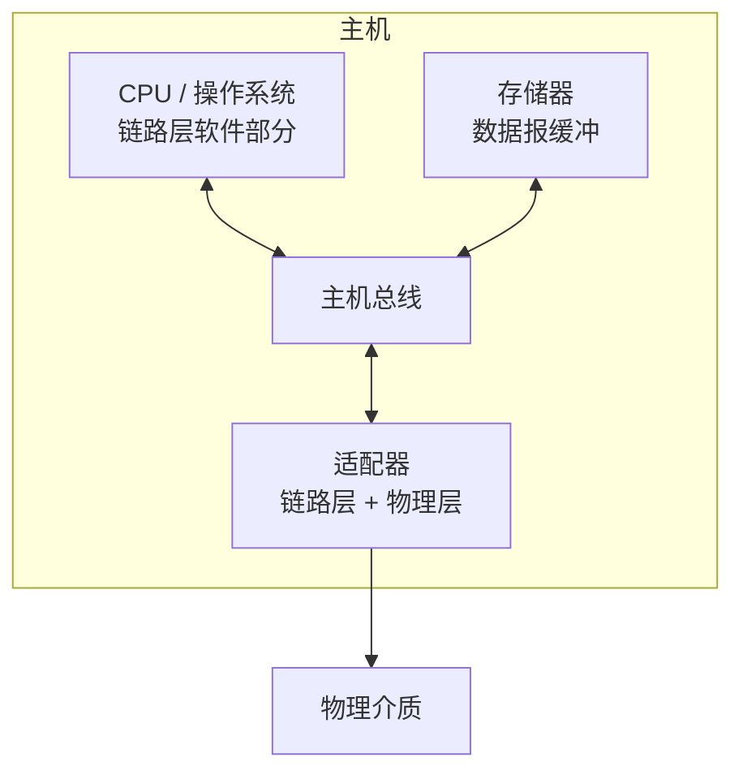

| 实现位置 | 承担的功能                                                       |
| -------- | ---------------------------------------------------------------- |
| 硬件     | 成帧、链路接入、差错检测、物理层收发、CRC 计算                   |
| 软件     | 组装链路层地址、初始化控制器、处理中断、向上交付数据报、差错处理 |

硬件承担实时性要求高的部分，软件负责与控制平面和上层协议衔接。

> [!note] 实践观察（非原书结论）
> 这种分工大致解释了以下现象：
>
> - 链路层协议固化在硬件里，较难像 TCP 那样靠升级软件改进
> - CRC 能做到线速计算，而运输层检验和只需"够用就好"
> - 交换机只处理到链路层，转发时延通常低于路由器

## 6.2 差错检测和纠正技术

比特在传输中可能因衰减、噪声、串扰而出错。链路层在发送前附加冗余比特，接收方据此判断、甚至修复错误：

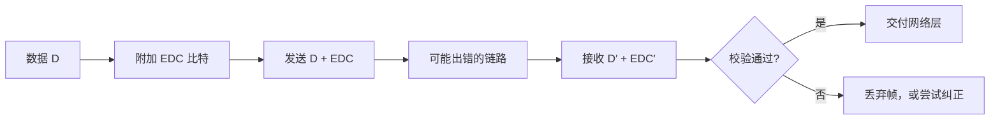

> [!warning] 检测不等于保证
> 任何差错检测方案都只能以**一定概率**发现错误。若错误恰好把 $D+\text{EDC}$ 变成另一个合法码字，接收方就会误认为无差错。冗余比特越多、检测算法越强，漏检概率越低，代价是开销与计算量。

三种常用技术的对比如下，后文依次展开：

| 技术     | 原理                          | 检测能力 | 开销         | 典型位置       |
| -------- | ----------------------------- | -------- | ------------ | -------------- |
| 奇偶校验 | 增加校验比特使 1 的个数为偶数 | 弱       | 极低         | 教学、简单硬件 |
| 检验和   | 反码求和后取反                | 较弱     | 低           | 运输层（软件） |
| CRC      | 模 2 多项式除法               | 强       | 中，可硬件化 | 链路层（硬件） |

### 6.2.1 奇偶校验

#### 1. 单比特奇偶校验

在偶校验方案中，发送方增加 1 个校验比特，使 $d+1$ 个比特中 1 的个数为偶数。接收方统计 1 的个数：为偶数，说明无差错或出现了偶数个错误；为奇数，说明至少有一个比特出错。

因此，单比特奇偶校验只能发现**奇数个**比特错误。若一次突发错误翻转了偶数个比特，校验仍然通过——这正是它在真实链路上不够用的原因。

#### 2. 二维奇偶校验

把数据排成矩阵，对每行、每列分别计算校验比特，就能定位单个错误。下表是接收方看到的内容：数据比特 `r2c3` 在传输中被翻转（原值 0，现为 1），而校验位仍是发送方算出的原值。

|        | c1  | c2  |  c3   | c4  | 行校验 |
| :----: | :-: | :-: | :---: | :-: | :----: |
|   r1   |  1  |  0  |   1   |  1  |   1    |
|   r2   |  0  |  1  | **1** |  0  | **1**  |
|   r3   |  1  |  1  |   0   |  1  |   1    |
|   r4   |  1  |  0  |   0   |  1  |   0    |
| 列校验 |  1  |  0  | **1** |  1  |   1    |

第 2 行有 2 个 1，本应校验位为 0，实际为 1，不匹配；第 3 列同样有 2 个 1，校验位也是 1，不匹配。行、列校验同时不匹配的交点就是出错位置，把它翻转回 0 即完成纠正。

右下角的校验位对"行校验列"（等价于"列校验行"）再做一次偶校验。借助它，接收方可以区分单个比特错误的位置：

| 报错的校验        | 判定                 | 处理                 |
| ----------------- | -------------------- | -------------------- |
| 一行 + 一列       | 交点处的数据比特出错 | 翻转该比特           |
| 仅某一行 + 右下角 | 该行的行校验位出错   | 数据无误，修正校验位 |
| 仅某一列 + 右下角 | 该列的列校验位出错   | 数据无误，修正校验位 |
| 仅右下角          | 右下角自身出错       | 数据无误             |

> [!note] 数据比特出错时右下角不受影响
> 单个数据比特翻转，会使其所在行校验与所在列校验各翻转一次，而右下角对全部行校验位的奇偶性不变（两个校验位同时参与的是同一个数据比特，不改变右下角匹配结果）。因此数据出错与右下角报错无关。

二维奇偶校验能检测任意两个比特错误、能定位并纠正单个比特错误；若两个错误落在同一行（或同一列），则只能检测而无法定位。

接收方能自行检测并纠正错误的能力称为**前向纠错**（Forward Error Correction，FEC）。FEC 的价值在于不需要重传：

- 实时音频、视频无法等待重传的往返时延
- 深空链路往返时延以分钟计，重传代价极高
- 音频 CD 用交叉交错的 FEC 对抗划痕与灰尘

### 6.2.2 检验和方法

检验和把数据看作若干 $k$ 比特整数，求和后取反码作为校验字段。以 16 比特为例：

| 步骤 | 计算                                  | 结果     |
| ---- | ------------------------------------- | -------- |
| 1    | 发送方对数据字求和：`0x1234 + 0x5678` | `0x68AC` |
| 2    | 取反码，得到检验和                    | `0x9753` |
| 3    | 发送 `0x1234`、`0x5678`、`0x9753`     | —        |
| 4    | 接收方把三个字一起求和                | `0xFFFF` |
| 5    | 结果为全 1，判定无差错；否则判定出错  | —        |

因特网检验和（RFC 1071）就采用这一方案，TCP、UDP、IP 都用它，字段长度 16 比特。

| 优点                 | 缺点                                    |
| -------------------- | --------------------------------------- |
| 实现简单，纯软件即可 | 检错能力弱于 CRC                        |
| 计算量小             | 对字序不敏感，交换两个字不会被发现      |
| 适合高层协议         | 插入全 0 字也不改变和，无法抵御恶意篡改 |

> [!question] 为什么运输层用检验和，链路层用 CRC？
> 二者的实现位置不同。运输层在主机软件中实现，需要一种足够简单、可快速计算的方案；链路层在适配器硬件中实现，可以用移位寄存器和异或门在流式数据上直接算出 CRC，几乎不增加时延。换句话说，不是 CRC 更好所以链路层用它，而是链路层**用得起** CRC。

### 6.2.3 循环冗余检测 CRC

**循环冗余检测**（Cyclic Redundancy Check，CRC）又称多项式编码，是链路层最常用的差错检测技术。

发送方与接收方约定一个 $r+1$ 比特的**生成多项式** $G$。发送方在 $d$ 比特数据 $D$ 后补 $r$ 个 0，用模 2 除法除以 $G$，所得余数 $R$ 就是 $r$ 比特的 CRC 字段。发送的比特串为：

$$
T = D \cdot 2^r \oplus R
$$

其中 $T$ 恰好能被 $G$ 整除。接收方用 $G$ 去除收到的比特串：余数为 0 则认为无差错，否则判定出错。

所有运算都在**模 2 算术**下进行：

- 加法不进位，减法不借位，加减法都等价于异或
- 例如 `1011 XOR 0101 = 1110`，`1001 XOR 1101 = 0100`

#### 1. 计算示例

设 $D=101110$，$G=1001$（$r=3$）：

1. 在 $D$ 后补 3 个 0，得 `101110000`
2. 用 `1001` 做模 2 长除法，每步取最高 4 位与 `1001` 异或（最高位为 0 时直接移位），去掉前导 0 后继续：

| 步骤 | 当前比特串  | 取前 4 位异或        | 结果，接剩余位并去前导 0     |
| :--: | ----------- | -------------------- | ---------------------------- |
|  1   | `101110000` | `1011 ⊕ 1001 = 0010` | `0010` + `10000` → `1010000` |
|  2   | `1010000`   | `1010 ⊕ 1001 = 0011` | `0011` + `000` → `11000`     |
|  3   | `11000`     | `1100 ⊕ 1001 = 0101` | `0101` + `0` → `1010`        |
|  4   | `1010`      | `1010 ⊕ 1001 = 0011` | 余数 `011`                   |

3. 余数 $R=011$，发送 $T=101110\,011$

接收方用 `1001` 除 `101110011`，余数为 0，判定无差错。

#### 2. 检测能力

CRC 的检错能力取决于 $G$ 的选择：

| 差错类型                  | 检测能力                                                  |
| ------------------------- | --------------------------------------------------------- |
| 单个比特错误              | 全部检出（$G$ 的最低项与常数项均为 1 时）                 |
| 两个比特错误              | 全部检出，条件：对不超过帧长的 $k$，$G(x)$ 不整除 $x^k+1$ |
| 奇数个比特错误            | 全部检出（$G$ 含因子 $x+1$ 时）                           |
| 长度不超过 $r$ 的突发错误 | 全部检出                                                  |
| 长度恰为 $r+1$ 的突发错误 | 漏检概率 $2^{-(r-1)}$（错误模式恰等于 $G$ 时漏检）        |
| 长度超过 $r+1$ 的突发错误 | 漏检概率约为 $2^{-r}$                                     |

国际标准规定了若干生成多项式，硬件只需按 $G$ 的顺序接异或门：

| 名称      | 多项式                            | 比特串                              | 典型用途         |
| --------- | --------------------------------- | ----------------------------------- | ---------------- |
| CRC-8     | `x^8 + x^2 + x + 1`               | `100000111`                         | ATM 信头         |
| CRC-12    | `x^12 + x^11 + x^3 + x^2 + x + 1` | `1100000001111`                     | 字符传输         |
| CRC-16    | `x^16 + x^15 + x^2 + 1`           | `11000000000000101`                 | 链路控制         |
| CRC-CCITT | `x^16 + x^12 + x^5 + 1`           | `10001000000100001`                 | HDLC、X.25       |
| CRC-32    | 32 次多项式                       | `100000100110000010001110110110111` | 以太网、ZIP、PNG |

> [!tip] 硬件实现：r 级移位寄存器
> 寄存器共 $r$ 位，初值全 0。对输入串（含补的 $r$ 个 0）逐位处理：
>
> 1. 取寄存器最高位 $f$
> 2. 寄存器左移一位，低位补入下一个输入比特
> 3. 若 $f=1$，寄存器与 $G$ 的低 $r$ 位异或
>
> 全部输入处理完，寄存器内容即余数。以 $G=1001$（低 3 位为 `001`）处理 `101110000`，最终寄存器为 `011`，与长除法结果一致。
>
> 该电路不需要缓存整个帧，因此能在高线速下实时完成。

# 第二部分 多路访问链路和协议

## 6.3 多路访问链路和协议

点对点链路由两端独占，基本不存在竞争；广播链路则要让多个节点共享同一信道，竞争不可避免。

广播链路的核心问题是**多路访问问题**：多个节点可能同时发送，信号在介质上叠加，导致**碰撞**（collision），涉及的帧全部损坏，带宽被白白浪费。因此需要多路访问协议规定"谁在什么时候可以发送"。

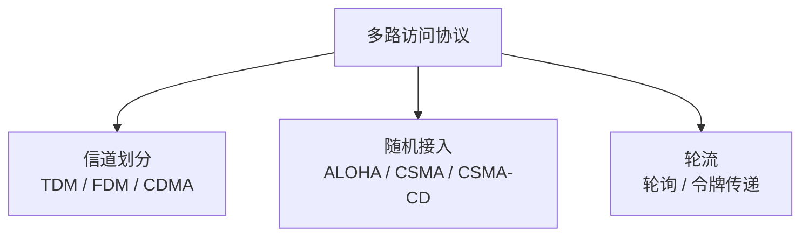

理想的多路访问协议应满足：

1. 只有一个节点活跃时，它能以全速率 $R$ bps 发送
2. $M$ 个节点活跃时，每个节点的平均吞吐量接近 $R/M$
3. 完全去中心化，不依赖某个主节点，避免单点故障
4. 简单、便宜、易于实现

现实协议只能在这些目标间折中。下面的三类协议，分别偏向不同的目标。

### 6.3.1 信道划分协议

信道划分协议把信道的带宽切分成若干份，分给不同节点，从而在源头上避免碰撞。

| 技术     | 划分维度 | 每个节点得到的资源 | 是否需要同步 |
| -------- | -------- | ------------------ | ------------ |
| **TDM**  | 时间     | 每帧中的一个时隙   | 需要         |
| **FDM**  | 频率     | 一个频段           | 不需要       |
| **CDMA** | 编码     | 一个正交码         | 需要码同步   |

以 TDM 为例，时间被划分为帧，每帧再划分为 $N$ 个时隙，每个节点固定占用一个时隙：


FDM 的做法类似，只是把"时间片"换成"频段"。

信道划分的优点是既无碰撞又公平，时延也可预测；缺点是节点只能分到 $R/N$ 的带宽，即使它是唯一活跃的节点，因此不适合突发性流量。

CDMA 则给每个节点分配一个正交编码，所有节点可以同时同频发送，接收方用相应编码解调出目标信号。它对码同步要求高，抗干扰能力强，主要用于蜂窝通信和军用系统。

### 6.3.2 随机接入协议

随机接入协议不让节点排队，而是允许节点以全速率 $R$ 发送；发生碰撞就等待随机时间后重传。

记 $a=d_{\text{prop}}/d_{\text{trans}}$，其中 $d_{\text{prop}}$ 为任意两个适配器间的最大传播时延，$d_{\text{trans}}$ 为发送一个最大长度帧所需的时间。

| 协议       | 时隙 | 载波侦听 | 碰撞检测 | 最大效率                     |
| ---------- | :--: | :------: | :------: | ---------------------------- |
| 时隙 ALOHA |  是  |    否    |    否    | $\dfrac{1}{e} \approx 0.37$  |
| 纯 ALOHA   |  否  |    否    |    否    | $\dfrac{1}{2e} \approx 0.18$ |
| CSMA       |  否  |    是    |    否    | 取决于传播时延               |
| CSMA/CD    |  否  |    是    |    是    | 约 $\dfrac{1}{1+5a}$         |

#### 1. 时隙 ALOHA

时隙 ALOHA 的假设与规则：

| 假设                   | 说明                     |
| ---------------------- | ------------------------ |
| 帧长固定为 $L$ 比特    | 每个时隙长 $L/R$ 秒      |
| 时间划分为时隙         | 节点只能在时隙开始时发送 |
| 所有节点同步           | 需要统一的时隙边界       |
| 碰撞可在时隙结束前检测 | 由信道或上层机制告知     |

节点有帧时，等到下一个时隙开始就发送。若成功则结束；若碰撞，则在后续每个时隙以概率 $p$ 重传，直到成功。

系统效率定义为：大量节点、每个节点总有大量帧待发时，成功时隙所占的比例。

> [!note] 时隙 ALOHA 的效率推导
> 设 $N$ 个节点，每个节点在一个时隙内**以概率 $p$ 发送**。某个时隙成功的条件是"恰好一个节点发送，其余 $N-1$ 个都不发送"：
>
> $$
> P_{\text{success}} = Np(1-p)^{N-1}
> $$
>
> 对 $p$ 求极值：令导数为 0，得 $p = 1/N$。代入：
>
> $$
> P_{\text{success}} = \left(1-\frac{1}{N}\right)^{N-1} \xrightarrow{N\to\infty} \frac{1}{e} \approx 0.368
> $$
>
> 因此长期来看，最多约 37% 的时隙在做有用功。即便所有节点都"守规矩"，仍有三分之二的带宽被浪费。

| 时隙 | 事件              |
| :--: | ----------------- |
|  1   | 节点 1、2、3 碰撞 |
|  2   | 空闲              |
|  3   | 空闲              |
|  4   | 节点 2 成功       |
|  8   | 节点 1 成功       |
|  9   | 节点 3 成功       |

#### 2. 纯 ALOHA

纯 ALOHA 不需要时隙同步，节点有帧就立即发送。它的代价是"脆弱期"翻倍：一个帧要成功，在它开始发送前的一个帧时和发送后的一个帧时内，都不能有别的节点开始发送。

$$
\eta_{\max} = \frac{1}{2e} \approx 0.184
$$

即只有时隙 ALOHA 的一半。这是完全去中心化、完全不协调所付出的代价。

> [!note] 历史：Norm Abramson 与 ALOHAnet
> 20 世纪 70 年代，Norm Abramson 在夏威夷大学设计 ALOHAnet，用无线电连接分散在岛屿上的节点。
>
> - 下行信道由中心主机向各节点广播，不存在竞争
> - 上行信道由各节点向中心主机发送，碰撞不可避免
> - 为解决上行碰撞，产生了纯 ALOHA 协议
>
> ALOHAnet 后来与 ARPAnet 互联，并启发了 Bob Metcalfe，进而促成以太网与 CSMA/CD 的诞生。

#### 3. 载波侦听多路访问 CSMA

ALOHA 的浪费源于"不先听再说"。**载波侦听多路访问**（Carrier Sense Multiple Access，CSMA）加入一条礼貌规则：**发送前先侦听信道**，信道忙就等待，信道空闲才发送。这样可以避免撞上正在进行的传输。

但 CSMA 仍会发生碰撞，根源是**传播时延**：节点 A 开始发送后，信号需要时间才能到达远处的节点 D。在信号到达之前，D 侦听到的信道仍是空闲的，于是也开始发送，碰撞随即发生。

CSMA 不检测碰撞，因此即使已经碰撞，节点仍会把整个损坏的帧发完，浪费信道时间。

> [!question] 既然已经侦听，为什么还会碰撞？
> 侦听只能听到**已经到达**的信号。两个节点若在彼此的传播时延内同时开始发送，谁都听不到对方。传播时延越大（$a$ 越大），这个"来不及听见"的窗口相对帧长越长，效率越低（见下节 CSMA/CD 效率式）。

#### 4. CSMA/CD

**带碰撞检测的载波侦听多路访问**（CSMA/CD）在 CSMA 上增加"边发边听"：适配器在发送过程中持续检测信号，一旦发现碰撞就立即停止，而不是把整个帧发完。这样，被碰撞损坏的传输会被及早中止，减少浪费的信道时间。

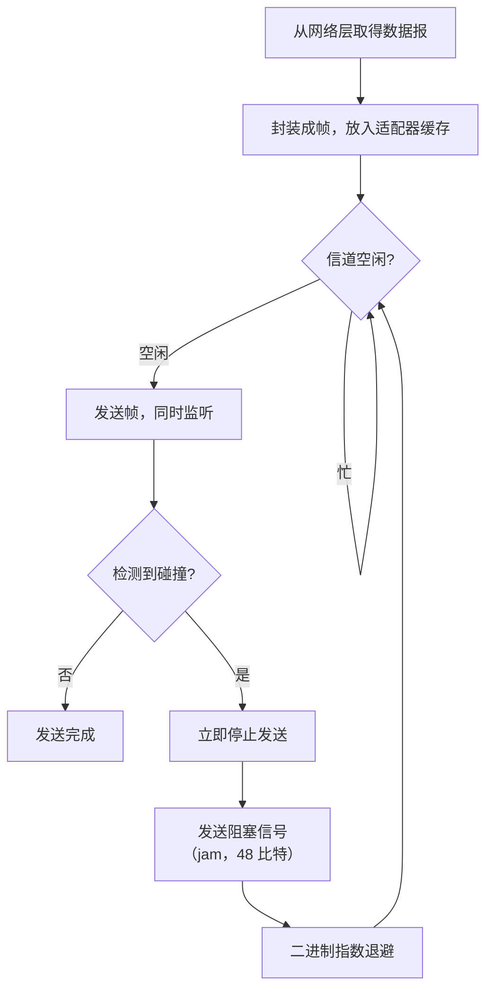

**阻塞信号**（jam signal）：检测到碰撞后，适配器先发送 48 比特的阻塞信号，确保所有参与碰撞的节点都察觉到碰撞，再进入退避。

**二进制指数退避**：碰撞发生后，节点不能立刻重试，否则会再次碰撞。若某帧已连续经历 $n$ 次碰撞，节点从集合

$$
\{0,1,2,\dots,2^n-1\}
$$

中等概率选取 $K$，等待 $K \times 512$ 比特时间后再尝试。$n$ 随碰撞次数增加而增大，等待窗口随之指数扩张，从而在拥塞时自动降低重试密度。

| 已碰撞次数  | $K$ 的取值范围 | 最大等待（比特时间）         |
| ----------- | -------------- | ---------------------------- |
| 1           | `{0, 1}`       | 512                          |
| 2           | `{0, 1, 2, 3}` | 1536                         |
| 3           | `{0, …, 7}`    | 3584                         |
| 10 次及以上 | `{0, …, 1023}` | 523776（即 $1023\times512$） |

以太网中 $n$ 通常封顶为 10，之后窗口不再增大。若连续 16 次碰撞仍失败，适配器放弃该帧并向网络层报告错误。

> [!warning] 为什么 10 Mbps 以太网最小帧长是 64 字节？
> 要确保发送方在帧发完之前就能检测到碰撞，帧的传输时间必须不短于"信号往返最远两端"的时间，即
>
> $$
> d_{\text{trans}} \ge 2\tau
> $$
>
> 10 Mbps 以太网的最远距离约 2500 m，往返传播时延约 51.2 μs，对应 512 比特。于是最小帧被定为 512 比特 = 64 字节（含首部与 FCS）。短于 64 字节的帧会被视为**残帧**（runt frame）丢弃。
>
> 这也解释了退避时间的单位为什么是 512 比特时间：它正好是一个"碰撞检测窗口"。
>
> 注：该推导针对 10 Mbps。速率提高后，同样的 64 字节最小帧对应更短的最大距离；1 Gbps 半双工以太网则通过载波扩展，把有效最小帧扩展到 512 字节（需验证具体标准条款）。

#### 5. CSMA/CD 的效率

在忽略协议开销、假设帧长固定且节点数很多的条件下，CSMA/CD 的效率可近似为

$$
\text{效率} \approx \frac{1}{1 + 5a},\qquad a=\frac{d_{\text{prop}}}{d_{\text{trans}}}
$$

直观上，传播时延越小，碰撞窗口越短，侦听越有效；帧越长，检测碰撞的开销占比越低。反之，距离长而帧又短时，大量时间会被等待与退避消耗掉。

> [!note] CSMA/CA
> 无线介质上无法在发送的同时可靠地检测碰撞（自身信号远强于接收信号），因此 802.11 采用**碰撞避免**（CSMA/CA）：先侦听，再随机退避，并用确认帧判断是否成功。具体机制留待无线章节。

### 6.3.3 轮流协议

随机接入在"只有一个节点活跃"时表现最好，多节点活跃时效率下降。轮流协议则让节点按顺序获得发送权，兼顾公平与效率。

| 特性     | 轮询（polling）                  | 令牌传递（token passing）      |
| -------- | -------------------------------- | ------------------------------ |
| 控制方式 | 主节点依次询问从节点             | 令牌在节点间按固定顺序传递     |
| 去中心化 | 差，依赖主节点                   | 较好                           |
| 碰撞     | 无                               | 无                             |
| 主要缺点 | 轮询时延；主节点故障导致全网瘫痪 | 令牌丢失或节点故障需要恢复机制 |
| 典型例子 | 蓝牙微微网                       | 令牌环（IEEE 802.5）、FDDI     |

轮询的开销是"问一圈"的时延：即使只有一个节点有数据，也要等主节点问到它。令牌传递把控制权分散到各节点，但令牌本身可能丢失、重复，需要额外的监控与恢复机制。

### 6.3.4 DOCSIS：电缆因特网接入的链路层协议

**DOCSIS**（Data Over Cable Service Interface Specification）是电缆接入网的链路层标准，它把信道划分、随机接入和集中式授权组合在一起，是理解"真实协议如何折中"的好例子。

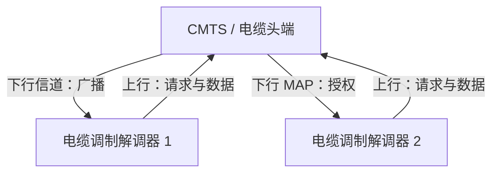

下行方向只有 CMTS 一个发送方，天然是广播，不存在多路访问问题；上行方向由多个调制解调器共享，必须协调。

上行方向的机制是分层的：

1. **频分**：上下行使用不同的频率段，互不干扰
2. **时分**：上行信道划分为微时隙（minislot），由 CMTS 统一编号
3. **随机接入**：调制解调器在竞争微时隙中发送请求帧，声明"我要发多少数据"
4. **集中授权**：CMTS 用下行 MAP 报文公布每个微时隙归谁使用
5. **退避重传**：请求帧碰撞时，按二进制指数退避后重试
6. **测距**：CMTS 测量各调制解调器的传播时延并下达定时偏移，使上行信号在时隙边界对齐

因此，DOCSIS 同时体现了三种思路：用 FDM/TDM 消除大部分竞争，用随机接入处理请求，用集中授权保证数据阶段无碰撞。

# 第三部分 交换局域网、链路虚拟化与数据中心

## 6.4 交换局域网

今天的局域网几乎都由**链路层交换机**互联主机、服务器和路由器构成。交换机工作在链路层，按 MAC 地址转发帧，对主机完全透明。

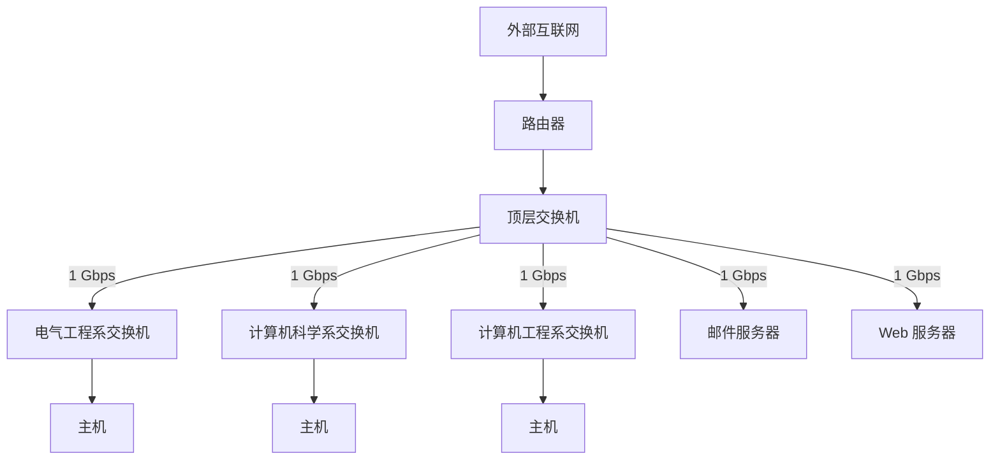

### 6.4.1 链路层寻址和 ARP

#### 1. MAC 地址

主机与路由器的适配器都有链路层地址，常称为 **LAN 地址**、**物理地址**或 **MAC 地址**。以太网的 MAC 地址长 48 比特（6 字节），通常写成六组十六进制数：

```text
1A-23-F9-CD-06-9B
```

IEEE 管理 MAC 地址空间：前 24 比特是**组织唯一标识符**（OUI），由 IEEE 分配给厂商；后 24 比特由厂商自行分配，保证全球唯一。

MAC 地址最重要的性质是**扁平**：它不随设备所处的位置变化。这与 IP 地址形成鲜明对比：

| 特性           | MAC 地址                    | IP 地址                     |
| -------------- | --------------------------- | --------------------------- |
| 长度           | 48 比特                     | IPv4 32 比特，IPv6 128 比特 |
| 结构           | 扁平，无层次                | 层次化（网络前缀 + 主机号） |
| 分配者         | IEEE 分配 OUI，厂商分配其余 | ISP、网络管理员、DHCP       |
| 是否随位置变化 | 否                          | 是，换子网就要换地址        |
| 作用范围       | 同一链路（局域网）内        | 端到端，跨网络              |
| 类比           | 身份证号                    | 邮政地址                    |

广播 MAC 地址为 `FF-FF-FF-FF-FF-FF`。适配器收到帧后按以下规则处理：

| 条件                            | 动作           |
| ------------------------------- | -------------- |
| 目的 MAC 等于自己的 MAC         | 接收，向上交付 |
| 目的 MAC 为广播地址             | 接收，向上交付 |
| 目的 MAC 为组播地址且已加入该组 | 接收           |
| 其他                            | 丢弃           |
| 处于混杂模式（抓包、虚拟化）    | 全部接收       |

> [!important] 实践原则：保持各层独立
> 既然 IP 地址已经能标识主机，为什么还要 MAC 地址？
>
> 1. **局域网不只承载 IP**。同一块网卡要能同时处理 IPv4、IPv6、ARP、IPX 等协议，链路层不能假定上层一定是 IP
> 2. **地址与位置解耦**。若适配器直接使用网络层地址，主机移动或换网段时就得重新配置硬件地址
> 3. **过滤成本**。若适配器没有自己的地址，所有帧都要交给主机处理，CPU 将被大量无关帧中断
> 4. **分层**。各层使用各自的地址，修改一层不必改动另一层

#### 2. 地址解析协议 ARP

**地址解析协议**（Address Resolution Protocol，ARP）把 IP 地址解析为 MAC 地址。主机 A 知道 B 的 IP 地址，却必须先得到 B 的 MAC 地址，才能在以太网帧的目的地址字段填上正确的值。

每台主机和路由器都维护一张 **ARP 表**：

| IP 地址         | MAC 地址          | 剩余寿命（TTL） |
| --------------- | ----------------- | --------------- |
| 222.222.222.221 | 88-B2-2F-54-1A-0F | 13 分 45 秒     |
| 222.222.222.223 | 5C-66-AB-90-75-B1 | 13 分 52 秒     |

ARP 有几个值得注意的特点：

- **即插即用**：无需配置，表项由协议自动建立
- **请求广播、应答单播**：请求帧发往广播地址，应答只发给提问者
- **会老化**：表项过期后须重新解析，以适应 MAC 地址变化；原书典型值为 20 分钟，实际随操作系统而异（需验证）
- **只管本子网**：跨子网的解析交给默认网关

同一子网内的解析过程：

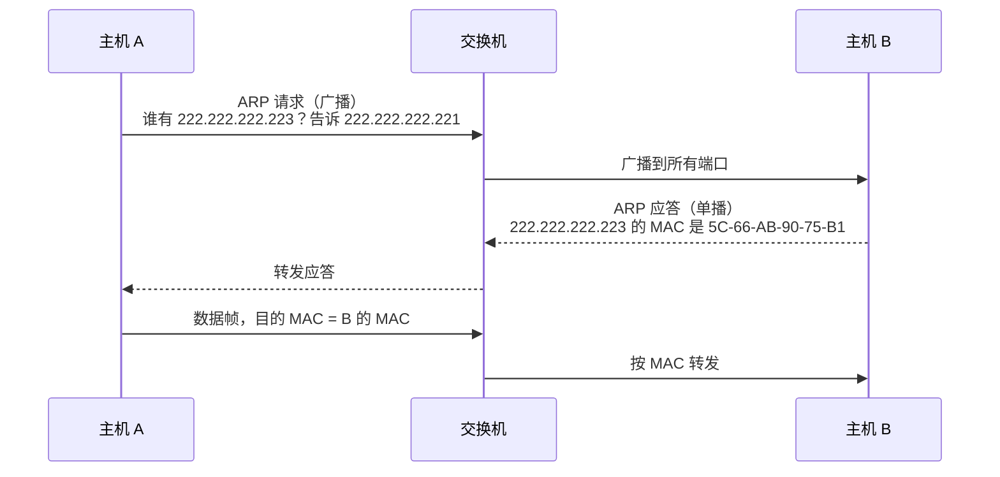

> [!note] ARP 报文格式
> 在以太网上承载 IPv4 时，ARP 报文长 28 字节，字段包括：硬件类型、协议类型、硬件地址长度、协议地址长度、操作码（1 = 请求，2 = 应答）、发送方 MAC 与 IP、目标 MAC 与 IP。请求中的目标 MAC 字段填全 0，由应答方填入自己的地址。

> [!warning] ARP 欺骗
> ARP 没有任何认证机制，主机收到应答就更新表项。攻击者可以持续发送伪造应答，宣称"网关的 IP 对应我的 MAC"，从而把流量引到自己这里，实施中间人攻击。常见防护手段包括动态 ARP 检测（DAI）、静态绑定和 802.1X 准入控制。

#### 3. 发送数据报到子网以外

若目的主机在另一个子网，源主机不能把帧的目的 MAC 直接填成最终主机——它根本不知道对方的 MAC，而且中间还要经过路由器。正确做法是把帧发给**默认网关**：

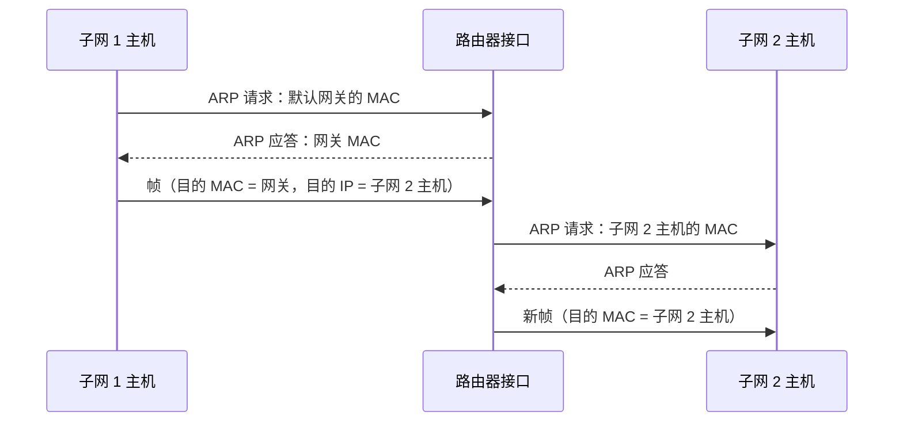

关键规律是：**IP 地址端到端不变，MAC 地址逐跳重写**。

| 字段       | 主机 → 网关      | 网关 → 目的主机     |
| ---------- | ---------------- | ------------------- |
| 源 MAC     | 主机 MAC         | 网关出口接口 MAC    |
| 目的 MAC   | 网关入口接口 MAC | 目的主机 MAC        |
| 源 IP      | 主机 IP          | 主机 IP（不变）     |
| 目的 IP    | 目的主机 IP      | 目的主机 IP（不变） |
| TTL        | 初始值           | 减 1                |
| 首部检验和 | 原值             | 重新计算            |

每一跳路由器都要拆帧、查转发表、重新封装，因此链路层帧只在本地有意义。这正是"链路层地址用于一跳，网络层地址用于端到端"的含义。

#### 4. 例题：经路由器的逐帧推演

设两个子网由一台路由器互联（示例地址）：

| 设备             | IP 地址         | MAC 地址          |
| ---------------- | --------------- | ----------------- |
| 主机 A（子网 1） | 111.111.111.111 | 74-29-9C-E8-FF-55 |
| 路由器接口 1     | 111.111.111.110 | E6-E9-00-17-BB-4B |
| 路由器接口 2     | 222.222.222.220 | 1A-23-F9-CD-06-9B |
| 主机 B（子网 2） | 222.222.222.222 | 49-BD-D2-C7-56-2A |

A 向 B 发送一个数据报，设各 ARP 表项均已缓存。逐段的帧如下：

| 阶段             | 源 MAC        | 目的 MAC      | 源 IP           | 目的 IP         |
| ---------------- | ------------- | ------------- | --------------- | --------------- |
| A → 路由器接口 1 | A 的 MAC      | 接口 1 的 MAC | 111.111.111.111 | 222.222.222.222 |
| 路由器接口 2 → B | 接口 2 的 MAC | B 的 MAC      | 111.111.111.111 | 222.222.222.222 |

两段帧中，IP 字段相同，MAC 字段完全不同；路由器在中间还要把 TTL 减 1 并重算 IP 首部检验和。若 A 的 ARP 表中没有默认网关表项，须先广播 ARP 请求解析 `111.111.111.110`；同理，路由器若不知道 B 的 MAC，会在子网 2 上广播 ARP 请求。

> [!tip] 常见误区
> A 在 ARP 表中查的是**默认网关**的 IP（`111.111.111.110`），而不是 B 的 IP。A 通过子网掩码判断 B 不在本子网，因此把帧交给网关。

### 6.4.2 以太网

以太网是今天最流行的有线局域网技术，从 1970 年代的同轴电缆总线，发展到集线器星型拓扑，再到今天的交换式星型拓扑。帧格式却保持了长期稳定。

> [!note] 历史：Bob Metcalfe 与以太网
> Bob Metcalfe 受 ARPAnet、ALOHAnet 和随机接入协议启发，在 Xerox PARC 与 David Boggs 发明了以太网。最初的以太网速率 2.94 Mbps，可在约一英里范围内连接多达 256 台主机。后来它演化为 10 Mbps 标准，并被 IEEE 采纳为 802.3。

#### 1. 以太网帧结构

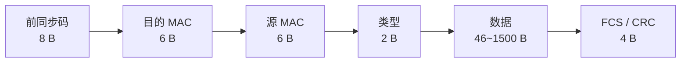

| 字段     |         长度 | 作用                                                     |
| -------- | -----------: | -------------------------------------------------------- |
| 前同步码 |       8 字节 | 唤醒接收适配器并同步时钟；最后两比特标志帧开始           |
| 目的地址 |       6 字节 | 目的适配器 MAC，可为广播或组播地址                       |
| 源地址   |       6 字节 | 发送适配器 MAC                                           |
| 类型     |       2 字节 | 指示上层协议；`0x0800` IPv4，`0x0806` ARP，`0x86DD` IPv6 |
| 数据     | 46~1500 字节 | 承载网络层数据报；不足 46 字节须填充                     |
| FCS      |       4 字节 | CRC-32 校验                                              |

几个容易忽略的细节：

- **前同步码**共 8 字节，前 7 字节为 `10101010`，用于时钟同步；第 8 字节为 `10101011`（SFD），最后两比特 `11` 表示"帧马上开始"
- **最小帧长** 64 字节（含首部与 FCS，不含前同步码），源自 CSMA/CD 的碰撞检测要求（6.3.2 节）
- **最大帧长** 1518 字节（不含前同步码），数据字段上限 1500 字节就是通常所说的 **MTU**
- 类型字段小于 `0x0600` 时表示长度而非协议类型，这是与 IEEE 802.3 兼容留下的历史包袱

以太网提供**无连接、不可靠**服务：发送前不握手，收到帧不回确认，CRC 校验失败就直接丢弃。丢失的帧由 TCP 重传弥补；若上层是 UDP，则表现为丢包。以太网刻意保持简单，把可靠性留给端系统。

#### 2. 以太网技术

以太网的命名规则是"速率 + BASE + 介质/编码"：

| 名称         | 速率     | 介质 / 特点        | 典型最大距离    |
| ------------ | -------- | ------------------ | --------------- |
| 10BASE-T     | 10 Mbps  | 双绞线             | 100 m           |
| 100BASE-TX   | 100 Mbps | 两对 5 类双绞线    | 100 m           |
| 1000BASE-T   | 1 Gbps   | 四对双绞线         | 100 m           |
| 1000BASE-LX  | 1 Gbps   | 长波光纤           | 数公里          |
| 10GBASE-T    | 10 Gbps  | 双绞线             | 100 m（Cat 6a） |
| 40GBASE-T    | 40 Gbps  | 双绞线（Cat 8）    | 约 30 m         |
| 100GBASE-LR4 | 100 Gbps | 长波光纤，波分复用 | 约 10 km        |

以太网的物理介质包括同轴电缆、双绞线和光纤。现代以太网几乎都是交换式星型拓扑、全双工点对点链路，因此不再需要 CSMA/CD；只有在共享介质或半双工模式下，碰撞检测才仍然生效。

> [!note] 为什么 MTU 是 1500 字节？
> 一种常见解释是"效率与时延的折中"：帧越长，首部开销占比越低；但长帧会占用信道更久，增加其他节点的等待时间，且出错时重传代价更高。该解释并非可考的设计史，仅供理解（需验证）。数据中心里的**巨型帧**（jumbo frame）可把 MTU 提高到 9000 字节，以减少大流量下的首部开销。

### 6.4.3 链路层交换机

交换机的工作可以概括为**转发**、**过滤**与**自学习**，其中转发在查不到表项时表现为泛洪。它对主机和路由器透明——主机并不知道帧经过了多少台交换机。

| 功能 | 依据                          | 结果                       |
| ---- | ----------------------------- | -------------------------- |
| 转发 | 目的 MAC 对应的接口不是入接口 | 从该接口发出               |
| 过滤 | 目的 MAC 对应的接口就是入接口 | 丢弃，不必占用其他链路     |
| 泛洪 | 表中查不到目的 MAC            | 向除入接口外的所有接口发出 |

#### 1. 转发和过滤

交换机维护**交换机表**（也称 MAC 表、转发表）：

| MAC 地址          | 接口 | 表项建立时间 |
| ----------------- | ---- | ------------ |
| 62-FE-F7-11-89-A3 | 1    | 9:32         |
| 7C-BA-B2-B4-91-10 | 3    | 9:36         |

当目的地址为 `DD-DD-DD-DD-DD-DD` 的帧从接口 `x` 到达时：

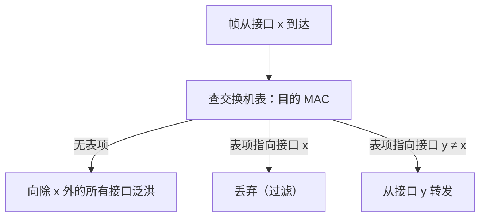

#### 2. 自学习

交换机表不需要管理员配置，交换机会自动建立它：

1. 初始时表为空
2. 每收到一个帧，就把**源 MAC**、**入接口**和**当前时间**写入表中
3. 若该 MAC 已有表项，则更新接口与时间
4. 长时间未再出现的表项被老化删除

因此交换机是**即插即用**设备：插上线就能工作，拓扑变化后表项会自动调整。

> [!example] 例题：自学习逐帧推演
> 一台 4 端口交换机，主机 A、B、C、D 分别接在端口 1、2、3、4，初始表为空。依次发生下列传输：
>
> | 序  | 帧（源 → 目的） | 入端口 | 学到的表项  | 交换机动作                  |
> | --- | --------------- | ------ | ----------- | --------------------------- |
> | 1   | A → B           | 1      | A 在 1      | B 未知，向端口 2、3、4 泛洪 |
> | 2   | B → A           | 2      | B 在 2      | A 已知在 1，只从端口 1 转发 |
> | 3   | C → B           | 3      | C 在 3      | B 在 2，只从端口 2 转发     |
> | 4   | A → B           | 1      | 更新 A 在 1 | B 在 2，只从端口 2 转发     |
> | 5   | B → D           | 2      | 更新 B 在 2 | D 未知，向端口 1、3、4 泛洪 |
>
> 第 5 步之前，D 一直没有发送过帧，所以交换机始终不知道它在哪个端口，只能泛洪。D 一旦发出任意帧，表项就会建立。

#### 3. 存储转发与直通

| 方式                | 做法                                  | 时延                            | 差错处理                       |
| ------------------- | ------------------------------------- | ------------------------------- | ------------------------------ |
| 存储转发            | 收完整个帧、校验 FCS 无误后才转发     | 每跳多约 $L/R$（与 1.3 节一致） | 损坏帧被丢弃，不浪费出链路带宽 |
| 直通（cut-through） | 读到目的 MAC 即开始转发，不等整帧收完 | 最低                            | 可能把已损坏的帧转发出去       |

#### 4. 交换机的性质

交换机的优点很直接：

- **消除碰撞**：每个端口是一个独立的碰撞域，全双工下无碰撞
- **支持异质链路**：不同端口可跑不同速率，交换机负责缓存与整形
- **易于管理**：可逐端口启用、禁用、限速、镜像，便于排障
- **提高安全性**：帧只发给目的端口，不像集线器那样广播到所有端口

局限同样明显：广播帧仍会泛洪到整个局域网（除非划分 VLAN）；冗余链路会形成环路，须用 STP/RSTP 阻塞部分端口（见下）；表项耗尽后会退化为泛洪，可被攻击者利用。

> [!warning] 交换机毒化
> 攻击者发送大量源 MAC 各不相同的伪造帧，迅速填满交换机表。此后合法帧的目的 MAC 查不到表项，交换机只能泛洪，攻击者接在任一端口上就能嗅探到本不该发给它的流量。这种攻击称为**交换机毒化**（switch poisoning）或 MAC 泛洪攻击。防护手段包括端口安全（限制每端口学到的 MAC 数量）、静态绑定和 VLAN 隔离。

#### 5. 环路与生成树协议 STP

为提高可靠性，交换网络常有冗余链路，但二层帧头没有 TTL：广播或泛洪帧一旦遇到环路，就会无限循环并放大，造成**广播风暴**。

**生成树协议**（Spanning Tree Protocol，STP，IEEE 802.1D）通过阻塞部分端口，在有环拓扑上逻辑地构造一棵无环树：

| 步骤 | 内容                                                                |
| ---- | ------------------------------------------------------------------- |
| 1    | 选举**根网桥**：桥 ID（优先级 + MAC）最小者                         |
| 2    | 每台非根交换机选一个**根端口**：到根网桥路径开销最小的端口          |
| 3    | 每个网段选一个**指定端口**：该网段上到根开销最小的端口              |
| 4    | 其余端口置于**阻塞**状态，不转发数据帧，只收发 STP 配置报文（BPDU） |

链路或交换机故障时，STP 重新计算，启用原先被阻塞的端口。**RSTP**（802.1w）在此基础上显著缩短收敛时间。

#### 6. 交换机与路由器的比较

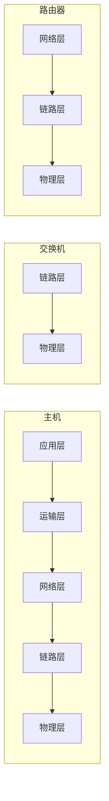

| 特性     | 集线器   | 交换机                  | 路由器                 |
| -------- | -------- | ----------------------- | ---------------------- |
| 所在层次 | 物理层   | 链路层                  | 网络层                 |
| 转发依据 | 无       | 目的 MAC                | 目的 IP                |
| 碰撞域   | 全网一个 | 每端口一个              | 每端口一个             |
| 广播域   | 全网一个 | 全网一个（VLAN 可分割） | 每接口一个             |
| 即插即用 | 是       | 是                      | 否，需配置地址与协议   |
| 流量隔离 | 无       | 有                      | 有                     |
| 路径优化 | 无       | 无                      | 有，可按拓扑与策略选路 |
| 转发时延 | 最低     | 低                      | 较高                   |

交换机适合小型网络：便宜、即插即用、转发快。路由器适合大型网络：能隔离广播域、优化路径、实施策略。现代**三层交换机**把两者结合，在硬件中完成 IP 转发，常用于数据中心与园区网核心。

### 6.4.4 虚拟局域网 VLAN

传统部门级交换局域网有几个结构性缺陷：广播帧泛洪到全网，敏感流量可被任意端口嗅探；每个部门都要独立交换机，空闲端口无法调剂；用户换部门就得重新布线，或者改动物理拓扑。

**虚拟局域网**（Virtual Local Area Network，VLAN）允许在单一物理基础设施上划分多个逻辑局域网，每个 VLAN 是一个独立的广播域。

> [!success] Definition VLAN
> VLAN 是一组被配置为如同共享同一物理局域网的主机与交换机端口的集合。划分依据可以是端口、MAC 地址或协议，VLAN 内的广播不会泄漏到其他 VLAN。

#### 1. 基于端口的 VLAN

最常见的做法是按交换机端口划分。以下为示例分配（非原书配置）：

| 端口   | VLAN    | 成员             |
| ------ | ------- | ---------------- |
| 2 – 8  | VLAN 10 | 电气工程系       |
| 9 – 15 | VLAN 20 | 计算机科学系     |
| 1、16  | 未分配  | 可留作干线或上联 |

同一 VLAN 内的端口构成一个广播域，跨 VLAN 的帧即使物理上在同一台交换机内，也不会被转发（除非经过三层设备）。

#### 2. VLAN 间的通信

VLAN 之间默认完全隔离，要互通必须经过网络层设备。常见做法有两种：一是**单臂路由**，交换机的一个端口接路由器，路由器上为每个 VLAN 配置子接口；二是**三层交换机**，交换机内部为每个 VLAN 配置虚拟接口（SVI），直接在硬件中路由。

现代设备通常把 VLAN 交换与路由功能整合在同一台三层交换机中，但逻辑上仍然是"二层隔离、三层转发"。

#### 3. VLAN 干线

多台交换机互联时，若每个 VLAN 都拉一条独立链路，成本过高。**干线**（trunk）端口用一条链路承载多个 VLAN 的流量，靠标签区分帧属于哪个 VLAN：

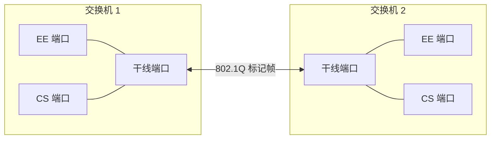

IEEE **802.1Q** 在标准以太网帧中插入 4 字节标签：


| 字段 | 长度    | 说明                                   |
| ---- | ------- | -------------------------------------- |
| TPID | 16 比特 | 固定为 `0x8100`，标识这是一个标记帧    |
| PCP  | 3 比特  | 优先级 0–7，可映射到 IP 的 DSCP        |
| DEI  | 1 比特  | 丢弃资格指示（原 CFI）                 |
| VID  | 12 比特 | VLAN 标识，取值 0–4095，0 与 4095 保留 |

PCP、DEI、VID 合起来称为**标签控制信息**（TCI）。带标签帧的最大长度因此变为 1522 字节。插入或剥除标签会改变帧内容，因此交换机须**重新计算 FCS**。

> [!note] 其他划分方式与安全边界
> VLAN 也可以按 MAC 地址、上层协议或 802.1X 认证结果动态划分。需要注意的是，VLAN 提供的是**广播域隔离**，不是安全隔离：错误配置的干线端口、VLAN 跳跃（VLAN hopping）攻击都能绕过边界。真正需要强隔离的场景应使用独立设备或叠加加密。

## 6.5 链路虚拟化：网络作为链路层

链路层中的"链路"未必是一条物理线路。只要某种设施能把帧从一端送到另一端，它就可以充当链路层，哪怕它内部是一整个网络。这种把网络当作链路使用的做法称为**链路虚拟化**。常见的例子包括：

- **拨号/电话网**：两台主机通过电话网建立"链路"，PPP 帧在其上传输
- **交换以太网**：对 IP 而言，整个二层网络就是一条"链路"
- **ATM、帧中继**：用虚电路提供点对点链路层服务
- **MPLS**：用标签交换网络为 IP 提供互联

### 6.5.1 多协议标签交换 MPLS

**多协议标签交换**（Multiprotocol Label Switching，MPLS）把虚电路的标签转发与 IP 的路由选择结合起来：控制平面仍用 OSPF、BGP 计算路径，数据平面则按固定长度的标签转发，而不必逐跳做最长前缀匹配。

> [!success] Definition MPLS
> MPLS 是一种位于链路层与网络层之间的转发技术。入口路由器为分组打上标签，核心路由器按"入标签 → 出标签 + 出接口"的映射表转发，出口路由器剥去标签。标签的分配与路径的建立由控制协议完成，转发本身与 IP 首部无关。

MPLS 首部（常称 **shim header**）夹在链路层首部与 IP 首部之间：


| 字段  | 长度    | 作用                             |
| ----- | ------- | -------------------------------- |
| Label | 20 比特 | 标签值，本地有效                 |
| EXP   | 3 比特  | 实验字段，常用于 QoS 优先级      |
| S     | 1 比特  | 栈底标志，1 表示已是最后一个标签 |
| TTL   | 8 比特  | 生存时间，防止环路               |

几个关键概念：

| 概念 | 含义                                                |
| ---- | --------------------------------------------------- |
| FEC  | 转发等价类，一组沿相同路径、获得相同转发的分组      |
| LER  | 标签边缘路由器，位于 MPLS 域边界，负责压入/弹出标签 |
| LSR  | 标签交换路由器，位于域内，按标签交换并转发          |
| LSP  | 标签交换路径，分组沿标签序列经过的路径              |
| LDP  | 标签分发协议，邻居间通告"某前缀对应哪个标签"        |

一条 LSP 上的逐跳标签替换（示意）：


对应的转发表（示意）：

| 路由器 | 入接口 | 入标签 | 出接口 | 出标签 |
| ------ | ------ | ------ | ------ | ------ |
| LSR B  | 1      | 21     | 3      | 47     |
| LSR C  | 2      | 47     | 4      | 33     |

核心路由器只做标签替换，不查 IP 路由表，因此转发表更小、查找更快。MPLS 支持**标签栈**：外层标签用于骨干网转发，内层标签标识 VPN 或业务，S 位标记栈底。

MPLS 的主要价值不在"更快"——现代硬件做 IP 查找已经足够快——而在于它提供了 IP 路由难以表达的能力：

- **流量工程**：可显式指定路径，绕过拥塞链路，而不受最短路径限制
- **快速恢复**：预建备份 LSP，链路故障时毫秒级切换
- **VPN**：用标签栈隔离不同客户的路由，构成 L3VPN
- **多业务承载**：同一张网承载 IP、以太网、专线等不同业务

## 6.6 数据中心网络

大型互联网公司建设数据中心，用于提供网页、搜索、邮件、视频等服务，支撑大规模并行计算，并提供云计算。一个数据中心可能有数万到数十万台主机，其网络设计与传统企业网有显著差异。

### 6.6.1 数据中心体系结构

主机通常以**刀片**（blade）形式插在机架中，每个机架顶部有一台**机架顶部交换机**（Top of Rack，TOR），刀片以 40 Gbps 或 100 Gbps 以太网接入（需验证原书取值）。

数据中心的成本构成大致如下（约 2009 年前后的研究数据，需验证出处与年份）：

| 项目                     | 占比 |
| ------------------------ | ---: |
| 主机                     |  45% |
| 基础设施（供电、冷却等） |  25% |
| 电力                     |  15% |
| 网络                     |  15% |

外部请求先到达**负载均衡器**，再由它分发给内部服务器。负载均衡器主要按第四层信息（目的 IP 与端口）分配连接，也可按应用层信息（如 URL）分配，因此常被称为"第四层交换机"或"第七层交换机"；它同时完成 NAT、隐藏内部拓扑，并通过健康检查摘除故障服务器。

典型的**分级拓扑**如下：

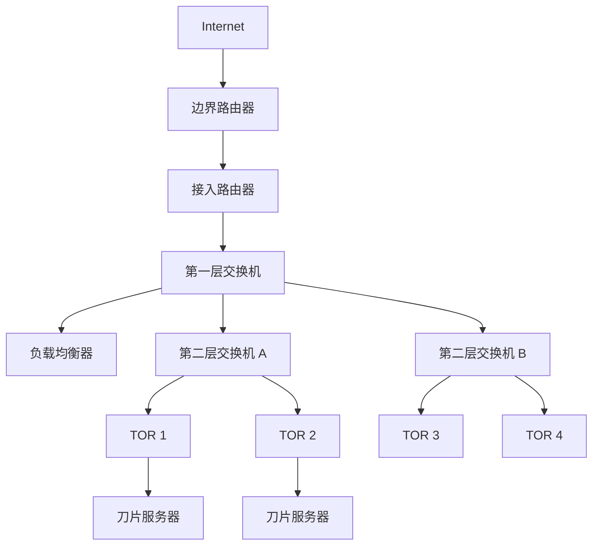

分级结构可以扩展到数十万台主机，但存在**超订**（oversubscription）问题。示意数值：若 40 台主机各以 10 Gbps 接入 TOR，而交换机之间是 100 Gbps 链路，则 40 条跨机架流同时传输时，每条平均只有 $100/40=2.5$ Gbps（此例的 10 Gbps 仅为示意，与上文刀片接入速率无关）。汇聚层的带宽被超额分配，在"东西向"（服务器之间）流量为主的数据中心里尤其明显。

解决办法是增加层间连接，形成**多根**（multi-root）或 **Clos** 拓扑：

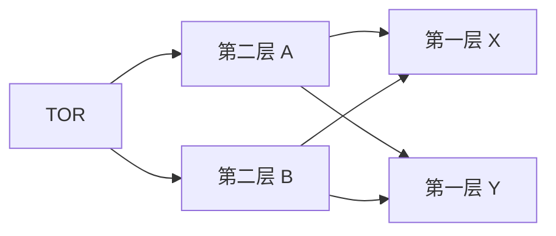

每台 TOR 上联到多台第二层交换机，每台第二层交换机再上联到多台第一层交换机，任意两层之间都有多条等价路径。

多根拓扑增加了聚合带宽，提供了多条等价路径（可用 ECMP 分散流量），也提高了容错能力：单条链路或单台交换机故障只损失部分带宽。

要在多条等价路径间分摊流量，需要**等价多路径**（Equal-Cost Multi-Path，ECMP）与细粒度负载均衡。传统基于五元组的哈希在大流场景下容易"扎堆"。

> [!note] 补充（非原书内容，需验证出处）
> 部分数据中心采用逐包或流片（flowlet）级的负载均衡，以缓解大流扎堆问题。

### 6.6.2 数据中心网络的发展趋势

| 趋势         | 动机                                   | 做法                                     |
| ------------ | -------------------------------------- | ---------------------------------------- |
| 降低成本     | 规模大，网络设备支出与功耗都不可忽视   | 商品交换机 + Clos 拓扑，用数量换单台性能 |
| 集中式 SDN   | 单一组织管理，拓扑与策略可全局优化     | 逻辑集中控制器，自动化配置与流量调度     |
| 虚拟化       | 虚拟机迁移要求地址与位置解耦           | 大二层、ARP 目录服务、Overlay（VXLAN）   |
| 物理约束     | 高带宽、微秒级时延、小缓存、丢包代价高 | 专用拥塞控制、RDMA、流调度               |
| 模块化与定制 | 快速部署、可预测的故障域               | 集装箱式模块化数据中心，自研网卡与交换机 |

> [!note] 与第五章的呼应
> 5.5.3 节介绍的 Orion 控制器，正是上表"集中式 SDN"在 Google Jupiter 数据中心网络与 B4 广域网上的实例。

其中虚拟化带来的地址问题值得单独说明：虚拟机在物理服务器之间迁移后，IP 地址不变，但它接入的交换机端口变了。传统以太网与 IP 依赖"地址隐含位置"的假设，迁移后要么改地址（破坏已有连接），要么让整个数据中心成为一个大二层网络，并用目录服务维护"VM 的 IP → 当前所在物理位置"的映射。

## 6.7 回顾：Web 页面请求的历程

至此，协议栈的各层都已学过。用一个具体场景把它们串起来：Bob 的便携机接入学校以太网，要访问 `www.google.com`。

```mermaid
flowchart LR
    BOB["Bob 的便携机"] --> SW["学校以太网交换机"] --> GW["学校路由器<br/>兼 DHCP 服务器"] --> ISP["Comcast 网络"]
    ISP --> DNS["DNS 服务器"]
    ISP --> GOOG["Google 网络"] --> WEB["www.google.com"]
```

### 6.7.1 准备：DHCP、UDP、IP 与以太网

Bob 开机后没有 IP 地址，首先要运行 **DHCP**：

1. Bob 构造 DHCP 请求报文
2. 放入 UDP 报文段，目的端口 67、源端口 68
3. 放入 IP 数据报，源地址 `0.0.0.0`，目的地址 `255.255.255.255`
4. 放入以太网帧，目的 MAC 为广播地址
5. 交换机泛洪，DHCP 服务器收到请求
6. 服务器分配地址，回送 DHCP ACK
7. Bob 记录自己的 IP、子网掩码、默认网关与 DNS 服务器

> [!note] DHCP 的四个报文
> 完整过程是 DISCOVER（发现服务器）→ OFFER（提供地址）→ REQUEST（请求使用）→ ACK（确认）。前两步用广播，因为客户端此时还没有地址。若 DHCP 服务器不在本子网，需要由路由器充当**中继代理**转发请求。

### 6.7.2 仍在准备：DNS 与 ARP

Bob 在浏览器输入网址后，需要把域名解析成 IP：

1. 构造 DNS 查询，放入 UDP（目的端口 53），再放入 IP 数据报
2. 目的 IP 是 DNS 服务器，不在本子网，因此帧要发给默认网关
3. Bob 查 ARP 表，若没有网关表项就广播 ARP 请求
4. 网关返回自己的 MAC，Bob 把 DNS 查询帧发往网关
5. 网关逐跳转发，最终到达 DNS 服务器
6. DNS 服务器返回 Google 的 IP 地址

这一阶段涉及 DNS、UDP、IP、ARP 与以太网五种协议，跨越应用层、运输层、网络层与链路层。

### 6.7.3 路由选择到 DNS 服务器

DNS 查询离开学校网络后，要经过学校与 Comcast 的多台路由器。每台路由器根据转发表决定下一跳，而转发表由域内、域间两类路由协议共同填充（第五章）：

| 范围       | 协议             | 作用                           |
| ---------- | ---------------- | ------------------------------ |
| 自治系统内 | OSPF、IS-IS、RIP | 计算域内最短路径，填充内部路由 |
| 自治系统间 | BGP              | 通告前缀可达性，按策略选择出口 |

链路层在此只负责把数据报送到下一跳：每一跳都换一个新的帧，源、目的 MAC 都随之改变。

### 6.7.4 Web 客户-服务器交互：TCP 与 HTTP

拿到 Google 的 IP 后，Bob 的浏览器与服务器建立 TCP 连接，然后发送 HTTP 请求：

1. TCP 三次握手：SYN → SYN-ACK → ACK
2. 发送 HTTP GET 请求
3. 服务器返回 HTTP 响应
4. 浏览器解析 HTML，请求页面中的其他资源
5. 连接关闭或复用

完整过程如下：

```mermaid
sequenceDiagram
    participant Bob as Bob 的便携机
    participant SW as 以太网交换机
    participant GW as 学校路由器
    participant DNS as DNS 服务器
    participant Web as www.google.com
    Bob->>SW: DHCP DISCOVER（广播）
    SW->>GW: 泛洪
    GW-->>Bob: DHCP OFFER / ACK
    Bob->>SW: ARP 请求：网关 MAC
    SW->>GW: 广播
    GW-->>Bob: ARP 应答
    Bob->>SW: DNS 查询（UDP 53）
    SW->>GW: 转发
    GW->>DNS: 逐跳路由
    DNS-->>Bob: DNS 应答：Google 的 IP
    Bob->>Web: TCP SYN
    Web-->>Bob: SYN-ACK
    Bob->>Web: ACK + HTTP GET
    Web-->>Bob: HTTP 响应
```

一次页面请求涉及的协议可以按层归纳：

| 层次   | 协议                     | 作用                       |
| ------ | ------------------------ | -------------------------- |
| 应用层 | HTTP、DNS                | 请求网页、解析域名         |
| 运输层 | TCP、UDP                 | 可靠传输、无连接查询       |
| 网络层 | IP、DHCP、OSPF/BGP、ICMP | 编址、配置、路由、差错报告 |
| 链路层 | 以太网、ARP              | 成帧、寻址、一跳传送       |
| 物理层 | 双绞线、光纤             | 比特信号                   |

这张表也说明了分层的意义：每一层只解决自己的问题，上层不必关心下层用的是什么介质与技术。

## 6.8 小结

链路层把网络层数据报从一个节点送到相邻节点。它位于网络层与物理层之间，是协议栈中软硬件交接最明显的一层。

- **服务**：成帧、链路接入、可靠交付、差错检测与纠正。成帧几乎人人都有，链路接入在共享介质上必需，后两项视链路质量而定
- **差错检测**：奇偶校验便宜但弱，检验和适合软件实现，CRC 检错能力强且可硬件线速计算
- **多路访问**：信道划分无碰撞但不灵活，随机接入灵活但有碰撞，轮流协议折中；DOCSIS 把三者组合使用
- **寻址**：MAC 地址扁平、随适配器走；IP 地址层次化、随位置走。ARP 在同一子网内把二者关联起来；经路由器时，IP 端到端不变，MAC 逐跳重写
- **以太网**：帧格式长期稳定，从共享总线演进到交换式全双工，CSMA/CD 只在半双工下需要
- **交换机**：按 MAC 转发、过滤、自学习，即插即用，但不隔离广播域；冗余环路由 STP/RSTP 处理
- **VLAN**：在物理网络上划分逻辑广播域，802.1Q 标签让一条干线承载多个 VLAN
- **MPLS**：用标签交换为 IP 提供流量工程、快速恢复与 VPN 能力
- **数据中心**：Clos 多路径、ECMP、SDN 与虚拟化，共同应对东西向大流量

| 服务           | 作用                       | 典型提供者             |
| -------------- | -------------------------- | ---------------------- |
| 成帧           | 封装数据报，界定帧边界     | 所有链路层协议         |
| 链路接入       | 协调共享介质的使用         | 以太网、802.11、DOCSIS |
| 可靠交付       | 确认与重传，保证单跳无差错 | 802.11、部分无线协议   |
| 差错检测与纠正 | 发现并可能修复比特错误     | 以太网（CRC-32）等     |

| 协议       | 静态划分信道 | 是否侦听 | 是否检测碰撞 | 最大效率               | 时延是否可预测 | 特点                       |
| ---------- | :----------: | :------: | :----------: | ---------------------- | :------------: | -------------------------- |
| TDM / FDM  |      是      |    否    |      否      | 接近 1（每节点 $1/N$） |       是       | 无碰撞，但不适应突发流量   |
| 时隙 ALOHA |      否      |    否    |      否      | $1/e$                  |       否       | 需同步，实现简单           |
| 纯 ALOHA   |      否      |    否    |      否      | $1/(2e)$               |       否       | 完全去中心化，效率最低     |
| CSMA       |      否      |    是    |      否      | 取决于传播时延         |       否       | 先听后说，仍有碰撞         |
| CSMA/CD    |      否      |    是    |      是      | $1/(1+5a)$             |       否       | 边发边听，碰撞即停         |
| 轮询/令牌  |      否      |    —     |      否      | 接近 1                 |    较可预测    | 无碰撞，但有轮询或令牌开销 |

| 设备   | 转发依据 | 广播域                  | 即插即用 |
| ------ | -------- | ----------------------- | -------- |
| 交换机 | 目的 MAC | 全网一个（VLAN 可分割） | 是       |
| 路由器 | 目的 IP  | 每接口一个              | 否       |
