在第四章和第五章中，我们打开了网络层这个"黑盒子"：数据平面决定每台路由器怎样在本地把分组从输入链路转发到输出链路，控制平面决定端到端路径并据此计算转发表。两者合起来，为运输层提供了主机到主机的逻辑通信服务。

但数据报并不会凭空跨越链路。它要从一块网卡出发，经过双绞线、光纤或无线电波到达下一台设备，再交给网络层；若还要继续转发，就换一条链路重新出发。把数据报从一个节点送到**相邻**节点的，正是本章的主角——**链路层**（link layer）。

链路层处理的信道有两类，它们面对的问题截然不同：

| 信道类型       | 典型场景                                       | 核心问题                   | 代表协议       |
| -------------- | ---------------------------------------------- | -------------------------- | -------------- |
| **广播信道**   | 无线局域网、卫星网、HFC 电缆接入网、早期以太网 | 多节点共享介质，须协调发送 | 802.11、DOCSIS |
| **点对点链路** | 长距离路由器互联、主机连接交换机               | 只有两端，访问控制简单     | PPP、HDLC      |

广播信道中，多个节点可能同时发送帧，因此需要**介质访问控制**（Medium Access Control，MAC）协议协调发送；点对点链路只有两端，通常不需要复杂的竞争处理。

本章将讨论链路层服务、差错检测与纠正、多路访问协议、以太网、交换机、VLAN、链路虚拟化和数据中心网络。WiFi 虽然也是链路层技术，但其无线信道特性和接入机制将在第七章专门讨论。

> [!important] 本章目标
> 理解链路层的原理与实现：
>
> 1. 链路层概述：节点、链路与帧；成帧、链路接入、可靠交付、差错检测四项服务；适配器中的软硬件分工
> 2. 差错检测与纠正：奇偶校验、检验和与 CRC，以及各自的检测能力与开销
> 3. 多路访问协议：信道划分、随机接入（ALOHA、CSMA、CSMA/CD）与轮流协议，DOCSIS 的综合运用
> 4. 链路层寻址：MAC 地址、ARP，以及链路层地址与网络层地址如何协同
> 5. 以太网：帧格式、技术演进与交换式以太网
> 6. 链路层交换机：转发、过滤、自学习、STP，以及与路由器的比较
> 7. VLAN、MPLS 与数据中心网络，并以一次 Web 页面请求串起整个协议栈

---

# 第一部分 链路层基础与差错检测

## 6.1 链路层概述

### 6.1.1 基本术语

| 术语                  | 含义                                                | 举例                              |
| --------------------- | --------------------------------------------------- | --------------------------------- |
| **节点**（node）      | 运行链路层协议的设备                                | 主机、路由器、交换机、WiFi 接入点 |
| **链路**（link）      | 连接通信路径上相邻节点的通信信道                    | 双绞线、光纤、无线信道            |
| **帧**（frame）       | 链路层的传输单位，封装网络层数据报                  | 以太网帧、PPP 帧、802.11 帧       |
| **适配器**（adapter） | 实现链路层与物理层的硬件，又称网络接口控制器（NIC） | 以太网卡、WiFi 网卡               |

一个节点可能连接多条链路，而一条链路连接两个或多个节点。数据报从源主机到达目的主机，必须逐段经过端到端路径中的每一条链路。

例如，某企业网络中的无线主机向服务器发送数据报时，可能依次经过：

1. 无线主机到 WiFi 接入点的无线链路；
2. 接入点到链路层交换机的以太网链路；
3. 交换机到路由器的链路；
4. 两台路由器之间的链路；
5. 路由器到另一台交换机的以太网链路；
6. 交换机到服务器的以太网链路。

每经过一条链路，发送节点都会把网络层数据报封装成该链路所使用的帧格式，再将帧发送给相邻节点。不同链路可以采用不同的链路层协议。


> [!note] 术语
> 本章的"链路"指两个相邻节点之间的**单段**通信信道，与日常所说的"网络链路""宽带链路"不同。后者往往指一条端到端连接，跨越多个节点和多段链路。

> [!example] 类比：把数据报当作旅客
> 旅行社为旅客规划从普林斯顿到洛桑的行程：先乘大轿车到 JFK，再飞往日内瓦，最后换火车到洛桑。
>
> | 旅行中的元素       | 网络中的对应概念       |
> | ------------------ | ---------------------- |
> | 旅客               | 数据报                 |
> | 行程区段           | 链路                   |
> | 交通工具与运营公司 | 链路层协议             |
> | 换乘点             | 节点（路由器、交换机） |
> | 旅行社规划路线     | 路由选择               |
>
> 每种交通工具只负责把旅客送到下一个地点，但交通工具和运营公司可以不同。类似地，每段链路只负责完成一跳传输，不同链路可以使用不同的帧格式和链路层协议。

### 6.1.2 链路层提供的服务

链路层的基本任务，是把网络层数据报从一个节点移动到相邻节点。不同协议的实现细节各异，但可能提供的服务可归为四类：

| 服务               | 作用                                 | 是否普遍提供       | 说明                    |
| ------------------ | ------------------------------------ | ------------------ | ----------------------- |
| **成帧**           | 把数据报封装为帧，并加上首部与尾部   | 几乎总是           | 帧格式因协议而异        |
| **链路接入**       | 协调多个节点对共享介质的使用         | 广播链路必需       | 由 MAC 协议规定何时发送 |
| **可靠交付**       | 通过确认与重传保证帧无差错到达       | 否                 | 高误码链路（无线）常用  |
| **差错检测与纠正** | 检测（并在可能时纠正）帧中的比特差错 | 检测普遍，纠正较少 | 见 6.2                  |

#### 1. 成帧

几乎所有链路层协议都要成帧。帧由数据字段、首部字段与尾部字段组成：

- **数据字段**承载网络层数据报
- **首部字段**携带源/目的地址、类型与控制信息
- **尾部字段**放置 CRC 等差错检测字段

帧长有上限，以太网的数据字段最多 1500 字节（6.4.2 节），因此大数据报须分片。

#### 2. 链路接入

**介质访问控制**（MAC）协议规定节点如何将帧发送到链路上。

非全双工点对点链路只有一个发送端和一个接收端，通常只需在链路空闲时发送。广播链路则由多个节点共享：如果多个节点同时发送，信号可能在接收端相互干扰，形成**碰撞**（collision）。因此，广播链路需要 MAC 协议协调帧的发送时机，具体机制将在 6.3 节讨论。

#### 3. 可靠交付

链路层可靠交付的做法与运输层类似：确认、序号、重传。但它作用在**单段链路**上，而不是端到端。

| 链路类型 | 典型例子                   | 链路层可靠交付                 |
| -------- | -------------------------- | ------------------------------ |
| 高误码率 | 无线（802.11、蜂窝）       | 值得做：本地纠错比端到端重传快 |
| 低误码率 | 光纤、同轴电缆、多数双绞线 | 通常多余，徒增开销             |

> [!warning] 链路层可靠交付不能替代 TCP
> 即使每一段链路都能可靠交付，也不能保证端到端通信一定可靠。例如，路由器可能因为拥塞而丢弃数据报，或者主机发生故障；此外，应用可能还需要端到端的有序交付。TCP 的可靠性机制仍然有独立价值。
>
> 反过来，TCP 的端到端重传需要等待反馈并跨越整个路径。若错误发生在高误码率无线链路上，链路层在本地纠错或重传通常更快。

#### 4. 差错检测与纠正

信号衰减、电磁噪声、串扰都可能会让某些比特在传输中翻转。为了避免传输损坏的数据报导致浪费带宽，许多链路层协议会在帧中加入**差错检测与纠正比特**（Error-Detection and-Correction bits，EDC）。

发送方根据帧内容计算冗余信息并附加到帧中；接收方收到帧后重新计算并比较，从而判断是否可能存在错误。链路层的差错检测通常比 Internet 检验和更强，并且常由适配器硬件实现。

> [!note] 差错检测与差错纠正
> **差错检测**只能判断接收内容是否可能出错；**差错纠正**还需要进一步确定错误位置，并据此修复错误。并非所有差错检测算法都具备纠正能力。

### 6.1.3 链路层在何处实现

链路层是协议栈中软硬件交界非常明显的一层。主机的链路层功能大部分由**网络适配器**（network adapter），也称**网络接口控制器**（Network Interface Controller，NIC，简称网卡）实现。

适配器可以集成在主板芯片组中，也可以由独立芯片或网卡提供。它负责成帧、链路接入、差错检测以及物理信号的收发等工作。

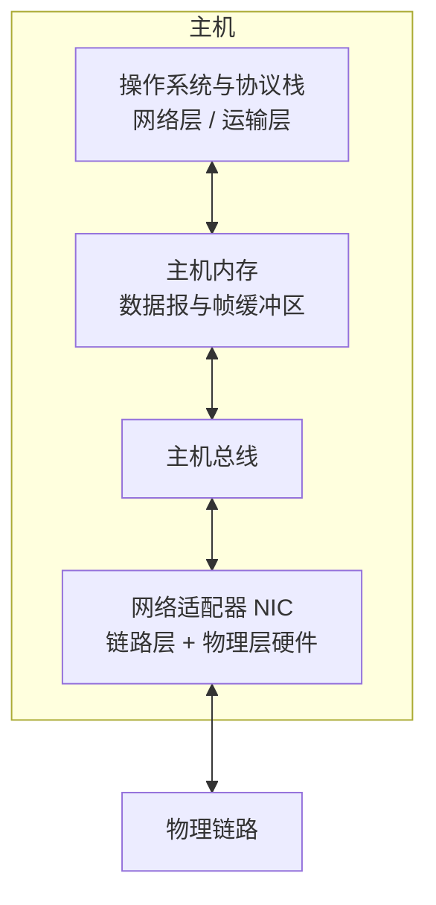

发送和接收过程如下：

- **发送端**：从主机内存取得网络层数据报，填充帧首部和差错检测字段，执行链路接入规则，再把帧发送到链路
- **接收端**：接收完整帧，检查差错，提取网络层数据报并交付给主机协议栈

链路层并非完全由硬件实现。运行在 CPU 上的软件仍负责较高层次的控制功能，例如组装链路层地址、初始化和配置适配器、响应适配器中断、处理异常以及把数据报交给网络层。

因此，链路层可以看作**硬件与软件协同实现的协议层**：实时性要求高、需要高速处理的部分通常放在硬件中；与操作系统和上层协议衔接的部分则由软件完成。

## 6.2 差错检测和纠正技术

比特在传输中可能因衰减、噪声、串扰而出错。链路层在发送前附加冗余比特，接收方据此判断、甚至修复错误：

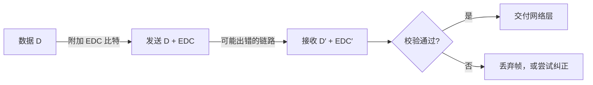

> [!warning] 检测不等于保证
> 任何差错检测方案都只能以**一定概率**发现错误。若错误恰好把 $D+\text{EDC}$ 变成另一个合法码字，接收方就会误认为无差错。冗余比特越多、检测算法越强，漏检概率越低，开销与计算量也越大。

三种常用技术的对比如下：

| 技术     | 原理                          | 检测能力 | 开销         | 典型位置       |
| -------- | ----------------------------- | -------- | ------------ | -------------- |
| 奇偶校验 | 增加校验比特使 1 的个数为偶数 | 弱       | 极低         | 教学、简单硬件 |
| 检验和   | 反码求和后取反                | 较弱     | 低           | 运输层（软件） |
| CRC      | 模 2 多项式除法               | 强       | 中，可硬件化 | 链路层（硬件） |

### 6.2.1 奇偶校验

#### 1. 单比特奇偶校验

最简单的差错检测方法是**单比特奇偶校验**（single-bit parity）。假设需要发送的数据 $D$ 包含 $d$ 个比特，发送方额外增加一个校验位，使数据和校验位中的 1 的个数满足指定的奇偶规则。

- **偶校验**（even parity）：使 $d+1$ 个比特中 1 的总数为偶数
- **奇校验**（odd parity）：使 $d+1$ 个比特中 1 的总数为奇数

以偶校验为例，接收方统计收到的 $d+1$ 个比特中 1 的个数：

- 若 1 的个数为奇数，则至少发生了奇数个比特错误
- 若 1 的个数为偶数，则可能没有错误，也可能发生了偶数个比特错误

因此，单比特奇偶校验只能检测**奇数个比特翻转**。若两个比特同时翻转，奇偶性不变，错误就可能漏检。

#### 2. 二维奇偶校验

单比特奇偶校验只能发现奇数个比特错误。为了获得更强的检测能力，可以把数据排成 $i$ 行、$j$ 列的矩阵，并分别为每一行、每一列计算奇偶校验位，这称为**二维奇偶校验**（two-dimensional parity）。

下面以偶校验为例。接收方看到的数据中，位置 $(2,3)$ 的数据比特由原来的 0 翻转成了 1，而发送方计算的行、列校验位保持不变：

|        | $c_1$ | $c_2$ | $c_3$ | $c_4$ | 行校验 |
| :----: | :---: | :---: | :---: | :---: | :----: |
| $r_1$  |   1   |   0   |   1   |   1   |   1    |
| $r_2$  |   0   |   1   | **1** |   0   | **1**  |
| $r_3$  |   1   |   1   |   0   |   1   |   1    |
| $r_4$  |   1   |   0   |   0   |   1   |   0    |
| 列校验 |   1   |   0   | **1** |   1   |   1    |

第 2 行有 2 个 1，本应校验位为 0，实际为 1，不匹配；第 3 列同样有 2 个 1，校验位也是 1，不匹配。行、列校验同时不匹配的交点就是出错位置，把它翻转回 0 即完成纠正。

右下角的校验位对"行校验列"（等价于"列校验行"）再做一次偶校验。借助它，接收方可以区分单个比特错误的位置：

| 报错的校验        | 判定                 | 处理                 |
| ----------------- | -------------------- | -------------------- |
| 一行 + 一列       | 交点处的数据比特出错 | 翻转该比特           |
| 仅某一行 + 右下角 | 该行的行校验位出错   | 数据无误，修正校验位 |
| 仅某一列 + 右下角 | 该列的列校验位出错   | 数据无误，修正校验位 |
| 仅右下角          | 右下角自身出错       | 数据无误             |

> [!note] 数据比特出错时右下角不受影响
> 单个数据比特翻转，会使其所在行校验与所在列校验各翻转一次，而右下角对全部行校验位的奇偶性不变（两个校验位同时参与的是同一个数据比特，不改变右下角匹配结果）。因此数据出错与右下角报错无关。

- 二维奇偶校验可以检测任意一个或两个比特错误，并能定位、纠正单个比特错误
- 当两个数据比特错误落在同一行或同一列时，校验只能发现异常，无法确定具体的错误位置
- 当四个错误比特恰好构成矩形的四个顶点时，每行和每列的错误数量均为偶数，所有校验均可能通过，因而发生漏检

接收方能自行检测并纠正错误的能力称为**前向纠错**（Forward Error Correction，FEC）。FEC 的价值在于不需要重传，适用于：

- 实时音频、视频无法等待重传的往返时延
- 深空链路往返时延以分钟计，重传代价极高
- 音频 CD 用交叉交错的 FEC 对抗划痕与灰尘

### 6.2.2 检验和方法

检验和把数据看作若干 $k$ 比特整数，求和后取反码作为校验字段。Internet 检验和采用 **16 比特反码求和**：

| 步骤 | 计算                                  |   结果   |
| :--: | ------------------------------------- | :------: |
|  1   | 发送方对数据字求和：`0x1234 + 0x5678` | `0x68AC` |
|  2   | 取反码，得到检验和                    | `0x9753` |
|  3   | 发送 `0x1234`、`0x5678`、`0x9753`     |    —     |
|  4   | 接收方把三个字一起求和                | `0xFFFF` |
|  5   | 结果为全 1，判定无差错；否则判定出错  |    —     |

| 优点                 | 缺点                                    |
| -------------------- | --------------------------------------- |
| 实现简单，纯软件即可 | 检错能力弱于 CRC                        |
| 计算量小             | 对字序不敏感，交换两个字不会被发现      |
| 适合高层协议         | 插入全 0 字也不改变和，无法抵御恶意篡改 |

> [!question] 为什么运输层用检验和，链路层用 CRC？
> 二者的实现位置不同。运输层在主机软件中实现，需要一种足够简单、可快速计算的方案；链路层在适配器硬件中实现，可以用移位寄存器和异或门在流式数据上直接算出 CRC，几乎不增加时延。换句话说，不是 CRC 更好所以链路层用它，而是链路层**用得起** CRC。

### 6.2.3 循环冗余校验 CRC

**循环冗余校验**（Cyclic Redundancy Check，CRC）是一种广泛用于链路层的差错检测技术，也称为多项式编码（polynomial code）。

发送方和接收方预先约定一个 $r+1$ 比特的**生成多项式**（generator）$G$，其最高位必须为 1。发送方要为 $d$ 比特的数据 $D$ 计算 $r$ 比特的余数 $R$，使得最终发送的比特串能够被 $G$ 整除：

最终发送的比特串为：

$$
T = D \cdot 2^r \oplus R
$$

其中 $T$ 恰好能被 $G$ 整除。接收方用 $G$ 去除收到的比特串：余数为 0 则认为无差错，否则判定出错。

所有运算都在**模 2 算术**下进行：

- 加法不进位，减法不借位，加减法都等价于异或
- 例如 `1011 XOR 0101 = 1110`，`1001 XOR 1101 = 0100`

#### 1. 计算示例

设 $D=101110,\,G=1001\implies r=3$：

1. 在 $D$ 后补 3 个 0，得 `101110000`
2. 用 `1001` 做模 2 长除法，每步取最高 4 位与 `1001` 异或（最高位为 0 时直接移位），去掉前导 0 后继续：

   | 步骤 | 当前比特串  | 取前 4 位异或        | 结果，接剩余位并去前导 0     |
   | :--: | ----------- | -------------------- | ---------------------------- |
   |  1   | `101110000` | `1011 ⊕ 1001 = 0010` | `0010` + `10000` → `1010000` |
   |  2   | `1010000`   | `1010 ⊕ 1001 = 0011` | `0011` + `000` → `11000`     |
   |  3   | `11000`     | `1100 ⊕ 1001 = 0101` | `0101` + `0` → `1010`        |
   |  4   | `1010`      | `1010 ⊕ 1001 = 0011` | 余数 `011`                   |

3. 余数 $R=011$，发送 $T=101110\;011$

接收方用 `1001` 除 `101110011`。若余数为 0，则判定无差错。

#### 2. 检测能力

CRC 的检错能力取决于 $G$ 的选择：

- 能检测所有长度小于 $r+1$ 比特的突发错误，即连续错误长度不超过 $r$ 比特时全部可以检测
- 在适当假设下，长度大于 $r+1$ 比特的突发错误以约 $1-2^{-r}$ 的概率被检测到
- 若生成多项式包含因子 $(x+1)$，则可以检测任意奇数个比特错误。

常见 CRC 生成多项式包括 CRC-8、CRC-12、CRC-16 和 CRC-32。以太网使用 CRC-32，其生成多项式对应的比特串为：`100000100110000010001110110110111`

> [!tip] 硬件实现：r 级移位寄存器
> 寄存器共 $r$ 位，初值全 0。对输入串（含补的 $r$ 个 0）逐位处理：
>
> 1. 取寄存器最高位 $f$
> 2. 寄存器左移一位，低位补入下一个输入比特
> 3. 若 $f=1$，寄存器与 $G$ 的低 $r$ 位异或
>
> 全部输入处理完，寄存器内容即余数。以 $G=1001$（低 3 位为 `001`）处理 `101110000`，最终寄存器为 `011`，与长除法结果一致。
>
> 该电路不需要缓存整个帧，因此能在高线速下实时完成。

---

# 第二部分 多路访问链路和协议

## 6.3 多路访问链路和协议

点对点链路由两端独占，基本不存在竞争；广播链路则要让多个节点共享同一信道，竞争不可避免。

广播链路的核心问题是**多路访问问题**：多个节点可能同时发送，信号在介质上叠加，导致**碰撞**（collision），涉及的帧全部损坏，带宽被白白浪费。因此需要多路访问协议规定"谁在什么时候可以发送"。

这些年来，多路访问协议层出不穷，但大致可归为三类：

1. **信道划分协议**（channel partitioning protocols）
2. **随机接入协议**（random access protocols）
3. **轮流协议**（taking-turns protocols）

理想情况下，我们希望（幻想）多路访问协议具有以下特性：

1. 只有一个节点活跃时，它能以全速率 $R$ bps 发送
2. $M$ 个节点活跃时，每个节点的平均吞吐量接近 $R/M$
3. 完全去中心化，不依赖某个主节点，避免单点故障
4. 简单、便宜、易于实现

### 6.3.1 信道划分协议

信道划分协议把信道的带宽切分成若干份，分给不同节点，从而在源头上避免碰撞。

- 时分复用（Time-Division Multiplexing, **TDM**）：将时间划分为**时间帧**（time frame），每个时间帧再划分为 $N$ 个**时隙**（time slot），分配给 $N$ 个节点，每个节点在被分配的时隙内发送数据。
  - 优点：消除碰撞，公平
  - 缺点：数据平均发送速率被限制在 $R/N$，并必须等待轮到它的时隙才能发送，即使它是唯一要发数据的节点。
- 频分复用（Frequency-Division Multiplexing, **FDM**）：将信道的频谱划分为 $N$ 个子信道（子信道速率为 $R/N$），分配给 $N$ 个节点，每个节点在被分配的子信道上发送数据。
  - 优点：消除碰撞，公平
  - 缺点：每个节点的传输速率被限制在 $R/N$，并且需要额外的滤波器和频率规划。
- 码分多址（Code Division Multiple Access, **CDMA**）：对每个节点分配一种不同的码。每个节点使用自己唯一的码对要发送的数据比特进行**编码**。
  - 优点：如果码选择得当，多个节点可以同时发送数据， 并且接收方可以使用相应的码对信号进行**解码**，从而恢复出原始数据。
  - 缺点：需要复杂的编码和解码算法，并且可能受到多径干扰和码间干扰。

  CDMA 曾是 3G 蜂窝网络的基础技术，但在 4G 和 5G 网络中已被其他技术取代。

### 6.3.2 随机接入协议

随机接入协议不让节点排队，而是允许节点以全速率 $R$ 发送；发生碰撞就等待随机时间后重传。

#### 1. 时隙 ALOHA

**时隙 ALOHA**（slotted ALOHA）假设：

| 假设                 | 说明                       |
| -------------------- | -------------------------- |
| 帧长固定为 $L$ 比特  | 每个帧需要 $L/R$ 秒发送    |
| 时间被划分为时隙     | 每个时隙长度为 $L/R$ 秒    |
| 节点同步             | 所有节点知道时隙何时开始   |
| 只能在时隙开始时发送 | 一个帧恰好占用一个时隙     |
| 碰撞可以被检测       | 节点能在时隙结束前得知碰撞 |

节点有新的帧需要发送时，等到下一个时隙开始就发送。若成功则结束；若碰撞，则在后续每个时隙以概率 $p$ 重传，直到成功。

时隙 ALOHA 具有几个优点：当只有一个节点活跃时，它可以连续使用信道全速率 $R$；节点独立决定是否重传，不需要中心控制器；协议实现也较简单。它的主要代价是碰撞时隙和空闲时隙都会浪费信道资源。

**效率**定义为：在大量活跃节点、每个节点始终有大量帧待发送的情况下，长期来看成功时隙所占的比例。

> [!note] 时隙 ALOHA 的效率推导
> 设 $N$ 个节点，每个节点在一个时隙内**以概率 $p$ 发送**。某个时隙成功的条件是"恰好一个节点发送，其余 $N-1$ 个都不发送"：
>
> $$
> P_{\text{success}} = Np(1-p)^{N-1}
> $$
>
> 对 $p$ 求极值：令导数为 0，得 $p = 1/N$。代入：
>
> $$
> \max P_{\text{success}} = \left(1-\frac{1}{N}\right)^{N-1} \xrightarrow{N\to\infty} \frac{1}{e} \approx 0.368
> $$
>
> 因此长期来看，最多约 37% 的时隙在做有用功。即便所有节点都"守规矩"，仍有三分之二的带宽被浪费。

#### 2. 纯 ALOHA

纯 ALOHA 不要求时隙同步，节点有帧就立即发送。若碰撞，节点每等待一个帧时后以概率 $p$ 重传。

纯 ALOHA 的问题在于：帧发送期间，其他节点只要在某个时间范围内开始发送，就可能与该帧发生重叠。设发送一个帧所需时间为 $T$，节点 A 在时刻 $t$ 开始发送，则其他节点在 $[t-T,t+T]$ 内开始发送，都可能导致 A 的帧发生碰撞。这个时间范围称为**脆弱期**（vulnerable period），其长度为 $2T$。

最大效率为：

$$
\eta_{\max} = \frac{1}{2e} \approx 0.184
$$

即只有时隙 ALOHA 的一半。这是完全去中心化、完全不协调所付出的代价。

> [!info] 历史：Norm Abramson 与 ALOHAnet
> 20 世纪 60 年代末，Norm Abramson 在夏威夷大学设计 ALOHAnet，希望通过无线电连接分散在岛屿上的计算机。网络使用两个不同频段：中心主机通过下行信道广播数据，各个远端节点通过上行信道向中心主机发送数据。由于多个远端节点共享上行信道，碰撞不可避免，这促使 Abramson 提出了纯 ALOHA。1970 年，ALOHAnet 与 ARPAnet 建立连接。ALOHA 的随机接入思想后来也启发了 Ethernet 的设计。

#### 3. 载波侦听多路访问 CSMA

ALOHA 协议中，节点并不考虑其他节点是否正在发送，因而碰撞较多。**载波侦听多路访问**（Carrier Sense Multiple Access，CSMA）加入一条礼貌规则：**发送前先侦听信道**，信道忙就等待，信道空闲才发送。这样可以避免撞上正在进行的传输。

> [!question] 既然已经侦听，为什么还会碰撞？
> 假设 A 与 D 位于共享总线两端。时刻 $t_0$，B 侦听信道并发现空闲，于是开始发送。B 的信号需要经过传播时延 $T_{\text{prop}}$ 才能传播到 D。若 D 在信号到达之前也开始发送，那么 D 侦听时仍会认为信道空闲，最终两者的帧在信道中发生碰撞。

CSMA 不检测碰撞，因此即使已经碰撞，节点仍会把整个损坏的帧发完，浪费信道时间。

#### 4. CSMA/CD

**带碰撞检测的载波侦听多路访问**（CSMA/CD）在 CSMA 上增加了碰撞检测：适配器在发送过程中持续检测信号，一旦发现碰撞就立即停止，而不是把整个帧发完。这样，被碰撞损坏的传输会被及早中止，减少浪费的信道时间。

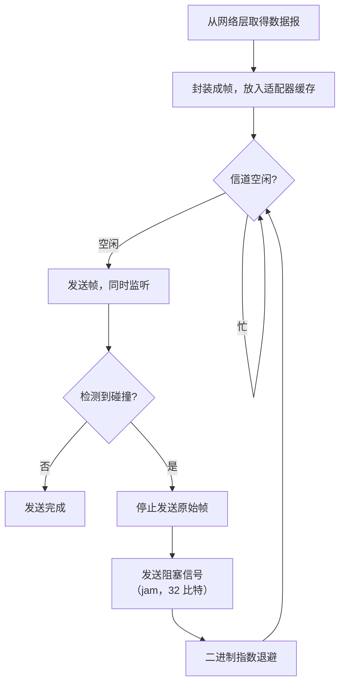

**阻塞信号**（jam signal）：检测到碰撞后，适配器先发送 32 比特的阻塞信号，确保所有参与碰撞的节点都察觉到碰撞，再进入退避。

以太网采用**二进制指数退避**（binary exponential backoff）算法：一个帧经历 $n$ 次碰撞后，节点从集合中随机选择整数 $K$：

$$
K\in\{0,1,2,\ldots,2^n-1\}
$$

等待时间为 $K$ 个时隙单位。以太网中的时隙单位为 **512 bit times**，即发送 512 个比特所需的时间。

碰撞次数越多，随机选择区间越大，节点之间再次碰撞的概率就越低。以太网中，指数增长的范围在达到规定上限后不再继续增大。

| 已发生碰撞次数 $n$ | $K$ 的取值范围        | 可能的退避时隙数 |
| :----------------: | --------------------- | ---------------- |
|         1          | $\{0,1\}$             | 0–1              |
|         2          | $\{0,1,2,3\}$         | 0–3              |
|         3          | $\{0,1,\ldots,7\}$    | 0–7              |
|     10 或更多      | $\{0,1,\ldots,1023\}$ | 0–1023           |

以太网中 $n$ 通常封顶为 10，之后窗口不再增大。若连续 16 次碰撞仍失败，适配器放弃该帧并向网络层报告错误。

每次发送一个新帧时，节点都会重新执行 CSMA/CD 算法，不会把之前帧经历过的碰撞次数直接沿用到新帧。因此，一个刚到达的新帧有可能在其他节点仍处于退避状态时成功发送。

> [!note] CSMA/CD 与现代以太网
> CSMA/CD 主要对应早期总线型以太网和使用集线器的共享式以太网。现代以太网通常采用交换机和全双工点对点链路，一个端口不会同时承载多个节点的竞争发送，因此不再需要通过 CSMA/CD 解决碰撞问题。

#### 5. CSMA/CD 的效率

在忽略协议开销、假设帧长固定且节点数很多的条件下，CSMA/CD 的效率可近似为

$$
\eta \approx \frac{1}{1 + 5a},\qquad a=\frac{d_{\text{prop}}}{d_{\text{trans}}}
$$

- 传播时间 $d_{\text{prop}}$ 越小，存在碰撞却检测不到的窗口越短，碰撞被检测到的时间越快。双方都能尽早停止发送，减少浪费的信道时间，从而提高效率。
- 帧传输时间 $d_{\text{trans}}$ 越大，固定传播时延所占的比例减小，碰撞检测及争用所消耗的时间相对于成功传输时间变得更小，因此信道利用率提高

> [!note] CSMA/CA
> 无线介质上无法在发送的同时可靠地检测碰撞（自身信号远强于接收信号），因此 802.11 采用**碰撞避免**（CSMA/CA）：先侦听，再随机退避，并用确认帧判断是否成功。具体机制留待无线章节。

### 6.3.3 轮流协议

随机接入在"只有一个节点活跃"时表现最好，多节点活跃时效率下降。轮流协议则让节点按顺序获得发送权，兼顾公平与效率。

其中有两种比较重要的轮流协议：

- **轮询**（polling）：主节点依次告知从节点允许发送和最大发送帧数量，同时检测其是否发送完成（或空闲），然后继续告知下一个从节点。
- **令牌传递**（token passing）：节点按固定顺序传递一个令牌（token），持有令牌的节点可以发送数据，发送完毕后将令牌传给下一个节点。

| 特性     | 轮询（polling）                  | 令牌传递（token passing）      |
| -------- | -------------------------------- | ------------------------------ |
| 控制方式 | 主节点依次询问从节点             | 令牌在节点间按固定顺序传递     |
| 去中心化 | 差，依赖主节点                   | 较好                           |
| 碰撞     | 无                               | 无                             |
| 主要缺点 | 轮询时延；主节点故障导致全网瘫痪 | 令牌丢失或节点故障需要恢复机制 |
| 典型例子 | 蓝牙微微网                       | 令牌环（IEEE 802.5）、FDDI     |

轮询的开销是"问一圈"的时延：即使只有一个节点有数据，也要等主节点问到它。令牌传递把控制权分散到各节点，但令牌本身可能丢失、重复，需要额外的监控与恢复机制。

#### 三类多路访问协议比较

| 类别     | 代表协议             | 如何协调发送             | 主要优点               | 主要代价                 |
| -------- | -------------------- | ------------------------ | ---------------------- | ------------------------ |
| 信道划分 | TDM、FDM、CDMA       | 预先分配时间、频率或编码 | 碰撞少，资源分配明确   | 空闲资源可能被浪费       |
| 随机接入 | ALOHA、CSMA、CSMA/CD | 节点竞争，碰撞后随机退避 | 单节点活跃时可独占信道 | 多节点活跃时可能发生碰撞 |
| 轮流     | 轮询、令牌传递       | 依次授予发送机会         | 减少碰撞，发送更有秩序 | 控制开销与等待时间       |

### 6.3.4 DOCSIS：电缆 Internet 接入的链路层协议

**DOCSIS**（Data Over Cable Service Interface Specification）是电缆接入网的链路层标准，它把信道划分、随机接入和集中式授权组合在一起，是理解"真实协议如何折中"的好例子。

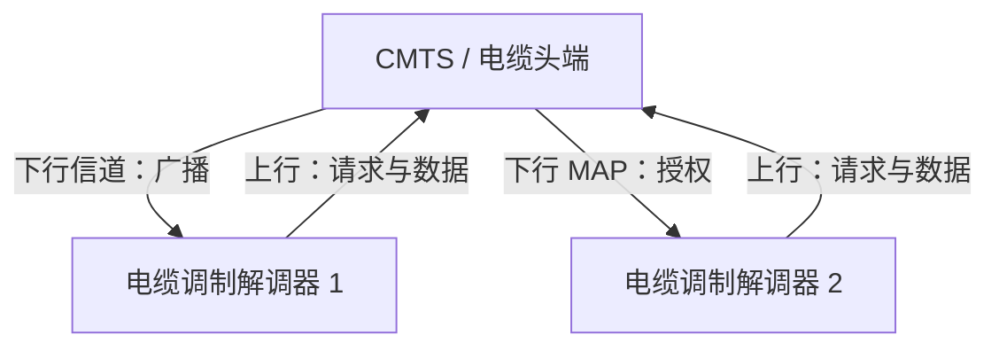

下行方向只有 CMTS 一个发送方，天然是广播，不存在多路访问问题；上行方向由多个调制解调器共享，必须协调。

上行方向的机制是分层的：

1. **频分**：上下行使用不同的频率段，互不干扰
2. **时分**：上行信道划分为微时隙（minislot），由 CMTS 统一编号
3. **随机接入**：调制解调器在竞争微时隙中发送**请求帧**，声明"我要发多少数据"
4. **集中授权**：CMTS 用下行 MAP 报文公布每个微时隙归谁使用
5. **退避重传**：请求帧碰撞时，按二进制指数退避后重试
6. **测距**：CMTS 测量各调制解调器的传播时延并下达定时偏移，使上行信号在时隙边界对齐

因此，DOCSIS 同时体现了三种思路：用 FDM/TDM 消除大部分竞争，用随机接入处理请求，用集中授权保证数据传输阶段无碰撞。

> [!note] 现代 DOCSIS
> 传统 DOCSIS 主要采用上下行频分、上行时分调度与竞争请求相结合的机制。随着 DOCSIS 3.1 和 4.0 的发展，OFDM/OFDMA、全双工通信等技术进一步提高了频谱利用率与传输能力。

---

# 第三部分 交换局域网与链路层寻址

## 6.4 交换局域网

上一节讨论了多个节点如何共享同一广播信道。本节转向**交换局域网**（switched LAN）：通过链路层交换机把多个主机、服务器和路由器连接起来。

链路层交换机按照帧中的 **MAC 地址**进行转发，而不是根据 IP 地址执行网络层路由。交换机通常对主机和路由器透明：主机只需把帧发送给目标适配器，并不需要知道中间经过了哪些交换机。

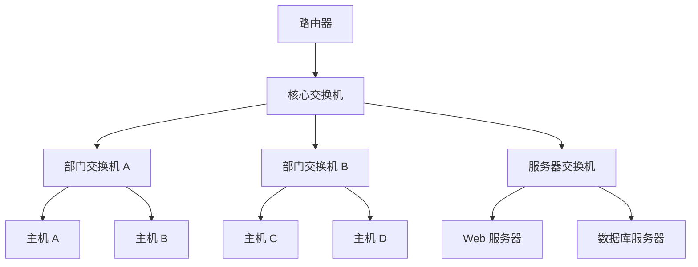

交换局域网的构建涉及几个问题：主机如何知道目标设备的 MAC 地址？以太网帧采用什么格式？交换机如何学习和转发帧？如何在同一套物理设施上隔离不同部门的网络？本节依次讨论这些问题。

### 6.4.1 链路层寻址和 ARP

主机和路由器既有网络层地址（例如 IP 地址），也有链路层地址（MAC 地址）。

#### 1. MAC 地址

严格来说，具有链路层地址的不是主机或路由器本身，而是它们的**网络适配器**（网络接口）。一台拥有多个网络接口的主机或路由器，通常也拥有多个 MAC 地址。

链路层地址也称为 **LAN 地址**、**物理地址**或 **MAC 地址**（Media Access Control Address）。对以太网和 802.11 无线局域网而言，以太网的 MAC 地址长 48 比特（6 字节），通常写成六组十六进制数：`1A-23-F9-CD-06-9B`

对于传统的 MA-L 地址块，前 24 比特为 OUI，由 IEEE 分配给组织，后 24 比特由该组织自行分配，保证全球唯一。除此之外，IEEE 还提供 MA-M 和 MA-S 等不同规模的地址块。

> [!note] 本地管理地址
> MAC 地址的第 2 个最低有效位（U/L 位）为 1 时表示**本地管理地址**，由网络管理员自行分配，不保证全球唯一。若为 0，才是全球唯一地址。

MAC 地址具有两个重要特征：

- **扁平结构**：地址本身不包含网络前缀与主机部分，不表示设备所处的网络位置；
- **通常不随位置改变**：设备移动到另一个局域网时，适配器的 MAC 地址通常仍然保持不变。虽然 MAC 地址原本被设计为固定地址，但现代系统也允许通过软件修改它。

> [!example] MAC 地址与 IP 地址的类比
> 可以把 MAC 地址比作身份证号码：它用于识别对象，通常不随对象所处的位置变化。IP 地址则更像邮寄地址：它描述对象在网络中的位置，位置改变时地址也需要改变。
>
> 网络需要两种地址，正如一个人既需要身份标识，也需要邮寄地址。

广播 MAC 地址为 `FF-FF-FF-FF-FF-FF`。适配器收到帧后按以下规则处理：

| 条件                            | 动作           |
| ------------------------------- | -------------- |
| 目的 MAC 等于自己的 MAC         | 接收，向上交付 |
| 目的 MAC 为广播地址             | 接收，向上交付 |
| 目的 MAC 为组播地址且已加入该组 | 接收           |
| 其他                            | 丢弃           |
| 处于混杂模式（抓包、虚拟化）    | 全部接收       |

> [!important] 实践原则：保持各层独立
> 既然 IP 地址已经能标识主机，为什么还要 MAC 地址？
>
> 1. **局域网不只承载 IP**。同一块网卡要能同时处理 IPv4、IPv6、ARP、IPX 等协议，链路层不能假定上层一定是 IP
> 2. **地址与位置解耦**。若适配器直接使用网络层地址，主机移动或换网段时就得重新配置硬件地址
> 3. **过滤成本**。若适配器没有自己的地址，所有帧都要交给主机处理，CPU 将被大量无关帧中断
> 4. **分层**。各层使用各自的地址，修改一层不必改动另一层

#### 2. 地址解析协议 ARP

**地址解析协议**（Address Resolution Protocol，ARP）把 IP 地址解析为 MAC 地址。主机 A 知道 B 的 IP 地址，却必须先得到 B 的 MAC 地址，才能在以太网帧的目的地址字段填上正确的值。

每台主机和路由器都维护一张 **ARP 表**：

| IP 地址         | MAC 地址          | 剩余寿命（TTL） |
| --------------- | ----------------- | --------------- |
| 222.222.222.221 | 88-B2-2F-54-1A-0F | 13 分 45 秒     |
| 222.222.222.223 | 5C-66-AB-90-75-B1 | 13 分 52 秒     |

ARP 有几个值得注意的特点：

- **即插即用**：无需配置，表项由协议自动建立
- **请求广播、应答单播**：请求帧发往广播地址，应答只发给提问者
- **会老化**：表项过期后须重新解析，以适应 MAC 地址变化；典型值为 20 分钟，实际随操作系统而异
- **只管本子网**：跨子网的解析交给默认网关

假设主机 A 的 IP 地址为 `222.222.222.220`，要向同一子网中的主机 B（IP 地址为 `222.222.222.222`）发送数据报。A 知道 B 的 IP 地址，却不知道 B 的 MAC 地址。

ARP 的工作过程如下：

1. A 查询自己的 ARP 表。若表中已有 B 的 IP-MAC 映射，就直接使用；
2. 若没有对应表项，A 构造 ARP 请求报文，其中包含发送方和目标方的 IP、MAC 地址信息；
3. A 把 ARP 请求封装到以太网帧中，并将目的 MAC 地址设为**广播地址** `FF-FF-FF-FF-FF-FF`；
4. 局域网中的其他适配器收到广播帧后，将 ARP 请求交给各自的 ARP 模块，检查目标 IP 是否与自己的 IP 匹配；
5. 目标主机 B 发现请求中的目标 IP 是自己的 IP，于是发送 ARP 应答，**单播**给 A 自己的 MAC 地址；
6. A 收到应答后更新 ARP 表，并用 B 的 MAC 地址构造以太网帧，发送原始 IP 数据报。

> [!note] ARP 报文格式
> 在以太网上承载 IPv4 时，ARP 报文长 28 字节，字段包括：硬件类型、协议类型、硬件地址长度、协议地址长度、操作码（1 = 请求，2 = 应答）、发送方 MAC 与 IP、目标 MAC 与 IP。请求中的目标 MAC 字段填全 0，由应答方填入自己的地址。

> [!warning] ARP 欺骗
> ARP 没有任何认证机制，主机收到应答就更新表项。攻击者可以持续发送伪造应答，宣称"网关的 IP 对应我的 MAC"，从而把流量引到自己这里，实施中间人攻击。常见防护手段包括动态 ARP 检测（DAI）、静态绑定和 802.1X 准入控制。

#### 3. 发送数据报到子网以外

如果目的主机与发送主机位于**不同子网**，发送方不能直接通过 ARP 查询远端主机的 MAC 地址。它需要先把数据报交给本地子网中的**第一跳路由器**（默认网关）。

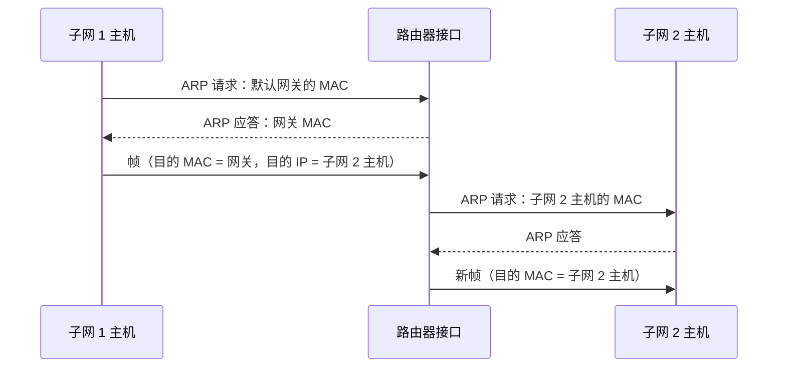

关键规律是：**IP 地址端到端不变，MAC 地址逐跳重写**。

| 字段            | 主机 → 网关      | 网关 → 目的主机     |
| --------------- | ---------------- | ------------------- |
| 源 MAC          | 主机 MAC         | 网关出口接口 MAC    |
| 目的 MAC        | 网关入口接口 MAC | 目的主机 MAC        |
| 源 IP           | 主机 IP          | 主机 IP（不变）     |
| 目的 IP         | 目的主机 IP      | 目的主机 IP（不变） |
| TTL             | 初始值           | 减 1                |
| IPv4 首部检验和 | 原值             | 重新计算            |

每一跳路由器都要拆帧、查转发表、重新封装，因此链路层帧只在本地有意义。这正是"链路层地址用于一跳，网络层地址用于端到端"的含义。

#### 4. 例题：经路由器的逐帧推演

设两个子网由一台路由器互联（示例地址）：

| 设备             | IP 地址         | MAC 地址          |
| ---------------- | --------------- | ----------------- |
| 主机 A（子网 1） | 111.111.111.111 | 74-29-9C-E8-FF-55 |
| 路由器接口 1     | 111.111.111.110 | E6-E9-00-17-BB-4B |
| 路由器接口 2     | 222.222.222.220 | 1A-23-F9-CD-06-9B |
| 主机 B（子网 2） | 222.222.222.222 | 49-BD-D2-C7-56-2A |

A 向 B 发送一个数据报，设各 ARP 表项均已缓存。逐段的帧如下：

| 阶段             | 源 MAC        | 目的 MAC      | 源 IP           | 目的 IP         |
| ---------------- | ------------- | ------------- | --------------- | --------------- |
| A → 路由器接口 1 | A 的 MAC      | 接口 1 的 MAC | 111.111.111.111 | 222.222.222.222 |
| 路由器接口 2 → B | 接口 2 的 MAC | B 的 MAC      | 111.111.111.111 | 222.222.222.222 |

两段帧中，IP 字段相同，MAC 字段完全不同；路由器在中间还要把 TTL 减 1 并重算 IP 首部检验和。若 A 的 ARP 表中没有默认网关表项，须先广播 ARP 请求解析 `111.111.111.110`；同理，路由器若不知道 B 的 MAC，会在子网 2 上广播 ARP 请求。

> [!tip] 常见误区
> A 在 ARP 表中查的是**默认网关**的 IP（`111.111.111.110`），而不是 B 的 IP。A 通过子网掩码判断 B 不在本子网，因此把帧交给网关。

### 6.4.2 以太网

以太网是今天最流行的有线局域网技术，从 1970 年代的同轴电缆总线，发展到集线器星型拓扑，再到今天的交换式星型拓扑，帧格式保持了长期稳定。

> [!info] 历史：集线器和交换机
> 20 世纪 90 年代末，以太网 LAN 普遍采用**集线器**（Hub）组成的**星形拓扑**：各主机通过双绞线连接到集线器。集线器工作在物理层，按比特而非帧进行转发：它将某个接口收到的比特重新生成并增强信号，再广播到所有其他接口。因此，集线器网络仍属于广播式 LAN，多个节点同时发送时仍可能发生碰撞。
>
> 进入 21 世纪，以太网逐渐以**交换机**（Switch）取代集线器，但仍保留星形拓扑。交换机工作在数据链路层，能够存储并转发帧，而不是简单地复制比特。它将不同接口隔离为独立的碰撞域，配合全双工通信可以消除碰撞。与工作在网络层的路由器不同，交换机只处理至数据链路层。

#### 1. 以太网帧结构

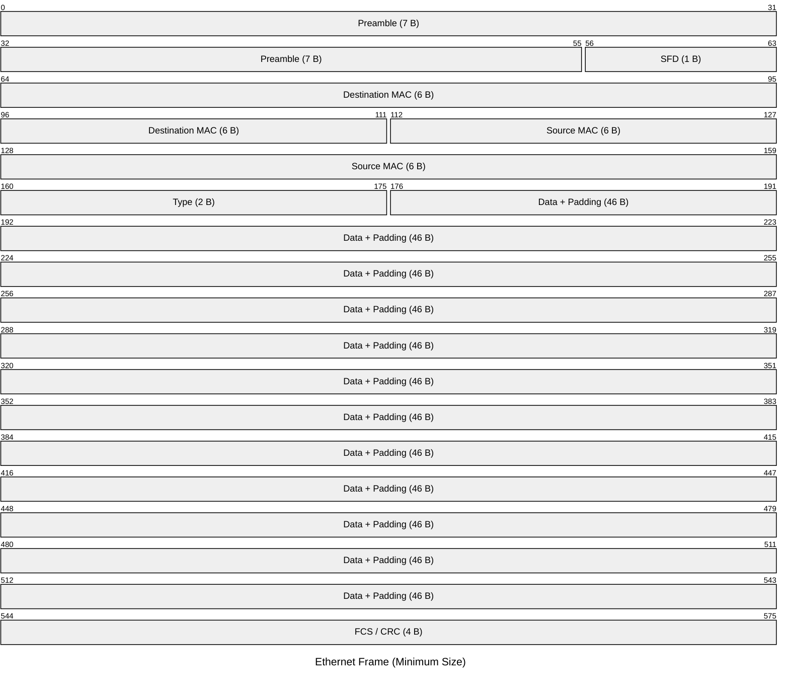

- **前导码**（Preamble）：7 字节，用于时钟同步，内容为 `10101010` 重复 7 次
- **帧开始定界符**（SFD）：1 字节，内容为 `10101011`，标志帧的开始
- **目的地址**（Destination MAC）：6 字节，指明帧的接收者
  - 广播地址：`FF-FF-FF-FF-FF-FF`
  - 组播地址：第一个字节的最低有效位（I/G 位）为 1 的 MAC 地址
- **源地址**（Source MAC）：6 字节，指明帧的发送者
- **类型**（Type）：2 字节，指示上层协议类型
  - IPv4：`0x0800`； ARP：`0x0806`；IPv6：`0x86DD`
  - 类型字段小于 `0x0600` 时表示长度而非协议类型，这是与 IEEE 802.3 兼容留下的历史包袱
- **数据**（Data）：46~1500 字节，承载网络层数据报；不足 46 字节须填充
  - 1500 字节是以太网的最大传输单元（MTU），超过该长度的报文需分片
- **帧校验序列**（FCS）：4 字节，使用 CRC-32 进行校验

以太网提供**无连接、不可靠**服务：发送前不握手，收到帧不回确认，CRC 校验失败就直接丢弃。丢失的帧由 TCP 重传弥补；若上层是 UDP，则表现为丢包。以太网刻意保持简单，把可靠性留给端系统。

#### 2. 以太网技术

以太网标准命名遵循统一规则：**速率 + BASE + 介质/编码**。

- 速率部分直接标明比特率（10、100、1000、10G、40G、100G 等）。
- 后缀则标明具体介质或编码方式：BASE-T 通常指双绞线，BASE-SX/LX/LR 等多与光纤波长或距离相关，BASE-CX 则指短距铜缆等。

常见标准示例：

| 名称         | 速率     | 介质 / 特点         | 典型最大距离 |
| ------------ | -------- | ------------------- | ------------ |
| 10BASE-T     | 10 Mbps  | 双绞线              | 100 m        |
| 100BASE-TX   | 100 Mbps | 两对 Cat5 双绞线    | 100 m        |
| 1000BASE-T   | 1 Gbps   | 四对双绞线          | 100 m        |
| 1000BASE-LX  | 1 Gbps   | 长波单模/多模光纤   | 数公里       |
| 10GBASE-T    | 10 Gbps  | 双绞线（Cat6a）     | 100 m        |
| 40GBASE-T    | 40 Gbps  | 双绞线（Cat8）      | 约 30 m      |
| 100GBASE-LR4 | 100 Gbps | 长波光纤 + 波分复用 | 约 10 km     |

物理介质经历了从早期同轴电缆（10BASE-2/5）、双绞线到光纤的演变。今天的以太网通常采用**交换式星型拓扑**，各设备通过独立的**点对点链路连接交换机**。**全双工链路**允许双方同时发送和接收，不存在传统共享介质上的碰撞，因此不需要 CSMA/CD。只有在共享介质或半双工模式下，碰撞检测才仍然必要。

尽管速率提升了三个数量级、拓扑和介质发生巨大变化，以太网帧格式本身却保持了近半个世纪的稳定，这也是它被持续称为“以太网”的核心原因。

> [!note] 为什么以太网 MTU 通常是 1500 字节？
> 可以从传输效率与时延的折中来理解：帧越长，固定首部开销占比越低，逐包处理开销也越小；但长帧需要更长的发送时间，在共享介质或存在排队竞争时，会增加其他数据的等待时间。
>
> 数据中心等高速网络中常使用巨型帧（Jumbo Frame），MTU 常配置为约 9000 字节，以减少逐包处理开销和首部占用。但其具体大小取决于设备实现，需要通信路径上的相关设备均支持相应的 MTU。

### 6.4.3 链路层交换机

交换机对主机和路由器是**透明**的，主机和路由器不知道也不关心帧在链路层是如何转发的。与路由器类似，交换机输出接口也设有缓存，以应对突发的流量。

#### 1. 转发和过滤

交换机维护**交换机表**（switch table）来决定帧的转发路径或是否过滤（丢弃），举例如下：

|          MAC 地址 | 接口 | 表项建立时间 |
| ----------------: | :--: | ------------ |
| 62-FE-F7-11-89-A3 |  1   | 9:32         |
| 7C-BA-B2-B4-91-10 |  3   | 9:36         |

当目的地址为 `DD-DD-DD-DD-DD-DD` 的帧到达交换机接口 $x$ 时，交换机会查表，此时有三种可能：

1. **无表项**：交换机不知道目的 MAC 在哪个接口，会将该帧转发到除入接口外的其他适用端口，称为泛洪（flooding）
2. **表项 $=x$**：说明帧是回送的，交换机丢弃该帧（过滤）
3. **表项 $\ne x$**：交换机将该帧放入对应接口的输出缓存，等待发送

#### 2. 自学习

交换机表不需要管理员配置，交换机会自动建立它：

1. 初始时表为空
2. 每收到一个帧，就把**源 MAC**、**入接口**和**当前时间**写入表中。若该 MAC 已有表项，则更新接口与时间
3. 一段时间内未出现的表项被删除，这段时间称为老化时间（aging time）

因此交换机是**即插即用**设备：插上线就能工作，拓扑变化后表项会自动调整。

> [!example] 例题：自学习逐帧推演
> 一台 4 端口交换机，主机 A、B、C、D 分别接在端口 1、2、3、4，初始表为空。依次发生下列传输：
>
> | 序  | 帧（源 → 目的） | 入端口 | 学到的表项  | 交换机动作                  |
> | --- | --------------- | ------ | ----------- | --------------------------- |
> | 1   | A → B           | 1      | A 在 1      | B 未知，向端口 2、3、4 泛洪 |
> | 2   | B → A           | 2      | B 在 2      | A 已知在 1，只从端口 1 转发 |
> | 3   | C → B           | 3      | C 在 3      | B 在 2，只从端口 2 转发     |
> | 4   | A → B           | 1      | 更新 A 在 1 | B 在 2，只从端口 2 转发     |
> | 5   | B → D           | 2      | 更新 B 在 2 | D 未知，向端口 1、3、4 泛洪 |
>
> 第 5 步之前，D 一直没有发送过帧，所以交换机始终不知道它在哪个端口，只能泛洪。D 一旦发出任意帧，表项就会建立。

#### 3. 存储转发与直通转发

| 方式                    | 做法                                  | 时延           | 差错处理                       |
| ----------------------- | ------------------------------------- | -------------- | ------------------------------ |
| 存储转发                | 收完整个帧、校验 FCS 无误后才转发     | 每跳多约 $L/R$ | 损坏帧被丢弃，不浪费出链路带宽 |
| 直通转发（cut-through） | 读到目的 MAC 即开始转发，不等整帧收完 | 最低           | 可能把已损坏的帧转发出去       |

#### 4. 交换机的性质

交换机的优点很直接：

- **消除碰撞**：每个端口是一个独立的碰撞域，全双工下无碰撞
- **支持异质链路**：不同端口可跑不同速率，交换机负责缓存与整形
- **易于管理**：可逐端口启用、禁用、限速、镜像，便于排障
- **提高安全性**：帧只发给目的端口，不像集线器那样广播到所有端口

局限同样明显：广播帧仍会泛洪到整个局域网（除非划分 VLAN）；冗余链路会形成环路，须用 STP/RSTP 阻塞部分端口（见下）；表项耗尽后会退化为泛洪，可被攻击者利用。

> [!warning] 交换机毒化
> 攻击者发送大量源 MAC 各不相同的伪造帧，迅速填满交换机表。此后合法帧的目的 MAC 查不到表项，交换机只能泛洪，攻击者接在任一端口上就能嗅探到本不该发给它的流量。这种攻击称为**交换机毒化**（switch poisoning）或 MAC 泛洪攻击。防护手段包括端口安全（限制每端口学到的 MAC 数量）、静态绑定和 VLAN 隔离。

#### 5. 环路与生成树协议 STP

为提高可靠性，交换网络常有冗余链路，但二层帧头没有 TTL：广播或泛洪帧一旦遇到环路，就会无限循环并放大，造成**广播风暴**。

**生成树协议**（Spanning Tree Protocol，STP，IEEE 802.1D）通过阻塞部分端口，在有环拓扑上逻辑地构造一棵无环树：

| 步骤 | 内容                                                                |
| ---- | ------------------------------------------------------------------- |
| 1    | 选举**根桥**：桥 ID（优先级 + MAC）最小者                           |
| 2    | 每台非根交换机选一个**根端口**：到根桥路径开销最小的端口            |
| 3    | 每个网段选一个**指定端口**：该网段上到根开销最小的端口              |
| 4    | 其余端口置于**阻塞**状态，不转发数据帧，只收发 STP 配置报文（BPDU） |

链路或交换机故障时，STP 重新计算，启用原先被阻塞的端口。**RSTP**（802.1w）在此基础上显著缩短收敛时间。

#### 6. 交换机与路由器的比较

| 特性         | 集线器（Hub）        | 交换机（Switch）                          | 路由器（Router）                 |
| ------------ | -------------------- | ----------------------------------------- | -------------------------------- |
| **工作层次** | 物理层               | 数据链路层                                | 网络层                           |
| **转发依据** | 无（广播到所有端口） | 目的 MAC 地址                             | 目的 IP 地址                     |
| **碰撞域**   | 整个网络一个         | 每个端口一个                              | 每个接口一个                     |
| **广播域**   | 整个网络一个         | 默认整个网络一个（可用 VLAN 分割）        | 每个接口一个                     |
| **即插即用** | 是                   | 是                                        | 否（需配置 IP 地址与路由协议）   |
| **流量隔离** | 无                   | 有（端口隔离 + VLAN）                     | 有（天然隔离广播域）             |
| **路径选择** | 无                   | 无（受生成树限制，路径单一）              | 有（可按拓扑、策略选择最优路径） |
| **转发时延** | 最低                 | 低                                        | 较高（需处理到第3层）            |
| **主要风险** | 碰撞严重、带宽共享   | 广播风暴、生成树限制、大型网络 ARP 开销大 | 配置复杂、处理开销较大           |

- **小型网络**优先使用**交换机**
  - 优点：便宜、即插即用、转发速度快、能有效隔离碰撞域并提高总吞吐量。
  - 缺点：广播域默认是整个网络，大型场景下容易出现广播风暴和 ARP 表膨胀

- **大型网络**应在网络中引入**路由器**（或三层交换机）
  - 优点：天然隔离广播域、能根据拓扑选择最优路径、可实施访问控制策略，网络拓扑更丰富稳健。
  - 缺点：需要配置 IP 地址与路由，转发时延相对较高

- **现代实践**  
  **三层交换机**把第2层交换与第3层路由功能结合在硬件中完成，既保留高速转发能力，又能做 IP 转发与策略控制，广泛用于数据中心和园区网核心/汇聚层。

### 6.4.4 虚拟局域网 VLAN

传统交换局域网可能按照部门划分为多个物理网段，每个部门连接自己的交换机，再通过上层交换机互联。这种方式在规模扩大后会遇到三个问题：

1. **广播隔离不足**：广播帧（ARP、DHCP 等）会泛洪到整个机构网络，既浪费带宽，也存在安全隐患（敏感流量可被任意端口嗅探）
2. **交换机利用率低**：每个部门都需要独立交换机，小部门造成大量端口闲置
3. **用户移动管理困难**：员工换部门必须重新布线，跨部门用户更难处理

**虚拟局域网**（Virtual Local Area Network，VLAN）允许在一套物理局域网基础设施上定义多个逻辑局域网。处于同一个 VLAN 的主机看起来就像连接在同一个独立交换网络中；不同 VLAN 之间的广播流量彼此隔离。

#### 1. 基于端口的 VLAN

网络管理员将交换机端口划分到不同 VLAN：

| 端口范围 | VLAN ID | 所属部门     | 说明         |
| -------- | ------- | ------------ | ------------ |
| 2 – 8    | 10      | 电气工程系   | 独立广播域   |
| 9 – 15   | 20      | 计算机科学系 | 独立广播域   |
| 1、16    | 未分配  | —            | 可配置为干线 |

- 同一 VLAN 内的端口构成一个广播域。
- 跨 VLAN 的帧即使物理上在同一台交换机内，也不会被直接转发。
- 用户换部门只需在管理软件中修改端口所属 VLAN，无需重新布线。

#### 2. VLAN 间通信

VLAN 默认完全隔离，互通必须经过**网络层设备**：

- **单臂路由**：交换机一个端口接外部路由器，路由器为每个 VLAN 配置子接口
- **三层交换机**（更常用）：交换机内部为每个 VLAN 创建虚拟接口（SVI），直接在硬件中完成 IP 转发

逻辑上始终是“**二层隔离、三层转发**”。

#### 3. VLAN 中继与 802.1Q

多台交换机互联时，为每个 VLAN 拉独立链路成本过高。更可扩展的方式是**VLAN 中继**（VLAN trunking）：在两台交换机之间配置一条 trunk 链路，让它承载多个 VLAN 的帧。

此时，交换机必须知道从 trunk 端口到达的帧属于哪个 VLAN。IEEE 802.1Q 定义了带 VLAN 标签的扩展以太网帧格式。交换机在发送帧进入 trunk 链路时插入 4 字节 VLAN 标签；另一端交换机读取标签，确定 VLAN 后再剥离标签并转发。

普通以太网帧：
| Preamble | SFD | DA | SA | Type | Data + Padding | FCS |
| :------: | :-: | :-: | :-: | :--: | :------------: | :-: |

802.1Q 带标签帧：

| Preamble | SFD | DA  | SA  | 802.1Q 标签 | Type | Data + Padding | FCS |
| :------: | :-: | :-: | :-: | :---------: | :--: | :------------: | :-: |

802.1Q 标签占 4 字节，内部字段：

| 字段 |   长度 | 说明                                                       |
| :--: | -----: | ---------------------------------------------------------- |
| TPID | 16 bit | Tag Protocol Identifier，固定值 `0x8100`，标识这是带标签帧 |
| PCP  |  3 bit | Priority Code Point，优先级（0–7），类似 IP 的 DSCP        |
| DEI  |  1 bit | Drop Eligible Indicator，指示在拥塞时是否可优先丢弃        |
| VID  | 12 bit | VLAN Identifier，真正的 VLAN 编号                          |

- VID 取值 1\~4094；0 表示优先级标签帧（Priority-tagged frame），不指定 VLAN；4095 保留，不可用于正常 VLAN 标识。
- PCP + DEI + VID 合称 **TCI（Tag Control Information）**。
- 带标签帧最大长度变为 **1522 字节**。
- 交换机插入/剥离标签后必须**重新计算 FCS**。

#### 4. 其他划分方式与注意事项

- **按 MAC 地址划分**：设备接入任何端口都会自动加入对应 VLAN。
- **按协议划分**：可根据 IPv4、IPv6 等上层协议划分。
- **动态划分**：结合 802.1X 认证结果动态分配。
- **跨路由器扩展**：可用 VXLAN 等技术把 VLAN 延伸到更广的地理范围。

> [!warning] 安全提醒
> VLAN 提供的是**广播域隔离**，不是严格的安全隔离。干线端口配置错误、VLAN 跳跃（VLAN Hopping）攻击都可能绕过边界。高安全需求场景应配合独立设备或加密手段。

---

# 第四部分 链路虚拟化与数据中心网络

## 6.5 链路虚拟化：把整个网络当作一条链路

本章开头，我们把链路理解为连接相邻节点的物理线路。随着讨论深入，链路的含义逐渐扩展：它可以是多个节点共享的信道，也可以是由交换机组成的复杂局域网。对通信端点而言，底层即使经过许多设备，也可以表现为一条逻辑链路。

例如，两个主机通过拨号调制解调器连接时，主机之间实际上经过了一个由交换机、链路和协议构成的电话网络。但从 Internet 的链路层视角看，电话网络可以被抽象成连接两端主机的一条链路。

这种抽象称为**链路虚拟化**（link virtualization）：底层可能是一个复杂网络，上层却把它看作一条逻辑链路。

本节介绍两种典型技术：多协议标签交换 MPLS 和 VXLAN。它们都能把底层复杂网络隐藏起来，但实现方式不同。

### 6.5.1 多协议标签交换（MPLS）

**多协议标签交换**（Multiprotocol Label Switching，MPLS）起源于 20 世纪 90 年代中后期，其设计思想借鉴了虚电路网络：给分组增加一个固定长度的**标签**（label），使路由器可以根据标签转发，而不必每次都根据 IP 目的地址执行最长前缀匹配。

IETF 最终将这些努力统一为 MPLS 协议（RFC 3031、RFC 3032），把虚电路技术与路由数据报网络有机结合。

> [!success] 定义
> MPLS 是一种工作在链路层与网络层之间的转发技术。入口路由器为分组压入标签，核心路由器只根据“入标签 → 出标签 + 出接口”的映射表进行转发，出口路由器弹出标签。标签的分配与路径建立由控制平面协议完成，数据平面转发本身与 IP 首部无关。

#### 1. MPLS 帧格式

MPLS 在链路层首部与 IP 首部之间插入一个 **4 字节的 shim header**（MPLS 首部）：

| 字段  | 长度   | 作用                                         |
| ----- | ------ | -------------------------------------------- |
| Label | 20 bit | 固定长度标签，供 MPLS 路由器查表转发         |
| TC    | 3 bit  | 流量类别，常用于 QoS 优先级                  |
| S     | 1 bit  | 栈底标志。1 表示当前是最内层（最后一个）标签 |
| TTL   | 8 bit  | 生存时间，防止环路                           |

由于非 MPLS 设备无法正确处理预期的 IP 首部之前出现的 MPLS 首部，因此带 MPLS 首部的帧只能在支持 MPLS 的相邻设备之间传输。具备 MPLS 能力的路由器通常称为**标签交换路由器**（Label-Switched Router, LSR）。

#### 2. 标签分发与转发路径

MPLS 需要让相邻的 MPLS 路由器知道：某个标签代表什么转发等价类（Forwarding Equivalence Class，FEC），以及收到该标签的数据应该如何转发。

MPLS 采用下游分配标签（Downstream Label Allocation）机制：由数据转发方向上的下游路由器分配标签，再将标签映射通告给上游路由器。因此，标签分配与通告方向通常和数据转发方向相反。

例如，假设 R1、R2、R3、R4 均支持 MPLS，R1 是入口路由器，R4 是出口路由器，目的地 A 位于 R4 后方。数据可以选择以下两条路径：

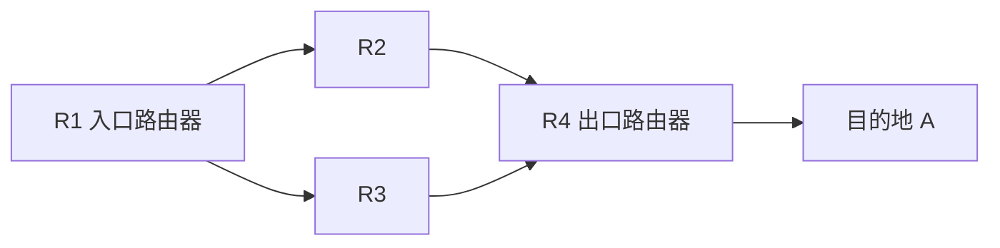

标签分发过程如下：

1. R4 分配标签：R4 为到达目的地 A 的 FEC 分配标签，例如向 R2 通告标签 10，向 R3 通告标签 12。
2. R2、R3 分配标签：R2 收到 R4 的标签映射后，为同一个 FEC 分配标签 6，并向上游 R1 通告；R3 则分配标签 8，并向 R1 通告。
3. R1 建立转发状态：R1 获得两条路径的标签映射，可以根据控制平面的路径选择结果，选择经 R2 或 R3 转发。

数据转发过程如下：

- 路径一：R1 → R2 → R4 → A
  - R1 为数据分组压入标签 6，发送给 R2。
  - R2 收到标签 6 后，根据标签转发表将其替换为标签 10，再发送给 R4。
  - R4 收到标签 10 后，弹出标签并将分组继续转发到目的地 A。
- 路径二：R1 → R3 → R4 → A
  - R1 为数据分组压入标签 8，发送给 R3。
  - R3 收到标签 8 后，将其替换为标签 12，再发送给 R4。
  - R4 收到标签 12 后，弹出标签并将分组继续转发到目的地 A。

这里需要注意：MPLS 标签具有局部意义，同一个标签值在不同链路或不同路由器上可以代表不同的转发等价类。路由器根据收到的标签查表，执行压入（Push）、替换（Swap）或弹出（Pop）操作。

这里的关键在于：MPLS 路由器能够根据标签选择转发路径，而不必查看 IP 首部。底层 MPLS 网络可以像交换局域网或 ATM 网络一样，把多个 IP 设备连接起来。

> [!note] 补充说明
> 上述示例采用 RFC 3031 定义的传统下游分配标签方式。实际标签分发还涉及下游主动通告（Downstream Unsolicited）和上游请求（Downstream on Demand）两种模式。

标签如何分发、MPLS 路径如何计算，涉及专门的信令与路由机制。RSVP 的扩展 RSVP-TE 可用于 MPLS 信令；OSPF 等链路状态协议也可以扩展，以传播链路带宽等信息。具体路径计算算法并没有统一规定，实际实现可能因厂商而异。

#### 3. MPLS 的优势

早期人们强调 MPLS 能加快转发，但现代硬件做 IP 最长前缀匹配已经非常快。MPLS 真正被广泛使用的原因在于它提供了标准 IP 路由难以实现的能力：

1. **流量工程（Traffic Engineering）**  
   标准 IP 路由只选择最短路径。MPLS 可以显式指定多条路径，把去往同一目的地的流量分流到不同链路，绕开拥塞，实现负载均衡或策略路由。

2. **快速恢复（Fast Reroute）**  
   可以预先计算备份 LSP。当链路或节点故障时，在毫秒级切换到备份路径，远快于传统路由协议的收敛时间。

3. **VPN 支持**  
   利用标签栈隔离不同客户的路由表和地址空间，实现 L3VPN。运营商可以用同一张物理网络为多个客户提供虚拟专用网络。

4. **多业务承载**  
   同一张 MPLS 网络可以同时承载 IP、以太网、专线等多种业务。

MPLS 在软件定义网络（SDN）出现之前就已经成熟。SDN 的广义转发范式（匹配任意字段 + 动作）也能实现许多原本属于 MPLS 的流量工程功能。未来两者可能长期共存，也可能被更新的技术逐步取代，目前仍在演进中。

### 6.5.2 VXLAN：把以太网延伸到 IP 网络之上

我们在 6.4.4 节学习的 802.1Q VLAN 有两个重要限制：

- VLAN ID 只有 12 比特，最多只能支持 **4094** 个 VLAN。
- 整个 VLAN 必须限制在一个**端到端的交换式以太网**基础设施内，无法跨越三层网络，更无法轻松覆盖全球。

如果希望把地理位置相距很远的多个二层网络连接起来，或者在数据中心中支持远多于 4094 个逻辑网络，就可以使用**可扩展虚拟局域网**（Virtual eXtensible LAN，VXLAN）。

VXLAN 的核心思想是建立一个二层**隧道**：原始以太网帧进入隧道后，被封装在 UDP 数据报中，再封装在 IP 数据报中，通过底层三层网络传输；到达隧道另一端后，再取出原始以太网帧并交付给目标局域网。

> [!success] Definition VXLAN
> VXLAN 是一种把二层以太网帧封装进 UDP/IP 报文的隧道技术，用 24 比特的 VNI（VXLAN Network Identifier）标识虚拟网络，最多支持约 1600 万个虚拟局域网，并可跨越三层网络边界。

**VTEP**（VXLAN Tunnel Endpoint，VXLAN 隧道端点）是实现 VXLAN 的关键设备。它可以是：

- 物理交换机或路由器
- 数据中心中的虚拟交换机（vSwitch）

每个 VTEP 负责：

- 识别本端主机发出的帧属于哪个 VXLAN
- 把完整的以太网帧加上 VXLAN 头后封装进 UDP，再封装进 IP 数据报，发往对端 VTEP
- 在对端解封装，把原始以太网帧重新注入本地以太网

具体来说，全过程举例说明如下：

1. Host A（Sunnyvale）发出一个目的 MAC 为 Host B（Bangalore）的以太网帧
2. 本地 VTEP $x$ 收到该帧，发现 Host B 位于隧道另一端
3. VTEP $x$ 执行以下封装：
   - 原始以太网帧完整保留
   - 加上 VXLAN 头部（其中包含 24 比特 VNI）
   - 再封装进 UDP 段
   - 最后封装进以 VTEP $y$ 为目的地址的 IP 数据报
4. 中间的 IP 网络像传输普通数据报一样，把这个报文送到 Bangalore 的 VTEP $y$
5. VTEP $y$ 解封装，提取出原始以太网帧，并在本地以太网中转发
6. Host B 最终收到源 MAC 为 A、目的 MAC 为 B 的原始帧

VXLAN 首部中包含一个 24 比特的 **VXLAN 网络标识符**（VXLAN Network Identifier，VNI）。24 比特可以表示约 1600 万个不同的 VXLAN，相比 802.1Q 的 12 比特 VLAN ID，能够支持更多逻辑隔离网络。

封装结构如下：

```text
外层 Ethernet
└── 外层 IP
    └── UDP
        └── VXLAN Header（含 24-bit VNI）
            └── 原始 Ethernet Frame
                └── 原始 IP Datagram
                    └── 上层数据
```

这种“以太网帧套在 UDP 里再套在 IP 里”的层叠封装，正是隧道与链路虚拟化思想的典型体现。

VXLAN 特别适合：

- 大型数据中心需要大量隔离租户网络
- 跨数据中心、跨地域的二层连通需求
- 云环境下虚拟机任意迁移（保持 IP/MAC 不变）

## 6.6 数据中心网络

大型互联网公司建设数据中心，用于提供网页、搜索、邮件、视频等服务，支撑大规模并行计算，并提供云计算。一个数据中心可能有数万到数十万台主机，其网络设计与传统企业网有显著差异。

### 6.6.1 数据中心体系结构

#### 1. 数据中心的基本组成

数据中心中的服务器通常采用标准化、商品化硬件。常见的机架式服务器采用类似“披萨盒”的扁平结构，直接安装在机架中；刀片服务器则以模块化形式插入共享机箱中。每个机架通常放置约 20–40 台主机。

每个机架顶部通常部署一台交换机，称为**机架顶部交换机**（Top of Rack，TOR）。机架中的每台主机都连接到 TOR 交换机，TOR 交换机再通过额外端口连接数据中心中的其他交换机。常见服务器接入速率为 40 Gbps 或 100 Gbps 以太网。

数据中心网络支持两类流量：

- **南北向流量**（north-south traffic）：外部客户端与数据中心内部主机之间的通信；
- **东西向流量**（east-west traffic）：数据中心内部不同主机之间的通信。

为了处理外部用户请求，数据中心通常部署一个或多个**边界路由器**（border router），将内部网络连接到公共 Internet。

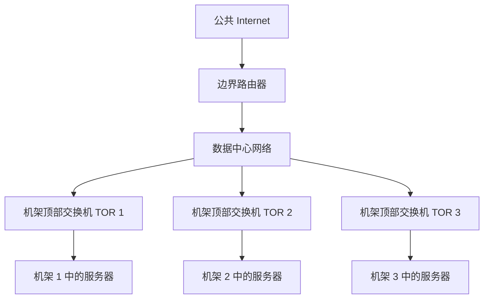

> [!note] 数据中心建设成本
> 原书以 2024 年的大型数据中心为例，给出了一个粗略的成本构成：主机约占 45%，基础设施（供电、UPS、发电机、制冷等）约占 25%，电力消耗约占 15%，网络设备与外部连接等约占 15%。
>
> 尽管网络设备并非最大成本项，网络架构创新仍可能显著影响整体建设成本与应用性能。

#### 2. 负载均衡

大型云数据中心通常同时运行搜索、邮件、视频等多种应用。每个应用可以有一个对外公开的 IP 地址，客户端向这个地址发送请求。

数据中心内部通常由**负载均衡器**（load balancer）接收外部请求，再根据主机当前负载，将请求分发给适合处理该请求的服务器。

负载均衡器有两个重要作用：

1. **分配工作负载**：避免请求集中到少数服务器，提高资源利用率；
2. **隐藏内部结构**：负载均衡器把应用对外的公开 IP 映射到具体服务器的内部 IP，返回方向再进行反向转换，提供类似 NAT 的功能。客户端不必直接与内部主机通信。

负载均衡器有时称为**四层交换机**（layer-4 switch），因为它不仅可以根据目的 IP 地址，还可以根据运输层目的端口等信息作出转发决策。

#### 3. 分级拓扑与容量瓶颈

针对大量的主机互联，通常采用分层的路由器与交换机结构（边界路由器 → 接入路由器 → 多层交换机 → TOR），可以扩展到数十万台主机的同时留出足够的冗余。然而，传统架构依然存在 **host-to-host 容量受限**问题：

- 同机架主机之间可跑满接入速率
- 跨机架流量需经过上层链路，当大量并发流共享有限带宽时，单流有效速率显著下降

示例：若主机接入 10 Gbps、交换机间链路 100 Gbps，40 条跨机架流同时经过某条 100 Gbps 链路时，每流平均仅得 2.5 Gbps。

应对思路主要有三条：

- 使用更高速率交换机和路由器（成本高昂）。
- 尽量将相关服务与数据放置在同一机架或邻近机架（受灵活性要求限制）。
- **增加层间连接度**，形成多根（multi-root）/Clos 拓扑，提供多条链路与交换机不相交的路径。这样既提升聚合带宽，又提高容错性。

  每台 TOR 连接到多台第二层交换机，每台第二层交换机再连接到多台第一层交换机，从而在任意两层之间提供多条链路与交换机不相交的路径。

#### 4. 多路径路由与 ECMP

增加层间连接后，数据中心网络中会出现多条从源主机到目的主机的可用路径。此时，**多路径路由**（multipath routing）成为重要机制。

一种简单方案是**等价多路径路由**（Equal-Cost Multi-Path，ECMP）：当到目的地存在多个等代价下一跳时，路由器或交换机在这些下一跳之间分配不同流量。更精细的方案还可以依据流量大小或链路负载进行负载均衡，部分设计甚至允许同一条流中的不同数据包走不同路径。

多路径路由带来两项重要收益：

- **增加容量**：多条路径共同承载流量，提高网络整体吞吐量；
- **提高可靠性**：某条链路或设备失效时，仍可能通过其他路径到达目的地。

#### 5. Leaf-Spine 架构

传统三层分层网络逐渐演进出一种两层互联结构，称为 **Leaf-Spine 拓扑**：

- **Leaf 交换机**：接入交换机，直接连接服务器或机架；
- **Spine 交换机**：核心交换机，连接所有 Leaf 交换机。

每台 Leaf 交换机都与每台 Spine 交换机相连。数据中心可以通过增加 Spine 交换机数量或提高 Leaf-Spine 链路速率来扩展互联带宽。

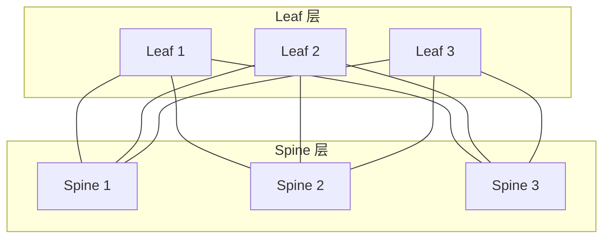

在 Leaf-Spine 拓扑中，服务器之间的通信除接入 Leaf 外，通常只需经过一个 Spine 层交换机，即交换机之间恰好两跳。相比传统分层架构，这使不同机架之间的路径长度更加一致。

Leaf-Spine 架构的兴起，也反映了数据中心流量模式的变化：服务器之间的东西向流量日益重要，不再只是服务器与外部客户端之间的南北向流量。

#### 6. Clos 网络

由多级交换机构成的分层、多级互联网络也称为 **Clos 网络**，名称来自 Charles Clos 在电话交换领域的研究。Clos 网络后来被应用于数据中心和多处理器互联网络。

大型数据中心运营商还可能使用商品化交换芯片自行构建交换设备，而不是完全依赖传统网络设备供应商提供整机。这种定制方式有利于控制成本，并使硬件更贴合数据中心的流量特征。

### 6.6.2 数据中心网络的发展趋势

| 趋势             | 主要动机                                 | 典型做法                                                                                                  |
| ---------------- | ---------------------------------------- | --------------------------------------------------------------------------------------------------------- |
| 集中式 SDN 控制  | 单一组织管理，规模巨大                   | 逻辑集中控制器 + 商品交换机数据平面<br>自动化配置与状态管理（如 Google Orion）                            |
| 虚拟化           | 应用软件与物理硬件解耦<br>支持热迁移     | 将整个数据中心视为一个大二层网络<br>用目录服务替代传统 ARP 广播，维护“VM IP → 当前物理位置”映射           |
| 物理约束         | 高带宽、微秒级时延、小缓存、丢包代价极高 | 专用拥塞控制（Data Center TCP 等）<br>RDMA over Ethernet<br>流调度与速率控制解耦                          |
| 硬件模块化与定制 | 快速部署、可预测故障域、成本控制         | 集装箱式模块化数据中心（MDC）<br>自研网卡、交换机、协议<br>可用性区域（Availability Zones）跨邻近建筑复制 |
| 能效与碳效       | 电力成本与碳排放压力显著上升             | 优化能效；追求碳效率（整体碳足迹最小化）                                                                  |

其中虚拟化带来的地址问题值得单独说明：虚拟机在物理服务器之间迁移后，IP 地址不变，但它接入的交换机端口变了。传统以太网与 IP 依赖"地址隐含位置"的假设，迁移后要么改地址（破坏已有连接），要么让整个数据中心成为一个大二层网络，并用目录服务维护"VM 的 IP → 当前所在物理位置"的映射。

## 6.7 回顾：一次 Web 页面请求的完整历程

至此，协议栈各层均已学过。我们用一个具体场景把它们串起来：Bob 的便携机接入学校以太网，要访问 `www.google.com`。


学校路由器连接 ISP（本例为 comcast.net）。Comcast 为学校提供 DNS 服务，因此 DNS 服务器位于 Comcast 网络；DHCP 服务器通常运行在学校路由器内。

### 6.7.1 准备阶段：DHCP、UDP、IP 与以太网

Bob 开机并接入网络后，没有 IP 地址，无法进行任何网络通信。因此，第一件事是通过 **DHCP** 获取 IP 地址及其他必要配置：

1. Bob 的操作系统创建 **DHCP 请求报文**，封装进 **UDP 报文段**（目的端口 67、源端口 68）。
2. UDP 报文段再封装进 **IP 数据报**：源地址 `0.0.0.0`（尚未有地址），目的地址广播地址 `255.255.255.255`。
3. IP 数据报封装进 **以太网帧**：目的 MAC 为广播地址 `FF:FF:FF:FF:FF:FF`，源 MAC 为 Bob 笔记本电脑的地址（如 `00:16:D3:23:68:8A`）。
4. 交换机收到广播帧后，向所有端口泛洪（包括连接路由器的端口）。
5. 路由器接收该帧，提取 IP 数据报 → UDP 报文段 → DHCP 请求报文。假设 DHCP 服务器可分配 `68.85.2.0/24` 地址块，它为 Bob 分配 `68.85.2.101`，并创建 **DHCP ACK 报文**，其中包含：
   - 分配的 IP 地址
   - DNS 服务器地址（`68.87.71.226`）
   - 默认网关地址（`68.85.2.1`）
   - 子网前缀（`68.85.2.0/24`）
   - 子网掩码（`255.255.255.0`）
6. DHCP ACK 经 UDP → IP → 以太网帧封装后，以单播方式发回（目的 MAC 为 Bob 的地址）。交换机因先前学习到 Bob 的 MAC，直接转发到正确端口。
7. Bob 提取 DHCP ACK，记录自己的 IP、DNS 服务器地址，并将默认网关写入转发表。此后，所有目的地址不在本子网的数据报都发往默认网关。

此时，Bob 的网络组件已初始化完成，可以开始处理 Web 页面请求。

### 6.7.2 仍在准备：DNS 与 ARP

Bob 在浏览器输入 `www.google.com` 后，浏览器准备创建 TCP 套接字以发送 HTTP 请求，但首先需要知道 `www.google.com` 的 IP 地址，因此使用 **DNS**：

8. 操作系统创建 **DNS 查询报文**（查询 `www.google.com`），封装进 UDP 报文段（目的端口 53），再封装进 IP 数据报（目的地址为 DHCP 告知的 DNS 服务器 `68.87.71.226`，源地址为 Bob 的 `68.85.2.101`）。
9. 该数据报需发往默认网关，但 Bob 只知道网关的 IP 地址，不知道其 MAC 地址，因此使用 **ARP**。
10. Bob 创建 **ARP 查询报文**（目标 IP 为 `68.85.2.1`），封装进广播以太网帧（目的 MAC `FF:FF:FF:FF:FF:FF`）并发送。
11. 网关路由器收到 ARP 查询，发现目标 IP 匹配自身接口，回复 **ARP 应答**（告知自己的 MAC，如 `00:22:6B:45:1F:1B`）。
12. Bob 收到 ARP 应答，获知网关 MAC 地址。
13. Bob 终于能将含有 DNS 查询的以太网帧发往网关（帧的目的 MAC 为网关，IP 数据报的目的地址仍为 DNS 服务器）。

这一阶段涉及 DNS、UDP、IP、ARP 与以太网，跨越应用层、运输层、网络层与链路层。

### 6.7.3 依旧准备：路由到 DNS 服务器

14. 学校网关路由器收到帧后，提取 IP 数据报，根据转发表将数据报转发给 Comcast 网络中的下一跳路由器。
15. Comcast 网络中的路由器继续根据转发表转发。转发表由**域内路由协议**（如 OSPF、IS-IS、RIP）与**域间路由协议 BGP** 共同填充。
16. 数据报最终到达 DNS 服务器。服务器查找 `www.google.com`，返回其 IP 地址（本例为 `64.233.169.105`，假设已缓存），生成 DNS 应答报文，经 UDP → IP 封装后返回 Bob。
17. Bob 从 DNS 应答中提取到 Google 的 IP 地址，终于可以与 Web 服务器通信。

链路层在每一跳只负责把数据报送到下一跳：每经过一个路由器，都会重新封装新的链路层帧，源/目的 MAC 地址随之改变。

### 6.7.4 Web 客户-服务器交互：TCP 与 HTTP

拿到 Google 的 IP 后，真正的 Web 交互开始：

18. Bob 创建 TCP 套接字。TCP 先与 `www.google.com` 进行**三次握手**：发送 **TCP SYN** 报文段（目的端口 80），封装进 IP 数据报（目的地址 `64.233.169.105`），再封装进以太网帧发往网关。
19. 数据报经学校、Comcast、Google 网络中的路由器逐跳转发（跨域路径由 BGP 决定）。
20. SYN 到达 Google 服务器，服务器创建连接套接字，回复 **TCP SYNACK**。
21. SYNACK 返回 Bob，TCP 连接进入已连接状态。
22. Bob 的浏览器创建 **HTTP GET 请求**，写入套接字，成为 TCP 报文段的载荷，再经 IP 与链路层发送到 Google。
23. Google 的 HTTP 服务器读取 GET 请求，生成 **HTTP 响应**（正文为请求的网页内容），经 TCP 返回。
24. HTTP 响应到达 Bob，浏览器提取 HTML 并显示网页。

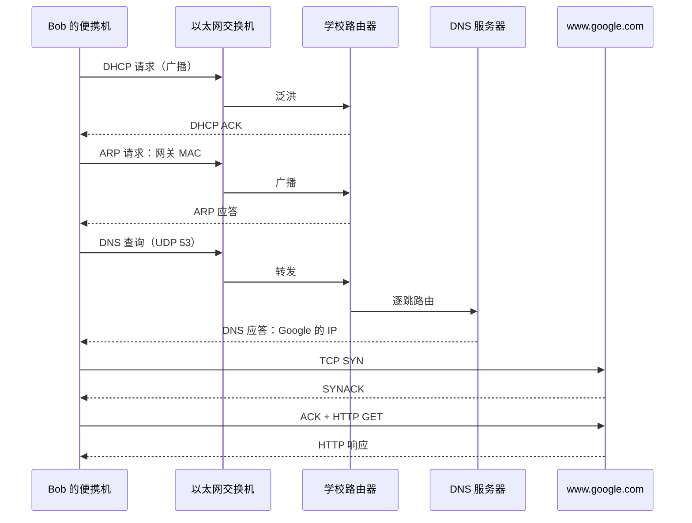

> [!summary] 协议归纳
>
> | 层次   | 协议               | 作用                             |
> | ------ | ------------------ | -------------------------------- |
> | 应用层 | HTTP、DNS、DHCP    | 请求网页、解析域名、获取 IP 地址 |
> | 运输层 | TCP、UDP           | 可靠传输、无连接查询             |
> | 网络层 | IP、OSPF/BGP、ICMP | 编址、配置、路由、差错报告       |
> | 链路层 | 以太网、ARP        | 成帧、寻址、一跳传送             |
> | 物理层 | 双绞线、光纤等     | 比特信号传输                     |
>
> 这张表也清晰说明了分层的意义：每一层只解决自己的问题，上层不必关心下层具体使用何种介质与技术。

## 6.8 小结

链路层把网络层数据报从一个节点送到相邻节点。它位于网络层与物理层之间，是协议栈中软硬件交接最明显的一层。

- **链路层服务**：成帧、链路接入、可靠交付、差错检测与纠正。成帧几乎人人都有，链路接入在共享介质上必需，后两项视链路质量而定
- **差错检测**：奇偶校验便宜但弱，检验和适合软件实现，CRC 检错能力强且可硬件线速计算
- **多路访问**：信道划分无碰撞但不灵活，随机接入灵活但有碰撞，轮流协议折中；DOCSIS 把三者组合使用
- **寻址**：MAC 地址扁平、随适配器走；IP 地址层次化、随位置走。ARP 在同一子网内把二者关联起来；经路由器时，IP 端到端不变，MAC 逐跳重写
- **以太网**：帧格式长期稳定，从共享总线演进到交换式全双工，CSMA/CD 只在半双工下需要
- **交换机**：按 MAC 转发、过滤、自学习，即插即用，但不隔离广播域；冗余环路由 STP/RSTP 处理
- **VLAN**：在物理网络上划分逻辑广播域，802.1Q 标签让一条干线承载多个 VLAN
- **MPLS**：用标签交换为 IP 提供流量工程、快速恢复与 VPN 能力
- **VXLAN**：把二层以太网延伸到三层 IP 网络之上，支持大规模隔离网络与虚拟机迁移
- **数据中心**：通过分层互联、多路径路由和 Leaf-Spine 等架构提高带宽与可靠性，并使用负载均衡、SDN 和虚拟化管理大规模资源
