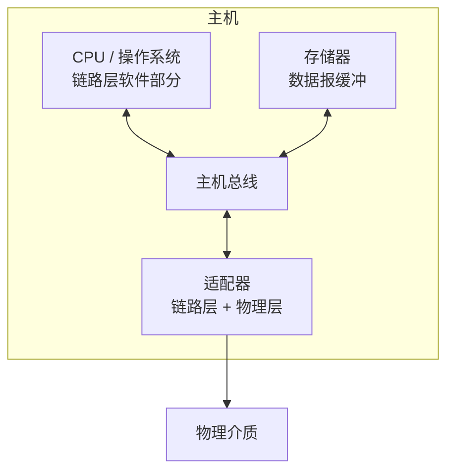
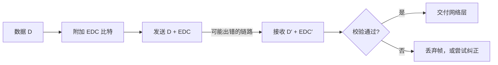
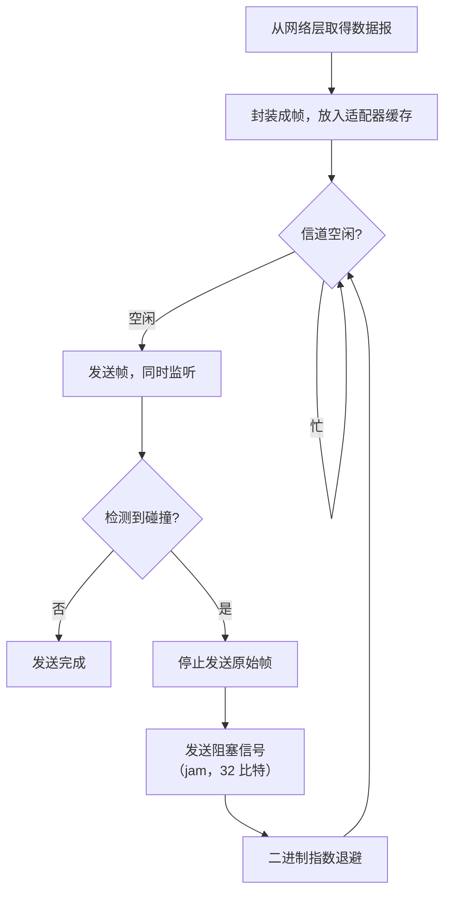
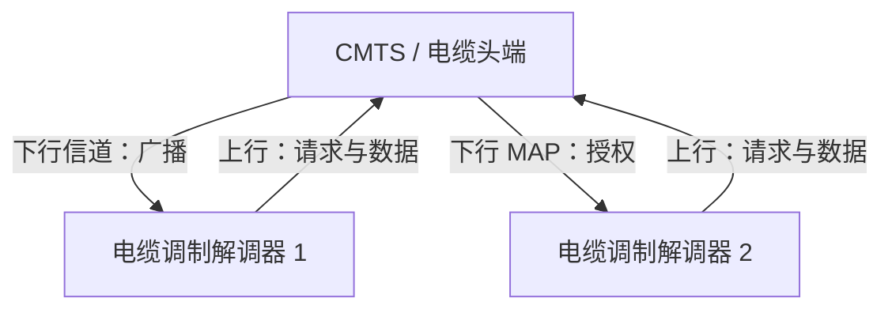
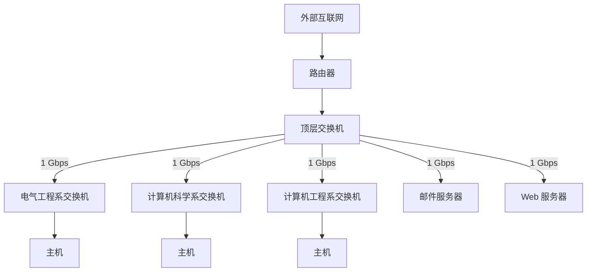
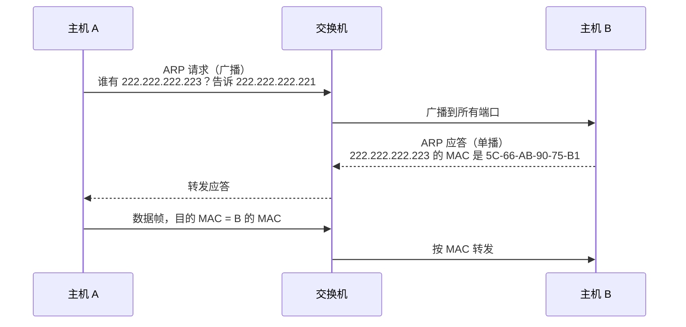
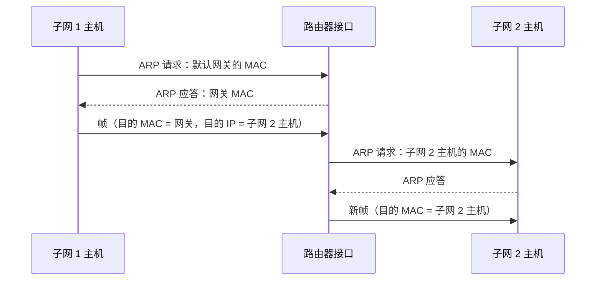
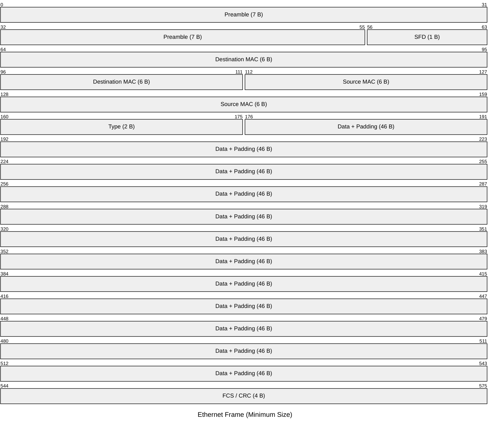
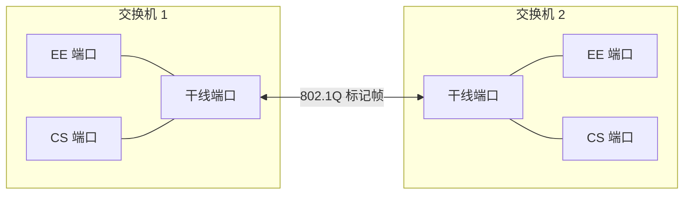
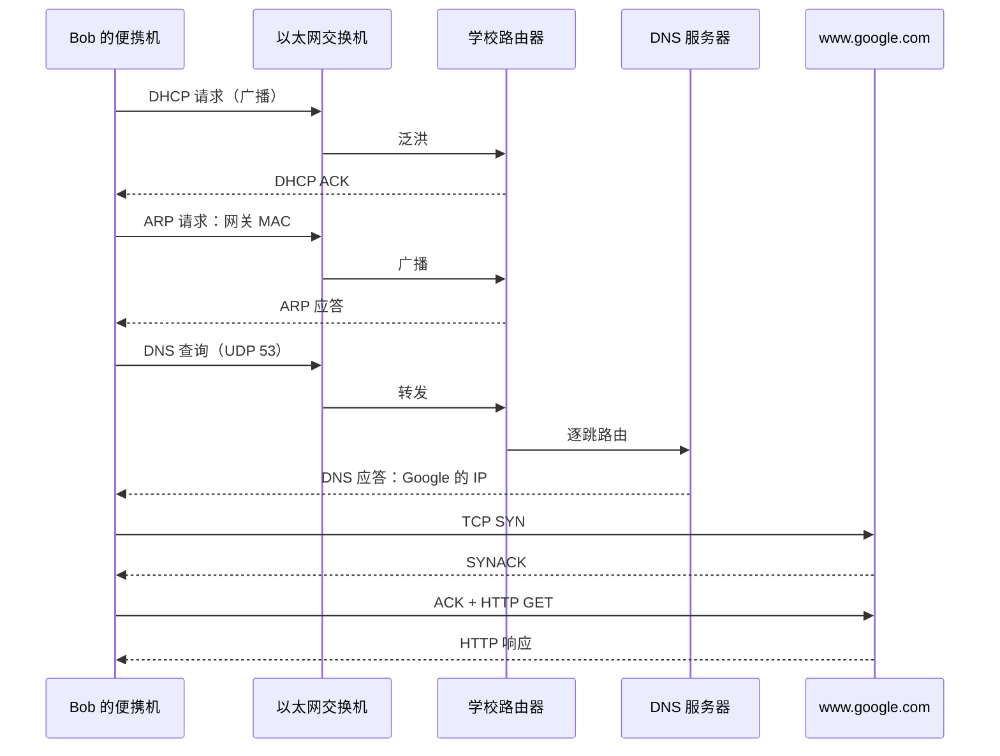

在第四章和第五章中，我们打开了网络层这个"黑盒子"：数据平面决定每台路由器怎样在本地把分组从输入链路转发到输出链路，控制平面决定端到端路径并据此计算转发表。两者合起来，为运输层提供了主机到主机的逻辑通信服务。

但数据报并不会凭空跨越链路。它要从一块网卡出发，经过双绞线、光纤或无线电波到达下一台设备，再交给网络层；若还要继续转发，就换一条链路重新出发。把数据报从一个节点送到**相邻**节点的，正是本章的主角——**链路层**（link layer）。

链路层处理的信道有两类，它们面对的问题截然不同：

| 信道类型       | 典型场景                                       | 核心问题                   | 代表协议       |
| -------------- | ---------------------------------------------- | -------------------------- | -------------- |
| **广播信道**   | 无线局域网、卫星网、HFC 电缆接入网、早期以太网 | 多节点共享介质，须协调发送 | 802.11、DOCSIS |
| **点对点链路** | 长距离路由器互联、主机连接交换机               | 只有两端，访问控制简单     | PPP、HDLC      |

> [!important] 本章目标
> 理解链路层的原理与实现：
>
> 1. 链路层概述：节点、链路与帧；成帧、链路接入、可靠交付、差错检测四项服务；适配器中的软硬件分工
> 2. 差错检测与纠正：奇偶校验、检验和与 CRC，以及各自的检测能力与开销
> 3. 多路访问协议：信道划分、随机接入（ALOHA、CSMA、CSMA/CD）与轮流协议，DOCSIS 的综合运用
> 4. 链路层寻址：MAC 地址、ARP，以及链路层地址与网络层地址如何协同
> 5. 以太网：帧格式、技术演进与交换式以太网
> 6. 链路层交换机：转发、过滤、自学习、STP，以及与路由器的比较
> 7. VLAN、MPLS 与数据中心网络，并以一次 Web 页面请求串起整个协议栈

# 第一部分 链路层基础与差错检测

## 6.1 链路层概述

### 6.1.1 基本术语

| 术语                  | 含义                                      | 举例                              |
| --------------------- | ----------------------------------------- | --------------------------------- |
| **节点**（node）      | 运行链路层协议的设备                      | 主机、路由器、交换机、WiFi 接入点 |
| **链路**（link）      | 连接相邻节点的通信信道                    | 双绞线、光纤、无线信道            |
| **帧**（frame）       | 链路层的传输单位，封装网络层数据报        | 以太网帧、PPP 帧、802.11 帧       |
| **适配器**（adapter） | 实现链路层与物理层的硬件，又称网卡（NIC） | 以太网卡、WiFi 网卡               |

一条链路连接两个或多个节点，而一个节点可能挂着多条链路。数据报沿路径前进时，在每一跳被"拆封—转发—再封装"：

> [!note] 术语
> 本章的"链路"指两个相邻节点之间的**单段**通信信道，与日常所说的"网络链路""宽带链路"不同。后者往往指一条端到端连接，跨越多个节点和多段链路。

> [!example] 类比：把数据报当作旅客
> 旅行社为旅客规划从普林斯顿到洛桑的行程：先乘大轿车到 JFK，再飞往日内瓦，最后换火车到洛桑。每一段由不同公司用不同交通工具完成，但都只负责"把旅客送到下一个换乘点"。
>
> | 交通               | 网络                   |
> | ------------------ | ---------------------- |
> | 旅客               | 数据报                 |
> | 行程区段           | 链路                   |
> | 交通工具与运营公司 | 链路层协议             |
> | 换乘点             | 节点（路由器、交换机） |
> | 旅行社规划路线     | 路由选择               |
>
> 链路层协议就像某一段行程的交通工具：它只管这一跳，不负责全程；全程路线则由网络层（第五章的路由选择）决定。

### 6.1.2 链路层提供的服务

链路层的基本任务，是把网络层数据报从一个节点移动到相邻节点。不同协议的实现细节各异，但可能提供的服务可归为四类：

| 服务               | 作用                                 | 是否普遍提供       | 说明                   |
| ------------------ | ------------------------------------ | ------------------ | ---------------------- |
| **成帧**           | 把数据报封装为帧，并加上首部与尾部   | 是                 | 帧格式因协议而异       |
| **链路接入**       | 协调多个节点对共享介质的使用         | 广播链路必需       | 即 MAC 协议，见 6.3    |
| **可靠交付**       | 通过确认与重传保证帧无差错到达       | 否                 | 高误码链路（无线）常用 |
| **差错检测与纠正** | 检测（并在可能时纠正）帧中的比特差错 | 检测普遍，纠正较少 | 见 6.2                 |

#### 1. 成帧

几乎所有链路层协议都要成帧。帧由数据字段、首部字段与尾部字段组成：

- 数据字段承载网络层数据报
- 首部携带源/目的地址、类型与控制信息
- 尾部放置 CRC 等差错检测字段

帧长有上限，以太网的数据字段最多 1500 字节（6.4.2 节），因此大数据报须分片。

#### 2. 链路接入

**介质访问控制**（Medium Access Control，MAC）协议规定节点何时可以把帧送上链路。点对点链路只有两端，链路空闲即可发送；广播链路则须协调多个节点——碰撞会使涉及的帧全部损坏、带宽被白白浪费，因此需要专门的多路访问协议（6.3 节）。

#### 3. 可靠交付

链路层可靠交付的做法与运输层类似：确认、重传、序号。但它作用在**单段链路**上，而不是端到端。

| 链路类型 | 典型例子                   | 链路层可靠交付                 |
| -------- | -------------------------- | ------------------------------ |
| 高误码率 | 无线（802.11、蜂窝）       | 值得做：本地纠错比端到端重传快 |
| 低误码率 | 光纤、同轴电缆、多数双绞线 | 通常多余，徒增开销             |

> [!warning] 链路层重传不能替代 TCP
> 链路层的可靠交付只保证帧通过**一段**链路。若中间某台路由器拥塞丢弃分组，或应用需要端到端的有序可靠交付，仍须由 TCP 负责。反过来，TCP 的端到端重传虽然能兜底，却要付出一个完整往返时延的代价；在高误码链路上，链路层的本地重传往往更划算。

#### 4. 差错检测与纠正

信号衰减、电磁噪声、串扰都会让某些比特在传输中翻转。链路层在帧中加入**差错检测和纠错比特**（Error-Detection and-Correction bits，EDC），接收方据此判断帧是否出错（6.2 节）。

链路层的差错检测通常比运输层、网络层的检验和更强，且多用硬件实现，以匹配链路速率高、需要实时处理的特性。

> [!note] 差错检测与差错纠正
> 差错检测只能发现存在错误，而纠正可以定位错误发生的位置并据此提供修正的能力。

### 6.1.3 链路层在何处实现

链路层是协议栈中软硬件交界最明显的一层。以主机为例，主要功能实现在**适配器**（网络接口卡，NIC）上：

| 实现位置 | 承担的功能                                                       |
| -------- | ---------------------------------------------------------------- |
| 硬件     | 成帧、链路接入、差错检测、物理层收发、CRC 计算                   |
| 软件     | 组装链路层地址、初始化控制器、处理中断、向上交付数据报、差错处理 |

硬件承担实时性要求高的部分，带来了较高的性能和难以更新维护的特性，而软件负责与控制平面和上层协议衔接。

## 6.2 差错检测和纠正技术

比特在传输中可能因衰减、噪声、串扰而出错。链路层在发送前附加冗余比特，接收方据此判断、甚至修复错误：

> [!warning] 检测不等于保证
> 任何差错检测方案都只能以**一定概率**发现错误。若错误恰好把 $D+\text{EDC}$ 变成另一个合法码字，接收方就会误认为无差错。冗余比特越多、检测算法越强，漏检概率越低，开销与计算量也越大。

三种常用技术的对比如下：

| 技术     | 原理                          | 检测能力 | 开销         | 典型位置       |
| -------- | ----------------------------- | -------- | ------------ | -------------- |
| 奇偶校验 | 增加校验比特使 1 的个数为偶数 | 弱       | 极低         | 教学、简单硬件 |
| 检验和   | 反码求和后取反                | 较弱     | 低           | 运输层（软件） |
| CRC      | 模 2 多项式除法               | 强       | 中，可硬件化 | 链路层（硬件） |

### 6.2.1 奇偶校验

#### 1. 单比特奇偶校验

在偶校验方案中，发送方增加 1 个校验比特，使 $d+1$ 个比特中 1 的个数为偶数。接收方统计 1 的个数：为偶数，说明无差错或出现了偶数个错误；为奇数，说明至少有一个比特出错。

因此，单比特奇偶校验只能发现**奇数个**比特错误。若一次突发错误翻转了偶数个比特，校验仍然能够通过。

#### 2. 二维奇偶校验

把数据排成矩阵，对每行、每列分别计算校验比特，就能定位单个错误。下表是接收方看到的内容：数据比特 `r2c3` 在传输中被翻转（原值 0，现为 1），而校验位仍是发送方算出的原值。

|        | c1  | c2  |  c3   | c4  | 行校验 |
| :----: | :-: | :-: | :---: | :-: | :----: |
|   r1   |  1  |  0  |   1   |  1  |   1    |
|   r2   |  0  |  1  | **1** |  0  | **1**  |
|   r3   |  1  |  1  |   0   |  1  |   1    |
|   r4   |  1  |  0  |   0   |  1  |   0    |
| 列校验 |  1  |  0  | **1** |  1  |   1    |

第 2 行有 2 个 1，本应校验位为 0，实际为 1，不匹配；第 3 列同样有 2 个 1，校验位也是 1，不匹配。行、列校验同时不匹配的交点就是出错位置，把它翻转回 0 即完成纠正。

右下角的校验位对"行校验列"（等价于"列校验行"）再做一次偶校验。借助它，接收方可以区分单个比特错误的位置：

| 报错的校验        | 判定                 | 处理                 |
| ----------------- | -------------------- | -------------------- |
| 一行 + 一列       | 交点处的数据比特出错 | 翻转该比特           |
| 仅某一行 + 右下角 | 该行的行校验位出错   | 数据无误，修正校验位 |
| 仅某一列 + 右下角 | 该列的列校验位出错   | 数据无误，修正校验位 |
| 仅右下角          | 右下角自身出错       | 数据无误             |

> [!note] 数据比特出错时右下角不受影响
> 单个数据比特翻转，会使其所在行校验与所在列校验各翻转一次，而右下角对全部行校验位的奇偶性不变（两个校验位同时参与的是同一个数据比特，不改变右下角匹配结果）。因此数据出错与右下角报错无关。

- 二维奇偶校验可以检测任意一个或两个比特错误，并能定位、纠正单个比特错误
- 当两个数据比特错误落在同一行或同一列时，校验只能发现异常，无法确定具体的错误位置
- 当四个错误比特恰好构成矩形的四个顶点时，每行和每列的错误数量均为偶数，所有校验均可能通过，因而发生漏检

接收方能自行检测并纠正错误的能力称为**前向纠错**（Forward Error Correction，FEC）。FEC 的价值在于不需要重传：

- 实时音频、视频无法等待重传的往返时延
- 深空链路往返时延以分钟计，重传代价极高
- 音频 CD 用交叉交错的 FEC 对抗划痕与灰尘

### 6.2.2 检验和方法

检验和把数据看作若干 $k$ 比特整数，求和后取反码作为校验字段。以 16 比特为例：

| 步骤 | 计算                                  | 结果     |
| ---- | ------------------------------------- | -------- |
| 1    | 发送方对数据字求和：`0x1234 + 0x5678` | `0x68AC` |
| 2    | 取反码，得到检验和                    | `0x9753` |
| 3    | 发送 `0x1234`、`0x5678`、`0x9753`     | —        |
| 4    | 接收方把三个字一起求和                | `0xFFFF` |
| 5    | 结果为全 1，判定无差错；否则判定出错  | —        |

Internet 检验和（RFC 1071）采用这一方案。IPv4 首部、TCP 和 UDP 均使用 16 比特字检验和。

| 优点                 | 缺点                                    |
| -------------------- | --------------------------------------- |
| 实现简单，纯软件即可 | 检错能力弱于 CRC                        |
| 计算量小             | 对字序不敏感，交换两个字不会被发现      |
| 适合高层协议         | 插入全 0 字也不改变和，无法抵御恶意篡改 |

> [!question] 为什么运输层用检验和，链路层用 CRC？
> 二者的实现位置不同。运输层在主机软件中实现，需要一种足够简单、可快速计算的方案；链路层在适配器硬件中实现，可以用移位寄存器和异或门在流式数据上直接算出 CRC，几乎不增加时延。换句话说，不是 CRC 更好所以链路层用它，而是链路层**用得起** CRC。

### 6.2.3 循环冗余校验 CRC

**循环冗余校验**（Cyclic Redundancy Check，CRC）又称多项式编码，是链路层最常用的差错检测技术。

发送方与接收方约定一个 $r+1$ 比特的**生成多项式** $G$。发送方在 $d$ 比特数据 $D$ 后补 $r$ 个 0，用模 2 除法除以 $G$，所得余数 $R$ 就是 $r$ 比特的 CRC 字段。发送的比特串为：

$$
T = D \cdot 2^r \oplus R
$$

其中 $T$ 恰好能被 $G$ 整除。接收方用 $G$ 去除收到的比特串：余数为 0 则认为无差错，否则判定出错。

所有运算都在**模 2 算术**下进行：

- 加法不进位，减法不借位，加减法都等价于异或
- 例如 `1011 XOR 0101 = 1110`，`1001 XOR 1101 = 0100`

#### 1. 计算示例

设 $D=101110$，$G=1001$（$r=3$）：

1. 在 $D$ 后补 3 个 0，得 `101110000`
2. 用 `1001` 做模 2 长除法，每步取最高 4 位与 `1001` 异或（最高位为 0 时直接移位），去掉前导 0 后继续：

| 步骤 | 当前比特串  | 取前 4 位异或        | 结果，接剩余位并去前导 0     |
| :--: | ----------- | -------------------- | ---------------------------- |
|  1   | `101110000` | `1011 ⊕ 1001 = 0010` | `0010` + `10000` → `1010000` |
|  2   | `1010000`   | `1010 ⊕ 1001 = 0011` | `0011` + `000` → `11000`     |
|  3   | `11000`     | `1100 ⊕ 1001 = 0101` | `0101` + `0` → `1010`        |
|  4   | `1010`      | `1010 ⊕ 1001 = 0011` | 余数 `011`                   |

3. 余数 $R=011$，发送 $T=101110\;011$

接收方用 `1001` 除 `101110011`，余数为 0，判定无差错。

#### 2. 检测能力

CRC 的检错能力取决于 $G$ 的选择：

| 差错类型                  | 检测能力                                           |
| ------------------------- | -------------------------------------------------- |
| 长度不超过 $r$ 的突发错误 | 全部检出                                           |
| 长度恰为 $r+1$ 的突发错误 | 漏检概率 $2^{-(r-1)}$（错误模式恰等于 $G$ 时漏检） |
| 长度超过 $r+1$ 的突发错误 | 漏检概率约为 $2^{-r}$                              |

国际标准规定了若干生成多项式，硬件只需按 $G$ 的顺序接异或门：

| 名称      | 多项式                            | 比特串                              | 典型用途         |
| --------- | --------------------------------- | ----------------------------------- | ---------------- |
| CRC-8     | `x^8 + x^2 + x + 1`               | `100000111`                         | ATM 信头         |
| CRC-12    | `x^12 + x^11 + x^3 + x^2 + x + 1` | `1100000001111`                     | 字符传输         |
| CRC-16    | `x^16 + x^15 + x^2 + 1`           | `11000000000000101`                 | 链路控制         |
| CRC-CCITT | `x^16 + x^12 + x^5 + 1`           | `10001000000100001`                 | HDLC、X.25       |
| CRC-32    | 32 次多项式                       | `100000100110000010001110110110111` | 以太网、ZIP、PNG |

> [!tip] 硬件实现：r 级移位寄存器
> 寄存器共 $r$ 位，初值全 0。对输入串（含补的 $r$ 个 0）逐位处理：
>
> 1. 取寄存器最高位 $f$
> 2. 寄存器左移一位，低位补入下一个输入比特
> 3. 若 $f=1$，寄存器与 $G$ 的低 $r$ 位异或
>
> 全部输入处理完，寄存器内容即余数。以 $G=1001$（低 3 位为 `001`）处理 `101110000`，最终寄存器为 `011`，与长除法结果一致。
>
> 该电路不需要缓存整个帧，因此能在高线速下实时完成。

# 第二部分 多路访问链路和协议

## 6.3 多路访问链路和协议

点对点链路由两端独占，基本不存在竞争；广播链路则要让多个节点共享同一信道，竞争不可避免。

广播链路的核心问题是**多路访问问题**：多个节点可能同时发送，信号在介质上叠加，导致**碰撞**（collision），涉及的帧全部损坏，带宽被白白浪费。因此需要多路访问协议规定"谁在什么时候可以发送"。

这些年来，多路访问协议层出不穷，但大致可归为三类：

1. **信道划分协议**（channel partitioning protocols）
2. **随机接入协议**（random access protocols）
3. **轮流协议**（taking-turns protocols）

理想情况下，我们希望（幻想）多路访问协议具有以下特性：

1. 只有一个节点活跃时，它能以全速率 $R$ bps 发送
2. $M$ 个节点活跃时，每个节点的平均吞吐量接近 $R/M$
3. 完全去中心化，不依赖某个主节点，避免单点故障
4. 简单、便宜、易于实现

### 6.3.1 信道划分协议

信道划分协议把信道的带宽切分成若干份，分给不同节点，从而在源头上避免碰撞。

- 时分复用（Time-Division Multiplexing, **TDM**）：将时间划分为**时间帧**（time frame），每个时间帧再划分为 $N$ 个**时隙**（time slot），分配给 $N$ 个节点，每个节点在被分配的时隙内发送数据。
  - 优点：消除碰撞，公平
  - 缺点：数据平均发送速率被限制在 $R/N$，并必须等待轮到它的时隙才能发送，即使它是唯一要发数据的节点。
- 频分复用（Frequency-Division Multiplexing, **FDM**）：将信道的频谱划分为 $N$ 个子信道（带宽为 $R/N$），分配给 $N$ 个节点，每个节点在被分配的子信道上发送数据。
  - 优点：消除碰撞，公平
  - 缺点：每个节点的带宽被限制在 $R/N$，并且需要额外的滤波器和频率规划。
- 码分多址（Code Division Multiple Access, **CDMA**）：对每个节点分配一种不同的码。每个节点使用自己唯一的码对要发送的数据比特进行**编码**。
  - 优点：如果码选择得当，多个节点可以同时发送数据， 并且接收方可以使用相应的码对信号进行**解码**，从而不受干扰地恢复出原始数据。
  - 缺点：需要复杂的编码和解码算法，并且可能受到多径干扰和码间干扰。

  CDMA 曾是 3G 蜂窝网络的基础技术，但在 4G 和 5G 网络中已被其他技术取代。

### 6.3.2 随机接入协议

随机接入协议不让节点排队，而是允许节点以全速率 $R$ 发送；发生碰撞就等待随机时间后重传。

记 $a=d_{\text{prop}}/d_{\text{trans}}$，其中 $d_{\text{prop}}$ 为任意两个适配器间的最大传播时延，$d_{\text{trans}}$ 为发送一个最大长度帧所需的时间。

| 协议       | 时隙 | 载波侦听 | 碰撞检测 | 最大效率                     |
| ---------- | :--: | :------: | :------: | ---------------------------- |
| 时隙 ALOHA |  是  |    否    |    否    | $\dfrac{1}{e} \approx 0.37$  |
| 纯 ALOHA   |  否  |    否    |    否    | $\dfrac{1}{2e} \approx 0.18$ |
| CSMA       |  否  |    是    |    否    | 取决于传播时延               |
| CSMA/CD    |  否  |    是    |    是    | 约 $\dfrac{1}{1+5a}$         |

#### 1. 时隙 ALOHA

时隙 ALOHA 的假设与规则：

| 假设                   | 说明                     |
| ---------------------- | ------------------------ |
| 帧长固定为 $L$ 比特    | 每个时隙长 $L/R$ 秒      |
| 时间划分为时隙         | 节点只能在时隙开始时发送 |
| 所有节点同步           | 需要统一的时隙边界       |
| 碰撞可在时隙结束前检测 | 由信道或上层机制告知     |

节点有帧时，等到下一个时隙开始就发送。若成功则结束；若碰撞，则在后续每个时隙以概率 $p$ 重传，直到成功。

系统效率定义为：大量节点、每个节点总有大量帧待发时，成功时隙所占的比例。

> [!note] 时隙 ALOHA 的效率推导
> 设 $N$ 个节点，每个节点在一个时隙内**以概率 $p$ 发送**。某个时隙成功的条件是"恰好一个节点发送，其余 $N-1$ 个都不发送"：
>
> $$
> P_{\text{success}} = Np(1-p)^{N-1}
> $$
>
> 对 $p$ 求极值：令导数为 0，得 $p = 1/N$。代入：
>
> $$
> P_{\text{success}} = \left(1-\frac{1}{N}\right)^{N-1} \xrightarrow{N\to\infty} \frac{1}{e} \approx 0.368
> $$
>
> 因此长期来看，最多约 37% 的时隙在做有用功。即便所有节点都"守规矩"，仍有三分之二的带宽被浪费。

#### 2. 纯 ALOHA

纯 ALOHA 不需要时隙同步，节点有帧就立即发送。若碰撞，节点每等待一个帧时后以概率 $p$ 重传。

它的代价是"脆弱期"翻倍：设发送一个帧的时间为 $T$，若节点 A 在时间 $t$ 开始发送，任何在 $[t-T, t+T]$ 期间开始发送的节点都会与 A 的帧碰撞。脆弱期长达 $2T$，因此成功概率减半。

$$
\eta_{\max} = \frac{1}{2e} \approx 0.184
$$

即只有时隙 ALOHA 的一半。这是完全去中心化、完全不协调所付出的代价。

> [!info] 历史：Norm Abramson 与 ALOHAnet
> 20 世纪 70 年代，Norm Abramson 在夏威夷大学设计 ALOHAnet，用无线电连接分散在岛屿上的节点。
>
> - 下行信道由中心主机向各节点广播，不存在竞争
> - 上行信道由各节点向中心主机发送，碰撞不可避免
> - 为解决上行碰撞，产生了纯 ALOHA 协议
>
> ALOHAnet 后来与 ARPAnet 互联，并启发了 Bob Metcalfe，进而促成以太网与 CSMA/CD 的诞生。

#### 3. 载波侦听多路访问 CSMA

ALOHA 的浪费源于"不先听再说"。**载波侦听多路访问**（Carrier Sense Multiple Access，CSMA）加入一条礼貌规则：**发送前先侦听信道**，信道忙就等待，信道空闲才发送。这样可以避免撞上正在进行的传输。

> [!question] 既然已经侦听，为什么还会碰撞？
> 侦听只能听到**已经到达**的信号。两个节点若在彼此的传播时延间隔内开始发送，谁都听不到对方。传播时延越大，这个"来不及听见"的窗口相对帧长越长，效率越低（见下节 CSMA/CD 效率式）。

CSMA 不检测碰撞，因此即使已经碰撞，节点仍会把整个损坏的帧发完，浪费信道时间。

#### 4. CSMA/CD

**带碰撞检测的载波侦听多路访问**（CSMA/CD）在 CSMA 上增加"边发边听"：适配器在发送过程中持续检测信号，一旦发现碰撞就立即停止，而不是把整个帧发完。这样，被碰撞损坏的传输会被及早中止，减少浪费的信道时间。

**阻塞信号**（jam signal）：检测到碰撞后，适配器先发送 32 比特的阻塞信号，确保所有参与碰撞的节点都察觉到碰撞，再进入退避。

**二进制指数退避**：碰撞发生后，节点不能立刻重试，否则会再次碰撞。若某帧已连续经历 $n$ 次碰撞，节点从集合

$$
\{0,1,2,3,\dots,2^n-1\}
$$

中等概率选取数 $K$，等待 $K \times 512$ 比特时间（512 bit 传输时间的 $K$ 倍）后再尝试。$n$ 随碰撞次数增加而增大，等待窗口随之指数扩张，从而在拥塞时自动降低重试密度。

| 已碰撞次数  | $K$ 的取值范围 | 最大等待（比特时间）         |
| ----------- | -------------- | ---------------------------- |
| 1           | `{0, 1}`       | 512                          |
| 2           | `{0, 1, 2, 3}` | 1536                         |
| 3           | `{0, …, 7}`    | 3584                         |
| 10 次及以上 | `{0, …, 1023}` | 523776（即 $1023\times512$） |

以太网中 $n$ 通常封顶为 10，之后窗口不再增大。若连续 16 次碰撞仍失败，适配器放弃该帧并向网络层报告错误。

> [!warning] 为什么以太网最小帧长是 64 字节？
>
> 要确保发送方在帧发送完成之前能够检测到最坏情况下的碰撞，帧的发送时间必须覆盖碰撞检测所需的时间，即简化模型下：
>
> $$
> d_{\text{trans}}\geq 2\tau
> $$
>
> 对于经典 10 Mbps 以太网，时隙时间（Slot Time）为 512 比特时间，即：
>
> $$
> 512/10^7=51.2\,\mu s
> $$
>
> 该时间预算覆盖最坏情况下的往返传播及相关设备延迟。经典以太网的最大碰撞域直径约为 2500 m。
>
> 因此，最小帧长规定为：
>
> $$
> L_{\min}=512\text{ bit}=64\text{ byte}
> $$
>
> 这里的 64 字节包含以太网帧首部、数据及填充字段、FCS，不包含前导码和帧起始定界符。接收端通常会丢弃不足 64 字节的帧片段，这类帧片段称为残帧（Runt Frame）。
>
> 这也解释了退避时间的单位为什么是 512 比特时间：它对应一个时隙时间。
>
> > [!note]
> > 上述推导针对经典 10 Mbps 以太网。100 Mbps 以太网同样采用 512 比特时间的时隙时间，但对应的时间缩短为 5.12 μs。
> >
> > 1 Gbps 半双工以太网采用载波扩展（Carrier Extension），将时隙时间扩展至 4096 比特（512 字节），但实际以太网帧的最小长度仍然是 64 字节。对于不足 512 字节的帧，发送端在 FCS 后追加特殊扩展符号，以延长载波占用时间。

#### 5. CSMA/CD 的效率

在忽略协议开销、假设帧长固定且节点数很多的条件下，CSMA/CD 的效率可近似为

$$
\text{效率} \approx \frac{1}{1 + 5a},\qquad a=\frac{d_{\text{prop}}}{d_{\text{trans}}}
$$

- 传播时间 $d_{\text{prop}}$ 越小，存在碰撞却检测不到的窗口越短，碰撞被检测到的时间越快。双方都能尽早停止发送，减少浪费的信道时间，从而提高效率。
- 帧传输时间 $d_{\text{trans}}$ 越大，固定传播时延所占的比例减小，碰撞检测及争用所消耗的时间相对于成功传输时间变得更小，因此信道利用率提高

> [!note] CSMA/CA
> 无线介质上无法在发送的同时可靠地检测碰撞（自身信号远强于接收信号），因此 802.11 采用**碰撞避免**（CSMA/CA）：先侦听，再随机退避，并用确认帧判断是否成功。具体机制留待无线章节。

### 6.3.3 轮流协议

随机接入在"只有一个节点活跃"时表现最好，多节点活跃时效率下降。轮流协议则让节点按顺序获得发送权，兼顾公平与效率。

其中有两种比较重要的轮流协议：

- **轮询**（polling）：主节点依次告知从节点允许发送和最大发送帧数量，同时检测其是否发送完成（或空闲），然后继续告知下一个从节点。
- **令牌传递**（token passing）：节点按固定顺序传递一个令牌（token），持有令牌的节点可以发送数据，发送完毕后将令牌传给下一个节点。

| 特性     | 轮询（polling）                  | 令牌传递（token passing）      |
| -------- | -------------------------------- | ------------------------------ |
| 控制方式 | 主节点依次询问从节点             | 令牌在节点间按固定顺序传递     |
| 去中心化 | 差，依赖主节点                   | 较好                           |
| 碰撞     | 无                               | 无                             |
| 主要缺点 | 轮询时延；主节点故障导致全网瘫痪 | 令牌丢失或节点故障需要恢复机制 |
| 典型例子 | 蓝牙微微网                       | 令牌环（IEEE 802.5）、FDDI     |

轮询的开销是"问一圈"的时延：即使只有一个节点有数据，也要等主节点问到它。令牌传递把控制权分散到各节点，但令牌本身可能丢失、重复，需要额外的监控与恢复机制。

### 6.3.4 DOCSIS：电缆 Internet 接入的链路层协议

**DOCSIS**（Data Over Cable Service Interface Specification）是电缆接入网的链路层标准，它把信道划分、随机接入和集中式授权组合在一起，是理解"真实协议如何折中"的好例子。

下行方向只有 CMTS 一个发送方，天然是广播，不存在多路访问问题；上行方向由多个调制解调器共享，必须协调。

上行方向的机制是分层的：

1. **频分**：上下行使用不同的频率段，互不干扰
2. **时分**：上行信道划分为微时隙（minislot），由 CMTS 统一编号
3. **随机接入**：调制解调器在竞争微时隙中发送**请求帧**，声明"我要发多少数据"
4. **集中授权**：CMTS 用下行 MAP 报文公布每个微时隙归谁使用
5. **退避重传**：请求帧碰撞时，按二进制指数退避后重试
6. **测距**：CMTS 测量各调制解调器的传播时延并下达定时偏移，使上行信号在时隙边界对齐

因此，DOCSIS 同时体现了三种思路：用 FDM/TDM 消除大部分竞争，用随机接入处理请求，用集中授权保证数据传输阶段无碰撞。

> [!note] 现代 DOCSIS
> 传统 DOCSIS 主要采用上下行频分、上行时分调度与竞争请求相结合的机制。随着 DOCSIS 3.1 和 4.0 的发展，OFDM/OFDMA、全双工通信等技术进一步提高了频谱利用率与传输能力。

# 第三部分 交换局域网、链路虚拟化与数据中心

## 6.4 交换局域网

今天的局域网几乎都由**链路层交换机**互联主机、服务器和路由器构成。交换机工作在链路层，按 MAC 地址转发帧，对主机完全透明。

### 6.4.1 链路层寻址和 ARP

#### 1. MAC 地址

主机与路由器的适配器都有链路层地址，常称为 **LAN 地址**、**物理地址**或 **MAC 地址**。以太网的 MAC 地址长 48 比特（6 字节），通常写成六组十六进制数：`1A-23-F9-CD-06-9B`

对于传统的全球管理 EUI-48 地址，IEEE 管理 MAC 地址空间：前 24 比特是**组织唯一标识符**（OUI），由 IEEE 分配给厂商；后 24 比特由厂商自行分配，保证全球唯一。

> [!note] 本地管理地址
> MAC 地址的第 2 个最低有效位（U/L 位）为 1 时表示**本地管理地址**，由网络管理员自行分配，不保证全球唯一。若为 0，才是全球唯一地址。

MAC 地址最重要的性质是**扁平**：它不随设备所处的位置变化。这与 IP 地址形成鲜明对比：

| 特性           | MAC 地址                    | IP 地址                     |
| -------------- | --------------------------- | --------------------------- |
| 长度           | 48 比特                     | IPv4 32 比特，IPv6 128 比特 |
| 结构           | 扁平，无层次                | 层次化（网络前缀 + 主机号） |
| 分配者         | IEEE 分配 OUI，厂商分配其余 | ISP、网络管理员、DHCP       |
| 是否随位置变化 | 否                          | 是，换子网就要换地址        |
| 作用范围       | 同一链路（局域网）内        | 端到端，跨网络              |
| 类比           | 身份证号                    | 邮政地址                    |

广播 MAC 地址为 `FF-FF-FF-FF-FF-FF`。适配器收到帧后按以下规则处理：

| 条件                            | 动作           |
| ------------------------------- | -------------- |
| 目的 MAC 等于自己的 MAC         | 接收，向上交付 |
| 目的 MAC 为广播地址             | 接收，向上交付 |
| 目的 MAC 为组播地址且已加入该组 | 接收           |
| 其他                            | 丢弃           |
| 处于混杂模式（抓包、虚拟化）    | 全部接收       |

> [!important] 实践原则：保持各层独立
> 既然 IP 地址已经能标识主机，为什么还要 MAC 地址？
>
> 1. **局域网不只承载 IP**。同一块网卡要能同时处理 IPv4、IPv6、ARP、IPX 等协议，链路层不能假定上层一定是 IP
> 2. **地址与位置解耦**。若适配器直接使用网络层地址，主机移动或换网段时就得重新配置硬件地址
> 3. **过滤成本**。若适配器没有自己的地址，所有帧都要交给主机处理，CPU 将被大量无关帧中断
> 4. **分层**。各层使用各自的地址，修改一层不必改动另一层

#### 2. 地址解析协议 ARP

**地址解析协议**（Address Resolution Protocol，ARP）把 IP 地址解析为 MAC 地址。主机 A 知道 B 的 IP 地址，却必须先得到 B 的 MAC 地址，才能在以太网帧的目的地址字段填上正确的值。

每台主机和路由器都维护一张 **ARP 表**：

| IP 地址         | MAC 地址          | 剩余寿命（TTL） |
| --------------- | ----------------- | --------------- |
| 222.222.222.221 | 88-B2-2F-54-1A-0F | 13 分 45 秒     |
| 222.222.222.223 | 5C-66-AB-90-75-B1 | 13 分 52 秒     |

ARP 有几个值得注意的特点：

- **即插即用**：无需配置，表项由协议自动建立
- **请求广播、应答单播**：请求帧发往广播地址，应答只发给提问者
- **会老化**：表项过期后须重新解析，以适应 MAC 地址变化；典型值为 20 分钟，实际随操作系统而异
- **只管本子网**：跨子网的解析交给默认网关

同一子网内的解析过程：

> [!note] ARP 报文格式
> 在以太网上承载 IPv4 时，ARP 报文长 28 字节，字段包括：硬件类型、协议类型、硬件地址长度、协议地址长度、操作码（1 = 请求，2 = 应答）、发送方 MAC 与 IP、目标 MAC 与 IP。请求中的目标 MAC 字段填全 0，由应答方填入自己的地址。

> [!warning] ARP 欺骗
> ARP 没有任何认证机制，主机收到应答就更新表项。攻击者可以持续发送伪造应答，宣称"网关的 IP 对应我的 MAC"，从而把流量引到自己这里，实施中间人攻击。常见防护手段包括动态 ARP 检测（DAI）、静态绑定和 802.1X 准入控制。

#### 3. 发送数据报到子网以外

若目的主机在另一个子网，源主机不能把帧的目的 MAC 直接填成最终主机——它根本不知道对方的 MAC。正确做法是把帧发给**默认网关**：

关键规律是：**IP 地址端到端不变，MAC 地址逐跳重写**。

| 字段            | 主机 → 网关      | 网关 → 目的主机     |
| --------------- | ---------------- | ------------------- |
| 源 MAC          | 主机 MAC         | 网关出口接口 MAC    |
| 目的 MAC        | 网关入口接口 MAC | 目的主机 MAC        |
| 源 IP           | 主机 IP          | 主机 IP（不变）     |
| 目的 IP         | 目的主机 IP      | 目的主机 IP（不变） |
| TTL             | 初始值           | 减 1                |
| IPv4 首部检验和 | 原值             | 重新计算            |

每一跳路由器都要拆帧、查转发表、重新封装，因此链路层帧只在本地有意义。这正是"链路层地址用于一跳，网络层地址用于端到端"的含义。

#### 4. 例题：经路由器的逐帧推演

设两个子网由一台路由器互联（示例地址）：

| 设备             | IP 地址         | MAC 地址          |
| ---------------- | --------------- | ----------------- |
| 主机 A（子网 1） | 111.111.111.111 | 74-29-9C-E8-FF-55 |
| 路由器接口 1     | 111.111.111.110 | E6-E9-00-17-BB-4B |
| 路由器接口 2     | 222.222.222.220 | 1A-23-F9-CD-06-9B |
| 主机 B（子网 2） | 222.222.222.222 | 49-BD-D2-C7-56-2A |

A 向 B 发送一个数据报，设各 ARP 表项均已缓存。逐段的帧如下：

| 阶段             | 源 MAC        | 目的 MAC      | 源 IP           | 目的 IP         |
| ---------------- | ------------- | ------------- | --------------- | --------------- |
| A → 路由器接口 1 | A 的 MAC      | 接口 1 的 MAC | 111.111.111.111 | 222.222.222.222 |
| 路由器接口 2 → B | 接口 2 的 MAC | B 的 MAC      | 111.111.111.111 | 222.222.222.222 |

两段帧中，IP 字段相同，MAC 字段完全不同；路由器在中间还要把 TTL 减 1 并重算 IP 首部检验和。若 A 的 ARP 表中没有默认网关表项，须先广播 ARP 请求解析 `111.111.111.110`；同理，路由器若不知道 B 的 MAC，会在子网 2 上广播 ARP 请求。

> [!tip] 常见误区
> A 在 ARP 表中查的是**默认网关**的 IP（`111.111.111.110`），而不是 B 的 IP。A 通过子网掩码判断 B 不在本子网，因此把帧交给网关。

### 6.4.2 以太网

以太网是今天最流行的有线局域网技术，从 1970 年代的同轴电缆总线，发展到集线器星型拓扑，再到今天的交换式星型拓扑。帧格式却保持了长期稳定。

> [!info] 历史：集线器和交换机
> 20 世纪 90 年代末，以太网 LAN 普遍采用**集线器**（Hub）组成的**星形拓扑**：各主机通过双绞线连接到集线器。集线器工作在物理层，按比特而非帧进行转发：它将某个接口收到的比特重新生成并增强信号，再广播到所有其他接口。因此，集线器网络仍属于广播式 LAN，多个节点同时发送时仍可能发生碰撞。
>
> 进入 21 世纪，以太网逐渐以**交换机**（Switch）取代集线器，但仍保留星形拓扑。交换机工作在数据链路层，能够存储并转发帧，而不是简单地复制比特。它将不同接口隔离为独立的碰撞域，配合全双工通信可以消除碰撞。与工作在网络层的路由器不同，交换机只处理至数据链路层。

#### 1. 以太网帧结构

- **前导码**（Preamble）：7 字节，用于时钟同步，内容为 `10101010` 重复 7 次
- **帧开始定界符**（SFD）：1 字节，内容为 `10101011`，标志帧的开始
- **目的地址**（Destination MAC）：6 字节，指明帧的接收者
  - 广播地址：`FF-FF-FF-FF-FF-FF`
  - 组播地址：第一个字节的最低有效位（I/G 位）为 1 的 MAC 地址
- **源地址**（Source MAC）：6 字节，指明帧的发送者
- **类型**（Type）：2 字节，指示上层协议类型
  - IPv4：`0x0800`； ARP：`0x0806`；IPv6：`0x86DD`
  - 类型字段小于 `0x0600` 时表示长度而非协议类型，这是与 IEEE 802.3 兼容留下的历史包袱
- **数据**（Data）：46~1500 字节，承载网络层数据报；不足 46 字节须填充
  - 1500 字节是以太网的最大传输单元（MTU），超过该长度的报文需分片
- **帧校验序列**（FCS）：4 字节，使用 CRC-32 进行校验

以太网提供**无连接、不可靠**服务：发送前不握手，收到帧不回确认，CRC 校验失败就直接丢弃。丢失的帧由 TCP 重传弥补；若上层是 UDP，则表现为丢包。以太网刻意保持简单，把可靠性留给端系统。

#### 2. 以太网技术

**以太网技术标准命名与演进要点（扩充版）**

以太网标准命名遵循统一规则：**速率 + BASE + 介质/编码**。

- 速率部分直接标明比特率（10、100、1000、10G、40G、100G 等）。
- **BASE** 表示基带传输，即该物理介质只承载以太网信号，不做频分复用。
- 后缀则标明具体介质或编码方式：T 通常指双绞线，SX/LX/LR 等多与光纤波长或距离相关，CX 则指短距铜缆等。

常见标准示例：

| 名称         | 速率     | 介质 / 特点         | 典型最大距离 |
| ------------ | -------- | ------------------- | ------------ |
| 10BASE-T     | 10 Mbps  | 双绞线              | 100 m        |
| 100BASE-TX   | 100 Mbps | 两对 Cat5 双绞线    | 100 m        |
| 1000BASE-T   | 1 Gbps   | 四对双绞线          | 100 m        |
| 1000BASE-LX  | 1 Gbps   | 长波单模/多模光纤   | 数公里       |
| 10GBASE-T    | 10 Gbps  | 双绞线（Cat6a）     | 100 m        |
| 40GBASE-T    | 40 Gbps  | 双绞线（Cat8）      | 约 30 m      |
| 100GBASE-LR4 | 100 Gbps | 长波光纤 + 波分复用 | 约 10 km     |

物理介质经历了从早期同轴电缆（10BASE-2/5）、双绞线到光纤的演变。今天的以太网通常采用**交换式星型拓扑**，各设备通过独立的**点对点链路连接交换机**。**全双工链路**允许双方同时发送和接收，不存在传统共享介质上的碰撞，因此不需要 CSMA/CD。只有在共享介质或半双工模式下，碰撞检测才仍然必要。

尽管速率提升了三个数量级、拓扑和介质发生巨大变化，以太网帧格式本身却保持了近半个世纪的稳定，这也是它被持续称为“以太网”的核心原因。

> [!note] 为什么以太网 MTU 通常是 1500 字节？
> 可以从传输效率与时延的折中来理解：帧越长，固定首部开销占比越低，逐包处理开销也越小；但长帧需要更长的发送时间，在共享介质或存在排队竞争时，会增加其他数据的等待时间。
>
> 数据中心等高速网络中常使用巨型帧（Jumbo Frame），MTU 常配置为约 9000 字节，以减少逐包处理开销和首部占用。但其具体大小取决于设备实现，需要通信路径上的相关设备均支持相应的 MTU。

### 6.4.3 链路层交换机

交换机对主机和路由器是**透明**的，主机和路由器不知道也不关心帧在链路层是如何转发的。与路由器类似，交换机输出接口也设有缓存，以应对突发的流量。

#### 1. 转发和过滤

交换机维护**交换机表**（switch table）来决定帧的转发路径或是否过滤（丢弃）：

| MAC 地址          | 接口 | 表项建立时间 |
| ----------------- | ---- | ------------ |
| 62-FE-F7-11-89-A3 | 1    | 9:32         |
| 7C-BA-B2-B4-91-10 | 3    | 9:36         |

当目的地址为 `DD-DD-DD-DD-DD-DD` 的帧到达交换机接口 $x$ 时，交换机会查表，此时有三种可能：

1. **无表项**：交换机不知道目的 MAC 在哪个接口，会将该帧转发到除入接口外的其他适用端口，称为泛洪（flooding）
2. **表项 $=x$**：说明帧是回送的，交换机丢弃该帧（过滤）
3. **表项 $\ne x$**：交换机将该帧放入对应接口的输出缓存，等待发送

#### 2. 自学习

交换机表不需要管理员配置，交换机会自动建立它：

1. 初始时表为空
2. 每收到一个帧，就把**源 MAC**、**入接口**和**当前时间**写入表中
3. 若该 MAC 已有表项，则更新接口与时间
4. 长时间未再出现的表项被老化删除

因此交换机是**即插即用**设备：插上线就能工作，拓扑变化后表项会自动调整。

> [!example] 例题：自学习逐帧推演
> 一台 4 端口交换机，主机 A、B、C、D 分别接在端口 1、2、3、4，初始表为空。依次发生下列传输：
>
> | 序  | 帧（源 → 目的） | 入端口 | 学到的表项  | 交换机动作                  |
> | --- | --------------- | ------ | ----------- | --------------------------- |
> | 1   | A → B           | 1      | A 在 1      | B 未知，向端口 2、3、4 泛洪 |
> | 2   | B → A           | 2      | B 在 2      | A 已知在 1，只从端口 1 转发 |
> | 3   | C → B           | 3      | C 在 3      | B 在 2，只从端口 2 转发     |
> | 4   | A → B           | 1      | 更新 A 在 1 | B 在 2，只从端口 2 转发     |
> | 5   | B → D           | 2      | 更新 B 在 2 | D 未知，向端口 1、3、4 泛洪 |
>
> 第 5 步之前，D 一直没有发送过帧，所以交换机始终不知道它在哪个端口，只能泛洪。D 一旦发出任意帧，表项就会建立。

#### 3. 存储转发与直通转发

| 方式                    | 做法                                  | 时延           | 差错处理                       |
| ----------------------- | ------------------------------------- | -------------- | ------------------------------ |
| 存储转发                | 收完整个帧、校验 FCS 无误后才转发     | 每跳多约 $L/R$ | 损坏帧被丢弃，不浪费出链路带宽 |
| 直通转发（cut-through） | 读到目的 MAC 即开始转发，不等整帧收完 | 最低           | 可能把已损坏的帧转发出去       |

#### 4. 交换机的性质

交换机的优点很直接：

- **消除碰撞**：每个端口是一个独立的碰撞域，全双工下无碰撞
- **支持异质链路**：不同端口可跑不同速率，交换机负责缓存与整形
- **易于管理**：可逐端口启用、禁用、限速、镜像，便于排障
- **提高安全性**：帧只发给目的端口，不像集线器那样广播到所有端口

局限同样明显：广播帧仍会泛洪到整个局域网（除非划分 VLAN）；冗余链路会形成环路，须用 STP/RSTP 阻塞部分端口（见下）；表项耗尽后会退化为泛洪，可被攻击者利用。

> [!warning] 交换机毒化
> 攻击者发送大量源 MAC 各不相同的伪造帧，迅速填满交换机表。此后合法帧的目的 MAC 查不到表项，交换机只能泛洪，攻击者接在任一端口上就能嗅探到本不该发给它的流量。这种攻击称为**交换机毒化**（switch poisoning）或 MAC 泛洪攻击。防护手段包括端口安全（限制每端口学到的 MAC 数量）、静态绑定和 VLAN 隔离。

#### 5. 环路与生成树协议 STP

为提高可靠性，交换网络常有冗余链路，但二层帧头没有 TTL：广播或泛洪帧一旦遇到环路，就会无限循环并放大，造成**广播风暴**。

**生成树协议**（Spanning Tree Protocol，STP，IEEE 802.1D）通过阻塞部分端口，在有环拓扑上逻辑地构造一棵无环树：

| 步骤 | 内容                                                                |
| ---- | ------------------------------------------------------------------- |
| 1    | 选举**根桥**：桥 ID（优先级 + MAC）最小者                           |
| 2    | 每台非根交换机选一个**根端口**：到根桥路径开销最小的端口            |
| 3    | 每个网段选一个**指定端口**：该网段上到根开销最小的端口              |
| 4    | 其余端口置于**阻塞**状态，不转发数据帧，只收发 STP 配置报文（BPDU） |

链路或交换机故障时，STP 重新计算，启用原先被阻塞的端口。**RSTP**（802.1w）在此基础上显著缩短收敛时间。

#### 6. 交换机与路由器的比较

| 特性         | 集线器（Hub）        | 交换机（Switch）                          | 路由器（Router）                 |
| ------------ | -------------------- | ----------------------------------------- | -------------------------------- |
| **工作层次** | 物理层（第1层）      | 数据链路层（第2层）                       | 网络层（第3层）                  |
| **转发依据** | 无（广播到所有端口） | 目的 MAC 地址                             | 目的 IP 地址                     |
| **碰撞域**   | 整个网络一个         | 每个端口一个                              | 每个接口一个                     |
| **广播域**   | 整个网络一个         | 默认整个网络一个（可用 VLAN 分割）        | 每个接口一个                     |
| **即插即用** | 是                   | 是                                        | 否（需配置 IP 地址与路由协议）   |
| **流量隔离** | 无                   | 有（端口隔离 + VLAN）                     | 有（天然隔离广播域）             |
| **路径选择** | 无                   | 无（受生成树限制，路径单一）              | 有（可按拓扑、策略选择最优路径） |
| **转发时延** | 最低                 | 低                                        | 较高（需处理到第3层）            |
| **主要风险** | 碰撞严重、带宽共享   | 广播风暴、生成树限制、大型网络 ARP 开销大 | 配置复杂、处理开销较大           |

- **小型网络**优先使用**交换机**
  - 优点：便宜、即插即用、转发速度快、能有效隔离碰撞域并提高总吞吐量。
  - 缺点：广播域默认是整个网络，大型场景下容易出现广播风暴和 ARP 表膨胀

- **大型网络**应在网络中引入**路由器**（或三层交换机）
  - 优点：天然隔离广播域、能根据拓扑选择最优路径、可实施访问控制策略，网络拓扑更丰富稳健。
  - 缺点：需要配置 IP 地址与路由，转发时延相对较高

- **现代实践**  
  **三层交换机**把第2层交换与第3层路由功能结合在硬件中完成，既保留高速转发能力，又能做 IP 转发与策略控制，广泛用于数据中心和园区网核心/汇聚层。

### 6.4.4 虚拟局域网 VLAN

传统部门级交换局域网存在三个结构性缺陷：

1. **广播隔离不足**：广播帧（ARP、DHCP 等）会泛洪到整个机构网络，既浪费带宽，也存在安全隐患（敏感流量可被任意端口嗅探）
2. **交换机利用率低**：每个部门都需要独立交换机，小部门造成大量端口闲置
3. **用户移动管理困难**：员工换部门必须重新布线，跨部门用户更难处理

**虚拟局域网（VLAN）** 在同一套物理交换基础设施上划分多个逻辑局域网，每个 VLAN 是一个独立的广播域，完美解决上述问题。

> [!success] Definition VLAN
> VLAN 是一组被配置为如同共享同一物理局域网的主机与交换机端口的集合。同一 VLAN 内的主机可以直接通信，广播不会泄漏到其他 VLAN。

#### 1. 基于端口的 VLAN（最常用）

网络管理员将交换机端口划分到不同 VLAN：

| 端口范围 | VLAN ID | 所属部门     | 说明         |
| -------- | ------- | ------------ | ------------ |
| 2 – 8    | 10      | 电气工程系   | 独立广播域   |
| 9 – 15   | 20      | 计算机科学系 | 独立广播域   |
| 1、16    | 未分配  | —            | 可配置为干线 |

- 同一 VLAN 内的端口构成一个广播域。
- 跨 VLAN 的帧即使物理上在同一台交换机内，也不会被直接转发。
- 用户换部门只需在管理软件中修改端口所属 VLAN，无需重新布线。

#### 2. VLAN 间通信

VLAN 默认完全隔离，互通必须经过**网络层设备**：

- **单臂路由**：交换机一个端口接外部路由器，路由器为每个 VLAN 配置子接口
- **三层交换机**（更常用）：交换机内部为每个 VLAN 创建虚拟接口（SVI），直接在硬件中完成 IP 转发

逻辑上始终是“**二层隔离、三层转发**”。

#### 3. VLAN 干线（Trunk）

多台交换机互联时，为每个 VLAN 拉独立链路成本过高。**干线端口**用一条物理链路承载多个 VLAN 的流量：

- 在每台交换机上指定一个（或多个）端口为干线端口。
- 干线端口（Trunk Port）可以承载多个 VLAN 的流量，其实际允许通过的 VLAN 由交换机配置决定。发送端通常为以太网帧插入 802.1Q 标签，以标识所属 VLAN。
- 一条物理链路可以同时承载多个 VLAN 的流量。
- 为了让对端交换机知道帧属于哪个 VLAN，发送端会在帧里插入 **802.1Q 标签**。

#### 4. IEEE 802.1Q 标签格式

标准以太网帧本身没有“我属于哪个 VLAN”的字段，因此 IEEE 定义了扩展格式 802.1Q。

| Preamble | SFD | DA  | SA  | 802.1Q 标签 | Type | Data + Padding | FCS |
| :------: | :-: | :-: | :-: | :---------: | :--: | :------------: | :-: |

802.1Q 标签占 4 字节，内部字段：

| 字段 |   长度 | 说明                                                       |
| :--: | -----: | ---------------------------------------------------------- |
| TPID | 16 bit | Tag Protocol Identifier，固定值 `0x8100`，标识这是带标签帧 |
| PCP  |  3 bit | Priority Code Point，优先级（0–7），类似 IP 的 DSCP        |
| DEI  |  1 bit | Drop Eligible Indicator，指示在拥塞时是否可优先丢弃        |
| VID  | 12 bit | VLAN Identifier，真正的 VLAN 编号                          |

- VID 取值 1\~4094；0 表示优先级标签帧（Priority-tagged frame），不指定 VLAN；4095 保留，不可用于正常 VLAN 标识。
- PCP + DEI + VID 合称 **TCI（Tag Control Information）**。
- 带标签帧最大长度变为 **1522 字节**。
- 交换机插入/剥离标签后必须**重新计算 FCS**。

#### 5. 其他划分方式与注意事项

- **按 MAC 地址划分**：设备接入任何端口都会自动加入对应 VLAN。
- **按协议划分**：可根据 IPv4、IPv6 等上层协议划分。
- **动态划分**：结合 802.1X 认证结果动态分配。
- **跨路由器扩展**：可用 VXLAN 等技术把 VLAN 延伸到更广的地理范围。

> [!warning] 安全提醒
> VLAN 提供的是**广播域隔离**，不是严格的安全隔离。干线端口配置错误、VLAN 跳跃（VLAN Hopping）攻击都可能绕过边界。高安全需求场景应配合独立设备或加密手段。

## 6.5 链路虚拟化：把整个网络当作一条链路

链路层中的”链路”未必是一条物理线路。只要某种设施能把帧从一端送到另一端，它就可以充当链路层，哪怕它内部是一整个网络。

这种把复杂网络“虚拟化”成一条链路的做法，称为**链路虚拟化**（Link Virtualization）。互联网本身也是对电话网的一种虚拟化；覆盖网络（Overlay Network）又进一步把互联网虚拟化成连接覆盖节点的链路。

本节重点介绍两种把底层复杂网络虚拟成链路层通道的技术：

1. **MPLS**（Multiprotocol Label Switching）
2. **VXLAN**（Virtual Extensible LAN）

### 6.5.1 多协议标签交换（MPLS）

20 世纪 90 年代中后期，业界希望提升 IP 路由器的转发速度。虚电路网络中一个关键思想——**固定长度标签**——被引入。目标不是用虚电路完全取代基于目的地址的 IP 转发，而是**在保留 IP 寻址与路由的前提下**，有选择地给数据报打上标签，让路由器在可能的情况下根据固定长度标签转发，而不是每次都做最长前缀匹配。

IETF 最终将这些努力统一为 MPLS 协议（RFC 3031、RFC 3032），把虚电路技术与路由数据报网络有机结合。

> [!success] 定义
> MPLS 是一种工作在链路层与网络层之间的转发技术。入口路由器为分组压入标签，核心路由器只根据“入标签 → 出标签 + 出接口”的映射表进行转发，出口路由器弹出标签。标签的分配与路径建立由控制平面协议完成，数据平面转发本身与 IP 首部无关。

MPLS 在链路层首部与 IP 首部之间插入一个 **4 字节的 shim header**（MPLS 首部）：

| 字段  | 长度   | 作用                                         |
| ----- | ------ | -------------------------------------------- |
| Label | 20 bit | 标签值，本地有效                             |
| TC    | 3 bit  | 流量类别，常用于 QoS 优先级                  |
| S     | 1 bit  | 栈底标志。1 表示当前是最内层（最后一个）标签 |
| TTL   | 8 bit  | 生存时间，防止环路                           |

只有两端都是 MPLS 能力的路由器才能正确处理这种帧。普通 IP 路由器看到“本该是 IP 首部的位置却出现了 MPLS 头”会直接困惑。具备 MPLS 能力的路由器通常称为**标签交换路由器**（Label-Switched Router, LSR）。

一些关键概念：

| 概念 | 全称                         | 含义                                                         |
| ---- | ---------------------------- | ------------------------------------------------------------ |
| FEC  | Forwarding Equivalence Class | 转发等价类。一组会沿相同路径、获得相同转发处理的分组         |
| LER  | Label Edge Router            | 标签边缘路由器。位于 MPLS 域边界，负责压入/弹出标签          |
| LSR  | Label Switching Router       | 标签交换路由器。位于域内，只做标签交换与转发                 |
| LSP  | Label Switched Path          | 标签交换路径。分组沿着标签序列经过的完整路径                 |
| LDP  | Label Distribution Protocol  | 标签分发协议（早期常用）。邻居之间通告“某个前缀对应哪个标签” |

LDP 是传统 MPLS 网络中常见的标签分发协议，RSVP-TE 可用于建立具有流量工程约束的显式路径。近年来，段路由（Segment Routing，SR）及其 MPLS 数据平面实现 SR-MPLS 也成为重要的流量工程方案。不同网络会根据需求选择相应的控制平面机制。

假设源主机要发送数据到目的网络，经过 MPLS 域：

对应的转发表（示意）：

| 路由器 | 入接口 | 入标签 | 出接口 | 出标签 | 动作     |
| ------ | ------ | ------ | ------ | ------ | -------- |
| LSR B  | 1      | 21     | 3      | 47     | 标签替换 |
| LSR C  | 2      | 47     | 4      | 33     | 标签替换 |

核心路由器只做**标签替换**，完全不需要查看 IP 地址，因此转发表更小、查找更快。

MPLS 还支持**标签栈**（Label Stack）：外层标签用于骨干网转发，内层标签可以标识 VPN 或具体业务，S 位用来标记栈底。

早期人们强调 MPLS 能加快转发，但现代硬件做 IP 最长前缀匹配已经非常快。MPLS 真正被广泛使用的原因在于它提供了标准 IP 路由难以实现的能力：

1. **流量工程（Traffic Engineering）**  
   标准 IP 路由只选择一条最短路径。MPLS 可以显式指定多条路径，把去往同一目的地的流量分流到不同链路，绕开拥塞，实现负载均衡或策略路由。

2. **快速恢复（Fast Reroute）**  
   可以预先计算备份 LSP。当链路或节点故障时，在毫秒级切换到备份路径，远快于传统路由协议的收敛时间。

3. **VPN 支持**  
   利用标签栈隔离不同客户的路由表和地址空间，实现 L3VPN。运营商可以用同一张物理网络为多个客户提供虚拟专用网络。

4. **多业务承载**  
   同一张 MPLS 网络可以同时承载 IP、以太网、专线等多种业务。

MPLS 在软件定义网络（SDN）出现之前就已经成熟。SDN 的广义转发范式（匹配任意字段 + 动作）也能实现许多原本属于 MPLS 的流量工程功能。未来两者可能长期共存，也可能被更新的技术逐步取代，目前仍在演进中。

### 6.5.2 VXLAN：把以太网延伸到 IP 网络之上

我们在 6.4.4 节学习的 802.1Q VLAN 有两个重要限制：

- VLAN ID 只有 12 比特，最多只能支持 **4096** 个 VLAN。
- 整个 VLAN 必须限制在一个**端到端的交换式以太网**基础设施内，无法跨越三层网络，更无法轻松覆盖全球。

数据中心和云环境常常需要数万甚至数十万个隔离网络，并且希望把分布在不同地理位置的二层网络逻辑上连成一个大二层。这就需要更强大的技术——**VXLAN**（Virtual Extensible LAN）。

VXLAN 通过**隧道**把原本分离的以太网段连接成一个逻辑上的大二层网络。底层可以是任意 IP 网络（甚至跨越大洲）。

实现方式是在两端建立一条**链路层隧道**。一端进入隧道的以太网帧，会在另一端原封不动地出来。整个中间的 IP 网络被虚拟化成了一条“大链路”。

> [!success] Definition VXLAN
> VXLAN 是一种把二层以太网帧封装进 UDP/IP 报文的隧道技术，用 24 比特的 VNI（VXLAN Network Identifier）标识虚拟网络，最多支持约 1600 万个虚拟局域网，并可跨越三层网络边界。

**VTEP**（VXLAN Tunnel Endpoint，VXLAN 隧道端点）是实现 VXLAN 的关键设备。它可以是：

- 物理交换机或路由器
- 数据中心中的虚拟交换机（vSwitch）

每个 VTEP 负责：

- 识别本端主机发出的帧属于哪个 VXLAN
- 把完整的以太网帧加上 VXLAN 头后封装进 UDP，再封装进 IP 数据报，发往对端 VTEP
- 在对端解封装，把原始以太网帧重新注入本地以太网

具体来说，全过程举例说明如下：

1. Host A（Sunnyvale）发出一个目的 MAC 为 Host B（Bangalore）的以太网帧
2. 本地 VTEP $x$ 收到该帧，发现 Host B 位于隧道另一端
3. VTEP $x$ 执行以下封装：
   - 原始以太网帧完整保留
   - 加上 VXLAN 头部（其中包含 24 比特 VNI）
   - 再封装进 UDP 段
   - 最后封装进以 VTEP $y$ 为目的地址的 IP 数据报
4. 中间的 IP 网络像传输普通数据报一样，把这个报文送到 Bangalore 的 VTEP $y$
5. VTEP $y$ 解封装，提取出原始以太网帧，并在本地以太网中转发
6. Host B 最终收到源 MAC 为 A、目的 MAC 为 B 的原始帧

这种“以太网帧套在 UDP 里再套在 IP 里”的层叠封装，正是隧道与链路虚拟化思想的典型体现。

VXLAN 特别适合：

- 大型数据中心需要大量隔离租户网络
- 跨数据中心、跨地域的二层连通需求
- 云环境下虚拟机任意迁移（保持 IP/MAC 不变）

## 6.6 数据中心网络

大型互联网公司建设数据中心，用于提供网页、搜索、邮件、视频等服务，支撑大规模并行计算，并提供云计算。一个数据中心可能有数万到数十万台主机，其网络设计与传统企业网有显著差异。

### 6.6.1 数据中心体系结构

数据中心的设计往往被当作核心商业机密，因为它直接关系到云厂商的竞争力。2024 年建设一座大型数据中心的成本可从数亿美元到超过十亿美元不等。成本构成大致如下：

| 项目                                                 | 占比 |
| ---------------------------------------------------- | ---: |
| 主机（每 3–4 年更换）                                |  45% |
| 基础设施（变压器、UPS、发电机、冷却等）              |  25% |
| 电力                                                 |  15% |
| 网络（交换机/路由器/负载均衡器、外部链路、流量费用） |  15% |

虽然网络成本不是最高，但网络创新对降低总成本、提升性能至关重要。

数据中心的“工作单元”是主机。这些主机通常以**刀片**（blade）形式插在机架中，每个机架顶部有一台**机架顶部交换机**（Top of Rack，TOR），刀片以 40 Gbps 或 100 Gbps 以太网接入，并被分配数据中心内部的 IP 地址。

数据中心网络需同时处理两类流量：外部客户端 ↔ 内部主机，以及内部主机之间的流量。通过边界路由器连接公网。

#### 1. 负载均衡

外部请求首先到达**负载均衡器**。负载均衡器按应用将请求分发到不同主机，并完成类似 NAT 的地址转换（公网 IP ↔ 内部主机 IP），从而隐藏内部拓扑并防止客户端直接访问主机。大型数据中心常为不同应用部署多个负载均衡器，有时也称为“四层交换机”（依据目的 IP + 端口决策）。

#### 2. 分级拓扑与容量瓶颈

针对大量的主机互联，通常采用分层的路由器与交换机结构（边界路由器 → 接入路由器 → 多层交换机 → TOR），可以扩展到数十万台主机的同时留出足够的冗余。然而，传统架构依然存在 **host-to-host 容量受限**问题：

- 同机架主机之间可跑满接入速率
- 跨机架流量需经过上层链路，当大量并发流共享有限带宽时，单流有效速率显著下降

示例：若主机接入 10 Gbps、交换机间链路 100 Gbps，40 条跨机架流同时经过某条 100 Gbps 链路时，每流平均仅得 2.5 Gbps。

应对思路主要有三条：

- 使用更高速率交换机和路由器（成本高昂）。
- 尽量将相关服务与数据放置在同一机架或邻近机架（受灵活性要求限制）。
- **增加层间连接度**，形成多根（multi-root）/Clos 拓扑，提供多条链路与交换机不相交的路径。这样既提升聚合带宽，又提高容错性。

  每台 TOR 连接到多台第二层交换机，每台第二层交换机再连接到多台第一层交换机，从而在任意两层之间提供多条链路与交换机不相交的路径。

多路径路由因此成为数据中心网络的一等公民。默认情况下，流会被拆分到多条路径上。最简单的做法是 **ECMP**（Equal-Cost Multi-Path），在等价路径上随机选择下一跳；也有更细粒度的流级、流片子（flowlet）甚至逐包负载均衡方案。

随着内部服务器之间流量远超服务器与外部流量，三级分级结构逐渐演进为 Leaf-Spine（叶脊） 两层拓扑：

- Leaf（接入）交换机与每一台 Spine（核心）交换机全连接
- 任意两个 Leaf 之间的通信最多只需两跳
- 可通过提升链路速率或横向增加 Spine 节点进行扩展

这类多层多交换机互连网络统称 Clos 网络，其理论源自电话交换研究，如今在数据中心与多处理器互连中得到广泛应用。部分最大规模的数据中心运营商已开始用商用硅片自行设计交换机，而非直接采购成品。

### 6.6.2 数据中心网络的发展趋势

| 趋势             | 主要动机                                 | 典型做法                                                                                                  |
| ---------------- | ---------------------------------------- | --------------------------------------------------------------------------------------------------------- |
| 集中式 SDN 控制  | 单一组织管理，规模巨大                   | 逻辑集中控制器 + 商品交换机数据平面 自动化配置与状态管理（如 Google Orion）                            |
| 虚拟化           | 应用软件与物理硬件解耦 支持热迁移     | 将整个数据中心视为一个大二层网络 用目录服务替代传统 ARP 广播，维护“VM IP → 当前物理位置”映射           |
| 物理约束         | 高带宽、微秒级时延、小缓存、丢包代价极高 | 专用拥塞控制（Data Center TCP 等） RDMA over Ethernet 流调度与速率控制解耦                          |
| 硬件模块化与定制 | 快速部署、可预测故障域、成本控制         | 集装箱式模块化数据中心（MDC） 自研网卡、交换机、协议 可用性区域（Availability Zones）跨邻近建筑复制 |
| 能效与碳效       | 电力成本与碳排放压力显著上升             | 优化能效；追求碳效率（整体碳足迹最小化）                                                                  |

其中虚拟化带来的地址问题值得单独说明：虚拟机在物理服务器之间迁移后，IP 地址不变，但它接入的交换机端口变了。传统以太网与 IP 依赖"地址隐含位置"的假设，迁移后要么改地址（破坏已有连接），要么让整个数据中心成为一个大二层网络，并用目录服务维护"VM 的 IP → 当前所在物理位置"的映射。

## 6.7 回顾：一次 Web 页面请求的完整历程

至此，协议栈各层均已学过。我们用一个具体场景把它们串起来：Bob 的便携机接入学校以太网，要访问 `www.google.com`。

学校路由器连接 ISP（本例为 comcast.net）。Comcast 为学校提供 DNS 服务，因此 DNS 服务器位于 Comcast 网络；DHCP 服务器通常运行在学校路由器内。

### 6.7.1 准备阶段：DHCP、UDP、IP 与以太网

Bob 开机并接入网络后，没有 IP 地址，无法进行任何网络通信。因此，第一件事是通过 **DHCP** 获取 IP 地址及其他必要配置：

1. Bob 的操作系统创建 **DHCP 请求报文**，封装进 **UDP 报文段**（目的端口 67、源端口 68）。
2. UDP 报文段再封装进 **IP 数据报**：源地址 `0.0.0.0`（尚未有地址），目的地址广播地址 `255.255.255.255`。
3. IP 数据报封装进 **以太网帧**：目的 MAC 为广播地址 `FF:FF:FF:FF:FF:FF`，源 MAC 为 Bob 笔记本电脑的地址（如 `00:16:D3:23:68:8A`）。
4. 交换机收到广播帧后，向所有端口泛洪（包括连接路由器的端口）。
5. 路由器接收该帧，提取 IP 数据报 → UDP 报文段 → DHCP 请求报文。假设 DHCP 服务器可分配 `68.85.2.0/24` 地址块，它为 Bob 分配 `68.85.2.101`，并创建 **DHCP ACK 报文**，其中包含：
   - 分配的 IP 地址
   - DNS 服务器地址（`68.87.71.226`）
   - 默认网关地址（`68.85.2.1`）
   - 子网前缀（`68.85.2.0/24`）
   - 子网掩码（`255.255.255.0`）
6. DHCP ACK 经 UDP → IP → 以太网帧封装后，以单播方式发回（目的 MAC 为 Bob 的地址）。交换机因先前学习到 Bob 的 MAC，直接转发到正确端口。
7. Bob 提取 DHCP ACK，记录自己的 IP、DNS 服务器地址，并将默认网关写入转发表。此后，所有目的地址不在本子网的数据报都发往默认网关。

此时，Bob 的网络组件已初始化完成，可以开始处理 Web 页面请求。

### 6.7.2 仍在准备：DNS 与 ARP

Bob 在浏览器输入 `www.google.com` 后，浏览器准备创建 TCP 套接字以发送 HTTP 请求，但首先需要知道 `www.google.com` 的 IP 地址，因此使用 **DNS**：

8. 操作系统创建 **DNS 查询报文**（查询 `www.google.com`），封装进 UDP 报文段（目的端口 53），再封装进 IP 数据报（目的地址为 DHCP 告知的 DNS 服务器 `68.87.71.226`，源地址为 Bob 的 `68.85.2.101`）。
9. 该数据报需发往默认网关，但 Bob 只知道网关的 IP 地址，不知道其 MAC 地址，因此使用 **ARP**。
10. Bob 创建 **ARP 查询报文**（目标 IP 为 `68.85.2.1`），封装进广播以太网帧（目的 MAC `FF:FF:FF:FF:FF:FF`）并发送。
11. 网关路由器收到 ARP 查询，发现目标 IP 匹配自身接口，回复 **ARP 应答**（告知自己的 MAC，如 `00:22:6B:45:1F:1B`）。
12. Bob 收到 ARP 应答，获知网关 MAC 地址。
13. Bob 终于能将含有 DNS 查询的以太网帧发往网关（帧的目的 MAC 为网关，IP 数据报的目的地址仍为 DNS 服务器）。

这一阶段涉及 DNS、UDP、IP、ARP 与以太网，跨越应用层、运输层、网络层与链路层。

### 6.7.3 依旧准备：路由到 DNS 服务器

14. 学校网关路由器收到帧后，提取 IP 数据报，根据转发表将数据报转发给 Comcast 网络中的下一跳路由器。
15. Comcast 网络中的路由器继续根据转发表转发。转发表由**域内路由协议**（如 OSPF、IS-IS、RIP）与**域间路由协议 BGP** 共同填充。
16. 数据报最终到达 DNS 服务器。服务器查找 `www.google.com`，返回其 IP 地址（本例为 `64.233.169.105`，假设已缓存），生成 DNS 应答报文，经 UDP → IP 封装后返回 Bob。
17. Bob 从 DNS 应答中提取到 Google 的 IP 地址，终于可以与 Web 服务器通信。

链路层在每一跳只负责把数据报送到下一跳：每经过一个路由器，都会重新封装新的链路层帧，源/目的 MAC 地址随之改变。

### 6.7.4 Web 客户-服务器交互：TCP 与 HTTP

拿到 Google 的 IP 后，真正的 Web 交互开始：

18. Bob 创建 TCP 套接字。TCP 先与 `www.google.com` 进行**三次握手**：发送 **TCP SYN** 报文段（目的端口 80），封装进 IP 数据报（目的地址 `64.233.169.105`），再封装进以太网帧发往网关。
19. 数据报经学校、Comcast、Google 网络中的路由器逐跳转发（跨域路径由 BGP 决定）。
20. SYN 到达 Google 服务器，服务器创建连接套接字，回复 **TCP SYNACK**。
21. SYNACK 返回 Bob，TCP 连接进入已连接状态。
22. Bob 的浏览器创建 **HTTP GET 请求**，写入套接字，成为 TCP 报文段的载荷，再经 IP 与链路层发送到 Google。
23. Google 的 HTTP 服务器读取 GET 请求，生成 **HTTP 响应**（正文为请求的网页内容），经 TCP 返回。
24. HTTP 响应到达 Bob，浏览器提取 HTML 并显示网页。

> [!summary] 协议归纳
>
> | 层次   | 协议               | 作用                             |
> | ------ | ------------------ | -------------------------------- |
> | 应用层 | HTTP、DNS、DHCP    | 请求网页、解析域名、获取 IP 地址 |
> | 运输层 | TCP、UDP           | 可靠传输、无连接查询             |
> | 网络层 | IP、OSPF/BGP、ICMP | 编址、配置、路由、差错报告       |
> | 链路层 | 以太网、ARP        | 成帧、寻址、一跳传送             |
> | 物理层 | 双绞线、光纤等     | 比特信号传输                     |
>
> 这张表也清晰说明了分层的意义：每一层只解决自己的问题，上层不必关心下层具体使用何种介质与技术。

## 6.8 小结

链路层把网络层数据报从一个节点送到相邻节点。它位于网络层与物理层之间，是协议栈中软硬件交接最明显的一层。

- **服务**：成帧、链路接入、可靠交付、差错检测与纠正。成帧几乎人人都有，链路接入在共享介质上必需，后两项视链路质量而定
- **差错检测**：奇偶校验便宜但弱，检验和适合软件实现，CRC 检错能力强且可硬件线速计算
- **多路访问**：信道划分无碰撞但不灵活，随机接入灵活但有碰撞，轮流协议折中；DOCSIS 把三者组合使用
- **寻址**：MAC 地址扁平、随适配器走；IP 地址层次化、随位置走。ARP 在同一子网内把二者关联起来；经路由器时，IP 端到端不变，MAC 逐跳重写
- **以太网**：帧格式长期稳定，从共享总线演进到交换式全双工，CSMA/CD 只在半双工下需要
- **交换机**：按 MAC 转发、过滤、自学习，即插即用，但不隔离广播域；冗余环路由 STP/RSTP 处理
- **VLAN**：在物理网络上划分逻辑广播域，802.1Q 标签让一条干线承载多个 VLAN
- **MPLS**：用标签交换为 IP 提供流量工程、快速恢复与 VPN 能力
- **VXLAN**：把二层以太网延伸到三层 IP 网络之上，支持大规模隔离网络与虚拟机迁移
- **数据中心**：Clos 多路径、ECMP、SDN 与虚拟化，共同应对服务器间大流量
