# 1. 软件设计的基本问题

在软件开发中，程序不仅需要正确地完成当前任务，还需要能够适应未来的需求变化。随着软件规模增大，如果模块之间存在大量依赖，一个模块的修改就可能引起其他模块的连锁变化，使软件逐渐变得难以维护。

因此，良好的软件设计通常追求以下目标：

- **高内聚**：一个模块内部的功能相互关联，共同完成相对独立的职责。
- **低耦合**：模块之间尽可能减少不必要的依赖，使其能够独立变化。
- **可扩展性**：增加新功能时，尽可能不影响已有的稳定代码。
- **可复用性**：通过合理的抽象和模块划分，使已有代码能够在不同场景下复用。
- **可测试性**：模块能够与外部依赖隔离，使其功能可以独立验证。

面向对象设计通过封装、继承、多态和组合等机制组织程序。为了更好地运用这些机制，软件工程中逐渐形成了一系列设计原则和设计模式。

**设计原则**回答的是应该遵循什么样的设计思想；**设计模式**则是针对特定问题总结出的可复用设计方案。

学习设计模式，不仅需要理解每种模式的结构，还需要掌握三个问题：

1. 什么样的代码结构会产生设计问题？
2. 如何判断应该使用哪种设计模式？
3. 引入设计模式之后，究竟解决了什么问题？

# 2. 前置知识：面向对象与 UML 类图

在学习设计模式之前，需要先掌握面向对象程序设计中的几个基本概念：

- **封装（Encapsulation）**：隐藏对象的内部实现，只向外部提供必要的接口。
- **继承（Inheritance）**：通过已有类定义新类，复用和扩展已有实现。
- **多态（Polymorphism）**：通过统一接口调用不同类型对象的实现。
- **组合（Composition）**：通过持有其他对象，将不同功能组织在一起。

其中，继承和组合是设计模式中最常见的两种对象组织方式。

## 2.1 UML 类图

UML（Unified Modeling Language，统一建模语言）是一种通用的软件建模语言。类图（Class Diagram）用于描述系统中类、接口及其关系，是面向对象设计中常用的结构建模工具。

一个简单的类图如下：

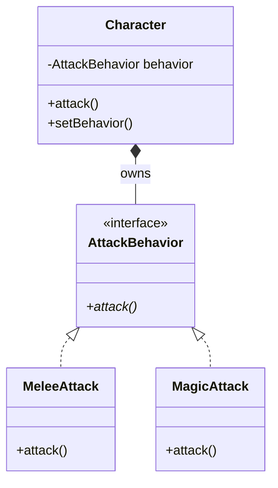

图中，`Character` 持有一个 `AttackBehavior`，而 `MeleeAttack` 和 `MagicAttack` 分别实现该接口。角色不需要知道具体攻击方式，只需要调用统一的 `attack()` 接口。

UML 类图中常见的关系如下。

### 2.1.1 继承（Generalization）

表示一种 `is-a` 关系，即子类是一种父类。

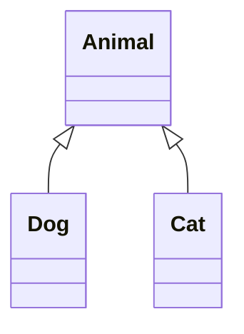

- 实线连接。
- 空心三角形指向父类。

在 C++ 中对应公有继承：

```cpp
class Animal {};

class Dog : public Animal {};
```

### 2.1.2 实现（Realization）

表示一个类实现某个接口，通常用于描述接口与具体实现之间的关系。

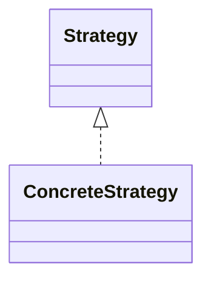

- 虚线连接。
- 空心三角形指向接口。

在 C++ 中通常通过继承抽象类并实现其纯虚函数完成：

```cpp
class Strategy {
public:
    virtual void execute() = 0;
    virtual ~Strategy() = default;
};

class ConcreteStrategy : public Strategy {
public:
    void execute() override {}
};
```

注意：C++ 中实现接口在语法上仍然使用继承，但 UML 中通常将这种关系区分为实现关系。

### 2.1.3 组合（Composition）

表示一种强整体-部分关系，即部分对象由整体对象拥有，其生命周期通常由整体管理。

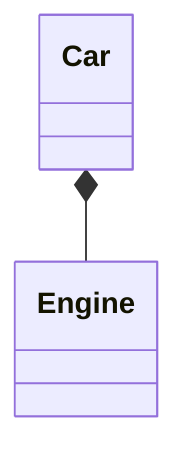

- 实线连接。
- 实心菱形位于整体一端。

例如，汽车包含发动机：

```cpp
class Engine {};

class Car {
private:
    Engine engine;
};
```

这里的发动机作为汽车的成员对象，其生命周期与汽车对象相关联。

组合通常用于表达紧密的对象所有权关系。在实际代码中，还可以通过 `std::unique_ptr` 表达动态分配的独占所有权。

### 2.1.4 聚合（Aggregation）

表示一种较弱的整体-部分关系，部分对象可以独立于整体存在，也可以被其他对象共享。

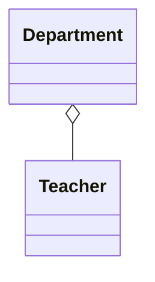

- 实线连接。
- 空心菱形位于整体一端。

例如，系部拥有多名教师，但教师并不依赖某个系部对象才能存在。

```cpp
class Teacher {};

class Department {
private:
    std::vector<Teacher*> teachers;
};
```

这里使用非拥有型指针表达一种弱关联，实际工程中还需要明确对象生命周期和指针有效性。

组合与聚合的主要区别在于整体对部分的所有权以及生命周期约束。聚合在实际 UML 建模中通常没有组合常用，其语义也较为宽泛。

### 2.1.5 依赖（Dependency）

表示一个类在某种操作中使用另一个类，但并不长期持有它。

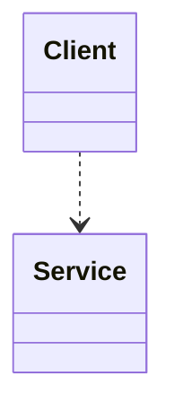

- 虚线连接。
- 箭头指向被依赖的类。

例如：

```cpp
class Service {
public:
    void execute();
};

class Client {
public:
    void run(Service& service) {
        service.execute();
    }
};
```

`Client` 通过函数参数使用 `Service`，但并不持有它。

### 2.1.6 关联（Association）

表示两个类之间存在相对稳定的联系，但不强调整体-部分关系。

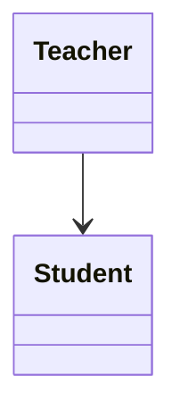

例如，教师对象长期保存所负责学生的引用或标识，二者具有稳定的关联关系。

关联可以通过成员指针、引用或容器等方式实现，具体的生命周期关系需要另外确定。

### 2.1.7 关系速查

| 关系 | UML 表示          | 含义                           |
| ---- | ----------------- | ------------------------------ |
| 继承 | 实线 + 空心三角形 | 子类是一种父类                 |
| 实现 | 虚线 + 空心三角形 | 类实现接口                     |
| 组合 | 实线 + 实心菱形   | 强所有权、整体管理部分生命周期 |
| 聚合 | 实线 + 空心菱形   | 弱整体-部分关系                |
| 关联 | 实线箭头          | 对象之间存在稳定联系           |
| 依赖 | 虚线箭头          | 一个类临时使用另一个类         |

其中，设计模式中的类图经常通过继承、实现、组合和依赖关系描述对象结构。理解这些关系后，阅读 GoF 设计模式中的类图就会容易很多。

# 3. 面向对象设计原则

## 3.1 SOLID 原则

SOLID 是五个面向对象设计原则英文名称首字母的组合，包括单一职责原则、开闭原则、里氏替换原则、接口隔离原则和依赖倒置原则。

### 3.1.1 单一职责原则（Single Responsibility Principle, SRP）

一个类应该只有一个引起它变化的原因，即一个类应该只承担一种相对独立的职责。

例如，一个用户类同时负责用户信息管理、数据库存储和邮件发送：

```cpp
class User {
public:
    void updateInfo();
    void saveToDatabase();
    void sendEmail();
};
```

这使得用户信息管理、数据库实现和邮件服务之间产生了不必要的耦合。任何一个方面发生变化，都可能要求修改 `User` 类。

可以按照职责将其拆分：

```cpp
class User {
    // 用户信息
};

class UserRepository {
public:
    void save(const User& user);
};

class EmailService {
public:
    void send(const User& user);
};
```

现在，`User` 负责表示用户，`UserRepository` 负责持久化，`EmailService` 负责邮件发送。不同职责可以独立变化。

**核心：** 将不同变化原因对应的职责分离，使每个类的修改范围尽可能集中。

### 3.1.2 开闭原则（Open-Closed Principle, OCP）

软件实体（类、模块、函数等）应该对扩展开放，对修改关闭。

即当需要增加新功能时，应该尽可能通过扩展现有结构实现，而不是反复修改已经稳定的代码。

例如，一个支付系统通过条件判断选择支付方式：

```cpp
class Payment {
public:
    void pay(int type) {
        if (type == 1) {
            // 支付宝支付
        } else if (type == 2) {
            // 微信支付
        }
    }
};
```

每增加一种支付方式，都需要修改 `Payment::pay()`，导致条件判断不断增长。

可以利用抽象类和多态改造：

```cpp
class Payment {
public:
    virtual void pay() = 0;
    virtual ~Payment() = default;
};

class Alipay : public Payment {
public:
    void pay() override {
        // 支付宝支付
    }
};

class WechatPay : public Payment {
public:
    void pay() override {
        // 微信支付
    }
};
```

增加银行卡支付时，只需要增加一个新的 `Payment` 实现：

```cpp
class BankPay : public Payment {
public:
    void pay() override {
        // 银行卡支付
    }
};
```

原有支付实现不需要修改。

**核心：** 将容易变化的部分抽象出来，通过增加新的实现扩展功能。

开闭原则并不意味着完全禁止修改已有代码，而是尽可能减少扩展功能时对稳定代码的影响。

### 3.1.3 里氏替换原则（Liskov Substitution Principle, LSP）

所有使用父类型对象的地方，都应该能够透明地使用其子类型对象，而不破坏程序原有的正确性。

继承不仅要求子类在语法上满足父类的接口，还要求子类在行为上满足父类的约定。

例如：

```cpp
class Bird {
public:
    virtual void fly() = 0;
    virtual ~Bird() = default;
};

class Sparrow : public Bird {
public:
    void fly() override {
        // 麻雀飞行
    }
};

class Penguin : public Bird {
public:
    void fly() override {
        // 企鹅不会飞
    }
};
```

企鹅虽然属于鸟类，但无法满足 `Bird::fly()` 所表达的行为要求。如果程序依赖于任意 `Bird` 都能飞行，那么使用 `Penguin` 就会破坏程序的正确性。

可以重新划分抽象：

```cpp
class Bird {
public:
    virtual ~Bird() = default;
};

class FlyingBird : public Bird {
public:
    virtual void fly() = 0;
    virtual ~FlyingBird() = default;
};

class Sparrow : public FlyingBird {
public:
    void fly() override {
        // 麻雀飞行
    }
};

class Penguin : public Bird {
    // 企鹅不具备飞行能力
};
```

从形式化的角度看，子类型需要保持父类型的行为契约：不能强化前置条件、削弱后置条件，也不能破坏父类型的不变量。

**核心：** 继承关系应该在行为上成立，使子类能够正确替换父类。

### 3.1.4 接口隔离原则（Interface Segregation Principle, ISP）

客户端不应该被迫依赖它不需要的接口。

即应该将庞大而复杂的接口拆分为多个职责明确、粒度适当的小接口，使不同客户端只依赖自己真正需要的功能。

例如，一个设备接口包含打印、扫描和传真功能：

```cpp
class Machine {
public:
    virtual void print() = 0;
    virtual void scan() = 0;
    virtual void fax() = 0;
    virtual ~Machine() = default;
};
```

但普通打印机并不支持扫描和传真，却不得不实现这些接口。

可以将其拆分：

```cpp
class Printable {
public:
    virtual void print() = 0;
    virtual ~Printable() = default;
};

class Scannable {
public:
    virtual void scan() = 0;
    virtual ~Scannable() = default;
};

class Faxable {
public:
    virtual void fax() = 0;
    virtual ~Faxable() = default;
};
```

不同设备只需要实现自己支持的接口：

```cpp
class Printer : public Printable {
public:
    void print() override;
};

class MultiFunctionPrinter
    : public Printable,
      public Scannable,
      public Faxable {
public:
    void print() override;
    void scan() override;
    void fax() override;
};
```

**核心：** 按照客户端的实际需求划分接口，避免不必要的依赖。

### 3.1.5 依赖倒置原则（Dependency Inversion Principle, DIP）

高层模块不应该依赖低层模块，二者都应该依赖抽象；抽象不应该依赖细节，细节应该依赖抽象。

其中：

- 高层模块：实现核心业务逻辑的模块。
- 低层模块：提供具体技术实现的模块，例如数据库访问、文件读写和网络通信。

例如，一个业务模块直接依赖 MySQL：

```cpp
class MySQLDatabase {
public:
    void save(const std::string& data);
};

class UserService {
private:
    MySQLDatabase db;

public:
    void saveUser(const std::string& data) {
        db.save(data);
    }
};
```

此时，`UserService` 与 MySQL 的具体实现绑定。

可以引入抽象接口：

```cpp
class Database {
public:
    virtual bool save(const std::string& data) = 0;
    virtual ~Database() = default;
};

class MySQLDatabase : public Database {
public:
    bool save(const std::string& data) override {
        // 写入 MySQL
        return true;
    }
};

class UserService {
private:
    Database& db;

public:
    explicit UserService(Database& database)
        : db(database) {}

    bool saveUser(const std::string& data) {
        return db.save(data);
    }
};
```

现在，`UserService` 依赖抽象 `Database`，而不是具体数据库实现。

**依赖倒置更直接的工程价值：可测试性。**

可以在测试中提供一个假的数据库实现（FakeDatabase），而不需要连接真实数据库：

```cpp
class FakeDatabase : public Database {
public:
    int saveCount = 0;
    std::string savedData;

    bool save(const std::string& data) override {
        ++saveCount;
        savedData = data;
        return true;
    }
};
```

测试时：

```cpp
FakeDatabase fakeDB;
UserService service(fakeDB);

service.saveUser("Alice");

// 验证业务逻辑是否正确调用数据库
assert(fakeDB.saveCount == 1);
assert(fakeDB.savedData == "Alice");
```

这样就能独立测试 `UserService`，不需要启动 MySQL、准备数据库或依赖外部网络。

这里还涉及**依赖注入（Dependency Injection, DI）**：通过构造函数、方法参数或接口注入等方式，将对象所依赖的组件从外部传入。

依赖倒置是一种设计原则，依赖注入则是实现这一原则的常见技术，二者不能混为一谈。

**核心：** 让业务逻辑依赖稳定的抽象，而不是容易变化的具体实现；通过依赖注入，使外部依赖可替换、可测试。

> [!warring] 广义依赖
> UML 中的依赖要求调用者不长期持有被调用者，但在 DIP 中，只要调用者使用了被调用者，就称为依赖，即使被调用者就是调用者的一个成员对象。

## 3.2 组合优于继承（Composition over Inheritance）

组合优于继承是一条重要的面向对象设计指导思想，但它不属于 SOLID 五大原则。

在合理的情况下，应该优先通过组合对象复用和扩展功能，而不是建立复杂的继承层次。

继承表达的是一种 `is-a` 关系，即子类是一种父类；组合表达的是一种 `has-a` 关系，即对象拥有另一个对象，并通过它完成某些功能。

例如，游戏角色拥有不同的攻击能力。

如果通过继承组织：

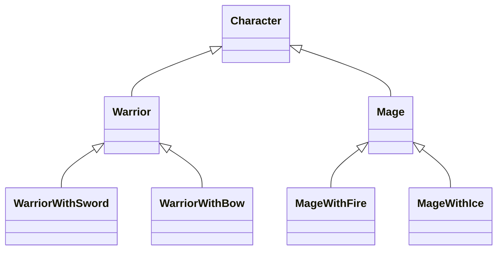

随着角色类型和能力种类增加，继承层次可能迅速膨胀。

可以将攻击能力独立出来，通过组合实现：

```cpp
class AttackBehavior {
public:
    virtual void attack() = 0;
    virtual ~AttackBehavior() = default;
};

class MeleeAttack : public AttackBehavior {
public:
    void attack() override {
        // 近战攻击
    }
};

class MagicAttack : public AttackBehavior {
public:
    void attack() override {
        // 魔法攻击
    }
};

class Character {
private:
    std::unique_ptr<AttackBehavior> behavior;

public:
    explicit Character(
        std::unique_ptr<AttackBehavior> b
    ) : behavior(std::move(b)) {}

    void setBehavior(std::unique_ptr<AttackBehavior> b) {
        behavior = std::move(b);
    }

    void attack() {
        behavior->attack();
    }
};
```

现在，角色可以组合不同的攻击行为，也可以在运行时替换攻击方式，而不必为每种组合创建新的子类。

```cpp
Character character(std::make_unique<MeleeAttack>());
character.attack();  // 近战攻击

character.setBehavior(std::make_unique<MagicAttack>());
character.attack();  // 魔法攻击
```

| 比较     | 继承               | 组合                       |
| -------- | ------------------ | -------------------------- |
| 关系     | is-a               | has-a                      |
| 复用方式 | 继承父类实现       | 委托其他对象完成工作       |
| 灵活性   | 通常在编译期确定   | 可以在运行时替换组件       |
| 适用场景 | 稳定的类型继承关系 | 可独立变化、自由组合的功能 |

组合优于继承并不意味着应该完全避免继承。对于真正满足里氏替换原则的子类型关系，继承依然是合理的设计手段。

**与设计模式的联系：** 上述 `AttackBehavior` 的设计结构实际上就是策略模式（Strategy）的典型形式。这里通过组合独立的行为对象来改变角色的攻击方式，后面将在 §6.1 中正式介绍。

## 3.3 迪米特法则（Law of Demeter, LoD）

迪米特法则又称最少知识原则（Principle of Least Knowledge）。

**一个对象应该尽可能少地了解其他对象，只与自己的直接朋友通信，而不应过多依赖其他对象的内部结构。**

所谓直接朋友，通常包括：

- 当前对象自身。
- 当前对象的成员对象。
- 当前方法的参数对象。
- 当前方法创建的对象。
- 当前对象能够直接访问的相关对象。

例如：

```cpp
order.getCustomer()
     .getAddress()
     .getCity();
```

这段代码连续访问多个对象的内部结构。假设客户的地址存储方式发生变化，就可能需要修改调用者。

可以将操作封装到更接近数据的一方：

```cpp
order.getShippingCity();
```

调用者不需要了解订单、客户和地址之间的内部组织方式。

**核心：** 限制对象之间不必要的了解，减少模块之间的结构性依赖。

迪米特法则并不是禁止出现多个点号，也不是要求所有访问都必须通过中间类转发。它强调的是不要让一个模块依赖过多其他模块的内部实现。

## 3.4 设计原则之间的联系

这些原则不是互相独立的规则，而是共同指导软件模块的组织方式。

| 原则         | 主要解决的问题                   |
| ------------ | -------------------------------- |
| 单一职责原则 | 避免一个类承担过多职责           |
| 开闭原则     | 减少扩展功能时对已有代码的修改   |
| 里氏替换原则 | 保证继承关系在行为上合理         |
| 接口隔离原则 | 避免依赖不需要的接口             |
| 依赖倒置原则 | 降低高层业务逻辑对具体实现的依赖 |
| 组合优于继承 | 避免通过复杂继承层次复用功能     |
| 迪米特法则   | 减少对象对其他对象内部结构的了解 |

这些原则可以相互配合：

1. 使用单一职责原则划分模块。
2. 使用接口隔离原则设计模块之间的接口。
3. 使用依赖倒置原则降低模块之间的耦合。
4. 使用开闭原则提高系统的可扩展性。
5. 使用里氏替换原则保证继承体系的正确性。
6. 优先使用组合构建灵活的对象结构。
7. 使用迪米特法则限制不必要的对象交互。

不同教材对设计原则的归纳数量并不完全一致。SOLID 是较为通行的五项原则；组合优于继承和迪米特法则则是经常与 SOLID 一起学习的其他指导思想。

# 4. GoF 经典设计模式

## 4.1 概述

GoF（Gang of Four，四人帮）指 Erich Gamma、Richard Helm、Ralph Johnson 和 John Vlissides 四位作者。他们在 1994 年出版的《Design Patterns: Elements of Reusable Object-Oriented Software》中总结了 23 种经典面向对象设计模式。

这 23 种模式按照用途分为三类：

- **创建型模式（Creational Patterns）**：解决对象如何创建的问题。
- **结构型模式（Structural Patterns）**：解决类和对象如何组织的问题。
- **行为型模式（Behavioral Patterns）**：解决对象之间如何协作、分配职责和传递消息的问题。

## 4.2 创建型模式

创建型模式将对象的创建过程与使用过程分离，降低客户端对具体对象创建方式的依赖。

| 模式         | 英文名称         | 核心思想                                   |
| ------------ | ---------------- | ------------------------------------------ |
| 单例模式     | Singleton        | 保证一个类只有一个实例，并提供统一访问入口 |
| 工厂方法模式 | Factory Method   | 定义创建对象的接口，将具体创建过程交给子类 |
| 抽象工厂模式 | Abstract Factory | 提供创建一系列相关对象的接口               |
| 建造者模式   | Builder          | 将复杂对象的构建过程与其表示分离           |
| 原型模式     | Prototype        | 通过复制已有对象创建新对象                 |

## 4.3 结构型模式

结构型模式通过组合类和对象形成更大的结构，同时控制模块之间的依赖关系。

| 模式       | 英文名称  | 核心思想                                                     |
| ---------- | --------- | ------------------------------------------------------------ |
| 适配器模式 | Adapter   | 将一个接口转换为客户端期望的接口                             |
| 桥接模式   | Bridge    | 将抽象部分与实现部分分离，使二者能够独立变化                 |
| 组合模式   | Composite | 将对象组织成树形结构，使单个对象和组合对象具有一致的使用方式 |
| 装饰者模式 | Decorator | 动态地为对象添加额外功能                                     |
| 外观模式   | Facade    | 为复杂子系统提供统一、简化的接口                             |
| 享元模式   | Flyweight | 共享相同的状态，减少对象数量和内存开销                       |
| 代理模式   | Proxy     | 通过代理对象控制对目标对象的访问                             |

## 4.4 行为型模式

行为型模式关注对象之间的通信方式、职责分配和算法组织。

| 模式         | 英文名称                | 核心思想                                       |
| ------------ | ----------------------- | ---------------------------------------------- |
| 责任链模式   | Chain of Responsibility | 将请求沿处理链传递，由链上的对象依次尝试处理   |
| 命令模式     | Command                 | 将请求封装为对象，支持参数化、排队和撤销等操作 |
| 解释器模式   | Interpreter             | 为特定语言定义语法表示，并提供解释执行机制     |
| 迭代器模式   | Iterator                | 提供统一方式遍历集合，而不暴露其内部结构       |
| 中介者模式   | Mediator                | 通过中介者协调多个对象之间的交互               |
| 备忘录模式   | Memento                 | 保存对象的内部状态，以便日后恢复               |
| 观察者模式   | Observer                | 建立一对多依赖关系，一个对象变化时通知其他对象 |
| 状态模式     | State                   | 将对象在不同状态下的行为封装起来               |
| 策略模式     | Strategy                | 将不同算法封装起来，使算法可以相互替换         |
| 模板方法模式 | Template Method         | 定义算法骨架，将部分步骤交给子类实现           |
| 访问者模式   | Visitor                 | 将作用于对象结构的操作与对象结构分离           |

因此，GoF 设计模式共 23 种，即创建型 5 种、结构型 7 种、行为型 11 种。

# 5. 如何识别设计模式？

学习设计模式时，最重要的能力不是看到某种模式后能解释它的定义，而是看到代码中的设计问题后，能够判断可能需要哪种模式。

设计模式不是一组固定的代码模板，而是针对某类问题的解决思路。同一个问题可能存在多种方案，下面的对应关系只是候选方向，并不是一一对应的规则。

## 5.1 代码症状与模式

| 代码症状或需求                    | 可以考虑的模式     | 判断依据                       |
| --------------------------------- | ------------------ | ------------------------------ |
| 按类型分支的 `if/switch` 不断膨胀 | 策略模式           | 分支选择的是不同算法或行为     |
| 按类型分支决定创建哪种对象        | 工厂方法或抽象工厂 | 问题集中在对象创建过程         |
| 功能需要自由组合、逐层叠加        | 装饰者模式         | 需要在运行时为对象添加功能     |
| 一处变化需要通知多个对象          | 观察者模式         | 对象之间存在一对多通知关系     |
| 第三方接口与现有接口不兼容        | 适配器模式         | 需要转换接口而不修改原有代码   |
| 构造函数参数过多、配置组合复杂    | 建造者模式         | 对象需要分步骤构建             |
| 整体流程固定，个别步骤容易变化    | 模板方法模式       | 固定算法骨架，子类实现变化步骤 |
| 请求需要经过多个处理者            | 责任链模式         | 处理者依次检查或处理请求       |
| 请求需要排队、保存或撤销          | 命令模式           | 将请求本身封装为对象           |
| 复杂子系统需要统一入口            | 外观模式           | 简化客户端对多个子系统的调用   |
| 需要控制远程对象或延迟创建对象    | 代理模式           | 通过代理间接访问目标对象       |
| 一组对象之间存在复杂的相互通信    | 中介者模式         | 将交互关系集中交给中介者       |
| 相同结构需要执行多种独立操作      | 访问者模式         | 将操作从稳定对象结构中分离     |

## 5.2 几种重要的识别区别

### 条件判断膨胀：策略还是工厂？

首先判断变化发生在哪里：

- 如果变化在于**如何完成某项任务**，考虑策略模式。
- 如果变化在于**应该创建哪种对象**，考虑工厂方法或抽象工厂。

例如：

```cpp
if (type == 1) {
    calculateWithA();
} else if (type == 2) {
    calculateWithB();
}
```

这是算法选择问题，可以考虑策略模式。

而：

```cpp
if (type == 1) {
    return std::make_unique<ProductA>();
} else if (type == 2) {
    return std::make_unique<ProductB>();
}
```

这是对象创建问题，可以考虑工厂。

二者可以同时出现，但不是同一种模式。

### 对象功能扩展：装饰者还是策略？

- 如果需要替换对象执行的算法，考虑策略模式。
- 如果需要在原有功能外叠加额外行为，考虑装饰者模式。

例如，改变支付计算方式属于策略；为文件读取增加缓冲和加密包装属于装饰者。

### 多个对象协作：观察者还是责任链？

- 如果一个对象变化后需要通知多个对象，考虑观察者模式。
- 如果一个请求需要沿多个处理者传递，考虑责任链模式。

二者一个重点在通知，一个重点在请求处理过程。

## 5.3 模式选择的基本流程

遇到设计问题时，可以按照下面的顺序思考：

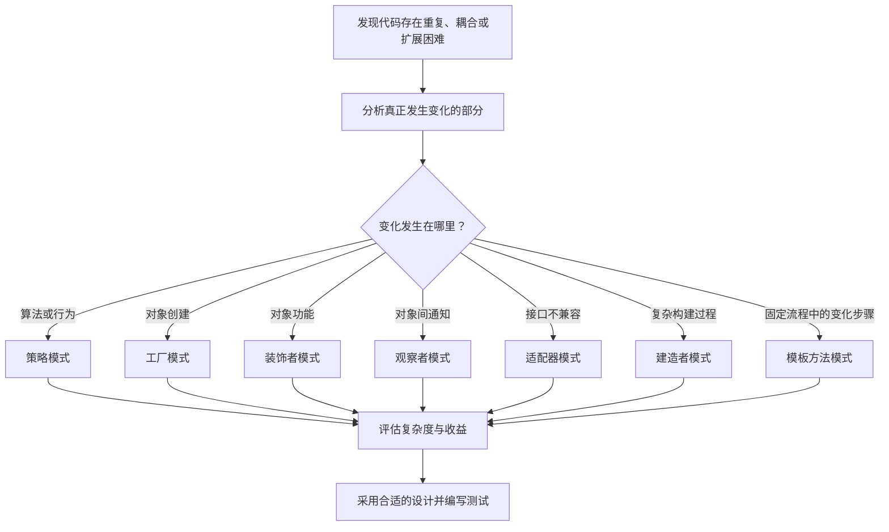

模式的选择始终应该由实际问题驱动，而不是为了使用模式而寻找问题。

# 6. 重要设计模式

## 6.1 策略模式（Strategy）

**问题：** 当一个任务存在多种可替换的算法时，如何避免使用大量条件判断选择不同算法？

**核心思想：** 将不同算法分别封装为独立的策略对象，使客户端可以选择和替换算法。

例如，电商系统支持多种折扣计算方式：

```cpp
class DiscountStrategy {
public:
    virtual double calculate(double price) = 0;
    virtual ~DiscountStrategy() = default;
};

class NormalDiscount : public DiscountStrategy {
public:
    double calculate(double price) override {
        return price;
    }
};

class VipDiscount : public DiscountStrategy {
public:
    double calculate(double price) override {
        return price * 0.9;
    }
};

class SpecialDiscount : public DiscountStrategy {
public:
    double calculate(double price) override {
        return price * 0.8;
    }
};
```

上下文类负责调用当前策略：

```cpp
class ShoppingCart {
private:
    std::unique_ptr<DiscountStrategy> strategy;

public:
    explicit ShoppingCart(std::unique_ptr<DiscountStrategy> s)
        : strategy(std::move(s)) {}

    void setStrategy(std::unique_ptr<DiscountStrategy> s) {
        strategy = std::move(s);
    }

    double checkout(double price) {
        return strategy->calculate(price);
    }
};
```

客户端可以在构造时选择策略，也可以在运行时更换策略：

```cpp
ShoppingCart cart(std::make_unique<NormalDiscount>());
cart.checkout(100.0);  // 100.0

cart.setStrategy(std::make_unique<VipDiscount>());
cart.checkout(100.0);  // 90.0
```

对应的 UML 结构：

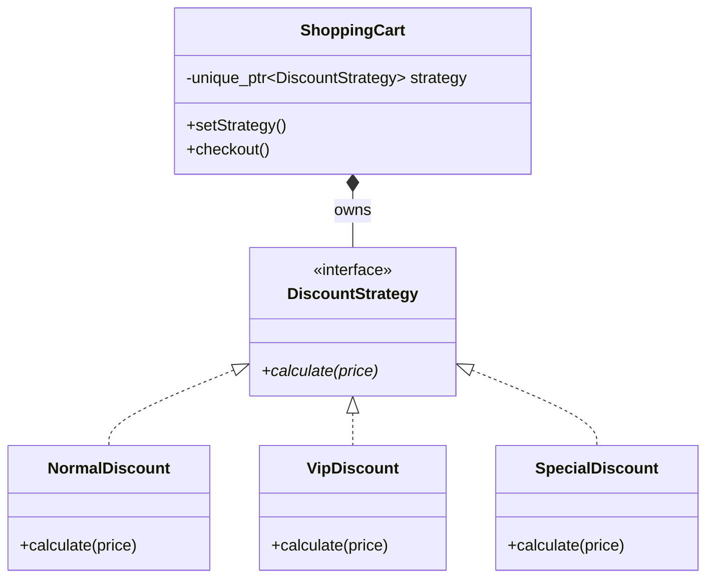

**优点：**

- 不同算法相互独立，便于维护。
- 可以在运行时切换算法。
- 避免大量条件判断。
- 符合开闭原则和组合优于继承的思想。

**缺点：**

- 需要额外定义策略接口和具体策略类。
- 如果算法种类很少且变化不大，可能显得过于复杂。

**适用场景：** 排序算法、支付方式、折扣计算、路径规划等。

**与设计原则的联系：** 策略模式是组合优于继承的典型应用，也是开闭原则的一种实现方式。§3.2 中 `Character` 组合 `AttackBehavior` 的例子，本质上就是策略模式：角色将攻击算法委托给独立策略对象完成。

## 6.2 模板方法模式（Template Method）

**问题：** 多个类需要执行相似的处理流程，但其中某些具体步骤有所不同，如何避免重复编写整体流程？

**核心思想：** 在父类中定义算法的固定执行骨架，将其中可变化的步骤交给子类实现。

例如，不同数据文件的处理过程可能都包含读取、转换和保存三个步骤：

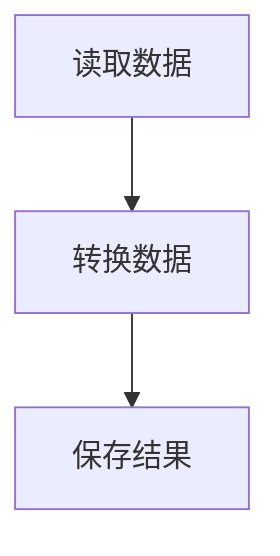

可以在基类中定义固定流程：

```cpp
class DataProcessor {
public:
    void process() {
        read();
        transform();
        save();
    }

    virtual ~DataProcessor() = default;

protected:
    virtual void read() = 0;
    virtual void transform() = 0;
    virtual void save() = 0;
};
```

具体子类实现不同的处理步骤：

```cpp
class CSVProcessor : public DataProcessor {
protected:
    void read() override {
        // 读取 CSV 文件
    }

    void transform() override {
        // 转换 CSV 数据
    }

    void save() override {
        // 保存处理结果
    }
};

class JSONProcessor : public DataProcessor {
protected:
    void read() override {
        // 读取 JSON 文件
    }

    void transform() override {
        // 转换 JSON 数据
    }

    void save() override {
        // 保存处理结果
    }
};
```

客户端只需要调用统一的 `process()`：

```cpp
CSVProcessor csv;
csv.process();

JSONProcessor json;
json.process();
```

无论使用哪种处理器，整体执行流程都保持一致，具体步骤由子类实现。

**优点：**

- 将固定流程集中管理，避免重复代码。
- 允许子类定制部分步骤。
- 统一算法执行顺序，减少实现差异。

**缺点：**

- 依赖继承，子类与父类之间存在较强耦合。
- 算法流程的变化通常需要修改基类。
- 子类的定制能力受到父类预先定义的步骤限制。

**适用场景：** 数据处理框架、算法骨架、编译流程、测试框架以及需要子类实现回调步骤的框架。

### 策略模式与模板方法模式

这两种模式都能够实现算法变化，但采用了不同的机制。

| 比较     | 策略模式             | 模板方法模式             |
| -------- | -------------------- | ------------------------ |
| 实现方式 | 组合                 | 继承                     |
| 变化对象 | 整个算法或行为策略   | 算法中的部分步骤         |
| 控制权   | 上下文委托策略对象   | 父类控制整体流程         |
| 灵活性   | 可以在运行时替换策略 | 通常通过选择不同子类定制 |
| 适用场景 | 多种相互独立的算法   | 多个算法具有相同流程骨架 |

可以简单理解为：

- **策略模式：** 将整个算法交给另一个对象完成。
- **模板方法模式：** 父类规定算法骨架，子类填写具体步骤。

## 6.3 工厂方法模式（Factory Method）

**问题：** 客户端需要创建对象，但不希望直接依赖具体产品类。如何将对象的创建过程交给专门的创建者？

**核心思想：** 定义一个创建产品的接口，将具体产品的创建过程交给子类决定。

例如，一个通知系统支持邮件通知和短信通知：

```cpp
class Notification {
public:
    virtual void send() = 0;
    virtual ~Notification() = default;
};

class EmailNotification : public Notification {
public:
    void send() override {
        // 发送邮件
    }
};

class SMSNotification : public Notification {
public:
    void send() override {
        // 发送短信
    }
};
```

定义抽象创建者：

```cpp
class NotificationFactory {
public:
    virtual std::unique_ptr<Notification> create() = 0;
    virtual ~NotificationFactory() = default;
};

class EmailFactory : public NotificationFactory {
public:
    std::unique_ptr<Notification> create() override {
        return std::make_unique<EmailNotification>();
    }
};

class SMSFactory : public NotificationFactory {
public:
    std::unique_ptr<Notification> create() override {
        return std::make_unique<SMSNotification>();
    }
};
```

客户端通过工厂接口创建产品：

```cpp
void notify(NotificationFactory& factory) {
    auto notification = factory.create();
    notification->send();
}
```

客户端依赖 `Notification` 抽象，而不需要知道具体创建了哪种通知对象。

**优点：**

- 将对象创建过程与对象使用过程分离。
- 减少客户端对具体产品类的依赖。
- 增加新产品时，可以通过增加新的工厂实现扩展。

**缺点：**

- 增加了工厂类，可能导致类的数量增多。
- 每增加一种产品，通常需要增加对应的创建者。

**适用场景：** 产品类型具有扩展需求，且客户端不应直接依赖具体产品创建方式的场景。

### 工厂方法与抽象工厂

抽象工厂模式进一步将创建对象的范围扩展为一组相关产品。

例如，一个跨平台 GUI 系统需要创建按钮和文本框：

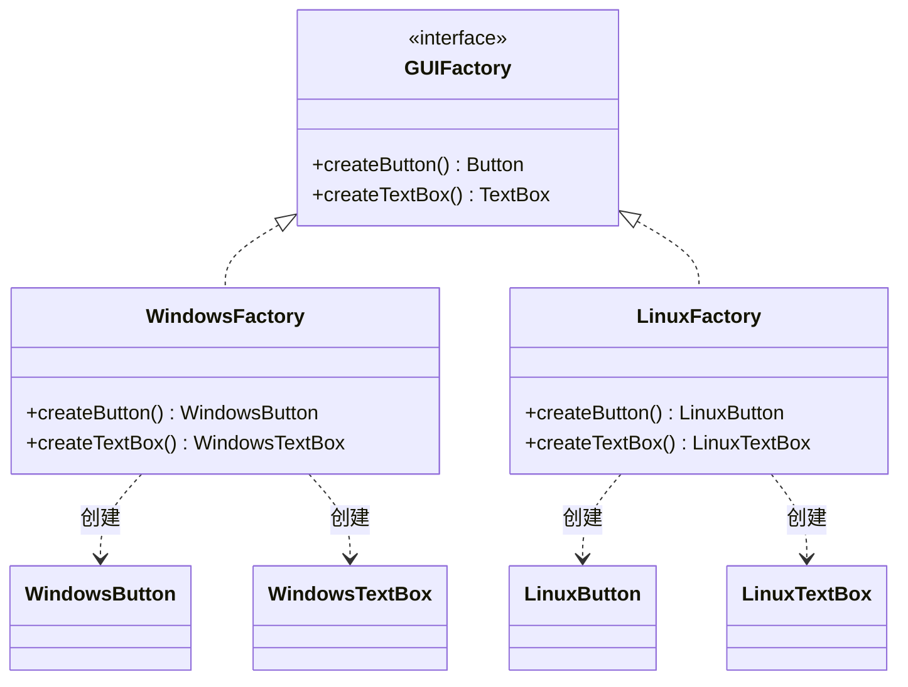

客户端只需要选择一种工厂，就能创建风格一致的一组产品。

| 比较     | 工厂方法               | 抽象工厂               |
| -------- | ---------------------- | ---------------------- |
| 创建对象 | 通常创建一种产品       | 创建一组相关产品       |
| 主要目的 | 将具体产品创建交给子类 | 保证相关产品族的一致性 |
| 典型例子 | 不同通知方式           | 不同平台的 GUI 组件    |

简单工厂（Simple Factory）经常与工厂方法一起讨论，但它不是 GoF 23 种模式之一。

## 6.4 观察者模式（Observer）

**问题：** 一个对象的状态发生变化时，如何自动通知所有依赖于它的对象？

**核心思想：** 建立被观察者与观察者之间的一对多依赖关系，当被观察者状态变化时，自动通知所有观察者。

例如，气象站维护当前温度，手机、显示屏和记录器都需要获取温度变化：

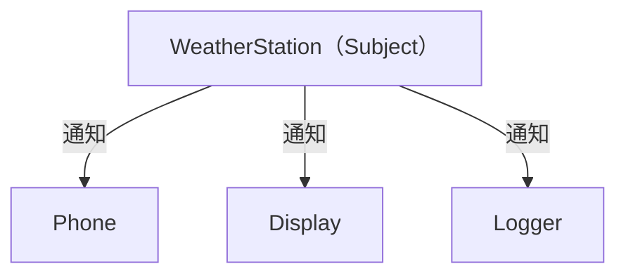

主要角色：

- `Subject`：被观察者，维护观察者列表，负责注册、移除和通知观察者。
- `Observer`：观察者，定义统一的更新接口。
- `ConcreteObserver`：具体观察者，实现更新行为。

下面给出一个简化的 C++ 实现：

```cpp
#include <algorithm>
#include <vector>

class Observer {
public:
    virtual void update(double temperature) = 0;
    virtual ~Observer() = default;
};

class WeatherStation {
private:
    std::vector<Observer*> observers;
    double temperature = 0.0;

public:
    void attach(Observer& observer) {
        observers.push_back(&observer);
    }

    void detach(Observer& observer) {
        observers.erase(
            std::remove(observers.begin(), observers.end(), &observer),
            observers.end()
        );
    }

    void setTemperature(double value) {
        temperature = value;
        notify();
    }

    void notify() {
        for (Observer* observer : observers) {
            observer->update(temperature);
        }
    }
};
```

具体观察者实现更新接口：

```cpp
class PhoneDisplay : public Observer {
private:
    WeatherStation& station;

public:
    explicit PhoneDisplay(WeatherStation& s)
        : station(s) {
        station.attach(*this);
    }

    ~PhoneDisplay() override {
        station.detach(*this);
    }

    void update(double temperature) override {
        // 更新手机上的温度显示
    }
};
```

客户端：

```cpp
WeatherStation station;
PhoneDisplay phone(station);

station.setTemperature(25.0);
station.setTemperature(30.0);
```

每次温度变化，气象站都会通知已注册的观察者。

这里通过 `attach()` 注册观察者，通过 `detach()` 移除观察者。示例使用非拥有型裸指针，因此必须满足两条生命周期约束：

1. 观察者销毁前必须从气象站注销——示例在析构函数中调用 `detach()` 完成这一点。
2. **观察者必须先于气象站销毁**，即气象站要比所有观察者活得更久；否则观察者析构时调用的 `station.detach()` 会访问已销毁的对象。

示例客户端中 `station` 先声明、`phone` 后声明，局部对象按声明的逆序析构：`phone` 先析构并完成注销，`station` 后析构，恰好满足上述约束。

这也是观察者模式需要特别注意的问题：如果观察者已经销毁，而被观察者仍保存着它的地址，就会产生悬垂指针。

实际工程中可以使用 RAII 订阅句柄、弱引用或其他生命周期管理机制解决该问题。通知过程中修改观察者列表、并发注册和注销也需要额外处理。

**优点：**

- 建立一对多通知机制。
- 被观察者不需要了解观察者的具体实现。
- 可以动态添加和移除观察者。

**缺点：**

- 观察者过多时，通知过程可能产生较大开销。
- 观察者之间可能存在复杂的更新依赖。
- 需要注意对象生命周期、回调管理和并发访问问题。

**适用场景：** GUI 事件、状态更新、事件监听、MVC 架构等。

### 发布-订阅模式（Publish-Subscribe）

发布-订阅模式与观察者模式有相似之处，但通常通过一个中间的消息中心（Broker）解耦发布者和订阅者。

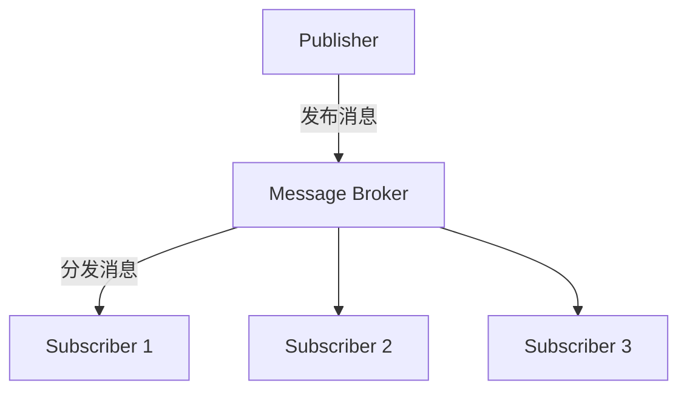

例如，订单系统发布 `OrderCreated` 消息：

- 库存模块订阅该消息，扣减库存。
- 邮件模块订阅该消息，发送订单确认邮件。
- 积分模块订阅该消息，增加用户积分。

订单模块不需要知道有哪些模块订阅了该消息。

| 比较     | 观察者模式                   | 发布-订阅模式                 |
| -------- | ---------------------------- | ----------------------------- |
| 主要角色 | Subject、Observer            | Publisher、Broker、Subscriber |
| 通知方式 | 被观察者通常直接通知观察者   | 通过消息中心转发              |
| 耦合关系 | 观察者需要注册到具体 Subject | 发布者与订阅者通常互不知晓    |
| 典型场景 | 对象内部状态变化             | 消息队列、事件总线、微服务    |

二者并非绝对互斥。发布-订阅模式可以看作一种更加解耦的事件通信组织方式，实际系统中也可能采用类似观察者模式的实现。

## 6.5 装饰者模式（Decorator）

**问题：** 如何在不修改原有类的情况下，动态地为对象添加功能？

**核心思想：** 使用包装对象包含原始对象，并通过相同接口对其进行包装，从而逐层扩展功能。

例如，一个咖啡系统提供基础咖啡：

```cpp
class Coffee {
public:
    virtual double cost() = 0;
    virtual ~Coffee() = default;
};

class BasicCoffee : public Coffee {
public:
    double cost() override {
        return 10.0;
    }
};
```

现在需要增加牛奶和糖等配料。

定义装饰者：

```cpp
class CoffeeDecorator : public Coffee {
protected:
    std::unique_ptr<Coffee> coffee;

public:
    explicit CoffeeDecorator(std::unique_ptr<Coffee> c)
        : coffee(std::move(c)) {}
};

class MilkDecorator : public CoffeeDecorator {
public:
    using CoffeeDecorator::CoffeeDecorator;

    double cost() override {
        return coffee->cost() + 2.0;
    }
};

class SugarDecorator : public CoffeeDecorator {
public:
    using CoffeeDecorator::CoffeeDecorator;

    double cost() override {
        return coffee->cost() + 1.0;
    }
};
```

可以逐层包装：

```cpp
std::unique_ptr<Coffee> coffee =
    std::make_unique<BasicCoffee>();

coffee = std::make_unique<MilkDecorator>(
    std::move(coffee)
);

coffee = std::make_unique<SugarDecorator>(
    std::move(coffee)
);
```

最终价格为 13.0。

装饰者通过组合对象逐层增加功能，而不需要为每种配料组合创建新的子类。

**优点：**

- 可以在运行时动态扩展功能。
- 避免通过继承产生大量子类。
- 符合开闭原则和组合优于继承的思想。

**缺点：**

- 可能形成多层包装，增加调试难度。
- 对象的创建和调用过程会变得复杂。

**适用场景：** IO 流、缓存、日志、权限包装和功能扩展。

## 6.6 责任链模式（Chain of Responsibility）

**问题：** 一个请求可能由多个处理对象处理，如何避免请求发送者与具体处理者直接耦合？

**核心思想：** 将多个处理对象连接成一条链，请求沿链传递，由处理者决定是否处理请求或继续传递。

责任链模式通常有两种常见形式。

**形式一：处理即终止。**

这是 GoF 经典责任链模式的典型形式。每个处理者判断自己是否能够处理请求：

- 能够处理：执行操作并终止传递。
- 不能处理：将请求交给下一个处理者。
- 到达链尾仍无人处理：请求未被处理。

例如，不同级别的审批人员依次处理请假申请。

```cpp
struct Request {
    // 请求信息
};

class Handler {
protected:
    std::unique_ptr<Handler> next;

public:
    void setNext(std::unique_ptr<Handler> h) {
        next = std::move(h);
    }

    virtual bool handle(const Request& request) {
        return next ? next->handle(request) : false;
    }

    virtual ~Handler() = default;
};
```

基类提供默认转发行为，具体处理器只需要实现自己的判断和处理逻辑：

```cpp
class ManagerHandler : public Handler {
public:
    bool handle(const Request& request) override {
        if (canHandle(request)) {
            // 经理处理请求
            return true;
        }

        return Handler::handle(request);
    }

private:
    bool canHandle(const Request& request);
};
```

这里约定 `true` 表示请求已经被处理或被当前节点终止，`false` 表示整条链仍未处理该请求。

**形式二：管道式处理。**

另一种常见形式是每个处理者都执行自己的处理步骤，然后将请求继续传递给下一个处理者。这种形式常见于 HTTP 中间件和拦截器。

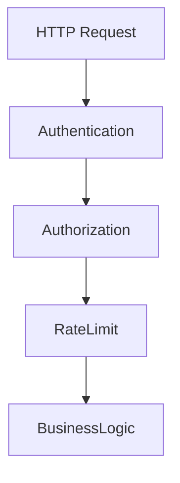

每个中间件可以在调用下一个处理器之前执行操作，也可以在下一个处理器返回后执行后置操作。

这种管道式中间件与责任链模式具有相似的链式结构，但语义上不再是传统的“找到一个处理者就终止”，而是允许多个处理者依次参与处理。

**优点：**

- 请求发送者不需要知道具体处理者。
- 可以灵活增加、删除和调整处理链。
- 各处理器职责相对独立。

**缺点：**

- 请求可能经过较长的处理链，增加执行开销。
- 可能出现请求最终无人处理的情况。
- 调试时需要追踪请求经过的多个处理器。

**适用场景：** 审批流程、请求过滤、HTTP 中间件、权限检查和日志处理等。

## 6.7 适配器模式（Adapter）

**问题：** 已有类提供的接口与客户端期望的接口不兼容，如何在不修改原有类的情况下使二者协作？

**核心思想：** 引入适配器，将已有接口转换为客户端期望的接口。

例如，客户端需要一个统一的播放器接口：

```cpp
class Player {
public:
    virtual void play() = 0;
    virtual ~Player() = default;
};
```

但已有的第三方播放器提供的是：

```cpp
class OldPlayer {
public:
    void playAudio();
};
```

可以通过适配器包装它：

```cpp
class PlayerAdapter : public Player {
private:
    OldPlayer oldPlayer;

public:
    void play() override {
        oldPlayer.playAudio();
    }
};
```

现在客户端可以通过统一的 `Player` 接口使用旧播放器。

**优点：**

- 兼容已有代码和第三方接口。
- 不需要修改原有类。
- 降低接口差异带来的耦合。

**缺点：**

- 增加了额外的适配层。
- 如果接口差异过大，适配逻辑可能变得复杂。

**适用场景：** 系统集成、第三方库接入、遗留代码兼容等。

## 6.8 命令模式（Command）

**问题：** 如何将请求本身封装为对象，从而使请求的发起者与执行者解耦？

**核心思想：** 将一个操作封装为命令对象，由命令对象记录执行该操作所需要的信息，并提供统一的执行接口。

命令模式通常包含四个角色：

- `Command`：命令接口，声明执行操作的方法。
- `ConcreteCommand`：具体命令，保存执行操作所需的信息。
- `Receiver`：接收者，真正执行具体业务操作的对象。
- `Invoker`：调用者，负责触发命令。

例如，GUI 系统中的按钮不直接实现文件保存逻辑，而是绑定一个命令：

```cpp
class Document {
public:
    void save() {
        // 保存文档
    }
};

class Command {
public:
    virtual void execute() = 0;
    virtual ~Command() = default;
};

class SaveCommand : public Command {
private:
    Document& receiver;

public:
    explicit SaveCommand(Document& document)
        : receiver(document) {}

    void execute() override {
        receiver.save();
    }
};
```

按钮作为调用者，只负责执行命令：

```cpp
class Button {
private:
    std::unique_ptr<Command> command;

public:
    explicit Button(std::unique_ptr<Command> c)
        : command(std::move(c)) {}

    void click() {
        command->execute();
    }
};
```

整个调用关系为：

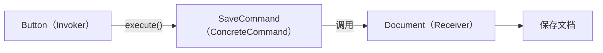

按钮不需要知道文档具体如何保存，命令对象负责连接调用者与真正的执行者。

进一步地，命令对象可以保存执行所需的参数和状态，并通过增加 `undo()` 等接口支持撤销操作。

**优点：**

- 将请求发送者与请求执行者解耦。
- 可以将请求保存、排队、记录和延迟执行。
- 可以通过额外接口实现撤销和重做。

**缺点：**

- 需要额外定义命令类。
- 命令数量较多时，可能增加类的数量和维护成本。

**适用场景：** GUI 操作、任务队列、事务操作、撤销与重做。

## 6.9 建造者模式（Builder）

**问题：** 当对象包含大量属性，且构造过程比较复杂时，如何避免构造函数出现大量参数或不同参数组合的重载？

**核心思想：** 将复杂对象的构建过程与其表示分离，使构建过程能够逐步进行，并可以得到不同形式的最终对象。

GoF 原始建造者模式通常包含以下角色：

- `Builder`：定义构建步骤的抽象接口。
- `ConcreteBuilder`：实现具体构建过程，负责生成产品。
- `Director`：控制构建步骤的执行顺序。
- `Product`：最终构建出的对象。

其基本结构为：

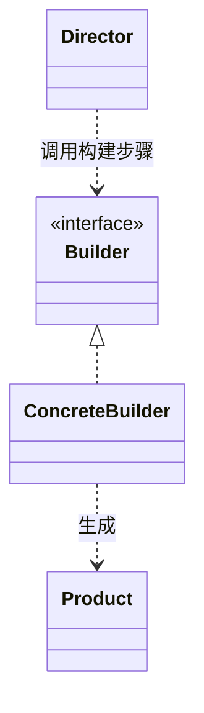

现代 C++ 中还常见一种简化形式：**流式建造者（Fluent Builder）**。它通过链式调用逐步设置属性，通常不需要单独的 Director。

例如，构建 HTTP 请求：

```cpp
#include <string>
#include <utility>
#include <vector>

struct Request {
    std::string method;
    std::string url;
    std::string body;
    std::vector<std::pair<std::string, std::string>> headers;
};

class RequestBuilder {
private:
    Request request;

public:
    RequestBuilder& method(std::string value) {
        request.method = std::move(value);
        return *this;
    }

    RequestBuilder& url(std::string value) {
        request.url = std::move(value);
        return *this;
    }

    RequestBuilder& body(std::string value) {
        request.body = std::move(value);
        return *this;
    }

    RequestBuilder& header(std::string key, std::string value) {
        request.headers.emplace_back(
            std::move(key), std::move(value)
        );
        return *this;
    }

    Request build() {
        return std::move(request);
    }
};
```

客户端可以通过链式调用构建对象：

```cpp
auto request = RequestBuilder()
    .method("POST")
    .url("/users")
    .header("Content-Type", "application/json")
    .body("{}")
    .build();
```

这里的 `RequestBuilder` 是一种常见的现代建造者变体：客户端显式调用各个构建步骤，最后调用 `build()` 获得产品，没有单独的 Director。

**优点：**

- 将复杂对象的构建过程分离。
- 支持逐步构建和可选参数。
- 提高构建代码的可读性。
- 可以通过不同建造者得到不同表示。

**缺点：**

- 需要额外定义建造者类。
- 对简单对象而言可能增加不必要的复杂度。

**适用场景：** 构造步骤较多、属性较多或存在多种构建配置的对象。

## 6.10 单例模式（Singleton）

**问题：** 某些资源或服务在整个程序中只需要一个实例，如何保证对象的唯一性，并提供统一的访问入口？

**核心思想：** 限制类的实例化过程，保证一个类只有一个实例，并提供全局访问方式。

例如，程序可以使用一个统一的日志管理器：

```cpp
#include <string>

class Logger {
public:
    static Logger& instance() {
        static Logger logger;
        return logger;
    }

    void log(const std::string& msg) {
        // 写入日志
    }

    Logger(const Logger&) = delete;
    Logger& operator=(const Logger&) = delete;

private:
    Logger() = default;
};
```

使用时：

```cpp
Logger::instance().log("Hello");
```

这里通过私有构造函数禁止外部直接创建对象，并通过静态成员函数提供唯一实例。

在 C++11 及之后的标准中，函数局部静态变量的初始化具有线程安全保证。

**优点：**

- 保证实例唯一，避免重复创建。
- 提供统一的访问入口。
- 可以集中管理共享资源。

**缺点：**

- 引入全局状态，使模块之间形成隐式依赖。
- 不利于单元测试和依赖替换。
- 实例初始化安全不代表所有成员操作都线程安全。

**适用场景：** 日志管理器、配置管理器、部分资源管理器等。

单例模式不应该被滥用。能够通过依赖注入管理生命周期的对象，不一定需要设计为单例。

## 6.11 访问者模式（Visitor，选学）

**问题：** 如何在不修改对象结构中各元素类的情况下，为这些元素增加新的操作？

**核心思想：** 将作用于对象结构的操作封装为独立的访问者，使不同访问者能够对同一对象结构执行不同操作。

例如，编译器维护一棵抽象语法树（AST）：

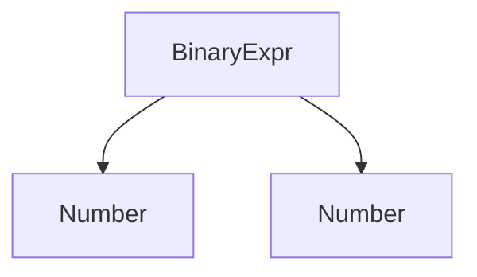

现在需要为语法树增加多种操作：

- 计算表达式的值。
- 输出表达式。
- 检查表达式是否合法。
- 生成机器代码。

如果将这些操作全部放入节点类中，随着功能增加，节点类会越来越复杂。

可以定义访问者接口：

```cpp
class Number;
class BinaryExpr;

class Visitor {
public:
    virtual void visit(Number& node) = 0;
    virtual void visit(BinaryExpr& node) = 0;
    virtual ~Visitor() = default;
};

class Element {
public:
    virtual void accept(Visitor& visitor) = 0;
    virtual ~Element() = default;
};
```

具体节点通过 `accept()` 将自身交给访问者处理：

```cpp
class Number : public Element {
public:
    void accept(Visitor& visitor) override;
};

class BinaryExpr : public Element {
public:
    void accept(Visitor& visitor) override;
};

void Number::accept(Visitor& visitor) {
    visitor.visit(*this);
}

void BinaryExpr::accept(Visitor& visitor) {
    visitor.visit(*this);
}
```

不同访问者分别实现不同操作：

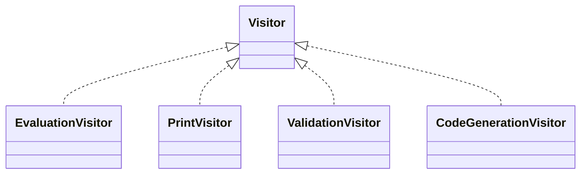

访问者模式的核心难点在于**双分派（Double Dispatch）**。

以 `element->accept(visitor)` 为例：

1. 首先根据 `element` 的实际类型，动态选择对应的 `accept()` 实现。
2. 在 `accept()` 内部，通过 `visitor.visit(*this)` 调用对应的 `visit()` 重载。
3. 由于 `visit()` 是虚函数，最终根据访问者对象的实际类型，执行具体访问者的实现。

因此，访问者模式可以同时根据元素类型和访问者类型选择具体操作，从而将操作与对象结构分离。

**优点：**

- 将操作与对象结构分离。
- 增加新的操作时，不需要修改已有元素类。
- 适合在稳定的对象结构上实现多种操作。

**缺点：**

- 增加新的元素类型时，需要修改访问者接口及其具体实现。
- 对象结构变化频繁时，维护成本较高。
- 相比其他常见模式，实现和理解都更加复杂。

**适用场景：** 编译器 AST、语法树遍历、复杂对象结构的多种操作。

访问者模式更适合对象结构相对稳定、但需要不断增加新操作的场景。

## 6.12 组合模式（Composite）

**问题：** 如何表示树形结构，使客户端能够以相同方式处理单个对象和对象组合？

**核心思想：** 将对象组织成树形结构，并让叶子节点和组合节点实现统一接口。

例如，文件系统中既有文件，也有目录。目录可以包含文件或其他目录：

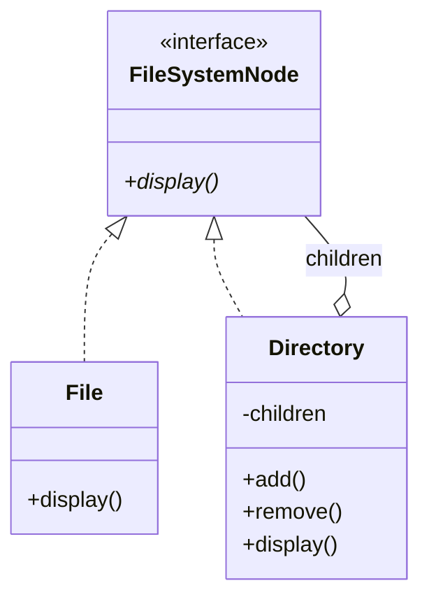

`File` 是叶子节点，`Directory` 是组合节点。客户端只需要调用统一的 `display()` 接口，就能遍历整个文件系统。

**优点：**

- 统一处理单个对象和对象组合。
- 适合递归表示树形结构。
- 增加节点类型比较方便。

**缺点：**

- 可能使叶子节点和组合节点接口过于宽泛。
- 对不同节点的特殊操作可能需要额外的类型判断。

**适用场景：** 文件系统、GUI 控件树、组织结构、表达式树。

## 6.13 迭代器模式（Iterator）

**问题：** 如何在不暴露集合内部实现的情况下，提供统一的遍历方式？

**核心思想：** 将遍历集合的逻辑封装为迭代器，使客户端不必了解集合内部的数据组织方式。

例如，链表、数组和树的内部结构不同，但可以通过统一的迭代器接口提供遍历能力。

迭代器通常提供：

- `begin()`：指向第一个元素。
- `end()`：表示遍历终点。
- `operator++()`：移动到下一个元素。
- `operator*()`：访问当前元素。

C++ STL 中的迭代器正是迭代器模式的重要体现：

```cpp
std::vector<int> values{1, 2, 3, 4};

for (auto it = values.begin(); it != values.end(); ++it) {
    std::cout << *it << '\n';
}
```

不同容器提供相应迭代器，但客户端可以使用相似的遍历方式。

**优点：**

- 将遍历逻辑与集合实现分离。
- 提供统一的访问方式。
- 可以支持不同类型的遍历策略。

**适用场景：** STL 容器、树结构遍历、自定义集合。

# 7. 容易混淆的设计模式

## 7.1 策略模式与状态模式

状态模式（State）将对象在不同状态下的行为封装为独立的状态对象。对象将具体行为委托给当前状态，并且可以随着内部状态变化切换到其他状态。

例如，订单对象可以处于待支付、已支付和已取消等状态，不同状态下允许执行的操作不同。

策略模式与状态模式都可能通过组合一个独立对象来改变上下文的行为，但二者的目的不同。

| 比较         | 策略模式           | 状态模式           |
| ------------ | ------------------ | ------------------ |
| 关注点       | 算法的替换         | 对象内部状态的变化 |
| 行为变化原因 | 客户端选择不同策略 | 对象状态发生转换   |
| 典型例子     | 不同折扣算法       | 订单状态转换       |

策略模式通常由外部选择当前使用的算法；状态模式则强调对象根据自身状态改变行为，状态之间还可能存在转换关系。

## 7.2 装饰者模式与代理模式

代理模式（Proxy）为目标对象提供一个替代访问入口，通过代理对象控制对目标对象的访问。代理对象通常与目标对象实现相同的接口。

例如：

- 虚拟代理：延迟创建开销较大的对象。
- 远程代理：封装对远程对象的访问。
- 保护代理：控制访问权限。

装饰者模式和代理模式在结构上都可能表现为一个对象包装另一个对象，但意图不同。

| 比较     | 装饰者模式       | 代理模式             |
| -------- | ---------------- | -------------------- |
| 主要目的 | 动态扩展功能     | 控制对目标对象的访问 |
| 关注点   | 增加额外行为     | 访问控制与间接访问   |
| 典型例子 | 为文件流增加缓冲 | 为远程服务提供代理   |

## 7.3 观察者模式与中介者模式

中介者模式（Mediator）通过引入一个中介对象，集中协调多个对象之间的交互，避免对象之间形成复杂的直接依赖关系。

例如，GUI 系统中多个控件的交互可以交给一个对话框控制器协调，而不需要控件之间直接相互调用。

| 比较     | 观察者模式               | 中介者模式             |
| -------- | ------------------------ | ---------------------- |
| 主要目的 | 对象变化时通知其他对象   | 协调多个对象之间的交互 |
| 通信方式 | 一对多通知               | 多个对象通过中介者通信 |
| 典型例子 | 温度变化通知多个显示设备 | GUI 控件之间的交互协调 |

## 7.4 责任链模式与命令模式

| 比较     | 责任链模式         | 命令模式           |
| -------- | ------------------ | ------------------ |
| 主要目的 | 将请求沿处理链传递 | 将请求封装为对象   |
| 关注点   | 由谁处理请求       | 如何表示和执行请求 |
| 典型例子 | HTTP 中间件        | GUI 按钮操作       |

## 7.5 工厂方法与建造者模式

| 比较     | 工厂方法               | 建造者                     |
| -------- | ---------------------- | -------------------------- |
| 主要目的 | 将对象创建交给具体工厂 | 分离复杂对象的构建过程     |
| 关注点   | 创建哪种对象           | 对象如何逐步构建           |
| 典型例子 | 创建不同通知对象       | 构建具有多个可选属性的请求 |

# 8. 现代 C++ 中的设计模式

GoF 设计模式诞生于 1994 年，其经典实现主要基于抽象类、继承和虚函数。但随着 C++ 语言的发展，现代 C++ 提供了智能指针、函数对象、泛型编程、Lambda 表达式等工具，使一些设计模式能够以更简洁的形式实现。

**设计模式描述的是设计思想，而不是固定的代码结构。** 因此，现代 C++ 中不一定需要完全照搬 GoF 的经典类图。

## 8.1 使用 std::function 实现策略

前面的策略模式通过抽象基类和派生类实现不同算法。

但如果算法只需要表示为一个可调用对象，可以使用 `std::function` 简化：

```cpp
#include <functional>

class ShoppingCart {
private:
    std::function<double(double)> strategy;

public:
    explicit ShoppingCart(
        std::function<double(double)> s
    ) : strategy(std::move(s)) {}

    void setStrategy(
        std::function<double(double)> s
    ) {
        strategy = std::move(s);
    }

    double checkout(double price) {
        return strategy(price);
    }
};
```

使用 Lambda 表达式创建策略：

```cpp
ShoppingCart cart([](double price) {
    return price;
});

cart.setStrategy([](double price) {
    return price * 0.9;
});

double result = cart.checkout(100.0);
```

这里：

- `std::function<double(double)>` 表示接收一个 `double` 参数并返回 `double` 的可调用对象。
- Lambda 表达式直接提供具体算法。
- `setStrategy()` 可以在运行时更换算法。

这仍然体现了策略模式的核心思想，但不需要为每种算法都定义一个独立的类。

`std::function` 是一种类型擦除的可调用对象包装器，适合需要在运行时保存和替换不同可调用对象的情况。

## 8.2 使用 Lambda 实现命令

命令模式的核心是将操作封装为对象。现代 C++ 中，可以直接使用 Lambda 和 `std::function<void()>` 表示命令：

```cpp
#include <functional>

class Button {
private:
    std::function<void()> command;

public:
    explicit Button(std::function<void()> cmd)
        : command(std::move(cmd)) {}

    void click() {
        if (command) {
            command();
        }
    }
};
```

使用时：

```cpp
Button saveButton([] {
    // 保存文件
});

saveButton.click();
```

Lambda 可以捕获外部对象，因此也可以通过捕获完成对接收者的调用。

需要注意捕获引用对象的生命周期，避免在被捕获对象销毁后继续执行命令。

## 8.3 使用回调实现观察者

观察者模式的核心是注册回调并在事件发生时通知它们。

现代 C++ 可以使用 `std::function` 表示观察者：

```cpp
#include <functional>
#include <vector>

class WeatherStation {
private:
    std::vector<std::function<void(double)>> observers;

public:
    void subscribe(std::function<void(double)> observer) {
        observers.push_back(std::move(observer));
    }

    void setTemperature(double value) {
        for (auto& observer : observers) {
            observer(value);
        }
    }
};
```

客户端可以直接注册 Lambda：

```cpp
WeatherStation station;

station.subscribe([](double temperature) {
    // 更新手机显示
});

station.subscribe([](double temperature) {
    // 更新显示屏
});

station.setTemperature(25.0);
```

这种实现不需要为每种观察者单独定义一个类。

不过，这个简化版本没有提供取消订阅，也没有处理回调对象的生命周期。实际工程中通常还需要订阅句柄、取消注册和并发控制。

## 8.4 使用模板和 Concepts 实现策略

C++ 泛型编程还可以将策略作为模板参数，在编译期确定具体实现。

C++20 引入了 Concepts，可以约束模板参数必须满足某种接口要求：

```cpp
#include <concepts>

template<class Strategy>
concept DiscountPolicy = requires(
    const Strategy& strategy,
    double price
) {
    { strategy.calculate(price) } -> std::convertible_to<double>;
};

template<DiscountPolicy Strategy>
double checkout(double price, const Strategy& strategy) {
    return strategy.calculate(price);
}
```

具体策略：

```cpp
struct NormalDiscount {
    double calculate(double price) const {
        return price;
    }
};

struct VipDiscount {
    double calculate(double price) const {
        return price * 0.9;
    }
};
```

使用时：

```cpp
NormalDiscount normal;
VipDiscount vip;

checkout(100.0, normal);
checkout(100.0, vip);
```

这种方式不需要虚函数，编译器可以根据具体模板参数生成对应实现。

与前面的 `std::function` 相比：

| 方式            | 多态发生时间 | 主要特点                               |
| --------------- | ------------ | -------------------------------------- |
| 虚函数          | 运行时       | 通过基类接口进行动态分派               |
| `std::function` | 运行时       | 保存不同类型的可调用对象               |
| 模板与 Concepts | 编译期       | 泛型约束、静态分派，通常有利于内联优化 |

选择哪种方式取决于需求：需要运行时替换时，可以考虑虚函数或 `std::function`；能够在编译期确定类型时，可以考虑模板。

## 8.5 现代 C++ 与常见设计模式的对应

| C++ 机制                            | 相关设计模式             | 说明                         |
| ----------------------------------- | ------------------------ | ---------------------------- |
| 虚函数与抽象类                      | 策略、工厂方法、观察者等 | 经典运行时多态               |
| `std::function`                     | 策略、命令、观察者       | 将行为包装为可调用对象       |
| Lambda 表达式                       | 策略、命令、观察者       | 简洁地表示具体行为或回调     |
| `std::unique_ptr`                   | 组合、装饰者、策略       | 明确表达独占所有权           |
| `std::shared_ptr` / `std::weak_ptr` | 部分共享对象结构         | 管理共享所有权及弱引用       |
| 模板与 Concepts                     | 策略等                   | 通过编译期多态实现行为替换   |
| `std::variant` 与 `std::visit`      | 访问者思想               | 对封闭的类型集合进行类型分派 |

`std::variant` 与 `std::visit` 并不是 GoF 访问者模式的完全等价实现，但可以实现相似的按类型执行不同操作的功能。

现代 C++ 的价值不在于消灭设计模式，而在于提供更合适的语言机制，使设计可以更加简洁、类型安全。

# 9. 在实际开发中识别设计模式

设计模式并不只存在于教材或人为设计的类图中。标准库、图形界面框架和应用程序中都存在大量设计模式的实际应用。

## 9.1 STL 迭代器与迭代器模式

STL 容器通过 `begin()` 和 `end()` 提供统一的迭代器接口：

```cpp
std::vector<int> values{1, 2, 3, 4};

for (auto it = values.begin(); it != values.end(); ++it) {
    std::cout << *it << '\n';
}
```

无论底层使用数组、链表还是其他结构，客户端都可以使用统一的遍历方式。这正是迭代器模式的核心思想：将集合的遍历方式与集合内部实现分离。

C++20 ranges 在此基础上进一步提供了范围抽象和惰性视图，使迭代和数据处理可以更加灵活地组合。

## 9.2 std::sort 的比较器与策略模式

`std::sort` 允许客户端传入不同的比较器：

```cpp
std::vector<int> values{3, 1, 4, 2};

std::sort(values.begin(), values.end());

std::sort(
    values.begin(),
    values.end(),
    std::greater<int>{}
);
```

第二次调用通过不同的比较器改变排序规则。

比较器在这里承担了策略对象的作用：排序算法保持不变，而具体比较行为可以替换。

## 9.3 Qt 信号与槽机制

Qt 的信号与槽机制是一种事件通信机制。

对象可以发射信号，其他对象可以连接相应的槽函数：

```cpp
connect(
    button,
    &QPushButton::clicked,
    this,
    &MainWindow::handleButtonClicked
);
```

当按钮发出 `clicked` 信号时，连接的槽函数会被调用。

它体现了观察者模式的一对多通知思想，但 Qt 的信号槽机制还提供了跨线程队列连接、连接管理等额外能力，不能简单等同于 GoF 观察者模式的某一种实现。

## 9.4 其他常见实例

| 实际组件或场景     | 相关设计模式           | 原因                             |
| ------------------ | ---------------------- | -------------------------------- |
| STL 迭代器         | 迭代器模式             | 统一遍历不同容器                 |
| `std::sort` 比较器 | 策略模式               | 替换不同的比较算法               |
| Qt 信号与槽        | 观察者模式             | 事件发生时通知连接对象           |
| C++ IO 流包装      | 装饰者模式思想         | 为数据流增加缓冲、格式化等功能   |
| HTTP 中间件        | 责任链模式的管道式变体 | 多个处理器依次处理请求           |
| GUI 菜单和撤销操作 | 命令模式               | 将用户操作封装为命令             |
| 数据库驱动接口     | 工厂与适配器模式       | 创建驱动对象、适配不同数据库接口 |

这些例子有助于把抽象的设计模式与实际代码联系起来。需要注意，同一个组件可能综合使用多种设计模式，不必强行将其归结为唯一的一种。

# 10. 什么时候应该使用设计模式？

理解设计模式的另一个重要问题是避免过度设计。

设计模式本身会引入额外的抽象、接口和对象，因此不应该为了使用模式而使用模式。

## 10.1 从简单实现开始

假设当前系统只有一种支付方式：

```cpp
void pay(double price) {
    // 使用固定的支付方式
}
```

这时引入 `PaymentStrategy`、`PaymentFactory`、`PaymentManager` 等一系列类，并没有明显收益，只会增加代码复杂度。

如果以后逐渐出现不同支付方式，而且算法需要独立变化，再考虑引入策略模式。

一种实用的经验是：

**先写最简单的实现；当同一类变化再次出现时，重新评估是否需要抽象，并在确实存在扩展需求时引入设计模式。**

这是一种帮助避免过度设计的重构启发式，而不是要求所有代码必须等到第二次重复才允许抽象。对于已经明确的外部接口或稳定架构边界，可以提前建立抽象。

## 10.2 设计模式的成本与收益

引入设计模式通常需要付出以下成本：

- 增加类和接口的数量。
- 增加对象之间的调用层次。
- 提高代码阅读和理解成本。
- 增加对象生命周期和状态管理的复杂度。

因此，需要比较模式带来的收益与额外复杂度：

| 关注点   | 需要考虑的问题                           |
| -------- | ---------------------------------------- |
| 变化频率 | 这部分代码是否经常变化？                 |
| 变化范围 | 修改它是否会影响多个模块？               |
| 扩展需求 | 是否确实存在多种实现或可预见的扩展需求？ |
| 测试需求 | 是否需要隔离外部依赖进行测试？           |
| 实现成本 | 引入模式是否比直接实现更清晰？           |

设计模式最重要的价值不是增加抽象层次，而是**将变化隔离在合适的位置，使系统更容易理解和维护。**

# 11. 设计原则与设计模式的联系

设计模式通常是一个或多个设计原则在特定场景下的具体应用，但二者之间不存在严格的一一对应关系。

| 设计模式     | 相关设计原则                         | 设计体现                                       |
| ------------ | ------------------------------------ | ---------------------------------------------- |
| 策略模式     | 开闭原则、依赖倒置原则、组合优于继承 | 将算法抽象为接口，通过组合替换具体算法         |
| 模板方法模式 | 单一职责原则、里氏替换原则           | 将固定流程与可变步骤分离                       |
| 工厂方法模式 | 开闭原则、依赖倒置原则               | 客户端依赖产品抽象，具体创建过程由工厂子类实现 |
| 观察者模式   | 单一职责原则、开闭原则               | 将状态维护和通知机制分离                       |
| 装饰者模式   | 开闭原则、组合优于继承               | 通过包装对象动态扩展功能                       |
| 适配器模式   | 依赖倒置原则、接口隔离原则           | 将不兼容接口转换为客户端需要的接口             |
| 责任链模式   | 单一职责原则、开闭原则               | 将请求处理职责分散到独立处理器                 |
| 命令模式     | 单一职责原则、依赖倒置原则           | 将请求封装为独立对象                           |
| 访问者模式   | 开闭原则                             | 将操作从对象结构中分离                         |

可以通过几个典型例子理解原则如何落地为模式：

- **策略模式**：通过依赖抽象和对象组合，将算法变化独立出来。
- **工厂方法模式**：通过抽象工厂接口，降低客户端对具体产品创建方式的依赖。
- **观察者模式**：将状态维护与通知机制分离，使一个对象的变化能够影响多个对象。
- **装饰者模式**：通过包装对象动态扩展功能，避免继承层次膨胀。
- **责任链模式**：将请求处理职责分散到多个处理器，避免请求发送者依赖具体处理逻辑。

因此，设计原则和设计模式之间的关系可以理解为：

**设计原则提供判断标准，设计模式提供常见解决方案，具体实现则利用语言机制将这些方案落地。**

# 12. 进一步学习

掌握 GoF 设计模式后，可以继续从两个方向深入。

## 12.1 软件架构与依赖倒置

依赖倒置原则不仅适用于类之间的关系，还可以应用在整个系统的架构设计中。

例如，端口-适配器架构（Ports and Adapters Architecture），又称六边形架构（Hexagonal Architecture），将业务核心与数据库、网络、文件系统等外部技术细节隔离。

业务核心定义抽象接口（端口），外部组件通过适配器实现这些接口。

```mermaid
flowchart TD
    U[外部用户] -->|调用| IA[输入适配器]
    IA -->|调用| D[业务核心 Domain]
    D -->|调用| P[抽象端口]
    DBA[数据库适配器] -.->|实现| P
    NA[网络适配器] -.->|实现| P
    FSA[文件系统适配器] -.->|实现| P
```

图中实线为运行时调用方向，虚线为依赖方向。端口由业务核心定义；运行时核心通过端口调用外部功能，但依赖关系恰好相反——是适配器实现并依赖端口，核心不依赖任何具体适配器。

这正是依赖倒置原则在系统架构层面的应用：**调用方向与依赖方向相反**，业务核心不依赖具体技术实现，而是通过抽象与外部系统交互。

## 12.2 现代 C++ 与软件设计

继续学习现代 C++，可以重点关注：

- 智能指针与 RAII：对象所有权和生命周期管理。
- Lambda 与函数对象：将行为作为参数传递。
- 泛型编程与 Concepts：编译期抽象与约束。
- `std::function`：运行时可调用对象包装。
- `std::variant` 与 `std::visit`：类型安全的封闭集合分派。
- STL 算法与迭代器：泛型算法和行为策略。

这些语言机制并不会取代设计原则和设计模式，而是让它们能够以更加自然、简洁和类型安全的方式实现。

# 13. 总结与学习建议

面向对象设计原则和设计模式共同解决软件模块如何组织、对象如何协作以及系统如何适应需求变化的问题。

可以将整个知识体系归纳为三个层次：

1. **设计原则**：规定软件设计应该遵循的基本思想，例如高内聚、低耦合、开闭原则和依赖倒置原则。
2. **设计模式**：针对常见设计问题提供可复用的结构，例如策略模式、工厂方法模式、观察者模式和责任链模式。
3. **具体实现**：利用接口、抽象类、继承、组合、多态、函数对象和依赖注入等语言机制实现设计模式。

初学时不建议直接记忆所有 23 种模式，而应该按照以下顺序学习：

| 阶段     | 学习内容                                 | 目标                         |
| -------- | ---------------------------------------- | ---------------------------- |
| 入门前置 | 面向对象、UML 类图、继承与组合           | 看懂设计结构                 |
| 基本原则 | SOLID、组合优于继承、迪米特法则          | 理解良好设计的判断标准       |
| 核心模式 | 策略、模板方法、工厂方法、观察者、装饰者 | 理解常见设计问题及其解决方案 |
| 扩展模式 | 责任链、适配器、命令、建造者、单例       | 掌握其他常见对象协作方式     |
| 进阶模式 | 访问者、组合、迭代器及其余 GoF 模式      | 理解复杂对象结构和行为组织   |
| 工程应用 | STL、Qt、现代 C++、软件架构              | 将设计模式应用于实际开发     |

**最终需要建立的认识：设计模式不是为了让代码看起来更复杂，也不是每个类都必须套用某种模式。** 当简单的函数、接口或对象组合已经能够清晰地解决问题时，就没有必要引入额外的设计模式。只有在确实存在相应的设计问题时，才应当使用对应的模式。

学习设计模式的最终目标不是记住 23 张类图，而是面对不断变化的软件需求时，能够识别变化、合理划分职责、控制依赖，并选择成本合适的实现方案。
